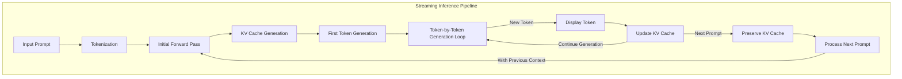
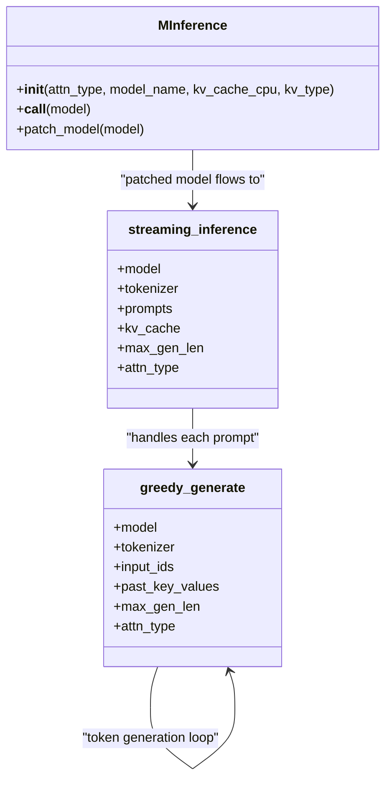
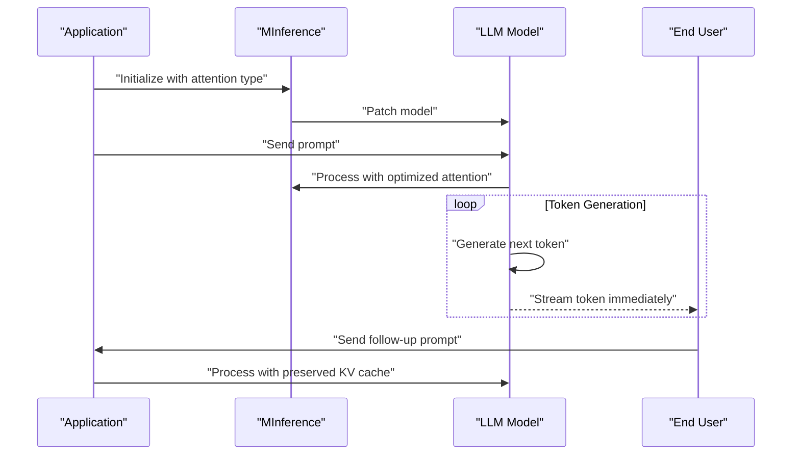

<!-- source: DeepWiki mcp.deepwiki.com · repo microsoft/MInference · page 6.1 Streaming Inference · fetched 2026-10-26 -->

# Streaming Inference

<details>
<summary>Relevant source files</summary>

The following files were used as context for generating this wiki page:

- [examples/run_hf.py](examples/run_hf.py)
- [examples/run_hf_streaming.py](examples/run_hf_streaming.py)
- [tests/test_e2e.py](tests/test_e2e.py)

</details>


## Purpose and Scope

This document explains how to use MInference for streaming inference, where generated tokens are displayed to the user as they are produced rather than waiting for the entire response to complete. This approach significantly improves perceived latency for end users, especially in long-context scenarios. The document covers implementation details, configuration options, and practical examples of streaming inference with MInference.

For information about integrating MInference with other frameworks, see [Integration with Other Frameworks](#6.2).

## Introduction to Streaming Inference

Streaming inference refers to the process of generating and returning model outputs incrementally, one token at a time, rather than waiting for the entire sequence to be generated. In MInference, this approach is particularly valuable for:

1. Improving user experience by showing initial responses quickly
2. Enabling real-time, interactive applications like chatbots
3. Efficiently handling multi-turn conversations where context preservation is important
4. Reducing perceived latency when working with large language models on long contexts

MInference implements streaming inference with efficient KV cache management between prompts, allowing for continuous generation across multiple turns while maintaining context.

Sources: [examples/run_hf_streaming.py:69-96]()

## Streaming Inference Architecture



The streaming inference implementation in MInference follows these steps:

1. Process the input prompt through the model's forward pass
2. Measure and report Time To First Token (TTFT)
3. Generate tokens sequentially while displaying them as they become available
4. Preserve the KV cache between different prompts/turns of a conversation
5. Use the preserved cache to maintain context across multiple interactions

This architecture enables both efficient processing and a responsive user experience.

Sources: [examples/run_hf_streaming.py:17-66](), [examples/run_hf_streaming.py:69-96]()

## Implementation Details



The streaming inference implementation in MInference is composed of two main components:

1. **MInference Configuration**: The `MInference` class patches the model with the specified attention type and KV cache configuration.

2. **Generation Functions**: 
   - `streaming_inference`: Handles multiple prompts, preserving KV cache between them
   - `greedy_generate`: Implements token-by-token generation with real-time display

### Key Implementation Functions

The primary implementation of streaming inference is found in the `greedy_generate` function which:

1. Makes an initial forward pass through the model with the input sequence
2. Measures and reports the Time To First Token (TTFT)
3. Extracts the generated token and its associated updated KV cache
4. Enters a loop to generate additional tokens one by one
5. Displays tokens in a streaming fashion as they are generated
6. Preserves and returns the KV cache for potential use in subsequent prompts

Sources: [examples/run_hf_streaming.py:17-66]()

## Configuration Options

MInference supports various attention and KV cache types for streaming inference:

| Attention Type | Description |
|----------------|-------------|
| `hf` | Standard Hugging Face attention implementation |
| `a_shape` | A-Shape attention pattern for efficient processing |
| `tri_shape` | Tri-Shape attention pattern |
| `minference` | MInference's dynamic sparse attention |
| `inf_llm` | Inference optimized for LLM |
| `dense` | Dense attention (full attention matrix) |
| `flexprefill` | Flexible prefill implementation |

| KV Cache Type | Description |
|---------------|-------------|
| `dense` | Standard dense KV cache |
| `snapkv` | SnapKV compression for memory efficiency |
| `pyramidkv` | Pyramid compression scheme |
| `quest` | Quest attention implementation |
| `streamingllm` | StreamingLLM implementation |
| `retr_attn` | Retrieval augmented attention |
| `kivi` | KIVI quantization implementation |

These options can be configured when initializing the `MInference` instance to optimize for specific use cases.

Sources: [examples/run_hf_streaming.py:144-154](), [tests/test_e2e.py:11-20]()

## Usage Example

### Basic Streaming Inference

The following diagram illustrates how to set up and run streaming inference with MInference:



To implement streaming inference with MInference:

1. Initialize the model and tokenizer from Hugging Face
2. Patch the model with MInference using your chosen attention type
3. Call the streaming_inference function with your prompts

Example code structure:

```python
# Load model and tokenizer
tokenizer = AutoTokenizer.from_pretrained(model_name)
model = AutoModelForCausalLM.from_pretrained(
    model_name,
    torch_dtype="auto",
    device_map="cuda",
    _attn_implementation="flash_attention_2",
)

# Patch with MInference
minference_patch = MInference(
    attn_type="minference",  # Choose from available types
    model_name=model_name,
    kv_cache_cpu=True,  # Store KV cache on CPU for larger contexts
)
model = minference_patch(model)

# Run streaming inference
streaming_inference(
    model,
    tokenizer,
    prompts,  # List of prompts to process sequentially
    kv_cache=None,  # Will be built and preserved during generation
    attn_type="minference",
)
```

Sources: [examples/run_hf_streaming.py:98-131]()

## Performance Considerations

### Time To First Token (TTFT)

MInference measures and reports the Time To First Token (TTFT) during streaming inference, which is a critical metric for user experience. Different attention mechanisms can significantly impact TTFT:

- Dense attention may have higher TTFT for long contexts
- MInference's sparse attention patterns can reduce TTFT for long sequences
- A-Shape and Tri-Shape patterns offer different TTFT/performance trade-offs

### Memory Management

When working with long contexts, memory management is crucial. The streaming inference implementation includes options for efficient memory usage:

- KV cache can be stored on CPU with `kv_cache_cpu=True`
- Different KV cache types (e.g., SnapKV, PyramidKV) provide memory optimization
- The preservation of KV cache between prompts allows for efficient multi-turn processing

### Scaling to Long Contexts

The streaming inference implementation has been tested with contexts up to 100,000 tokens, making it suitable for very long document processing.

Sources: [examples/run_hf_streaming.py:109-113](), [tests/test_e2e.py:85-86]()

## Practical Applications

Streaming inference with MInference is particularly useful for:

1. **Chat Applications**: Providing real-time responses in conversational AI
2. **Document Processing**: Summarizing or analyzing very long documents
3. **Multi-Turn Interactions**: Maintaining context across multiple user interactions
4. **High-Latency Environments**: Improving perceived responsiveness when generation is slow

By combining MInference's efficient attention mechanisms with streaming token generation, applications can provide a more responsive user experience even when working with very large context windows.

Sources: [examples/run_hf_streaming.py:116-121]()

---

