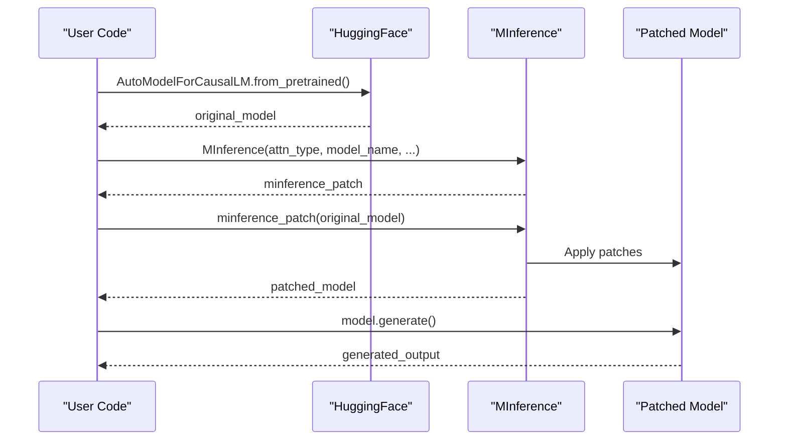
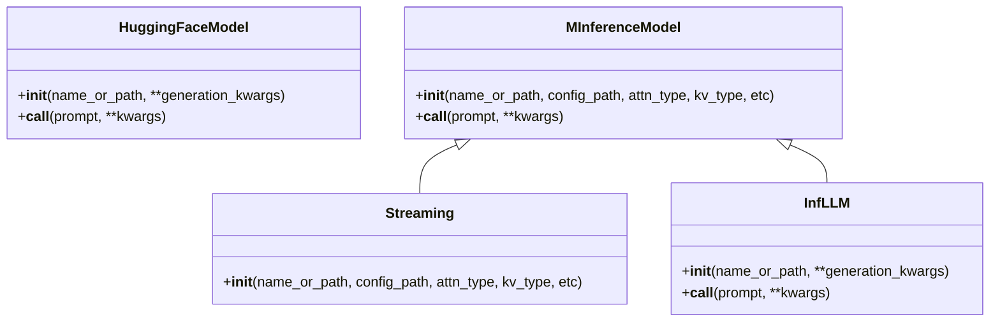
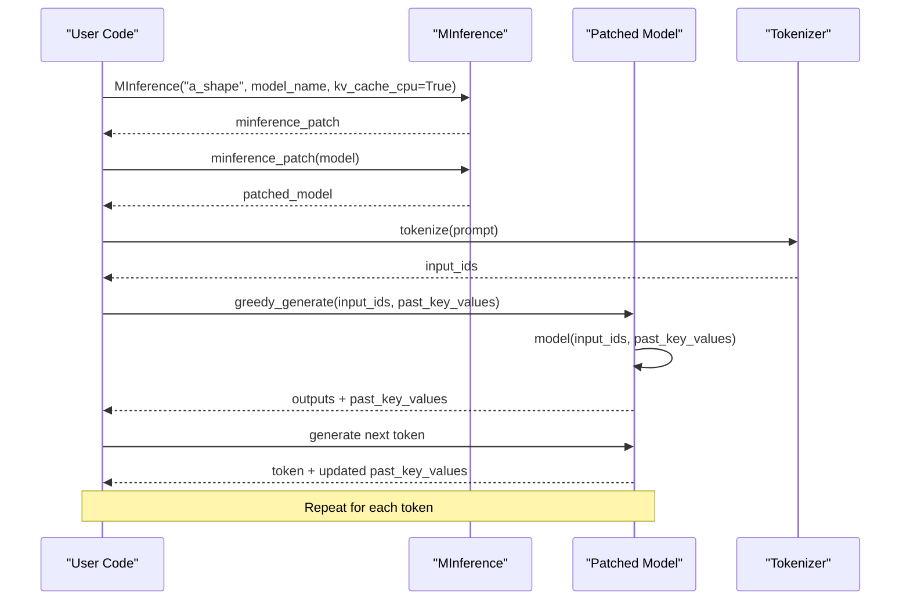
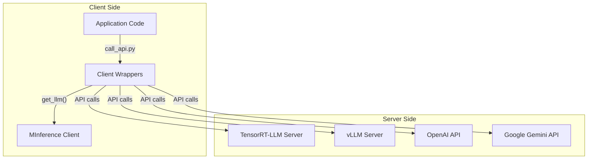
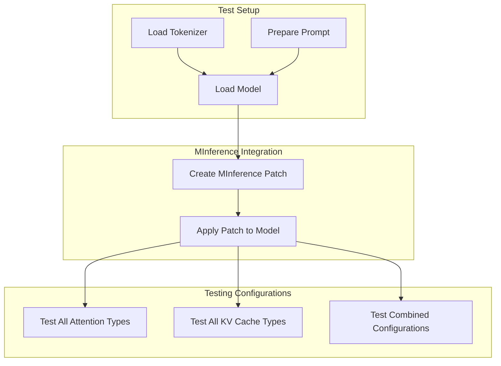

<!-- source: DeepWiki mcp.deepwiki.com · repo microsoft/MInference · page 6.2 Integration with Other Frameworks · fetched 2026-10-26 -->

# Integration with Other Frameworks

<details>
<summary>Relevant source files</summary>

The following files were used as context for generating this wiki page:

- [examples/run_hf.py](examples/run_hf.py)
- [examples/run_hf_streaming.py](examples/run_hf_streaming.py)
- [experiments/ruler/pred/call_api.py](experiments/ruler/pred/call_api.py)
- [experiments/ruler/pred/model_wrappers.py](experiments/ruler/pred/model_wrappers.py)
- [tests/test_e2e.py](tests/test_e2e.py)

</details>


This document describes how to integrate MInference with other popular LLM frameworks such as HuggingFace Transformers and vLLM. MInference provides a patching system that can be applied to models from these frameworks to enable sparse attention mechanisms and KV cache optimizations. For information about streaming inference specifically, see [Streaming Inference](#6.1).

## Overview of Integration Architecture

MInference is designed to work with existing model frameworks through a patching mechanism that modifies the model's attention modules to use MInference's optimized implementations. The following diagram illustrates the high-level integration architecture:

```mermaid
graph TD
    subgraph "External Frameworks"
        HF["HuggingFace Transformers"]
        VLLM["vLLM"]
    end
    
    subgraph "MInference System"
        Patch["Patching System"]
        Config["MInferenceConfig"]
        
        subgraph "Attention Types"
            Dense["dense"]
            MinAttn["minference"]
            AShape["a_shape"]
            TriShape["tri_shape"]
            FlexPrefill["flexprefill"]
        end
        
        subgraph "KV Cache Types"
            DenseKV["dense"]
            SnapKV["snapkv"]
            PyramidKV["pyramidkv"]
            KIVI["kivi"]
            Quest["quest"]
            RetrAttn["retr_attn"]
            StreamingLLM["streamingllm"]
        end
    end
    
    HF -->|"patch_model()"| Patch
    VLLM -->|"patch_model()"| Patch
    
    Patch -->|configures| Config
    Config -->|selects| Attention Types
    Config -->|selects| KV Cache Types
    
    Patch -->|returns| PatchedModel["Patched Model"]
```

Sources: [minference/__init__.py](), [tests/test_e2e.py:11-20]()

## Integrating with HuggingFace Transformers

### Basic Integration

The simplest way to integrate MInference with a HuggingFace model is to use the `MInference` class to patch an existing model. The following code demonstrates this basic integration:



Sources: [examples/run_hf.py:10-23]()

The basic integration steps are:

1. Load the model using HuggingFace's `AutoModelForCausalLM.from_pretrained()`
2. Create a `MInference` patch instance with desired configuration
3. Apply the patch to the model
4. Use the patched model for inference

Here's a simple example:

```python
# Import required libraries
from transformers import AutoModelForCausalLM, AutoTokenizer
from minference import MInference

# Load model and tokenizer
model_name = "gradientai/Llama-3-8B-Instruct-262k"
tokenizer = AutoTokenizer.from_pretrained(model_name)
model = AutoModelForCausalLM.from_pretrained(
    model_name,
    torch_dtype="auto",
    device_map="cuda",
    _attn_implementation="flash_attention_2",
)

# Create and apply the MInference patch
minference_patch = MInference(
    attn_type="minference", model_name=model_name, kv_type="dense"
)
model = minference_patch(model)

# Generate text with the patched model
batch_inputs = tokenizer(prompt, return_tensors="pt").to("cuda")
outputs = model.generate(**batch_inputs, max_length=10)
```

Sources: [examples/run_hf.py:4-30]()

### Configuration Options

When integrating MInference with HuggingFace models, you can configure various aspects of the sparse attention and KV cache optimizations:

#### Attention Types

MInference supports multiple attention mechanisms:

| Attention Type | Description |
|----------------|-------------|
| `dense` | Standard dense attention (baseline) |
| `minference` | MInference's vertical/slash sparse attention |
| `a_shape` | A-shape attention pattern |
| `tri_shape` | Tri-shape attention pattern |
| `flexprefill` | Flexible prefill attention |
| `inf_llm` | Infinity LLM-specific attention |

Sources: [tests/test_e2e.py:11-12](), [examples/run_hf_streaming.py:146-155]()

#### KV Cache Types

MInference supports various KV cache implementations:

| KV Cache Type | Description |
|---------------|-------------|
| `dense` | Standard dense KV cache |
| `snapkv` | SnapKV compression |
| `pyramidkv` | Pyramid compression |
| `kivi` | KIVI quantization |
| `quest` | Quest attention |
| `retr_attn` | Retrieval attention |
| `streamingllm` | StreamingLLM compression |

Sources: [tests/test_e2e.py:12-20]()

## Model Wrapper Classes

MInference provides several wrapper classes that simplify integration with different frameworks:



Sources: [experiments/ruler/pred/model_wrappers.py:12-271]()

### HuggingFaceModel

The `HuggingFaceModel` wrapper provides a simple interface for using HuggingFace models without MInference optimizations. It's useful as a baseline for comparison.

Example usage:

```python
from experiments.ruler.pred.model_wrappers import HuggingFaceModel

model = HuggingFaceModel(
    name_or_path="gradientai/Llama-3-8B-Instruct-262k",
    do_sample=True,
    temperature=0.7,
    top_k=40,
    top_p=0.9,
    stop=["Human:", "\n\n"],
    max_new_tokens=100,
)

response = model("What is the capital of France?")
```

Sources: [experiments/ruler/pred/model_wrappers.py:12-70]()

### MInferenceModel

The `MInferenceModel` wrapper integrates MInference with HuggingFace models, providing a simple interface for using MInference's optimizations.

Example usage:

```python
from experiments.ruler.pred.model_wrappers import MInferenceModel

model = MInferenceModel(
    name_or_path="gradientai/Llama-3-8B-Instruct-262k",
    config_path="configs/minference_config.json",
    do_sample=True,
    temperature=0.7,
    top_k=40,
    top_p=0.9,
    stop=["Human:", "\n\n"],
    max_new_tokens=100,
    attn_type="minference",
    kv_type="snapkv",
    starting_layer=0,
)

response = model("What is the capital of France?")
```

Sources: [experiments/ruler/pred/model_wrappers.py:73-158]()

### Streaming

The `Streaming` wrapper extends `MInferenceModel` to provide streaming inference capabilities with MInference's optimizations. It's particularly useful for long-context applications.

Example usage:

```python
from experiments.ruler.pred.model_wrappers import Streaming

model = Streaming(
    name_or_path="gradientai/Llama-3-8B-Instruct-262k",
    config_path="configs/minference_config.json",
    do_sample=True,
    temperature=0.7,
    top_k=40,
    top_p=0.9,
    stop=["Human:", "\n\n"],
    max_new_tokens=100,
    attn_type="a_shape",
    kv_type="snapkv",
)

response = model("Summarize the following document: [long document text]")
```

Sources: [experiments/ruler/pred/model_wrappers.py:205-271]()

## Streaming Inference with HuggingFace

MInference provides special support for streaming inference with HuggingFace models, which is particularly useful for long-context processing. The following diagram illustrates the streaming inference workflow:



Sources: [examples/run_hf_streaming.py:18-66]()

Example code for streaming inference:

```python
import torch
from transformers import AutoModelForCausalLM, AutoTokenizer
from minference import MInference

# Load model and tokenizer
model_name = "gradientai/Llama-3-8B-Instruct-Gradient-1048k"
tokenizer = AutoTokenizer.from_pretrained(model_name)
model = AutoModelForCausalLM.from_pretrained(
    model_name,
    torch_dtype="auto",
    device_map="cuda",
    _attn_implementation="flash_attention_2",
)

# Patch with MInference for streaming
minference_patch = MInference(
    "a_shape",
    model_name,
    kv_cache_cpu=True,
)
model = minference_patch(model)

# Define your prompts
prompts = ["Summarize the following book: [book text]"]

# Use streaming inference
streaming_inference(model, tokenizer, prompts)
```

Sources: [examples/run_hf_streaming.py:99-131]()

## Integration with Server-Based Frameworks

MInference can also be integrated with server-based frameworks through client wrappers that interact with model servers:



Sources: [experiments/ruler/pred/call_api.py:37-47](), [experiments/ruler/pred/call_api.py:126-257]()

### Integrating with vLLM

Although direct vLLM integration is mentioned in the system overview, the provided code files don't show explicit vLLM integration examples. However, there is a client wrapper for vLLM in `call_api.py`:

```python
from client_wrappers import VLLMClient

llm = VLLMClient(
    server_host=args.server_host,
    server_port=args.server_port,
    ssh_server=args.ssh_server,
    ssh_key_path=args.ssh_key_path,
    temperature=args.temperature,
    top_k=args.top_k,
    top_p=args.top_p,
    random_seed=args.random_seed,
    stop=args.stop_words,
    tokens_to_generate=tokens_to_generate,
)
```

Sources: [experiments/ruler/pred/call_api.py:144-158]()

## End-to-End Testing

MInference provides an end-to-end testing framework that can be used to verify integration with different frameworks and configurations:



Sources: [tests/test_e2e.py:23-110]()

Example testing code:

```python
def test_all_attn_types(self):
    attn_kwargs = {}
    for attn_type in ATTN_TYPES:
        for kv_type in ["dense"]:
            with self.subTest(attn_type=attn_type, kv_type=kv_type):
                self.forward(attn_type, kv_type, attn_kwargs)
```

This test iterates through all attention types and tests them with the dense KV cache.

Sources: [tests/test_e2e.py:105-110]()

## Best Practices for Integration

When integrating MInference with other frameworks, consider the following best practices:

1. **Use Flash Attention 2**: When loading HuggingFace models, specify `_attn_implementation="flash_attention_2"` for optimal performance.

2. **Configure KV Cache Location**: For long contexts, use `kv_cache_cpu=True` to store the KV cache in CPU memory.

3. **Select Appropriate Attention Types**:
   - For general use: `minference`
   - For streaming: `a_shape` or `tri_shape`
   - For maximum optimization: test different combinations with your specific workload

4. **Experiment with KV Cache Types**:
   - For memory efficiency: `snapkv` or `pyramidkv`
   - For quantization: `kivi`
   - For retrieval-based approaches: `retr_attn`

5. **Consider Starting Layer**: Use the `starting_layer` parameter to apply MInference optimizations only to specific layers.

Sources: [experiments/ruler/pred/model_wrappers.py:73-158](), [examples/run_hf_streaming.py:109-114]()

---

