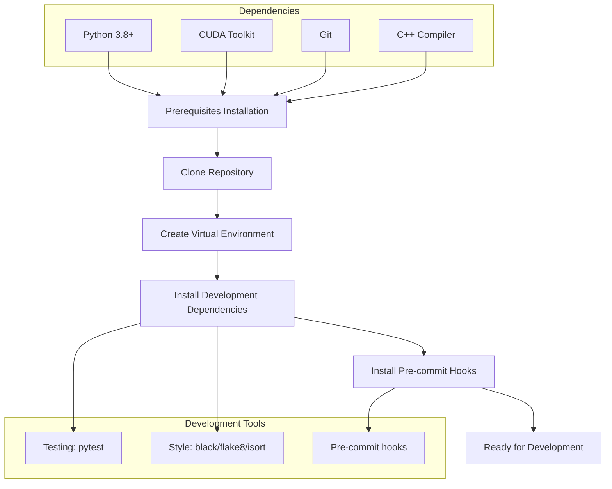
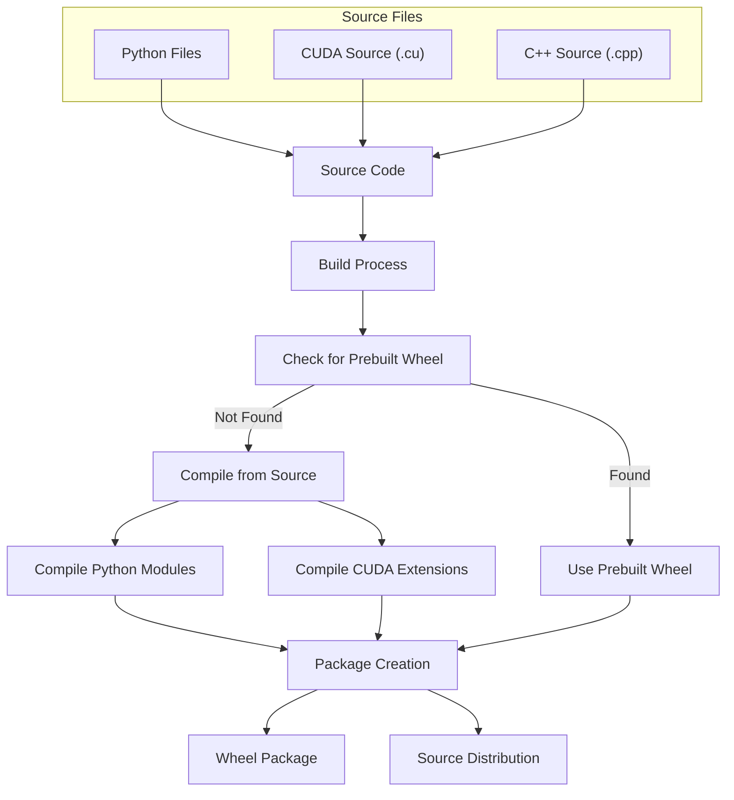
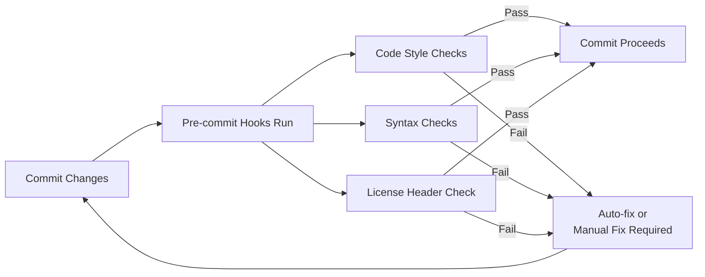
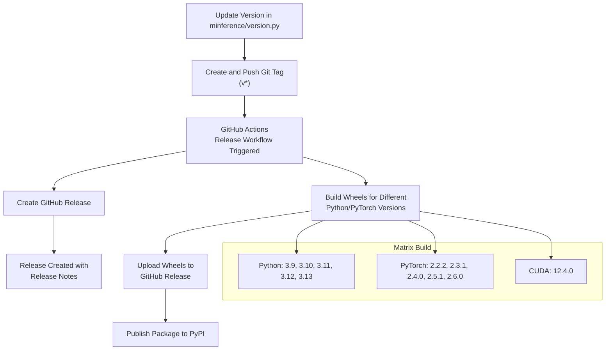
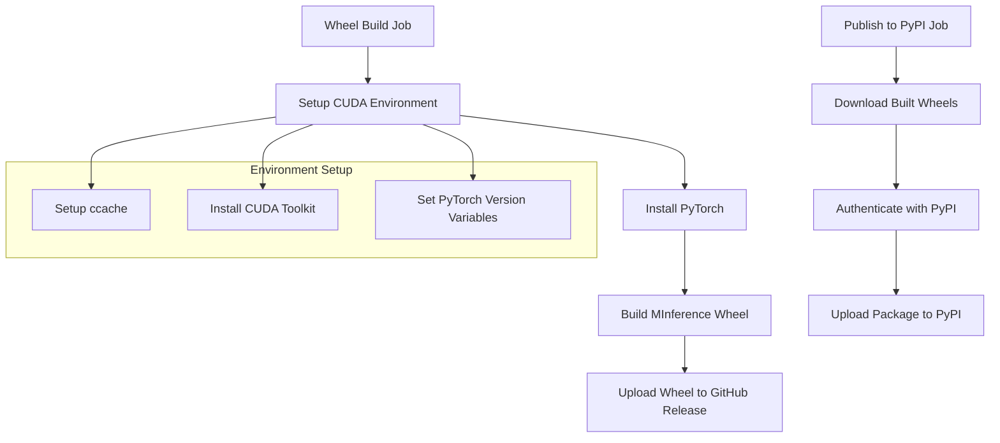

<!-- source: DeepWiki mcp.deepwiki.com · repo microsoft/MInference · page 7 Contributing and Development · fetched 2026-10-26 -->

# Contributing and Development

<details>
<summary>Relevant source files</summary>

The following files were used as context for generating this wiki page:

- [.github/workflows/release.yml](.github/workflows/release.yml)
- [.github/workflows/scripts/pytorch-install.sh](.github/workflows/scripts/pytorch-install.sh)
- [.pre-commit-config.yaml](.pre-commit-config.yaml)
- [MANIFEST.in](MANIFEST.in)
- [minference/modules/flexprefill.py](minference/modules/flexprefill.py)
- [setup.py](setup.py)

</details>


This document provides comprehensive information for developers who want to contribute to MInference. It covers the development setup process, code quality guidelines, and the release workflow. For information about usage examples and integration with other frameworks, see [Usage Examples](#6).

## Development Environment Setup

Setting up your development environment is the first step to contributing to MInference. The project requires specific dependencies and development tools to ensure code quality and compatibility.

### Prerequisites

Before you begin, ensure you have the following installed:

- Python 3.8+
- CUDA Toolkit (for GPU development)
- Git
- C++ compiler (GCC or Clang)

### Development Installation

```bash
# Clone the repository
git clone https://github.com/microsoft/MInference.git
cd MInference

# Create a virtual environment (recommended)
python -m venv venv
source venv/bin/activate  # On Windows: venv\Scripts\activate

# Install development dependencies
pip install -e ".[dev]"
```

The `[dev]` option installs additional packages needed for development, including testing and code quality tools.



Sources: [setup.py:249-257](), [.pre-commit-config.yaml:1-34]()

## Building from Source

MInference includes both Python code and C++/CUDA extensions. Building from source requires compiling these extensions.

### Building CUDA Extensions

The project uses PyTorch's extension mechanism to compile CUDA kernels. The build process is managed through `setup.py`:

```bash
# Build only the CUDA extensions
python setup.py build_ext --inplace
```

### Complete Build Process

For a complete build including package creation:

```bash
# Build the package
python setup.py build

# Build wheel package
python setup.py bdist_wheel
```

The build process automatically manages the CUDA extension compilation and can use a cached wheel if available unless `MINFERENCE_FORCE_BUILD=TRUE` is set.



Sources: [setup.py:81-110](), [setup.py:162-196](), [MANIFEST.in:1-5]()

## Code Quality and Standards

MInference maintains high code quality standards through automated tools and pre-commit hooks.

### Pre-commit Hooks

Pre-commit hooks automatically run before each commit to ensure code quality. To set up pre-commit hooks:

```bash
pre-commit install
```

The pre-commit configuration includes:

- Code formatting with `black`
- Import sorting with `isort`
- Linting with `flake8`
- License header checks
- Various file checks (trailing whitespace, merge conflicts, etc.)

### Coding Standards

- Python code should follow PEP 8 style guidelines
- All new code should include appropriate tests
- Documentation should be clear and follow existing patterns
- CUDA/C++ code should follow the project's C++ style



Sources: [.pre-commit-config.yaml:10-57]()

## Contributing Workflow

The following workflow is recommended for contributing to MInference:

1. **Fork and Clone**: Fork the repository and clone it locally
2. **Create Branch**: Create a feature branch for your changes
3. **Make Changes**: Implement your changes following coding standards
4. **Run Tests**: Ensure all tests pass with your changes
5. **Submit PR**: Create a pull request with a clear description of changes

### Pull Request Guidelines

- Provide a clear, descriptive title
- Reference any related issues
- Include comprehensive test coverage for new features
- Document new functionality
- Ensure all tests and CI checks pass

## Release Process

MInference uses a structured release process managed through GitHub Actions.

### Version Numbering

The project follows semantic versioning (MAJOR.MINOR.PATCH):
- MAJOR: Incompatible API changes
- MINOR: Backward-compatible functionality additions
- PATCH: Backward-compatible bug fixes

### Creating a Release

Releases are triggered by pushing a tag with the format `v*` (e.g., `v0.1.0`).



Sources: [.github/workflows/release.yml:1-203]()

### Wheel Building Process

The release workflow automatically builds wheels for various Python and PyTorch versions:

1. The workflow is triggered by a tag push
2. A GitHub release is created
3. Wheels are built for each Python/PyTorch combination in the matrix
4. Wheels are uploaded to the GitHub release
5. The package is published to PyPI

This process ensures compatibility across different Python and PyTorch versions.



Sources: [.github/workflows/release.yml:43-203](), [.github/workflows/scripts/pytorch-install.sh:1-37]()

## Testing

Comprehensive testing is essential for maintaining code quality and preventing regressions.

### Running Tests

The project uses pytest for testing:

```bash
# Run all tests
pytest

# Run specific test file
pytest test/test_specific_file.py

# Run with parallelism
pytest -xvs -n auto
```

### Test Coverage

Aim for high test coverage when implementing new features or fixing bugs. Include:
- Unit tests for functions and methods
- Integration tests for component interactions
- Regression tests for fixed bugs

## Troubleshooting Common Issues

### Build Failures

If you encounter build failures:

1. Ensure you have compatible CUDA and PyTorch versions
2. Check if you need to update your CUDA drivers
3. Try setting `MINFERENCE_FORCE_BUILD=TRUE` to force rebuilding from source
4. Check the error output for specific compiler errors

### Pre-commit Hook Failures

If pre-commit hooks fail:

1. Check the error message for details on what failed
2. For formatting issues, run `black` and `isort` manually
3. For license header issues, check against the template in assets/license_header.txt

Sources: [setup.py:66-78](), [.pre-commit-config.yaml:35-44]()

---

