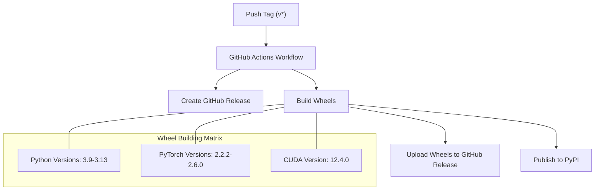
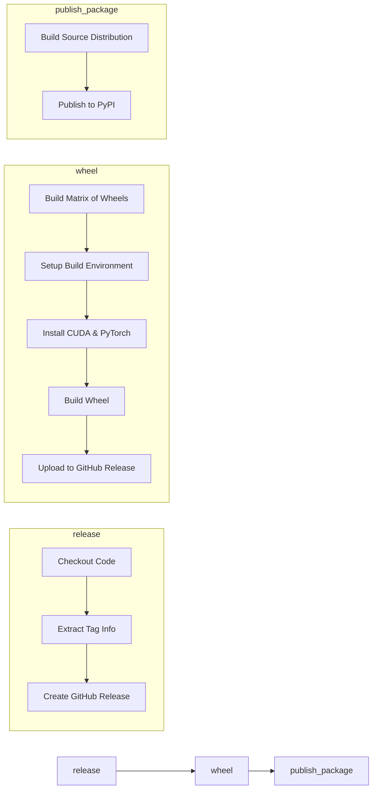
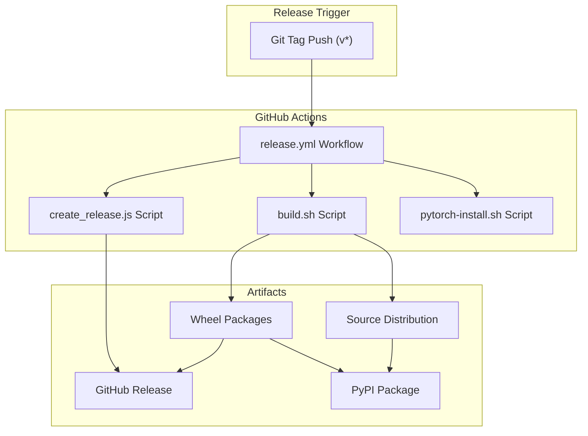

<!-- source: DeepWiki mcp.deepwiki.com · repo microsoft/MInference · page 7.2 Release Process · fetched 2026-10-26 -->

# Release Process

<details>
<summary>Relevant source files</summary>

The following files were used as context for generating this wiki page:

- [.github/workflows/release.yml](.github/workflows/release.yml)
- [.github/workflows/scripts/pytorch-install.sh](.github/workflows/scripts/pytorch-install.sh)
- [MANIFEST.in](MANIFEST.in)

</details>


This document outlines the automated release process for MInference, including how releases are triggered, what artifacts are generated, and how these are published to users. For information about building and installing MInference from source, see [Building and Installation](#7.1).

## Overview

MInference uses GitHub Actions to automate its release process. When a new version tag is pushed, a workflow automatically builds wheel packages for multiple Python and PyTorch versions, creates a GitHub release, and publishes the packages to PyPI.



Sources: [.github/workflows/release.yml:7-11](), [.github/workflows/release.yml:43-64](), [.github/workflows/release.yml:132-149]()

## Release Triggering

A new release is triggered when a Git tag with the prefix `v` (e.g., `v1.0.0`) is pushed to the repository. This automatically starts the release workflow.

Sources: [.github/workflows/release.yml:7-11]()

## Release Workflow Components

The MInference release process consists of three main jobs that run sequentially:



Sources: [.github/workflows/release.yml:17-42](), [.github/workflows/release.yml:43-131](), [.github/workflows/release.yml:132-202]()

### 1. Creating a GitHub Release

The first job in the workflow creates a GitHub release associated with the pushed tag. This release will later be populated with built wheel packages.

Sources: [.github/workflows/release.yml:17-42]()

### 2. Building Wheels

The second job builds wheel packages across a compatibility matrix of:

- Python versions: 3.9, 3.10, 3.11, 3.12, 3.13
- PyTorch versions: 2.2.2, 2.3.1, 2.4.0, 2.5.1, 2.6.0
- CUDA version: 12.4.0

Note that Python 3.13 is only supported with PyTorch ≥ 2.5 due to compatibility constraints.

The wheel building process:
1. Sets up the necessary build environment
2. Installs the appropriate CUDA version
3. Installs the specified PyTorch version
4. Builds the wheel package
5. Uploads the wheel as an asset to the GitHub release

Sources: [.github/workflows/release.yml:43-131](), [.github/workflows/scripts/pytorch-install.sh:1-37]()

### 3. Publishing to PyPI

The final job:
1. Builds a source distribution (sdist) package
2. Publishes both the sdist and the previously built wheels to PyPI

This job uses a single configuration (Python 3.10, PyTorch 2.3.0, CUDA 12.2.2) for building the source distribution.

Sources: [.github/workflows/release.yml:132-202]()

## Package Contents

The MInference package includes:

- All Python code from the `minference` directory
- C++ and CUDA source files from the `csrc` directory
- JSON configuration files included in the `minference` directory

Sources: [MANIFEST.in:1-5]()

## Release Compatibility Matrix

The following table shows the compatibility between Python versions and PyTorch versions in the release:

| Python Version | Supported PyTorch Versions |
|----------------|----------------------------|
| 3.9            | 2.2.2, 2.3.1, 2.4.0, 2.5.1, 2.6.0 |
| 3.10           | 2.2.2, 2.3.1, 2.4.0, 2.5.1, 2.6.0 |
| 3.11           | 2.2.2, 2.3.1, 2.4.0, 2.5.1, 2.6.0 |
| 3.12           | 2.2.2, 2.3.1, 2.4.0, 2.5.1, 2.6.0 |
| 3.13           | 2.5.1, 2.6.0 |

Sources: [.github/workflows/release.yml:50-63]()

## Making a New Release

For maintainers who need to trigger a new release, follow these steps:

1. Ensure all changes for the release are merged into the main branch
2. Update version information in relevant files
3. Create and push a new tag with the version number:

```bash
git tag v1.2.3
git push origin v1.2.3
```

4. The GitHub Actions workflow will automatically start upon tag push
5. Monitor the workflow progress in the GitHub Actions tab
6. Verify the release page has been created with all wheel packages
7. Confirm the package is available on PyPI after workflow completion

## Publishing System Architecture



Sources: [.github/workflows/release.yml:17-202](), [.github/workflows/scripts/pytorch-install.sh:1-37]()

## Environment Configuration

During the release process, several environment variables are configured to ensure proper building:

- `MATRIX_CUDA_VERSION`: The CUDA version formatted for package naming (e.g., "124" for CUDA 12.4)
- `MATRIX_TORCH_VERSION`: The major.minor PyTorch version (e.g., "2.3")
- `MATRIX_PYTHON_VERSION`: The Python version formatted without dots (e.g., "39" for Python 3.9)

The build process intelligently selects the appropriate CUDA version for each PyTorch version based on compatibility constraints.

Sources: [.github/workflows/release.yml:85-89](), [.github/workflows/scripts/pytorch-install.sh:19-26]()