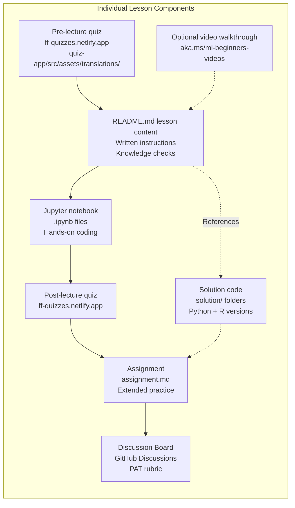
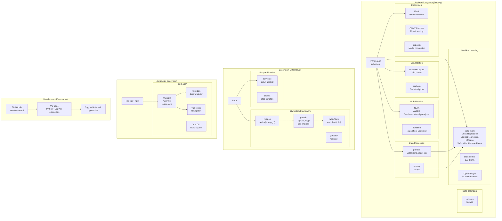
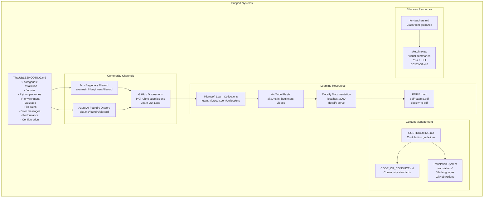

<!-- source: DeepWiki mcp.deepwiki.com · repo microsoft/ML-For-Beginners · page 1 Overview · fetched 2026-10-26 -->

# Overview

Relevant source files

The following files were used as context for generating this wiki page:

- [1-Introduction/1-intro-to-ML/README.md](1-Introduction/1-intro-to-ML/README.md)
- [1-Introduction/2-history-of-ML/README.md](1-Introduction/2-history-of-ML/README.md)
- [1-Introduction/README.md](1-Introduction/README.md)
- [1-Introduction/images/globe.jpg](1-Introduction/images/globe.jpg)
- [2-Regression/README.md](2-Regression/README.md)
- [5-Clustering/README.md](5-Clustering/README.md)
- [README.md](README.md)
- [TROUBLESHOOTING.md](TROUBLESHOOTING.md)
- [images/3.png](images/3.png)
- [quiz-app/src/assets/translations/en.json](quiz-app/src/assets/translations/en.json)

This document provides an overview of the ML-For-Beginners curriculum, a comprehensive 12-week, 26-lesson course focused on classical machine learning techniques using scikit-learn. The curriculum is designed as a project-based learning experience with hands-on exercises, quizzes, and assignments that teach fundamental ML concepts without diving into deep learning or neural networks.

For detailed information about specific aspects of the curriculum:
- Curriculum organization and learning modules: see [Curriculum Structure](#1.1)
- Pedagogical methodology and lesson structure: see [Learning Approach](#1.2)  
- Software requirements and setup: see [Technical Requirements](#1.3)
- Community resources and help channels: see [Community and Support Resources](#1.4)

## Purpose and Scope

The ML-For-Beginners curriculum serves as an educational resource for learning classical machine learning fundamentals. The course explicitly focuses on traditional ML algorithms and techniques, deliberately excluding deep learning, neural networks, and general AI topics to provide a focused learning path for beginners.

**Primary Learning Objectives:**
- Core ML concepts and terminology (features, labels, training data, model evaluation)
- Supervised learning: regression and classification techniques
- Unsupervised learning: clustering methods
- Specialized applications: natural language processing, time series forecasting, reinforcement learning
- Practical implementation using scikit-learn and related Python libraries
- Ethical considerations including fairness and responsible AI principles

**Excluded Topics:**
- Deep learning architectures
- Neural networks (covered in separate AI for Beginners curriculum)
- Advanced AI techniques

The curriculum includes 26 lessons organized into 8 major learning modules, delivered over 12 weeks with approximately 2-3 lessons per week.

Sources: [README.md:27-94](), [1-Introduction/1-intro-to-ML/README.md:70-94]()

## Repository Structure and Learning Modules

```mermaid
graph TB
    subgraph Repository["ML-For-Beginners Repository Structure"]
        README["README.md<br/>Main curriculum index<br/>26 lessons table"]
        
        subgraph Intro["1-Introduction/"]
            Intro1["1-intro-to-ML/README.md<br/>ML concepts, terminology"]
            Intro2["2-history-of-ML/README.md<br/>Historical context"]
            Intro3["3-fairness/README.md<br/>Ethics and fairness"]
            Intro4["4-techniques-of-ML/README.md<br/>ML workflow"]
        end
        
        subgraph Regression["2-Regression/"]
            Reg1["1-Tools/README.md<br/>Python/scikit-learn setup"]
            Reg2["2-Data/README.md<br/>Data preparation"]
            Reg3["3-Linear/README.md<br/>LinearRegression"]
            Reg4["4-Logistic/README.md<br/>LogisticRegression"]
            RegData["data/US-pumpkins.csv<br/>1757 rows"]
        end
        
        subgraph WebApp["3-Web-App/"]
            WebApp1["1-Web-App/README.md<br/>Flask deployment"]
        end
        
        subgraph Classification["4-Classification/"]
            Class1["1-Introduction/README.md<br/>Classification intro"]
            Class2["2-Classifiers-1/README.md<br/>SVC, KNN"]
            Class3["3-Classifiers-2/README.md<br/>RandomForest, AdaBoost"]
            Class4["4-Applied/README.md<br/>ONNX deployment"]
            ClassData["data/cuisines.csv<br/>2448 entries"]
        end
        
        subgraph Clustering["5-Clustering/"]
            Clust1["1-Visualize/README.md<br/>Clustering intro"]
            Clust2["2-K-Means/README.md<br/>KMeans algorithm"]
            ClustData["data/nigerian-songs.csv<br/>Music metadata"]
        end
        
        subgraph NLP["6-NLP/"]
            NLP1["1-Introduction-to-NLP/README.md<br/>NLP basics"]
            NLP2["2-Tasks/README.md<br/>Common tasks"]
            NLP3["3-Translation-Sentiment/README.md<br/>TextBlob"]
            NLP4["4-Hotel-Reviews-1/README.md<br/>VADER sentiment"]
            NLP5["5-Hotel-Reviews-2/README.md<br/>515K reviews"]
            NLPData["data/Hotel_Reviews.csv<br/>515,738 reviews"]
        end
        
        subgraph TimeSeries["7-TimeSeries/"]
            TS1["1-Introduction/README.md<br/>TS concepts"]
            TS2["2-ARIMA/README.md<br/>SARIMAX models"]
            TS3["3-SVR/README.md<br/>SVR forecasting"]
            TSData["data/energy.csv<br/>Power usage data"]
        end
        
        subgraph Reinforcement["8-Reinforcement/"]
            RL1["1-QLearning/README.md<br/>Q-Learning basics"]
            RL2["2-Gym/README.md<br/>OpenAI Gym"]
        end
        
        subgraph RealWorld["9-Real-World/"]
            RW1["1-Applications/README.md<br/>Industry applications"]
            RW2["2-Debugging-ML-Models/README.md<br/>RAI dashboard"]
        end
    end
    
    README --> Intro
    README --> Regression
    README --> WebApp
    README --> Classification
    README --> Clustering
    README --> NLP
    README --> TimeSeries
    README --> Reinforcement
    README --> RealWorld
    
    Reg1 --> Reg2
    Reg2 --> Reg3
    Reg3 --> Reg4
    RegData --> Reg2
    
    Reg4 --> WebApp1
    WebApp1 --> Class1
    
    Class1 --> Class2
    Class2 --> Class3
    Class3 --> Class4
    ClassData --> Class1
    
    Class4 --> Clust1
    Clust1 --> Clust2
    ClustData --> Clust1
    
    Clust2 --> NLP1
    NLP1 --> NLP2
    NLP2 --> NLP3
    NLP3 --> NLP4
    NLP4 --> NLP5
    NLPData --> NLP4
    
    NLP5 --> TS1
    TS1 --> TS2
    TS2 --> TS3
    TSData --> TS2
    
    TS3 --> RL1
    RL1 --> RL2
    
    RL2 --> RW1
    RW1 --> RW2
```

**Curriculum Structure Overview**

The curriculum progresses through 9 major directory-organized modules, with each module containing multiple lessons. The table at [README.md:114-142]() provides the complete lesson index with learning objectives.

| Module | Directory | Lessons | Focus Area |
|--------|-----------|---------|------------|
| Introduction | `1-Introduction/` | 4 | ML concepts, history, fairness, techniques |
| Regression | `2-Regression/` | 4 | Linear, polynomial, logistic regression with pumpkin pricing data |
| Web App | `3-Web-App/` | 1 | Flask deployment with ONNX Runtime |
| Classification | `4-Classification/` | 4 | Multiple classifiers, cuisine dataset, ONNX conversion |
| Clustering | `5-Clustering/` | 2 | K-Means clustering with Nigerian music data |
| NLP | `6-NLP/` | 5 | Text processing, sentiment analysis with hotel reviews |
| Time Series | `7-TimeSeries/` | 3 | ARIMA/SARIMA forecasting with energy data |
| Reinforcement | `8-Reinforcement/` | 2 | Q-Learning, OpenAI Gym environments |
| Real-World | `9-Real-World/` | 2 | Industry applications, model debugging |

Sources: [README.md:114-142](), [1-Introduction/README.md:8-14](), [2-Regression/README.md:1-32](), [5-Clustering/README.md:1-21]()

## Dual-Language Implementation

The curriculum provides parallel implementations in Python (primary) and R (alternative) for statistical ML modules. This architecture allows learners to choose their preferred language ecosystem while learning identical concepts.

**Python Implementation:**
- Primary language for all 26 lessons
- Uses scikit-learn as core ML framework
- Notebooks located in lesson directories with `.ipynb` extension
- Examples: [2-Regression/1-Tools/README.md](), [4-Classification/2-Classifiers-1/README.md]()

**R Implementation:**
- Available for regression, classification, and clustering modules
- Uses tidymodels framework (parsnip, recipes, workflows, yardstick)
- Located in `solution/R/` subdirectories with `.rmd` extension
- Examples: [2-Regression/1-Tools/solution/R/lesson_1.html](), [4-Classification/1-Introduction/solution/R/lesson_10.html]()

The note at [README.md:110-111]() explains that R lessons use R Markdown format combining code chunks, YAML headers, and Markdown documentation, which can be rendered to PDF, HTML, or Word formats.

Sources: [README.md:110-111](), [README.md:120-130]()

## Project-Based Learning Methodology

**Lesson Structure:**

Each lesson follows a standardized structure documented at [README.md:96-108]():

1. **Pre-lecture quiz**: Hosted at `ff-quizzes.netlify.app`, sets learning intention
2. **Written lesson**: `README.md` file with concepts and knowledge checks
3. **Video walkthrough**: Optional supplemental video (some lessons)
4. **Jupyter notebook**: Hands-on coding exercises in `.ipynb` format
5. **Post-lecture quiz**: Reinforces retention through assessment
6. **Challenge**: Practice problem within the lesson
7. **Assignment**: Extended project documented in `assignment.md`
8. **Discussion**: PAT (Progress Assessment Tool) rubric submission via GitHub Discussions

**Quiz Application Details:**

The quiz system is a standalone Vue.js application with 52 quizzes containing 156 total questions. Quiz content is defined in JSON format at [quiz-app/src/assets/translations/en.json:1-6]() with structure:
- Quiz objects with `id` and `title`
- Question arrays with `questionText` and `answerOptions`
- Boolean `isCorrect` flags for each answer option

Sources: [README.md:96-108](), [README.md:112](), [quiz-app/src/assets/translations/en.json:1-58]()

## Technology Stack and Dependencies

**Core Python Dependencies:**

The primary Python stack relies on these key libraries (as referenced throughout lesson code):

- `scikit-learn`: Core ML framework providing `LinearRegression`, `LogisticRegression`, `KMeans`, `SVC`, `KNeighborsClassifier`, `RandomForestClassifier`, `train_test_split`, preprocessing utilities
- `pandas`: Data manipulation with `DataFrame`, `read_csv()`, data cleaning methods
- `numpy`: Numerical computing for arrays and mathematical operations
- `matplotlib.pyplot`: Visualization with `plot()`, `scatter()`, `show()` methods
- `seaborn`: Statistical data visualization
- `imblearn`: SMOTE oversampling for imbalanced data (`SMOTE` class)
- `statsmodels`: Time series with `SARIMAX` implementation
- `OpenAI Gym`: Reinforcement learning environments
- `NLTK`: Natural language toolkit with `VADER` sentiment analyzer
- `TextBlob`: Text processing, translation, sentiment analysis
- `Flask`: Web application framework for model deployment
- `onnxruntime`: High-performance model inference
- `skl2onnx`: Converting scikit-learn models to ONNX format

**R Dependencies (tidymodels):**

The R implementation uses tidymodels components:
- `recipes`: Preprocessing pipelines with `recipe()`, `step_mutate()`, `step_dummy()`, `step_smote()`
- `parsnip`: Model specification with `logistic_reg()`, `multinom_reg()`, `set_engine()`, `set_mode()`
- `workflows`: Combining preprocessing and models with `workflow()`, `fit()`
- `yardstick`: Performance metrics evaluation
- `tidyverse`: Data manipulation (dplyr, ggplot2, tidyr, readr)
- `themis`: SMOTE implementation for R

Sources: [README.md:22-26](), [1-Introduction/1-intro-to-ML/README.md:20-26]()

## Support Infrastructure

**Community Support Resources:**

The curriculum provides multiple support channels documented at [README.md:51](), [README.md:176-184]():

1. **TROUBLESHOOTING.md**: Self-service guide covering 9 categories of common issues (installation, Jupyter, packages, R environment, quiz app, file paths, errors, performance, configuration)
2. **Discord Servers**: 
   - ML4Beginners Discord (`aka.ms/ml4beginners/discord`)
   - Azure AI Foundry Discord (`aka.ms/foundry/discord`)
3. **GitHub Discussions**: Community Q&A and PAT rubric submissions for reflective learning
4. **Microsoft Learn Collections**: Supplementary learning modules and paths
5. **YouTube Playlist**: Video walkthroughs at `aka.ms/ml-beginners-videos`

**Documentation Formats:**

- **Online**: Docsify-based documentation at `localhost:3000` (installed via `docsify serve` command)
- **Offline**: PDF export at `pdf/readme.pdf` generated using docsify-to-pdf tool
- **Source**: Markdown files in repository structure

**Translation Infrastructure:**

The repository supports 50+ languages through automated translation:
- Translation files in `translations/` directory (ar, bn, bg, my, zh, hk, mo, tw, hr, cs, da, nl, et, fi, fr, de, el, he, hi, hu, id, it, ja, ko, lt, ms, mr, ne, no, fa, pl, br, pt, pa, ro, ru, sr, sk, sl, es, sw, sv, tl, ta, th, tr, uk, ur, vi)
- Automated via GitHub Actions using co-op-translator package
- Language table maintained at [README.md:15-17]()

**Educator Resources:**

- `for-teachers.md`: Guidance for using curriculum in classroom settings
- `sketchnotes/`: Visual summaries in PNG and TIFF formats with CC BY-SA 4.0 license for printing

Sources: [README.md:51](), [README.md:66](), [README.md:146-152](), [README.md:11-17](), [README.md:176-184](), [TROUBLESHOOTING.md:1-16]()

## Getting Started Workflow

**Repository Access:**

1. **Fork repository**: Click "Fork" button at `github.com/microsoft/ML-For-Beginners`
2. **Clone locally**: `git clone https://github.com/microsoft/ML-For-Beginners.git`
3. **Navigate to lessons**: Each lesson has its own directory with README and notebooks

**Setup Requirements:**

- Python 3.8+ installation
- VS Code with Python and Jupyter extensions
- Git for version control
- Node.js and npm (for quiz application development)
- GitHub account for forking and discussions

For detailed setup instructions and troubleshooting, see [Technical Requirements](#1.3) and [TROUBLESHOOTING.md]().

**Recommended Learning Path:**

The curriculum is designed to be followed sequentially as outlined in [README.md:114-142]():

1. Start with Introduction module (lessons 1-4) for foundational concepts
2. Progress through Regression (lessons 5-8) to learn supervised learning basics
3. Build a web app (lesson 9) to practice deployment
4. Continue through Classification (lessons 10-13), Clustering (lessons 14-15)
5. Explore NLP (lessons 16-20), Time Series (lessons 21-23), and Reinforcement Learning (lessons 24-25)
6. Conclude with Real-World Applications (lessons 26-27)

Each lesson follows the structure: pre-quiz → lesson content → notebook exercise → post-quiz → assignment → discussion.

Sources: [README.md:45-62](), [README.md:54-62]()

## Related Microsoft Curricula

The ML-For-Beginners curriculum is part of a larger family of Microsoft educational resources. Related courses mentioned at [README.md:155-174]():

- **AI for Beginners** (`aka.ms/ai-beginners`): Covers deep learning and neural networks not included in this curriculum
- **Data Science for Beginners** (`aka.ms/datascience-beginners`): Complementary data science fundamentals
- **Generative AI for Beginners** (`aka.ms/genai-beginners`): Generative AI and large language models
- **Edge AI for Beginners** (`aka.ms/edgeai-for-beginners`): Edge computing and ML
- Additional courses: Web Dev, IoT, Cybersecurity, XR Development

These curricula follow similar project-based pedagogical approaches with quizzes, lessons, and assignments.

Sources: [README.md:31](), [README.md:155-174]()

---

