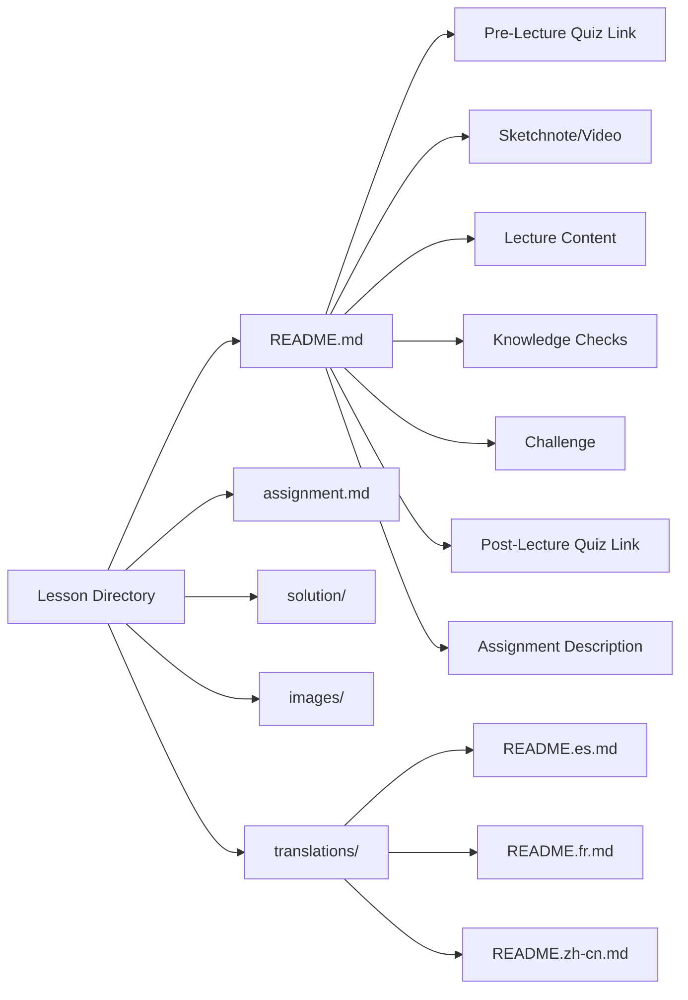
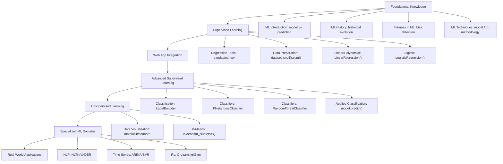
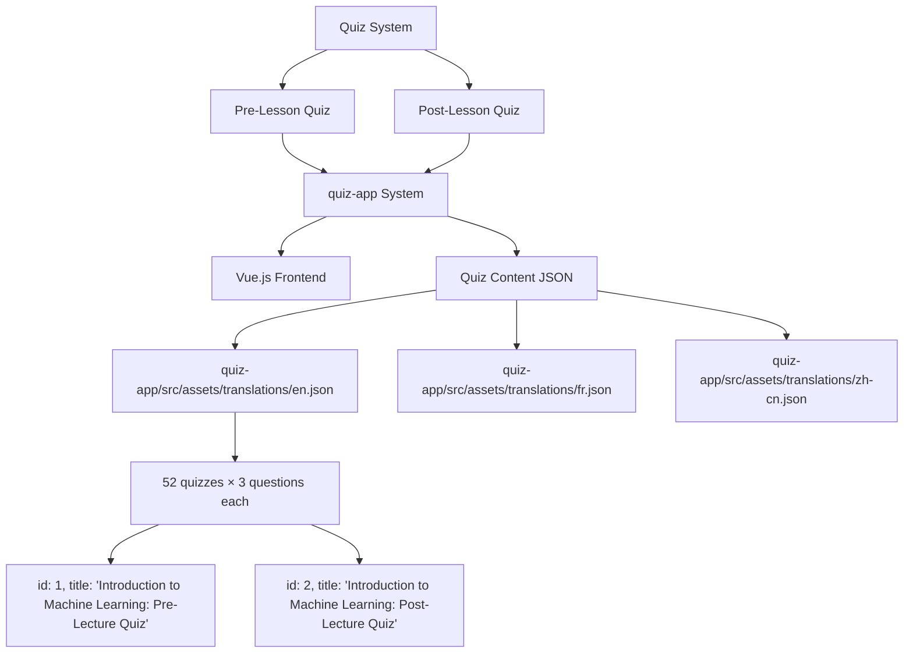
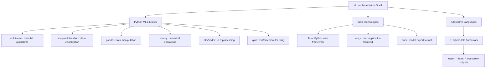
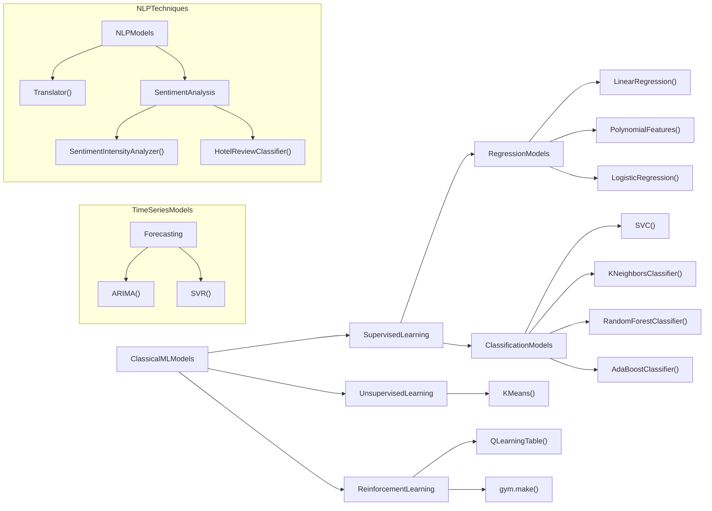
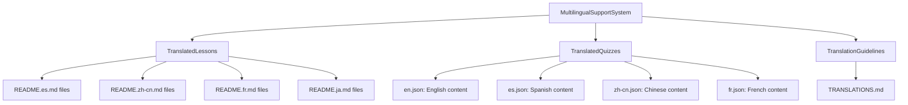

<!-- source: DeepWiki mcp.deepwiki.com · repo microsoft/ML-For-Beginners · page 1.1 Curriculum Structure · fetched 2026-10-26 -->

# Curriculum Structure

<details>
<summary>Relevant source files</summary>

The following files were used as context for generating this wiki page:

- [1-Introduction/1-intro-to-ML/README.md](1-Introduction/1-intro-to-ML/README.md)
- [1-Introduction/2-history-of-ML/README.md](1-Introduction/2-history-of-ML/README.md)
- [1-Introduction/README.md](1-Introduction/README.md)
- [1-Introduction/images/globe.jpg](1-Introduction/images/globe.jpg)
- [2-Regression/README.md](2-Regression/README.md)
- [5-Clustering/README.md](5-Clustering/README.md)
- [README.md](README.md)
- [TROUBLESHOOTING.md](TROUBLESHOOTING.md)
- [images/3.png](images/3.png)
- [quiz-app/src/assets/translations/en.json](quiz-app/src/assets/translations/en.json)

</details>


This document details the organizational structure of the ML-For-Beginners repository, explaining how the curriculum is organized across various machine learning topics and the progression of lessons. For information about the pedagogical approach and learning methodology used in this curriculum, see [Learning Approach](#1.2).

The ML-For-Beginners curriculum is a 12-week, 26-lesson course covering classical machine learning concepts using primarily Scikit-learn, focusing on foundational machine learning rather than deep learning.

Sources: [README.md:13-21]()

## Overall Curriculum Structure

The curriculum is divided into 9 main sections, with each section containing multiple lessons that introduce and build upon specific machine learning concepts.

```mermaid
flowchart TD
    A["ML-For-Beginners Curriculum"] --> B["1. Introduction"]
    A --> C["2. Regression"]
    A --> D["3. Web App"]
    A --> E["4. Classification"]
    A --> F["5. Clustering"]
    A --> G["6. Natural Language Processing"]
    A --> H["7. Time Series"]
    A --> I["8. Reinforcement Learning"]
    A --> J["9. Real-World Applications"]
    
    B --> B1["1.1 Intro to ML"]
    B --> B2["1.2 History of ML"]
    B --> B3["1.3 Fairness in ML"]
    B --> B4["1.4 Techniques of ML"]
    
    C --> C1["2.1 Tools"]
    C --> C2["2.2 Data Preparation"]
    C --> C3["2.3 Linear Regression"]
    C --> C4["2.4 Logistic Regression"]
    
    D --> D1["3.1 Web App with ML Model"]
    
    E --> E1["4.1 Intro to Classification"]
    E --> E2["4.2 Classifiers-1"]
    E --> E3["4.3 Classifiers-2"]
    E --> E4["4.4 Applied Classification"]
    
    F --> F1["5.1 Data Visualization"]
    F --> F2["5.2 K-Means Clustering"]
    
    G --> G1["6.1 Intro to NLP"]
    G --> G2["6.2 Common NLP Tasks"]
    G --> G3["6.3 Translation & Sentiment"]
    G --> G4["6.4 Hotel Reviews 1"]
    G --> G5["6.5 Hotel Reviews 2"]
    
    H --> H1["7.1 Intro to Time Series"]
    H --> H2["7.2 ARIMA Forecasting"]
    H --> H3["7.3 SVR Forecasting"]
    
    I --> I1["8.1 Q-Learning"]
    I --> I2["8.2 Gym Environments"]
    
    J --> J1["9.1 Real-World ML Applications"]
    J --> J2["9.2 Debugging ML Models"]
```



Sources: [README.md:98-126]()

## Repository Organization

The repository is structured to directly map to the curriculum sections, with each section having its own directory containing lesson materials.

```mermaid
graph TD
    A["Repository Root"] --> B["1-Introduction/"]
    A --> C["2-Regression/"]
    A --> D["3-Web-App/"]
    A --> E["4-Classification/"]
    A --> F["5-Clustering/"]
    A --> G["6-NLP/"]
    A --> H["7-TimeSeries/"]
    A --> I["8-Reinforcement/"]
    A --> J["9-Real-World/"]
    A --> K["quiz-app/"]
    A --> L["sketchnotes/"]
    
    B --> B1["1-intro-to-ML/README.md"]
    B --> B2["2-history-of-ML/README.md"]
    B --> B3["3-fairness/README.md"]
    B --> B4["4-techniques-of-ML/README.md"]
    
    C --> C1["1-Tools/README.md"]
    C --> C2["2-Data/README.md"]
    C --> C3["3-Linear/README.md"]
    C --> C4["4-Logistic/README.md"]
    
    K --> K1["src/assets/translations/en.json"]
    K --> K2["src/assets/translations/fr.json"]
    K --> K3["src/assets/translations/zh-cn.json"]
```



Sources: [README.md:30-34](), [1-Introduction/README.md:8-13]()

## Standard Lesson Components

Each lesson in the curriculum follows a standardized structure to provide a consistent learning experience. 

### Lesson Directory Structure



Sources: [README.md:40-46](), [1-Introduction/1-intro-to-ML/README.md:1-11]()

### Component Details

Each lesson includes the following standardized components:

| Component | Description | Implementation |
|-----------|-------------|----------------|
| Pre-Lecture Quiz | 3-question quiz to establish baseline knowledge | Link to quiz-app endpoint |
| Sketchnote | Visual summary of lesson concepts | Optional image in sketchnotes/ folder |
| Video Walkthrough | Video explanation of lesson content | Optional YouTube link |
| Lecture Content | Main educational material with explanations and examples | Markdown content in README.md |
| Knowledge Checks | Inline questions to reinforce understanding | Embedded in README.md |
| Challenge | Practical coding exercise to apply concepts | Section in README.md |
| Post-Lecture Quiz | 3-question quiz to assess learning | Link to quiz-app endpoint |
| Assignment | Extended project or exercise | Detailed in assignment.md |

As specified in the main README.md file:

> Each lesson includes:
> - optional sketchnote
> - optional supplemental video
> - video walkthrough (some lessons only)
> - pre-lecture warmup quiz
> - written lesson
> - for project-based lessons, step-by-step guides on how to build the project
> - knowledge checks
> - a challenge
> - supplemental reading
> - assignment
> - post-lecture quiz

Sources: [README.md:80-92](), [1-Introduction/4-techniques-of-ML/README.md:10-23]()

## Learning Path Progression

The curriculum follows a carefully designed progression that builds knowledge systematically, starting with fundamentals and advancing to more complex topics.



Sources: [README.md:72-77](), [1-Introduction/4-techniques-of-ML/README.md:14-25]()

### Thematic Integration

The curriculum uses a global theme, exploring different cultures and regions through the datasets and examples:

- **Regression**: North American pumpkin prices (lessons 2.2-2.4)
- **Classification**: Asian and Indian cuisines (lessons 4.2-4.4)
- **Clustering**: Nigerian musical tastes (lesson 5.2)
- **Natural Language Processing**: European hotel reviews (lessons 6.4-6.5)
- **Time Series**: World power usage (lessons 7.2-7.3)
- **Reinforcement Learning**: Classic fable scenarios - Peter and the wolf (lesson 8.2)

Sources: [README.md:15-19](), [README.md:98-126]()

## Assessment System

The curriculum incorporates a comprehensive quiz system to assess student learning before and after each lesson.



Sources: [README.md:95-96](), [quiz-app/src/assets/translations/en.json:1-57]()

### Quiz Implementation

The quiz content is stored in JSON files with consistent structure for each quiz:

```json
{
  "id": 1,
  "title": "Introduction to Machine Learning: Pre-Lecture Quiz",
  "quiz": [
    {
      "questionText": "Applications of machine learning are all around us",
      "answerOptions": [
        {
          "answerText": "True",
          "isCorrect": "true"
        },
        {
          "answerText": "False",
          "isCorrect": "false"
        }
      ]
    }
  ]
}
```

Each lesson has both a pre-lecture quiz (to set learning intentions) and a post-lecture quiz (to evaluate understanding). The quiz system contains 52 total quizzes with 3 questions per quiz.

Sources: [quiz-app/src/assets/translations/en.json:8-57](), [README.md:95-96]()

## Technical Implementation

### Machine Learning Technologies

The curriculum utilizes various machine learning libraries and frameworks for implementing the concepts covered in the lessons:



Sources: [README.md:94](), [1-Introduction/4-techniques-of-ML/README.md:70-100]()

### Machine Learning Models Map

The curriculum covers a range of classical machine learning models and techniques, showing their relationships and implementation:



Sources: [README.md:98-126](), [1-Introduction/4-techniques-of-ML/README.md:70-100]()

## Multilingual Support

The curriculum supports multiple languages to make ML education accessible globally:



Sources: [README.md:127-140](), [quiz-app/src/assets/translations/en.json:1-10]()

## Educational Progression

The curriculum follows a project-based approach with each section building upon previous knowledge:

| Section | Project Focus | ML Techniques | Core Libraries |
|---------|--------------|---------------|----------------|
| Introduction | Foundational Concepts | N/A | N/A |
| Regression | Pumpkin Price Prediction | Linear/Logistic Regression | scikit-learn, pandas |
| Web App | Model Deployment | Flask Integration | Flask, Pickle |
| Classification | Cuisine Classification | Multiple Classifiers | scikit-learn, pandas |
| Clustering | Music Taste Analysis | K-Means | scikit-learn, matplotlib |
| NLP | Hotel Review Analysis | Text Processing, Sentiment | NLTK, VADER |
| Time Series | Power Usage Forecasting | ARIMA, SVR | statsmodels, scikit-learn |
| Reinforcement Learning | Game-Based Learning | Q-Learning | OpenAI Gym |

Sources: [README.md:98-126](), [1-Introduction/4-techniques-of-ML/README.md:26-32]()

## Practical Implementation Guidelines

For students working through the curriculum, the recommended approach is:

1. Fork the repository
2. For each lesson:
   - Take the pre-lecture quiz
   - Read the lecture and complete activities
   - Create projects by understanding concepts rather than just running solution code
   - Take the post-lecture quiz
   - Complete the challenge and assignment
   - Submit a PAT (Progress Assessment Tool) in the Discussion Board

The solution code for each project-based lesson is provided in the `/solution` folder within each lesson directory.

Sources: [README.md:38-46]()

This structured curriculum ensures a comprehensive learning experience, providing a logical progression from foundational concepts to practical application of machine learning techniques.

---

