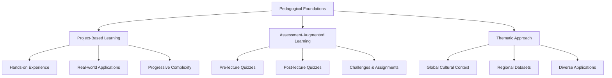
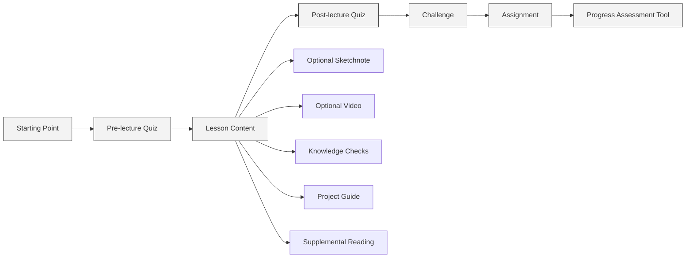
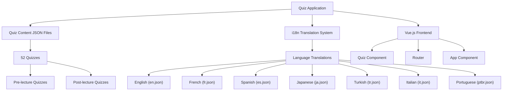
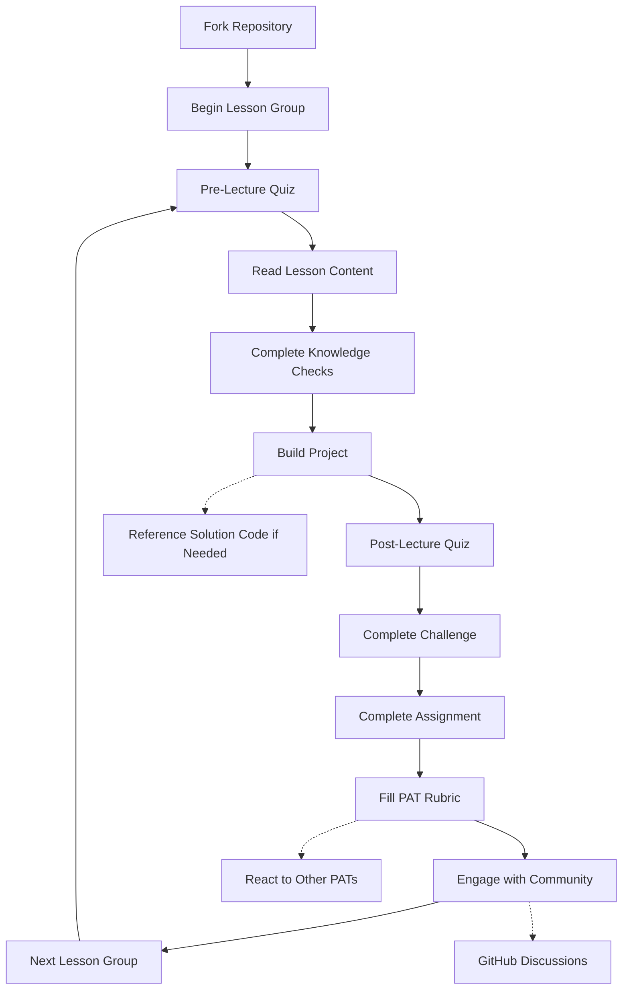
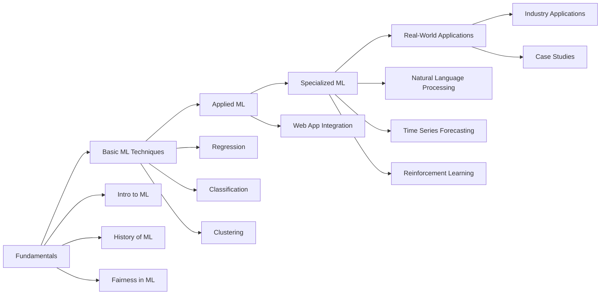
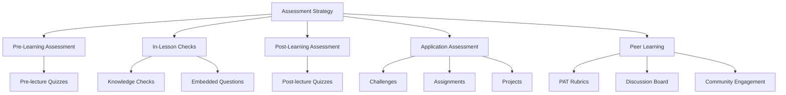
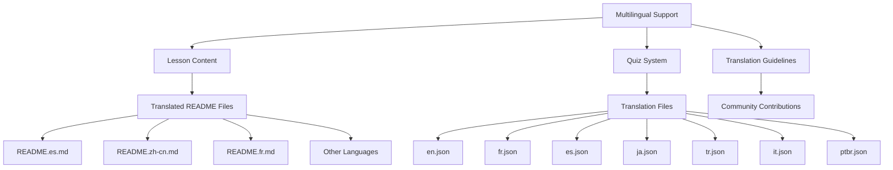
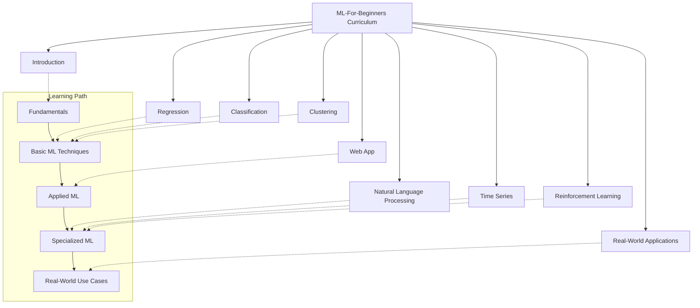

<!-- source: DeepWiki mcp.deepwiki.com · repo microsoft/ML-For-Beginners · page 1.2 Learning Approach · fetched 2026-10-26 -->

# Learning Approach

Relevant source files

The following files were used as context for generating this wiki page:

- [1-Introduction/1-intro-to-ML/README.md](1-Introduction/1-intro-to-ML/README.md)
- [1-Introduction/2-history-of-ML/README.md](1-Introduction/2-history-of-ML/README.md)
- [1-Introduction/README.md](1-Introduction/README.md)
- [1-Introduction/images/globe.jpg](1-Introduction/images/globe.jpg)
- [2-Regression/README.md](2-Regression/README.md)
- [5-Clustering/README.md](5-Clustering/README.md)
- [README.md](README.md)
- [TROUBLESHOOTING.md](TROUBLESHOOTING.md)
- [images/3.png](images/3.png)
- [quiz-app/src/assets/translations/en.json](quiz-app/src/assets/translations/en.json)

This page documents the pedagogical methodology used throughout the ML-For-Beginners curriculum. It explains how the learning experience is structured, including the components of each lesson, the assessment strategy, and the project-based approach that drives student engagement and knowledge retention.

## Pedagogical Foundations

The ML-For-Beginners curriculum is built upon two key pedagogical principles:

1. **Project-based learning**: Every topic is taught through practical, hands-on projects that apply theoretical concepts to real-world scenarios.
2. **Assessment-augmented learning**: Strategic use of pre and post-lesson quizzes to enhance knowledge retention and measure progress.

Additionally, the curriculum uses a thematic approach, taking students around the world through data from different cultures and regions to keep the content engaging and globally relevant.

Sources: [README.md:72-76]()

## Lesson Structure

Each lesson in the curriculum follows a consistent structure designed to maximize learning effectiveness. The components progress from setting context and intentions through pre-lecture quizzes to reinforcing knowledge with assignments and challenges.

Components of each lesson:

| Component | Purpose | Mandatory |
|-----------|---------|-----------|
| Sketchnote | Visual summary of lesson concepts | Optional |
| Supplemental video | Additional visual explanation | Optional |
| Video walkthrough | Step-by-step guidance (some lessons) | Optional |
| Pre-lecture quiz | Set learning intentions and baseline knowledge | Yes |
| Written lesson | Core instructional content | Yes |
| Project guide | Step-by-step instructions for project-based lessons | Yes (for project lessons) |
| Knowledge checks | Embedded comprehension questions | Yes |
| Challenge | Extended problem to solve independently | Yes |
| Supplemental reading | Additional resources for deeper understanding | Optional |
| Assignment | Practical application of concepts | Yes |
| Post-lecture quiz | Assess knowledge retention | Yes |

Sources: [README.md:80-92]()

## Quiz System Architecture

The quiz component is a crucial element of the assessment strategy. The curriculum includes a Vue.js-based quiz application with support for multiple languages, allowing for accessibility to a global audience.

The quiz system features:
- 52 quizzes (pre and post-lecture for 26 lessons)
- Each quiz contains 3 questions
- Support for 7 languages
- A Vue.js frontend interface

Students access quizzes at the beginning and end of each lesson, with the scores helping to reinforce concepts and measure learning progress.

Sources: [README.md:95-96](), [quiz-app/src/assets/translations/index.js:1-23](), [quiz-app/src/App.vue:1-112]()

## Student Learning Journey

The curriculum is designed for a guided, progressive learning journey that includes self-study, practical application, and community engagement.

The recommended approach to using the curriculum:

1. **Fork the repository** to your personal GitHub account
2. **Take the pre-lecture quiz** to set learning intentions
3. **Read the lecture** and engage with knowledge checks
4. **Build projects** based on lesson comprehension (reference solution code only if needed)
5. **Take the post-lecture quiz** to assess understanding
6. **Complete the challenge** to extend learning
7. **Complete the assignment** to apply concepts
8. **Fill out the Progress Assessment Tool (PAT)** rubric
9. **Engage with the community** on the Discussion Board

This structured approach encourages active learning and practical application of machine learning concepts.

Sources: [README.md:38-46]()

## Project-Based Learning Progression

The curriculum follows a progressive complexity model where projects start simple and become increasingly sophisticated throughout the 12-week cycle.

The project progression includes:
- **Fundamentals**: Theory and foundational concepts
- **Basic ML Techniques**: Core algorithms with simple datasets
- **Applied ML**: Integrating ML models into applications
- **Specialized ML**: Advanced techniques for specific domains
- **Real-World Applications**: Practical implementations and case studies

Each project builds on previous knowledge, allowing students to incrementally develop their skills from basic concepts to complex applications.

Sources: [README.md:72-76](), [README.md:97-125]()

## Assessment Methodology

The curriculum employs a comprehensive assessment strategy to measure learning progress and reinforce knowledge retention.

The assessment methodology includes:

1. **Pre-learning assessment**: Quizzes to establish baseline knowledge and set learning intentions
2. **In-lesson knowledge checks**: Embedded questions to reinforce understanding during the lesson
3. **Post-learning assessment**: Quizzes to measure knowledge retention after completing the lesson
4. **Application assessment**: Challenges and assignments to apply concepts in practical scenarios
5. **Progress Assessment Tool (PAT)**: A rubric-based self-assessment to reflect on learning
6. **Peer learning**: Community engagement through discussions and PAT reviews

This multi-layered approach ensures that students not only absorb information but can apply it effectively and reflect on their learning progress.

Sources: [README.md:38-46](), [quiz-app/src/assets/translations/en.json:1-114]()

## Multilingual Support

The curriculum is designed to be accessible to a global audience through comprehensive multilingual support.

The multilingual support features:
- Translated README files for major sections
- Localized quiz content in seven languages
- Translation guidelines for community contributors
- Language selection in the quiz application interface

This approach makes the curriculum accessible to non-English speakers and promotes global participation in learning machine learning concepts.

Sources: [quiz-app/src/assets/translations/index.js:1-23](), [quiz-app/src/App.vue:1-112]()

## Curriculum Structure and Progression

The curriculum follows a logical progression through various machine learning topics, from fundamentals to advanced applications.

The curriculum is structured to build skills incrementally:

1. **Introduction**: Foundational concepts, history, and ethical considerations
2. **Core ML Techniques**: Regression, classification, and clustering
3. **Applied ML**: Building web applications with ML models
4. **Specialized ML**: NLP, time series forecasting, and reinforcement learning
5. **Real-World Applications**: Industry case studies and practical implementations

Each section builds on previous knowledge, creating a comprehensive learning journey from ML basics to advanced applications.

Sources: [README.md:97-125]()

## Conclusion

The learning approach of ML-For-Beginners is designed to be comprehensive, engaging, and accessible. By combining project-based learning with strategic assessments and a global perspective, the curriculum provides an effective path for beginners to learn machine learning concepts and apply them in practical scenarios.

The modular structure allows learners to progress at their own pace, while the consistent format of lessons provides a familiar framework that enhances the learning experience. The multilingual support ensures that the curriculum is accessible to a global audience, democratizing access to machine learning education.

---

