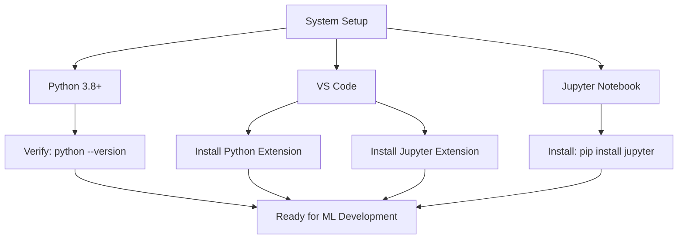
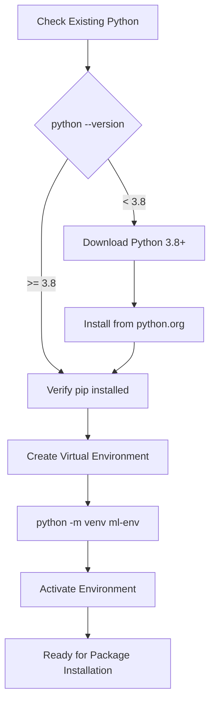
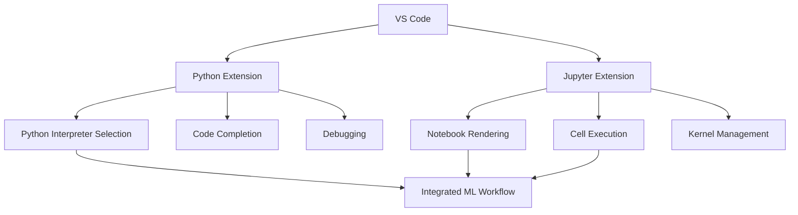
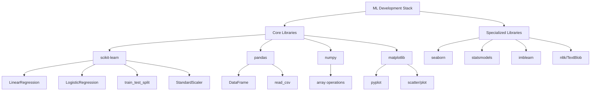
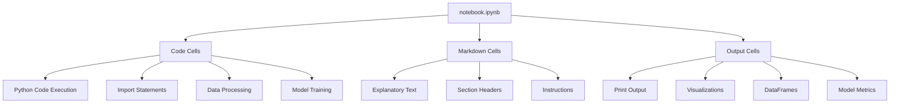
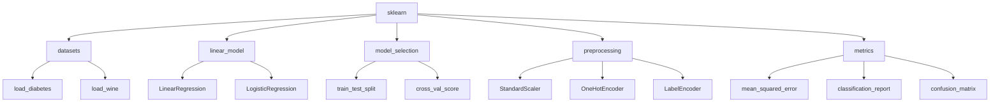
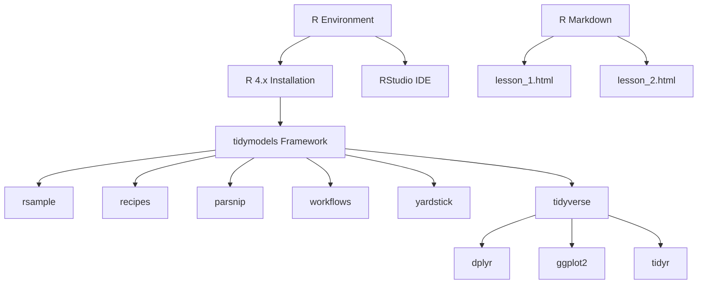
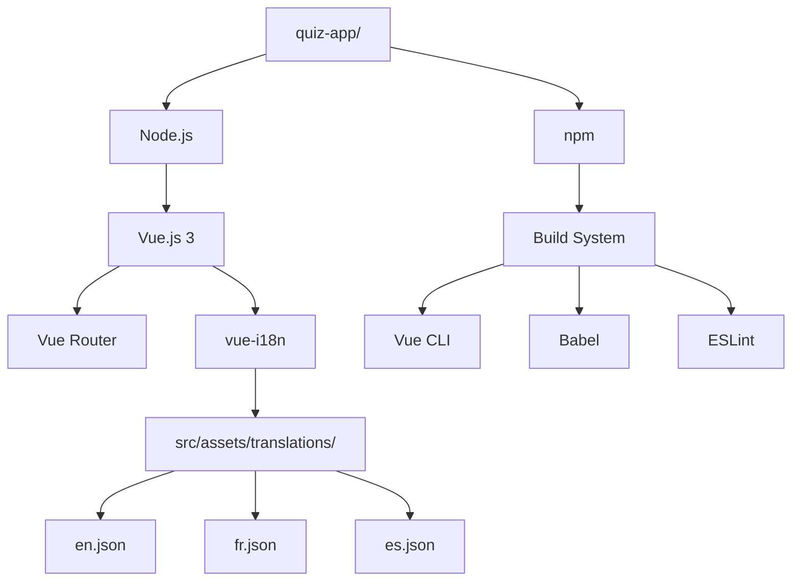
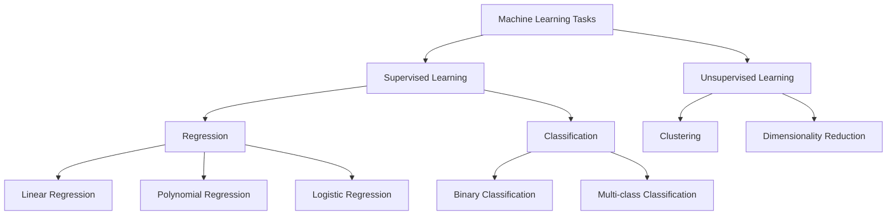

<!-- source: DeepWiki mcp.deepwiki.com · repo microsoft/ML-For-Beginners · page 1.3 Technical Requirements · fetched 2026-10-26 -->

# Technical Requirements

<details>
<summary>Relevant source files</summary>

The following files were used as context for generating this wiki page:

- [1-Introduction/1-intro-to-ML/README.md](1-Introduction/1-intro-to-ML/README.md)
- [1-Introduction/2-history-of-ML/README.md](1-Introduction/2-history-of-ML/README.md)
- [1-Introduction/README.md](1-Introduction/README.md)
- [1-Introduction/images/globe.jpg](1-Introduction/images/globe.jpg)
- [2-Regression/1-Tools/README.md](2-Regression/1-Tools/README.md)
- [2-Regression/2-Data/README.md](2-Regression/2-Data/README.md)
- [2-Regression/3-Linear/README.md](2-Regression/3-Linear/README.md)
- [2-Regression/4-Logistic/README.md](2-Regression/4-Logistic/README.md)
- [2-Regression/README.md](2-Regression/README.md)
- [5-Clustering/README.md](5-Clustering/README.md)
- [README.md](README.md)
- [TROUBLESHOOTING.md](TROUBLESHOOTING.md)
- [images/3.png](images/3.png)
- [quiz-app/src/assets/translations/en.json](quiz-app/src/assets/translations/en.json)

</details>


This page documents the required software, development environments, and libraries needed to work through the ML-For-Beginners curriculum. The curriculum supports multiple implementation tracks (Python and R) and includes a JavaScript-based quiz application.

For troubleshooting setup issues, see [Community and Support Resources](#1.4). For information about the curriculum structure, see [Curriculum Structure](#1.1).

## Core Requirements Overview

The curriculum requires three main software installations for the primary Python track:

| Software | Version | Purpose |
|----------|---------|---------|
| Python | 3.8+ | Primary programming language for ML exercises |
| Visual Studio Code | Latest | Recommended IDE with Jupyter and Python support |
| Jupyter Notebook | Latest | Interactive notebook environment for lessons |

**Installation Verification Diagram**



Sources: [README.md:46-52](), [2-Regression/1-Tools/README.md:22-43](), [TROUBLESHOOTING.md:20-42]()

## Python Installation and Configuration

Python 3.8 or higher is required for compatibility with all machine learning libraries used in the curriculum. Most computer systems may already include Python, but it's important to verify the version.

**Python Setup Workflow**



### Virtual Environment Setup

Using virtual environments is recommended to isolate project dependencies and avoid version conflicts between different Python projects.

```bash
# Create virtual environment
python -m venv ml-env

# Activate (Windows)
ml-env\Scripts\activate

# Activate (macOS/Linux)
source ml-env/bin/activate
```

Sources: [2-Regression/1-Tools/README.md:28-30](), [TROUBLESHOOTING.md:33-42](), [TROUBLESHOOTING.md:513-528]()

## Visual Studio Code Configuration

Visual Studio Code is the recommended IDE for this curriculum, providing integrated support for Python, Jupyter notebooks, and Git workflows.

**VS Code Extension Requirements**



### Required VS Code Extensions

1. **Python Extension**: Provides Python language support, debugging, and IntelliSense
2. **Jupyter Extension**: Enables `.ipynb` file support and interactive cell execution

### Configuration Steps

1. Install Visual Studio Code from [code.visualstudio.com](https://code.visualstudio.com/)
2. Open VS Code and install the Python extension
3. Install the Jupyter extension
4. Configure the Python interpreter: `Ctrl+Shift+P` → "Python: Select Interpreter"
5. Select your virtual environment interpreter

Sources: [2-Regression/1-Tools/README.md:32-38](), [TROUBLESHOOTING.md:562-570]()

## Python Library Stack

The curriculum relies on a standard data science and machine learning stack. All packages should be installed in your virtual environment.

**Core Python Libraries Architecture**



### Essential Libraries

| Package | Version | Purpose | Installation Command |
|---------|---------|---------|----------------------|
| `scikit-learn` | Latest stable | ML algorithms and model utilities | `pip install scikit-learn` |
| `pandas` | Latest stable | Data manipulation and analysis | `pip install pandas` |
| `numpy` | Latest stable | Numerical computing and arrays | `pip install numpy` |
| `matplotlib` | Latest stable | Data visualization and plotting | `pip install matplotlib` |
| `seaborn` | Latest stable | Statistical data visualization | `pip install seaborn` |
| `jupyter` | Latest stable | Interactive notebook environment | `pip install jupyter` |

### Domain-Specific Libraries

Additional libraries are required for specific modules:

| Module | Required Libraries | Purpose |
|--------|-------------------|---------|
| Regression | `scikit-learn`, `pandas`, `numpy`, `matplotlib` | Linear/polynomial/logistic regression |
| Classification | `imblearn`, `skl2onnx`, `onnxruntime` | SMOTE balancing, ONNX model deployment |
| Clustering | `scikit-learn`, `matplotlib`, `seaborn` | K-Means clustering, visualization |
| NLP | `nltk`, `textblob` | Text processing, sentiment analysis |
| Time Series | `statsmodels` | ARIMA/SARIMA forecasting |
| Reinforcement Learning | `gym` | RL environment simulation |

### Batch Installation

Install all core libraries at once:

```bash
# Activate virtual environment first
# Then install core packages
pip install scikit-learn pandas numpy matplotlib seaborn jupyter

# For specific modules, install additional packages as needed
pip install imblearn statsmodels nltk textblob gym
```

### M1 Mac Users

Special installation instructions apply for scikit-learn on Apple Silicon (M1/M2) Macs. Refer to the [scikit-learn installation documentation](https://scikit-learn.org/stable/install.html) for platform-specific guidance.

Sources: [2-Regression/1-Tools/README.md:40-43](), [2-Regression/1-Tools/README.md:110-124](), [2-Regression/3-Linear/README.md:168-171](), [2-Regression/4-Logistic/README.md:128-163](), [README.md:110](), [TROUBLESHOOTING.md:150-202]()

## Jupyter Notebook Environment

Jupyter notebooks (`.ipynb` files) serve as the primary authoring environment for ML lessons. They provide an interactive environment combining executable code, visualizations, and markdown documentation.

**Jupyter Notebook Structure**



### Starting Jupyter

```bash
# From lesson directory
jupyter notebook

# Jupyter server starts on http://localhost:8888
# Opens automatically in browser
```

### Working with Kernels

Each notebook runs a Python kernel that executes code cells. The kernel maintains state across cells:

- **Restart Kernel**: `Kernel → Restart` - Clears all variables
- **Restart & Run All**: `Kernel → Restart & Run All` - Executes all cells in order
- **Change Kernel**: `Kernel → Change Kernel` - Switch Python version/environment

### Notebook Usage in Curriculum

| Lesson Component | Notebook Feature Used |
|-----------------|----------------------|
| Data exploration | Code cells with `pandas` DataFrames |
| Visualizations | `matplotlib` plots inline with `%matplotlib inline` |
| Model training | `scikit-learn` fit/predict methods |
| Exercises | Interactive code cells for hands-on practice |
| Documentation | Markdown cells with explanations |

Sources: [2-Regression/1-Tools/README.md:44-79](), [2-Regression/1-Tools/README.md:100-210](), [TROUBLESHOOTING.md:96-146]()

## Scikit-learn Framework

Scikit-learn (`sklearn`) is the primary machine learning library, providing implementations of ML algorithms, preprocessing utilities, and model evaluation tools.

**Scikit-learn API Structure**



### Common Scikit-learn Patterns

**Model Training Workflow:**

```python
from sklearn.linear_model import LinearRegression
from sklearn.model_selection import train_test_split

# Split data
X_train, X_test, y_train, y_test = train_test_split(X, y, test_size=0.2)

# Create and train model
model = LinearRegression()
model.fit(X_train, y_train)

# Make predictions
predictions = model.predict(X_test)
```

### Key Scikit-learn Classes Used in Curriculum

| Class/Function | Module | Purpose |
|----------------|--------|---------|
| `LinearRegression` | `sklearn.linear_model` | Linear regression models |
| `LogisticRegression` | `sklearn.linear_model` | Binary/multiclass classification |
| `train_test_split` | `sklearn.model_selection` | Data splitting |
| `StandardScaler` | `sklearn.preprocessing` | Feature normalization |
| `OneHotEncoder` | `sklearn.preprocessing` | Categorical encoding |
| `confusion_matrix` | `sklearn.metrics` | Classification evaluation |
| `mean_squared_error` | `sklearn.metrics` | Regression evaluation |

Sources: [2-Regression/1-Tools/README.md:81-96](), [2-Regression/1-Tools/README.md:116-191](), [2-Regression/3-Linear/README.md:168-194](), [2-Regression/4-Logistic/README.md:128-163]()

## Optional: R Environment

The curriculum provides parallel R implementations for several modules using the tidymodels framework. R installation is optional and only needed if you want to explore the R-based lessons.

**R Environment Setup**



### R Package Requirements

Install the required R packages for ML lessons:

```r
# Core tidymodels ecosystem
install.packages(c("tidyverse", "tidymodels"), dependencies = TRUE)

# Additional packages for specific lessons
install.packages(c("caret", "themis"))
```

### R Lessons Availability

R implementations are available for:
- Regression lessons (lesson_1.html through lesson_4.html)
- Classification lessons (lesson_10.html through lesson_12.html)
- Clustering lessons (lesson_14.html and lesson_15.html)

Sources: [README.md:110](), [2-Regression/1-Tools/README.md:9](), [TROUBLESHOOTING.md:72-93](), [TROUBLESHOOTING.md:223-270]()

## Optional: JavaScript Environment (Quiz Application)

The curriculum includes a standalone Vue.js quiz application with 52 quizzes. Setting up the JavaScript environment is optional and only needed if you want to run the quiz application locally.

**Quiz Application Stack**



### Node.js Requirements

| Software | Version | Purpose |
|----------|---------|---------|
| Node.js | Latest LTS | JavaScript runtime |
| npm | Comes with Node.js | Package manager |

### Quiz Application Setup

```bash
# Navigate to quiz-app directory
cd quiz-app

# Install dependencies
npm install

# Run development server
npm run serve

# Access at http://localhost:8080
```

The quiz application is deployed at [ff-quizzes.netlify.app](https://ff-quizzes.netlify.app/en/ml/), so local setup is only needed for development or offline use.

Sources: [README.md:101-112](), [TROUBLESHOOTING.md:275-340]()

## Common Machine Learning Tasks

The curriculum covers different types of machine learning tasks, with a focus on regression models. Understanding these tasks will help you navigate the curriculum more effectively.



Each task requires different algorithms and evaluation metrics, all of which are covered in the curriculum.

Sources: [2-Regression/README.md:14-25](), [2-Regression/3-Linear/README.md:8-36](), [2-Regression/4-Logistic/README.md:35-64]()

## Development Workflow

The curriculum is designed to be followed in a specific sequence, with each lesson building on the previous one. The general workflow for each section is:

1. Read the lesson material
2. Complete the pre-lesson quiz
3. Set up the required environment
4. Work through the code examples
5. Complete the exercises and assignments
6. Take the post-lesson quiz

Sources: [2-Regression/1-Tools/README.md:7-24](), [2-Regression/README.md:26-32]()

## Troubleshooting Setup Issues

If you encounter issues with your setup, check the following:

1. Verify that Python is correctly installed and accessible from the command line
2. Ensure all required packages are installed with the correct versions
3. Check that VS Code is configured to use the correct Python interpreter
4. For Jupyter notebooks issues, verify that the Jupyter package is correctly installed
5. For M1 Mac users, follow the special installation instructions for Scikit-learn

Sources: [2-Regression/1-Tools/README.md:40]()

This technical requirements document provides the foundation for successfully working through the ML-For-Beginners curriculum. Setting up your environment correctly will ensure a smooth learning experience as you explore machine learning concepts and techniques.

---

