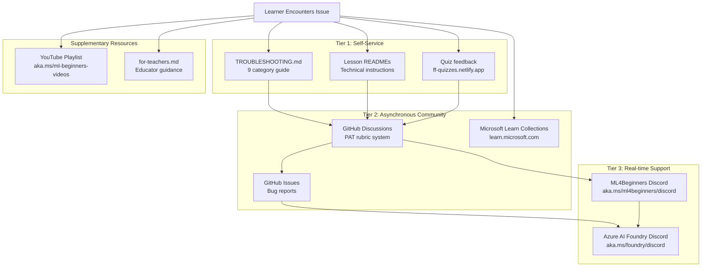
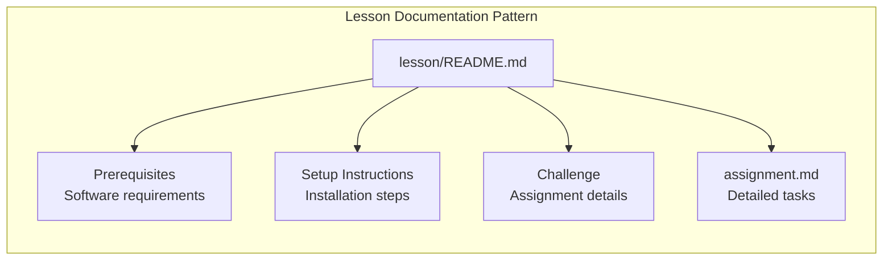
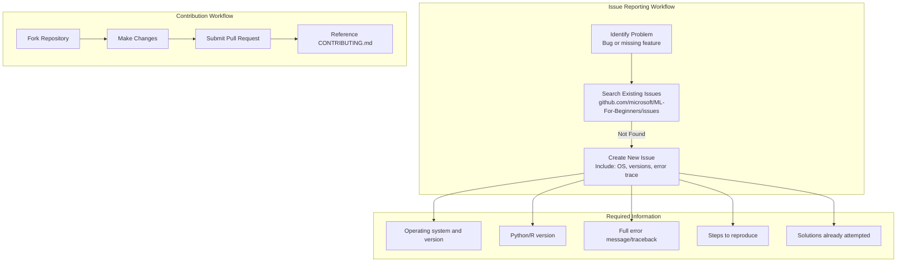
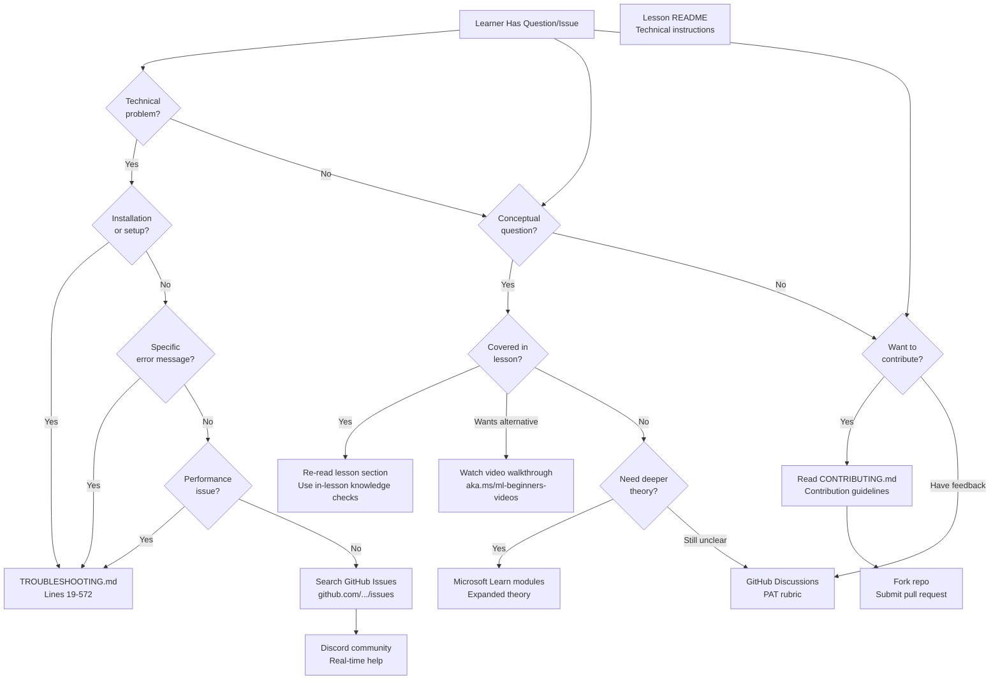

<!-- source: DeepWiki mcp.deepwiki.com · repo microsoft/ML-For-Beginners · page 1.4 Community and Support Resources · fetched 2026-10-26 -->

# Community and Support Resources

<details>
<summary>Relevant source files</summary>

The following files were used as context for generating this wiki page:

- [1-Introduction/1-intro-to-ML/README.md](1-Introduction/1-intro-to-ML/README.md)
- [1-Introduction/2-history-of-ML/README.md](1-Introduction/2-history-of-ML/README.md)
- [1-Introduction/README.md](1-Introduction/README.md)
- [1-Introduction/images/globe.jpg](1-Introduction/images/globe.jpg)
- [2-Regression/README.md](2-Regression/README.md)
- [5-Clustering/README.md](5-Clustering/README.md)
- [README.md](README.md)
- [TROUBLESHOOTING.md](TROUBLESHOOTING.md)
- [images/3.png](images/3.png)
- [quiz-app/src/assets/translations/en.json](quiz-app/src/assets/translations/en.json)

</details>


This document describes the support infrastructure available to learners using the ML-For-Beginners curriculum. It covers self-service troubleshooting resources, real-time community channels, educational supplementary materials, and pathways for contributing feedback. For information about the pedagogical learning approach and assessment methods, see [Learning Approach](#1.2). For technical setup requirements, see [Technical Requirements](#1.3).

---

## Overview of Support Architecture

The ML-For-Beginners curriculum provides multi-tiered support to accommodate diverse learner needs, from self-service documentation to real-time community assistance. The support ecosystem is designed with escalation pathways: learners begin with self-service resources, escalate to asynchronous community discussions, and can ultimately reach real-time support channels for urgent issues.



Sources: [README.md:51-52](), [README.md:94](), [README.md:176-184](), [TROUBLESHOOTING.md:1-16]()

---

## Self-Service Documentation

### TROUBLESHOOTING.md Structure

The primary self-service resource is `TROUBLESHOOTING.md`, which provides solutions for 9 categories of common technical issues. This document is referenced directly in the main README as the first point of contact for technical problems.

| Category | Coverage | File Location |
|----------|----------|---------------|
| Installation Issues | Python, Jupyter, R setup | [TROUBLESHOOTING.md:19-93]() |
| Jupyter Notebook Issues | Kernel management, cell execution | [TROUBLESHOOTING.md:96-146]() |
| Python Package Issues | Import errors, version conflicts | [TROUBLESHOOTING.md:149-220]() |
| R Environment Issues | Package installation, RMarkdown | [TROUBLESHOOTING.md:223-273]() |
| Quiz Application Issues | npm build, port conflicts | [TROUBLESHOOTING.md:276-339]() |
| Data and File Path Issues | Relative paths, missing datasets | [TROUBLESHOOTING.md:342-381]() |
| Common Error Messages | Memory errors, convergence warnings | [TROUBLESHOOTING.md:384-465]() |
| Performance Issues | Slow execution, high memory usage | [TROUBLESHOOTING.md:468-507]() |
| Environment and Configuration | Virtual environments, Git issues | [TROUBLESHOOTING.md:510-572]() |

Each category includes problem descriptions, solution code snippets, and command-line examples. The document uses a consistent structure: **Problem** statement followed by **Solution** with executable code.

Sources: [TROUBLESHOOTING.md:5-15](), [TROUBLESHOOTING.md:19-572]()

### Lesson-Specific Documentation

Each lesson contains a README with technical instructions and common issues specific to that topic. For example, the introduction to machine learning provides setup guidance for Python, Node.js, and required libraries.



Sources: [1-Introduction/1-intro-to-ML/README.md:20-27](), [1-Introduction/1-intro-to-ML/README.md:145]()

---

## Community Support Channels

### GitHub Discussions

The repository uses GitHub Discussions for asynchronous community learning and feedback. Learners are encouraged to use the PAT (Progress Assessment Tool) rubric system to document their learning journey and reflect on completed lesson groups.

**PAT Rubric Workflow:**
1. Complete a lesson group (e.g., all regression lessons)
2. Navigate to GitHub Discussions at `https://github.com/microsoft/ML-For-Beginners/discussions`
3. Fill out the appropriate PAT rubric
4. "Learn out loud" by sharing insights and challenges
5. React to other learners' PATs to foster collaborative learning

Sources: [README.md:62](), [README.md:94]()

### Discord Servers

Two Discord servers provide real-time community support:

#### ML4Beginners Discord
- **Access:** [aka.ms/ml4beginners/discord](https://aka.ms/ml4beginners/discord)
- **Purpose:** Primary community for curriculum-specific questions
- **Special Events:** "Learn with AI" series (September 18-30, 2025) focusing on GitHub Copilot for Data Science
- **Badge Display:** Repository README includes Discord badge using `dcbadge.limes.pink/api/server/kzRShWzttr`

#### Azure AI Foundry Discord
- **Access:** [aka.ms/foundry/discord](https://aka.ms/foundry/discord)
- **Purpose:** Broader AI development community for production deployment questions
- **Badge:** Displayed in troubleshooting guide and main README

Sources: [README.md:21-23](), [README.md:176-184](), [TROUBLESHOOTING.md:576]()

### GitHub Issues and Pull Requests

For bugs, feature requests, and technical contributions, learners use the standard GitHub workflow:



Sources: [TROUBLESHOOTING.md:587-594](), [README.md:94](), [README.md:46-47]()

---

## Educational Supplementary Resources

### Microsoft Learn Collections

The curriculum is integrated with Microsoft Learn, providing additional modules and learning paths. Learners access these collections through two primary links:

- **Main Collection:** `https://learn.microsoft.com/en-us/collections/qrqzamz1nn2wx3?WT.mc_id=academic-77952-bethanycheum`
- **Additional Modules:** `https://docs.microsoft.com/en-us/users/jenlooper-2911/collections/k7o7tg1gp306q4?WT.mc_id=academic-77952-leestott`

These collections include:
- Low-code ML tools tutorials (Azure ML)
- Expanded theoretical content
- Cloud-based ML workflows
- Assessment modules

Sources: [README.md:49](), [README.md:64](), [README.md:144](), [TROUBLESHOOTING.md:577]()

### Video Walkthroughs

The YouTube playlist at [aka.ms/ml-beginners-videos](https://aka.ms/ml-beginners-videos) contains video tutorials for selected lessons. These videos are embedded in lesson READMEs and provide visual walkthroughs of complex concepts.

**Video Integration Pattern in Lessons:**
```markdown
[](https://youtu.be/VIDEO_ID "Description")
> 🎥 Click the image above for a video...
```

Examples include:
- Introduction to ML [1-Introduction/1-intro-to-ML/README.md:7-9]()
- Regression models overview [2-Regression/README.md:11-12]()
- History of ML [1-Introduction/2-history-of-ML/README.md:10-12]()

Sources: [README.md:70-74](), [TROUBLESHOOTING.md:578](), [1-Introduction/1-intro-to-ML/README.md:7-15]()

### Quiz System

The standalone quiz application provides pre-lecture and post-lecture assessments for all 26 lessons, totaling 52 quizzes with 156 questions.

**Quiz System Architecture:**
- **Hosting:** Netlify at `ff-quizzes.netlify.app/en/ml/`
- **Source:** `quiz-app/` directory with Vue.js 3 implementation
- **Data Structure:** JSON files in `quiz-app/src/assets/translations/`
- **Languages:** 7 supported (en, fr, it, ja, ptbr, tr, es)

Each quiz object in the JSON follows this schema:
```json
{
  "id": 1,
  "title": "Introduction to Machine Learning: Pre-Lecture Quiz",
  "quiz": [
    {
      "questionText": "...",
      "answerOptions": [
        {
          "answerText": "...",
          "isCorrect": "true|false"
        }
      ]
    }
  ]
}
```

**Integration Points in Curriculum:**
- Pre-lecture quizzes linked at lesson start
- Post-lecture quizzes linked at lesson end
- Example: [1-Introduction/1-intro-to-ML/README.md:3]() and [1-Introduction/1-intro-to-ML/README.md:133]()

Sources: [README.md:101](), [README.md:108](), [README.md:112](), [quiz-app/src/assets/translations/en.json:1-59]()

---

## Educator Resources

### for-teachers.md Guide

Educators have access to a dedicated guide at `for-teachers.md` that provides:
- Classroom setup recommendations
- Suggested timelines for course delivery
- Assessment strategies
- Discussion facilitation tips

Sources: [README.md:66]()

### Lesson Templates

The repository provides a standardized lesson template that educators can reference when adapting content or creating extensions. Each lesson follows a consistent structure:

| Component | Purpose | File Pattern |
|-----------|---------|--------------|
| README.md | Main lesson content | `{module}/{lesson}/README.md` |
| Pre-quiz link | Readiness assessment | Links to `ff-quizzes.netlify.app` |
| Sketchnote | Visual summary | `sketchnotes/{topic}.png` |
| Video walkthrough | Visual instruction (optional) | Embedded YouTube link |
| Knowledge checks | In-lesson validation | Markdown callouts with ✅ |
| Challenge | Hands-on exercise | Inline section |
| Assignment | Homework task | `assignment.md` |
| Post-quiz link | Retention assessment | Links to `ff-quizzes.netlify.app` |

Sources: [README.md:96-109](), [1-Introduction/2-history-of-ML/README.md:3]()

### Sketchnotes

Visual learners and educators can access CC BY-SA 4.0 licensed sketchnotes in the `sketchnotes/` directory. These are available in:
- **PNG format:** For digital display and embedding in lessons
- **TIFF format:** High-resolution for printing in classroom materials

Example sketchnote references:
- ML history: [1-Introduction/2-history-of-ML/README.md:3-4]()
- Clustering concepts: [5-Clustering/README.md:9]()

Sources: [README.md:98](), [1-Introduction/2-history-of-ML/README.md:3-4]()

---

## Support Resource Decision Tree

The following diagram maps common learner scenarios to appropriate support resources:



Sources: [TROUBLESHOOTING.md:1-596](), [README.md:49-74](), [README.md:176-184]()

---

## Code of Conduct and Contribution Guidelines

### CODE_OF_CONDUCT.md

All community interactions (Discord, Discussions, Issues, PRs) are governed by the Microsoft Open Source Code of Conduct. Learners and contributors must adhere to these standards when participating in any support channel.

Sources: [README.md:94]()

### CONTRIBUTING.md

The contribution guidelines document specifies:
- Pull request submission process
- Code style requirements
- Testing expectations for contributed code
- Documentation standards

Contributors are encouraged to improve the curriculum through:
- Bug fixes
- Typo corrections
- Additional examples
- Enhanced explanations
- Translation improvements (via automated system)

Sources: [README.md:94](), [README.md:46-47]()

---

## Additional Networking and Related Courses

The README promotes other Microsoft curriculum repositories that learners may explore for related topics:

| Course | URL Pattern | Relevance to ML4Beginners |
|--------|-------------|---------------------------|
| AI for Beginners | aka.ms/ai-beginners | Deep learning and neural networks |
| Data Science for Beginners | aka.ms/datascience-beginners | Data analysis foundations |
| Generative AI for Beginners | aka.ms/genai-beginners | Modern LLM applications |
| Edge AI for Beginners | aka.ms/edgeai-for-beginners | Deployment on edge devices |

These courses form a learning pathway where ML-For-Beginners provides classical machine learning foundations before learners advance to specialized topics.

Sources: [README.md:155-174]()

---

## Translation and Localization Support

The curriculum supports 50+ languages through an automated translation system powered by GitHub Actions and the co-op-translator package. This allows non-English speakers to access support resources in their native language.

**Translation Coverage:**
- Main README files in all modules
- Lesson content
- Assignment instructions

**Languages Include:** Arabic, Chinese (Simplified, Traditional variants for Hong Kong, Macau, Taiwan), French, German, Spanish, Japanese, Korean, Hindi, and 40+ others.

**Access Pattern:**
`translations/{language-code}/README.md` (e.g., `translations/es/README.md` for Spanish)

Sources: [README.md:11-17]()

---

## Contact and Badge Information

Repository status and community metrics are displayed via badges in the main README:

```markdown
[](...)
[](...)
[](...)
[](...)
```

These badges provide quick links to:
- Current open issues count
- Active contributors
- License information (MIT)
- Pull request welcome status

Sources: [README.md:1-9]()

---

