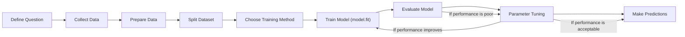
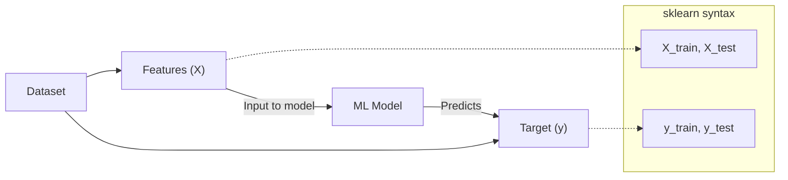
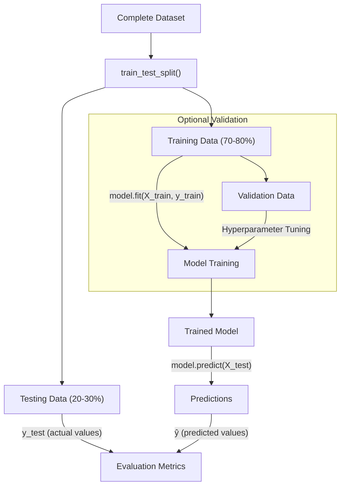
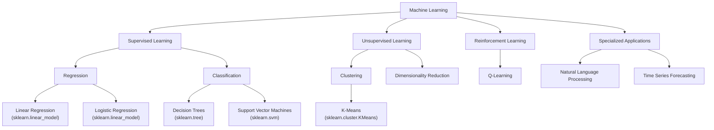
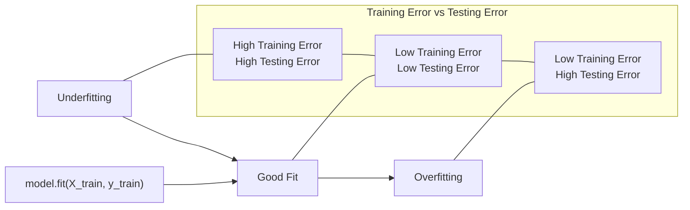
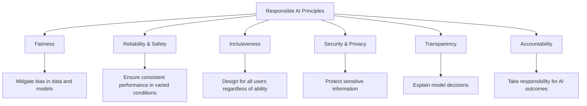
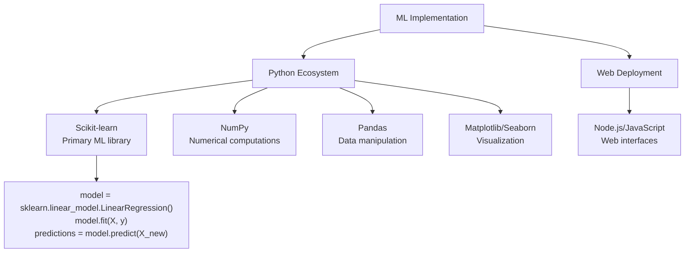

<!-- source: DeepWiki mcp.deepwiki.com · repo microsoft/ML-For-Beginners · page 2 Core ML Concepts · fetched 2026-10-26 -->

# Core ML Concepts

Relevant source files

The following files were used as context for generating this wiki page:

- [1-Introduction/1-intro-to-ML/README.md](1-Introduction/1-intro-to-ML/README.md)
- [1-Introduction/2-history-of-ML/README.md](1-Introduction/2-history-of-ML/README.md)
- [1-Introduction/4-techniques-of-ML/README.md](1-Introduction/4-techniques-of-ML/README.md)
- [1-Introduction/4-techniques-of-ML/assignment.md](1-Introduction/4-techniques-of-ML/assignment.md)
- [1-Introduction/4-techniques-of-ML/images/overfitting.png](1-Introduction/4-techniques-of-ML/images/overfitting.png)
- [1-Introduction/README.md](1-Introduction/README.md)
- [1-Introduction/images/globe.jpg](1-Introduction/images/globe.jpg)
- [2-Regression/README.md](2-Regression/README.md)
- [5-Clustering/README.md](5-Clustering/README.md)
- [README.md](README.md)
- [TROUBLESHOOTING.md](TROUBLESHOOTING.md)
- [images/3.png](images/3.png)
- [quiz-app/src/assets/translations/en.json](quiz-app/src/assets/translations/en.json)

This document provides an overview of the fundamental machine learning concepts covered in the ML-For-Beginners curriculum. It introduces the core principles, terminology, and processes that form the foundation for all machine learning systems. The material is meant to bridge the introduction to ML with the specific learning paradigms explored in later sections. For detailed information about specific ML implementations, see [Supervised Learning](#3), [Unsupervised Learning](#4), and [Specialized ML Applications](#5).

## The Machine Learning Process

Machine learning follows a structured workflow from problem formulation to model deployment. Understanding this process is essential for developing effective ML solutions.

### The ML Workflow

The process begins with a specific question that cannot be easily answered with rule-based programming. Data collection and preparation follow, leading to model training, evaluation, and refinement before using the model to make predictions on new data.

Sources: [1-Introduction/4-techniques-of-ML/README.md:16-24](). [1-Introduction/4-techniques-of-ML/README.md:98-101]().

## Key ML Terminology

### Features and Target Variables

- **Features**: Measurable properties of your data (independent variables), represented as `X` in code
- **Target**: What you're trying to predict (dependent variable), represented as `y` in code

Features are the inputs to your model, while the target is what the model learns to predict.

Sources: [1-Introduction/4-techniques-of-ML/README.md:48-51]().

### Dataset Splitting

Data is typically split into:
- **Training data**: Used to fit the model (70-80% of data)
- **Testing data**: Used to evaluate the model's performance on unseen data (20-30%)
- **Validation data**: Optional split used for hyperparameter tuning

In scikit-learn, this is implemented using the `train_test_split` function.

Sources: [1-Introduction/4-techniques-of-ML/README.md:61-67]().

## Learning Paradigms

Machine learning encompasses several learning paradigms that differ in their approach and application.

### ML Paradigms Overview

Sources: [1-Introduction/1-intro-to-ML/translations/README.fr.md:50-61](). [1-Introduction/4-techniques-of-ML/README.md:70-76]().

### Supervised Learning

Supervised learning involves training a model on labeled data to make predictions. The model learns to map input features to known output values.

| Type | Purpose | Examples | Target Type |
|------|---------|----------|------------|
| Regression | Predict continuous values | House price prediction, temperature forecasting | Numeric |
| Classification | Predict categories or classes | Email spam detection, image recognition | Categorical |

For more details, see [Supervised Learning](#3), [Regression](#3.1), and [Classification](#3.2).

Sources: [1-Introduction/1-intro-to-ML/translations/README.fr.md:54-56]().

### Unsupervised Learning

Unsupervised learning involves finding patterns or structure in unlabeled data. The model identifies inherent groupings or patterns without predefined outputs.

| Type | Purpose | Examples |
|------|---------|----------|
| Clustering | Group similar data points | Customer segmentation, anomaly detection |
| Dimensionality Reduction | Reduce feature space | Data compression, visualization |

For more details, see [Unsupervised Learning](#4) and [Clustering](#4.1).

Sources: [1-Introduction/1-intro-to-ML/translations/README.fr.md:57]().

### Specialized Applications

Beyond the fundamental paradigms, machine learning has specialized applications in various domains:

- **Natural Language Processing (NLP)**: Working with text data
- **Time Series Forecasting**: Predicting future values based on sequential data
- **Reinforcement Learning**: Learning through interaction with an environment

For more details, see [Specialized ML Applications](#5).

Sources: [1-Introduction/1-intro-to-ML/translations/README.fr.md:58-60]().

## Model Training and Evaluation

### Model Fitting

- **Underfitting**: Model is too simple to capture the underlying pattern in the data
- **Good fit**: Model generalizes well to unseen data
- **Overfitting**: Model learns the noise in the training data and performs poorly on new data

Sources: [1-Introduction/4-techniques-of-ML/README.md:86-90]().

### Model Evaluation Metrics

Model performance is assessed using various metrics depending on the learning paradigm:

| Learning Type | Common Metrics | Scikit-learn Implementation |
|---------------|----------------|----------------------------|
| Regression | Mean Squared Error (MSE), Root Mean Squared Error (RMSE), Mean Absolute Error (MAE) | `sklearn.metrics.mean_squared_error`, `sklearn.metrics.mean_absolute_error` |
| Classification | Accuracy, Precision, Recall, F1 Score, ROC-AUC | `sklearn.metrics.accuracy_score`, `sklearn.metrics.precision_recall_fscore_support`, `sklearn.metrics.roc_auc_score` |
| Clustering | Silhouette Score, Davies-Bouldin Index | `sklearn.metrics.silhouette_score`, `sklearn.metrics.davies_bouldin_score` |

Sources: [1-Introduction/4-techniques-of-ML/README.md:80-84]().

### Parameter Tuning

Improving model performance often involves adjusting hyperparameters, which are values set before training begins. This process may include:

- Grid Search: Testing all possible combinations of parameters
- Random Search: Testing random combinations of parameters
- Cross-Validation: Using multiple train-test splits to validate parameter choices

In scikit-learn, this can be implemented using `GridSearchCV` or `RandomizedSearchCV`.

Sources: [1-Introduction/4-techniques-of-ML/README.md:94-96]().

## Responsible AI in Machine Learning

Machine learning solutions should be built with responsible AI principles in mind. These principles ensure that ML systems are fair, reliable, inclusive, secure, transparent, and accountable.

### Impact Assessment and Debugging

When implementing ML solutions, consider:

- **Adverse impact on individuals**: Identify potential harms from system use
- **Data requirements**: Understand regulatory and quality requirements
- **Fairness analysis**: Evaluate for bias across different groups
- **Interpretability**: Understand what drives model outcomes

Sources: [1-Introduction/3-fairness/README.md:33-96](). [1-Introduction/3-fairness/README.md:97-117]().

## ML Technologies and Implementation

The curriculum primarily uses the following technologies for implementing machine learning concepts:

### Key Libraries

In this curriculum, you'll primarily work with:

- **Scikit-learn**: For implementing ML algorithms
- **Python**: As the primary programming language
- **JavaScript/Node.js**: For web application development

Sources: [1-Introduction/1-intro-to-ML/translations/README.fr.md:18-24]().

## Conclusion

This overview of core ML concepts provides the foundation for understanding the more detailed explorations of specific machine learning techniques in the subsequent sections of this curriculum. As you progress through the material, you'll build on these concepts and gain hands-on experience implementing various machine learning solutions.

Remember that effective machine learning requires not only technical skill but also careful consideration of responsible AI principles to ensure your solutions are beneficial, fair, and ethical.

For specific implementations and deeper exploration of these concepts, refer to the subsequent sections of this curriculum.

---

