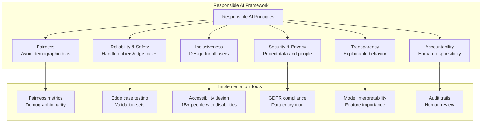
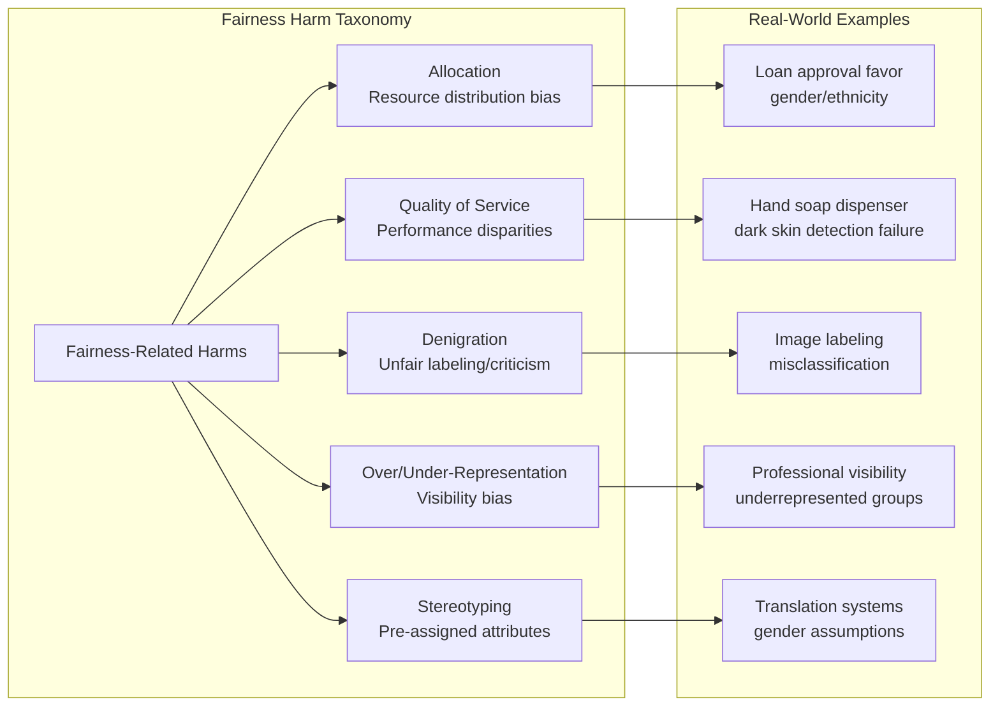
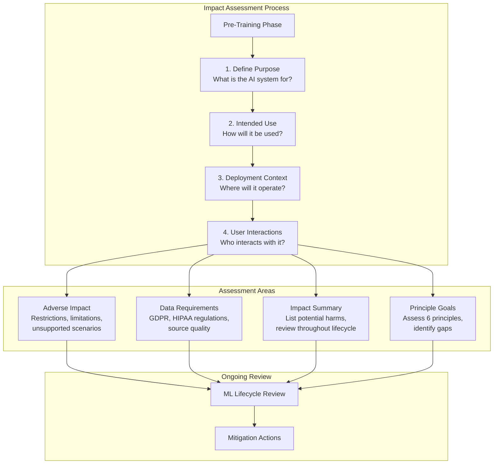
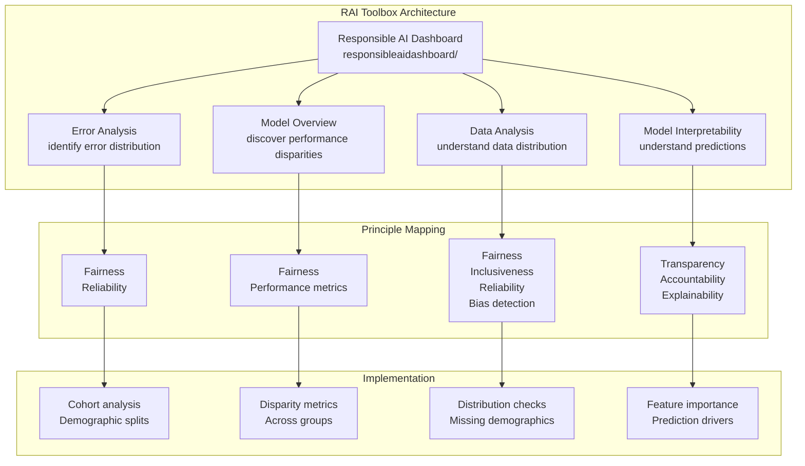

<!-- source: DeepWiki mcp.deepwiki.com · repo microsoft/ML-For-Beginners · page 2.2 Fairness and Ethics in ML · fetched 2026-10-26 -->

# Fairness and Ethics in ML

Relevant source files

The following files were used as context for generating this wiki page:

- [1-Introduction/3-fairness/README.md](1-Introduction/3-fairness/README.md)
- [1-Introduction/3-fairness/assignment.md](1-Introduction/3-fairness/assignment.md)
- [1-Introduction/3-fairness/images/accessibility.png](1-Introduction/3-fairness/images/accessibility.png)
- [1-Introduction/3-fairness/images/accountability.png](1-Introduction/3-fairness/images/accountability.png)

## Purpose and Scope

This document covers responsible AI principles and their implementation in machine learning systems, with emphasis on fairness considerations, harm prevention, impact assessment methodologies, and debugging tools. The material focuses on ethical frameworks that should be applied during the ML development lifecycle.

For foundational ML concepts and terminology, see [Introduction to Machine Learning](#2.1). For the broader development process including training and evaluation, see [ML Development Workflow](#2.3).

**Sources:** [1-Introduction/3-fairness/README.md:1-160]()

---

## Responsible AI Principles

The curriculum establishes six core principles for building trustworthy ML systems. These principles form the evaluation framework applied throughout the learning modules, particularly during model assessment and deployment decisions.

**Sources:** [1-Introduction/3-fairness/README.md:14-21, 33-95]()

### Principle Definitions

| Principle | Definition | Key Considerations |
|-----------|-----------|-------------------|
| **Fairness** | Treat everyone fairly; avoid affecting similar groups differently | Data may contain inherited biases; requires conscious bias detection |
| **Reliability & Safety** | Consistent performance under normal and unexpected conditions | Must anticipate outliers, edge cases (weather, lighting, etc.) |
| **Inclusiveness** | Engage and empower everyone | Address barriers for 1 billion people with disabilities globally |
| **Security & Privacy** | Protect confidential information and resist attacks | GDPR compliance; balance personalization with privacy |
| **Transparency** | Understandable behavior and components | Stakeholders must comprehend how/why systems function |
| **Accountability** | Human responsibility for system operation | Particularly critical for sensitive applications (facial recognition) |

**Sources:** [1-Introduction/3-fairness/README.md:33-95]()

---

## Fairness-Related Harms

The curriculum identifies five categories of fairness-related harms ("unfairness") that ML systems can perpetuate. Understanding these harm types is essential for data cleaning, feature engineering, and model evaluation phases.

**Sources:** [1-Introduction/3-fairness/README.md:37-50]()

### Harm Type Examples

**Allocation**: A gender or ethnicity is favored in resource distribution (e.g., medical treatment recommendations, loan applications, employment decisions for similar qualifications).

**Quality of Service**: Training data covers one scenario but reality is more complex, leading to poor performance. Example: hand soap dispensers unable to sense people with dark skin ([Gizmodo reference](https://gizmodo.com/why-cant-this-soap-dispenser-identify-dark-skin-1797931773)).

**Denigration**: Unfair criticism or labeling. Example: image labeling technology that mislabeled images of dark-skinned people as gorillas.

**Over/Under-Representation**: Certain groups not seen in professions; services promoting this contribute to harm by perpetuating invisibility.

**Stereotyping**: Associating groups with pre-assigned attributes. Example: English-Turkish translation systems with gender-stereotyped word associations (e.g., "doctor" → male pronouns, "nurse" → female pronouns in translation).

**Sources:** [1-Introduction/3-fairness/README.md:37-50]()

---

## Impact Assessment Methodology

Before training models, the curriculum requires conducting an impact assessment to understand system purpose, intended use, deployment context, and user interactions. This assessment identifies potential risks and expected consequences.

**Sources:** [1-Introduction/3-fairness/README.md:97-107]()

### Assessment Focus Areas

| Area | Questions to Address |
|------|---------------------|
| **Adverse Impact on Individuals** | What restrictions/requirements exist? What unsupported use cases could cause harm? What known limitations affect performance? |
| **Data Requirements** | Where will data be used? GDPR/HIPAA compliance needed? Is data source substantial for training? What is data origin and integrity? |
| **Summary of Impact** | What potential harms could arise? Are identified issues mitigated throughout ML lifecycle? |
| **Applicable Goals** | Are goals from each of the six principles met? What gaps exist? |

**Sources:** [1-Introduction/3-fairness/README.md:99-107]()

---

## Responsible AI Toolbox Integration

The curriculum integrates Microsoft's Responsible AI Toolbox (RAI Toolbox) for debugging AI systems. This open-source framework provides four core capabilities mapped to the responsible AI principles.

**Sources:** [1-Introduction/3-fairness/README.md:109-117, 149-151]()

### RAI Toolbox Components

**Error Analysis**: Identifies error distribution patterns that can affect system fairness or reliability. Enables drilling down into specific cohorts where model performance degrades.

**Model Overview**: Discovers disparities in model performance across data cohorts (e.g., demographic groups, feature ranges). Surfaces where "similar groups" receive different treatment.

**Data Analysis**: Understands data distribution to identify potential bias (missing demographics, disproportionate representation) leading to fairness, inclusiveness, and reliability issues.

**Model Interpretability**: Explains what influences model predictions. Critical for transparency (understanding behavior) and accountability (determining responsibility for outcomes).

**Sources:** [1-Introduction/3-fairness/README.md:111-117]()

### Toolbox Access Points

The RAI Toolbox is implemented as:
- **GitHub Repository**: `microsoft/responsible-ai-toolbox` - main open-source project
- **Jupyter Notebooks**: `notebooks/responsibleaidashboard/getting-started.ipynb` - interactive tutorials
- **Python Package**: `responsibleai` - installable via pip
- **Azure ML Integration**: Available as built-in component

**Assignment Reference**: Students explore RAI Toolbox notebooks and document findings ([1-Introduction/3-fairness/assignment.md:1-12]()).

**Sources:** [1-Introduction/3-fairness/README.md:149-159](), [1-Introduction/3-fairness/assignment.md:1-12]()

---

## Challenge Exercise

The curriculum includes a challenge focused on harm prevention and bias mitigation:

**Core Question**: "What else should we consider?" when thinking about real-life scenarios where model untrustworthiness is evident.

**Required Actions**:
- Ensure diversity of backgrounds and perspectives among team members
- Invest in datasets reflecting society's diversity
- Develop better methods throughout ML lifecycle for detecting and correcting responsible AI issues

**Sources:** [1-Introduction/3-fairness/README.md:119-127]()

---

## Pre/Post Assessment

The lesson includes quiz assessments at:
- **Pre-lecture**: `https://ff-quizzes.netlify.app/en/ml/` - tests baseline understanding
- **Post-lecture**: Same URL - validates learning outcomes

**Sources:** [1-Introduction/3-fairness/README.md:6, 129]()

---

## Learning Resources

### Required Prerequisites

**Microsoft Learn Path**: "Responsible AI Principles" module at `docs.microsoft.com/learn/modules/responsible-ai-principles/` provides foundational knowledge before lesson content.

**Video**: "Microsoft's Approach to Responsible AI" (YouTube: `dnC8-uUZXSc`) introduces corporate perspective.

**Sources:** [1-Introduction/3-fairness/README.md:23-31]()

### Supplementary Materials

| Resource Type | Description | Link |
|--------------|-------------|------|
| **Workshop Video** | "RAI Toolbox: An open-source framework for building responsible AI" by Besmira Nushi, Mehrnoosh Sameki, Amit Sharma | YouTube: `tGgJCrA-MZU` |
| **RAI Resource Center** | Microsoft AI responsible AI resources | `microsoft.com/ai/responsible-ai-resources` |
| **FATE Research** | Fairness, Accountability, Transparency, Ethics research group | `microsoft.com/research/theme/fate/` |
| **Azure ML Tools** | Fairness tools in Azure Machine Learning | `docs.microsoft.com/azure/machine-learning/concept-fairness-ml` |

**Sources:** [1-Introduction/3-fairness/README.md:131-156]()

---

## Integration with Curriculum

This fairness lesson appears early in the 12-week curriculum (Week 1, Introduction module) to establish ethical frameworks before technical implementation. Subsequent modules apply these principles during:

- **Regression** (Weeks 3-4): Evaluating pumpkin pricing predictions for demographic fairness
- **Classification** (Weeks 5-6): Analyzing cuisine classifiers for cultural representation
- **NLP** (Weeks 8-9): Examining sentiment analysis for language/cultural bias
- **Real-World Applications** (Week 12): Assessing deployed systems across fairness dimensions

The RAI Dashboard is introduced here but used throughout the curriculum for model debugging and evaluation.

**Sources:** [1-Introduction/3-fairness/README.md:1-160]()

---

