<!-- source: DeepWiki mcp.deepwiki.com · repo microsoft/ML-For-Beginners · page 2.3 ML Development Workflow · fetched 2026-10-26 -->

# ML Development Workflow

<details>
<summary>Relevant source files</summary>

The following files were used as context for generating this wiki page:

- [1-Introduction/4-techniques-of-ML/README.md](1-Introduction/4-techniques-of-ML/README.md)
- [1-Introduction/4-techniques-of-ML/assignment.md](1-Introduction/4-techniques-of-ML/assignment.md)
- [1-Introduction/4-techniques-of-ML/images/overfitting.png](1-Introduction/4-techniques-of-ML/images/overfitting.png)

</details>


## Purpose and Scope

This document details the iterative machine learning development workflow, from problem definition through model deployment. It covers the systematic process of data collection, preparation, feature engineering, train/test splitting, model training, evaluation, hyperparameter tuning, and prediction. This workflow applies to all classical ML tasks covered in the curriculum.

For conceptual ML definitions and terminology, see [Introduction to Machine Learning](#2.1). For considerations about bias and responsible AI during the workflow, see [Fairness and Ethics in ML](#2.2). For specific algorithm implementations, see the relevant module pages: [Regression](#3.1), [Classification](#3.2), [Clustering](#4.1), [NLP](#5.1), [Time Series](#5.2), or [Reinforcement Learning](#5.3).

---

## ML Development Process Overview

The ML development workflow consists of seven primary stages that form an iterative cycle. The process is not strictly linear; practitioners often revisit earlier stages based on evaluation results.

### End-to-End Workflow Diagram

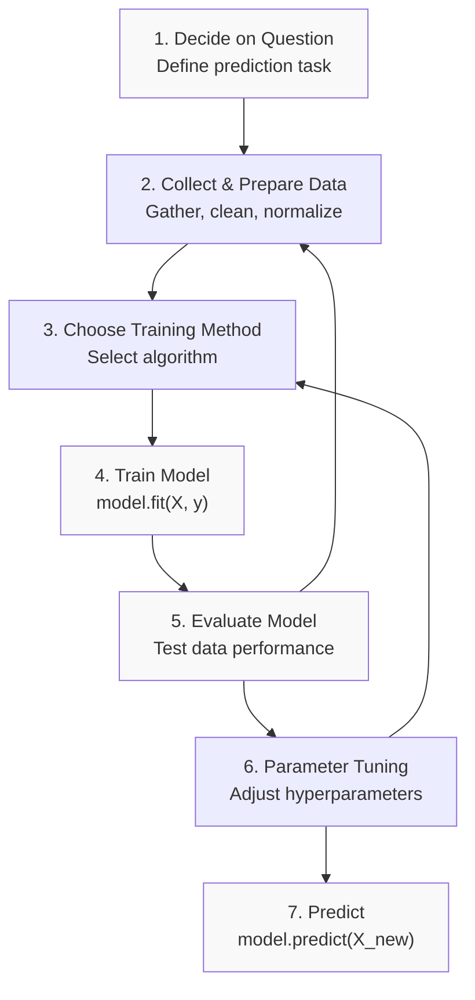

Sources: [1-Introduction/4-techniques-of-ML/README.md:16-24]()

---

## Stage 1: Problem Definition

The workflow begins by formulating a question that requires data-driven predictions rather than conditional logic. ML is appropriate when patterns are hidden or too complex for rule-based systems.

### Characteristics of ML-Suitable Questions

- **Pattern-based**: Requires discovering hidden correlations in data
- **Prediction-focused**: Aims to estimate future or unknown values
- **Data-available**: Sufficient historical data exists
- **Non-trivial**: Cannot be solved with simple conditional programs

Examples from the curriculum:
- "What color pumpkins will be cheapest in December?" (regression)
- "What cuisine does this ingredient combination represent?" (classification)
- "What genres of music cluster together?" (unsupervised learning)
- "What sentiment does this hotel review express?" (NLP)

Sources: [1-Introduction/4-techniques-of-ML/README.md:26-32]()

---

## Stage 2: Data Collection and Preparation

Data preparation is a multi-step process that significantly impacts model quality. The principle "garbage in, garbage out" applies strongly to ML systems.

### Data Collection Requirements

| Consideration | Description | Example |
|---------------|-------------|---------|
| **Source awareness** | Document data origin and inherent biases | US-pumpkins.csv from USDA market data |
| **Quantity** | Sufficient samples for pattern learning | 1,757 pumpkin price records |
| **Quality** | Accurate, complete, representative | Filter nulls, outliers |
| **Type match** | Appropriate for the question | Continuous prices for regression |

### Data Preparation Pipeline

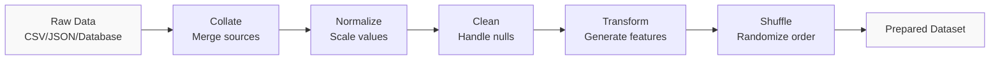

### Common Preparation Operations

**String to Numeric Conversion**: Convert categorical strings to integer encodings (used in clustering: [5-Clustering/1-Visualize/README.md]())

**Feature Generation**: Create new data columns from existing ones (used in classification: [4-Classification/1-Introduction/README.md]())

**Cleaning**: Remove or impute missing values, filter outliers, standardize formats (used before web app deployment: [3-Web-App/README.md]())

**Randomization**: Shuffle data to prevent order-based bias in training

Sources: [1-Introduction/4-techniques-of-ML/README.md:38-45]()

---

## Stage 3: Feature and Target Identification

### Feature Variables

A **feature** is a measurable property used as model input. Features are typically represented as columns in tabular data.

- **Code representation**: Variable `X` (uppercase)
- **Shape**: 2D array `(n_samples, n_features)`
- **Examples**: `'date'`, `'size'`, `'color'`, `'latitude'`, `'temperature'`

### Target Variables

A **target** (or **label**) is the value being predicted.

- **Code representation**: Variable `y` (lowercase)
- **Shape**: 1D array `(n_samples,)`
- **Examples**: 
  - Regression: pumpkin price, real estate value
  - Classification: cuisine category, sentiment label
  - Time series: future energy load

### Feature Selection vs Feature Extraction

| Technique | Definition | Method |
|-----------|------------|--------|
| **Feature Selection** | Returns subset of original features | Statistical tests, correlation analysis |
| **Feature Extraction** | Creates new features from functions of originals | PCA, polynomial features |

The distinction matters for performance and interpretability: selection preserves original meaning, while extraction may create abstract combinations.

Sources: [1-Introduction/4-techniques-of-ML/README.md:47-55]()

---

## Data Visualization and Analysis

Visualization libraries (Seaborn, MatPlotLib) enable pattern discovery and quality assessment before training.

### Visualization Use Cases

**Correlation Discovery**: Scatter plots reveal relationships between features and targets

**Bias Detection**: Class distribution charts identify imbalanced datasets (as in [4-Classification/2-Classifiers-1/README.md]())

**Outlier Identification**: Box plots and histograms highlight anomalous data points

**Feature Distribution**: Histograms show value ranges and normalization needs

Sources: [1-Introduction/4-techniques-of-ML/README.md:57-59]()

---

## Dataset Splitting

Prior to training, datasets are divided into distinct subsets to enable unbiased evaluation.

### Train/Test/Validation Split Architecture

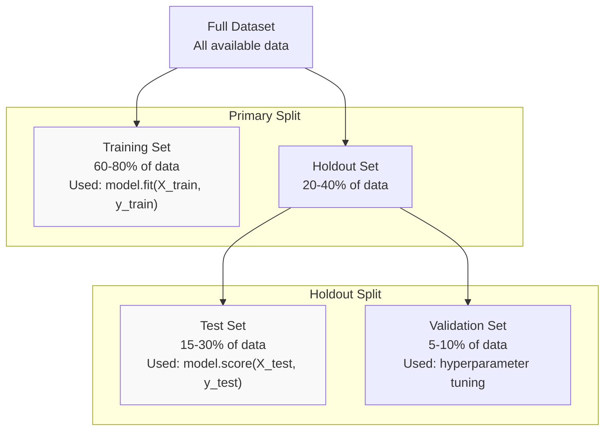

### Split Characteristics by Dataset Type

| Split | Purpose | Size | Data Independence |
|-------|---------|------|-------------------|
| **Training** | Model fitting via `model.fit()` | 60-80% | Largest portion |
| **Testing** | Final performance evaluation | 15-30% | Never seen during training |
| **Validation** | Hyperparameter tuning | 5-10% | Optional, for large datasets |

### Special Case: Time Series Splitting

Time series data requires **temporal splitting** (not random) to prevent data leakage. Training data must precede test data chronologically, as covered in [7-TimeSeries/1-Introduction/README.md]().

Sources: [1-Introduction/4-techniques-of-ML/README.md:61-67]()

---

## Stage 4: Model Training

Training exposes the model to data patterns and adjusts internal parameters to minimize prediction error.

### Training Method Selection

Scikit-learn (referenced at [https://scikit-learn.org/stable/user_guide.html]()) provides multiple training methods categorized by task type:

- **Supervised Learning**: Linear models, tree-based models, SVMs, neural networks
- **Unsupervised Learning**: K-Means, hierarchical clustering, DBSCAN
- **Time Series**: ARIMA/SARIMA via statsmodels
- **Reinforcement Learning**: Q-Learning with custom implementations

Method selection depends on:
1. Question type (regression, classification, clustering)
2. Data characteristics (size, dimensionality, linearity)
3. Performance requirements (accuracy vs speed)
4. Interpretability needs

### Model Fitting Process

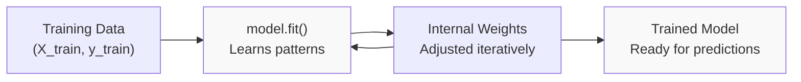

The `model.fit()` method is universal across scikit-learn estimators:

```
# Standard pattern in curriculum notebooks
model.fit(X_train, y_train)
```

**Key concept**: Training adjusts internal weights to privilege certain data patterns, building a statistical representation of relationships between features and target.

### Training Iterations (Epochs)

Large or complex models may require multiple passes through the training data. Each complete pass is an **epoch**. The training process continues until:
- Loss function converges
- Maximum iterations reached
- Early stopping criteria met

Sources: [1-Introduction/4-techniques-of-ML/README.md:69-79]()

---

## Stage 5: Model Evaluation

Evaluation measures model quality using previously unseen test data.

### Evaluation Workflow

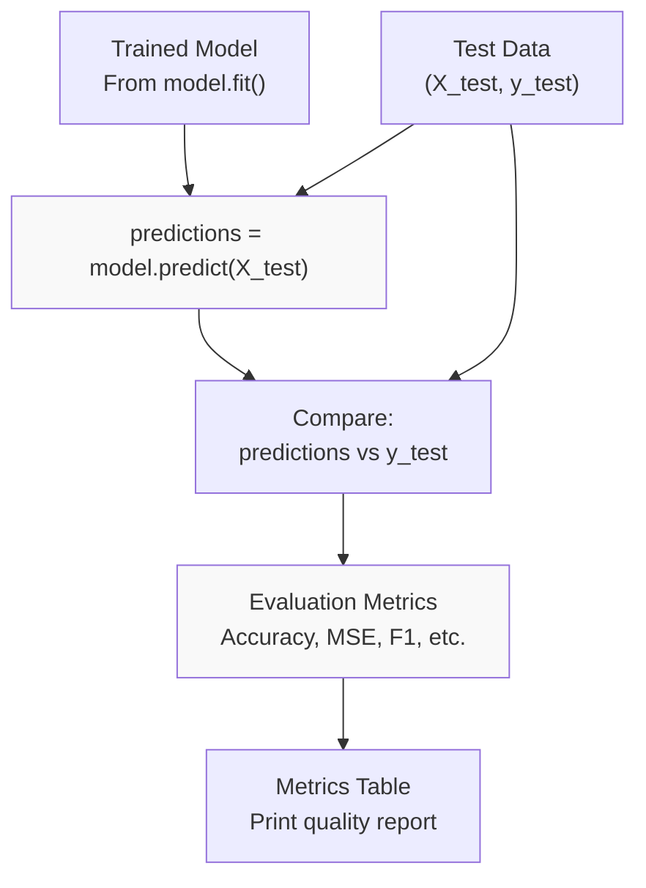

### Common Evaluation Metrics by Task Type

| Task Type | Metrics | Description |
|-----------|---------|-------------|
| **Regression** | MSE, RMSE, R² | Error magnitude, variance explained |
| **Classification** | Accuracy, Precision, Recall, F1, ROC-AUC | Class prediction quality |
| **Clustering** | Silhouette score, Elbow method | Cluster cohesion/separation |
| **Time Series** | MAPE, MAE | Forecasting error percentage |

The test data must be a subset of the original dataset that the model has **never analyzed** during training.

Sources: [1-Introduction/4-techniques-of-ML/README.md:81-83]()

---

## Model Fitting Quality

### Underfitting vs Overfitting

**Model fitting** refers to how well the model's function approximates the true underlying pattern.

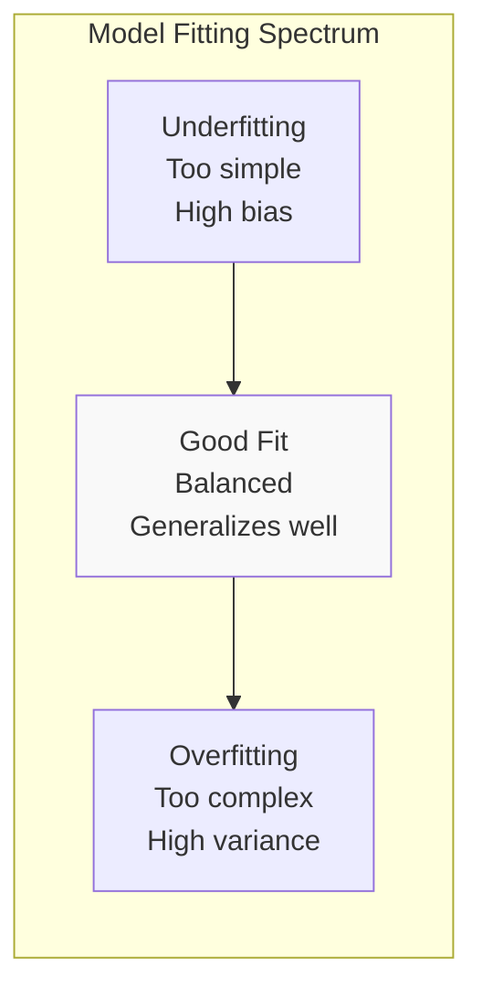

### Characteristics

| Issue | Cause | Training Performance | Test Performance |
|-------|-------|---------------------|------------------|
| **Underfitting** | Model too simple | Poor accuracy | Poor accuracy |
| **Good Fit** | Appropriate complexity | Good accuracy | Good accuracy |
| **Overfitting** | Model too complex | Excellent accuracy | Poor accuracy |

**Overfitting**: Model learns training data details and noise too well. Predictions too closely aligned with training data, poor generalization to new data.

**Underfitting**: Model cannot capture data patterns. Predictions loosely aligned with training data, inaccurate on both training and test sets.

### Detection and Mitigation

**Detection**: Compare training vs test performance
- Large gap indicates overfitting
- Poor performance on both indicates underfitting

**Mitigation strategies**:
- Overfitting: Add regularization, reduce features, increase training data, simplify model
- Underfitting: Add features, increase model complexity, train longer

Sources: [1-Introduction/4-techniques-of-ML/README.md:85-92]()

---

## Stage 6: Parameter Tuning

After initial training, model quality can be improved by adjusting **hyperparameters** - configuration variables that control algorithm behavior.

### Hyperparameters vs Parameters

| Type | Definition | When Set | Examples |
|------|------------|----------|----------|
| **Parameters** | Learned during training | Training phase | Weights, coefficients |
| **Hyperparameters** | Set before training | Before fit() | Learning rate, max depth, n_neighbors |

### Tuning Process

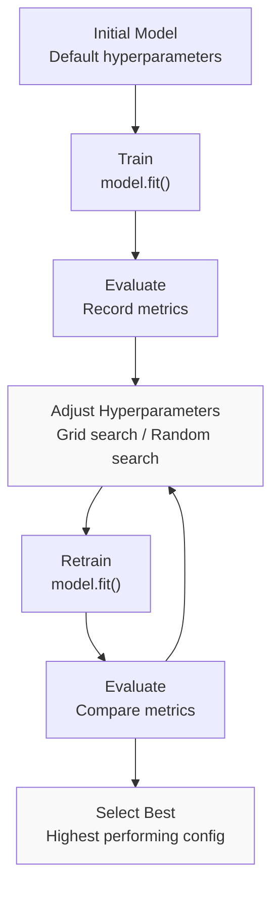

### Common Hyperparameters

**Linear Models**: Regularization strength (alpha), solver type

**Tree-based Models**: Max depth, min samples split, n_estimators

**SVM**: Kernel type (linear, RBF), C parameter, gamma

**K-Means**: Number of clusters (k), initialization method

**Neural Networks**: Learning rate, batch size, layer sizes

Comprehensive tuning guidance: [https://docs.microsoft.com/en-us/azure/machine-learning/how-to-tune-hyperparameters]()

Sources: [1-Introduction/4-techniques-of-ML/README.md:94-96]()

---

## Stage 7: Prediction

Prediction applies the trained model to new, unseen data to generate outputs.

### Prediction Workflow in Code

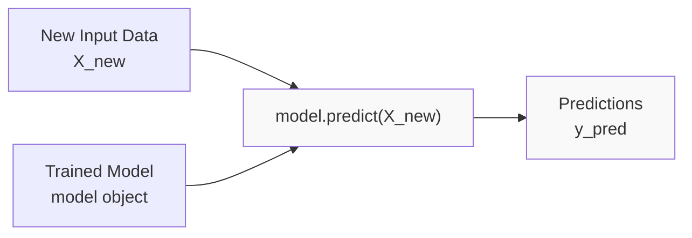

### Prediction Contexts

**Development/Testing**: Using held-out test data to validate model quality

**Production/Applied ML**: Real-time inference in web applications or APIs
- User input gathered (button press, form submission)
- Input formatted as feature array
- Model performs inference
- Result returned to user

Example: Web application deployment covered in [3-Web-App/README.md]()

### Inference Methods

| Method | Use Case | Code Example |
|--------|----------|--------------|
| `predict()` | Class labels or point estimates | `model.predict(X_new)` |
| `predict_proba()` | Class probabilities | `model.predict_proba(X_new)` |
| `score()` | Model accuracy on labeled data | `model.score(X_test, y_test)` |

Sources: [1-Introduction/4-techniques-of-ML/README.md:98-102]()

---

## Workflow Integration with Curriculum Modules

The seven-stage workflow applies consistently across all ML modules with task-specific variations:

### Module-Specific Workflow Implementations

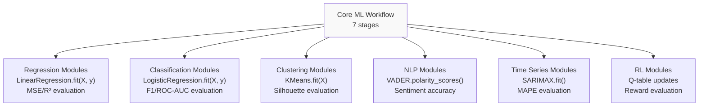

### Cross-Module Workflow Patterns

| Stage | Regression | Classification | Clustering | NLP |
|-------|-----------|----------------|-----------|-----|
| Data | Pumpkin prices | Cuisine recipes | Music metadata | Hotel reviews |
| Features (X) | Month, variety | Ingredients | Audio features | Review text |
| Target (y) | Price | Cuisine category | None (unsupervised) | Sentiment |
| Algorithm | LinearRegression | SVC, RandomForest | KMeans | VADER |
| Evaluation | R², MSE | F1, ROC-AUC | Silhouette | Accuracy |

All modules follow the same fundamental workflow structure while adapting algorithm and metric choices to task requirements.

Sources: [1-Introduction/4-techniques-of-ML/README.md:1-118]()

---

## Iterative Nature and Workflow Loops

The ML workflow is not linear; it contains multiple feedback loops:

### Feedback Loop Architecture

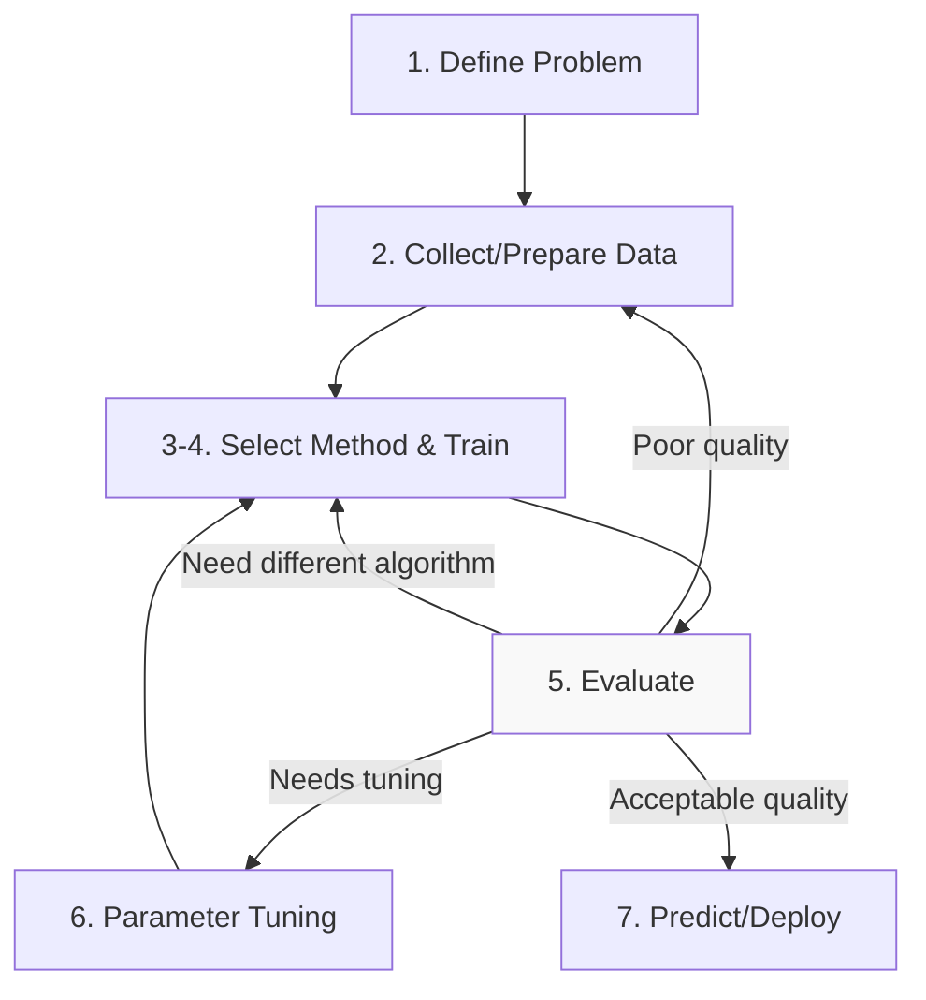

### Common Iteration Triggers

**Data Issues** (loop back to stage 2):
- Insufficient data quantity
- Biased or imbalanced data
- Missing features

**Algorithm Issues** (loop back to stage 3):
- Model too simple/complex for data
- Wrong algorithm family for task
- Poor convergence

**Performance Issues** (loop back to stage 6):
- Metrics below threshold
- Overfitting/underfitting detected
- Hyperparameters not optimal

Practitioners typically iterate multiple times before achieving production-ready model quality.

Sources: [1-Introduction/4-techniques-of-ML/README.md:16-24]()

---

## Workflow Tools and Frameworks

The curriculum demonstrates the workflow using specific tools:

### Primary Python Stack

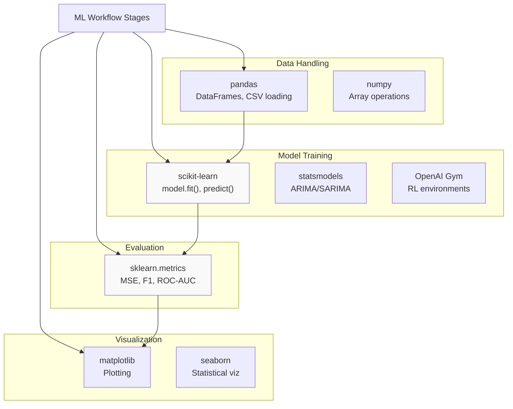

### R Alternative Stack

For statistical ML tasks, parallel R implementations use tidymodels framework:

- **rsample**: Dataset splitting
- **recipes**: Feature engineering pipeline
- **parsnip**: Model specification
- **workflows**: Training pipeline
- **yardstick**: Evaluation metrics

See [R Implementation with tidymodels](#6.2) for details.

---

## Related Resources

- **Algorithm Selection**: See module-specific pages for algorithm details ([Regression](#3.1), [Classification](#3.2), [Clustering](#4.1))
- **Data Ethics**: [Fairness and Ethics in ML](#2.2) for bias considerations during data collection
- **Deployment**: [Model Deployment with ONNX](#3.2.3) and [RL Model Deployment with Flask](#5.3.3)
- **Evaluation Deep Dive**: Module-specific evaluation sections cover task-appropriate metrics

Sources: [1-Introduction/4-techniques-of-ML/README.md:1-118]()

---

