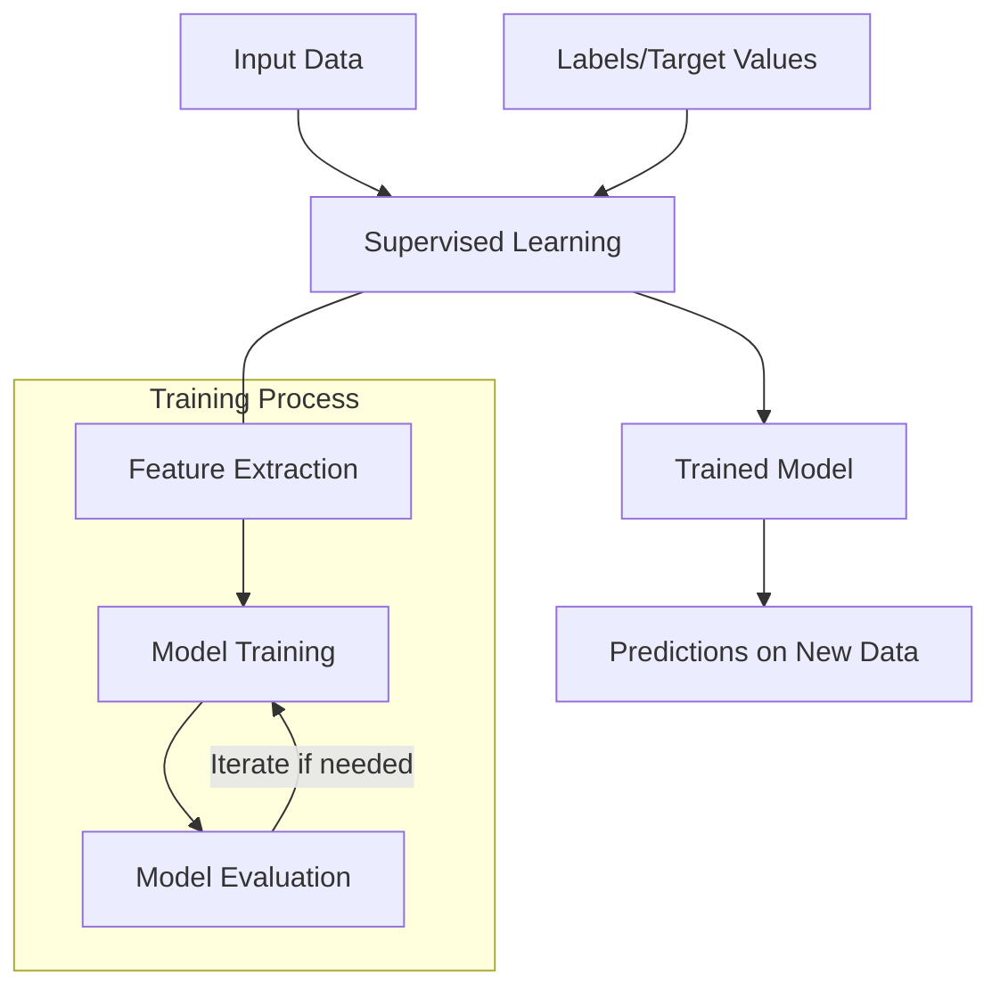
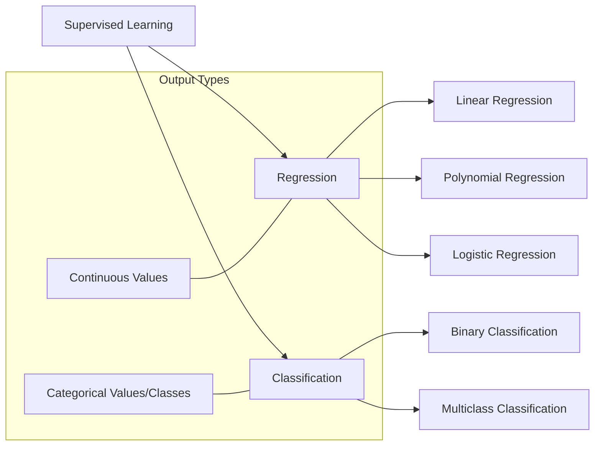
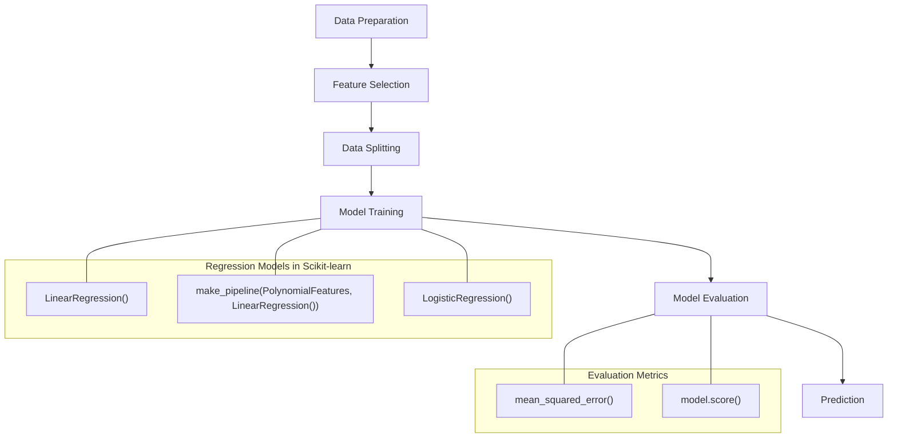
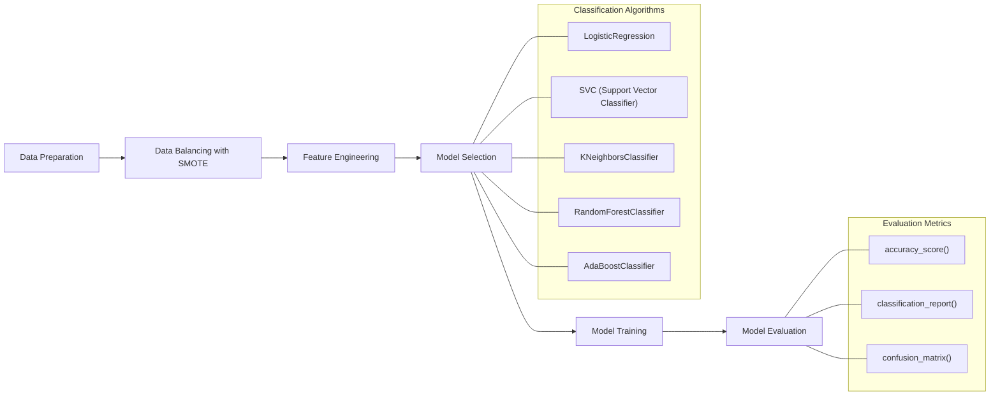
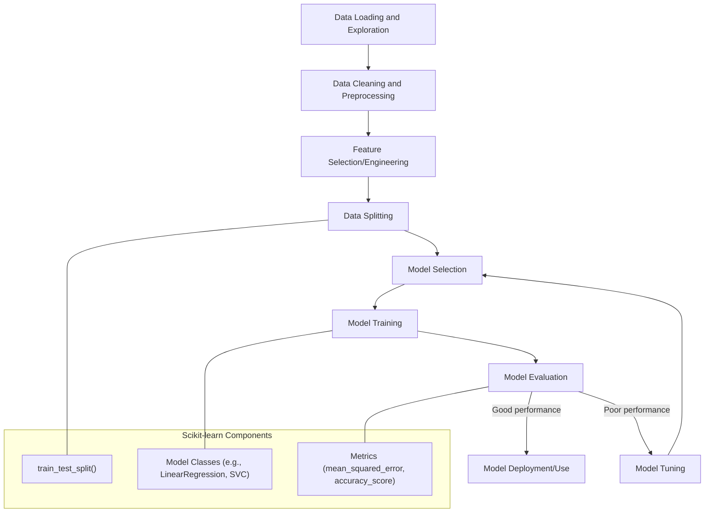
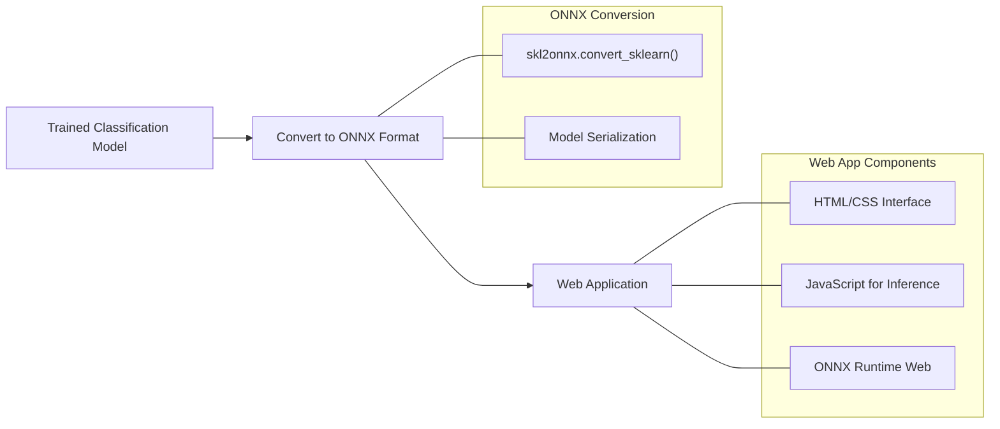

<!-- source: DeepWiki mcp.deepwiki.com · repo microsoft/ML-For-Beginners · page 3 Supervised Learning · fetched 2026-10-26 -->

# Supervised Learning

<details>
<summary>Relevant source files</summary>

The following files were used as context for generating this wiki page:

- [2-Regression/1-Tools/README.md](2-Regression/1-Tools/README.md)
- [2-Regression/2-Data/README.md](2-Regression/2-Data/README.md)
- [2-Regression/3-Linear/README.md](2-Regression/3-Linear/README.md)
- [2-Regression/4-Logistic/README.md](2-Regression/4-Logistic/README.md)
- [4-Classification/1-Introduction/README.md](4-Classification/1-Introduction/README.md)
- [4-Classification/1-Introduction/assignment.md](4-Classification/1-Introduction/assignment.md)
- [4-Classification/1-Introduction/notebook.ipynb](4-Classification/1-Introduction/notebook.ipynb)
- [4-Classification/1-Introduction/solution/notebook.ipynb](4-Classification/1-Introduction/solution/notebook.ipynb)
- [4-Classification/2-Classifiers-1/README.md](4-Classification/2-Classifiers-1/README.md)
- [4-Classification/2-Classifiers-1/notebook.ipynb](4-Classification/2-Classifiers-1/notebook.ipynb)
- [4-Classification/2-Classifiers-1/solution/notebook.ipynb](4-Classification/2-Classifiers-1/solution/notebook.ipynb)
- [4-Classification/3-Classifiers-2/README.md](4-Classification/3-Classifiers-2/README.md)
- [4-Classification/3-Classifiers-2/notebook.ipynb](4-Classification/3-Classifiers-2/notebook.ipynb)
- [4-Classification/3-Classifiers-2/solution/notebook.ipynb](4-Classification/3-Classifiers-2/solution/notebook.ipynb)
- [4-Classification/4-Applied/README.md](4-Classification/4-Applied/README.md)
- [4-Classification/4-Applied/notebook.ipynb](4-Classification/4-Applied/notebook.ipynb)
- [4-Classification/README.md](4-Classification/README.md)

</details>


This document provides an overview of supervised learning algorithms and techniques as presented in the ML-For-Beginners curriculum. It covers the fundamental concepts, types, and implementations of supervised learning models, focusing on regression and classification techniques used throughout the repository.

Supervised learning is a machine learning paradigm where models learn from labeled training data to predict outputs for unseen data. Within this curriculum, supervised learning is organized into two main categories: regression (for predicting continuous values) and classification (for predicting categorical values or classes).

## Supervised Learning Fundamentals

Supervised learning involves training a model on a labeled dataset, where each training example consists of an input object (typically a vector) and a desired output value. The model learns a function that maps inputs to outputs, which can then be used to predict outputs for new, unseen inputs.



The supervised learning process in this curriculum follows these key steps:
1. Data preparation and cleaning
2. Feature selection/engineering
3. Splitting data into training and testing sets
4. Model selection and training
5. Model evaluation
6. Making predictions

Sources: [2-Regression/1-Tools/README.md:10-45](). [2-Regression/3-Linear/README.md:8-21](). [4-Classification/1-Introduction/README.md:1-45]().

## Types of Supervised Learning Models

The curriculum covers two main types of supervised learning models:



### Regression

Regression models predict continuous values. In the curriculum, you'll learn to implement:
- **Linear Regression**: Predicts a target by finding the best-fit line through data points
- **Polynomial Regression**: Extends linear regression with polynomial terms for curved relationships
- **Logistic Regression**: Though named "regression," it's often used for binary classification

Sources: [2-Regression/README.md:1-41](). [2-Regression/3-Linear/README.md:1-80]().

### Classification

Classification models predict categorical labels or classes. The curriculum covers:
- **Binary Classification**: Predicts one of two classes (e.g., "orange or not orange")
- **Multiclass Classification**: Predicts one of several classes (e.g., cuisine types)

Sources: [4-Classification/README.md:1-27](). [4-Classification/1-Introduction/README.md:9-45]().

## Regression Implementation

The curriculum teaches regression through practical examples, primarily using the pumpkin price dataset to predict prices based on various features.



### Linear and Polynomial Regression

Linear regression finds the relationship between independent variables (features) and a dependent variable (target) by fitting a linear equation to the data. Polynomial regression extends this by including polynomial terms.

Key implementation steps using Scikit-learn:

1. Prepare and split the data:
```python
X_train, X_test, y_train, y_test = train_test_split(X, y, test_size=0.2, random_state=0)
```

2. Linear regression:
```python
lin_reg = LinearRegression()
lin_reg.fit(X_train, y_train)
```

3. Polynomial regression:
```python
pipeline = make_pipeline(PolynomialFeatures(2), LinearRegression())
pipeline.fit(X_train, y_train)
```

4. Evaluate models using metrics like MSE and coefficient of determination:
```python
mse = np.sqrt(mean_squared_error(y_test, pred))
score = model.score(X_train, y_train)
```

Sources: [2-Regression/3-Linear/README.md:159-198](). [2-Regression/3-Linear/README.md:224-252]().

### Logistic Regression

Despite its name, logistic regression is often used for binary classification tasks. In the curriculum, it's introduced in the regression section but bridges to classification concepts.

Key implementation with Scikit-learn:
```python
lr = LogisticRegression(multi_class='ovr', solver='liblinear')
model = lr.fit(X_train, np.ravel(y_train))
```

Sources: [2-Regression/4-Logistic/README.md:9-45](). [2-Regression/4-Logistic/README.md:140-169]().

## Classification Implementation

The curriculum teaches classification using a dataset of cuisine ingredients to predict cuisine type.



The classification implementation follows these key steps:

1. Data preparation and balancing:
```python
# Balancing data using SMOTE
oversample = SMOTE()
transformed_feature_df, transformed_label_df = oversample.fit_resample(feature_df, labels_df)
```

2. Feature selection and data splitting:
```python
X_train, X_test, y_train, y_test = train_test_split(X, y, test_size=0.3)
```

3. Training classifiers:
```python
# Various classifier implementations
classifiers = {
    'Linear SVC': SVC(kernel='linear', C=C, probability=True, random_state=0),
    'KNN classifier': KNeighborsClassifier(C),
    'SVC': SVC(),
    'RFST': RandomForestClassifier(n_estimators=100),
    'ADA': AdaBoostClassifier(n_estimators=100)
}

# Training loop
for name, classifier in classifiers.items():
    classifier.fit(X_train, np.ravel(y_train))
    y_pred = classifier.predict(X_test)
    # Evaluation
```

4. Evaluation using classification metrics:
```python
print(classification_report(y_test, y_pred))
```

Sources: [4-Classification/2-Classifiers-1/README.md:145-170](). [4-Classification/3-Classifiers-2/README.md:80-220]().

## Supervised Learning Workflow

The typical workflow for supervised learning used throughout the repository follows this pattern:



This workflow is applied consistently across both regression and classification tasks in the curriculum, with appropriate adjustments for the specific type of supervised learning problem.

Sources: [2-Regression/1-Tools/README.md:80-107](). [4-Classification/1-Introduction/README.md:118-155](). [4-Classification/2-Classifiers-1/README.md:145-170]().

## Application and Deployment

The curriculum culminates in showing how to apply trained models in practical applications, such as building a cuisine recommender web application.



This demonstrates the complete lifecycle of supervised learning models from training to deployment in user-facing applications.

Sources: [4-Classification/4-Applied/README.md:117-277]().

## Model Selection Guide

Choosing the right supervised learning model is a critical step. The curriculum provides guidance based on problem type and data characteristics:

| Problem Type | Recommended Models | When to Use |
|--------------|-------------------|-------------|
| Linear Relationship (Regression) | Linear Regression | Simple continuous value prediction with linear relationships |
| Non-linear Relationship (Regression) | Polynomial Regression | Continuous value prediction with curved relationships |
| Binary Classification | Logistic Regression, SVC | Predicting one of two classes (e.g., yes/no) |
| Multiclass Classification | Linear SVC, KNN, SVC, Random Forest | Predicting one of multiple classes |
| Small Dataset (<100K samples) | SVC, KNN | When you have relatively small training data |
| Large Dataset | Random Forest, AdaBoost | When you have large amounts of training data |

The repository provides decision flowcharts to help with model selection based on the characteristics of your data and problem.

Sources: [4-Classification/2-Classifiers-1/README.md:80-110](). [4-Classification/3-Classifiers-2/README.md:15-37]().

## Model Evaluation

Different metrics are used to evaluate supervised learning models depending on the problem type:

### Regression Metrics
- Mean Squared Error (MSE)
- Root Mean Squared Error (RMSE)
- Coefficient of Determination (R²)

### Classification Metrics
- Accuracy
- Precision
- Recall
- F1-Score
- Confusion Matrix
- ROC Curve and AUC

The curriculum emphasizes the importance of choosing appropriate evaluation metrics based on your specific problem and goals.

Sources: [2-Regression/3-Linear/README.md:195-215](). [4-Classification/2-Classifiers-1/README.md:214-230](). [2-Regression/4-Logistic/README.md:280-380]().

## Practical Project Examples

The repository includes practical applications of supervised learning:

1. **Regression Project**: Predicting pumpkin prices based on features like variety, origin, and date
2. **Classification Project**: Identifying cuisine type based on ingredient lists
3. **Web Application**: Building a cuisine recommender using a trained classification model

These projects demonstrate the full machine learning workflow from data preparation to model deployment.

Sources: [2-Regression/3-Linear/README.md:308-351](). [4-Classification/4-Applied/README.md:62-117]().

---

