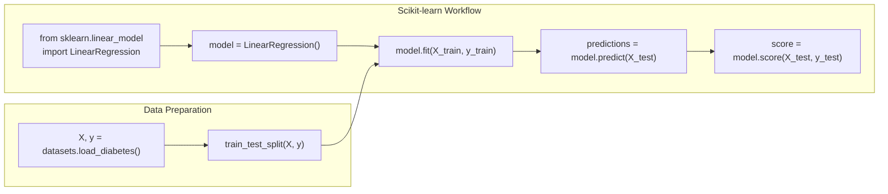
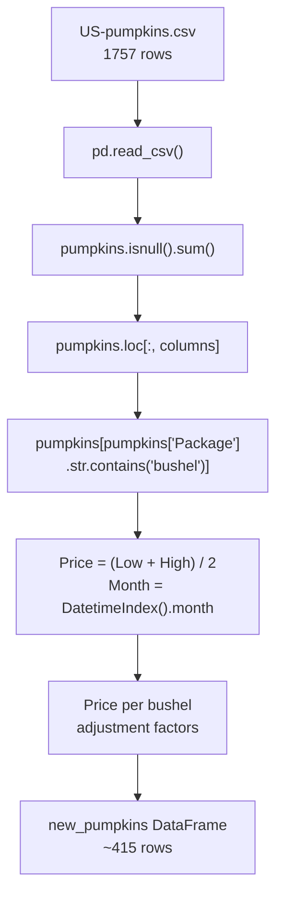
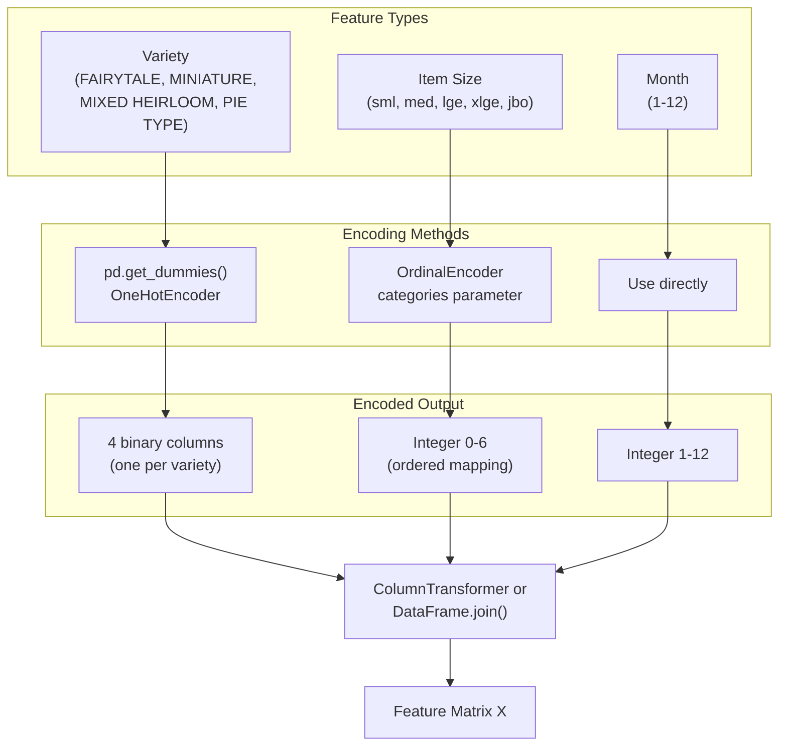
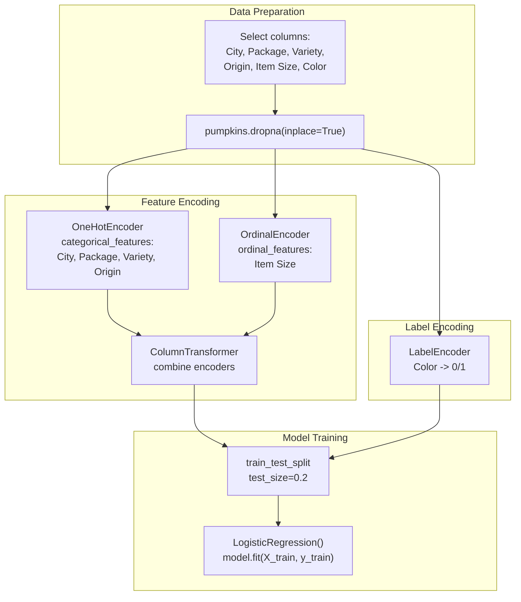
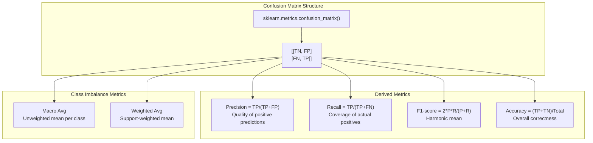
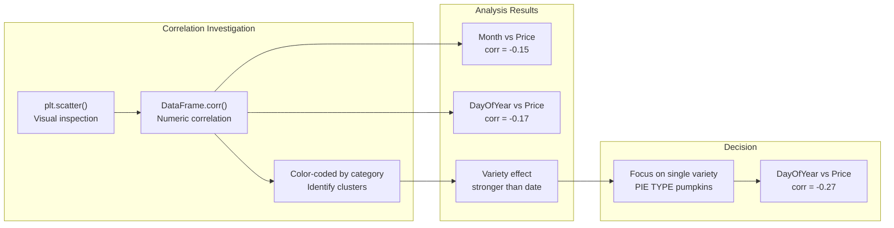
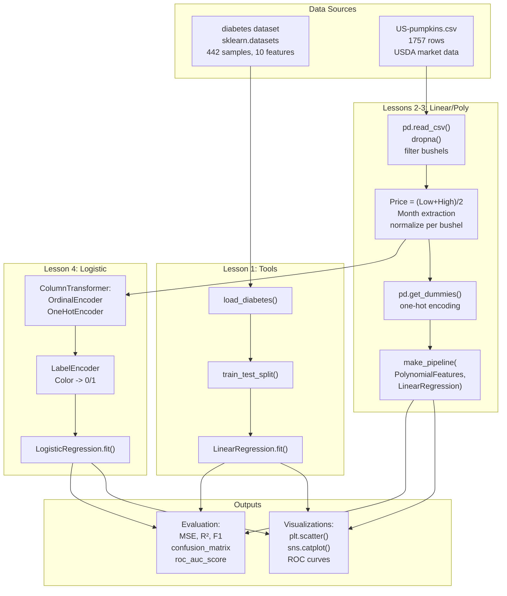

<!-- source: DeepWiki mcp.deepwiki.com · repo microsoft/ML-For-Beginners · page 3.1 Regression · fetched 2026-10-26 -->

# Regression

<details>
<summary>Relevant source files</summary>

The following files were used as context for generating this wiki page:

- [2-Regression/1-Tools/README.md](2-Regression/1-Tools/README.md)
- [2-Regression/2-Data/README.md](2-Regression/2-Data/README.md)
- [2-Regression/3-Linear/README.md](2-Regression/3-Linear/README.md)
- [2-Regression/4-Logistic/README.md](2-Regression/4-Logistic/README.md)

</details>


## Purpose and Scope

This document covers the Regression module of the ML-For-Beginners curriculum, which introduces supervised learning techniques for predicting continuous and categorical values. The module consists of four progressive lessons that teach linear regression, polynomial regression, and logistic regression using scikit-learn with the pumpkin pricing dataset as the primary example.

For information about classification with multiple algorithms and ONNX deployment, see [Classification](#3.2). For unsupervised learning techniques, see [Clustering](#4.1).

## Overview

The Regression module teaches foundational supervised learning concepts through hands-on implementation. The curriculum progresses from environment setup through data preparation, linear/polynomial regression, and concludes with logistic regression for binary classification. All lessons use Python 3.8+ with scikit-learn as the primary ML framework.

**Primary Dataset**: US-pumpkins.csv (1757 rows from USDA Specialty Crops Terminal Markets Standard Reports)

**Key Learning Outcomes**:
- Environment configuration (Python, VS Code, Jupyter, scikit-learn)
- Data cleaning and feature engineering with pandas
- Linear and polynomial regression for continuous prediction
- Logistic regression for binary classification
- Model evaluation using MSE, R², F1-score, confusion matrices, and ROC curves

Sources: [2-Regression/1-Tools/README.md:11-21](), [2-Regression/2-Data/README.md:11-19]()

## Lesson Progression and Learning Path

```mermaid
graph TB
    subgraph "Lesson 1: Tools and Environment"
        L1A["Install Python 3.8+<br/>VS Code + Extensions"]
        L1B["Install scikit-learn<br/>pip install"]
        L1C["Setup Jupyter Notebooks<br/>.ipynb files"]
        L1D["First Model: diabetes dataset<br/>LinearRegression.fit()"]
    end
    
    subgraph "Lesson 2: Data Preparation"
        L2A["Load US-pumpkins.csv<br/>pd.read_csv()"]
        L2B["Clean Data<br/>pumpkins.dropna()<br/>pumpkins.isnull().sum()"]
        L2C["Feature Engineering<br/>Month extraction<br/>Price normalization"]
        L2D["Visualization<br/>plt.scatter()<br/>groupby().mean().plot()"]
    end
    
    subgraph "Lesson 3: Linear & Polynomial"
        L3A["Train/Test Split<br/>train_test_split()"]
        L3B["LinearRegression<br/>model.fit(X_train, y_train)"]
        L3C["PolynomialFeatures<br/>make_pipeline()"]
        L3D["One-Hot Encoding<br/>pd.get_dummies()"]
    end
    
    subgraph "Lesson 4: Logistic Regression"
        L4A["Binary Classification<br/>Color prediction"]
        L4B["OrdinalEncoder<br/>OneHotEncoder<br/>ColumnTransformer"]
        L4C["LogisticRegression<br/>model.predict()"]
        L4D["Evaluation<br/>confusion_matrix()<br/>roc_curve()"]
    end
    
    L1A --> L1B
    L1B --> L1C
    L1C --> L1D
    
    L1D --> L2A
    L2A --> L2B
    L2B --> L2C
    L2C --> L2D
    
    L2D --> L3A
    L3A --> L3B
    L3B --> L3C
    L3C --> L3D
    
    L3D --> L4A
    L4A --> L4B
    L4B --> L4C
    L4C --> L4D
```



**Lesson Structure**: Each lesson follows the pattern of pre-lecture quiz → README content → notebook.ipynb hands-on exercise → post-lecture quiz → assignment. Video walkthroughs are embedded throughout.

Sources: [2-Regression/1-Tools/README.md:1-226](), [2-Regression/2-Data/README.md:1-211](), [2-Regression/3-Linear/README.md:1-367](), [2-Regression/4-Logistic/README.md:1-395]()

## Environment Setup and Core Libraries

### Required Software Stack

The regression lessons require the following environment configuration:

| Component | Purpose | Installation |
|-----------|---------|--------------|
| Python 3.8+ | Core language | python.org/downloads |
| Visual Studio Code | IDE with Jupyter support | code.visualstudio.com |
| scikit-learn | ML library | `pip install scikit-learn` |
| pandas | Data manipulation | Included with scikit-learn |
| numpy | Numerical computing | Included with scikit-learn |
| matplotlib | Visualization | Included with scikit-learn |
| seaborn | Statistical visualization | `pip install seaborn` |
| Jupyter | Notebook interface | `pip install jupyter` |

**Virtual Environment Setup** (recommended): [2-Regression/1-Tools/README.md:30]() recommends using Python's `venv` module to isolate dependencies.

Sources: [2-Regression/1-Tools/README.md:22-43]()

### Scikit-learn Core API Pattern



**Key Methods**:
- `model.fit(X, y)`: Train model on labeled data
- `model.predict(X)`: Generate predictions for new data
- `model.score(X, y)`: Return coefficient of determination (R²)
- `model.coef_`: Access learned coefficients
- `model.intercept_`: Access y-intercept

Sources: [2-Regression/1-Tools/README.md:82-89](), [2-Regression/1-Tools/README.md:180-194]()

## Data Preparation Pipeline

### US-pumpkins.csv Dataset Structure

The primary dataset contains 1757 rows with the following key columns used in the lessons:

| Column | Type | Description | Processing |
|--------|------|-------------|------------|
| Date | String (MM/DD/YYYY) | Sale date | Convert to Month via `pd.DatetimeIndex().month` |
| Package | String | Container type | Filter for 'bushel' entries, normalize pricing |
| Low Price | Float | Minimum price | Average with High Price |
| High Price | Float | Maximum price | Average with Low Price |
| Variety | String | Pumpkin type | One-hot encode via `pd.get_dummies()` |
| City Name | String | Location | One-hot encode |
| Color | String | ORANGE/WHITE | Target for logistic regression |
| Item Size | String | Size category | Ordinal encode with `OrdinalEncoder` |

Sources: [2-Regression/2-Data/README.md:24-34](), [2-Regression/2-Data/README.md:79-81]()

### Data Cleaning Workflow



**Critical Cleaning Steps**:

1. **Column Selection**: [2-Regression/2-Data/README.md:76-81]() - Use `loc` to extract relevant columns
2. **Missing Data Check**: [2-Regression/2-Data/README.md:68-74]() - `pumpkins.isnull().sum()` to identify gaps
3. **Package Filtering**: [2-Regression/2-Data/README.md:114-122]() - Filter for 'bushel' to standardize measurements
4. **Price Normalization**: [2-Regression/2-Data/README.md:128-135]() - Adjust for different bushel amounts (1 1/9, 1/2)
5. **Feature Creation**: [2-Regression/2-Data/README.md:89-96]() - Calculate average price, extract month

Sources: [2-Regression/2-Data/README.md:45-141]()

## Linear and Polynomial Regression Implementation

### Simple Linear Regression with Single Feature

The curriculum demonstrates linear regression using `DayOfYear` to predict `Price` for PIE TYPE pumpkins:

**Code Pattern**: [2-Regression/3-Linear/README.md:168-220]()
```python
# Feature preparation
X = pie_pumpkins['DayOfYear'].to_numpy().reshape(-1,1)
y = pie_pumpkins['Price']

# Train/test split
X_train, X_test, y_train, y_test = train_test_split(X, y, test_size=0.2)

# Model training
lin_reg = LinearRegression()
lin_reg.fit(X_train, y_train)

# Prediction and evaluation
pred = lin_reg.predict(X_test)
mse = np.sqrt(mean_squared_error(y_test, pred))
score = lin_reg.score(X_train, y_train)
```

**Important Note**: Input data must be 2D arrays (shape N×1) for scikit-learn. Use `reshape(-1,1)` for single features.

Sources: [2-Regression/3-Linear/README.md:160-223]()

### Polynomial Regression with Pipeline

For non-linear relationships, polynomial features are generated using `make_pipeline`:

**Pipeline Construction**: [2-Regression/3-Linear/README.md:237-249]()
```python
from sklearn.preprocessing import PolynomialFeatures
from sklearn.pipeline import make_pipeline

pipeline = make_pipeline(PolynomialFeatures(2), LinearRegression())
pipeline.fit(X_train, y_train)
```

`PolynomialFeatures(2)` generates second-degree polynomials: Given X, creates [X, X²]. For two features X and Y, creates [X, Y, X², XY, Y²].

Sources: [2-Regression/3-Linear/README.md:224-257]()

### Categorical Feature Encoding



**One-Hot Encoding Implementation**: [2-Regression/3-Linear/README.md:276-308]()
```python
# Single categorical feature
X = pd.get_dummies(new_pumpkins['Variety'])

# Multiple features combined
X = pd.get_dummies(new_pumpkins['Variety']) \
        .join(new_pumpkins['Month']) \
        .join(pd.get_dummies(new_pumpkins['City'])) \
        .join(pd.get_dummies(new_pumpkins['Package']))
```

**Ordinal Encoding for Ordered Categories**: [2-Regression/4-Logistic/README.md:127-133]()
```python
from sklearn.preprocessing import OrdinalEncoder

item_size_categories = [['sml', 'med', 'med-lge', 'lge', 'xlge', 'jbo', 'exjbo']]
ordinal_encoder = OrdinalEncoder(categories=item_size_categories)
```

Sources: [2-Regression/3-Linear/README.md:259-310](), [2-Regression/4-Logistic/README.md:120-155]()

### Model Performance Comparison

The curriculum demonstrates progressive improvement through feature engineering:

| Model Configuration | MSE | MSE (%) | R² Score |
|---------------------|-----|---------|----------|
| DayOfYear Linear | 2.77 | 17.2% | 0.07 |
| DayOfYear Polynomial | 2.73 | 17.0% | 0.08 |
| Variety Linear (one-hot) | 5.24 | 19.7% | 0.77 |
| All Features Linear | 2.84 | 10.5% | 0.94 |
| All Features Polynomial | 2.23 | 8.25% | 0.97 |

**Interpretation**:
- R² near 0: Model no better than mean prediction
- R² near 1: Model perfectly predicts outcomes
- MSE: Mean squared error in same units as target variable

Sources: [2-Regression/3-Linear/README.md:344-351]()

## Logistic Regression for Binary Classification

### Problem Definition and Setup

Logistic regression predicts binary categories despite the name containing "regression". The curriculum uses pumpkin color (ORANGE vs WHITE) as the classification target.

**Key Difference from Linear Regression**:
- Linear: Predicts continuous values (price)
- Logistic: Predicts binary categories (white/not-white)
- Uses sigmoid function to map predictions to probabilities [0, 1]

**Sigmoid Function**: Maps linear combination to probability
```
σ(x) = 1 / (1 + e^(-x))
```

If σ(x) > 0.5 → Class 1 (WHITE)
If σ(x) ≤ 0.5 → Class 0 (ORANGE)

Sources: [2-Regression/4-Logistic/README.md:9-26](), [2-Regression/4-Logistic/README.md:216-222]()

### Complete Feature Engineering Pipeline



**ColumnTransformer Pattern**: [2-Regression/4-Logistic/README.md:145-155]()
```python
from sklearn.compose import ColumnTransformer

ct = ColumnTransformer(transformers=[
    ('ord', ordinal_encoder, ordinal_features),
    ('cat', categorical_encoder, categorical_features)
])

ct.set_output(transform='pandas')
encoded_features = ct.fit_transform(pumpkins)
```

**Label Encoding**: [2-Regression/4-Logistic/README.md:156-163]()
```python
from sklearn.preprocessing import LabelEncoder

label_encoder = LabelEncoder()
encoded_label = label_encoder.fit_transform(pumpkins['Color'])
```

Sources: [2-Regression/4-Logistic/README.md:72-168]()

### Model Training and Prediction

**Training Code**: [2-Regression/4-Logistic/README.md:234-257]()
```python
from sklearn.linear_model import LogisticRegression
from sklearn.metrics import f1_score, classification_report

# Split data
X = encoded_pumpkins[encoded_pumpkins.columns.difference(['Color'])]
y = encoded_pumpkins['Color']
X_train, X_test, y_train, y_test = train_test_split(X, y, test_size=0.2)

# Train model
model = LogisticRegression()
model.fit(X_train, y_train)

# Predict and evaluate
predictions = model.predict(X_test)
print(classification_report(y_test, predictions))
print('F1-score: ', f1_score(y_test, predictions))
```

**Example Output**: Model achieves ~92% accuracy with 199 test samples (166 ORANGE, 33 WHITE).

Sources: [2-Regression/4-Logistic/README.md:232-278]()

## Model Evaluation Metrics

### Classification Metrics and Confusion Matrix



**Confusion Matrix Interpretation**: [2-Regression/4-Logistic/README.md:286-322]()

For pumpkin color prediction (0=ORANGE, 1=WHITE):
```
[[162,   4],    →  TN=162 (correct ORANGE), FP=4 (wrong WHITE)
 [ 11,  22]]    →  FN=11 (wrong ORANGE), TP=22 (correct WHITE)
```

**Key Terms**:
- **Precision**: Of all predicted WHITE, how many are actually WHITE? (0.85)
- **Recall**: Of all actual WHITE, how many did we find? (0.67)
- **F1-score**: Balanced metric between precision and recall (0.75)
- **Support**: Number of actual instances per class

Sources: [2-Regression/4-Logistic/README.md:280-340]()

### ROC Curve and AUC

**ROC Curve Implementation**: [2-Regression/4-Logistic/README.md:350-366]()
```python
from sklearn.metrics import roc_curve, roc_auc_score

y_scores = model.predict_proba(X_test)
fpr, tpr, thresholds = roc_curve(y_test, y_scores[:,1])

plt.plot([0, 1], [0, 1], 'k--')  # Diagonal reference line
plt.plot(fpr, tpr)
plt.xlabel('False Positive Rate')
plt.ylabel('True Positive Rate')
plt.title('ROC Curve')
```

**AUC Calculation**: [2-Regression/4-Logistic/README.md:372-378]()
```python
auc = roc_auc_score(y_test, y_scores[:,1])
# Result: 0.9749 (excellent performance)
```

**Interpretation**:
- AUC = 1.0: Perfect classifier
- AUC = 0.5: Random classifier (diagonal line)
- AUC > 0.9: Excellent discrimination
- Curve should rise steeply (high TPR) before FPR increases

Sources: [2-Regression/4-Logistic/README.md:342-379]()

## Visualization Techniques

### matplotlib and seaborn Integration

**Core Plotting Functions Used**:

| Function | Purpose | Lesson | Code Reference |
|----------|---------|--------|----------------|
| `plt.scatter()` | Show data distribution | 2, 3 | [2-Regression/1-Tools/README.md:198-204]() |
| `plt.plot()` | Draw regression line | 2, 3 | [2-Regression/3-Linear/README.md:218-220]() |
| `DataFrame.plot(kind='bar')` | Grouped statistics | 2 | [2-Regression/2-Data/README.md:189-191]() |
| `sns.catplot()` | Categorical comparisons | 4 | [2-Regression/4-Logistic/README.md:100-112]() |
| `sns.swarmplot()` | Distribution by category | 4 | [2-Regression/4-Logistic/README.md:203-209]() |

**Seaborn Color Palette Pattern**: [2-Regression/4-Logistic/README.md:103-106]()
```python
palette = {
    'ORANGE': 'orange',
    'WHITE': 'wheat'
}
sns.catplot(data=pumpkins, y="Variety", hue="Color", palette=palette)
```

Sources: [2-Regression/2-Data/README.md:142-195](), [2-Regression/4-Logistic/README.md:92-211]()

### Correlation Analysis Workflow



**Correlation Coefficient Interpretation**:
- Value near 0: No linear relationship
- Value near -1 or +1: Strong linear relationship
- Negative: Inverse relationship (price drops as day increases)

**Code Pattern**: [2-Regression/3-Linear/README.md:114-149]()
```python
print(new_pumpkins['Month'].corr(new_pumpkins['Price']))  # -0.15
print(new_pumpkins['DayOfYear'].corr(new_pumpkins['Price']))  # -0.17

# Filter to single variety
pie_pumpkins = new_pumpkins[new_pumpkins['Variety']=='PIE TYPE']
# Improved correlation: -0.27
```

Sources: [2-Regression/3-Linear/README.md:100-157]()

## Complete Regression Example: Best Model

The curriculum culminates in a complete example combining all techniques:

**Final Model Architecture**: [2-Regression/3-Linear/README.md:316-340]()

```mermaid
graph TB
    subgraph "Feature Engineering"
        Variety["Variety<br/>pd.get_dummies()"]
        Month["Month<br/>numeric"]
        City["City<br/>pd.get_dummies()"]
        Package["Package<br/>pd.get_dummies()"]
        Combine["DataFrame.join()<br/>concatenate features"]
    end
    
    subgraph "Pipeline"
        PolyFeat["PolynomialFeatures(2)<br/>Generate X²"]
        LinReg["LinearRegression()<br/>Final estimator"]
        Pipeline["make_pipeline()"]
    end
    
    subgraph "Results"
        MSE["MSE = 2.23 (8.25%)"]
        R2["R² = 0.97"]
    end
    
    Variety --> Combine
    Month --> Combine
    City --> Combine
    Package --> Combine
    
    Combine --> Pipeline
    PolyFeat --> Pipeline
    LinReg --> Pipeline
    
    Pipeline --> MSE
    Pipeline --> R2
```

**Complete Code**: [2-Regression/3-Linear/README.md:317-340]()
```python
# Feature matrix with categorical one-hot encoding
X = pd.get_dummies(new_pumpkins['Variety']) \
        .join(new_pumpkins['Month']) \
        .join(pd.get_dummies(new_pumpkins['City'])) \
        .join(pd.get_dummies(new_pumpkins['Package']))
y = new_pumpkins['Price']

# Train/test split
X_train, X_test, y_train, y_test = train_test_split(X, y, test_size=0.2, random_state=0)

# Polynomial pipeline
pipeline = make_pipeline(PolynomialFeatures(2), LinearRegression())
pipeline.fit(X_train, y_train)

# Evaluation
pred = pipeline.predict(X_test)
mse = np.sqrt(mean_squared_error(y_test, pred))
score = pipeline.score(X_train, y_train)
```

This achieves **97% R² determination** and **8.25% mean error**, demonstrating effective feature engineering and model selection.

Sources: [2-Regression/3-Linear/README.md:312-352]()

## Data Flow Through Regression Module



Sources: [2-Regression/1-Tools/README.md:102-210](), [2-Regression/2-Data/README.md:45-195](), [2-Regression/3-Linear/README.md:160-352](), [2-Regression/4-Logistic/README.md:72-378]()

## Key scikit-learn Classes and Functions

### Model Classes

| Class | Module | Purpose | Key Methods |
|-------|--------|---------|-------------|
| `LinearRegression` | `sklearn.linear_model` | Ordinary least squares | `fit()`, `predict()`, `score()` |
| `LogisticRegression` | `sklearn.linear_model` | Binary/multiclass classification | `fit()`, `predict()`, `predict_proba()` |
| `PolynomialFeatures` | `sklearn.preprocessing` | Generate polynomial features | `fit_transform()` |
| `make_pipeline` | `sklearn.pipeline` | Chain estimators | `fit()`, `predict()` |

Sources: [2-Regression/1-Tools/README.md:123](), [2-Regression/3-Linear/README.md:169-172](), [2-Regression/3-Linear/README.md:239-240](), [2-Regression/4-Logistic/README.md:248]()

### Preprocessing Classes

| Class | Module | Purpose | Parameters |
|-------|--------|---------|------------|
| `OrdinalEncoder` | `sklearn.preprocessing` | Encode ordered categories | `categories` (list of ordered values) |
| `OneHotEncoder` | `sklearn.preprocessing` | Binary columns per category | `sparse_output=False` for dense arrays |
| `LabelEncoder` | `sklearn.preprocessing` | Encode target labels | Auto-detects unique values |
| `ColumnTransformer` | `sklearn.compose` | Apply different encoders | `transformers` (list of tuples) |

Sources: [2-Regression/4-Logistic/README.md:127-155]()

### Evaluation Functions

| Function | Module | Purpose | Returns |
|----------|--------|---------|---------|
| `train_test_split` | `sklearn.model_selection` | Split data | X_train, X_test, y_train, y_test |
| `mean_squared_error` | `sklearn.metrics` | MSE calculation | Float (error magnitude) |
| `classification_report` | `sklearn.metrics` | Multi-metric summary | String (formatted report) |
| `confusion_matrix` | `sklearn.metrics` | TP/TN/FP/FN counts | 2D array |
| `roc_curve` | `sklearn.metrics` | ROC curve data | fpr, tpr, thresholds |
| `roc_auc_score` | `sklearn.metrics` | Area under ROC | Float [0, 1] |
| `f1_score` | `sklearn.metrics` | F1 metric | Float [0, 1] |

Sources: [2-Regression/1-Tools/README.md:177](), [2-Regression/3-Linear/README.md:170-171](), [2-Regression/4-Logistic/README.md:247](), [2-Regression/4-Logistic/README.md:286-291](), [2-Regression/4-Logistic/README.md:350-357]()

## Common Patterns and Best Practices

### Data Preparation Checklist

1. **Load and Inspect**: [2-Regression/2-Data/README.md:58-64]()
   - `pd.read_csv()`
   - `df.head()` / `df.info()`
   - `df.isnull().sum()`

2. **Clean**: [2-Regression/2-Data/README.md:68-74](), [2-Regression/3-Linear/README.md:151-156]()
   - `df.dropna()` to remove missing values
   - Filter invalid entries
   - Standardize units

3. **Engineer Features**: [2-Regression/2-Data/README.md:89-96](), [2-Regression/3-Linear/README.md:92-96]()
   - Extract date components
   - Calculate derived values
   - Create `DayOfYear` column

4. **Encode Categoricals**: [2-Regression/3-Linear/README.md:276-280](), [2-Regression/4-Logistic/README.md:127-155]()
   - One-hot: `pd.get_dummies()` or `OneHotEncoder`
   - Ordinal: `OrdinalEncoder` with category order
   - Labels: `LabelEncoder` for targets

5. **Split Data**: [2-Regression/1-Tools/README.md:177-178]()
   - `train_test_split(X, y, test_size=0.2, random_state=0)`
   - Always split before training
   - Set `random_state` for reproducibility

### Model Training Pattern

```python
# 1. Prepare features and target
X = features_dataframe
y = target_series

# 2. Split
X_train, X_test, y_train, y_test = train_test_split(X, y, test_size=0.2)

# 3. Define model/pipeline
model = LinearRegression()
# OR
pipeline = make_pipeline(PolynomialFeatures(2), LinearRegression())

# 4. Train
model.fit(X_train, y_train)

# 5. Predict
predictions = model.predict(X_test)

# 6. Evaluate
mse = mean_squared_error(y_test, predictions)
score = model.score(X_test, y_test)
```

Sources: [2-Regression/3-Linear/README.md:168-220](), [2-Regression/3-Linear/README.md:238-249]()

### Regression vs Classification Decision Guide

| Use Regression When | Use Logistic Regression When |
|---------------------|-------------------------------|
| Predicting numeric/continuous values | Predicting categories |
| Output is on a scale (price, temperature) | Output is discrete (yes/no, color) |
| Need exact value prediction | Need probability or class membership |
| Example: Pumpkin price prediction | Example: Pumpkin color classification |

**Note**: Despite the name, logistic regression is a classification method. [2-Regression/4-Logistic/README.md:26]() clarifies this linguistic confusion.

Sources: [2-Regression/1-Tools/README.md:104-105](), [2-Regression/4-Logistic/README.md:9-26](), [2-Regression/4-Logistic/README.md:34-47]()

## Mathematical Foundations

### Linear Regression Equation

**Line of Best Fit**: [2-Regression/3-Linear/README.md:50-72]()

```
Y = a + bX
```

Where:
- `Y`: Dependent variable (target)
- `X`: Explanatory variable (feature)
- `b`: Slope coefficient
- `a`: Y-intercept (value when X=0)

**Least-Squares Method**: Minimizes sum of squared residuals between predictions and actual values. The line minimizes: Σ(y_actual - y_predicted)²

**Coefficient Access**: After fitting, `model.coef_` contains slope(s), `model.intercept_` contains y-intercept.

### Correlation Coefficient

[2-Regression/3-Linear/README.md:74-80]() - Measures linear relationship strength between variables:
- Value near 0: Weak or no linear relationship
- Value near ±1: Strong linear relationship
- Sign indicates direction (positive/negative correlation)

**Good Model Characteristics**:
- High correlation (closer to ±1)
- Low MSE
- R² score closer to 1

### Polynomial Regression

[2-Regression/3-Linear/README.md:224-257]() - Fits curved line using polynomial terms:

For degree 2: `Y = a + b₁X + b₂X²`

Handles non-linear relationships while remaining a linear model (linear in coefficients).

### Logistic Sigmoid Function

[2-Regression/4-Logistic/README.md:216-222]() - Maps linear output to probability:

```
σ(x) = 1 / (1 + e^(-x))
```

Properties:
- Output range: [0, 1]
- S-shaped curve
- Threshold typically at 0.5 for classification

Sources: [2-Regression/3-Linear/README.md:46-72](), [2-Regression/3-Linear/README.md:74-80](), [2-Regression/3-Linear/README.md:224-257](), [2-Regression/4-Logistic/README.md:216-222]()

## Alternative R Implementation

The regression module provides parallel R implementations using the tidymodels framework. Each Python lesson has a corresponding R solution accessible via links in the README files: [2-Regression/1-Tools/README.md:9](), [2-Regression/2-Data/README.md:9](), [2-Regression/3-Linear/README.md:7](), [2-Regression/4-Logistic/README.md:7]()

**R tidymodels equivalents**:
- `rsample::initial_split()` → `train_test_split()`
- `recipes::recipe()` → Feature engineering pipeline
- `parsnip::linear_reg()` / `logistic_reg()` → Model specifications
- `workflows::workflow()` → Combines preprocessing and model
- `yardstick` package → Evaluation metrics

See [R Implementation with tidymodels](#6.2) for complete documentation of the R track.

Sources: [2-Regression/1-Tools/README.md:9](), [2-Regression/2-Data/README.md:9](), [2-Regression/3-Linear/README.md:7](), [2-Regression/4-Logistic/README.md:7]()

## Learning Resources and Support

### Video Walkthroughs

Each lesson includes embedded YouTube videos with short overviews:
- Lesson 1: Setup and first model ([2-Regression/1-Tools/README.md:24](), [2-Regression/1-Tools/README.md:96]())
- Lesson 2: Data cleaning and visualization ([2-Regression/2-Data/README.md:26](), [2-Regression/2-Data/README.md:146]())
- Lesson 3: Linear and polynomial regression ([2-Regression/3-Linear/README.md:16](), [2-Regression/3-Linear/README.md:102](), [2-Regression/3-Linear/README.md:162]())
- Lesson 4: Logistic regression and ROC ([2-Regression/4-Logistic/README.md:38](), [2-Regression/4-Logistic/README.md:66](), [2-Regression/4-Logistic/README.md:228](), [2-Regression/4-Logistic/README.md:344]())

### Quiz System

Pre and post-lecture quizzes available at `https://ff-quizzes.netlify.app/en/ml/` for self-assessment. Referenced at: [2-Regression/1-Tools/README.md:7](), [2-Regression/1-Tools/README.md:216]()

### Assignments

Each lesson concludes with hands-on assignments:
- Lesson 1: Work with different dataset ([2-Regression/1-Tools/README.md:226]())
- Lesson 2: Explore visualization techniques ([2-Regression/2-Data/README.md:211]())
- Lesson 3: Build a model ([2-Regression/3-Linear/README.md:367]())
- Lesson 4: Retry regression ([2-Regression/4-Logistic/README.md:395]())

### External Learning Paths

- Microsoft Learn modules: [2-Regression/1-Tools/README.md:34](), [2-Regression/4-Logistic/README.md:18]()
- Stanford Statistical Learning course: [2-Regression/3-Linear/README.md:363]()
- Kaggle datasets for practice: [2-Regression/4-Logistic/README.md:385]()

Sources: [2-Regression/1-Tools/README.md:7-226](), [2-Regression/2-Data/README.md:7-211](), [2-Regression/3-Linear/README.md:5-367](), [2-Regression/4-Logistic/README.md:5-395]()

---

