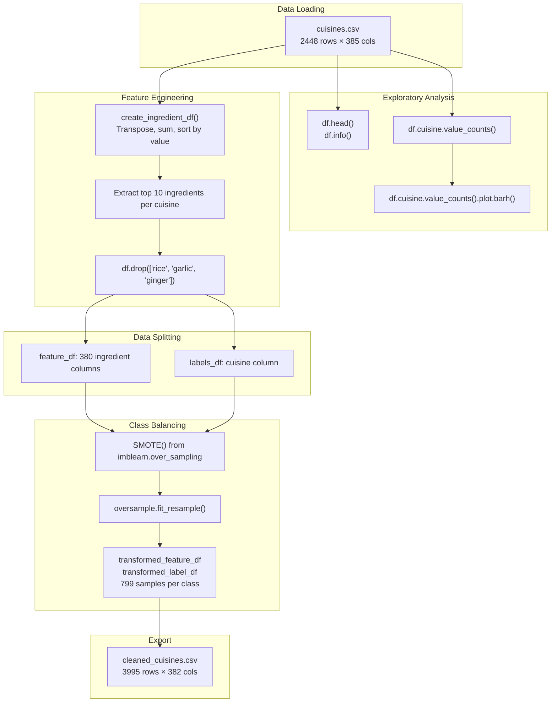
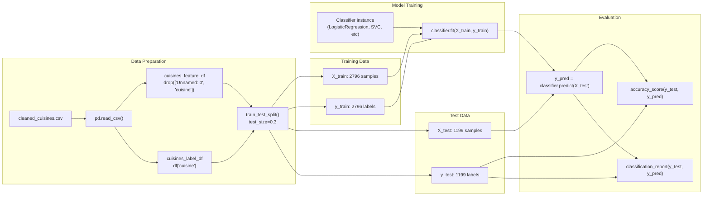
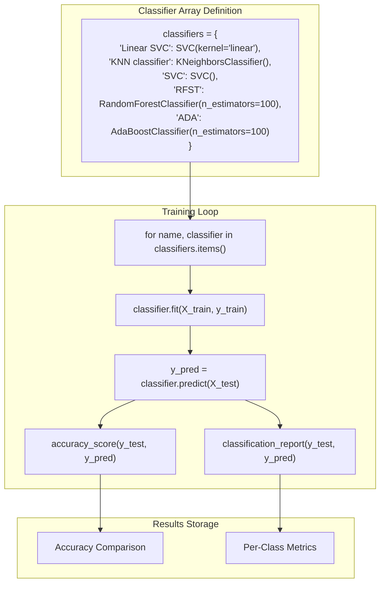
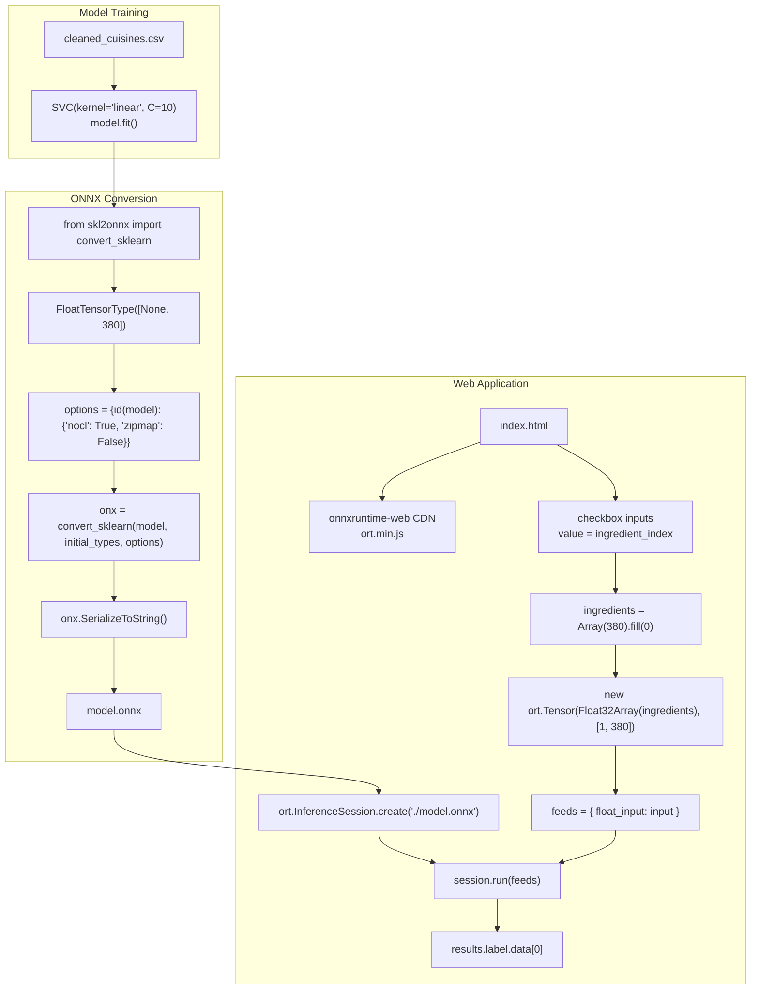

<!-- source: DeepWiki mcp.deepwiki.com · repo microsoft/ML-For-Beginners · page 3.2 Classification · fetched 2026-10-26 -->

# Classification

<details>
<summary>Relevant source files</summary>

The following files were used as context for generating this wiki page:

- [4-Classification/1-Introduction/README.md](4-Classification/1-Introduction/README.md)
- [4-Classification/1-Introduction/assignment.md](4-Classification/1-Introduction/assignment.md)
- [4-Classification/1-Introduction/notebook.ipynb](4-Classification/1-Introduction/notebook.ipynb)
- [4-Classification/1-Introduction/solution/notebook.ipynb](4-Classification/1-Introduction/solution/notebook.ipynb)
- [4-Classification/2-Classifiers-1/README.md](4-Classification/2-Classifiers-1/README.md)
- [4-Classification/2-Classifiers-1/notebook.ipynb](4-Classification/2-Classifiers-1/notebook.ipynb)
- [4-Classification/2-Classifiers-1/solution/notebook.ipynb](4-Classification/2-Classifiers-1/solution/notebook.ipynb)
- [4-Classification/3-Classifiers-2/README.md](4-Classification/3-Classifiers-2/README.md)
- [4-Classification/3-Classifiers-2/notebook.ipynb](4-Classification/3-Classifiers-2/notebook.ipynb)
- [4-Classification/3-Classifiers-2/solution/notebook.ipynb](4-Classification/3-Classifiers-2/solution/notebook.ipynb)
- [4-Classification/4-Applied/README.md](4-Classification/4-Applied/README.md)
- [4-Classification/4-Applied/notebook.ipynb](4-Classification/4-Applied/notebook.ipynb)
- [4-Classification/README.md](4-Classification/README.md)

</details>


## Purpose and Scope

This document describes the Classification module, which implements multiclass classification to predict cuisine types based on ingredient combinations. The module uses a balanced dataset of Asian and Indian cuisines (Chinese, Indian, Japanese, Korean, Thai) with 380 ingredient features per sample. It demonstrates data balancing with SMOTE, comparative evaluation of multiple scikit-learn classifiers, and production deployment using ONNX format for browser-based inference.

For binary classification using logistic regression, see [3.1.4](#3.1.4). For clustering approaches to unlabeled data, see [4.1](#4.1).

## Dataset Structure

The classification module operates on a cuisine dataset stored at [4-Classification/data/cuisines.csv](). The raw dataset contains 2448 entries with 385 columns: one `cuisine` label column, one index column (`Unnamed: 0`), and 383 ingredient columns encoded as binary features (0 or 1).

**Raw Dataset Distribution:**

| Cuisine  | Sample Count | Percentage |
|----------|--------------|------------|
| korean   | 799          | 32.6%      |
| indian   | 598          | 24.4%      |
| chinese  | 442          | 18.1%      |
| japanese | 320          | 13.1%      |
| thai     | 289          | 11.8%      |

The dataset exhibits class imbalance, with Korean cuisine samples outnumbering Thai by a factor of 2.76. After SMOTE balancing, each cuisine class contains exactly 799 samples, yielding 3,995 total training examples.

Sources: [4-Classification/1-Introduction/README.md:84-156]()

## Data Preparation Pipeline



**Data Preparation Steps:**

1. **Loading:** The dataset is loaded using `pd.read_csv()` into a DataFrame [4-Classification/1-Introduction/README.md:79-80]()

2. **Ingredient Analysis:** The `create_ingredient_df()` function transposes the dataframe, drops non-ingredient columns, sums ingredient occurrences, and sorts by frequency [4-Classification/1-Introduction/README.md:165-171]()

3. **Feature Reduction:** Common ingredients (rice, garlic, ginger) appearing across multiple cuisines are dropped to reduce confusion [4-Classification/1-Introduction/README.md:224-227]()

4. **Class Balancing:** SMOTE (Synthetic Minority Over-sampling Technique) generates synthetic samples through interpolation [4-Classification/1-Introduction/README.md:237-239](). The `fit_resample()` method upsamples minority classes to match the majority class count.

5. **Export:** Balanced data is concatenated and saved to `cleaned_cuisines.csv` [4-Classification/1-Introduction/README.md:271-280]()

Sources: [4-Classification/1-Introduction/README.md:52-283](), [4-Classification/1-Introduction/solution/notebook.ipynb:39-280]()

## Classification Workflow



**Standard Workflow Implementation:**

The classification workflow follows a consistent pattern across all algorithms:

1. **Feature/Label Separation:** Features are extracted by dropping the `Unnamed: 0` index column and `cuisine` label column [4-Classification/2-Classifiers-1/README.md:64-66](). Labels are extracted directly from the `cuisine` column [4-Classification/2-Classifiers-1/README.md:46-48]().

2. **Train/Test Split:** Data is split using `train_test_split()` with `test_size=0.3`, yielding a 70/30 split [4-Classification/2-Classifiers-1/README.md:149]().

3. **Model Training:** Each classifier is instantiated with specific hyperparameters, then trained using `.fit(X_train, y_train)`. The `np.ravel()` function is used to flatten the label array when required [4-Classification/2-Classifiers-1/README.md:160]().

4. **Prediction:** The `.predict()` method generates predictions on the test set [4-Classification/2-Classifiers-1/README.md:215]().

5. **Evaluation:** Performance is assessed using `accuracy_score()` for overall accuracy and `classification_report()` for per-class precision, recall, and F1-score [4-Classification/2-Classifiers-1/README.md:216-217]().

Sources: [4-Classification/2-Classifiers-1/README.md:14-217](), [4-Classification/3-Classifiers-2/README.md:54-89]()

## Classifier Implementations

### Logistic Regression

Logistic Regression with one-vs-rest (OvR) scheme is the baseline classifier for multiclass cuisine prediction.

**Configuration:**
- `multi_class='ovr'`: One-vs-rest strategy creates 5 binary classifiers
- `solver='liblinear'`: Optimization algorithm suitable for small datasets
- Typical accuracy: ~80%

The OvR scheme trains 5 separate binary classifiers, each distinguishing one cuisine from all others. During prediction, the classifier with the highest confidence score determines the final class [4-Classification/2-Classifiers-1/README.md:130-137]().

**Probability Estimation:**

The `predict_proba()` method returns class probabilities. For example, testing ingredients `['cilantro', 'onion', 'pea', 'potato', 'tomato', 'vegetable_oil']` produces probability distribution:

| Cuisine  | Probability |
|----------|-------------|
| indian   | 0.716       |
| chinese  | 0.229       |
| japanese | 0.030       |
| korean   | 0.017       |
| thai     | 0.008       |

Sources: [4-Classification/2-Classifiers-1/README.md:154-210](), [4-Classification/2-Classifiers-1/solution/notebook.ipynb:158-219]()

### Support Vector Classifiers

**Linear SVC:**

Linear Support Vector Classifier uses a linear kernel for classification:

```python
SVC(kernel='linear', C=10, probability=True, random_state=0)
```

- `kernel='linear'`: Linear decision boundary
- `C=10`: Regularization parameter controlling margin vs. misclassification trade-off
- `probability=True`: Enable probability estimates via Platt scaling
- Typical accuracy: ~78-79%

**RBF Kernel SVC:**

The default SVC uses a Radial Basis Function kernel:

```python
SVC()  # Default: kernel='rbf', C=1.0
```

The RBF kernel can capture non-linear decision boundaries, achieving higher accuracy (~83%) than the linear variant [4-Classification/3-Classifiers-2/README.md:152-170]().

Sources: [4-Classification/3-Classifiers-2/README.md:59-106](), [4-Classification/3-Classifiers-2/README.md:142-170]()

### K-Neighbors Classifier

K-Neighbors classification assigns labels based on the majority class among the K nearest training samples:

```python
KNeighborsClassifier(C)  # Where C=10
```

This algorithm creates predefined points and clusters data around them. For the cuisine dataset, it achieves ~74% accuracy, with particular difficulty distinguishing Korean cuisine (58% recall) [4-Classification/3-Classifiers-2/README.md:119-137]().

Sources: [4-Classification/3-Classifiers-2/README.md:108-139]()

### Ensemble Classifiers

**Random Forest:**

Random Forest constructs an ensemble of decision trees with randomness to prevent overfitting:

```python
RandomForestClassifier(n_estimators=100)
```

- `n_estimators=100`: Trains 100 decision trees
- Uses averaging to combine predictions
- Typical accuracy: ~84-85% (best performer)

**AdaBoost:**

Adaptive Boosting sequentially trains classifiers, focusing on previously misclassified samples:

```python
AdaBoostClassifier(n_estimators=100)
```

- Adjusts sample weights after each iteration
- Typical accuracy: ~72%

Sources: [4-Classification/3-Classifiers-2/README.md:174-220]()

## Performance Comparison



**Comparative Performance Table:**

| Classifier      | Accuracy | Indian Precision | Indian Recall | Notes |
|-----------------|----------|------------------|---------------|-------|
| Random Forest   | 84.5%    | 0.89             | 0.92          | Best overall |
| SVC (RBF)       | 83.2%    | 0.88             | 0.90          | Strong, slower |
| Linear SVC      | 78.6%    | 0.88             | 0.86          | Fast training |
| K-Neighbors     | 73.8%    | 0.86             | 0.78          | Struggles with Korean |
| AdaBoost        | 72.4%    | 0.91             | 0.83          | High variance |

Indian cuisine consistently achieves the highest precision (0.88-0.93) across all classifiers, likely due to distinctive ingredient combinations like fenugreek, turmeric, and yogurt [4-Classification/1-Introduction/README.md:209]().

Sources: [4-Classification/3-Classifiers-2/README.md:176-211](), [4-Classification/3-Classifiers-2/solution/notebook.ipynb:160-260]()

## ONNX Deployment Architecture



**ONNX Conversion Process:**

1. **Model Training:** A Support Vector Classifier is trained on the cuisine dataset [4-Classification/4-Applied/README.md:82-86]()

2. **Type Definition:** The input tensor type is defined as `FloatTensorType([None, 380])`, where `None` allows variable batch sizes and 380 represents the ingredient feature count [4-Classification/4-Applied/README.md:126]()

3. **Conversion Options:**
   - `'nocl': True` - Excludes class information to reduce model size
   - `'zipmap': False` - Removes dictionary output format (not needed for single predictions)
   
   [4-Classification/4-Applied/README.md:127-138]()

4. **Serialization:** The converted model is saved as `model.onnx` using `SerializeToString()` [4-Classification/4-Applied/README.md:133-136]()

**Browser Inference Implementation:**

The web application at [4-Classification/4-Applied/README.md:158-277]() implements client-side inference:

1. **Ingredient State:** A 380-element array tracks checkbox states (0 or 1) [4-Classification/4-Applied/README.md:231]()

2. **Event Handling:** Checkbox changes update the corresponding array index [4-Classification/4-Applied/README.md:235-241]()

3. **Inference Session:** `ort.InferenceSession.create()` loads the ONNX model [4-Classification/4-Applied/README.md:259]()

4. **Tensor Construction:** The ingredient array is converted to a `Float32Array` and wrapped in an `ort.Tensor` with shape `[1, 380]` [4-Classification/4-Applied/README.md:261]()

5. **Prediction:** The `session.run()` method executes inference and returns the predicted cuisine label [4-Classification/4-Applied/README.md:265-268]()

**Ingredient Index Mapping:**

Each checkbox value corresponds to an ingredient's column index in the dataset. For example:
- apple: value="4" (5th column, 0-indexed)
- cumin: value="112"
- sake: value="302"

The mapping is documented in [4-Classification/data/ingredient_indexes.csv]() [4-Classification/4-Applied/README.md:215]().

Sources: [4-Classification/4-Applied/README.md:28-296]()

## Evaluation Metrics

Classification performance is assessed using multiple metrics from scikit-learn's evaluation suite:

**Metrics Implementation:**

```python
from sklearn.metrics import accuracy_score, precision_score, confusion_matrix, 
                            classification_report, precision_recall_curve
```

[4-Classification/2-Classifiers-1/README.md:38-39]()

**Classification Report Structure:**

The `classification_report()` function generates a comprehensive evaluation table with per-class metrics:

- **Precision:** `TP / (TP + FP)` - Proportion of predicted instances that are correct
- **Recall:** `TP / (TP + FN)` - Proportion of actual instances correctly identified
- **F1-Score:** `2 × (precision × recall) / (precision + recall)` - Harmonic mean
- **Support:** Number of true instances for each class

**Example Output (Logistic Regression):**

```
              precision    recall  f1-score   support

     chinese       0.73      0.71      0.72       229
      indian       0.91      0.93      0.92       254
    japanese       0.70      0.75      0.72       220
      korean       0.86      0.76      0.81       242
        thai       0.79      0.85      0.82       254

    accuracy                           0.80      1199
   macro avg       0.80      0.80      0.80      1199
weighted avg       0.80      0.80      0.80      1199
```

The macro average treats all classes equally, while weighted average accounts for class imbalance by weighting metrics by support [4-Classification/2-Classifiers-1/README.md:214-229]().

Sources: [4-Classification/2-Classifiers-1/README.md:214-229](), [4-Classification/3-Classifiers-2/README.md:79-89]()

---

