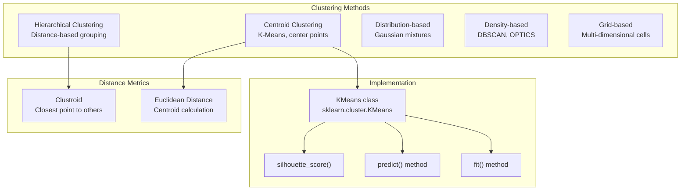
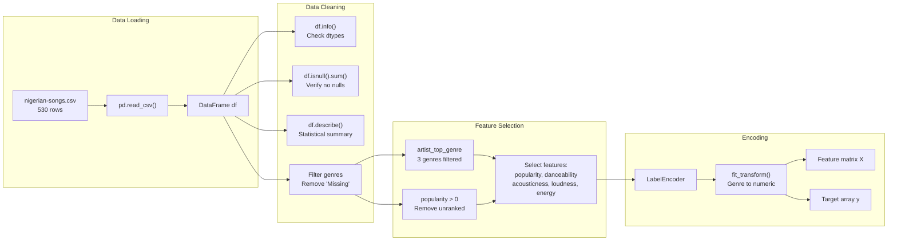
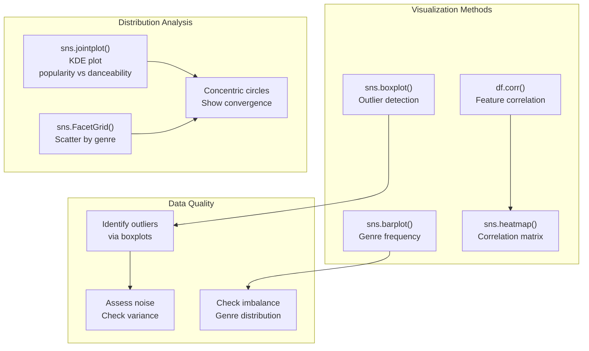
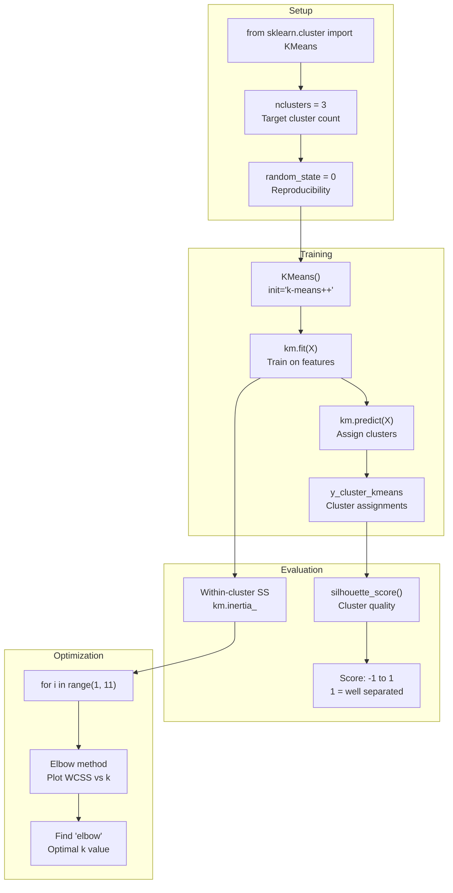
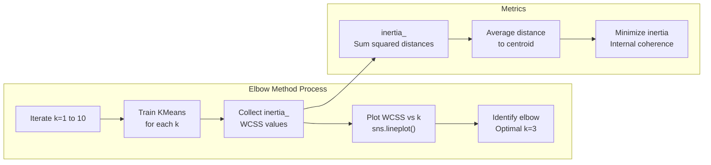
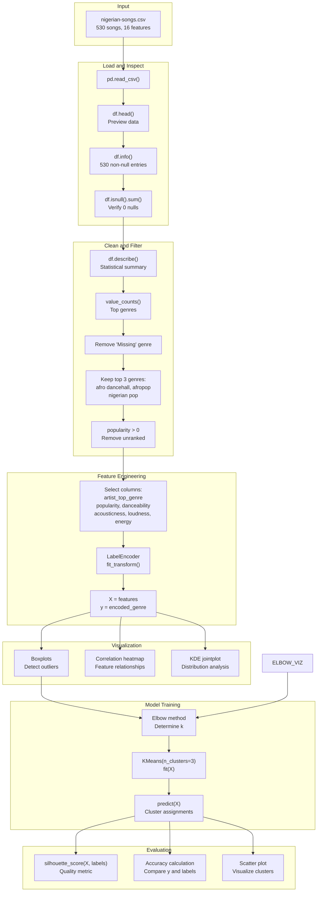

<!-- source: DeepWiki mcp.deepwiki.com · repo microsoft/ML-For-Beginners · page 4 Unsupervised Learning · fetched 2026-10-26 -->

# Unsupervised Learning

<details>
<summary>Relevant source files</summary>

The following files were used as context for generating this wiki page:

- [5-Clustering/1-Visualize/README.md](5-Clustering/1-Visualize/README.md)
- [5-Clustering/2-K-Means/README.md](5-Clustering/2-K-Means/README.md)
- [6-NLP/1-Introduction-to-NLP/README.md](6-NLP/1-Introduction-to-NLP/README.md)
- [6-NLP/1-Introduction-to-NLP/images/comprehension.png](6-NLP/1-Introduction-to-NLP/images/comprehension.png)
- [6-NLP/2-Tasks/README.md](6-NLP/2-Tasks/README.md)
- [6-NLP/3-Translation-Sentiment/README.md](6-NLP/3-Translation-Sentiment/README.md)
- [6-NLP/3-Translation-Sentiment/images/monnaie.png](6-NLP/3-Translation-Sentiment/images/monnaie.png)
- [6-NLP/4-Hotel-Reviews-1/README.md](6-NLP/4-Hotel-Reviews-1/README.md)
- [6-NLP/5-Hotel-Reviews-2/README.md](6-NLP/5-Hotel-Reviews-2/README.md)
- [6-NLP/5-Hotel-Reviews-2/assignment.md](6-NLP/5-Hotel-Reviews-2/assignment.md)
- [6-NLP/5-Hotel-Reviews-2/solution/3-notebook.ipynb](6-NLP/5-Hotel-Reviews-2/solution/3-notebook.ipynb)
- [6-NLP/README.md](6-NLP/README.md)

</details>


## Purpose and Scope

This document covers the unsupervised learning module within the ML-For-Beginners curriculum, specifically focusing on clustering techniques for discovering patterns in unlabeled data. The primary implementation uses K-Means clustering applied to a Nigerian music dataset to group similar songs based on audio features. For supervised learning approaches using labeled data, see [Supervised Learning](#3). For natural language processing applications, see [Specialized ML Applications](#5).

## Overview of Unsupervised Learning

Unsupervised learning algorithms discover patterns in unlabeled datasets where inputs are not matched with predefined outputs. Unlike supervised approaches that learn from labeled examples, unsupervised methods group or structure data based on inherent similarities without prior knowledge of categories.

The curriculum implements clustering as the primary unsupervised technique, where data points are partitioned into groups (clusters) such that points within a cluster are more similar to each other than to points in other clusters.

Sources: [5-Clustering/1-Visualize/README.md:1-15]()

## Clustering Fundamentals

### Clustering Definition and Use Cases

Clustering partitions a dataset into groups by examining patterns and relationships without requiring labeled training data. The algorithm assigns cluster IDs to data points, enabling pattern discovery while preserving privacy (referencing data by cluster ID rather than identifying information).

**Common Applications:**
- Market segmentation (age groups, purchasing patterns)
- Anomaly detection (fraud detection in credit card transactions)
- Medical diagnosis (tumor detection in scan batches)
- Search result grouping (shopping links, images, reviews)

Sources: [5-Clustering/1-Visualize/README.md:13-30]()

### Clustering Algorithm Selection

The curriculum uses scikit-learn's clustering implementations. Algorithm selection depends on data characteristics:

| Algorithm | Use Case | Type |
|-----------|----------|------|
| K-Means | General purpose | Inductive, centroid-based |
| Affinity Propagation | Many uneven clusters | Inductive |
| Mean-shift | Many uneven clusters | Inductive |
| Spectral Clustering | Few even clusters | Transductive |
| DBSCAN | Non-flat geometry, uneven clusters | Transductive, density-based |
| Hierarchical | Many constrained clusters | Transductive |

**Key Concepts:**

- **Transductive vs Inductive**: Transductive methods map observed training cases to specific test cases; inductive methods derive general rules applied to new test cases
- **Flat vs Non-flat Geometry**: Flat geometry uses Euclidean distance; non-flat uses curved distance measurements for data not existing on a plane
- **Constrained Clustering**: Semi-supervised approach forcing "must-link" or "cannot-link" relationships between points

Sources: [5-Clustering/1-Visualize/README.md:32-79]()

### Clustering Algorithm Types



Sources: [5-Clustering/1-Visualize/README.md:80-99]()

## Dataset and Data Processing

### Nigerian Music Dataset

The clustering implementation uses `nigerian-songs.csv` containing 530 song records with audio features from three genres: afro dancehall, afropop, and nigerian pop.

**Dataset Structure:**

| Column | Type | Description |
|--------|------|-------------|
| name | object | Song title |
| artist_top_genre | object | Genre classification |
| popularity | int64 | Popularity score (0-73) |
| danceability | float64 | Danceability metric (0-1) |
| acousticness | float64 | Acoustic quality (0-1) |
| energy | float64 | Energy level (0-1) |
| loudness | float64 | Loudness in dB |
| tempo | float64 | Beats per minute |

Sources: [5-Clustering/1-Visualize/README.md:112-164]()

### Data Preparation Pipeline



Sources: [5-Clustering/1-Visualize/README.md:132-277](), [5-Clustering/2-K-Means/README.md:38-102]()

### Data Exploration and Visualization

The preprocessing workflow includes exploratory visualization to understand data distribution and feature relationships:



**Key Findings:**
- Strongest correlation: energy and loudness (expected relationship)
- Data shows concentric convergence around danceability regardless of genre
- High variance and outliers present in multiple features
- Three genres loosely align in popularity/danceability space

Sources: [5-Clustering/1-Visualize/README.md:215-314](), [5-Clustering/2-K-Means/README.md:41-85]()

## K-Means Algorithm Implementation

### K-Means Algorithm Mechanics

K-Means clustering partitions data into k groups through an iterative three-step process:

1. **Initialization**: Select k center points by sampling from dataset
2. **Assignment Loop**:
   - Assign each sample to nearest centroid
   - Create new centroids from mean of assigned samples
   - Calculate difference between new and old centroids
   - Repeat until centroids stabilize

The algorithm minimizes inertia (within-cluster sum of squares), measuring internal cluster coherence.

Sources: [5-Clustering/2-K-Means/README.md:14-30]()

### Model Training Workflow



**Initialization Parameters:**

- `n_clusters`: Number of clusters to form
- `init='k-means++'`: Smart initialization placing centroids distant from each other for better convergence
- `random_state`: Seed for centroid initialization reproducibility
- `inertia_`: Sum of squared distances to nearest cluster center

Sources: [5-Clustering/2-K-Means/README.md:104-162]()

### Code Implementation

The K-Means training loop implements the elbow method to determine optimal cluster count:

```python
# Setup and iteration
from sklearn.cluster import KMeans
wcss = []

for i in range(1, 11):
    kmeans = KMeans(n_clusters = i, init = 'k-means++', random_state = 42)
    kmeans.fit(X)
    wcss.append(kmeans.inertia_)
```

Key implementation at [5-Clustering/2-K-Means/README.md:142-149]()

Final model training and prediction:

```python
# Train with optimal k=3
kmeans = KMeans(n_clusters = 3)
kmeans.fit(X)
labels = kmeans.predict(X)

# Visualize clusters
plt.scatter(df['popularity'], df['danceability'], c = labels)
plt.xlabel('popularity')
plt.ylabel('danceability')
plt.show()
```

Implementation at [5-Clustering/2-K-Means/README.md:185-196]()

Sources: [5-Clustering/2-K-Means/README.md:142-196]()

## Model Evaluation Techniques

### Silhouette Score

The silhouette score measures cluster separation quality on a scale from -1 to 1:

- **1**: Dense, well-separated clusters
- **0**: Overlapping clusters with samples near decision boundaries
- **-1**: Incorrectly assigned samples

```python
from sklearn import metrics
score = metrics.silhouette_score(X, y_cluster_kmeans)
```

The Nigerian music dataset achieves a silhouette score of **0.53**, indicating moderately formed clusters with data not particularly well-suited to this clustering approach.

Sources: [5-Clustering/2-K-Means/README.md:123-135]()

### Elbow Method

The elbow method determines optimal k by plotting WCSS (within-cluster sum of squares) against cluster count. The "elbow" point where the rate of decrease sharply changes indicates the optimal k value.



For the Nigerian music dataset, the elbow method confirms k=3 as optimal, matching the three genre categories in the filtered data.

Sources: [5-Clustering/2-K-Means/README.md:164-182]()

### Model Accuracy Assessment

```python
labels = kmeans.labels_
correct_labels = sum(y == labels)
print("Result: %d out of %d samples were correctly labeled." % (correct_labels, y.size))
print('Accuracy score: {0:0.2f}'. format(correct_labels/float(y.size)))
```

The model exhibits low accuracy due to data characteristics:

**Problem Indicators:**
- **Imbalanced data**: Unequal feature ranges
- **Low correlation**: Insufficient relationship between features
- **High variance**: Column values diverge significantly from mean
- **Skewed clusters**: Heavily influenced by pre-defined genre categories

Sources: [5-Clustering/2-K-Means/README.md:198-220]()

### Variance Problem

Variance measures "average of squared differences from the mean." In clustering context, high variance indicates dataset numbers diverge too much from the mean, causing poor cluster formation.

**Remediation Strategies:**
1. **Data scaling**: Normalize features to similar ranges
2. **Feature selection**: Test different column combinations
3. **Algorithm selection**: Try alternative clustering methods
4. **Weighting**: Apply weights to emphasize certain features

The curriculum notes that standard scaling can smooth the elbow graph but may reduce silhouette score, as unscaled data allows features with less variance to carry more weight.

Sources: [5-Clustering/2-K-Means/README.md:221-236]()

## Data Processing Pipeline

### Complete Workflow



Sources: [5-Clustering/1-Visualize/README.md:100-314](), [5-Clustering/2-K-Means/README.md:35-236]()

## Key Implementation Files

| File Path | Purpose | Key Components |
|-----------|---------|----------------|
| `5-Clustering/1-Visualize/README.md` | Clustering introduction | Algorithm taxonomy, use cases, dataset exploration |
| `5-Clustering/2-K-Means/README.md` | K-Means implementation | Algorithm mechanics, elbow method, silhouette scoring |
| `5-Clustering/1-Visualize/notebook.ipynb` | Visualization exercises | Seaborn plots, correlation analysis, KDE plots |
| `5-Clustering/2-K-Means/notebook.ipynb` | K-Means training | Model training loop, WCSS calculation, cluster visualization |
| `5-Clustering/data/nigerian-songs.csv` | Dataset | 530 songs with audio features |

Sources: [5-Clustering/1-Visualize/README.md:104](), [5-Clustering/2-K-Means/README.md:35]()

## Integration with Other Modules

The unsupervised learning module builds on foundational concepts from earlier modules while contrasting with supervised approaches:

**Prerequisites:**
- Data manipulation with pandas (from [Core ML Concepts](#2))
- Visualization with matplotlib/seaborn
- Scikit-learn model APIs

**Contrasts with Supervised Learning:**
- No labeled training data required
- Discovers inherent patterns vs. learning from examples
- Uses distance metrics vs. prediction error minimization
- Cluster IDs vs. class predictions

**Leads to:**
- Feature understanding for supervised models
- Dimensionality reduction techniques
- Anomaly detection applications in real-world scenarios

Sources: [5-Clustering/1-Visualize/README.md:1-32]()

---

