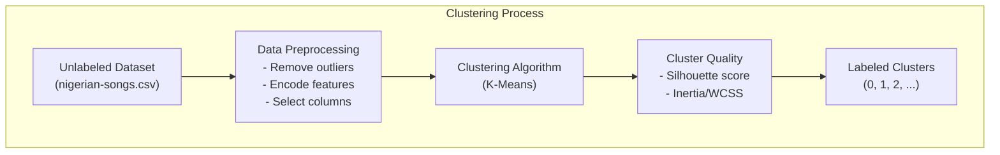
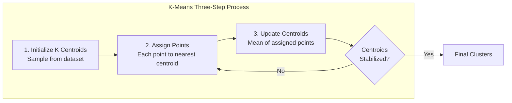
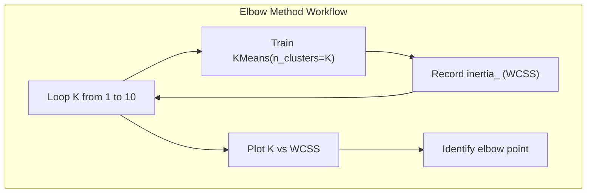
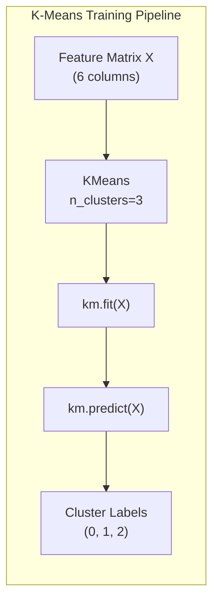
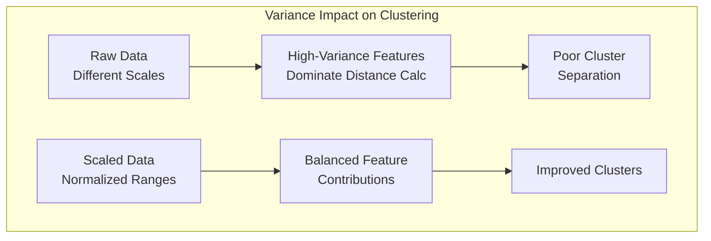
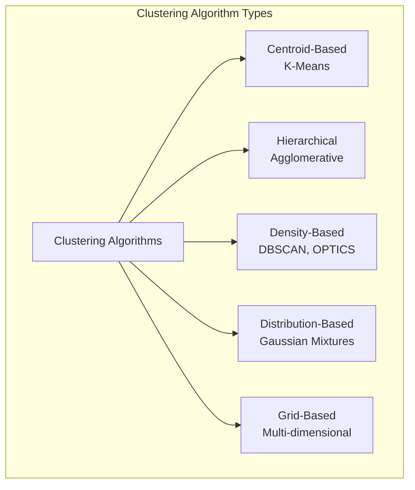
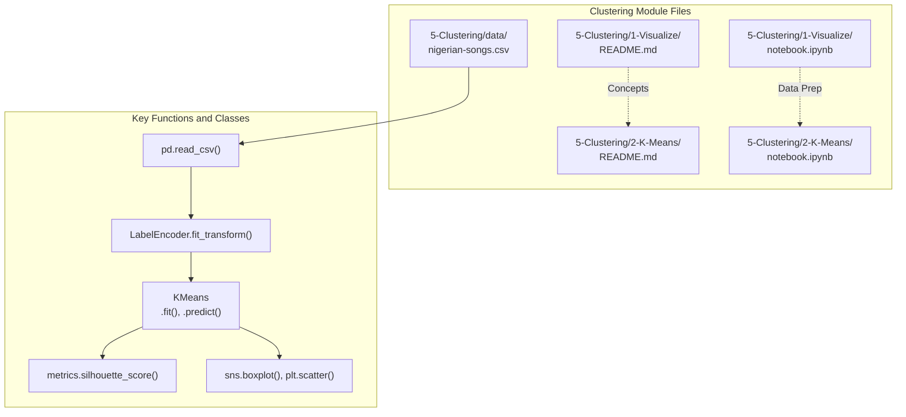

<!-- source: DeepWiki mcp.deepwiki.com · repo microsoft/ML-For-Beginners · page 4.1 Clustering · fetched 2026-10-26 -->

# Clustering

<details>
<summary>Relevant source files</summary>

The following files were used as context for generating this wiki page:

- [5-Clustering/1-Visualize/README.md](5-Clustering/1-Visualize/README.md)
- [5-Clustering/2-K-Means/README.md](5-Clustering/2-K-Means/README.md)
- [6-NLP/1-Introduction-to-NLP/README.md](6-NLP/1-Introduction-to-NLP/README.md)
- [6-NLP/1-Introduction-to-NLP/images/comprehension.png](6-NLP/1-Introduction-to-NLP/images/comprehension.png)
- [6-NLP/2-Tasks/README.md](6-NLP/2-Tasks/README.md)
- [6-NLP/3-Translation-Sentiment/README.md](6-NLP/3-Translation-Sentiment/README.md)
- [6-NLP/3-Translation-Sentiment/images/monnaie.png](6-NLP/3-Translation-Sentiment/images/monnaie.png)
- [6-NLP/4-Hotel-Reviews-1/README.md](6-NLP/4-Hotel-Reviews-1/README.md)
- [6-NLP/5-Hotel-Reviews-2/README.md](6-NLP/5-Hotel-Reviews-2/README.md)
- [6-NLP/5-Hotel-Reviews-2/assignment.md](6-NLP/5-Hotel-Reviews-2/assignment.md)
- [6-NLP/5-Hotel-Reviews-2/solution/3-notebook.ipynb](6-NLP/5-Hotel-Reviews-2/solution/3-notebook.ipynb)
- [6-NLP/README.md](6-NLP/README.md)

</details>


## Purpose and Scope

This document covers clustering techniques for unsupervised learning, focusing on K-Means clustering applied to the Nigerian music dataset. Clustering algorithms discover patterns in unlabeled data by grouping similar data points together without predefined categories. The material demonstrates data preparation, algorithm implementation, cluster quality evaluation, and visualization techniques using scikit-learn.

For general unsupervised learning concepts, see [4](#4). For classification with labeled data, see [3.2](#3.2). For NLP-based clustering applications, see [5.1](#5.1).

---

## Clustering Overview

### What is Clustering

Clustering is an unsupervised learning technique that partitions data into groups (clusters) where data points within each group are more similar to each other than to points in other groups. Unlike supervised learning, clustering operates without labeled training data and discovers inherent structure in the dataset.



**Sources:** [5-Clustering/1-Visualize/README.md:1-32](), [5-Clustering/2-K-Means/README.md:1-31]()

### Use Cases

Common applications for clustering:

| Domain | Application | Description |
|--------|-------------|-------------|
| Marketing | Customer segmentation | Group customers by purchasing behavior |
| Anomaly Detection | Fraud detection | Identify unusual patterns in credit card transactions |
| Medical | Tumor classification | Analyze medical scan batches for similar characteristics |
| Music | Genre discovery | Group songs by audio features without labels |
| E-commerce | Product recommendation | Cluster items for personalized suggestions |

**Sources:** [5-Clustering/1-Visualize/README.md:21-29]()

### Clustering Algorithm Selection

Scikit-learn provides multiple clustering algorithms with different characteristics:

| Algorithm | Use Case | Geometry | Learning Type |
|-----------|----------|----------|---------------|
| K-Means | General purpose | Flat | Inductive |
| DBSCAN | Non-flat geometry, uneven clusters | Non-flat | Transductive |
| Hierarchical | Many constrained clusters | Any | Transductive |
| Mean-shift | Many uneven clusters | Flat | Inductive |
| Gaussian mixtures | Flat geometry | Flat | Inductive |

The Nigerian music dataset uses **K-Means** as it is suitable for general-purpose clustering with flat (Euclidean) geometry.

**Sources:** [5-Clustering/1-Visualize/README.md:32-79]()

---

## K-Means Algorithm

### Algorithm Mechanics

K-Means clustering partitions data into K clusters by iteratively assigning points to the nearest cluster centroid and recalculating centroids based on assigned points.



**Sources:** [5-Clustering/2-K-Means/README.md:14-30]()

### Implementation in scikit-learn

The `KMeans` class from `sklearn.cluster` implements the algorithm:

```python
from sklearn.cluster import KMeans

km = KMeans(n_clusters=3, random_state=0)
km.fit(X)
y_cluster_kmeans = km.predict(X)
```

Key parameters:
- **n_clusters**: Number of clusters K
- **init**: Centroid initialization method (`'k-means++'` recommended)
- **random_state**: Seed for reproducible centroid initialization
- **max_iter**: Maximum iterations before stopping

**Implementation Details:**

| Attribute/Method | Purpose |
|------------------|---------|
| `km.fit(X)` | Train model on feature matrix X |
| `km.predict(X)` | Assign cluster labels to data points |
| `km.inertia_` | Within-cluster sum of squares (WCSS) |
| `km.labels_` | Cluster labels for training data |

**Sources:** [5-Clustering/2-K-Means/README.md:104-119](), [5-Clustering/2-K-Means/README.md:139-163]()

### K-Means++ Initialization

The `'k-means++'` initialization strategy selects initial centroids that are distant from each other, leading to better convergence compared to random initialization. This is the default in scikit-learn and is specified at [5-Clustering/2-K-Means/README.md:146]().

**Sources:** [5-Clustering/2-K-Means/README.md:162]()

---

## Nigerian Music Dataset

### Dataset Structure

The Nigerian music dataset (`nigerian-songs.csv`) contains 530 songs with audio features from Spotify:

| Column | Type | Description |
|--------|------|-------------|
| `name` | object | Song name |
| `artist` | object | Artist name |
| `artist_top_genre` | object | Genre classification (target) |
| `popularity` | int64 | Popularity score (0-100) |
| `danceability` | float64 | Danceability measure (0-1) |
| `acousticness` | float64 | Acoustic quality (0-1) |
| `energy` | float64 | Energy level (0-1) |
| `loudness` | float64 | Volume in dB |
| `tempo` | float64 | Beats per minute |
| `length` | int64 | Song duration in ms |

**Sources:** [5-Clustering/1-Visualize/README.md:112-163]()

### Data Loading and Exploration

```python
import pandas as pd
import matplotlib.pyplot as plt
import seaborn as sns

df = pd.read_csv("../data/nigerian-songs.csv")
df.head()
df.info()
df.describe()
```

The dataset has no missing values (`df.isnull().sum()` returns 0 for all columns).

**Sources:** [5-Clustering/1-Visualize/README.md:108-193]()

### Genre Distribution

The dataset includes songs from multiple genres, with three dominant genres selected for clustering:

1. **afro dancehall**
2. **afropop**
3. **nigerian pop**

Filtering is applied to focus on these genres and remove unclassified (`'Missing'`) entries:

```python
df = df[df['artist_top_genre'] != 'Missing']
df = df[(df['artist_top_genre'] == 'afro dancehall') | 
        (df['artist_top_genre'] == 'afropop') | 
        (df['artist_top_genre'] == 'nigerian pop')]
df = df[(df['popularity'] > 0)]
```

**Sources:** [5-Clustering/1-Visualize/README.md:215-258]()

---

## Data Preparation for Clustering

### Feature Selection

Not all columns are suitable for clustering. The selected features should have similar ranges and be relevant to finding musical patterns:

```python
from sklearn.preprocessing import LabelEncoder

le = LabelEncoder()
X = df.loc[:, ('artist_top_genre','popularity','danceability',
               'acousticness','loudness','energy')]
X['artist_top_genre'] = le.fit_transform(X['artist_top_genre'])
y = le.transform(df['artist_top_genre'])
```

Selected features:
- `artist_top_genre` (encoded as numeric)
- `popularity`
- `danceability`
- `acousticness`
- `loudness`
- `energy`

**Sources:** [5-Clustering/2-K-Means/README.md:89-102]()

### Outlier Detection

Boxplots reveal outliers in the dataset across multiple columns:

```python
plt.figure(figsize=(20,20), dpi=200)
sns.boxplot(x='popularity', data=df)
sns.boxplot(x='acousticness', data=df)
# ... additional boxplots for other features
```

While outliers exist, removing them would significantly reduce the dataset size. The lesson proceeds with the full dataset acknowledging this limitation.

**Sources:** [5-Clustering/2-K-Means/README.md:41-87]()

### Correlation Analysis

```python
corrmat = df.corr(numeric_only=True)
f, ax = plt.subplots(figsize=(12, 9))
sns.heatmap(corrmat, vmax=.8, square=True)
```

The correlation heatmap shows weak correlations overall, with the strongest being between `energy` and `loudness` (expected, as louder music tends to be energetic).

**Sources:** [5-Clustering/1-Visualize/README.md:260-272]()

---

## Determining Optimal Number of Clusters

### Elbow Method

The elbow method identifies the optimal K by plotting Within-Cluster Sum of Squares (WCSS) against the number of clusters:



**Implementation:**

```python
from sklearn.cluster import KMeans
wcss = []

for i in range(1, 11):
    kmeans = KMeans(n_clusters=i, init='k-means++', random_state=42)
    kmeans.fit(X)
    wcss.append(kmeans.inertia_)

plt.figure(figsize=(10,5))
sns.lineplot(x=range(1, 11), y=wcss, marker='o', color='red')
plt.title('Elbow')
plt.xlabel('Number of clusters')
plt.ylabel('WCSS')
plt.show()
```

The elbow appears at **K=3**, suggesting three clusters are optimal for this dataset.

**Sources:** [5-Clustering/2-K-Means/README.md:141-181]()

### Key Concepts

| Term | Definition |
|------|------------|
| **WCSS** | Within-Cluster Sums of Squares: measures squared average distance of points within a cluster to the centroid |
| **Inertia** | Measure of internal coherence of clusters; lower is better |
| **Elbow Point** | The K value where WCSS reduction slows significantly |

**Sources:** [5-Clustering/2-K-Means/README.md:154-161]()

### Silhouette Score

Silhouette score measures cluster quality on a scale from -1 to 1:
- **1**: Dense, well-separated clusters
- **0**: Overlapping clusters, samples near decision boundaries
- **-1**: Incorrect cluster assignments

```python
from sklearn import metrics
score = metrics.silhouette_score(X, y_cluster_kmeans)
```

For the Nigerian music dataset with K=3, the silhouette score is **0.53**, indicating moderate clustering quality—the data is not ideally suited for clustering but demonstrates the technique.

**Sources:** [5-Clustering/2-K-Means/README.md:123-135]()

---

## Clustering Implementation

### Training the Model



**Complete workflow:**

```python
from sklearn.cluster import KMeans

# Create and train model
kmeans = KMeans(n_clusters=3)
kmeans.fit(X)
labels = kmeans.predict(X)

# Visualize results
plt.scatter(df['popularity'], df['danceability'], c=labels)
plt.xlabel('popularity')
plt.ylabel('danceability')
plt.show()
```

**Sources:** [5-Clustering/2-K-Means/README.md:185-196]()

### Model Evaluation

```python
labels = kmeans.labels_
correct_labels = sum(y == labels)

print("Result: %d out of %d samples were correctly labeled." % 
      (correct_labels, y.size))
print('Accuracy score: {0:0.2f}'.format(correct_labels/float(y.size)))
```

The accuracy is relatively low due to:
1. **Imbalanced data**: Uneven distribution across features
2. **Weak correlations**: Features don't strongly separate genres
3. **High variance**: Significant differences between column value ranges
4. **Genre influence**: The three predefined genre categories may skew natural clustering

**Sources:** [5-Clustering/2-K-Means/README.md:198-220]()

---

## Variance and Data Scaling

### Variance Problem

Variance measures "the average of the squared differences from the mean." High variance indicates data values diverge significantly from the mean, causing clustering issues.

In the Nigerian music dataset:
- Different columns have vastly different scales (e.g., `tempo` ranges 61-206, `danceability` 0-1)
- Columns with less variance carry more weight in distance calculations
- This creates poorly demarcated clusters



**Sources:** [5-Clustering/2-K-Means/README.md:221-228]()

### Scaling Solution

Applying standard scaling normalizes features to similar ranges:

```python
from sklearn.preprocessing import StandardScaler

scaler = StandardScaler()
X_scaled = scaler.fit_transform(X)

kmeans = KMeans(n_clusters=3)
kmeans.fit(X_scaled)
```

**Effect of scaling:**
- Silhouette score may decrease
- Elbow graph smooths out
- Clusters become more balanced
- Prevents features with large ranges from dominating

**Sources:** [5-Clustering/2-K-Means/README.md:233-236]()

---

## Visualization Techniques

### Boxplots for Outlier Detection

Boxplots visualize data distribution and identify outliers for each feature:

```python
plt.figure(figsize=(20,20), dpi=200)

plt.subplot(4,3,1)
sns.boxplot(x='popularity', data=df)

plt.subplot(4,3,2)
sns.boxplot(x='acousticness', data=df)

# ... continue for all features
```

Each boxplot shows:
- **Box**: Interquartile range (IQR)
- **Line in box**: Median
- **Whiskers**: Data within 1.5*IQR
- **Points**: Outliers

**Sources:** [5-Clustering/2-K-Means/README.md:41-81]()

### Scatter Plots

Scatter plots display cluster assignments in 2D feature space:

```python
plt.scatter(df['popularity'], df['danceability'], c=labels)
plt.xlabel('popularity')
plt.ylabel('danceability')
plt.show()
```

Colors represent different cluster assignments, allowing visual inspection of separation quality.

**Sources:** [5-Clustering/2-K-Means/README.md:185-212]()

### KDE Plots

Kernel Density Estimate (KDE) plots show probability density distributions across features:

```python
sns.set_theme(style="ticks")

g = sns.jointplot(
    data=df,
    x="popularity", y="danceability", hue="artist_top_genre",
    kind="kde",
)
```

The jointplot reveals concentric circles around convergence points, indicating where data clusters naturally.

**Sources:** [5-Clustering/1-Visualize/README.md:283-313]()

### FacetGrid for Multi-Category Comparison

```python
sns.FacetGrid(df, hue="artist_top_genre", height=5) \
   .map(plt.scatter, "popularity", "danceability") \
   .add_legend()
```

FacetGrid creates separate scatter plots for each genre, colored by category, showing convergence patterns.

**Sources:** [5-Clustering/1-Visualize/README.md:302-312]()

---

## Clustering Algorithm Taxonomy

### Classification by Method



**K-Means** is a centroid-based algorithm that:
1. Selects K center points (centroids)
2. Assigns data to nearest centroid
3. Recalculates centroids as mean of assigned points
4. Repeats until convergence

**Sources:** [5-Clustering/1-Visualize/README.md:80-98]()

### Geometric Considerations

| Concept | Flat (Euclidean) | Non-Flat (Non-Euclidean) |
|---------|------------------|---------------------------|
| **Distance Measure** | Straight line between points | Curved path between points |
| **Suitable Algorithms** | K-Means, Gaussian Mixtures | DBSCAN, OPTICS |
| **Use Case** | Data on plane-like surface | Complex curved manifolds |

K-Means uses **Euclidean distance**, making it suitable for flat geometry datasets like the Nigerian music features.

**Sources:** [5-Clustering/1-Visualize/README.md:57-62]()

---

## Code Implementation Map

### File Structure and Key Components



**Sources:** [5-Clustering/1-Visualize/README.md:1-332](), [5-Clustering/2-K-Means/README.md:1-248]()

### Key scikit-learn Imports

| Import | Purpose |
|--------|---------|
| `sklearn.cluster.KMeans` | Core K-Means algorithm |
| `sklearn.preprocessing.LabelEncoder` | Encode categorical features as integers |
| `sklearn.preprocessing.StandardScaler` | Normalize feature scales |
| `sklearn.metrics.silhouette_score` | Calculate cluster quality metric |

**Sources:** [5-Clustering/2-K-Means/README.md:92](), [5-Clustering/2-K-Means/README.md:107](), [5-Clustering/2-K-Means/README.md:126]()

---

## Advanced Topics and Challenges

### Parameter Tuning

Key parameters for improving clustering:

1. **Number of clusters (K)**: Use elbow method and domain knowledge
2. **Feature selection**: Remove irrelevant columns, add engineered features
3. **Scaling**: Apply StandardScaler or MinMaxScaler
4. **Outlier removal**: Filter extreme values before training
5. **Alternative algorithms**: Try DBSCAN for non-spherical clusters

**Sources:** [5-Clustering/2-K-Means/README.md:225](), [5-Clustering/2-K-Means/README.md:233-236]()

### Dataset-Specific Challenges

The Nigerian music dataset presents several challenges:

| Challenge | Impact | Mitigation |
|-----------|--------|------------|
| Imbalanced features | Poor cluster separation | Scale data with StandardScaler |
| Weak correlations | Low predictive power | Select more discriminative features |
| High variance | Inconsistent clustering | Normalize ranges |
| Genre bias | Skewed natural clusters | Consider unsupervised feature learning |

**Sources:** [5-Clustering/2-K-Means/README.md:210-220]()

### Voronoi Diagrams

K-Means clusters can be visualized as Voronoi diagrams, where each region represents the space closer to one centroid than any other. This geometric interpretation helps understand cluster boundaries.

**Sources:** [5-Clustering/2-K-Means/README.md:16-22]()

---

## Related Algorithms and Comparisons

### Hierarchical vs. K-Means

| Feature | K-Means | Hierarchical |
|---------|---------|--------------|
| **K Selection** | Must specify K | Creates dendrogram |
| **Speed** | Fast | Slower |
| **Scalability** | High | Moderate |
| **Cluster Shape** | Spherical | Flexible |

**Sources:** [5-Clustering/1-Visualize/README.md:84-87]()

### DBSCAN for Non-Flat Geometry

DBSCAN handles non-flat geometry and uneven cluster densities better than K-Means. It's suitable for:
- Noisy data with outliers
- Clusters with varying density
- Non-spherical cluster shapes

**Sources:** [5-Clustering/1-Visualize/README.md:44](), [5-Clustering/1-Visualize/README.md:76-78]()

---

## Interactive Learning Resources

### External Tools

- **K-Means Simulator**: [https://user.ceng.metu.edu.tr/~akifakkus/courses/ceng574/k-means/](https://user.ceng.metu.edu.tr/~akifakkus/courses/ceng574/k-means/) - Visualize centroid selection and convergence
- **Stanford K-Means Handout**: [https://stanford.edu/~cpiech/cs221/handouts/kmeans.html](https://stanford.edu/~cpiech/cs221/handouts/kmeans.html) - Detailed algorithm explanation

**Sources:** [5-Clustering/2-K-Means/README.md:241-243]()

### Microsoft Learn Module

Deepen understanding with the [Train and evaluate cluster models](https://docs.microsoft.com/learn/modules/train-evaluate-cluster-models) module for additional clustering techniques and evaluation strategies.

**Sources:** [5-Clustering/1-Visualize/README.md:31]()

---

