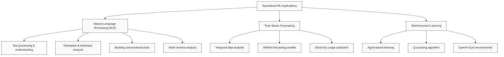
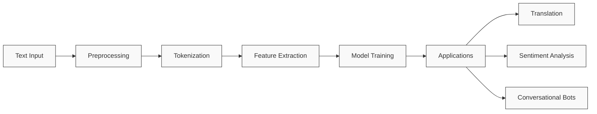
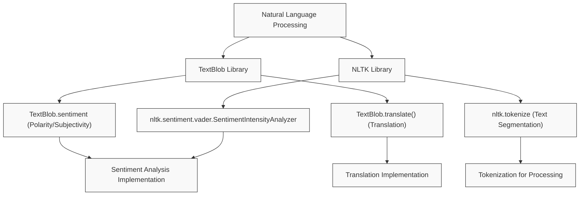
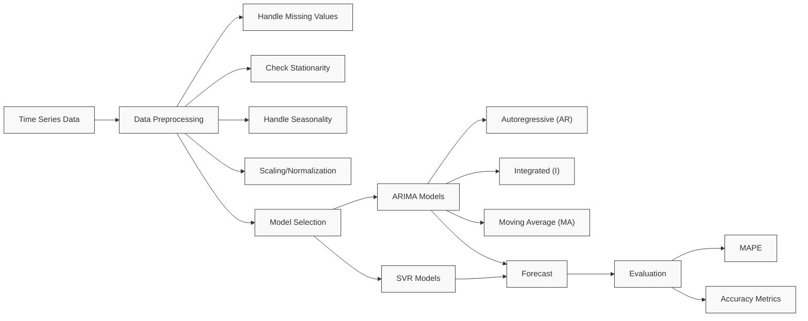
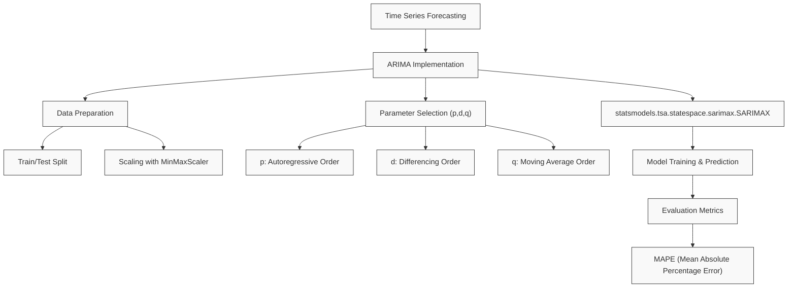
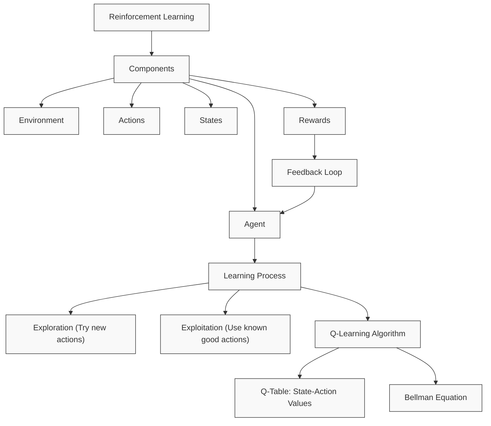
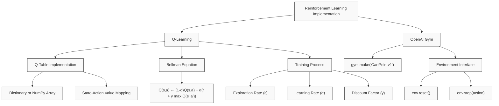
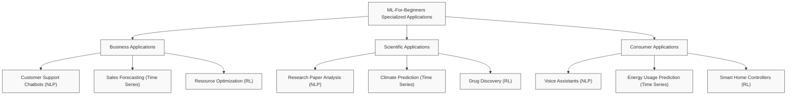

<!-- source: DeepWiki mcp.deepwiki.com · repo microsoft/ML-For-Beginners · page 5 Specialized ML Applications · fetched 2026-10-26 -->

# Specialized ML Applications

<details>
<summary>Relevant source files</summary>

The following files were used as context for generating this wiki page:

- [3-Web-App/1-Web-App/README.md](3-Web-App/1-Web-App/README.md)
- [5-Clustering/1-Visualize/README.md](5-Clustering/1-Visualize/README.md)
- [5-Clustering/2-K-Means/README.md](5-Clustering/2-K-Means/README.md)
- [6-NLP/1-Introduction-to-NLP/README.md](6-NLP/1-Introduction-to-NLP/README.md)
- [6-NLP/1-Introduction-to-NLP/images/comprehension.png](6-NLP/1-Introduction-to-NLP/images/comprehension.png)
- [6-NLP/2-Tasks/README.md](6-NLP/2-Tasks/README.md)
- [6-NLP/3-Translation-Sentiment/README.md](6-NLP/3-Translation-Sentiment/README.md)
- [6-NLP/3-Translation-Sentiment/images/monnaie.png](6-NLP/3-Translation-Sentiment/images/monnaie.png)
- [6-NLP/4-Hotel-Reviews-1/README.md](6-NLP/4-Hotel-Reviews-1/README.md)
- [6-NLP/5-Hotel-Reviews-2/README.md](6-NLP/5-Hotel-Reviews-2/README.md)
- [6-NLP/5-Hotel-Reviews-2/assignment.md](6-NLP/5-Hotel-Reviews-2/assignment.md)
- [6-NLP/5-Hotel-Reviews-2/solution/3-notebook.ipynb](6-NLP/5-Hotel-Reviews-2/solution/3-notebook.ipynb)
- [6-NLP/README.md](6-NLP/README.md)
- [7-TimeSeries/1-Introduction/README.md](7-TimeSeries/1-Introduction/README.md)
- [7-TimeSeries/2-ARIMA/README.md](7-TimeSeries/2-ARIMA/README.md)
- [7-TimeSeries/README.md](7-TimeSeries/README.md)
- [8-Reinforcement/1-QLearning/README.md](8-Reinforcement/1-QLearning/README.md)
- [8-Reinforcement/1-QLearning/assignment.md](8-Reinforcement/1-QLearning/assignment.md)
- [8-Reinforcement/1-QLearning/notebook.ipynb](8-Reinforcement/1-QLearning/notebook.ipynb)
- [8-Reinforcement/1-QLearning/rlboard.py](8-Reinforcement/1-QLearning/rlboard.py)
- [8-Reinforcement/1-QLearning/solution/assignment-solution.ipynb](8-Reinforcement/1-QLearning/solution/assignment-solution.ipynb)
- [8-Reinforcement/1-QLearning/solution/notebook.ipynb](8-Reinforcement/1-QLearning/solution/notebook.ipynb)
- [8-Reinforcement/1-QLearning/solution/rlboard.py](8-Reinforcement/1-QLearning/solution/rlboard.py)
- [8-Reinforcement/2-Gym/README.md](8-Reinforcement/2-Gym/README.md)
- [8-Reinforcement/2-Gym/assignment.md](8-Reinforcement/2-Gym/assignment.md)
- [8-Reinforcement/2-Gym/images/escape.png](8-Reinforcement/2-Gym/images/escape.png)
- [8-Reinforcement/2-Gym/notebook.ipynb](8-Reinforcement/2-Gym/notebook.ipynb)
- [8-Reinforcement/2-Gym/solution/notebook.ipynb](8-Reinforcement/2-Gym/solution/notebook.ipynb)
- [8-Reinforcement/README.md](8-Reinforcement/README.md)
- [8-Reinforcement/images/peter.png](8-Reinforcement/images/peter.png)

</details>


This section provides an overview of advanced machine learning applications beyond basic regression and classification tasks. We explore Natural Language Processing (NLP), Time Series Forecasting, and Reinforcement Learning, presenting key concepts, methodologies, and implementation approaches for each domain. These specialized applications demonstrate how machine learning can be applied to complex problems that require more tailored approaches than general-purpose algorithms.

For general machine learning concepts, see [Core ML Concepts](#2). For supervised learning methods like regression and classification, see [Supervised Learning](#3).

## Overview of Specialized Applications

The ML-For-Beginners curriculum covers three main specialized applications of machine learning:



Each of these domains applies machine learning techniques to specific types of problems that require specialized approaches. They go beyond the general-purpose algorithms covered in earlier sections and demonstrate how machine learning can be tailored to specific domains.

Sources: [6-NLP/README.md](). [7-TimeSeries/README.md](). [8-Reinforcement/README.md]().

## Natural Language Processing

Natural Language Processing (NLP) is the field focused on enabling computers to understand, interpret, and generate human language. The curriculum covers fundamental NLP concepts and practical applications.

### Core NLP Concepts and Components



NLP systems start with raw text input, then preprocess it through steps such as tokenization (breaking text into words or subwords), and feature extraction (converting text into numerical representations). The processed data is then used to train models for various applications.

In the curriculum, students learn to:
1. Build a basic conversational bot
2. Perform text translation
3. Conduct sentiment analysis on text
4. Analyze hotel reviews using NLP techniques

Sources: [6-NLP/1-Introduction-to-NLP/README.md](). [6-NLP/3-Translation-Sentiment/README.md]().

### NLP Technical Implementation



The NLP section uses two primary libraries:
- **TextBlob**: A simplified text processing library that provides easy-to-use interfaces for common NLP tasks
- **NLTK**: A comprehensive platform for building Python programs to work with human language data

The code implementation focuses on practical applications like building a conversational bot:

```python
# Example bot from 6-NLP/1-Introduction-to-NLP/solution/bot.py
random_responses = ["That is quite interesting, please tell me more.",
                    "I see. Do go on.",
                    "Why do you say that?",
                    "Funny weather we've been having, isn't it?",
                    "Let's change the subject.",
                    "Did you catch the game last night?"]
```

And performing sentiment analysis:

```python
# Sentiment analysis example from 6-NLP/3-Translation-Sentiment/README.md:115-119
sentiment1 = TextBlob(quote1).sentiment
sentiment2 = TextBlob(quote2).sentiment

print(quote1 + " has a sentiment of " + str(sentiment1))
print(quote2 + " has a sentiment of " + str(sentiment2))
```

Sources: [6-NLP/1-Introduction-to-NLP/README.md:99-110](). [6-NLP/3-Translation-Sentiment/README.md:104-120](). [6-NLP/5-Hotel-Reviews-2/README.md:234-262]().

## Time Series Forecasting

Time series forecasting is the process of using historical time-ordered data to predict future values. This specialized application is particularly valuable for business, finance, and resource planning.

### Time Series Concepts and Components



Time series forecasting requires understanding concepts like:
- **Stationarity**: When statistical properties don't change over time
- **Seasonality**: Regular patterns that repeat over fixed intervals
- **Differencing**: Technique to make non-stationary data stationary
- **Trends**: Consistent upward or downward movements in the data

The curriculum focuses on ARIMA (AutoRegressive Integrated Moving Average) models, which are particularly well-suited for time series data.

Sources: [7-TimeSeries/1-Introduction/README.md:15-70](). [7-TimeSeries/2-ARIMA/README.md:12-35]().

### Time Series Technical Implementation



The time series implementation uses:
- **statsmodels** library for ARIMA modeling
- **sklearn** for data preprocessing and evaluation
- **pandas** for data manipulation
- **matplotlib** for visualization

Key code components include:

```python
# Example ARIMA model from 7-TimeSeries/2-ARIMA/README.md:197-206
order = (4, 1, 0)
seasonal_order = (1, 1, 0, 24)

model = SARIMAX(endog=train, order=order, seasonal_order=seasonal_order)
results = model.fit()

print(results.summary())
```

The curriculum demonstrates forecasting future electricity load based on historical patterns of electricity usage, a practical business application.

Sources: [7-TimeSeries/1-Introduction/README.md:66-96](). [7-TimeSeries/2-ARIMA/README.md:166-209, 243-277]().

## Reinforcement Learning

Reinforcement Learning (RL) is a type of machine learning where an agent learns to make decisions by taking actions in an environment to maximize a reward signal.

### Reinforcement Learning Concepts



In the curriculum, students learn about:
- The **agent-environment interaction** paradigm
- **Q-Learning**: A value-based reinforcement learning algorithm
- **OpenAI Gym** environments for simulation
- Balancing **exploration vs. exploitation**

The examples use the "Peter and the Wolf" theme to explore reinforcement learning concepts, with Peter as the agent learning to navigate environments and balance on a pole.

Sources: [8-Reinforcement/README.md:1-45](). [8-Reinforcement/1-QLearning/README.md:6-19]().

### Reinforcement Learning Implementation



The reinforcement learning implementation focuses on two main components:

1. **Q-Learning Algorithm**: Implemented with a Q-Table that stores the expected rewards for each state-action pair:

```python
# Q-Table example from 8-Reinforcement/1-QLearning/README.md:166-167
Q = {}
actions = (0,1)

def qvalues(state):
    return [Q.get((state,a),0) for a in actions]
```

2. **OpenAI Gym**: Used to simulate environments for reinforcement learning:

```python
# CartPole example from 8-Reinforcement/2-Gym/README.md:54-56
env = gym.make("CartPole-v1")
print(env.action_space)
print(env.observation_space)
```

The curriculum demonstrates:
- How to navigate a grid-based environment using Q-Learning
- Balancing a pole on a cart using reinforcement learning in OpenAI Gym
- Dealing with continuous state spaces through discretization

Sources: [8-Reinforcement/1-QLearning/README.md:135-167, 229-256](). [8-Reinforcement/2-Gym/README.md:33-56, 133-149]().

## Comparison of Specialized Applications

| Aspect | Natural Language Processing | Time Series Forecasting | Reinforcement Learning |
|--------|--------------------------|------------------------|----------------------|
| **Data Type** | Text data | Time-ordered numerical data | States and rewards |
| **Primary Goal** | Understand and generate human language | Predict future values based on past data | Learn optimal decision policies |
| **Key Algorithms** | TextBlob, NLTK, transformers | ARIMA, SARIMA, SVR | Q-Learning, policy-based methods |
| **Main Libraries** | NLTK, TextBlob, spaCy | statsmodels, pandas, sklearn | OpenAI Gym, NumPy |
| **Applications** | Chatbots, translation, sentiment analysis | Financial forecasting, resource planning | Robotics, game playing, control systems |
| **Challenges** | Ambiguity in language, context understanding | Seasonality, stationarity, outliers | Exploration-exploitation tradeoff, reward design |

Sources: [6-NLP/README.md](). [7-TimeSeries/README.md](). [8-Reinforcement/README.md]().

## Integration and Applications

These specialized ML applications can be integrated into larger systems and applied to real-world problems:



The curriculum demonstrates several practical applications:
- Hotel review sentiment analysis using NLP techniques
- Electricity load forecasting using time series models
- Balancing simulation using reinforcement learning

These examples provide a foundation for understanding how specialized ML applications can be applied to solve complex real-world problems.

Sources: [6-NLP/5-Hotel-Reviews-2/README.md](). [7-TimeSeries/2-ARIMA/README.md](). [8-Reinforcement/2-Gym/README.md]().

## Summary

The specialized ML applications covered in this section demonstrate the versatility of machine learning techniques beyond basic classification and regression tasks. By tailoring algorithms and approaches to specific problem domains like natural language, time series data, and reinforcement learning scenarios, we can address complex challenges that require specialized handling.

Each domain has its own unique characteristics:
- **NLP** deals with the complexities of human language
- **Time Series** focuses on temporal patterns and future predictions
- **Reinforcement Learning** addresses sequential decision-making problems

These specialized applications represent some of the most exciting and impactful areas of modern machine learning, with applications spanning business, science, engineering, and consumer technology.

Sources: [6-NLP/README.md](). [7-TimeSeries/README.md](). [8-Reinforcement/README.md]().

---

