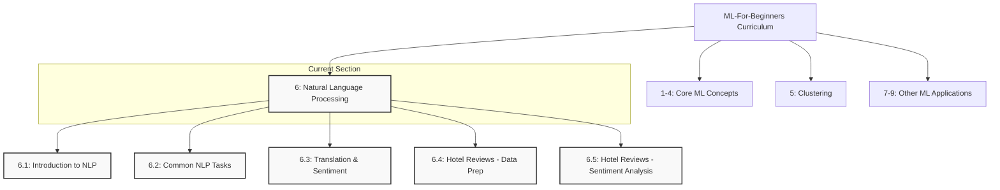
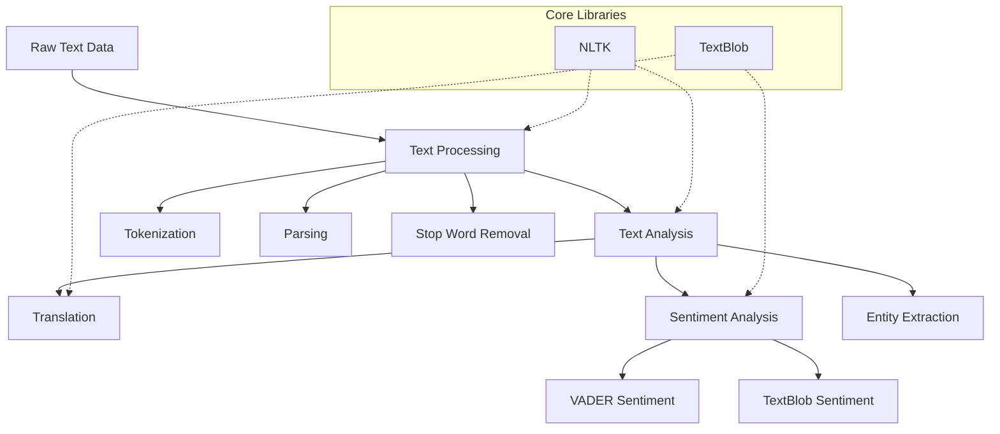
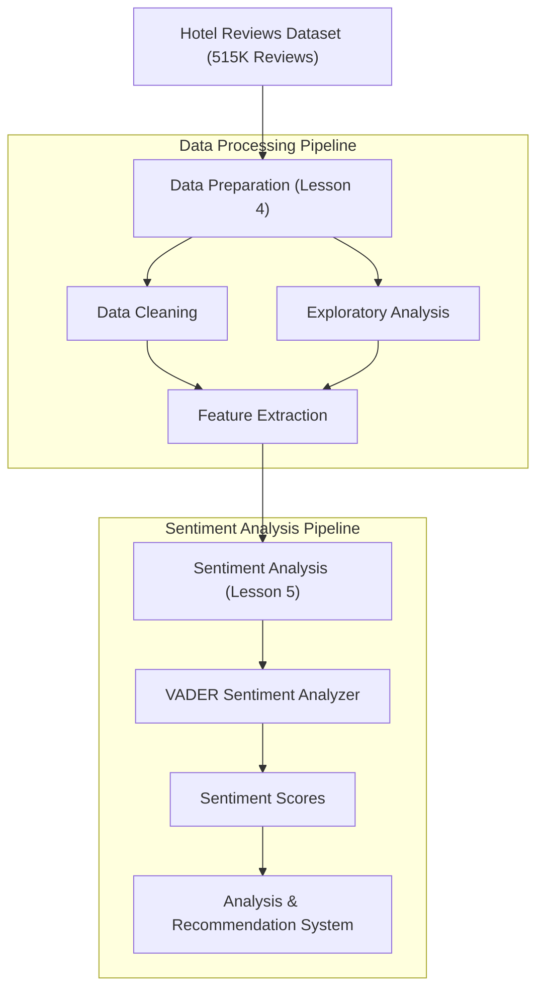

<!-- source: DeepWiki mcp.deepwiki.com · repo microsoft/ML-For-Beginners · page 5.1 Natural Language Processing · fetched 2026-10-26 -->

# Natural Language Processing

<details>
<summary>Relevant source files</summary>

The following files were used as context for generating this wiki page:

- [5-Clustering/1-Visualize/README.md](5-Clustering/1-Visualize/README.md)
- [5-Clustering/2-K-Means/README.md](5-Clustering/2-K-Means/README.md)
- [6-NLP/1-Introduction-to-NLP/README.md](6-NLP/1-Introduction-to-NLP/README.md)
- [6-NLP/1-Introduction-to-NLP/images/comprehension.png](6-NLP/1-Introduction-to-NLP/images/comprehension.png)
- [6-NLP/2-Tasks/README.md](6-NLP/2-Tasks/README.md)
- [6-NLP/3-Translation-Sentiment/README.md](6-NLP/3-Translation-Sentiment/README.md)
- [6-NLP/3-Translation-Sentiment/images/monnaie.png](6-NLP/3-Translation-Sentiment/images/monnaie.png)
- [6-NLP/4-Hotel-Reviews-1/README.md](6-NLP/4-Hotel-Reviews-1/README.md)
- [6-NLP/5-Hotel-Reviews-2/README.md](6-NLP/5-Hotel-Reviews-2/README.md)
- [6-NLP/5-Hotel-Reviews-2/assignment.md](6-NLP/5-Hotel-Reviews-2/assignment.md)
- [6-NLP/5-Hotel-Reviews-2/solution/3-notebook.ipynb](6-NLP/5-Hotel-Reviews-2/solution/3-notebook.ipynb)
- [6-NLP/README.md](6-NLP/README.md)

</details>


This document provides an overview of the Natural Language Processing (NLP) section within the ML-For-Beginners curriculum. NLP is a subfield of machine learning focused on enabling computers to understand, interpret, and generate human language. This section introduces fundamental NLP concepts, techniques, and practical applications through hands-on exercises and real-world datasets.

## NLP in the ML-For-Beginners Curriculum

The Natural Language Processing section fits into the broader ML-For-Beginners curriculum as a specialized application area of machine learning. While previous sections (such as Clustering) focus on numerical data analysis, NLP specifically addresses the challenges of processing and understanding textual data.



Sources: [6-NLP/README.md:14-20](https://github.com/microsoft/ML-For-Beginners/blob/main/6-NLP/README.md)

## Key Concepts and Components

NLP encompasses several key concepts and techniques that enable machines to work with human language data. Throughout this section, you'll explore:

- **Text processing** - Tokenization, parsing, and other techniques to transform raw text into structured formats
- **Translation** - Converting text from one language to another using computational models
- **Sentiment analysis** - Determining the emotional tone or opinion expressed in text
- **Conversational systems** - Building basic chatbots that can respond to user inputs

### NLP Applications Architecture

The NLP section builds from fundamental concepts to practical applications, culminating in sentiment analysis of hotel reviews. Here's how the technology concepts are structured:



Sources: [6-NLP/1-Introduction-to-NLP/README.md:13-17](https://github.com/microsoft/ML-For-Beginners/blob/main/6-NLP/1-Introduction-to-NLP/README.md), [6-NLP/3-Translation-Sentiment/README.md:1-4](https://github.com/microsoft/ML-For-Beginners/blob/main/6-NLP/3-Translation-Sentiment/README.md)

## Techniques and Tools

### Text Processing and Analysis

The curriculum introduces several fundamental NLP techniques:

1. **Tokenization** - Breaking text into words, phrases, or sentences
2. **Parsing** - Analyzing text structure to understand grammar and relationships
3. **Stop Word Removal** - Filtering out common words that add little meaning
4. **Part-of-speech tagging** - Identifying word types (nouns, verbs, etc.)

These techniques form the foundation for more advanced NLP applications covered later in the section.

Sources: [6-NLP/1-Introduction-to-NLP/README.md:33-36](https://github.com/microsoft/ML-For-Beginners/blob/main/6-NLP/1-Introduction-to-NLP/README.md)

### Key Libraries

The curriculum uses two primary Python libraries for NLP tasks:

| Library | Primary Use | Key Features |
|---------|-------------|--------------|
| TextBlob | Basic NLP tasks | Simple interface, sentiment analysis, translation |
| NLTK | Comprehensive NLP | Rich functionality, corpus access, advanced analysis |

For installation of TextBlob, the curriculum instructs:

```python
pip install -U textblob
python -m textblob.download_corpora
```

Sources: [6-NLP/1-Introduction-to-NLP/README.md:45-52](https://github.com/microsoft/ML-For-Beginners/blob/main/6-NLP/1-Introduction-to-NLP/README.md)

## Practical Applications

### Conversational Bot

Early in the curriculum, students build a simple conversational bot similar to the historical ELIZA program. This introduces core concepts like:

- Basic input/output processing
- Pattern matching in text
- Response generation

The bot uses a randomized response system with predefined answers, illustrating both the capabilities and limitations of rule-based NLP approaches.

Sources: [6-NLP/1-Introduction-to-NLP/README.md:82-143](https://github.com/microsoft/ML-For-Beginners/blob/main/6-NLP/1-Introduction-to-NLP/README.md)

### Translation and Sentiment Analysis

The curriculum covers:

- **Translation challenges** - Why direct word-by-word translation often fails
- **Machine learning approaches** to translation
- **Sentiment analysis** - Measuring the emotional tone of text
- **Polarity and subjectivity** - Quantifying sentiment on a scale

These concepts are applied to literary text analysis with examples from Jane Austen's "Pride and Prejudice."

Sources: [6-NLP/3-Translation-Sentiment/README.md:7-42](https://github.com/microsoft/ML-For-Beginners/blob/main/6-NLP/3-Translation-Sentiment/README.md), [6-NLP/3-Translation-Sentiment/README.md:82-132](https://github.com/microsoft/ML-For-Beginners/blob/main/6-NLP/3-Translation-Sentiment/README.md)

### Hotel Reviews Analysis

The culmination of the NLP section is a two-part comprehensive project analyzing hotel reviews. This real-world application integrates multiple NLP techniques:



Key aspects of this project include:

1. **Data Exploration and Cleaning**:
   - Processing a large dataset (515K hotel reviews)
   - Handling columns with varying data quality
   - Converting address information to structured format
   - Transforming tag data into analyzable features

2. **Sentiment Analysis Implementation**:
   - Removing stop words for processing efficiency
   - Using NLTK's VADER sentiment analyzer
   - Creating sentiment scores for negative and positive reviews
   - Comparing calculated sentiment with reviewer scores

Sources: [6-NLP/4-Hotel-Reviews-1/README.md:1-13](https://github.com/microsoft/ML-For-Beginners/blob/main/6-NLP/4-Hotel-Reviews-1/README.md), [6-NLP/5-Hotel-Reviews-2/README.md:1-4](https://github.com/microsoft/ML-For-Beginners/blob/main/6-NLP/5-Hotel-Reviews-2/README.md)

## Technical Implementation Details

### Data Processing Pipeline

The Hotel Reviews analysis demonstrates a complete NLP data processing pipeline:

1. **Initial Data Loading and Exploration**:
   - Loading data with pandas
   - Examining data structure and distribution
   - Identifying data quality issues

2. **Data Cleaning and Transformation**:
   - Standardizing location information
   - Extracting meaningful tags from unstructured text
   - Creating binary feature columns from text tags

3. **Text Preprocessing for Sentiment Analysis**:
   - Stop word removal for efficiency
   - Handling special cases ("No Negative", "No Positive")
   - Preparing text for sentiment scoring

Sources: [6-NLP/4-Hotel-Reviews-1/README.md:134-295](https://github.com/microsoft/ML-For-Beginners/blob/main/6-NLP/4-Hotel-Reviews-1/README.md), [6-NLP/5-Hotel-Reviews-2/README.md:10-236](https://github.com/microsoft/ML-For-Beginners/blob/main/6-NLP/5-Hotel-Reviews-2/README.md)

### Sentiment Analysis Implementation

The sentiment analysis implementation in the Hotel Reviews project uses NLTK's VADER (Valence Aware Dictionary and sEntiment Reasoner) sentiment analyzer:

```python
from nltk.sentiment.vader import SentimentIntensityAnalyzer

# Create the vader sentiment analyser
vader_sentiment = SentimentIntensityAnalyzer()

# Function to calculate sentiment
def calc_sentiment(review):    
    if review == "No Negative" or review == "No Positive":
        return 0
    return vader_sentiment.polarity_scores(review)["compound"]
```

This produces scores between -1 (highly negative) and 1 (highly positive), with 0 representing neutral sentiment.

Sources: [6-NLP/5-Hotel-Reviews-2/README.md:303-317](https://github.com/microsoft/ML-For-Beginners/blob/main/6-NLP/5-Hotel-Reviews-2/README.md)

### Performance Considerations

The curriculum addresses performance aspects of NLP processing:

- **Stop word removal** reduces processing time significantly
- Benchmarking shows processing time improvements:
  - Removing stop words from 515,000 reviews takes ~3-6 seconds
  - Full sentiment analysis with VADER takes ~2-3 minutes
  - Without stop word removal, processing would take much longer

This demonstrates practical considerations when working with large text datasets.

Sources: [6-NLP/5-Hotel-Reviews-2/README.md:265-293](https://github.com/microsoft/ML-For-Beginners/blob/main/6-NLP/5-Hotel-Reviews-2/README.md)

## Summary and Extensions

The NLP section provides a foundation in natural language processing techniques through progressive, hands-on examples. Starting with basic concepts and simple conversational bots, it builds to sophisticated sentiment analysis of real-world hotel review data.

After completing this section, students will understand:
- Basic NLP concepts and text processing techniques
- How to implement translation and sentiment analysis
- Methods for processing and analyzing large text datasets
- Practical considerations for NLP system performance

The final challenge encourages extending the sentiment analysis to detect patterns using clustering techniques from previous sections of the curriculum, integrating multiple ML approaches.

Sources: [6-NLP/5-Hotel-Reviews-2/README.md:365-367](https://github.com/microsoft/ML-For-Beginners/blob/main/6-NLP/5-Hotel-Reviews-2/README.md), [6-NLP/README.md:1-25](https://github.com/microsoft/ML-For-Beginners/blob/main/6-NLP/README.md)

---

