<!-- source: DeepWiki mcp.deepwiki.com · repo microsoft/ML-For-Beginners · page 5.2 Time Series Forecasting · fetched 2026-10-26 -->

# Time Series Forecasting

<details>
<summary>Relevant source files</summary>

The following files were used as context for generating this wiki page:

- [7-TimeSeries/1-Introduction/README.md](7-TimeSeries/1-Introduction/README.md)
- [7-TimeSeries/2-ARIMA/README.md](7-TimeSeries/2-ARIMA/README.md)
- [7-TimeSeries/README.md](7-TimeSeries/README.md)

</details>


This document covers time series analysis and forecasting techniques using ARIMA (AutoRegressive Integrated Moving Average) and SARIMA (Seasonal ARIMA) models. The material focuses on electricity load forecasting using historical consumption patterns, demonstrating data preparation, model training with `statsmodels`, and evaluation using walk-forward validation.

For reinforcement learning concepts, see [Reinforcement Learning](#5.3). For NLP sentiment analysis approaches, see [Natural Language Processing](#5.1).

## Purpose and Scope

Time series forecasting predicts future values based on temporal patterns in historical data. This section introduces the complete workflow for building ARIMA-based forecasting models:

- Understanding stationarity and differencing concepts
- Configuring ARIMA/SARIMA parameters (p, d, q, P, D, Q, m)
- Processing time series data with proper temporal splitting
- Implementing `SARIMAX` models from `statsmodels`
- Evaluating forecast accuracy using MAPE (Mean Absolute Percentage Error)
- Applying walk-forward validation for robust performance estimation

The primary dataset is `energy.csv` from the GEFCom2014 competition, containing hourly electricity load measurements from 2012-2014.

**Sources:** [7-TimeSeries/README.md:1-24](), [7-TimeSeries/1-Introduction/README.md:1-186](), [7-TimeSeries/2-ARIMA/README.md:1-395]()

## Time Series Fundamentals

### Core Concepts and Terminology

Time series data consists of observations recorded sequentially over time. Key characteristics that affect forecasting:

| Characteristic | Definition | Impact |
|---|---|---|
| **Stationarity** | Distribution remains constant when shifted in time | Non-stationary data requires differencing |
| **Trends** | Measurable long-term increases/decreases | Must be removed or modeled |
| **Seasonality** | Periodic fluctuations at regular intervals | Requires seasonal parameters in SARIMA |
| **Differencing** | Transformation to remove non-constant trends | Stabilizes mean and variance |
| **Autocorrelation** | Correlation of series with lagged versions of itself | Determines AR parameters |

**Stationarity** is critical for ARIMA models. Non-stationary data exhibits trends or changing variance that must be addressed through differencing operations.

**Sources:** [7-TimeSeries/1-Introduction/README.md:74-104](), [7-TimeSeries/2-ARIMA/README.md:17-22]()

### Time Series Analysis vs Forecasting

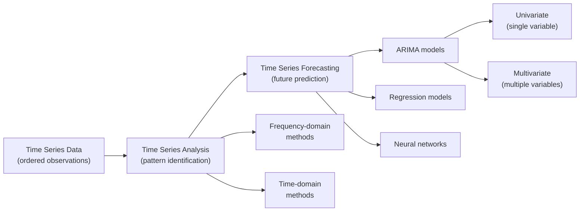

**Analysis** examines patterns in historical data, while **forecasting** uses those patterns to predict future values. The curriculum focuses on univariate forecasting using ARIMA, which models one variable's evolution over time.

**Sources:** [7-TimeSeries/1-Introduction/README.md:35-54]()

## ARIMA/SARIMA Model Architecture

### ARIMA Components

ARIMA models decompose time series into three components:

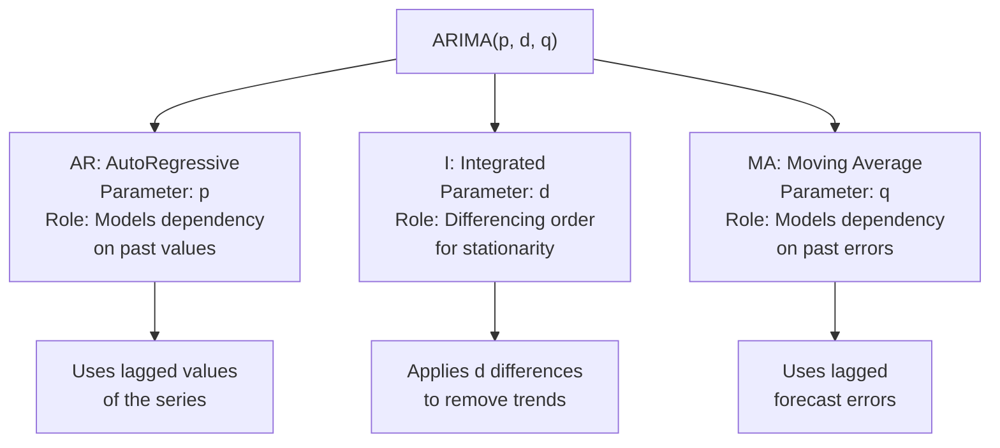

**Parameter meanings:**
- **p**: Number of lag observations (autoregressive order)
- **d**: Number of times differencing is applied (integration order)
- **q**: Size of moving average window (moving average order)

**Sources:** [7-TimeSeries/2-ARIMA/README.md:23-33](), [7-TimeSeries/2-ARIMA/README.md:176-181]()

### SARIMA Extensions for Seasonality

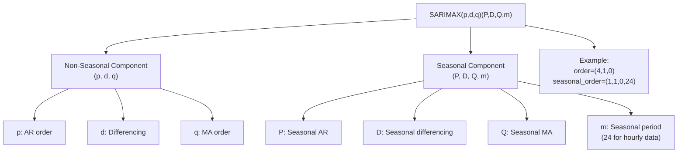

For electricity load data with daily patterns in hourly measurements, `m=24` captures the 24-hour cycle. The `SARIMAX` class in `statsmodels` implements this model, where the 'X' suffix indicates support for exogenous variables (not used in this curriculum).

**Sources:** [7-TimeSeries/2-ARIMA/README.md:182-183](), [7-TimeSeries/2-ARIMA/README.md:196-204]()

### Code Entity Mapping

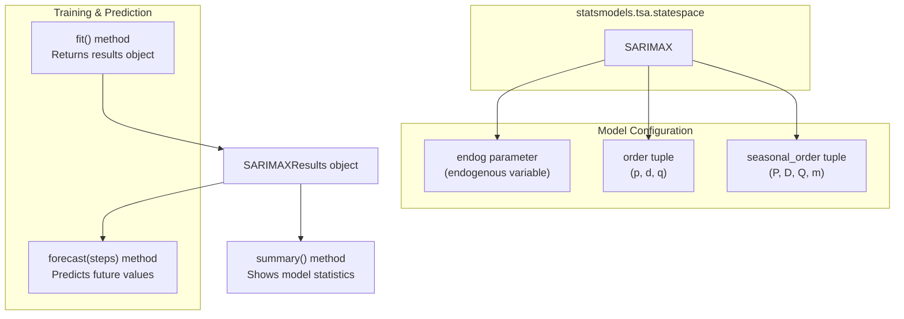

**Implementation pattern:**
```python
model = SARIMAX(endog=train_data, order=(p,d,q), seasonal_order=(P,D,Q,m))
results = model.fit()
predictions = results.forecast(steps=HORIZON)
```

**Sources:** [7-TimeSeries/2-ARIMA/README.md:54-58](), [7-TimeSeries/2-ARIMA/README.md:196-204](), [7-TimeSeries/2-ARIMA/README.md:261-265]()

## Data Pipeline

### Dataset Structure

The `energy.csv` dataset contains hourly electricity load measurements:

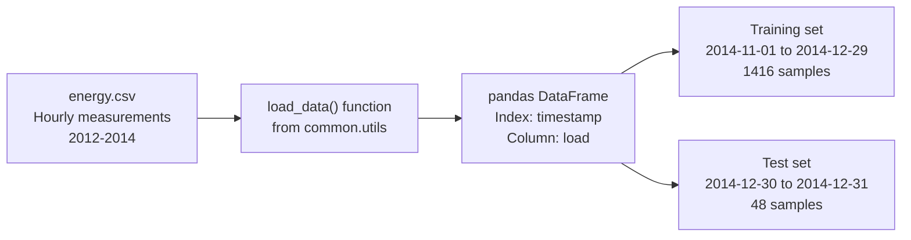

**Data characteristics:**
- Temporal granularity: 1 hour
- Strong daily seasonality (24-hour cycle)
- Variable: electricity load in MW
- Index: datetime objects for temporal operations

**Sources:** [7-TimeSeries/1-Introduction/README.md:112-144](), [7-TimeSeries/2-ARIMA/README.md:66-72]()

### Preprocessing Pipeline

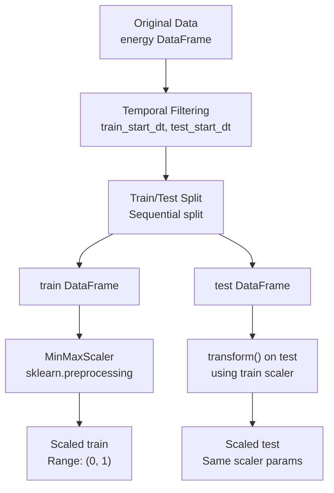

**Temporal splitting considerations:**
1. **No random splitting**: Test data must be chronologically after training data
2. **Validation omitted**: `SARIMAX.fit()` performs in-sample validation
3. **Training window**: Two months (November 1 - December 29, 2014)
4. **Test window**: Two days (December 30-31, 2014)

**Normalization approach** at [7-TimeSeries/2-ARIMA/README.md:135-164]():
- Fit `MinMaxScaler` on training data only
- Transform both train and test with same scaler
- Ensures test data doesn't leak information
- Results must be inverse-transformed for interpretation

**Sources:** [7-TimeSeries/2-ARIMA/README.md:84-127](), [7-TimeSeries/2-ARIMA/README.md:135-164]()

### Data Transformation Code Flow

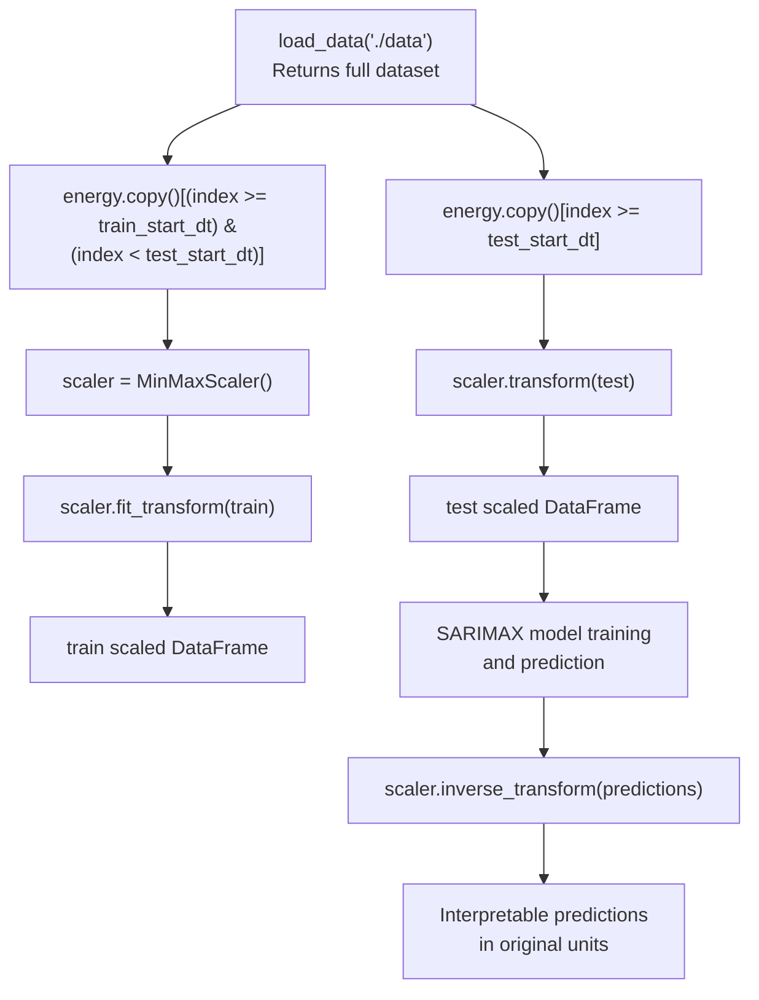

**Sources:** [7-TimeSeries/2-ARIMA/README.md:118-164]()

## Implementation Workflow

### Training and Prediction Process

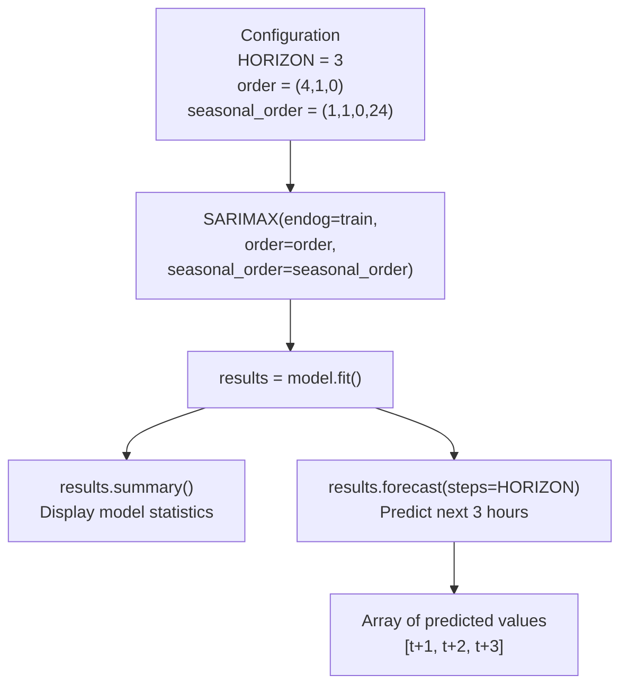

**Single-step forecasting** predicts one time point ahead. **Multi-step forecasting** (HORIZON > 1) predicts multiple future points. The `forecast()` method generates predictions for the specified number of steps.

**Sources:** [7-TimeSeries/2-ARIMA/README.md:166-208](), [7-TimeSeries/2-ARIMA/README.md:184-190]()

### Walk-Forward Validation

Walk-forward validation provides robust performance estimation by simulating real-world deployment:

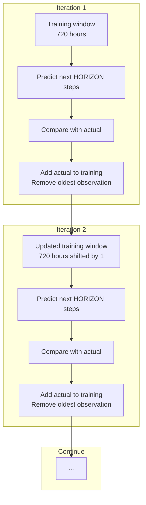

**Implementation pattern** at [7-TimeSeries/2-ARIMA/README.md:244-272]():

```python
training_window = 720  # 30 days of hourly data
history = [x for x in train_ts]
history = history[(-training_window):]  # Keep last 720 points
predictions = list()

for t in range(test_ts.shape[0]):
    model = SARIMAX(endog=history, order=order, seasonal_order=seasonal_order)
    model_fit = model.fit()
    yhat = model_fit.forecast(steps=HORIZON)
    predictions.append(yhat)
    
    obs = list(test_ts.iloc[t])
    history.append(obs[0])  # Add new observation
    history.pop(0)          # Remove oldest observation
```

**Key advantages:**
- Mimics production scenario where models retrain with new data
- Prevents look-ahead bias
- Provides realistic accuracy estimates
- Fixed window size controls computational cost

**Sources:** [7-TimeSeries/2-ARIMA/README.md:210-272]()

### Horizon Shifting for Multi-Step Evaluation

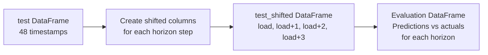

**Shifting mechanism** at [7-TimeSeries/2-ARIMA/README.md:222-242]():
```python
test_shifted = test.copy()
for t in range(1, HORIZON+1):
    test_shifted['load+'+str(t)] = test_shifted['load'].shift(-t, freq='H')
test_shifted = test_shifted.dropna(how='any')
```

This creates a DataFrame where each row contains the actual values for the current time and the next HORIZON time steps, enabling comparison with multi-step forecasts.

**Sources:** [7-TimeSeries/2-ARIMA/README.md:222-242]()

## Evaluation Methodology

### MAPE Calculation

Mean Absolute Percentage Error (MAPE) measures forecast accuracy as a percentage:

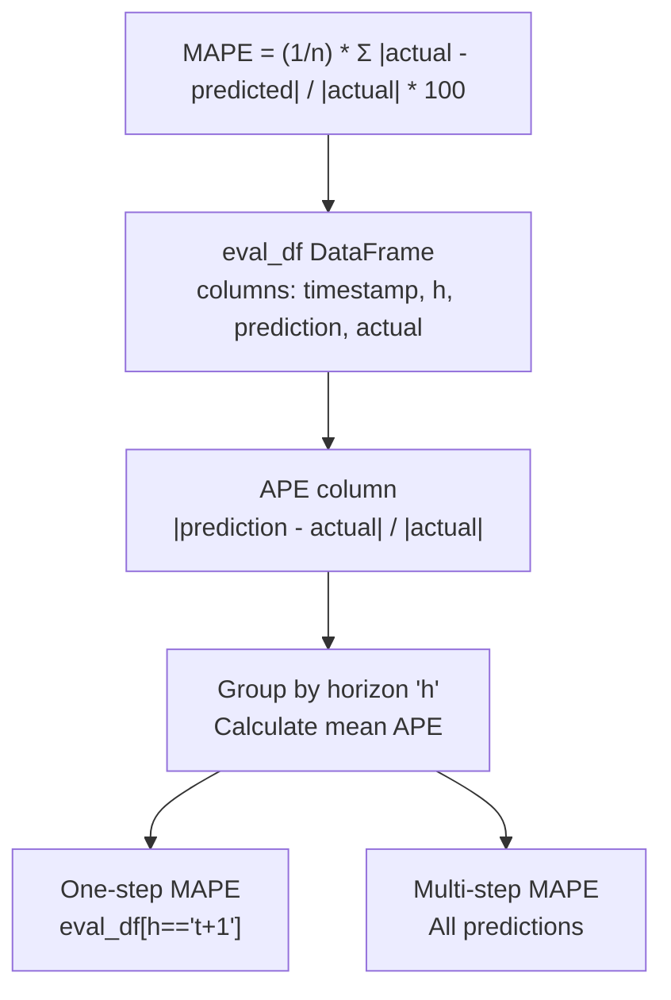

**Implementation** at [7-TimeSeries/2-ARIMA/README.md:310-344]():

```python
# Calculate APE for each prediction
eval_df['APE'] = (eval_df['prediction'] - eval_df['actual']).abs() / eval_df['actual']

# One-step MAPE
one_step_mape = mape(
    eval_df[eval_df['h'] == 't+1']['prediction'],
    eval_df[eval_df['h'] == 't+1']['actual']
) * 100

# Multi-step MAPE
multi_step_mape = mape(eval_df['prediction'], eval_df['actual']) * 100
```

**Interpretation:**
- MAPE of 1% means predictions are off by 1% on average
- Lower values indicate better accuracy
- Percentage format makes it interpretable across different scales

**Sources:** [7-TimeSeries/2-ARIMA/README.md:310-346](), [7-TimeSeries/2-ARIMA/README.md:314-318]()

### Evaluation DataFrame Structure

The evaluation pipeline constructs a DataFrame comparing predictions to actuals:

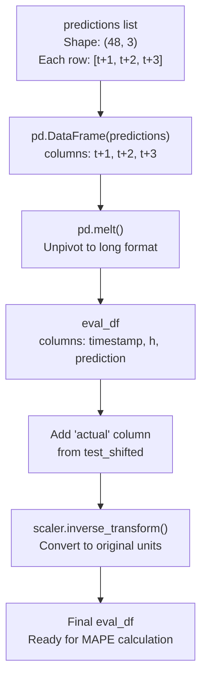

**Data transformation** at [7-TimeSeries/2-ARIMA/README.md:287-306]():

| timestamp | h | prediction | actual |
|---|---|---|---|
| 2014-12-30 00:00:00 | t+1 | 3,008.74 | 3,023.00 |
| 2014-12-30 01:00:00 | t+1 | 2,955.53 | 2,935.00 |
| 2014-12-30 00:00:00 | t+2 | 2,989.53 | 2,935.00 |
| 2014-12-30 01:00:00 | t+2 | 2,937.56 | 2,899.00 |

The `h` column indicates forecast horizon (t+1, t+2, etc.), enabling separate accuracy analysis for each prediction step.

**Sources:** [7-TimeSeries/2-ARIMA/README.md:287-306]()

### Visualization Pattern

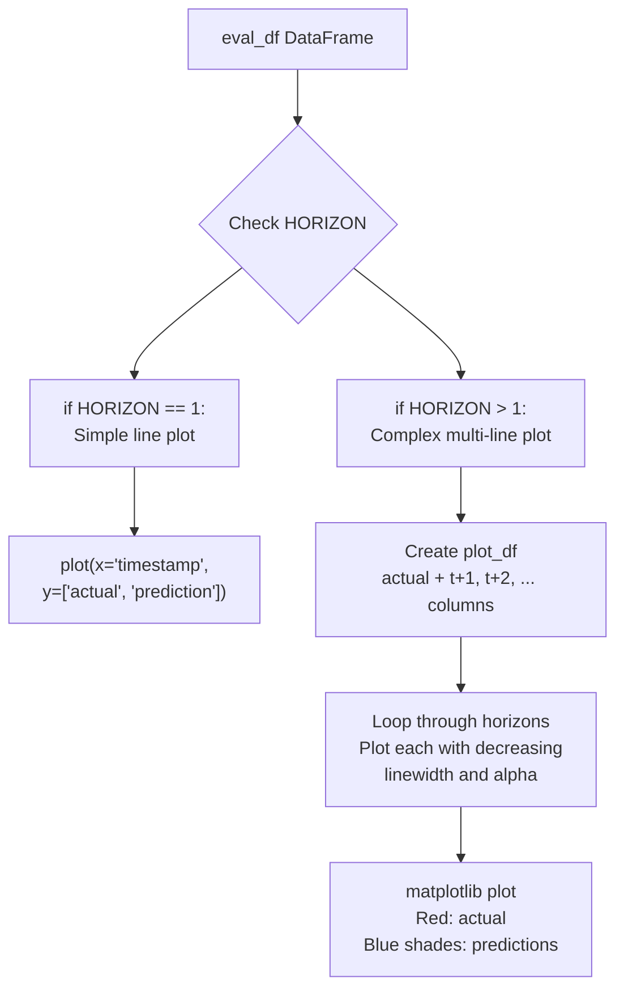

**Multi-step visualization** at [7-TimeSeries/2-ARIMA/README.md:350-374]():
- Red line: actual values
- Blue lines: predictions (darker = earlier horizon)
- Linewidth decreases: `4 * 0.9^t`
- Alpha decreases: `0.8^t`

This creates a visual representation where prediction uncertainty increases with horizon.

**Sources:** [7-TimeSeries/2-ARIMA/README.md:350-377]()

## Key Implementation Details

### Parameter Selection

Parameter selection is challenging and somewhat subjective. Two approaches:

| Approach | Method | Trade-offs |
|---|---|---|
| **Manual** | Trial and error with domain knowledge | Time-intensive but interpretable |
| **Automated** | `auto_arima()` from `pyramid` library | Faster but may overfit |

**Manual selection example** at [7-TimeSeries/2-ARIMA/README.md:194-204]():
```python
order = (4, 1, 0)  # 4 AR lags, 1 differencing, no MA
seasonal_order = (1, 1, 0, 24)  # 1 seasonal AR, 1 seasonal diff, period 24
```

The curriculum uses manual selection to teach parameter interpretation.

**Sources:** [7-TimeSeries/2-ARIMA/README.md:191-204]()

### Training Window Size

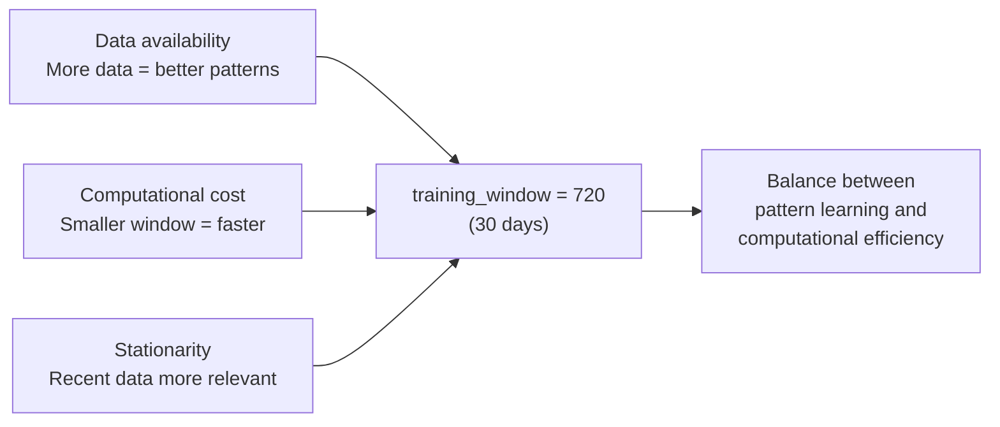

A 720-hour (30-day) window at [7-TimeSeries/2-ARIMA/README.md:248]() captures monthly patterns while maintaining reasonable training time for walk-forward validation.

**Sources:** [7-TimeSeries/2-ARIMA/README.md:248-254]()

### Library Dependencies

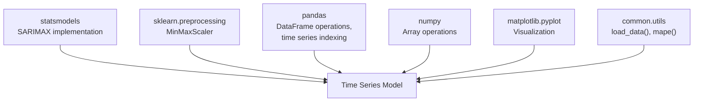

**Critical import** at [7-TimeSeries/2-ARIMA/README.md:54-58]():
```python
from statsmodels.tsa.statespace.sarimax import SARIMAX
from sklearn.preprocessing import MinMaxScaler
from common.utils import load_data, mape
```

The `common.utils` module provides dataset loading and metric calculation utilities shared across lessons.

**Sources:** [7-TimeSeries/2-ARIMA/README.md:39-64]()

## Related Concepts and Extensions

### Alternative Time Series Models

The curriculum mentions but doesn't implement:

- **Neural networks**: Can enhance classical methods for complex patterns (referenced at [7-TimeSeries/1-Introduction/README.md:181]())
- **Support Vector Regression (SVR)**: Covered in lesson 3 of the time series module (mentioned at [7-TimeSeries/README.md:19]())
- **Deep learning approaches**: Better for high-dimensional or non-linear patterns

**Sources:** [7-TimeSeries/1-Introduction/README.md:15-16](), [7-TimeSeries/1-Introduction/README.md:181](), [7-TimeSeries/README.md:19]()

### Real-World Applications

Time series forecasting applications mentioned:

- **Energy management**: Electricity load prediction for grid optimization
- **Finance**: Stock price and market trend forecasting
- **Retail**: Inventory and demand forecasting
- **Weather**: Temperature and precipitation prediction
- **Signal processing**: Pattern detection in sensor data

**Sources:** [7-TimeSeries/1-Introduction/README.md:21-26](), [7-TimeSeries/README.md:7-10]()

### Additional Resources

The curriculum references external learning materials:

- Penn State time series curriculum: [online.stat.psu.edu/stat510](https://online.stat.psu.edu/stat510/lesson/1)
- Microsoft Azure forecasting repository: [github.com/Azure/DeepLearningForTimeSeriesForecasting](https://github.com/Azure/DeepLearningForTimeSeriesForecasting)
- Model accuracy evaluation methods: [otexts.com/fpp2/accuracy.html](https://otexts.com/fpp2/accuracy.html)

**Sources:** [7-TimeSeries/1-Introduction/README.md:17](), [7-TimeSeries/2-ARIMA/README.md:384-390]()

---

