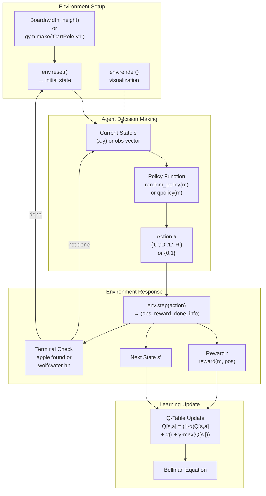
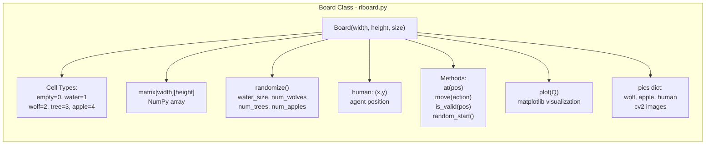
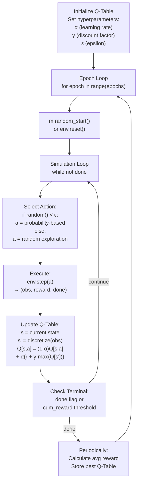

<!-- source: DeepWiki mcp.deepwiki.com · repo microsoft/ML-For-Beginners · page 5.3 Reinforcement Learning · fetched 2026-10-26 -->

# Reinforcement Learning

<details>
<summary>Relevant source files</summary>

The following files were used as context for generating this wiki page:

- [3-Web-App/1-Web-App/README.md](3-Web-App/1-Web-App/README.md)
- [8-Reinforcement/1-QLearning/README.md](8-Reinforcement/1-QLearning/README.md)
- [8-Reinforcement/1-QLearning/assignment.md](8-Reinforcement/1-QLearning/assignment.md)
- [8-Reinforcement/1-QLearning/notebook.ipynb](8-Reinforcement/1-QLearning/notebook.ipynb)
- [8-Reinforcement/1-QLearning/rlboard.py](8-Reinforcement/1-QLearning/rlboard.py)
- [8-Reinforcement/1-QLearning/solution/assignment-solution.ipynb](8-Reinforcement/1-QLearning/solution/assignment-solution.ipynb)
- [8-Reinforcement/1-QLearning/solution/notebook.ipynb](8-Reinforcement/1-QLearning/solution/notebook.ipynb)
- [8-Reinforcement/1-QLearning/solution/rlboard.py](8-Reinforcement/1-QLearning/solution/rlboard.py)
- [8-Reinforcement/2-Gym/README.md](8-Reinforcement/2-Gym/README.md)
- [8-Reinforcement/2-Gym/assignment.md](8-Reinforcement/2-Gym/assignment.md)
- [8-Reinforcement/2-Gym/images/escape.png](8-Reinforcement/2-Gym/images/escape.png)
- [8-Reinforcement/2-Gym/notebook.ipynb](8-Reinforcement/2-Gym/notebook.ipynb)
- [8-Reinforcement/2-Gym/solution/notebook.ipynb](8-Reinforcement/2-Gym/solution/notebook.ipynb)
- [8-Reinforcement/README.md](8-Reinforcement/README.md)
- [8-Reinforcement/images/peter.png](8-Reinforcement/images/peter.png)

</details>


## Purpose and Scope

This document covers the reinforcement learning (RL) module of the ML-For-Beginners curriculum, which introduces learning optimal agent behavior through environmental interaction and reward-based training. The material focuses on Q-Learning algorithms applied to both discrete grid-world environments and continuous state spaces using OpenAI Gym.

For time-dependent prediction problems, see [Time Series Forecasting](#5.2). For general ML concepts and workflow, see [ML Development Workflow](#2.3). For model deployment strategies beyond RL, see [Web Application Deployment](#3.2.3).

---

## Core Reinforcement Learning Concepts

Reinforcement Learning enables agents to learn optimal behavior by performing experiments in simulated environments. Unlike supervised learning, RL does not require labeled training data. Instead, an **agent** interacts with an **environment**, receives **observations** (states), takes **actions**, and receives **rewards** that signal the quality of decisions.

**Key Components:**

| Component | Description | Implementation |
|-----------|-------------|----------------|
| **Agent** | The learner/decision-maker | Peter (in Board environment) or the cart (in CartPole) |
| **Environment** | The world the agent interacts with | `Board` class or `gym.make("CartPole-v1")` |
| **State** | Current situation of the agent | Board position `(x, y)` or observation vector |
| **Action** | Possible moves the agent can make | `{"U", "D", "L", "R"}` or `{0, 1}` |
| **Reward** | Feedback signal for action quality | Numerical value from `reward()` function |
| **Policy** | Strategy mapping states to actions | `random_policy()` or `qpolicy()` |

**Sources:** [8-Reinforcement/1-QLearning/README.md:24-28](), [8-Reinforcement/README.md:22-44]()

---

## RL Workflow and Environment Interaction



**Sources:** [8-Reinforcement/1-QLearning/README.md:82-107](), [8-Reinforcement/2-Gym/README.md:60-90]()

---

## Peter and the Wolf Board Environment

The curriculum uses a custom grid-world environment implemented in the `Board` class to introduce RL concepts through a "Peter and the Wolf" narrative. Peter must navigate a board to find apples while avoiding wolves and water.

### Board Class Structure



**Board Initialization:**
- Creates grid of specified dimensions
- Stores cell types in `matrix` attribute
- Loads image assets for visualization
- Tracks agent position in `human` tuple

**Sources:** [8-Reinforcement/1-QLearning/rlboard.py:43-66](), [8-Reinforcement/1-QLearning/README.md:30-56]()

### Actions and Movement

The agent can move in four cardinal directions:

```python
actions = { "U" : (0,-1), "D" : (0,1), "L" : (-1,0), "R" : (1,0) }
action_idx = { a : i for i,a in enumerate(actions.keys()) }
```

**Movement Implementation:**
- `move(action)` updates `human` position
- `move_pos(pos, delta)` calculates new position without side effects
- `is_valid(pos)` checks board boundaries
- Invalid moves or water/wolf contact trigger failure

**Sources:** [8-Reinforcement/1-QLearning/README.md:63-68](), [8-Reinforcement/1-QLearning/rlboard.py:97-120]()

---

## Q-Learning Algorithm

Q-Learning learns a **Q-Table** that stores the "quality" (expected cumulative reward) of taking action `a` in state `s`. The agent uses this table to select optimal actions.

### Q-Table Representation

**For Discrete Grids (Board environment):**
```python
# NumPy array: Q[x, y, action_index]
Q = np.ones((width, height, len(actions)), dtype=np.float) * 1.0/len(actions)
```

**For Continuous States (Gym environments):**
```python
# Dictionary: Q[(discretized_state, action)] = value
Q = {}
actions = (0, 1)

def qvalues(state):
    return [Q.get((state,a), 0) for a in actions]
```

**Sources:** [8-Reinforcement/1-QLearning/README.md:164-169](), [8-Reinforcement/2-Gym/README.md:176-189]()

### Bellman Equation

The core update rule for Q-Learning:

**Q(s,a) ← (1-α)Q(s,a) + α(r + γ·max<sub>a'</sub>Q(s',a'))**

Where:
- **α** (alpha): Learning rate (0 to 1) - how much to update Q-values
- **γ** (gamma): Discount factor (0 to 1) - importance of future rewards
- **r**: Immediate reward from environment
- **s'**: Next state after taking action `a`
- **max<sub>a'</sub>Q(s',a')**: Maximum Q-value for next state across all actions

**Interpretation:** The new Q-value is a weighted combination of the old estimate and a new estimate based on the immediate reward plus the discounted best future reward.

**Sources:** [8-Reinforcement/1-QLearning/README.md:177-192](), [8-Reinforcement/1-QLearning/README.md:206]()

### Training Loop Structure



**Sources:** [8-Reinforcement/1-QLearning/README.md:194-209](), [8-Reinforcement/1-QLearning/README.md:232-257]()

---

## Exploration vs. Exploitation

The epsilon-greedy strategy balances exploring new actions versus exploiting known good actions.

**Implementation:**
```python
epsilon = 0.90  # Exploitation probability

if random.random() < epsilon:
    # Exploitation: use Q-Table probabilities
    v = probs(np.array(qvalues(s)))
    a = random.choices(actions, weights=v)[0]
else:
    # Exploration: random action
    a = np.random.randint(env.action_space.n)
```

**Probability Conversion Function:**
```python
def probs(v, eps=1e-4):
    v = v - v.min() + eps  # Avoid division by zero
    v = v / v.sum()
    return v
```

- Early training: Lower epsilon encourages exploration
- Later training: Higher epsilon exploits learned knowledge
- Small epsilon added to prevent numerical issues

**Sources:** [8-Reinforcement/1-QLearning/README.md:210-214](), [8-Reinforcement/2-Gym/README.md:198-211](), [8-Reinforcement/1-QLearning/README.md:220-227]()

---

## Reward Function Design

The reward function encodes the learning objective by assigning numerical values to states.

**Board Environment Rewards:**
```python
move_reward = -0.1    # Penalty for each step
goal_reward = 10      # Reward for finding apple
end_reward = -10      # Penalty for wolf/water

def reward(m, pos=None):
    pos = pos or m.human
    if not m.is_valid(pos):
        return end_reward
    x = m.at(pos)
    if x == Board.Cell.water or x == Board.Cell.wolf:
        return end_reward
    if x == Board.Cell.apple:
        return goal_reward
    return move_reward
```

**Key Insight:** Substantial rewards typically occur only at episode end (finding apple or dying). The algorithm must propagate these delayed rewards backward through the Q-Table updates via the Bellman equation.

**Sources:** [8-Reinforcement/1-QLearning/README.md:134-158]()

---

## OpenAI Gym Integration

OpenAI Gym provides standardized environments for RL research with consistent APIs.

### CartPole Environment

The CartPole problem requires balancing a pole on a moving cart through discrete actions (move left or right).

**Environment Setup:**
```python
import gym

env = gym.make("CartPole-v1")
print(env.action_space)        # Discrete(2): 0=left, 1=right
print(env.observation_space)   # Box(4): position, velocity, angle, rotation
```

**Observation Space (4 dimensions):**
- Cart position
- Cart velocity  
- Pole angle
- Pole rotation rate

**Reward System:**
- +1 for each timestep pole remains upright
- Episode ends when pole falls or cart moves off screen
- Goal: Maintain balance for maximum steps (solved at average reward ≥195 over 100 episodes)

**Sources:** [8-Reinforcement/2-Gym/README.md:44-59](), [8-Reinforcement/2-Gym/README.md:105-119]()

### State Discretization

Continuous observation spaces must be discretized for Q-Table representation.

**Method 1: Linear Discretization**
```python
def discretize(x):
    return tuple((x/np.array([0.25, 0.25, 0.01, 0.1])).astype(np.int))
```

**Method 2: Bin-Based Discretization**
```python
def create_bins(i, num):
    return np.arange(num+1)*(i[1]-i[0])/num+i[0]

ints = [(-5,5), (-2,2), (-0.5,0.5), (-2,2)]  # Value ranges
nbins = [20, 20, 10, 10]                      # Bin counts
bins = [create_bins(ints[i], nbins[i]) for i in range(4)]

def discretize_bins(x):
    return tuple(np.digitize(x[i], bins[i]) for i in range(4))
```

**Trade-offs:**
- Fewer bins: Faster learning, coarser policy
- More bins: Finer control, longer training time
- Bin ranges should cover typical observation values

**Sources:** [8-Reinforcement/2-Gym/README.md:123-156]()

---

## Training Process and Hyperparameter Tuning

### Hyperparameters

```python
alpha = 0.3      # Learning rate
gamma = 0.9      # Discount factor
epsilon = 0.90   # Exploration/exploitation balance
epochs = 100000  # Number of training episodes
```

**Tuning Guidelines:**
- **α (alpha)**: Start ~1.0, decay over time to preserve learned values. Can also use constant values (e.g., 0.3)
- **γ (gamma)**: Higher values (0.9-0.99) prioritize long-term rewards
- **ε (epsilon)**: Start low (~0.5) for exploration, increase toward 1.0 as training progresses
- **epochs**: Increase until average reward plateaus

**Sources:** [8-Reinforcement/2-Gym/README.md:198-211](), [8-Reinforcement/1-QLearning/README.md:231-257]()

### Progress Monitoring

**Cumulative Reward Tracking:**
```python
cum_rewards = []  # Rolling average (per 5000 epochs)
rewards = []      # All episode rewards

# During training:
cum_rewards.append(cum_reward)
rewards.append(cum_reward)

if epoch % 5000 == 0:
    avg = np.average(cum_rewards)
    print(f"{epoch}: {avg}, alpha={alpha}, epsilon={epsilon}")
    if avg > Qmax:
        Qmax = avg
        Qbest = Q  # Save best-performing Q-Table
    cum_rewards = []
```

**Visualization:**
```python
# Raw progress
plt.plot(rewards)

# Smoothed with running average
def running_average(x, window):
    return np.convolve(x, np.ones(window)/window, mode='valid')

plt.plot(running_average(rewards, 100))
```

**Expected Training Dynamics:**
1. **Initial phase**: High variance, frequent failures
2. **Learning phase**: Average path length increases as agent explores safely
3. **Convergence phase**: Path length decreases as optimal policy emerges
4. **Occasional degradation**: Stochastic updates can temporarily worsen Q-Table

**Sources:** [8-Reinforcement/2-Gym/README.md:217-260](), [8-Reinforcement/1-QLearning/README.md:301-314]()

---

## Policy Execution

After training, the Q-Table defines the learned policy for action selection.

### Strict Policy (Greedy)

```python
def qpolicy_strict(m):
    x, y = m.human
    v = probs(Q[x, y])
    a = list(actions)[np.argmax(v)]
    return a

walk(m, qpolicy_strict)
```

**Risk:** Can cause infinite loops if two states point to each other. Mitigate by limiting episode length.

### Probabilistic Policy (Recommended)

```python
def qpolicy(m):
    x, y = m.human
    v = probs(Q[x, y])
    a = random.choices(list(actions), weights=v)[0]
    return a

print_statistics(qpolicy)  # Test over 100 runs
```

**Advantages:**
- Maintains some exploration
- Avoids deterministic loops
- More robust to Q-Table imperfections

**Typical Performance:**
- Random walk: 30-40 steps average to apple
- Trained Q-Learning: 3-6 steps average

**Sources:** [8-Reinforcement/1-QLearning/README.md:263-299]()

---

## Deployment Considerations

### Model Persistence

**Pickle Serialization (Board environment):**
The Q-Table is a NumPy array that can be directly saved:
```python
import pickle

# Save Q-Table
with open('q_table.pkl', 'wb') as f:
    pickle.dump(Q, f)

# Load Q-Table
with open('q_table.pkl', 'rb') as f:
    Q = pickle.load(f)
```

**Dictionary Serialization (Gym environments):**
```python
import pickle

# Q is a dictionary: Q[(state_tuple, action)] = value
with open('q_dict.pkl', 'wb') as f:
    pickle.dump(Q, f)
```

**Sources:** [3-Web-App/1-Web-App/README.md:142-153]()

### Flask Web Application

RL agents can be deployed as web services using Flask:

**app.py structure:**
```python
import pickle
from flask import Flask, request, render_template

app = Flask(__name__)
model = pickle.load(open("./q_table.pkl", "rb"))  # Load Q-Table

@app.route("/")
def home():
    return render_template("index.html")

@app.route("/predict", methods=["POST"])
def predict():
    # Get state from form
    state_features = [int(x) for x in request.form.values()]
    
    # Query Q-Table for action
    state = discretize(state_features)
    action = np.argmax(qvalues(state))
    
    return render_template("index.html", 
                         prediction_text=f"Recommended action: {action}")

if __name__ == "__main__":
    app.run(debug=True)
```

**Requirements:**
- Flask framework
- Trained Q-Table (pickle file)
- Discretization function matching training
- HTML templates for user interface

**Sources:** [3-Web-App/1-Web-App/README.md:275-310](), [8-Reinforcement/2-Gym/README.md:306-318]()

---

## Code Files and Modules

| File | Purpose |
|------|---------|
| [8-Reinforcement/1-QLearning/rlboard.py]() | Custom `Board` class for grid-world environment |
| [8-Reinforcement/1-QLearning/notebook.ipynb]() | Interactive Q-Learning tutorial with Board environment |
| [8-Reinforcement/2-Gym/notebook.ipynb]() | CartPole Q-Learning with OpenAI Gym |
| [8-Reinforcement/1-QLearning/solution/notebook.ipynb]() | Complete Q-Learning implementation example |
| [8-Reinforcement/2-Gym/solution/notebook.ipynb]() | Complete CartPole solution |

**Key Functions:**
- `Board.randomize()`: Generate random environment
- `reward(m, pos)`: Calculate reward for state
- `walk(m, policy, start_position)`: Execute policy simulation
- `print_statistics(policy)`: Evaluate policy over multiple runs
- `probs(v)`: Convert Q-values to action probabilities
- `discretize(x)`: Convert continuous state to discrete representation

**Sources:** All files listed in importance-ranked file list above

---

