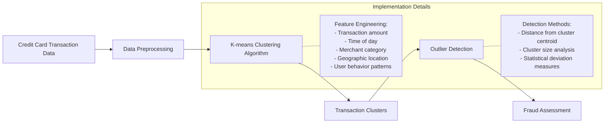
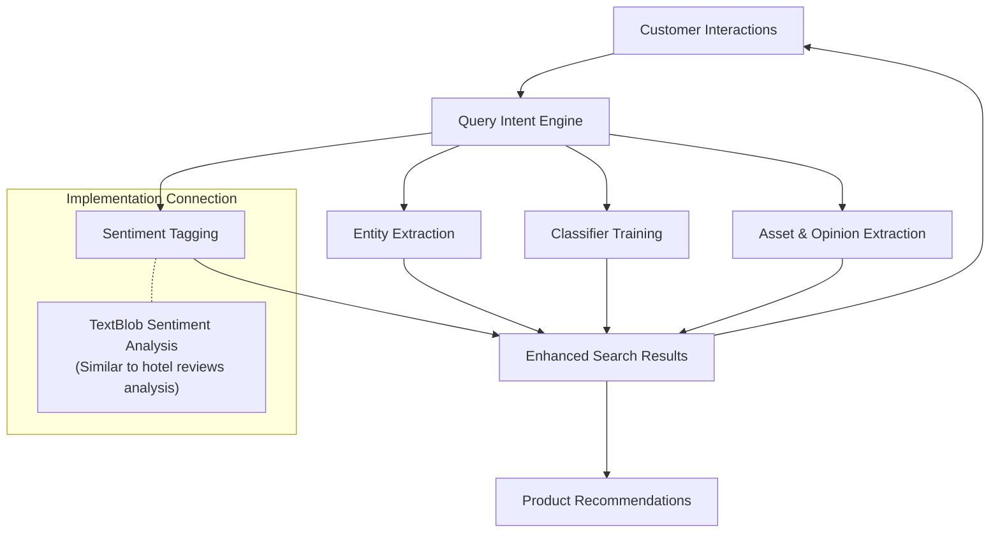
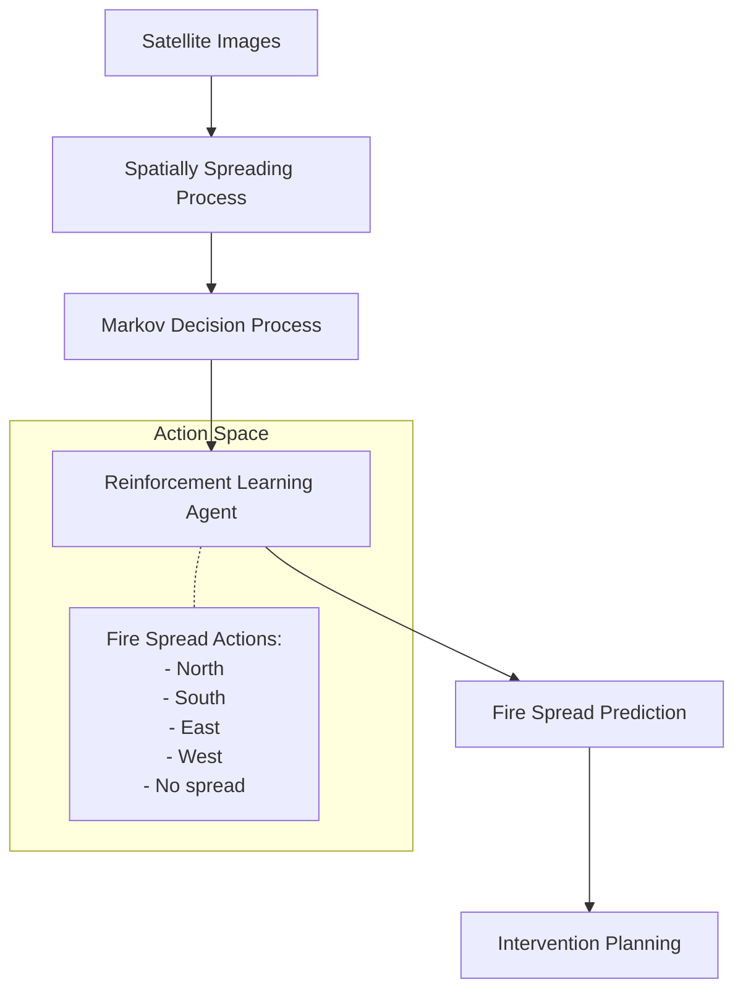
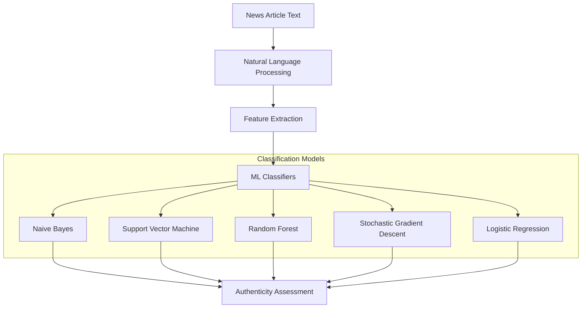
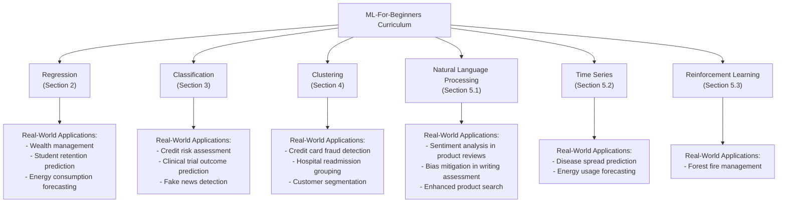

<!-- source: DeepWiki mcp.deepwiki.com · repo microsoft/ML-For-Beginners · page 5.4 Real-World ML Applications · fetched 2026-10-26 -->

# Real-World ML Applications

Relevant source files

The following files were used as context for generating this wiki page:

- [6-NLP/3-Translation-Sentiment/solution/notebook.ipynb](6-NLP/3-Translation-Sentiment/solution/notebook.ipynb)
- [9-Real-World/1-Applications/README.md](9-Real-World/1-Applications/README.md)
- [9-Real-World/README.md](9-Real-World/README.md)
- [9-Real-World/images/chess.jpg](9-Real-World/images/chess.jpg)

This document provides an overview of how classical machine learning techniques are applied across various industries and domains in real-world scenarios. Rather than focusing on implementation details, we examine practical applications of the regression, classification, clustering, natural language processing, and time series forecasting techniques covered in the curriculum. This page bridges the gap between theoretical knowledge and practical industry use cases.

For implementation details of specific ML models, see the relevant sections in [Supervised Learning](#3), [Unsupervised Learning](#4), and [Specialized ML Applications](#5).

## Overview of ML Applications Across Industries

Machine learning applications span virtually every industry, with different sectors leveraging specific techniques to solve their unique challenges. The diagram below illustrates the relationship between ML techniques and their applications across various domains:

```mermaid
flowchart TD
    ML["Classical Machine Learning"]
    
    ML --> SUP["Supervised Learning"]
    ML --> UNSUP["Unsupervised Learning"]
    ML --> TS["Time Series Analysis"]
    ML --> NLP["Natural Language Processing"]
    ML --> RL["Reinforcement Learning"]
    
    SUP --> REG["Regression"]
    SUP --> CLASS["Classification"]
    
    REG --> FINA1["Financial Forecasting"]
    REG --> EDUC1["Student Retention Prediction"]
    REG --> ENER1["Energy Consumption Prediction"]
    
    CLASS --> HEAL1["Clinical Trial Outcome Prediction"]
    CLASS --> ARTS1["Fake News Detection"]
    CLASS --> FINA2["Credit Risk Assessment"]
    
    UNSUP --> CLUST["Clustering"]
    CLUST --> FINA3["Credit Card Fraud Detection"]
    CLUST --> HEAL2["Hospital Readmission Grouping"]
    CLUST --> MARK1["Customer Segmentation"]
    
    TS --> ENER2["Energy Usage Forecasting"]
    TS --> HEAL3["Disease Spread Prediction"]
    TS --> FINA4["Stock Price Prediction"]
    
    NLP --> SENT["Sentiment Analysis"]
    NLP --> TRANS["Translation"]
    NLP --> EXTR["Entity Extraction"]
    
    SENT --> ARTS2["Hotel Review Analysis"]
    SENT --> RETAIL1["Product Review Analysis"]
    EXTR --> RETAIL2["Product Search Enhancement"]
    
    RL --> FOR1["Forest Fire Management"]
    RL --> GAMES["Game Strategy Optimization"]
```

Sources: [9-Real-World/1-Applications/README.md:7-9]()

## Industry Applications Matrix

The table below summarizes which ML techniques are commonly applied in different industries:

| Industry | Regression | Classification | Clustering | NLP | Time Series | Reinforcement Learning |
|----------|:----------:|:--------------:|:----------:|:---:|:-----------:|:----------------------:|
| Finance | ✓ | ✓ | ✓ | | ✓ | |
| Education | ✓ | | | ✓ | | |
| Retail | | ✓ | ✓ | ✓ | | |
| Healthcare | | ✓ | ✓ | | ✓ | |
| Ecology | | ✓ | | | | ✓ |
| Energy | ✓ | | | | ✓ | |
| Insurance | ✓ | ✓ | | | | |
| Arts & Culture | | ✓ | | ✓ | | |
| Marketing | | | ✓ | | | |

Sources: [9-Real-World/1-Applications/README.md:13-133]()

## Financial Sector Applications

The financial industry leverages ML for fraud detection, risk assessment, and investment management.

### Credit Card Fraud Detection with Clustering

K-means clustering is applied in credit card fraud detection through outlier detection. Transactions are clustered based on their characteristics, with outliers potentially indicating fraudulent activity.

### Wealth Management with Regression

Linear and multiple regression techniques help evaluate investment performance relative to benchmarks and identify statistically significant factors affecting investments.

Sources: [9-Real-World/1-Applications/README.md:14-31]()

## Educational Applications

ML in education focuses on predicting student outcomes and addressing bias in assessment systems.

### Student Retention Prediction

Coursera uses regression analysis to explore correlations between course quality metrics (like Net Promoter Score) and student retention rates, helping identify factors that contribute to course completion.

### Bias Mitigation in Writing Assessment

Grammarly employs NLP techniques to identify and mitigate gender bias in their writing assistant tools, demonstrating practical application of fairness concepts in ML systems.

Sources: [9-Real-World/1-Applications/README.md:31-47]()

## Retail Applications

Retail leverages ML for personalized customer experiences and inventory optimization.

### Personalized Customer Journey

Wayfair uses NLP techniques including entity extraction, classifier training, and sentiment analysis to improve product search results for customers, creating a more personalized shopping experience.

### Inventory Management

StitchFix combines ML algorithms with merchandising expertise to predict successful clothing items, optimizing inventory and improving customer satisfaction.

Sources: [9-Real-World/1-Applications/README.md:45-63](), [6-NLP/3-Translation-Sentiment/solution/notebook.ipynb:46-61]()

## Healthcare Applications

Healthcare employs ML for clinical trial management, hospital readmission prediction, and disease spread modeling.

### Clinical Trial Outcome Prediction

Researchers use Random Forest classifiers to predict clinical trial outcomes and distinguish between drug groups, helping pharmaceutical companies manage toxicity concerns in drug development.

### Hospital Readmission Management

Clustering algorithms help identify patterns in patient readmissions, allowing hospitals to discover groups of readmissions that may share common causes and implement targeted interventions.

### Disease Spread Prediction

During the COVID-19 pandemic, time series forecasting techniques like ARIMA, SARIMA, and logistic curves were used to predict disease spread patterns, deaths, and recovery rates.

Sources: [9-Real-World/1-Applications/README.md:59-85]()

## Ecological and Green Tech Applications

ML helps monitor and manage natural systems and resources in ecology and environmental technology.

### Forest Fire Management

Reinforcement learning is applied to model forest wildfire dynamics from satellite images. Fire spread is modeled as an agent that can take actions (spreading in different directions), with a Markov Decision Process modeling the dynamics.

### Animal Motion Tracking

While deep learning dominates visual animal tracking, classical ML techniques remain valuable for preprocessing sensor data to monitor farm animal postures and behaviors.

Sources: [9-Real-World/1-Applications/README.md:78-105]()

## Energy Management Applications

Energy sector uses time series forecasting to optimize energy usage and resource allocation.

Smart metering data is analyzed using clustering, regression, and time series forecasting techniques to predict future energy consumption patterns in Ireland, helping utilities plan for demand fluctuations.

Sources: [9-Real-World/1-Applications/README.md:96-111]()

## Insurance Industry Applications

Insurance companies leverage ML for risk assessment and financial modeling.

### Volatility Management

MetLife uses classification techniques and forecasting models to analyze and mitigate volatility in their financial models, improving risk management and financial stability.

Sources: [9-Real-World/1-Applications/README.md:101-121]()

## Arts, Culture, and Literature Applications

ML is applied in journalism to detect fake news and in museums to optimize visitor experiences.

### Fake News Detection

Researchers combine NLP for feature extraction with various classification algorithms to detect fake news, helping combat misinformation and its social impacts.

### Museum Visitor Experience Optimization

The Art Institute of Chicago uses predictive models to anticipate attendance patterns and visitor interests, creating optimized and personalized museum experiences.

Sources: [9-Real-World/1-Applications/README.md:110-141]()

## Marketing Applications

Marketing relies heavily on ML for customer segmentation and targeted campaigns.

### Customer Segmentation

Clustering algorithms help marketers identify distinct customer groups based on behavior, preferences, and demographics, enabling differentiated marketing strategies that improve brand recognition and customer reach.

Sources: [9-Real-World/1-Applications/README.md:129-149]()

## Integration with ML Techniques Covered in the Curriculum

The real-world applications discussed in this page directly build upon the ML techniques covered earlier in the curriculum. The diagram below illustrates this connection:

Sources: [9-Real-World/README.md:1-16](), [9-Real-World/1-Applications/README.md:7-148]()

## Summary

Classical machine learning techniques continue to provide valuable solutions across diverse industry sectors. While deep learning and AI generate significant interest, the applications discussed in this document demonstrate that traditional ML models remain essential tools for solving real-world problems. The examples presented illustrate how techniques covered in this curriculum—regression, classification, clustering, NLP, time series analysis, and reinforcement learning—provide practical value in business, healthcare, ecology, arts, and other domains.

These applications not only validate the relevance of the ML techniques covered in the curriculum but also provide inspiration for how these techniques can be combined and adapted to address complex real-world challenges.

Sources: [9-Real-World/1-Applications/README.md:7-9](), [9-Real-World/README.md:3-7]()

---

