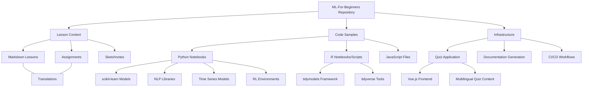
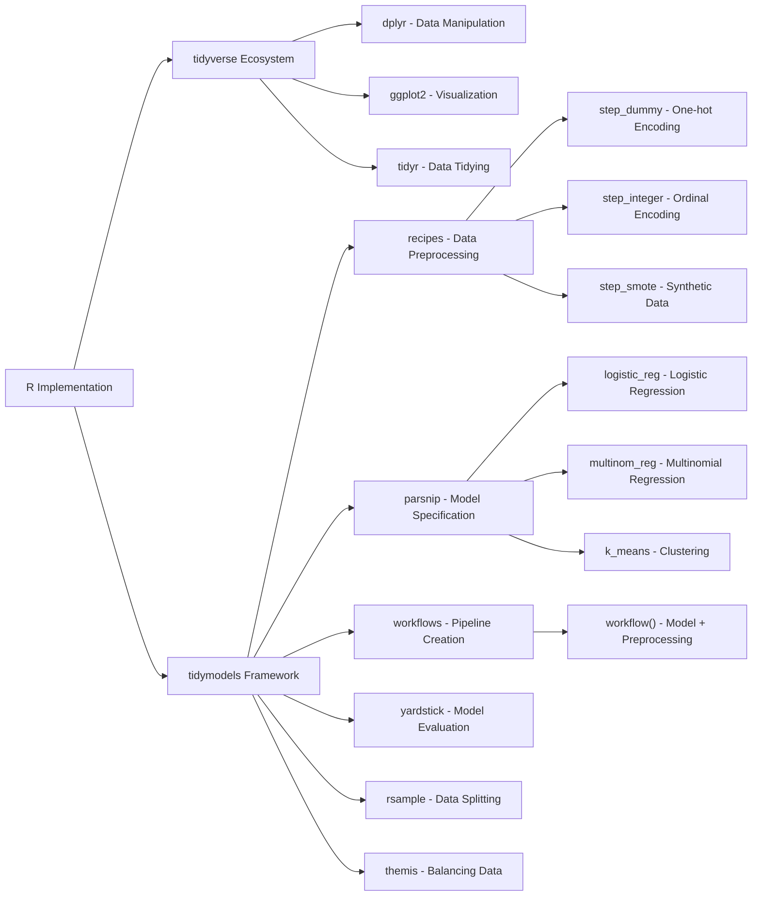
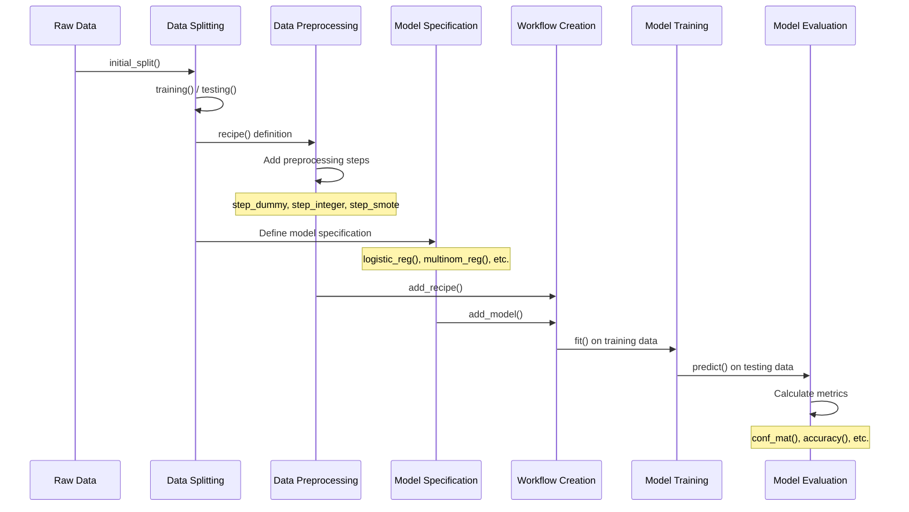
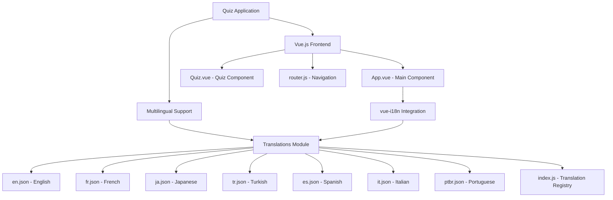
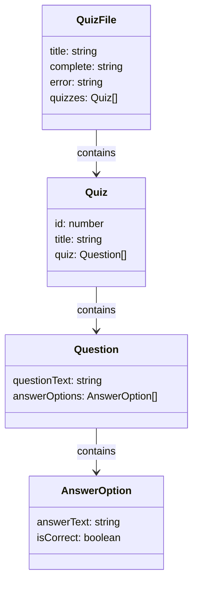
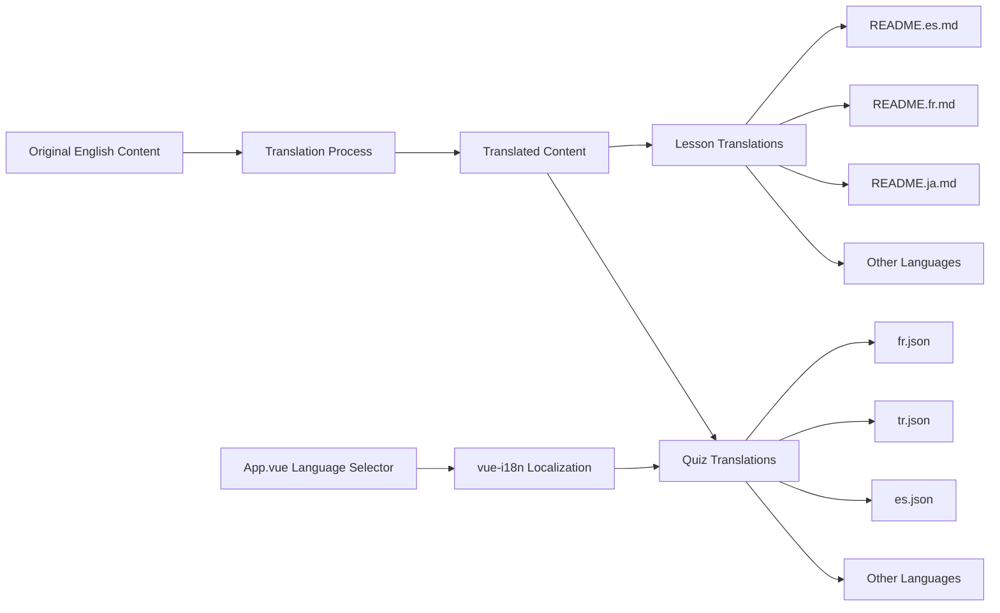
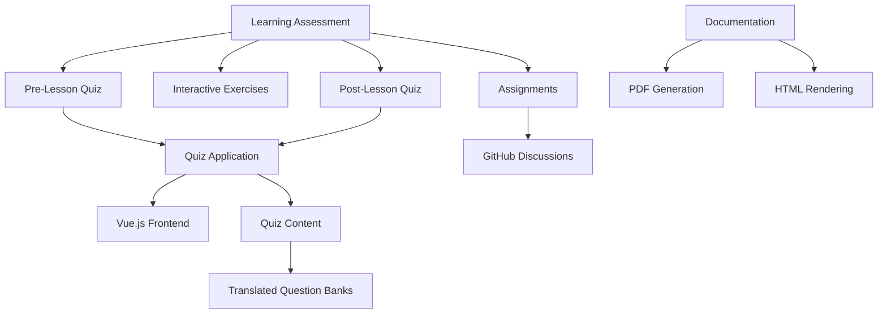

<!-- source: DeepWiki mcp.deepwiki.com · repo microsoft/ML-For-Beginners · page 6 Technical Implementation · fetched 2026-10-26 -->

# Technical Implementation

<details>
<summary>Relevant source files</summary>

The following files were used as context for generating this wiki page:

- [.gitignore](.gitignore)
- [1-Introduction/1-intro-to-ML/lesson-1.pdf](1-Introduction/1-intro-to-ML/lesson-1.pdf)
- [1-Introduction/2-history-of-ML/lesson-2.pdf](1-Introduction/2-history-of-ML/lesson-2.pdf)
- [2-Regression/1-Tools/README.md](2-Regression/1-Tools/README.md)
- [2-Regression/2-Data/README.md](2-Regression/2-Data/README.md)
- [2-Regression/3-Linear/README.md](2-Regression/3-Linear/README.md)
- [2-Regression/4-Logistic/README.md](2-Regression/4-Logistic/README.md)
- [2-Regression/4-Logistic/solution/R/lesson_4-R.ipynb](2-Regression/4-Logistic/solution/R/lesson_4-R.ipynb)
- [2-Regression/4-Logistic/solution/R/lesson_4.Rmd](2-Regression/4-Logistic/solution/R/lesson_4.Rmd)
- [2-Regression/4-Logistic/solution/R/lesson_4.html](2-Regression/4-Logistic/solution/R/lesson_4.html)
- [4-Classification/1-Introduction/solution/R/lesson_10-R.ipynb](4-Classification/1-Introduction/solution/R/lesson_10-R.ipynb)
- [4-Classification/1-Introduction/solution/R/lesson_10.Rmd](4-Classification/1-Introduction/solution/R/lesson_10.Rmd)
- [4-Classification/1-Introduction/solution/R/lesson_10.html](4-Classification/1-Introduction/solution/R/lesson_10.html)
- [4-Classification/2-Classifiers-1/solution/R/lesson_11-R.ipynb](4-Classification/2-Classifiers-1/solution/R/lesson_11-R.ipynb)
- [4-Classification/2-Classifiers-1/solution/R/lesson_11.Rmd](4-Classification/2-Classifiers-1/solution/R/lesson_11.Rmd)
- [4-Classification/data/cleaned_cuisines_R.csv](4-Classification/data/cleaned_cuisines_R.csv)
- [5-Clustering/1-Visualize/solution/R/lesson_14-R.ipynb](5-Clustering/1-Visualize/solution/R/lesson_14-R.ipynb)
- [5-Clustering/1-Visualize/solution/R/lesson_14.Rmd](5-Clustering/1-Visualize/solution/R/lesson_14.Rmd)
- [5-Clustering/2-K-Means/solution/R/lesson_15-R.ipynb](5-Clustering/2-K-Means/solution/R/lesson_15-R.ipynb)
- [5-Clustering/2-K-Means/solution/R/lesson_15.Rmd](5-Clustering/2-K-Means/solution/R/lesson_15.Rmd)
- [quiz-app/package-lock.json](quiz-app/package-lock.json)
- [quiz-app/package.json](quiz-app/package.json)
- [quiz-app/src/App.vue](quiz-app/src/App.vue)
- [quiz-app/src/assets/translations/fr.json](quiz-app/src/assets/translations/fr.json)
- [quiz-app/src/assets/translations/index.js](quiz-app/src/assets/translations/index.js)
- [quiz-app/src/assets/translations/tr.json](quiz-app/src/assets/translations/tr.json)

</details>


This page provides a technical overview of the implementation aspects of the ML-For-Beginners curriculum. It covers the code structure, frameworks used, multilingual support, and the quiz application architecture. For specific information about curriculum content organization, see [Curriculum Structure](#1.1).

## Repository Architecture

The ML-For-Beginners repository is organized around a structured learning path that progresses from fundamental concepts to specialized machine learning techniques. The codebase implements this curriculum through several interconnected components.



Sources:
- Repository diagrams provided in prompt
- [quiz-app/package.json]()
- [quiz-app/src/App.vue]()

## Code Implementation

The repository provides implementations of machine learning concepts in both Python and R, using industry-standard frameworks and libraries.

### Python Implementation

Python implementations primarily use scikit-learn for model building, along with specialized libraries for specific domains (NLP, time series, etc.). Implementations are provided as Jupyter notebooks for interactive learning.

### R Implementation

R implementations leverage the tidyverse ecosystem, particularly tidymodels for machine learning workflows. This implementation demonstrates the "tidy" approach to data science.



Sources:
- [2-Regression/4-Logistic/solution/R/lesson_4.Rmd]()
- [4-Classification/1-Introduction/solution/R/lesson_10.Rmd]()
- [4-Classification/2-Classifiers-1/solution/R/lesson_11.Rmd]()
- [5-Clustering/2-K-Means/solution/R/lesson_15.Rmd]()

### Example Workflow

Below is a typical workflow for model training and evaluation in R using tidymodels:



Sources:
- [2-Regression/4-Logistic/solution/R/lesson_4.Rmd:220-304]()
- [4-Classification/2-Classifiers-1/solution/R/lesson_11.Rmd:230-262]()

## Quiz Application

The quiz application is a Vue.js-based web application that provides pre-lesson and post-lesson quizzes to test knowledge retention.

### Architecture



Sources:
- [quiz-app/package.json]()
- [quiz-app/src/App.vue]()
- [quiz-app/src/assets/translations/index.js]()

### Quiz Content Structure

Each quiz is structured in JSON format and contains:

1. Quiz metadata (ID, title)
2. Collection of questions with:
   - Question text
   - Multiple answer options
   - Correct answer flag



Sources:
- [quiz-app/src/assets/translations/fr.json]()
- [quiz-app/src/assets/translations/tr.json]()

## Multilingual Support

The curriculum provides extensive multilingual support to make content accessible globally. This is implemented through:

1. Translated markdown files for lessons (e.g., README.fr.md)
2. Translated quiz content in JSON format 
3. Language selector in the quiz application

### Translation Architecture



Sources:
- [quiz-app/src/App.vue:5-14]()
- [quiz-app/src/assets/translations/index.js]()
- Repository diagrams provided in prompt

## Machine Learning Model Implementation

The curriculum covers multiple machine learning paradigms through concrete code implementations. Below is a mapping between ML concepts and their implementation in the codebase:

| ML Paradigm | Python Implementation | R Implementation | Key Libraries |
|-------------|------------------------|------------------|--------------|
| Regression | Linear & Logistic Regression | tidymodels workflows | scikit-learn, tidymodels |
| Classification | Various classifiers | parsnip models | scikit-learn, nnet |
| Clustering | K-means | stats::kmeans | scikit-learn, cluster |
| NLP | Text processing, sentiment | Text mining packages | NLTK, tidytext |
| Time Series | ARIMA models | forecast package | statsmodels, forecast |
| Reinforcement Learning | Q-Learning | Limited coverage | gym, ReinforcementLearning |

Sources:
- [2-Regression/4-Logistic/solution/R/lesson_4.Rmd]()
- [4-Classification/2-Classifiers-1/solution/R/lesson_11.Rmd]()
- [5-Clustering/2-K-Means/solution/R/lesson_15.Rmd]()
- Repository diagrams provided in prompt

### R Model Implementation Example

A typical R implementation uses tidymodels to create a workflow combining preprocessing and model training:

```
# Define preprocessing recipe
recipe_obj <- recipe(target ~ ., data = training_data) %>%
  step_dummy(all_nominal(), -all_outcomes()) %>%
  step_normalize(all_predictors())

# Define model specification
model_spec <- logistic_reg() %>%
  set_engine("glm") %>%
  set_mode("classification")

# Create workflow
workflow_obj <- workflow() %>%
  add_recipe(recipe_obj) %>%
  add_model(model_spec)

# Train model
model_fit <- workflow_obj %>% 
  fit(data = training_data)

# Make predictions
predictions <- model_fit %>%
  predict(new_data = testing_data)
```

Sources:
- [2-Regression/4-Logistic/solution/R/lesson_4.Rmd:230-304]()
- [4-Classification/2-Classifiers-1/solution/R/lesson_11.Rmd:230-262]()

## Infrastructure Components

### Documentation System

Lessons are written in markdown format with a consistent structure:
- Lecture content with explanations
- Code examples
- Exercises and challenges
- Quiz links
- References to additional resources

### Learning Assessment System



Sources:
- Repository diagrams provided in prompt
- [2-Regression/4-Logistic/solution/R/lesson_4.Rmd:16-17]()
- [quiz-app/src/assets/translations/fr.json]()

## Development and Deployment Architecture

The repository uses GitHub Actions for automated workflows, including:

1. Documentation generation
2. Quiz application deployment
3. Continuous integration tests

The deployment architecture ensures that changes to the curriculum are automatically reflected in the quiz application and documentation.

Sources:
- Repository diagrams provided in prompt
- [quiz-app/package.json:5-9]()

---

