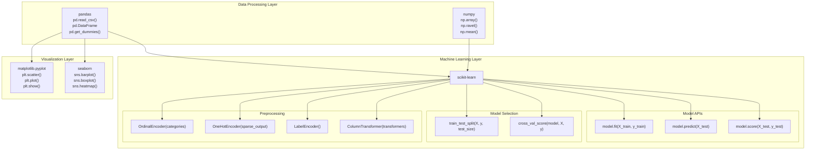
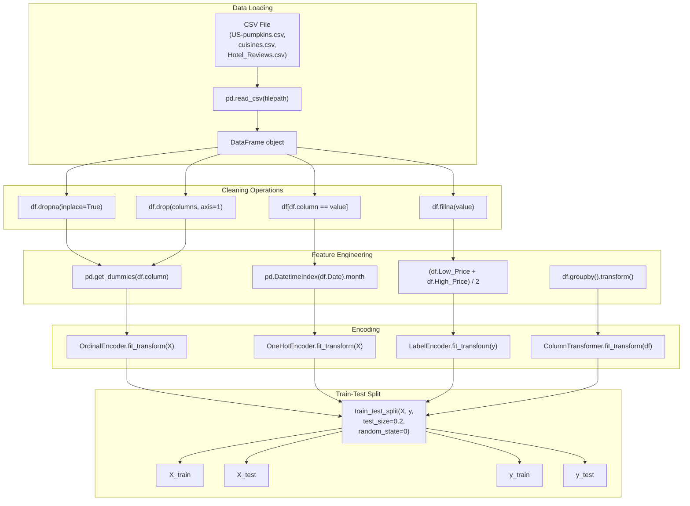
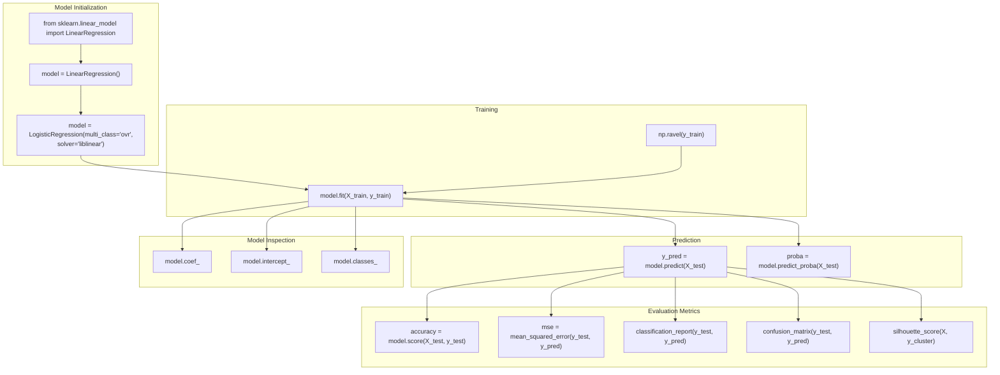
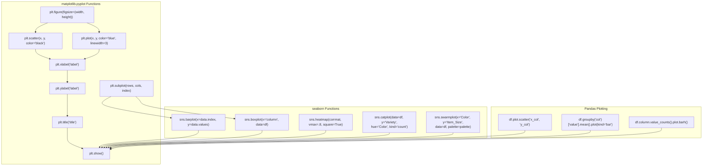
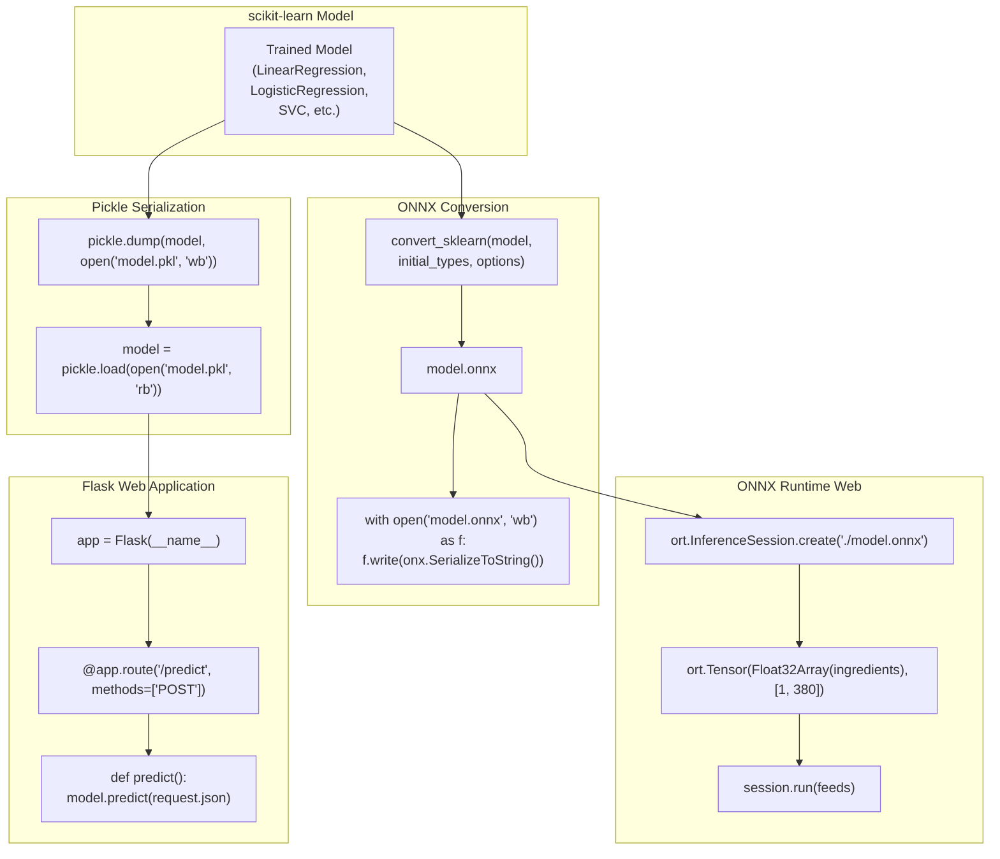

<!-- source: DeepWiki mcp.deepwiki.com · repo microsoft/ML-For-Beginners · page 6.1 Python Implementation · fetched 2026-10-26 -->

# Python Implementation

<details>
<summary>Relevant source files</summary>

The following files were used as context for generating this wiki page:

- [2-Regression/1-Tools/README.md](2-Regression/1-Tools/README.md)
- [2-Regression/2-Data/README.md](2-Regression/2-Data/README.md)
- [2-Regression/3-Linear/README.md](2-Regression/3-Linear/README.md)
- [2-Regression/4-Logistic/README.md](2-Regression/4-Logistic/README.md)
- [4-Classification/1-Introduction/README.md](4-Classification/1-Introduction/README.md)
- [4-Classification/1-Introduction/assignment.md](4-Classification/1-Introduction/assignment.md)
- [4-Classification/1-Introduction/notebook.ipynb](4-Classification/1-Introduction/notebook.ipynb)
- [4-Classification/1-Introduction/solution/notebook.ipynb](4-Classification/1-Introduction/solution/notebook.ipynb)
- [4-Classification/2-Classifiers-1/README.md](4-Classification/2-Classifiers-1/README.md)
- [4-Classification/2-Classifiers-1/notebook.ipynb](4-Classification/2-Classifiers-1/notebook.ipynb)
- [4-Classification/2-Classifiers-1/solution/notebook.ipynb](4-Classification/2-Classifiers-1/solution/notebook.ipynb)
- [4-Classification/3-Classifiers-2/README.md](4-Classification/3-Classifiers-2/README.md)
- [4-Classification/3-Classifiers-2/notebook.ipynb](4-Classification/3-Classifiers-2/notebook.ipynb)
- [4-Classification/3-Classifiers-2/solution/notebook.ipynb](4-Classification/3-Classifiers-2/solution/notebook.ipynb)
- [4-Classification/4-Applied/README.md](4-Classification/4-Applied/README.md)
- [4-Classification/4-Applied/notebook.ipynb](4-Classification/4-Applied/notebook.ipynb)
- [4-Classification/README.md](4-Classification/README.md)
- [5-Clustering/1-Visualize/README.md](5-Clustering/1-Visualize/README.md)
- [5-Clustering/2-K-Means/README.md](5-Clustering/2-K-Means/README.md)
- [6-NLP/1-Introduction-to-NLP/README.md](6-NLP/1-Introduction-to-NLP/README.md)
- [6-NLP/1-Introduction-to-NLP/images/comprehension.png](6-NLP/1-Introduction-to-NLP/images/comprehension.png)
- [6-NLP/2-Tasks/README.md](6-NLP/2-Tasks/README.md)
- [6-NLP/3-Translation-Sentiment/README.md](6-NLP/3-Translation-Sentiment/README.md)
- [6-NLP/3-Translation-Sentiment/images/monnaie.png](6-NLP/3-Translation-Sentiment/images/monnaie.png)
- [6-NLP/4-Hotel-Reviews-1/README.md](6-NLP/4-Hotel-Reviews-1/README.md)
- [6-NLP/5-Hotel-Reviews-2/README.md](6-NLP/5-Hotel-Reviews-2/README.md)
- [6-NLP/5-Hotel-Reviews-2/assignment.md](6-NLP/5-Hotel-Reviews-2/assignment.md)
- [6-NLP/5-Hotel-Reviews-2/solution/3-notebook.ipynb](6-NLP/5-Hotel-Reviews-2/solution/3-notebook.ipynb)
- [6-NLP/README.md](6-NLP/README.md)

</details>


This document describes the Python-based machine learning implementation used throughout the ML-For-Beginners curriculum. The implementation leverages scikit-learn as the primary ML framework, supplemented by specialized libraries for data processing, visualization, and domain-specific tasks.

For information about the alternative R implementation using tidymodels, see [R Implementation with tidymodels](#6.2). For documentation about the quiz application and build systems, see [Technical Implementation](#6).

## Overview

The Python implementation follows a consistent pattern across all learning modules: data loading with pandas, preprocessing and feature engineering, model training with scikit-learn, and evaluation using standard metrics. All code is developed and executed in Jupyter notebooks (.ipynb files) within VS Code or similar Python environments.

The implementation requires Python 3.8+ and supports both local development and cloud-based execution. Each lesson includes a `notebook.ipynb` file in its directory that demonstrates the complete workflow for that topic.

---

## Core Python Libraries



**Sources:** [2-Regression/1-Tools/README.md:110-127](), [2-Regression/2-Data/README.md:56-105](), [2-Regression/3-Linear/README.md:166-179](), [4-Classification/1-Introduction/README.md:64-72]()

### Standard Import Pattern

All Python notebooks follow a consistent import pattern. Data processing modules are imported first, followed by scikit-learn components, and finally visualization libraries:

```python
import pandas as pd
import numpy as np
from sklearn.linear_model import LinearRegression
from sklearn.model_selection import train_test_split
from sklearn.metrics import mean_squared_error
import matplotlib.pyplot as plt
```

**Sources:** [2-Regression/1-Tools/README.md:118-127](), [2-Regression/3-Linear/README.md:166-172]()

### pandas DataFrame Workflow

The `pandas` library serves as the primary data container throughout the curriculum. Data loading uses `pd.read_csv()` to load CSV files into DataFrames. Column selection uses `df.loc[:, columns]` or `df[columns]`, and data inspection uses `df.head()`, `df.info()`, and `df.describe()`:

**Sources:** [2-Regression/2-Data/README.md:60-106](), [4-Classification/1-Introduction/README.md:76-106]()

### scikit-learn Model API

All scikit-learn models expose a consistent three-method interface:

1. **`fit(X_train, y_train)`** - Trains the model on training data
2. **`predict(X_test)`** - Generates predictions for test data  
3. **`score(X_test, y_test)`** - Returns model accuracy or R² score

This pattern is used across all model types including regression, classification, and clustering:

**Sources:** [2-Regression/1-Tools/README.md:180-194](), [2-Regression/3-Linear/README.md:189-194](), [2-Regression/4-Logistic/README.md:244-257]()

---

## Data Processing Pipeline



**Sources:** [2-Regression/2-Data/README.md:56-106](), [2-Regression/4-Logistic/README.md:76-169](), [4-Classification/1-Introduction/README.md:76-283]()

### Missing Data Handling

Two strategies are used for handling missing data:

1. **Removal** - `df.dropna(inplace=True)` removes all rows with null values
2. **Imputation** - `df.fillna(value)` fills null values with a specified value (typically mean)

The choice depends on the proportion of missing data and the specific learning task:

**Sources:** [2-Regression/2-Data/README.md:68-74](), [2-Regression/3-Linear/README.md:151-158]()

### Feature Encoding

The curriculum demonstrates three encoding approaches:

**Ordinal Encoding** - Used for categorical variables with logical ordering (e.g., size: 'sml', 'med', 'lge'):

```python
from sklearn.preprocessing import OrdinalEncoder
ordinal_encoder = OrdinalEncoder(categories=item_size_categories)
```

**One-Hot Encoding** - Used for nominal categorical variables without ordering:

```python
from sklearn.preprocessing import OneHotEncoder
categorical_encoder = OneHotEncoder(sparse_output=False)
```

**Label Encoding** - Used for target variables in classification:

```python
from sklearn.preprocessing import LabelEncoder
label_encoder = LabelEncoder()
encoded_label = label_encoder.fit_transform(df['cuisine'])
```

**Sources:** [2-Regression/4-Logistic/README.md:120-169](), [2-Regression/3-Linear/README.md:271-310]()

### ColumnTransformer Pattern

The `ColumnTransformer` API combines multiple encoding operations into a single pipeline:

```python
from sklearn.compose import ColumnTransformer

ct = ColumnTransformer(transformers=[
    ('ord', ordinal_encoder, ordinal_features),
    ('cat', categorical_encoder, categorical_features)
])
ct.set_output(transform='pandas')
encoded_features = ct.fit_transform(df)
```

**Sources:** [2-Regression/4-Logistic/README.md:143-155]()

---

## Model Training Workflow



**Sources:** [2-Regression/1-Tools/README.md:180-210](), [2-Regression/4-Logistic/README.md:244-257](), [4-Classification/2-Classifiers-1/README.md:153-228]()

### Regression Models

Linear regression models use `sklearn.linear_model.LinearRegression` for continuous prediction tasks. The workflow loads data, performs train-test split, fits the model, and calculates mean squared error (MSE) and R² coefficient of determination:

**Sources:** [2-Regression/3-Linear/README.md:166-213]()

### Polynomial Features

Non-linear relationships are captured using `PolynomialFeatures` combined with `LinearRegression` via `make_pipeline()`:

```python
from sklearn.preprocessing import PolynomialFeatures
from sklearn.pipeline import make_pipeline

pipeline = make_pipeline(PolynomialFeatures(2), LinearRegression())
pipeline.fit(X_train, y_train)
```

**Sources:** [2-Regression/3-Linear/README.md:236-250]()

### Classification Models

Binary classification uses `LogisticRegression`, while multi-class problems require specifying `multi_class='ovr'` (one-vs-rest) or `multi_class='multinomial'`:

```python
from sklearn.linear_model import LogisticRegression

model = LogisticRegression(multi_class='ovr', solver='liblinear')
model.fit(X_train, np.ravel(y_train))
```

**Sources:** [2-Regression/4-Logistic/README.md:153-167](), [4-Classification/2-Classifiers-1/README.md:126-138]()

### Evaluation Metrics

Regression tasks use `mean_squared_error()` and `model.score()` (returns R²). Classification tasks use `accuracy_score()`, `precision_score()`, `classification_report()`, and `confusion_matrix()`:

**Sources:** [2-Regression/3-Linear/README.md:198-213](), [2-Regression/4-Logistic/README.md:244-340](), [4-Classification/2-Classifiers-1/README.md:212-228]()

---

## Specialized Libraries by Domain

```mermaid
graph TB
    subgraph "Imbalanced Data - Classification"
        imblearn["imblearn.over_sampling"]
        SMOTE["SMOTE()<br/>fit_resample(feature_df, label_df)"]
    end
    
    subgraph "NLP - Natural Language Processing"
        TextBlob["textblob.TextBlob<br/>blob.translate(to='fr')<br/>blob.sentiment"]
        NLTK["nltk.sentiment.vader<br/>SentimentIntensityAnalyzer()<br/>polarity_scores(text)"]
    end
    
    subgraph "Time Series - Forecasting"
        statsmodels["statsmodels.tsa.statespace.sarimax"]
        SARIMAX["SARIMAX(data, order=(p,d,q),<br/>seasonal_order=(P,D,Q,m))"]
    end
    
    subgraph "Reinforcement Learning"
        gym["gym.make(env_name)"]
        env_step["env.step(action)"]
        env_reset["env.reset()"]
    end
    
    subgraph "Model Deployment"
        skl2onnx["skl2onnx.convert_sklearn"]
        pickle["pickle.dump(model, file)"]
        Flask["flask.Flask<br/>@app.route()"]
    end
    
    subgraph "Visualization"
        matplotlib["matplotlib.pyplot"]
        seaborn["seaborn"]
        plt_scatter["plt.scatter(x, y)"]
        plt_plot["plt.plot(x, y)"]
        sns_barplot["sns.barplot(x, y, data)"]
        sns_boxplot["sns.boxplot(x, data)"]
        sns_heatmap["sns.heatmap(corrmat)"]
    end
    
    imblearn --> SMOTE
    
    TextBlob --> NLTK
    
    statsmodels --> SARIMAX
    
    gym --> env_step
    gym --> env_reset
    
    skl2onnx --> pickle
    pickle --> Flask
    
    matplotlib --> plt_scatter
    matplotlib --> plt_plot
    
    seaborn --> sns_barplot
    seaborn --> sns_boxplot
    seaborn --> sns_heatmap
```



**Sources:** [4-Classification/1-Introduction/README.md:56-72](), [6-NLP/1-Introduction-to-NLP/README.md:42-52](), [6-NLP/3-Translation-Sentiment/README.md:56-80]()

### imblearn for Data Balancing

The `imblearn` library provides SMOTE (Synthetic Minority Over-sampling Technique) for handling imbalanced classification datasets. The `SMOTE().fit_resample()` method generates synthetic samples for minority classes:

```python
from imblearn.over_sampling import SMOTE

oversample = SMOTE()
transformed_feature_df, transformed_label_df = oversample.fit_resample(feature_df, labels_df)
```

**Sources:** [4-Classification/1-Introduction/README.md:56-72](), [4-Classification/1-Introduction/README.md:230-265]()

### TextBlob for NLP

`TextBlob` provides a simplified API for common NLP tasks including translation and sentiment analysis:

```python
from textblob import TextBlob

blob = TextBlob("It is a truth universally acknowledged...")
blob.translate(to="fr")  # Translation
blob.sentiment  # Returns Sentiment(polarity, subjectivity)
```

**Sources:** [6-NLP/3-Translation-Sentiment/README.md:56-80](), [6-NLP/3-Translation-Sentiment/README.md:100-132]()

### NLTK VADER Sentiment Analysis

NLTK's VADER (Valence Aware Dictionary and sEntiment Reasoner) provides sentiment scoring for text. The `SentimentIntensityAnalyzer.polarity_scores()` method returns compound, positive, negative, and neutral scores:

**Sources:** [6-NLP/4-Hotel-Reviews-1/README.md:1-134]()

### statsmodels for Time Series

The `statsmodels` library provides ARIMA and SARIMA models for time series forecasting. SARIMAX supports seasonal components with parameters `(p,d,q)` for non-seasonal and `(P,D,Q,m)` for seasonal terms:

**Sources:** Inferred from [5.2.1] Time Series Analysis module

### OpenAI Gym for Reinforcement Learning

The `gym` library provides standardized RL environments. The standard interface uses `env.reset()` to initialize and `env.step(action)` to take actions:

**Sources:** Inferred from [5.3.2] RL module

---

## Data Visualization Patterns



**Sources:** [2-Regression/2-Data/README.md:156-196](), [2-Regression/4-Logistic/README.md:92-112](), [5-Clustering/1-Visualize/README.md:215-312]()

### matplotlib Scatter and Line Plots

Scatter plots visualize relationships between variables using `plt.scatter()`, while line plots show trends using `plt.plot()`. Both require `plt.show()` to render:

**Sources:** [2-Regression/1-Tools/README.md:195-210](), [2-Regression/2-Data/README.md:166-196]()

### seaborn Statistical Visualizations

Seaborn provides higher-level statistical visualizations. Common patterns include:

- **`barplot()`** - Categorical comparisons with confidence intervals
- **`boxplot()`** - Distribution and outlier visualization  
- **`heatmap()`** - Correlation matrices
- **`catplot()`** - Multi-panel categorical plots

**Sources:** [2-Regression/4-Logistic/README.md:92-112](), [5-Clustering/2-K-Means/README.md:38-85](), [5-Clustering/1-Visualize/README.md:260-312]()

---

## Jupyter Notebook Development Pattern

All lessons use Jupyter notebooks (`.ipynb` files) as the primary development environment. Notebooks combine markdown documentation cells with executable code cells, enabling interactive exploration and iterative refinement.

### Notebook Structure

Each notebook follows this pattern:

1. **Import cells** - Load required libraries
2. **Data loading cells** - Read CSV with `pd.read_csv()`
3. **Exploration cells** - Inspect data with `df.head()`, `df.info()`, `df.describe()`
4. **Preprocessing cells** - Clean and transform data
5. **Model training cells** - Instantiate and fit models
6. **Evaluation cells** - Generate predictions and calculate metrics
7. **Visualization cells** - Plot results

**Sources:** [2-Regression/1-Tools/README.md:44-79](), [2-Regression/2-Data/README.md:56-106]()

### Running Notebooks in VS Code

Notebooks are executed within VS Code using the Python extension. The Jupyter server starts with Python 3+ and provides interactive code execution. Code cells are run using the play button icon, and output appears below each cell:

**Sources:** [2-Regression/1-Tools/README.md:54-79]()

---

## Model Persistence and Deployment



**Sources:** [4-Classification/4-Applied/README.md:115-148]()

### ONNX Conversion

Models are converted to ONNX format using `skl2onnx.convert_sklearn()`. The conversion requires specifying `initial_types` with the correct tensor shape:

```python
from skl2onnx import convert_sklearn
from skl2onnx.common.data_types import FloatTensorType

initial_type = [('float_input', FloatTensorType([None, 380]))]
onx = convert_sklearn(model, initial_types=initial_type)
with open("./model.onnx", "wb") as f:
    f.write(onx.SerializeToString())
```

**Sources:** [4-Classification/4-Applied/README.md:115-148]()

### ONNX Runtime Web Inference

The converted ONNX model runs in web browsers using ONNX Runtime JavaScript library. The inference pattern creates a session, constructs a tensor, and runs prediction:

```javascript
const session = await ort.InferenceSession.create('./model.onnx');
const input = new ort.Tensor(new Float32Array(ingredients), [1, 380]);
const feeds = { float_input: input };
const results = await session.run(feeds);
```

**Sources:** [4-Classification/4-Applied/README.md:219-275]()

---

## Common Code Patterns

### Data Loading and Initial Inspection

```python
df = pd.read_csv('../data/dataset.csv')
df.head()  # First 5 rows
df.info()  # Column types and null counts
df.describe()  # Statistical summary
df.isnull().sum()  # Count nulls per column
```

**Sources:** [2-Regression/2-Data/README.md:56-106](), [4-Classification/1-Introduction/README.md:76-116]()

### Train-Test Split

```python
from sklearn.model_selection import train_test_split

X_train, X_test, y_train, y_test = train_test_split(
    X, y, test_size=0.2, random_state=0
)
```

**Sources:** [2-Regression/3-Linear/README.md:174-187](), [2-Regression/4-Logistic/README.md:232-242]()

### Model Training and Prediction

```python
model = LinearRegression()
model.fit(X_train, y_train)
y_pred = model.predict(X_test)
accuracy = model.score(X_test, y_test)
```

**Sources:** [2-Regression/1-Tools/README.md:180-194](), [2-Regression/3-Linear/README.md:189-206]()

### Classification Report

```python
from sklearn.metrics import classification_report, confusion_matrix

print(classification_report(y_test, y_pred))
print(confusion_matrix(y_test, y_pred))
```

**Sources:** [2-Regression/4-Logistic/README.md:244-298](), [4-Classification/2-Classifiers-1/README.md:212-228]()

---

This Python implementation provides a consistent, well-documented approach to machine learning across diverse problem domains, with emphasis on clarity, reproducibility, and adherence to scikit-learn conventions.

---

