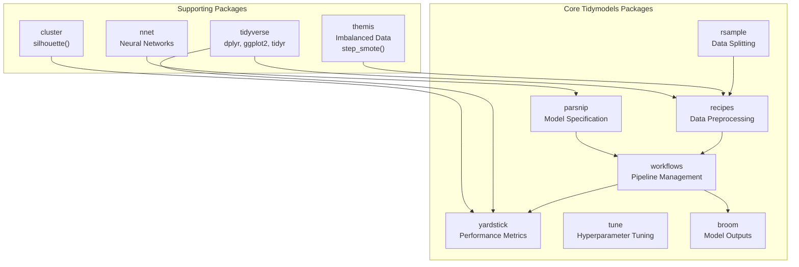
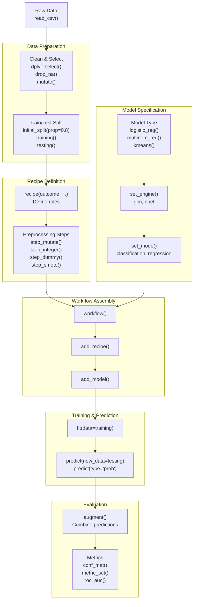
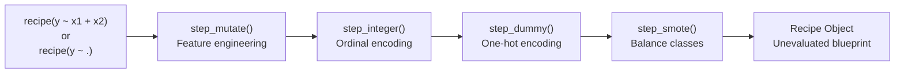
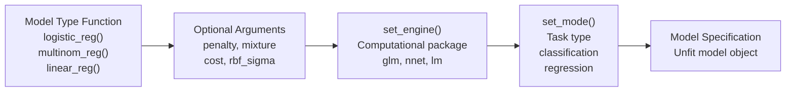
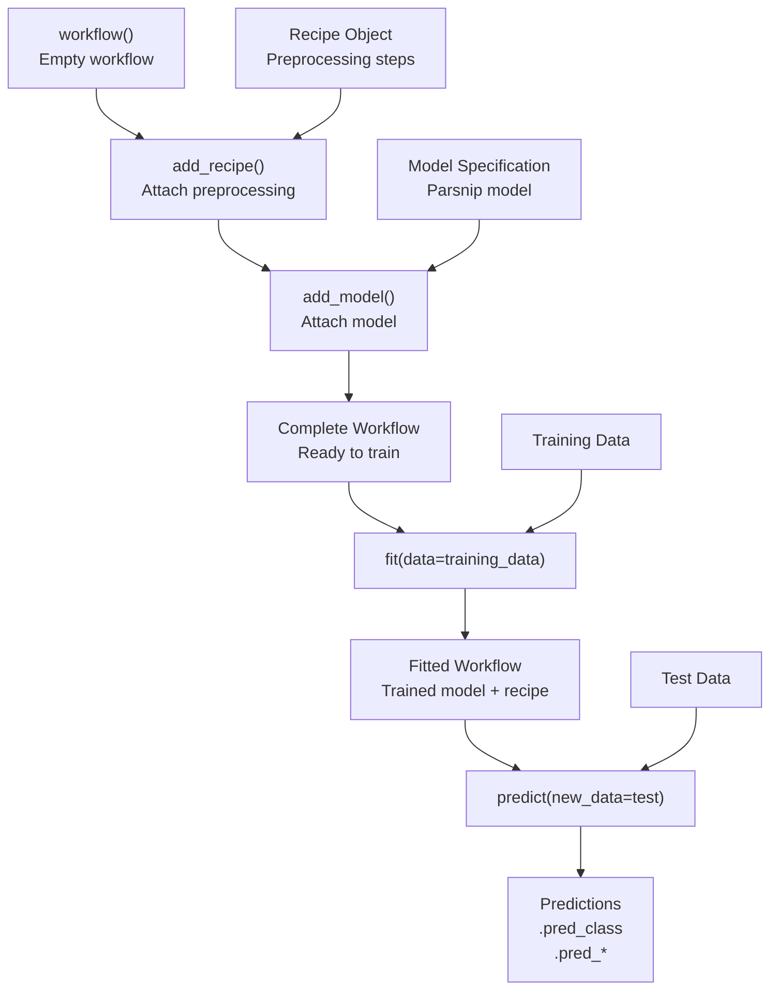
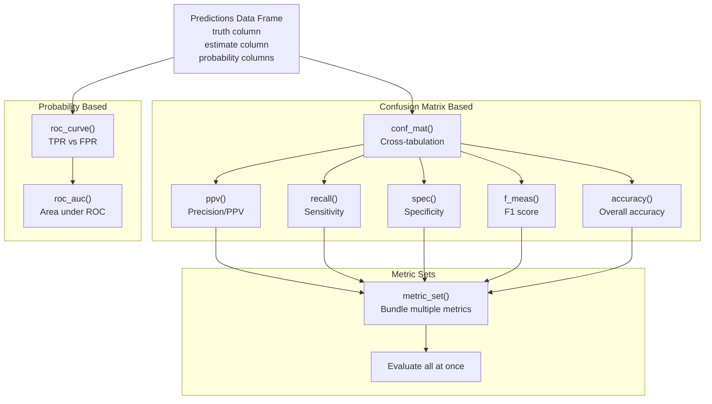
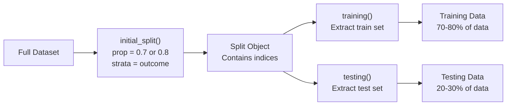
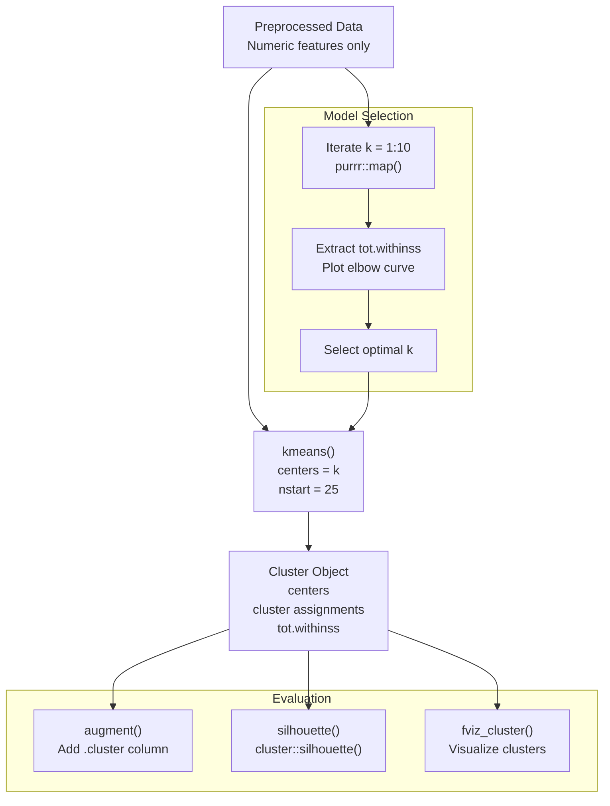

<!-- source: DeepWiki mcp.deepwiki.com · repo microsoft/ML-For-Beginners · page 6.2 R Implementation with tidymodels · fetched 2026-10-26 -->

# R Implementation with tidymodels

<details>
<summary>Relevant source files</summary>

The following files were used as context for generating this wiki page:

- [2-Regression/4-Logistic/solution/R/lesson_4-R.ipynb](2-Regression/4-Logistic/solution/R/lesson_4-R.ipynb)
- [2-Regression/4-Logistic/solution/R/lesson_4.Rmd](2-Regression/4-Logistic/solution/R/lesson_4.Rmd)
- [2-Regression/4-Logistic/solution/R/lesson_4.html](2-Regression/4-Logistic/solution/R/lesson_4.html)
- [4-Classification/1-Introduction/solution/R/lesson_10-R.ipynb](4-Classification/1-Introduction/solution/R/lesson_10-R.ipynb)
- [4-Classification/1-Introduction/solution/R/lesson_10.Rmd](4-Classification/1-Introduction/solution/R/lesson_10.Rmd)
- [4-Classification/1-Introduction/solution/R/lesson_10.html](4-Classification/1-Introduction/solution/R/lesson_10.html)
- [4-Classification/2-Classifiers-1/solution/R/lesson_11-R.ipynb](4-Classification/2-Classifiers-1/solution/R/lesson_11-R.ipynb)
- [4-Classification/2-Classifiers-1/solution/R/lesson_11.Rmd](4-Classification/2-Classifiers-1/solution/R/lesson_11.Rmd)
- [4-Classification/data/cleaned_cuisines_R.csv](4-Classification/data/cleaned_cuisines_R.csv)
- [5-Clustering/1-Visualize/solution/R/lesson_14-R.ipynb](5-Clustering/1-Visualize/solution/R/lesson_14-R.ipynb)
- [5-Clustering/1-Visualize/solution/R/lesson_14.Rmd](5-Clustering/1-Visualize/solution/R/lesson_14.Rmd)
- [5-Clustering/2-K-Means/solution/R/lesson_15-R.ipynb](5-Clustering/2-K-Means/solution/R/lesson_15-R.ipynb)
- [5-Clustering/2-K-Means/solution/R/lesson_15.Rmd](5-Clustering/2-K-Means/solution/R/lesson_15.Rmd)

</details>


## Purpose and Scope

This document describes the R-based machine learning implementation track provided as an alternative to the Python scikit-learn approach. The R track uses the tidymodels framework, a collection of packages that provide a unified interface for modeling and machine learning following tidy data principles. This implementation covers regression, classification, and clustering tasks using the same datasets as the Python lessons.

For Python implementation details, see [6.1](#6.1). For detailed framework components, see [6.2.1](#6.2.1) (tidymodels overview), [6.2.2](#6.2.2) (recipes), and [6.2.3](#6.2.3) (model training).

---

## Tidymodels Ecosystem Architecture

The tidymodels framework consists of multiple packages that work together to provide a complete machine learning workflow. Each package has a specific responsibility in the modeling pipeline.



**Sources:** [2-Regression/4-Logistic/solution/R/lesson_4.Rmd:37-50](), [4-Classification/1-Introduction/solution/R/lesson_10.Rmd:52-73](), [4-Classification/2-Classifiers-1/solution/R/lesson_11.Rmd:33-57]()

---

## Complete ML Pipeline: From Raw Data to Predictions

The tidymodels workflow follows a consistent pattern across all machine learning tasks. This diagram shows the complete pipeline using actual function names from the codebase.



**Sources:** [2-Regression/4-Logistic/solution/R/lesson_4.Rmd:251-309](), [4-Classification/2-Classifiers-1/solution/R/lesson_11.Rmd:93-262]()

---

## Recipe Construction and Preprocessing

The `recipe()` function defines preprocessing steps that transform raw data into model-ready format. Recipes use a step-based API where each `step_*()` function adds a transformation.

### Recipe Step Types

| Step Function | Purpose | Example Usage |
|--------------|---------|---------------|
| `step_mutate()` | Create/modify columns | Ordinal encoding setup |
| `step_integer()` | Convert ordered factors to integers | Size categories to numbers |
| `step_dummy()` | One-hot encode categorical variables | Create binary columns |
| `step_smote()` | Balance classes via synthetic oversampling | Handle imbalanced datasets |
| `step_normalize()` | Scale numeric features | Standardize ranges |

### Recipe Definition Pattern



### Example: Logistic Regression Recipe

The pumpkin color prediction recipe demonstrates ordinal encoding for size categories and one-hot encoding for other categorical variables:

[2-Regression/4-Logistic/solution/R/lesson_4.Rmd:180-188]()
```
recipe(color ~ ., data = pumpkins_select) %>%
  step_mutate(item_size = ordered(item_size, levels = c('sml', 'med', ...))) %>%
  step_integer(item_size, zero_based = F) %>%
  step_dummy(all_nominal(), -all_outcomes(), one_hot = TRUE)
```

### Example: Classification Recipe with SMOTE

The cuisine classification recipe includes SMOTE to handle class imbalance:

[4-Classification/2-Classifiers-1/solution/R/lesson_11.Rmd:140-145]()
```
cuisines_recipe <- recipe(cuisine ~ ., data = cuisines_train) %>% 
  step_smote(cuisine)
```

### Recipe Execution: prep() and bake()

When used outside a workflow, recipes must be manually executed:

- `prep()`: Estimates parameters from training data (e.g., category levels, means)
- `bake()`: Applies the recipe to new data using estimated parameters

[4-Classification/1-Introduction/solution/R/lesson_10.Rmd:354-368]()

However, workflows handle `prep()` and `bake()` automatically during `fit()`, making manual execution unnecessary in production pipelines.

**Sources:** [2-Regression/4-Logistic/solution/R/lesson_4.Rmd:162-193](), [4-Classification/1-Introduction/solution/R/lesson_10.Rmd:330-368](), [4-Classification/2-Classifiers-1/solution/R/lesson_11.Rmd:136-151]()

---

## Model Specification with Parsnip

Parsnip provides a unified interface for specifying models across different R packages (engines). The same model type can use different computational engines while maintaining consistent syntax.

### Model Specification Pattern



### Available Model Types and Engines

| Model Function | Task | Common Engines | Example Use Case |
|---------------|------|----------------|------------------|
| `logistic_reg()` | Binary classification | `glm`, `glmnet` | Pumpkin color prediction |
| `multinom_reg()` | Multiclass classification | `nnet`, `glmnet` | Cuisine classification |
| `linear_reg()` | Regression | `lm`, `glmnet` | Price prediction |
| `rand_forest()` | Classification/Regression | `ranger`, `randomForest` | Ensemble methods |

### Example: Binary Classification Model

[2-Regression/4-Logistic/solution/R/lesson_4.Rmd:279-282]()
```
log_reg <- logistic_reg() %>% 
  set_engine("glm") %>% 
  set_mode("classification")
```

### Example: Multiclass Classification Model

[4-Classification/2-Classifiers-1/solution/R/lesson_11.Rmd:230-236]()
```
mr_spec <- multinom_reg(penalty = 1) %>% 
  set_engine("nnet", MaxNWts = 2086) %>% 
  set_mode("classification")
```

The `penalty` argument controls regularization strength, and `MaxNWts` is an engine-specific parameter passed to the nnet package.

**Sources:** [2-Regression/4-Logistic/solution/R/lesson_4.Rmd:266-283](), [4-Classification/2-Classifiers-1/solution/R/lesson_11.Rmd:218-238]()

---

## Workflow Assembly and Training

Workflows bundle recipes and model specifications into a single object that manages the entire modeling process. This ensures preprocessing and modeling steps are executed in the correct order.

### Workflow Construction Pattern



### Example: Logistic Regression Workflow

[2-Regression/4-Logistic/solution/R/lesson_4.Rmd:289-297]()
```
log_reg_wf <- workflow() %>% 
  add_recipe(pumpkins_recipe) %>% 
  add_model(log_reg)
```

Training the workflow:

[2-Regression/4-Logistic/solution/R/lesson_4.Rmd:302-308]()
```
wf_fit <- log_reg_wf %>% 
  fit(data = pumpkins_train)
```

### Making Predictions

Predictions can be obtained as class labels or probabilities:

[2-Regression/4-Logistic/solution/R/lesson_4.Rmd:316-325]()
```
results <- pumpkins_test %>% select(color) %>% 
  bind_cols(wf_fit %>% 
              predict(new_data = pumpkins_test)) %>%
  bind_cols(wf_fit %>%
              predict(new_data = pumpkins_test, type = "prob"))
```

This produces:
- `.pred_class`: Predicted class labels
- `.pred_ORANGE`, `.pred_WHITE`: Class probabilities

**Sources:** [2-Regression/4-Logistic/solution/R/lesson_4.Rmd:284-326](), [4-Classification/2-Classifiers-1/solution/R/lesson_11.Rmd:240-262]()

---

## Model Evaluation with Yardstick

Yardstick provides functions to calculate performance metrics. All metrics follow a consistent interface accepting a data frame with truth and prediction columns.

### Classification Metrics Architecture



### Confusion Matrix

[2-Regression/4-Logistic/solution/R/lesson_4.Rmd:338-341]()
```
conf_mat(data = results, truth = color, estimate = .pred_class)
```

Output shows the cross-tabulation of actual vs. predicted classes:
- True Positives (TP): Top-left
- False Positives (FP): Top-right
- False Negatives (FN): Bottom-left
- True Negatives (TN): Bottom-right

### Metric Set for Comprehensive Evaluation

[2-Regression/4-Logistic/solution/R/lesson_4.Rmd:380-382]()
```
eval_metrics <- metric_set(ppv, recall, spec, f_meas, accuracy)
eval_metrics(data = results, truth = color, estimate = .pred_class)
```

This calculates all specified metrics in a single call, producing a tibble with metric names and values.

### ROC Curve and AUC

[2-Regression/4-Logistic/solution/R/lesson_4.Rmd:390-403]()
```
results %>% 
  roc_curve(color, .pred_ORANGE) %>% 
  autoplot()

results %>% 
  roc_auc(color, .pred_ORANGE)
```

The AUC (Area Under Curve) ranges from 0 to 1, where 1 indicates perfect classification.

**Sources:** [2-Regression/4-Logistic/solution/R/lesson_4.Rmd:330-406](), [4-Classification/2-Classifiers-1/solution/R/lesson_11.Rmd:283-308]()

---

## Data Splitting with Rsample

Rsample provides functions for partitioning data into training and testing sets with various sampling strategies.

### Train/Test Split Pattern



### Example: Stratified Split

[2-Regression/4-Logistic/solution/R/lesson_4.Rmd:252-263]()
```
set.seed(2056)
pumpkins_split <- pumpkins_select %>% 
  initial_split(prop = 0.8)

pumpkins_train <- training(pumpkins_split)
pumpkins_test <- testing(pumpkins_split)
```

### Stratified Sampling for Imbalanced Data

[4-Classification/2-Classifiers-1/solution/R/lesson_11.Rmd:98-121]()
```
cuisines_split <- initial_split(data = df_select,
                                strata = cuisine,
                                prop = 0.7)
```

The `strata` argument ensures proportional representation of each class in both training and testing sets, which is critical for imbalanced classification problems.

**Sources:** [2-Regression/4-Logistic/solution/R/lesson_4.Rmd:247-264](), [4-Classification/2-Classifiers-1/solution/R/lesson_11.Rmd:93-122]()

---

## Clustering Implementation

For unsupervised learning tasks like K-Means clustering, the implementation uses base R functions with tidymodels for preprocessing and evaluation.

### K-Means Clustering Workflow



### K-Means Execution

[5-Clustering/2-K-Means/solution/R/lesson_15.Rmd:180-192]()
```
set.seed(2056)
kclust <- kmeans(
  df_numeric_select,
  centers = 3,
  nstart = 25
)
```

Parameters:
- `centers`: Number of clusters (k)
- `nstart`: Number of random initializations to avoid local optima

### Adding Cluster Assignments

[5-Clustering/2-K-Means/solution/R/lesson_15.Rmd:199-203]()
```
augment(kclust, df_numeric_select) %>% 
  relocate(.cluster)
```

The `augment()` function from broom adds a `.cluster` column to the original data.

### Determining Optimal K with Elbow Method

[5-Clustering/2-K-Means/solution/R/lesson_15.Rmd:252-259]()
```
kclusts <- tibble(k = 1:10) %>% 
  mutate(model = map(k, ~ kmeans(df_numeric_select, centers = .x, nstart = 25)),
         glanced = map(model, ~ glance(.x))) %>% 
  unnest(cols = glanced)
```

This creates a tibble with clustering results for each k value, including `tot.withinss` (total within-cluster sum of squares).

### Silhouette Score Evaluation

[5-Clustering/2-K-Means/solution/R/lesson_15.Rmd:219-226]()
```
library(cluster)
ss <- silhouette(kclust$cluster,
                 dist = dist(df_numeric_select))
mean(ss[, 3])
```

Silhouette scores range from -1 to 1:
- Near 1: Well-separated clusters
- Near 0: Overlapping clusters
- Negative: Misclassified points

**Sources:** [5-Clustering/2-K-Means/solution/R/lesson_15.Rmd:173-293]()

---

## Comparison: R Tidymodels vs Python Scikit-learn

Both implementations follow similar conceptual workflows but differ in syntax and philosophy. The table below maps equivalent operations:

| Task | R Tidymodels | Python Scikit-learn |
|------|-------------|---------------------|
| Data splitting | `initial_split()`, `training()`, `testing()` | `train_test_split()` |
| Preprocessing pipeline | `recipe()`, `step_*()` functions | `Pipeline()`, `ColumnTransformer()` |
| Ordinal encoding | `step_integer()` | `OrdinalEncoder()` |
| One-hot encoding | `step_dummy()` | `OneHotEncoder()` |
| SMOTE | `step_smote()` | `SMOTE()` from imblearn |
| Model specification | `logistic_reg()`, `set_engine()` | `LogisticRegression()` |
| Training | `fit(data)` | `fit(X, y)` |
| Prediction | `predict(new_data)` | `predict(X)` |
| Confusion matrix | `conf_mat()` | `confusion_matrix()` |
| Metrics | `metric_set()` | Individual functions or `classification_report()` |
| K-Means | `kmeans()` | `KMeans()` |

### Key Philosophical Differences

**R Tidymodels:**
- Formula interface: `y ~ x1 + x2` or `y ~ .`
- Pipe-based workflow: `%>%` operator chains operations
- Lazy evaluation: Recipes aren't executed until bundled in workflows
- Unified interface: Same syntax across different engines

**Python Scikit-learn:**
- Array-based interface: Separate X and y arrays
- Object-oriented: Method chaining with `.fit().predict()`
- Immediate execution: Transformers applied directly
- Specialized classes: Different classes for different tasks

### Example: Complete Workflow Comparison

**R Tidymodels:**
```
recipe(outcome ~ .) %>%
  step_dummy(all_nominal()) %>%
  workflow() %>%
  add_model(logistic_reg()) %>%
  fit(data = train)
```

**Python Scikit-learn:**
```python
pipeline = Pipeline([
    ('encoder', OneHotEncoder()),
    ('model', LogisticRegression())
])
pipeline.fit(X_train, y_train)
```

Both approaches achieve the same result but reflect different design philosophies: tidymodels emphasizes readability and tidy data principles, while scikit-learn emphasizes object-oriented design and explicit control.

**Sources:** [2-Regression/4-Logistic/solution/R/lesson_4.Rmd:1-418](), [4-Classification/2-Classifiers-1/solution/R/lesson_11.Rmd:1-350]()

---

## Package Installation and Environment Setup

### Required Packages

All R lessons require the following packages:

| Package | Purpose | Key Functions |
|---------|---------|---------------|
| `tidyverse` | Data manipulation and visualization | `dplyr`, `ggplot2`, `readr` |
| `tidymodels` | ML framework | `recipes`, `parsnip`, `workflows`, `yardstick`, `rsample` |
| `themis` | Imbalanced data handling | `step_smote()` |
| `janitor` | Data cleaning | `clean_names()` |
| `nnet` | Neural networks | Multinomial regression engine |

### Installation Pattern

All R lessons include a standardized installation script:

[4-Classification/2-Classifiers-1/solution/R/lesson_11.Rmd:53-56]()
```
suppressWarnings(if (!require("pacman"))install.packages("pacman"))
pacman::p_load(tidyverse, tidymodels, DataExplorer, themis, here)
```

The `pacman` package manager automatically installs missing packages and loads them into the current session.

**Sources:** [2-Regression/4-Logistic/solution/R/lesson_4.Rmd:47-56](), [4-Classification/1-Introduction/solution/R/lesson_10.Rmd:63-73](), [5-Clustering/2-K-Means/solution/R/lesson_15.Rmd:72-76]()

---

