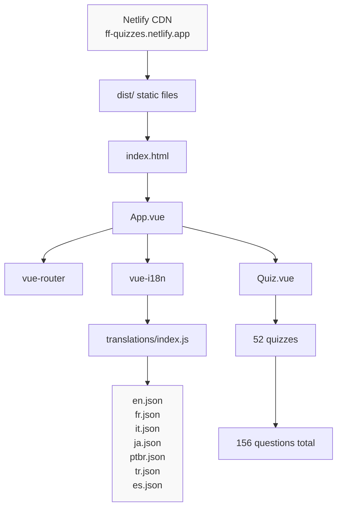
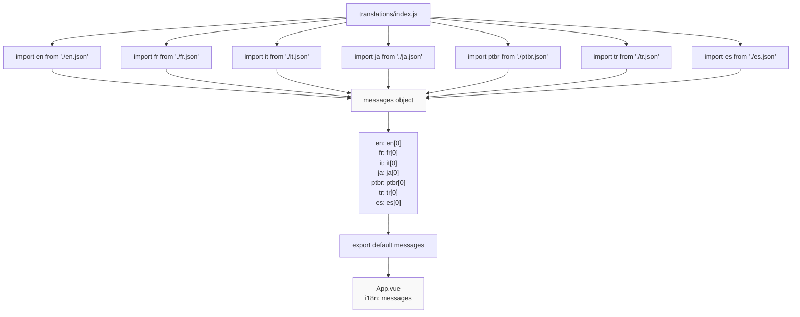
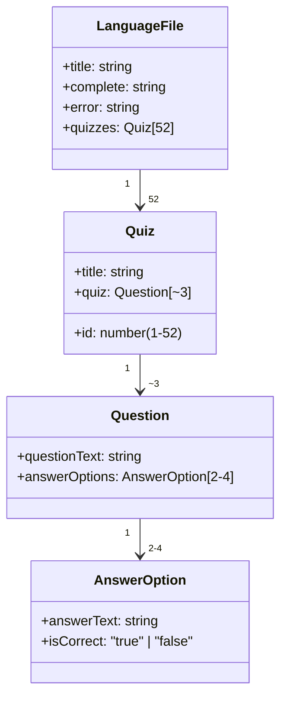
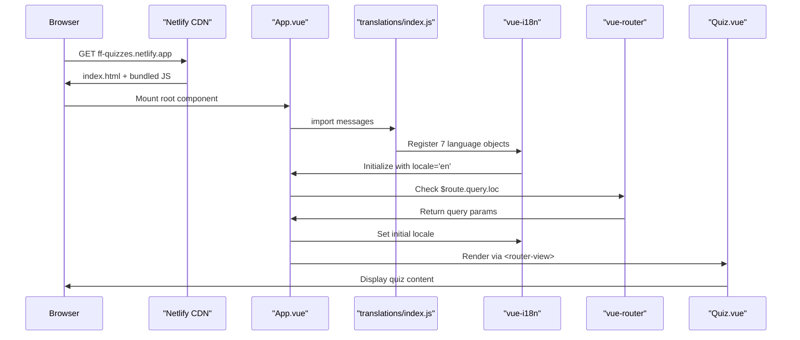
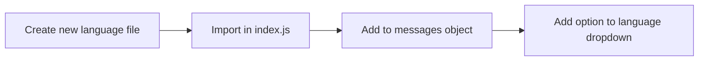

<!-- source: DeepWiki mcp.deepwiki.com · repo microsoft/ML-For-Beginners · page 6.3 Quiz Application Architecture · fetched 2026-10-26 -->

# Quiz Application Architecture

<details>
<summary>Relevant source files</summary>

The following files were used as context for generating this wiki page:

- [.gitignore](.gitignore)
- [1-Introduction/1-intro-to-ML/lesson-1.pdf](1-Introduction/1-intro-to-ML/lesson-1.pdf)
- [1-Introduction/2-history-of-ML/lesson-2.pdf](1-Introduction/2-history-of-ML/lesson-2.pdf)
- [quiz-app/package-lock.json](quiz-app/package-lock.json)
- [quiz-app/package.json](quiz-app/package.json)
- [quiz-app/src/App.vue](quiz-app/src/App.vue)
- [quiz-app/src/assets/translations/fr.json](quiz-app/src/assets/translations/fr.json)
- [quiz-app/src/assets/translations/index.js](quiz-app/src/assets/translations/index.js)
- [quiz-app/src/assets/translations/it.json](quiz-app/src/assets/translations/it.json)
- [quiz-app/src/assets/translations/ja.json](quiz-app/src/assets/translations/ja.json)
- [quiz-app/src/assets/translations/tr.json](quiz-app/src/assets/translations/tr.json)

</details>


## Purpose and Scope

This document describes the standalone Quiz Application deployed at `ff-quizzes.netlify.app`, which operates independently from the main ML-For-Beginners repository. The application provides 52 pre-lecture and post-lecture quizzes (totaling 156 questions) for testing user knowledge across the machine learning curriculum. The system supports 7 languages (English, French, Italian, Japanese, Portuguese-BR, Turkish, Spanish) to make educational content accessible globally.

## System Overview

The Quiz Application is a decoupled Vue.js 3 Single Page Application (SPA) hosted on Netlify. It loads quiz content from structured JSON files located in `quiz-app/src/assets/translations/` and provides client-side language switching without requiring server requests. The application is built using Vue CLI 5 and served as static assets.

### High-level Architecture



Sources: [quiz-app/package.json:1-44](), [quiz-app/src/App.vue:1-51](), [quiz-app/src/assets/translations/index.js:1-23]()

### Technical Stack

| Component | Technology | Version | Purpose |
|-----------|------------|---------|---------|
| Frontend Framework | Vue.js | 3.5.12 | Core reactive framework |
| Routing | vue-router | 3.5.3 | Client-side navigation between quiz routes |
| Internationalization | vue-i18n | 8.26.7 | Multi-language message system |
| Build System | @vue/cli-service | 5.0.8 | Webpack-based build and dev server |
| Code Quality | eslint + eslint-plugin-vue | 9.33.0 + 10.4.0 | Linting and code standards |
| Hosting | Netlify | N/A | Static site deployment and CDN |
| Polyfills | core-js | 3.6.5 | Browser compatibility |

Sources: [quiz-app/package.json:10-23]()

### Build and Deployment

The application uses three npm scripts defined in `package.json`:

| Script | Command | Purpose |
|--------|---------|---------|
| `serve` | `vue-cli-service serve` | Local development server with hot-reload |
| `build` | `vue-cli-service build` | Production build to `dist/` directory |
| `lint` | `vue-cli-service lint` | ESLint code quality checks |

Sources: [quiz-app/package.json:5-8]()

## Component Structure

The application uses a two-level component hierarchy with `App.vue` as the root and `Quiz.vue` as the routed child component.

```mermaid
flowchart TD
    A["App.vue<br/>(root component)"] --> B["<template><br/><nav> navigation"]
    A --> C["<router-view><br/>renders child"]
    A --> D["<script><br/>i18n: messages"]
    
    B --> E["<router-link to='/'>"]
    B --> F["<select v-model='locale'>"]
    
    C --> G["Quiz.vue<br/>(route component)"]
    
    D --> H["watch: locale(val)<br/>this.$root.$i18n.locale = val"]
    D --> I["created()<br/>check $route.query.loc"]
    
    F --> J["en, fr, it, ja<br/>ptbr, tr, es"]
    
    style A fill:#f9f9f9
    style G fill:#f9f9f9
```



Sources: [quiz-app/src/App.vue:1-51]()

### App.vue Component Structure

The `App.vue` component serves as the application shell with three main responsibilities:

1. **Navigation Bar** (lines 3-15): Contains `<router-link>` for home navigation and `<select>` dropdown for locale switching
2. **Content Area** (lines 16-21): Contains `<router-view>` that renders the `Quiz.vue` component
3. **i18n Configuration** (lines 29-44): Imports messages from `translations/index.js` and watches locale changes to update `$i18n.locale`

Sources: [quiz-app/src/App.vue:1-51]()

## Internationalization System

The application uses vue-i18n 8.26.7 for client-side translation of all quiz content across 7 supported languages. Each language contains identical quiz structures with localized text.

### Translation File Loading



Sources: [quiz-app/src/assets/translations/index.js:1-23]()

### Translation Array Structure

Each JSON file (e.g., `fr.json`, `tr.json`) contains a root array with a single object. The `index.js` extracts the first element (`[0]`) and maps it to the language code:

```javascript
// Simplified from quiz-app/src/assets/translations/index.js
const messages = {
  en: en[0],
  tr: tr[0],
  fr: fr[0],
  ja: ja[0],
  it: it[0],
  ptbr: ptbr[0],
  es: es[0]
};
```

Sources: [quiz-app/src/assets/translations/index.js:12-20]()

## Language Selection Mechanism

```mermaid
sequenceDiagram
    participant User
    participant Select as "<select v-model='locale'>"
    participant Watcher as "watch: locale(val)"
    participant I18n as "$root.$i18n"
    participant Template as "$t('title') etc."
    
    User->>Select: Select 'fr' option
    Select->>Watcher: locale = 'fr'
    Watcher->>I18n: this.$root.$i18n.locale = 'fr'
    I18n->>Template: Reactively update translations
    Template->>User: Display French text
```

The `<select>` element in `App.vue` binds to the `locale` data property via `v-model`. A watcher on `locale` updates `this.$root.$i18n.locale`, triggering reactive re-rendering of all `$t()` translation calls.



Sources: [quiz-app/src/App.vue:6-14](), [quiz-app/src/App.vue:40-44]()

### Query Parameter Locale Override

On component creation, `App.vue` checks for a `?loc=` query parameter to set the initial locale:

```javascript
// From App.vue:45-48
created() {
  if (this.$route.query.loc) {
    this.locale = this.$route.query.loc;
  }
}
```

This allows direct linking to specific language versions (e.g., `?loc=ja` for Japanese).

Sources: [quiz-app/src/App.vue:45-49]()

## Quiz Data Structure

Each translation file contains 52 quiz objects with a combined total of approximately 156 questions (3 questions per quiz on average). The JSON structure is deeply nested to support multiple-choice questions with correct answer tracking.

### JSON Schema



Sources: [quiz-app/src/assets/translations/fr.json:1-858]()

### Translation File Structure Example

Each language file follows this structure (example from `fr.json`):

```json
[
  {
    "title": "Machine Learning pour les Débutants: Quiz",
    "complete": "Félicitations, vous avez terminé le quiz!",
    "error": "Désolé, essayez à nouveau",
    "quizzes": [
      {
        "id": 1,
        "title": "Introduction au machine learning: Quiz préalable",
        "quiz": [
          {
            "questionText": "Les applications de machine learning sont toutes autour de nous",
            "answerOptions": [
              {
                "answerText": "Vrai",
                "isCorrect": "true"
              },
              {
                "answerText": "Faux",
                "isCorrect": "false"
              }
            ]
          }
        ]
      }
    ]
  }
]
```

Sources: [quiz-app/src/assets/translations/fr.json:1-57]()

### Quiz Content Mapping

| Field | Purpose | Accessed Via |
|-------|---------|--------------|
| `title` | Application header | `{{ $t("title") }}` |
| `complete` | Success message | `{{ $t("complete") }}` |
| `error` | Error feedback | `{{ $t("error") }}` |
| `quizzes[i].id` | Route parameter | Quiz ID (1-52) |
| `quizzes[i].title` | Quiz heading | Displayed in Quiz component |
| `quizzes[i].quiz[j].questionText` | Question display | Rendered in Quiz component |
| `quizzes[i].quiz[j].answerOptions[k].answerText` | Answer button text | Displayed as option |
| `quizzes[i].quiz[j].answerOptions[k].isCorrect` | Answer validation | String "true" or "false" |

Sources: [quiz-app/src/assets/translations/fr.json:1-57](), [quiz-app/src/App.vue:17]()

## Application Initialization and Routing Flow

The application follows a Vue.js SPA lifecycle with vue-router managing navigation between quiz views.

### Initialization Sequence



Sources: [quiz-app/src/App.vue:25-51](), [quiz-app/src/assets/translations/index.js:1-23]()

### Language Switch Flow

```mermaid
sequenceDiagram
    participant User
    participant Select as "<select v-model='locale'>"
    participant Watch as "watch: locale(val)"
    participant I18n as "$root.$i18n.locale"
    participant DOM as "All $t() calls"
    
    User->>Select: Change to 'ja'
    Select->>Watch: Trigger watcher
    Watch->>I18n: this.$root.$i18n.locale = 'ja'
    I18n->>DOM: Re-evaluate all $t() reactively
    DOM->>User: Display Japanese translations
```



Sources: [quiz-app/src/App.vue:40-44]()

## User Interface and Styling

The application uses scoped CSS within `App.vue` to provide a consistent, responsive design without external CSS frameworks.

### DOM Structure

```mermaid
flowchart TD
    A["<div> wrapper"] --> B["<nav> (lines 60-64)"]
    A --> C["<div id='app'> (line 16)"]
    
    B --> D["<router-link class='navlink'>"]
    B --> E["<label for='locale'>"]
    B --> F["<select v-model='locale'>"]
    
    C --> G["<h1> $t('title')"]
    C --> H["<router-view>"]
    
    H --> I["Quiz.vue component"]
    
    style B fill:#f9f9f9
    style C fill:#f9f9f9
```



Sources: [quiz-app/src/App.vue:1-22](), [quiz-app/src/App.vue:53-111]()

### CSS Class Structure

The `<style>` block (lines 53-111) defines the visual hierarchy:

| CSS Selector | Lines | Purpose |
|--------------|-------|---------|
| `html` | 54-58 | Global font family and text color (#252d4a) |
| `nav` | 60-64 | Dark blue background (#252d4a), padding, margin |
| `nav a` | 66-69 | White text, right-aligned links |
| `.link` | 71-73 | List item display |
| `h1, h2, h3, .message` | 75-80 | Center-aligned text |
| `.error` | 81-83 | Red error text |
| `.card` | 84-90 | Quiz container: 60% width, dark blue border, rounded corners |
| `.btn` | 91-105 | Answer buttons: min 50% width, white on dark blue, rounded |
| `.ans-btn` | 106-110 | Centered button container with flex display |

Sources: [quiz-app/src/App.vue:53-111]()

### Navigation Bar Implementation

The `<nav>` element contains:

1. **Home Link** (line 4): `<router-link class="navlink" to="/">Home</router-link>`
2. **Language Label** (line 5): `<label for="locale">locale</label>`
3. **Language Dropdown** (lines 6-14): `<select>` with 7 `<option>` elements for each supported language

Sources: [quiz-app/src/App.vue:3-15]()

## Adding New Languages

The application is designed to easily accommodate new language translations by:

1. Creating a new JSON file (e.g., `de.json`) with the same structure as existing translation files
2. Adding the import and registration in `translations/index.js`
3. Adding a new option to the language selector in `App.vue`



Sources: [quiz-app/src/assets/translations/index.js:1-22](), [quiz-app/src/App.vue:6-14]()

## Conclusion

The Quiz Application provides an interactive way for users to test their knowledge of machine learning concepts covered in the ML-For-Beginners curriculum. Its Vue.js implementation offers a responsive user experience, while the structured data format allows for easy addition of new quizzes and languages.

The multilingual support makes the educational content accessible to a global audience, aligning with the curriculum's goal of making machine learning education widely available.

---

