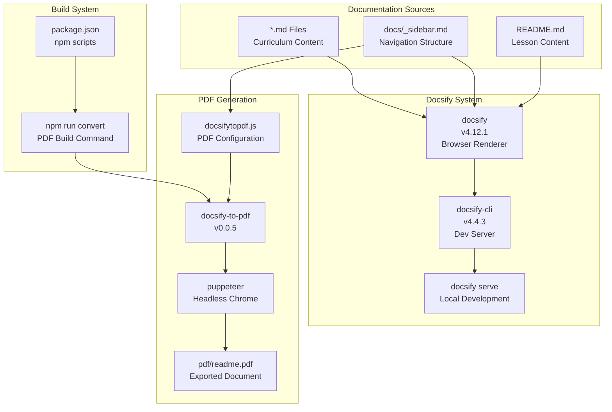
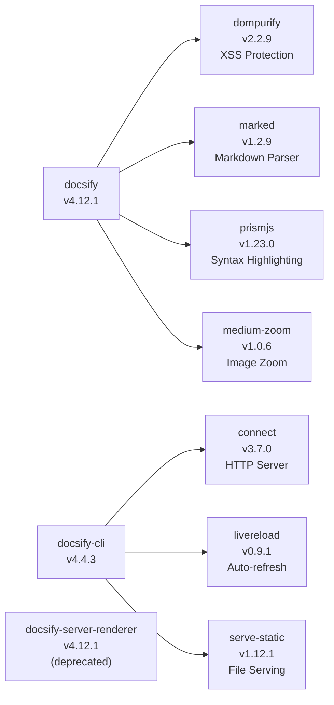
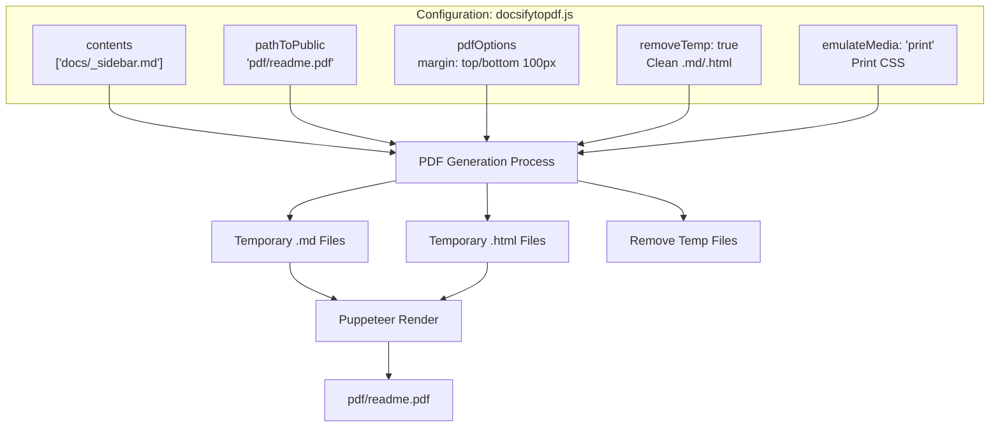
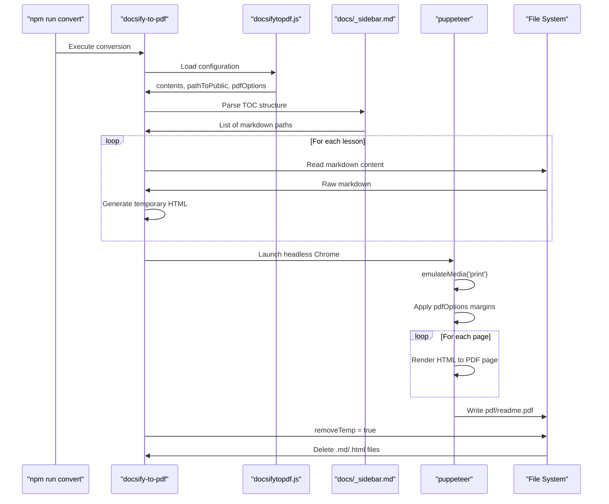
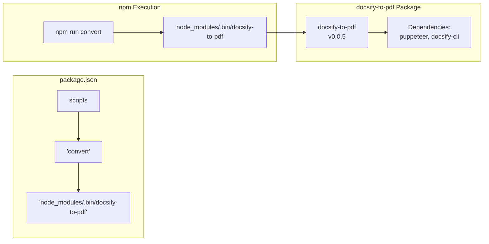

<!-- source: DeepWiki mcp.deepwiki.com · repo microsoft/ML-For-Beginners · page 6.4 Documentation and Build System · fetched 2026-10-26 -->

# Documentation and Build System

<details>
<summary>Relevant source files</summary>

The following files were used as context for generating this wiki page:

- [docs/_sidebar.md](docs/_sidebar.md)
- [docsifytopdf.js](docsifytopdf.js)
- [package-lock.json](package-lock.json)
- [package.json](package.json)
- [pdf/readme.pdf](pdf/readme.pdf)

</details>


This document describes the documentation generation and build tooling used to serve the ML-For-Beginners curriculum online and offline. It covers the Docsify-based documentation website, PDF generation pipeline, and npm-based build system. For information about the quiz application build system, see [Quiz Application Architecture](#6.3). For automated translation workflows, see [Co-op Translator GitHub Actions Workflow](#7.2).

## System Overview

The documentation system consists of two primary components: a Docsify-powered static documentation site that renders markdown files in the browser, and a PDF generation tool that creates a single downloadable document from the curriculum content.

**Key Technologies:**
- **docsify** (v4.12.1): Browser-based markdown renderer
- **docsify-cli** (v4.4.3): Development server and local tooling
- **docsify-to-pdf** (v0.0.5): PDF export utility
- **puppeteer**: Headless browser for PDF rendering



**Sources:** [package.json:1-29](), [package-lock.json:1-12](), [docsifytopdf.js:1-9](), [docs/_sidebar.md:1-43]()

## Docsify Documentation System

Docsify is a client-side markdown renderer that converts markdown files into a browsable documentation website without requiring a static site build step. The system uses the browser's JavaScript engine to parse markdown and render HTML dynamically.

### Configuration and Structure

The documentation navigation is defined in [docs/_sidebar.md:1-43](), which creates a hierarchical menu structure organized by curriculum modules:

| Module | Path Pattern | Example |
|--------|-------------|---------|
| Introduction | `../1-Introduction/*/README.md` | `1-intro-to-ML/README.md` |
| Regression | `../2-Regression/*/README.md` | `3-Linear/README.md` |
| Classification | `../4-Classification/*/README.md` | `2-Classifiers-1/README.md` |
| Clustering | `../5-Clustering/*/README.md` | `2-K-Means/README.md` |
| NLP | `../6-NLP/*/README.md` | `4-Hotel-Reviews-1/README.md` |
| Time Series | `../7-TimeSeries/*/README.md` | `2-ARIMA/README.md` |
| Reinforcement Learning | `../8-Reinforcement/*/README.md` | `1-QLearning/README.md` |
| Real World ML | `../9-Real-World/*/README.md` | `1-Applications/README.md` |
| Web App | `../3-Web-App/*/README.md` | `1-Web-App/README.md` |

The sidebar creates a nested navigation structure where each top-level module expands to reveal individual lessons. Docsify automatically resolves relative paths and renders the corresponding markdown content.

### Docsify Dependencies

The system includes several docsify packages from [package-lock.json:610-694]():



**Sources:** [package-lock.json:610-694]()

### Local Development Server

The docsify-cli package provides a `docsify serve` command that launches a local development server. The server configuration from [package-lock.json:627-656]() shows:

- **connect** (v3.7.0): Minimal HTTP server framework
- **connect-livereload** (v0.6.1): Injects livereload script into pages
- **livereload** (v0.9.1): Watches files and triggers browser refresh
- **serve-static** (v1.12.1): Serves markdown and asset files

The development workflow: developers run `docsify serve` locally, edit markdown files, and livereload automatically refreshes the browser to display changes without manual page reloads.

**Sources:** [package-lock.json:627-656]()

## PDF Generation System

The PDF generation system converts the documentation into a single downloadable file at `pdf/readme.pdf`. This allows learners to access the curriculum offline.

### Build Configuration

The PDF generation configuration is defined in [docsifytopdf.js:1-9]():



**Configuration Parameters:**

| Parameter | Value | Purpose |
|-----------|-------|---------|
| `contents` | `['docs/_sidebar.md']` | Table of contents source file |
| `pathToPublic` | `'pdf/readme.pdf'` | Output PDF path |
| `pdfOptions.margin.top` | `'100px'` | Top page margin |
| `pdfOptions.margin.bottom` | `'100px'` | Bottom page margin |
| `removeTemp` | `true` | Delete intermediate .md/.html files |
| `emulateMedia` | `'print'` | Use print media CSS for rendering |

**Sources:** [docsifytopdf.js:1-9]()

### PDF Generation Workflow

The PDF generation process is triggered via the npm script defined in [package.json:7]():

```
npm run convert
```

This executes `node_modules/.bin/docsify-to-pdf`, which performs the following steps:



**Sources:** [package.json:6-7](), [docsifytopdf.js:1-9](), [docs/_sidebar.md:1-43]()

### Puppeteer PDF Rendering

The docsify-to-pdf tool depends on puppeteer (v1.12.2) from [package-lock.json:695-711]() for PDF rendering. Puppeteer provides a headless Chromium browser that:

1. **Loads HTML content**: Rendered markdown converted to HTML
2. **Applies print CSS**: Uses `emulateMedia: 'print'` to trigger `@media print` stylesheets
3. **Sets page margins**: Applies 100px top/bottom margins from [docsifytopdf.js:5]()
4. **Generates PDF**: Uses Chromium's native PDF printing engine

The resulting PDF at `pdf/readme.pdf` contains embedded links (external URLs preserved as clickable annotations), images, and formatted code blocks from the curriculum.

**Sources:** [package-lock.json:695-711](), [docsifytopdf.js:4-8]()

## npm Build System

The build system is minimal, consisting of a single npm script defined in [package.json:1-29]():



**Package Metadata:**

| Field | Value | Purpose |
|-------|-------|---------|
| `name` | `"ml-for-beginners"` | Package identifier |
| `version` | `"1.0.0"` | Semantic version |
| `main` | `"index.js"` | Entry point (unused) |
| `license` | `"MIT"` | Open source license |
| `repository.url` | `"git+https://github.com/microsoft/ML-For-Beginners.git"` | Source repository |

**Sources:** [package.json:1-29]()

### DevDependencies

The project has a single development dependency from [package.json:26-28]():

```json
"devDependencies": {
  "docsify-to-pdf": "0.0.5"
}
```

Installing `docsify-to-pdf` automatically installs its transitive dependencies:
- **docsify-cli** (v4.4.3)
- **puppeteer** (v1.12.2)
- **colors** (v1.3.3): Terminal color output
- **lodash** (v4.17.11): Utility functions
- **markdown-link-extractor** (v1.2.0): Parse markdown links
- **yesno** (v0.2.0): CLI confirmation prompts

**Sources:** [package.json:26-28](), [package-lock.json:695-711]()

## Documentation Deployment

While not defined in the build system, the documentation is typically served through:

1. **GitHub Pages**: Docsify's client-side rendering works directly from GitHub's static hosting
2. **Local development**: `docsify serve` for contributors
3. **Offline access**: `pdf/readme.pdf` for learners without internet connectivity

The Docsify approach eliminates build complexity—no static site generation, no Jekyll, no CI/CD for documentation builds. Markdown files are served directly, and the browser handles rendering.

**Sources:** [docs/_sidebar.md:1-43](), [package.json:1-29]()

## External Link Preservation

The generated PDF preserves external links as clickable annotations. The PDF file at [pdf/readme.pdf:109-147]() contains annotation objects with `/Subtype /Link` and `/URI` actions, for example:

- YouTube video links (lessons)
- Quiz application URLs (`white-water-09ec41f0f.azurestaticapps.net/quiz/*`)
- GitHub discussions (`github.com/microsoft/ML-For-Beginners/discussions`)
- Microsoft Learn paths (`docs.microsoft.com/learn/paths/*`)
- External tools (nodejs.org, npmjs.com, scikit-learn.org)

These annotations are embedded during the Puppeteer PDF rendering process, preserving the curriculum's rich hyperlinking in the offline format.

**Sources:** [pdf/readme.pdf:109-147]()

## Build System Maintenance

The documentation build system requires minimal maintenance:

1. **Sidebar updates**: Edit [docs/_sidebar.md:1-43]() when adding/removing lessons
2. **PDF regeneration**: Run `npm run convert` after major content changes
3. **Dependency updates**: Update docsify-to-pdf when security patches released

The deprecated `docsify-server-renderer` (v4.12.1) from [package-lock.json:658-670]() is included as a transitive dependency but not actively used. The deprecation notice indicates Microsoft is investigating SSR/SSG alternatives for Docsify.

**Sources:** [package-lock.json:658-670](), [docs/_sidebar.md:1-43](), [package.json:6-7]()

---

