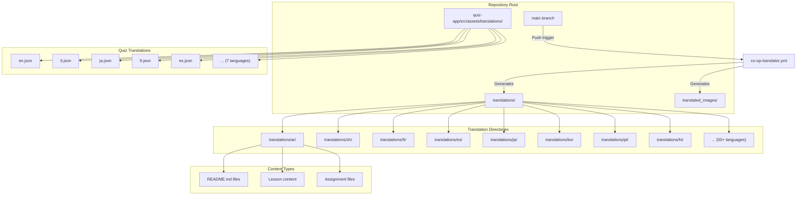
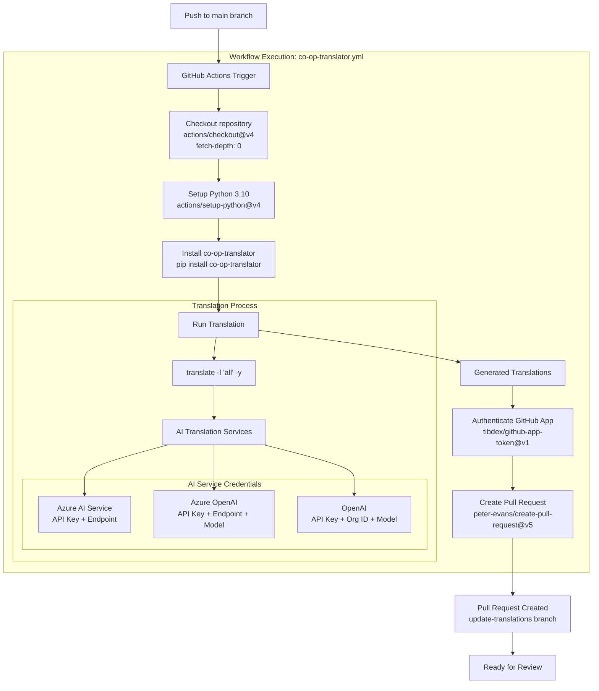
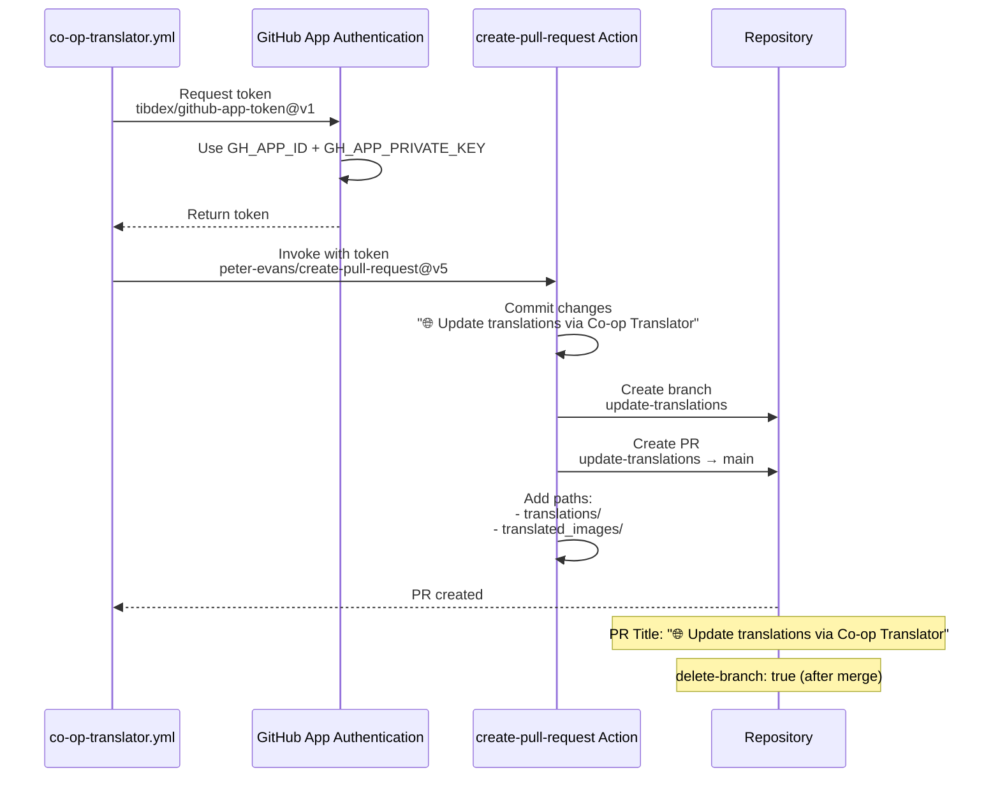
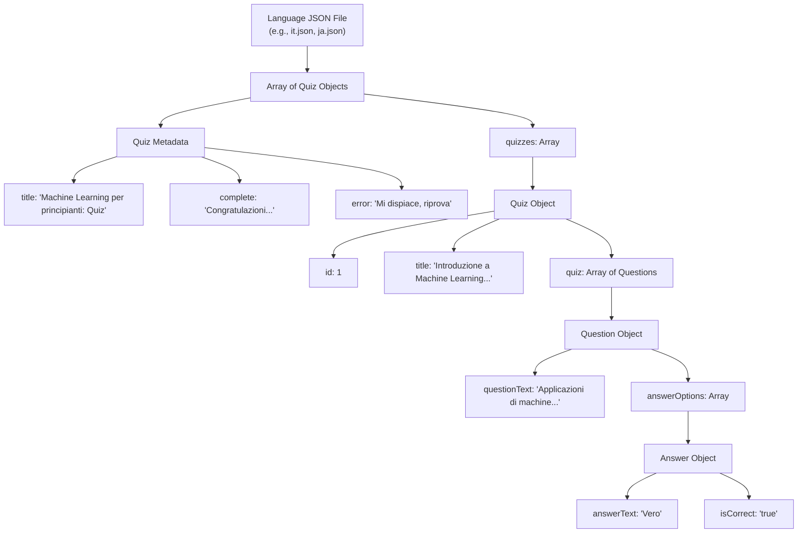
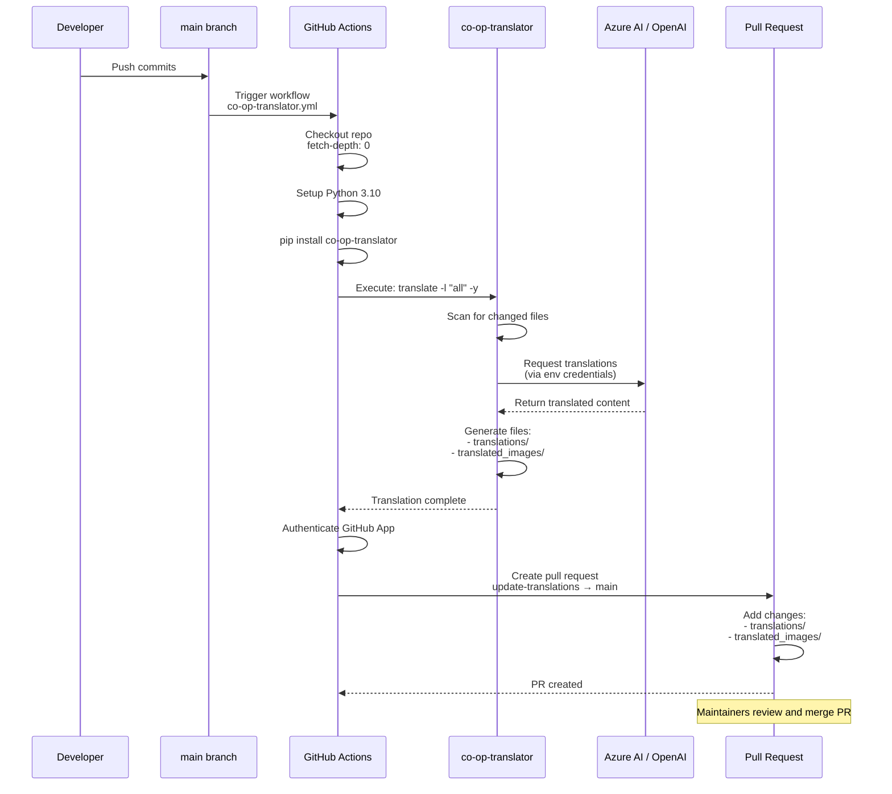
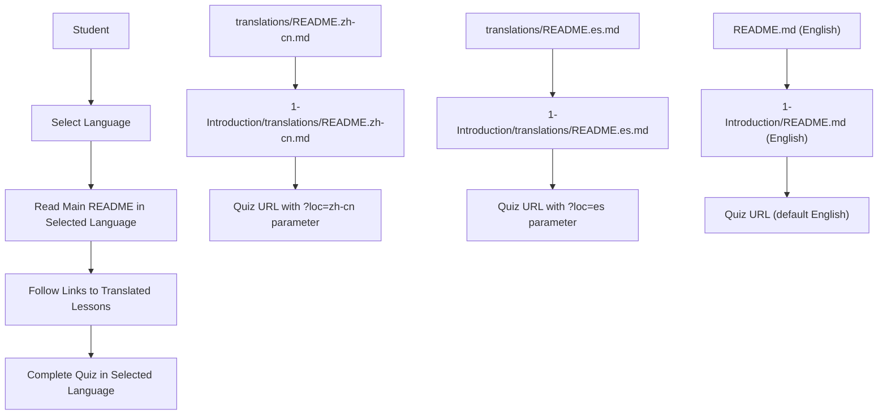

<!-- source: DeepWiki mcp.deepwiki.com · repo microsoft/ML-For-Beginners · page 7 Multilingual Support System · fetched 2026-10-26 -->

# Multilingual Support System

<details>
<summary>Relevant source files</summary>

The following files were used as context for generating this wiki page:

- [.github/workflows/co-op-translator.yml](.github/workflows/co-op-translator.yml)
- [quiz-app/src/assets/translations/it.json](quiz-app/src/assets/translations/it.json)
- [quiz-app/src/assets/translations/ja.json](quiz-app/src/assets/translations/ja.json)

</details>


The ML-For-Beginners repository implements an automated translation infrastructure powered by the co-op-translator Python package and GitHub Actions. This system automatically translates curriculum content into 50+ languages upon commits to the main branch, creating pull requests with updated translations.

## Translation Architecture Overview

The repository uses a directory-based structure where each language maintains its own set of translated files. Translations are generated automatically via the co-op-translator workflow and stored in dedicated directories.

### Directory Structure

**Translation Architecture Diagram**



Sources:
- [.github/workflows/co-op-translator.yml:104-106]()

### Language Coverage

The automated translation system supports **"all"** languages configured in the co-op-translator workflow. The system can be configured to translate into specific language sets or all available languages simultaneously.

| Category | Languages |
|----------|-----------|
| **Asian Languages** | Chinese (zh), Japanese (ja), Korean (ko), Hindi (hi), Bengali (bn), Urdu (ur), Tamil (ta), Thai (th), Vietnamese (vi), Indonesian (id), Malay (ms), Filipino/Tagalog (tl) |
| **European Languages** | French (fr), Spanish (es), German (de), Italian (it), Portuguese (pt), Russian (ru), Polish (pl), Dutch (nl), Swedish (sv), Danish (da), Norwegian (no), Finnish (fi), Greek (el), Czech (cs), Slovak (sk), Romanian (ro), Bulgarian (bg), Croatian (hr), Serbian (sr), Slovenian (sl), Ukrainian (uk), Hungarian (hu) |
| **Middle Eastern Languages** | Arabic (ar), Persian/Farsi (fa), Hebrew (he), Turkish (tr) |
| **Other Languages** | Breton (br), Burmese (my), Nepali (ne), Punjabi (pa), Marathi (mr), Swahili (sw), Lithuanian (lt), Moldovan (mo) |
| **Quiz Application** | English (en), Italian (it), Japanese (ja), French (fr), Spanish (es), Portuguese-Brazil (ptbr), Turkish (tr) |

Sources:
- [.github/workflows/co-op-translator.yml:56-74]()
- [quiz-app/src/assets/translations/it.json:1-10]()
- [quiz-app/src/assets/translations/ja.json:1-10]()

## Co-op Translator GitHub Actions Workflow

The automated translation pipeline is implemented as a GitHub Actions workflow that executes on every push to the `main` branch. The workflow uses the co-op-translator Python package to generate translations via AI services.

### Workflow Trigger and Configuration

**Co-op Translator Workflow Architecture**



Sources:
- [.github/workflows/co-op-translator.yml:3-7]()
- [.github/workflows/co-op-translator.yml:17-30]()
- [.github/workflows/co-op-translator.yml:32-51]()

### Translation Execution

The core translation step invokes the `translate` command from the co-op-translator package:

```bash
translate -l "all" -y
```

**Command Parameters:**
- `-l "all"` - Translates to all configured languages
- `-y` - Auto-confirms the translation without manual prompts
- Alternative configurations available for language batches (commented examples in workflow)

The workflow provides commented configuration options for translating specific language sets:

| Configuration Pattern | Use Case | Example |
|----------------------|----------|---------|
| `translate -l "all" -y` | Translate all languages at once | Default configuration |
| `translate -l "zh tw hk fr ja ko" -md -y` | Specific languages, markdown only | Batch processing |
| `translate -l "de es fa fr hi ko" -md -y` | European + Asian subset | Targeted updates |
| `translate -l "ar bn bg br cs da de el" -nb -y` | Without notebook files | Performance optimization |

Sources:
- [.github/workflows/co-op-translator.yml:56]()
- [.github/workflows/co-op-translator.yml:57-75]()

### AI Service Integration

The co-op-translator supports multiple AI translation backends through environment variables. The workflow is configured with credentials for three services:

**AI Service Configuration Table**

| Service | Required Environment Variables | Purpose |
|---------|-------------------------------|---------|
| **Azure AI Service** | `AZURE_AI_SERVICE_API_KEY`<br/>`AZURE_AI_SERVICE_ENDPOINT` | Azure Cognitive Services Translation API |
| **Azure OpenAI** | `AZURE_OPENAI_API_KEY`<br/>`AZURE_OPENAI_ENDPOINT`<br/>`AZURE_OPENAI_MODEL_NAME`<br/>`AZURE_OPENAI_CHAT_DEPLOYMENT_NAME`<br/>`AZURE_OPENAI_API_VERSION` | Azure-hosted OpenAI models |
| **OpenAI** | `OPENAI_API_KEY`<br/>`OPENAI_ORG_ID`<br/>`OPENAI_CHAT_MODEL_ID`<br/>`OPENAI_BASE_URL` | Direct OpenAI API access |

All credentials are stored as GitHub repository secrets and injected as environment variables during workflow execution.

Sources:
- [.github/workflows/co-op-translator.yml:33-50]()

### Pull Request Automation

After translations are generated, the workflow automatically creates a pull request with the changes:

**PR Creation Process**



**Pull Request Configuration:**
- **Branch Name:** `update-translations`
- **Base Branch:** `main`
- **Commit Message:** "🌐 Update translations via Co-op Translator"
- **PR Title:** "🌐 Update translations via Co-op Translator"
- **Included Paths:** `translations/`, `translated_images/`
- **Auto-delete Branch:** Yes (after merge)

Sources:
- [.github/workflows/co-op-translator.yml:76-106]()
- [.github/workflows/co-op-translator.yml:83-106]()

### Permissions and Security

The workflow requires specific permissions to function:

| Permission | Level | Purpose |
|------------|-------|---------|
| `contents` | `write` | Modify repository files (translations) |
| `pull-requests` | `write` | Create and update pull requests |

Authentication uses a GitHub App rather than personal access tokens for better security and audit capabilities.

Sources:
- [.github/workflows/co-op-translator.yml:12-14]()
- [.github/workflows/co-op-translator.yml:76-81]()

### Quiz Translation Data Structure

The quiz application uses separate JSON files for translations, located in `quiz-app/src/assets/translations/`. Each language file contains a complete set of quiz questions, answer options, and UI strings.

**Quiz Translation JSON Schema**



**Example from Italian Translation (it.json):**

| Field | Example Value |
|-------|---------------|
| `title` | "Machine Learning per principianti: Quiz" |
| `complete` | "Congratulazioni, il quiz è stato completato!" |
| `error` | "Mi dispiace, riprova" |
| `quizzes[0].id` | 1 |
| `quizzes[0].title` | "Introduzione a Machine Learning: Quiz Pre-Lezione" |
| `quizzes[0].quiz[0].questionText` | "Applicazioni di machine learning sono tutte intorno a noi" |
| `quizzes[0].quiz[0].answerOptions[0].answerText` | "Vero" |
| `quizzes[0].quiz[0].answerOptions[0].isCorrect` | "true" |

The quiz application loads these translations and renders them based on the `?loc=` URL parameter.

Sources:
- [quiz-app/src/assets/translations/it.json:1-60]()
- [quiz-app/src/assets/translations/ja.json:1-60]()

### Workflow Execution Details

**Complete Workflow Sequence**



The workflow runs on the `ubuntu-latest` runner with Python 3.10 and has a maximum runtime of 6 hours (GitHub Actions limit for free tier).

Sources:
- [.github/workflows/co-op-translator.yml:10]()
- [.github/workflows/co-op-translator.yml:17-106]()

### Batch Translation Configuration

For performance optimization, the workflow includes commented configuration examples for batch processing languages:

**Batch Configuration Options:**

```bash
# Translate specific Asian languages (markdown only)
translate -l "zh tw hk fr ja ko" -md -y

# Translate European languages (markdown only)  
translate -l "pt es de fa pl hi" -md -y

# Translate Middle Eastern + South Asian (markdown only)
translate -l "ru ar ur mo ja bn" -md -y

# Translate without notebook files
translate -l "ar bn bg br cs da de el es fa fi fr" -nb -y
```

The recommendation is to process large batches in groups of fewer than 29 files due to GitHub Actions runner time limits (maximum 6 hours).

Sources:
- [.github/workflows/co-op-translator.yml:63-74]()

### Translation Output Structure

The co-op-translator generates two primary outputs:

| Output Directory | Content | Purpose |
|-----------------|---------|---------|
| `translations/` | Translated markdown files organized by language code | Main curriculum content in target languages |
| `translated_images/` | Translated image files (if applicable) | Localized diagrams, screenshots, and visual content |

Both directories are automatically added to the pull request for review.

Sources:
- [.github/workflows/co-op-translator.yml:94]()
- [.github/workflows/co-op-translator.yml:104-106]()

## Integration with Main Curriculum

Translations are integrated into the main curriculum through a network of links:

1. **Language-specific README files** - Each translation includes all links to lessons in that language
2. **Quiz links with language parameters** - All quiz links include the appropriate language parameter
3. **Community discussions** - The repository has a discussion section where learners can interact in multiple languages



This integration ensures that students can navigate the entire curriculum in their preferred language, from the main README through lessons, assignments, and quizzes.

Sources:
- [translations/README.zh-cn.md:71-101]()
- [translations/README.es.md:83-113]()
- [TRANSLATIONS.md:30]()

## Contributing to Translations

The repository actively encourages contributions to translations to expand the curriculum's reach. The `TRANSLATIONS.md` file provides detailed guidelines for contributors, and the community coordinates translation efforts through GitHub issues.

To contribute translations:
1. Read the translation guidelines in `TRANSLATIONS.md`
2. Check existing issues to avoid duplicate work
3. Follow the proper file naming conventions
4. Ensure translations are done by humans, not machines
5. Submit a pull request with the translated files

Sources:
- [TRANSLATIONS.md]()
- [translations/README.zh-cn.md:110-111]()

## Technical Implementation Details

Under the hood, the multilingual support system leverages several technical mechanisms:

1. **File-based translation approach** - Each language has separate markdown files
2. **JSON-based quiz translations** - Quiz content is stored in language-specific JSON files
3. **URL parameters for language selection** - The `?loc=` parameter is used to specify the language
4. **Language dropdown in the quiz app** - The App.vue file includes language selection UI
5. **Translation registry in index.js** - This file registers available translations

The system is designed to be extensible, allowing new languages to be added without modifying the core functionality of the curriculum or quiz application.

Sources:
- [TRANSLATIONS.md:22-30]()
- [quiz-app/src/assets/translations/it.json]()

---

