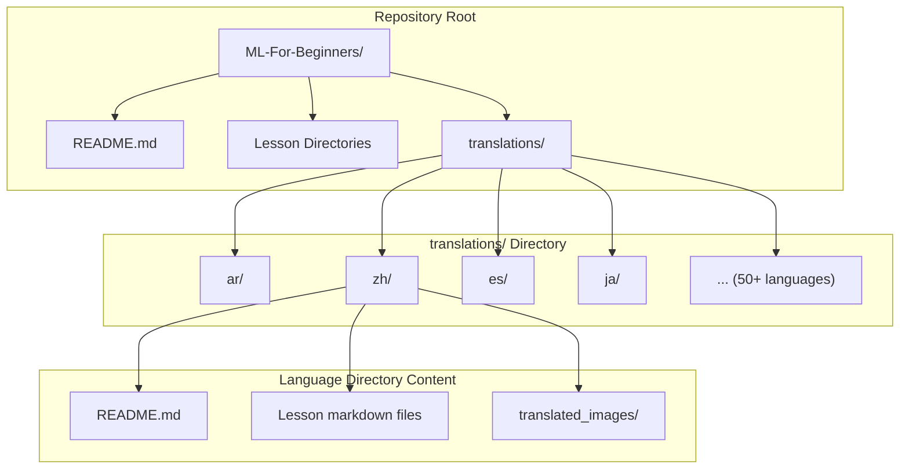
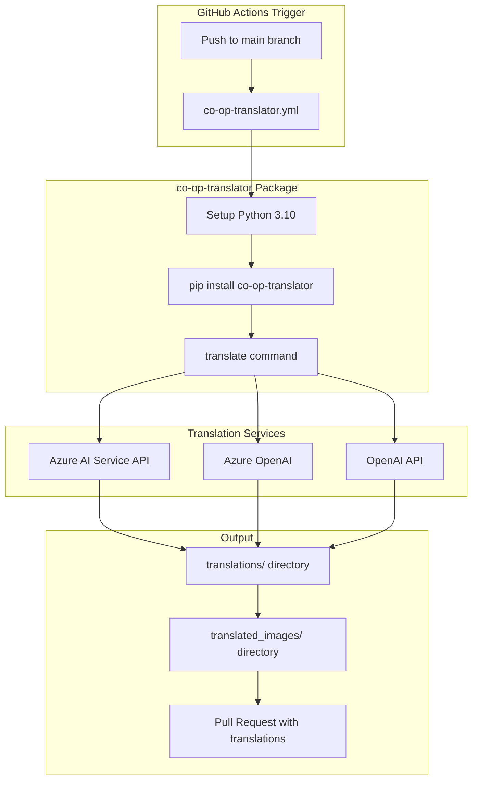
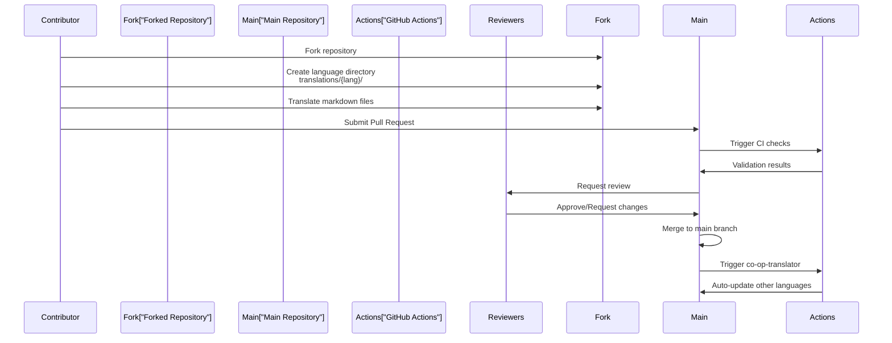
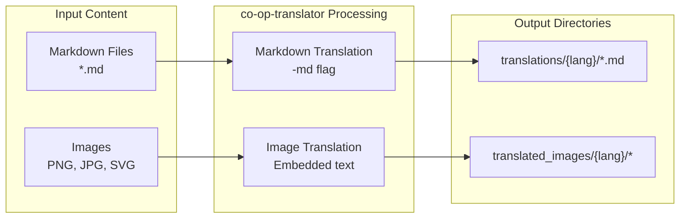
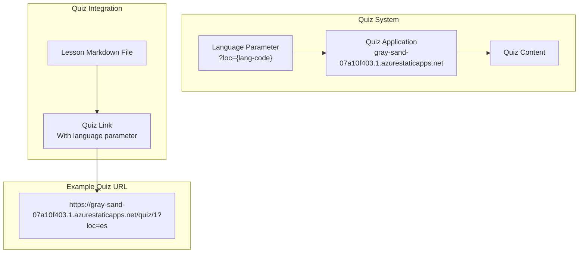
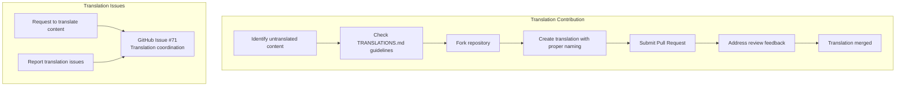
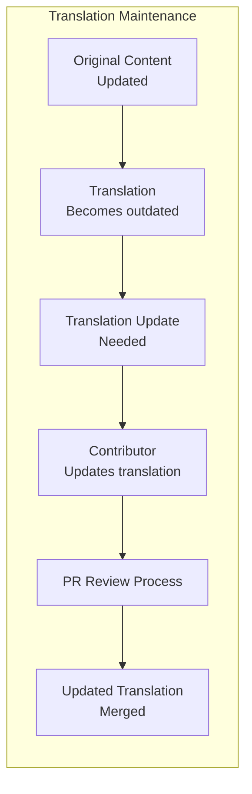
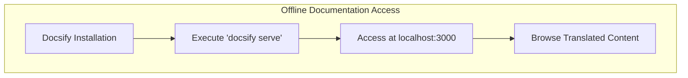
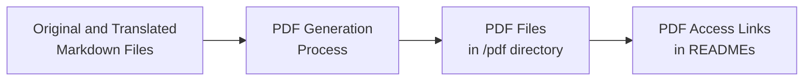

<!-- source: DeepWiki mcp.deepwiki.com · repo microsoft/ML-For-Beginners · page 7.1 Translation Architecture Overview · fetched 2026-10-26 -->

# Translation Architecture

<details>
<summary>Relevant source files</summary>

The following files were used as context for generating this wiki page:

- [.github/workflows/co-op-translator.yml](.github/workflows/co-op-translator.yml)
- [2-Regression/1-Tools/images/notebook.jpg](2-Regression/1-Tools/images/notebook.jpg)
- [2-Regression/1-Tools/notebook.ipynb](2-Regression/1-Tools/notebook.ipynb)
- [quiz-app/src/assets/translations/it.json](quiz-app/src/assets/translations/it.json)
- [quiz-app/src/assets/translations/ja.json](quiz-app/src/assets/translations/ja.json)

</details>


This document describes the translation architecture of the ML-For-Beginners repository, detailing how the curriculum is structured to support multiple languages. It covers the file organization, translation workflow, and contribution process for making the educational content accessible to a global audience.

## Overview

The ML-For-Beginners repository employs a dual-track translation architecture: **automated translation** via GitHub Actions workflow and **manual community contributions**. Translated content is organized in language-specific subdirectories following ISO 639-1 language codes.

### Key Components

- `translations/` directory containing language-specific subdirectories
- `.github/workflows/co-op-translator.yml` workflow for automated translations
- Manual translation contribution process via pull requests
- Language code naming convention following ISO standards

## Translation Directory Structure

The repository organizes translations using a two-tier structure: root-level `translations/` directory and lesson-specific translation directories.

### Root Translation Directory Structure

```
translations/
├── ar/          # Arabic
├── bn/          # Bengali
├── zh/          # Chinese (Simplified)
├── zh-tw/       # Chinese (Traditional)
├── es/          # Spanish
├── fr/          # French
├── de/          # German
├── hi/          # Hindi
├── it/          # Italian
├── ja/          # Japanese
├── ko/          # Korean
├── pt/          # Portuguese
├── ru/          # Russian
├── tr/          # Turkish
└── ... (50+ language directories)
```

Each language directory contains translated markdown files mirroring the main repository structure.

**Translation Directory Layout Diagram**



Sources:
- [.github/workflows/co-op-translator.yml:56-62]()
- [.github/workflows/co-op-translator.yml:104-106]()

### File Path Patterns

**Pattern 1: Root-level translations**
```
translations/{lang-code}/README.md
translations/{lang-code}/{lesson-path}/*.md
```

**Pattern 2: Translated images**
```
translated_images/{lang-code}/{image-path}
```

Example structure for Spanish (`es`) translations:
```
translations/es/README.md
translations/es/1-Introduction/1-intro-to-ML/README.md
translated_images/es/sketchnotes/ml-history.png
```

**Language Code Mapping Table**

| Language | ISO Code | Directory | Example File |
|----------|----------|-----------|--------------|
| Arabic | ar | `translations/ar/` | `translations/ar/README.md` |
| Bengali | bn | `translations/bn/` | `translations/bn/README.md` |
| Chinese (Simplified) | zh | `translations/zh/` | `translations/zh/README.md` |
| Chinese (Traditional) | zh-tw | `translations/zh-tw/` | `translations/zh-tw/README.md` |
| Spanish | es | `translations/es/` | `translations/es/README.md` |
| French | fr | `translations/fr/` | `translations/fr/README.md` |
| German | de | `translations/de/` | `translations/de/README.md` |
| Hindi | hi | `translations/hi/` | `translations/hi/README.md` |
| Italian | it | `translations/it/` | `translations/it/README.md` |
| Japanese | ja | `translations/ja/` | `translations/ja/README.md` |
| Korean | ko | `translations/ko/` | `translations/ko/README.md` |
| Portuguese | pt | `translations/pt/` | `translations/pt/README.md` |

Sources:
- [.github/workflows/co-op-translator.yml:104-106]()

## Automated vs Manual Translation

The repository employs two distinct translation mechanisms:

### Automated Translation via GitHub Actions

The repository uses the `co-op-translator` Python package executed via GitHub Actions workflow to automatically generate translations when content changes.

**Automated Translation Workflow Architecture**



**Workflow Configuration Details**

The automated workflow is defined in [.github/workflows/co-op-translator.yml:1-107]() with the following key components:

| Component | Configuration |
|-----------|---------------|
| **Trigger** | Push to `main` branch |
| **Runner** | `ubuntu-latest` |
| **Python Version** | 3.10 |
| **Translation Tool** | `co-op-translator` package |
| **API Credentials** | Azure AI Service, Azure OpenAI, OpenAI (via GitHub Secrets) |
| **Output Branch** | `update-translations` |
| **Target Languages** | Configurable via `-l` flag (default: "all") |

**Translation Command Example**

```bash
translate -l "all" -y
# Translates to all supported languages with auto-confirmation
```

Alternative batch commands for specific language groups:
```bash
translate -l "zh tw hk fr ja ko" -md -y
translate -l "pt es de fa pl hi" -md -y
translate -l "ar bn bg br cs da de el es fa fi fr he hi hr hu id it ja ko lt uk ur" -nb -y
```

**Automated Pull Request Generation**

After translation completion, the workflow automatically:
1. Creates a new branch `update-translations`
2. Commits translated content to `translations/` and `translated_images/` directories
3. Opens a pull request with title "🌐 Update translations via Co-op Translator"
4. Includes summary of changes in PR description

Sources:
- [.github/workflows/co-op-translator.yml:1-10]()
- [.github/workflows/co-op-translator.yml:27-50]()
- [.github/workflows/co-op-translator.yml:51-75]()
- [.github/workflows/co-op-translator.yml:83-106]()

### Manual Translation Contributions

Community members can contribute translations manually through standard pull request workflow:

**Manual Translation Process Flow**



Sources:
- [.github/workflows/co-op-translator.yml:3-6]()

## Language Coverage Scope

The repository supports 50+ languages through automated translation. The coverage scope is configurable in the GitHub Actions workflow.

### Language Groups Configuration

The workflow defines multiple language groups for batch processing:

**Language Group Categories**

| Category | Languages | Workflow Flag |
|----------|-----------|---------------|
| **East Asian** | Chinese (zh, tw, hk), Japanese (ja), Korean (ko) | `-l "zh tw hk fr ja ko"` |
| **European (West)** | Portuguese (pt), Spanish (es), German (de), French (fr), Italian (it) | `-l "pt es de fa pl hi"` |
| **European (East)** | Czech (cs), Polish (pl), Hungarian (hu), Bulgarian (bg), Romanian (ro) | `-l "cs pl hu bg ro"` |
| **Middle East & South Asia** | Arabic (ar), Persian/Farsi (fa), Hindi (hi), Urdu (ur), Bengali (bn) | `-l "ar fa hi ur bn"` |
| **Southeast Asian** | Indonesian (id), Malay (ms), Thai (th), Vietnamese (vi), Filipino (tl) | `-l "id ms th vi tl"` |
| **Nordic** | Danish (da), Norwegian (no), Swedish (sv), Finnish (fi) | `-l "da no sv fi"` |
| **Other** | Turkish (tr), Hebrew (he), Greek (el), Ukrainian (uk), Lithuanian (lt) | Various flags |

### Complete Language List

The `translate -l "all"` command targets the following languages:

```
ar  bn  bg  br  cs  da  de  el  es  fa  fi  fr  he  hi  hr  hu  
id  it  ja  ko  lt  mo  ms  mr  my  ne  nl  no  pa  pl  pt  ro  
ru  sk  sl  sr  sv  sw  th  tl  tr  tw  uk  ur  vi  zh  hk
```

**Language Translation Status Matrix**

| Language | ISO Code | Translation Method | Coverage |
|----------|----------|-------------------|----------|
| Arabic | ar | Automated + Manual | Full |
| Bengali | bn | Automated | Full |
| Chinese (Simplified) | zh | Automated + Manual | Full |
| Chinese (Traditional) | tw, hk | Automated | Full |
| Spanish | es | Automated + Manual | Full |
| French | fr | Automated + Manual | Full |
| German | de | Automated | Full |
| Hindi | hi | Automated + Manual | Full |
| Italian | it | Automated + Manual | Full |
| Japanese | ja | Automated + Manual | Full |
| Korean | ko | Automated + Manual | Full |
| Portuguese | pt | Automated + Manual | Full |
| Russian | ru | Automated | Full |
| Turkish | tr | Automated + Manual | Full |
| ... (35+ additional languages) | ... | Automated | Full |

Sources:
- [.github/workflows/co-op-translator.yml:56-75]()

## Translatable Content Types

The automated translation system processes the following content types:

**Content Translation Scope**



**File Type Coverage**

| Content Type | File Pattern | Translation Method | Output Location |
|--------------|--------------|-------------------|-----------------|
| Main README | `README.md` | Automated | `translations/{lang}/README.md` |
| Lesson README | `**/README.md` | Automated | `translations/{lang}/**/*.md` |
| Lesson Content | `**/lesson.md` | Automated | `translations/{lang}/**/lesson.md` |
| Assignments | `**/assignment.md` | Automated | `translations/{lang}/**/assignment.md` |
| Images with text | `**/*.png, *.jpg` | Automated | `translated_images/{lang}/**/*` |
| Notebooks | `**/*.ipynb` | Manual only | N/A |
| Quiz questions | Separate system | Manual | `quiz-app/src/assets/translations/{lang}.json` |

**Translation Flags**

The workflow supports specific translation flags:
- `-md`: Translate only markdown files
- `-y`: Auto-confirm translation
- `-nb`: No batch processing
- `-l "lang1 lang2 ..."`: Specify target languages

Sources:
- [.github/workflows/co-op-translator.yml:64-74]()
- [.github/workflows/co-op-translator.yml:91-95]()
- [.github/workflows/co-op-translator.yml:104-106]()

## Quiz Localization

The quizzes are available in multiple languages through a dedicated quiz application:



Sources:
- [1-Introduction/1-intro-to-ML/translations/README.es.md:7](1-Introduction/1-intro-to-ML/translations/README.es.md)
- [2-Regression/1-Tools/translations/README.ja.md:7](2-Regression/1-Tools/translations/README.ja.md)

## Translation Contribution Process

The following diagram illustrates the contribution process for translations:



Sources:
- [translations/README.zh-cn.md:111-112](translations/README.zh-cn.md)
- [translations/README.es.md:110-111](translations/README.es.md)
- [translations/README.ja.md:110-111](translations/README.ja.md)

## Translation Maintenance

As the original English content evolves, translations must be kept up-to-date:



Sources:
- [translations/README.zh-cn.md](translations/README.zh-cn.md)
- [translations/README.ja.md](translations/README.ja.md)

## Technical Implementation

The translation system is primarily file-based, with no special technical implementation beyond the repository's directory structure. The system relies on GitHub's workflow for contributions and updates.

For offline access to the documentation, the repository supports using Docsify:



Sources:
- [translations/README.ja.md:104-106](translations/README.ja.md)
- [translations/README.zh-cn.md:102-104](translations/README.zh-cn.md)

## PDF Generation

The repository also supports generating PDF files of the curriculum:



Sources:
- [translations/README.ja.md:108-110](translations/README.ja.md)
- [translations/README.zh-cn.md:105-107](translations/README.zh-cn.md)

## Conclusion

The translation architecture of ML-For-Beginners enables a global audience to access the curriculum in their preferred language. Through consistent file organization and community contributions, the repository maintains translations in various languages, making machine learning education more accessible worldwide.

---

