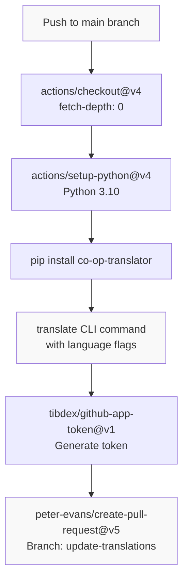
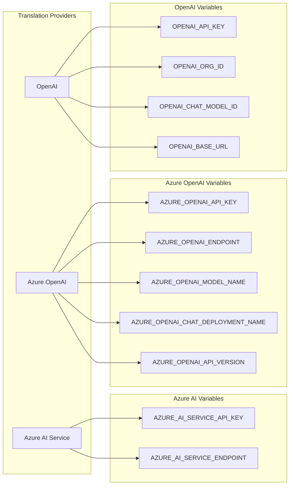
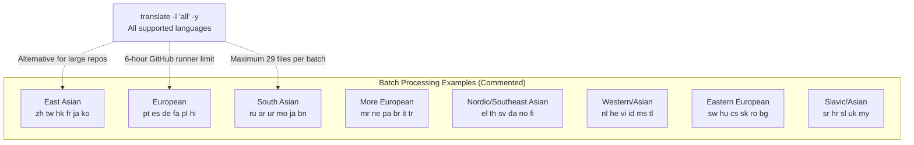
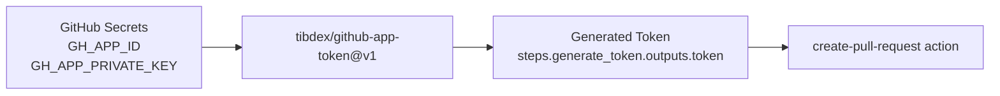
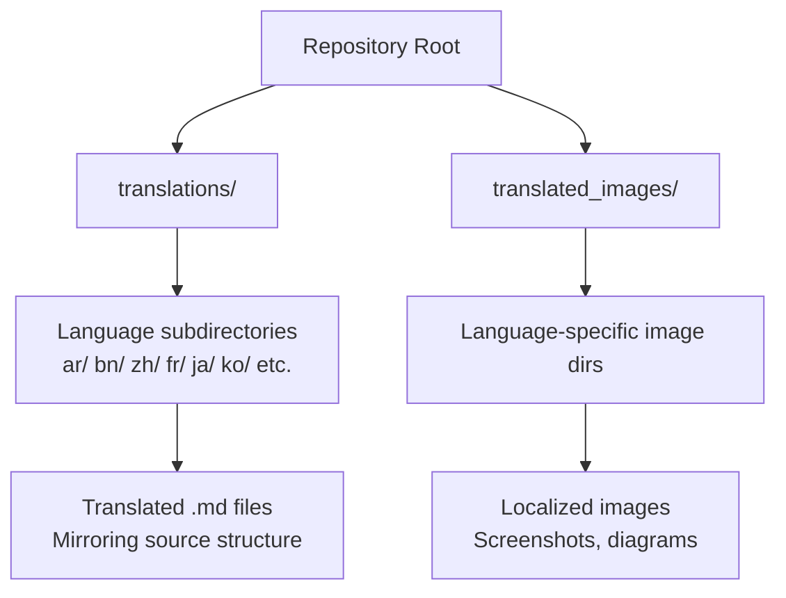
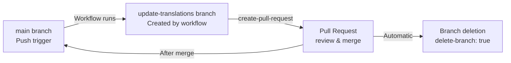

<!-- source: DeepWiki mcp.deepwiki.com · repo microsoft/ML-For-Beginners · page 7.2 Co-op Translator GitHub Actions Workflow · fetched 2026-10-26 -->

# Co-op Translator GitHub Actions Workflow

<details>
<summary>Relevant source files</summary>

The following files were used as context for generating this wiki page:

- [.github/workflows/co-op-translator.yml](.github/workflows/co-op-translator.yml)

</details>


## Purpose and Scope

This document describes the automated translation pipeline implemented in `.github/workflows/co-op-translator.yml`. The workflow automatically translates repository content into 50+ languages whenever changes are pushed to the `main` branch. It uses the `co-op-translator` Python package with Azure AI Service, Azure OpenAI, or OpenAI as translation backends, and creates pull requests with translated content.

For information about the broader multilingual support architecture, see [Translation Architecture Overview](#7.1). For quiz application internationalization, see [Quiz Internationalization System](#6.3.2).

**Sources:** [.github/workflows/co-op-translator.yml:1-107]()

---

## Workflow Trigger and Execution

The workflow is defined as a GitHub Actions job named `co-op-translator` that executes on the `ubuntu-latest` runner whenever code is pushed to the `main` branch.

### Trigger Configuration

The workflow uses a simple push trigger:

```yaml
on:
  push:
    branches:
      - main
```

This means the translation pipeline runs automatically for every commit merged into `main`, ensuring translated content stays synchronized with source content.

### Required Permissions

The workflow requires two GitHub permissions to function:

| Permission | Access Level | Purpose |
|------------|--------------|---------|
| `contents` | `write` | Commit translated files to repository |
| `pull-requests` | `write` | Create PRs for translation updates |

**Sources:** [.github/workflows/co-op-translator.yml:3-14]()

---

## Workflow Execution Steps

The workflow executes through six distinct steps, each handling a specific aspect of the translation pipeline.

### Execution Flow Diagram



**Sources:** [.github/workflows/co-op-translator.yml:16-107]()

### Step 1: Repository Checkout

The workflow checks out the repository with full git history (`fetch-depth: 0`), which is necessary for the co-op-translator to detect changes between commits and determine which files need translation.

**Sources:** [.github/workflows/co-op-translator.yml:17-20]()

### Step 2: Python Environment Setup

Python 3.10 is configured using the `actions/setup-python@v4` action. This provides the runtime environment for the `co-op-translator` package.

**Sources:** [.github/workflows/co-op-translator.yml:22-25]()

### Step 3: Co-op Translator Installation

The `co-op-translator` package is installed from PyPI using pip:

```bash
python -m pip install --upgrade pip
pip install co-op-translator
```

This package provides the `translate` CLI command used in the next step.

**Sources:** [.github/workflows/co-op-translator.yml:27-30]()

---

## Translation Provider Configuration

The workflow supports three translation backends through environment variables. The `co-op-translator` package selects the first available provider based on configured credentials.

### Provider Environment Variables



### Provider Selection Priority

The `co-op-translator` package attempts to use providers in this order:

1. **Azure AI Service**: Requires `AZURE_AI_SERVICE_API_KEY` and `AZURE_AI_SERVICE_ENDPOINT`
2. **Azure OpenAI**: Requires `AZURE_OPENAI_API_KEY`, `AZURE_OPENAI_ENDPOINT`, `AZURE_OPENAI_MODEL_NAME`, `AZURE_OPENAI_CHAT_DEPLOYMENT_NAME`, and `AZURE_OPENAI_API_VERSION`
3. **OpenAI**: Requires `OPENAI_API_KEY`; optionally uses `OPENAI_ORG_ID`, `OPENAI_CHAT_MODEL_ID`, and `OPENAI_BASE_URL`

All credentials are stored as GitHub repository secrets and injected as environment variables at runtime.

**Sources:** [.github/workflows/co-op-translator.yml:33-50]()

---

## Translation Command Configuration

The core translation operation is executed via the `translate` CLI command with configurable language and behavior flags.

### Active Configuration

The current workflow configuration uses:

```bash
translate -l "all" -y
```

This command translates all markdown and image files to all supported languages with automatic confirmation (no interactive prompts).

### Translation Command Flags

| Flag | Purpose | Example |
|------|---------|---------|
| `-l` | Specify target languages | `-l "zh tw hk fr ja ko"` |
| `-y` | Auto-confirm without prompts | `-y` |
| `-md` | Translate only markdown files | `-md` |
| `-nb` | Skip backup file creation | `-nb` |

### Language Configuration Options

The workflow file includes commented examples for batch processing languages:



The commented examples [.github/workflows/co-op-translator.yml:57-74]() demonstrate splitting large translation jobs into batches to avoid GitHub Actions' 6-hour runner timeout.

**Sources:** [.github/workflows/co-op-translator.yml:51-75]()

---

## GitHub App Authentication

The workflow uses a GitHub App for authentication rather than the default `GITHUB_TOKEN`. This provides elevated permissions for creating pull requests that can trigger other workflows.

### Authentication Flow



The `tibdex/github-app-token@v1` action generates a temporary authentication token from the GitHub App credentials, which is then passed to the pull request creation step.

**Sources:** [.github/workflows/co-op-translator.yml:76-81]()

---

## Pull Request Creation and Management

After translation completes, the workflow automatically creates a pull request with the translated content using the `peter-evans/create-pull-request@v5` action.

### Pull Request Configuration

| Parameter | Value | Purpose |
|-----------|-------|---------|
| `token` | `steps.generate_token.outputs.token` | GitHub App authentication |
| `commit-message` | `🌐 Update translations via Co-op Translator` | Commit message for changes |
| `title` | `🌐 Update translations via Co-op Translator` | PR title |
| `branch` | `update-translations` | Source branch name |
| `base` | `main` | Target branch for merge |
| `delete-branch` | `true` | Auto-delete after merge |
| `add-paths` | `translations/`<br/>`translated_images/` | Directories to include |

### Pull Request Body Template

The PR includes a structured description:

```markdown
This PR updates translations for recent changes merged into the `main` branch.

### 📋 Summary of Changes
- Translated markdown content has been added under the `translations/` directory
- Translated images (if applicable) have been generated in the `translated_images/` directory

🔁 Co-op Translator ensures that changes in links, structure, or inline elements 
in the original content are automatically reflected in all translated files.

---
🌐 This pull request was automatically generated by Co-op Translator, powered by Azure AI.
```

**Sources:** [.github/workflows/co-op-translator.yml:83-107]()

---

## Output Directory Structure

The workflow produces translated files in two dedicated directories, both included in the pull request via the `add-paths` configuration.

### Translation Output Directories



### Directory Organization

- **`translations/`**: Contains subdirectories for each target language (e.g., `translations/zh/`, `translations/fr/`). Each subdirectory mirrors the repository structure with translated markdown files.
- **`translated_images/`**: Contains localized images such as screenshots with translated text, organized by language subdirectories.

The `co-op-translator` package automatically maintains this structure, creating language directories as needed and preserving the original file hierarchy.

**Sources:** [.github/workflows/co-op-translator.yml:104-106]()

---

## Branch Management Strategy

The workflow uses a consistent branch naming strategy to manage translation updates.

### Branch Lifecycle



The `update-translations` branch is:
1. **Created or updated** by the `create-pull-request` action with translated content
2. **Used as the source branch** for the pull request targeting `main`
3. **Automatically deleted** after the PR is merged, due to `delete-branch: true`

This approach ensures clean branch management with no accumulation of stale translation branches.

**Sources:** [.github/workflows/co-op-translator.yml:101-103]()

---

## Encoding and Internationalization Settings

The workflow sets `PYTHONIOENCODING=utf-8` to ensure proper handling of non-ASCII characters across 50+ languages.

This environment variable configures Python's standard I/O streams to use UTF-8 encoding, preventing character encoding issues when processing files in Arabic, Chinese, Japanese, Korean, and other non-Latin scripts.

**Sources:** [.github/workflows/co-op-translator.yml:34]()

---

## Workflow Execution Summary

The complete translation automation pipeline operates as follows:

1. **Trigger**: Developer pushes code to `main`
2. **Detection**: Workflow checks out repository with full history
3. **Environment**: Python 3.10 environment with `co-op-translator` package
4. **Translation**: `translate -l "all" -y` processes all files using configured provider (Azure AI/OpenAI)
5. **Output**: Translated files written to `translations/` and `translated_images/`
6. **Authentication**: GitHub App token generated for elevated permissions
7. **PR Creation**: `update-translations` branch created with automated PR to `main`
8. **Merge**: Manual review and merge updates translated content
9. **Cleanup**: Translation branch automatically deleted

This fully automated pipeline ensures that every content update in the source language is reflected across all translated versions, maintaining consistency across the multilingual curriculum.

**Sources:** [.github/workflows/co-op-translator.yml:1-107]()

---

