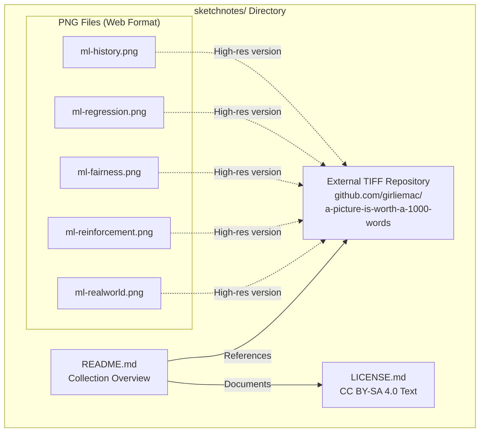
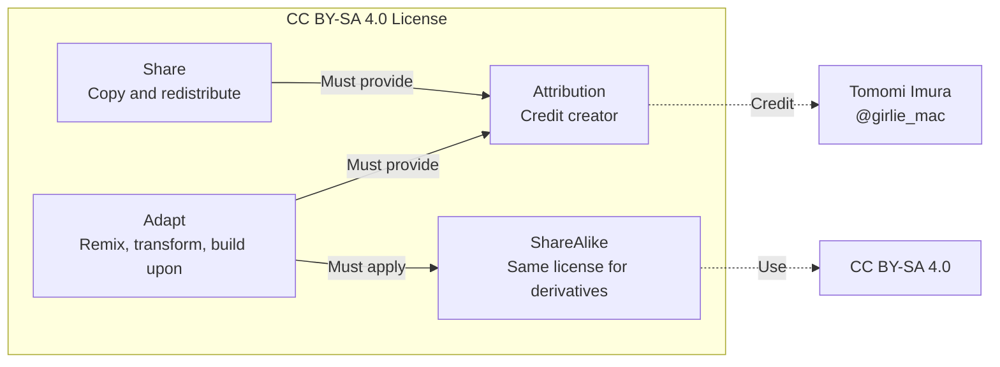
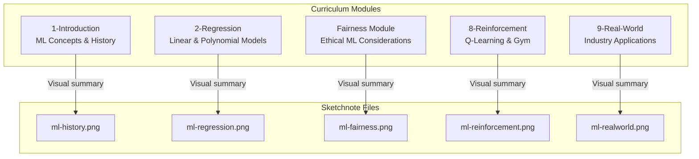
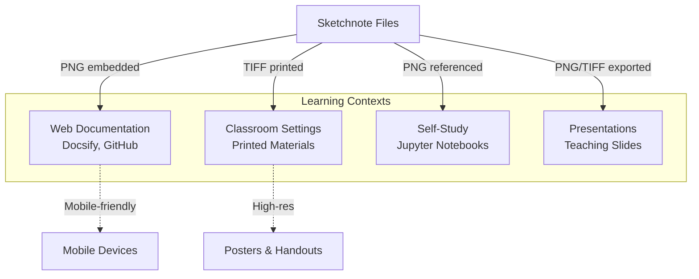
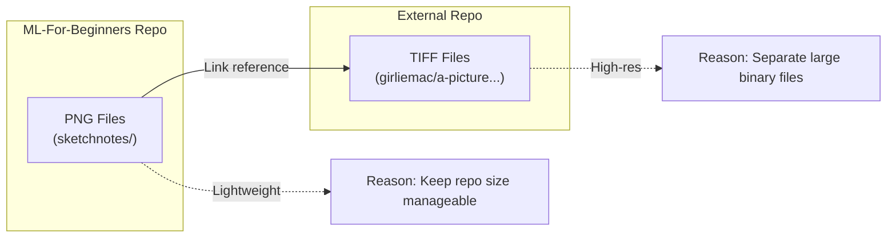

<!-- source: DeepWiki mcp.deepwiki.com · repo microsoft/ML-For-Beginners · page 8.1 Visual Learning Aids (Sketchnotes) · fetched 2026-10-26 -->

# Visual Learning Aids (Sketchnotes)

<details>
<summary>Relevant source files</summary>

The following files were used as context for generating this wiki page:

- [sketchnotes/LICENSE.md](sketchnotes/LICENSE.md)
- [sketchnotes/README.md](sketchnotes/README.md)
- [sketchnotes/ml-fairness.png](sketchnotes/ml-fairness.png)
- [sketchnotes/ml-history.png](sketchnotes/ml-history.png)
- [sketchnotes/ml-realworld.png](sketchnotes/ml-realworld.png)
- [sketchnotes/ml-regression.png](sketchnotes/ml-regression.png)
- [sketchnotes/ml-reinforcement.png](sketchnotes/ml-reinforcement.png)
- [sketchnotes/ml-timeseries.png](sketchnotes/ml-timeseries.png)

</details>


This document describes the sketchnotes collection that provides visual learning aids for the ML-For-Beginners curriculum. Sketchnotes are hand-drawn visual summaries that distill complex machine learning concepts into accessible diagrams, combining text, illustrations, and visual hierarchies to enhance comprehension and retention.

For information about the main curriculum structure, see [Curriculum Structure](#1.1). For automated translation infrastructure, see [Co-op Translator GitHub Actions Workflow](#7.2).

---

## Overview and Purpose

The sketchnotes collection serves as supplementary visual material accompanying written lessons throughout the curriculum. Each sketchnote condenses a major ML topic into a single-page visual summary, making abstract concepts more tangible through visual metaphors, diagrams, and structured layouts.

**Key Characteristics:**
- **Single-page summaries** - each sketchnote covers one major topic
- **Hand-drawn aesthetic** - maintains approachable, human-centered design
- **Dual-format availability** - PNG for web viewing, TIFF for high-resolution printing
- **Open licensing** - CC BY-SA 4.0 allows reuse and adaptation
- **Curriculum-aligned** - topics directly correspond to major learning modules

Sources: [sketchnotes/README.md:1-8]()

---

## File Structure and Organization



**Directory Layout:**

| File | Purpose | Format |
|------|---------|--------|
| `README.md` | Collection overview, creator attribution, TIFF repository link | Markdown |
| `LICENSE.md` | Full CC BY-SA 4.0 license text | Markdown |
| `ml-history.png` | Visual summary of ML history and evolution | PNG image |
| `ml-regression.png` | Regression concepts and techniques | PNG image |
| `ml-fairness.png` | Ethical considerations and bias in ML | PNG image |
| `ml-reinforcement.png` | Reinforcement learning principles | PNG image |
| `ml-realworld.png` | Real-world ML applications across industries | PNG image |

Sources: [sketchnotes/README.md:1-8]()

---

## Format Availability and Usage

### Web Format (PNG)

PNG files are stored directly in the repository at [sketchnotes/*.png]() for:
- **Embedded display** in lesson README files
- **Quick preview** in GitHub repository browser
- **Web-optimized loading** in documentation sites
- **Mobile-friendly viewing** across devices

**Technical Specifications:**
- Resolution: 1920×875 pixels (approximately)
- Color depth: 24-bit RGB
- File size: ~200-800 KB per image (varies by complexity)

### Print Format (TIFF)

High-resolution TIFF versions are hosted in a separate repository for printing purposes:

```
Repository: github.com/girliemac/a-picture-is-worth-a-1000-words/tree/main/ml/tiff
Purpose: Professional printing, poster creation, classroom materials
```

**TIFF Advantages:**
- **Lossless compression** - no quality degradation
- **High DPI** - suitable for large-format printing
- **Professional output** - optimal for educational materials

Sources: [sketchnotes/README.md:1-8]()

---

## Licensing Model



**License: Creative Commons Attribution-ShareAlike 4.0 International (CC BY-SA 4.0)**

**Permissions Granted:**
- ✅ **Commercial use** - may be used in commercial settings
- ✅ **Modification** - may be remixed and adapted
- ✅ **Distribution** - may be shared with others
- ✅ **Private use** - may be used personally

**Obligations:**
- **Attribution required** - must credit Tomomi Imura (@girlie_mac on Twitter)
- **ShareAlike required** - derivatives must use the same CC BY-SA 4.0 license
- **License notice** - must include license information and link

**Attribution Example:**
```
Sketchnote by Tomomi Imura (@girlie_mac)
Licensed under CC BY-SA 4.0
https://creativecommons.org/licenses/by-sa/4.0/
```

Sources: [sketchnotes/README.md:7](), [sketchnotes/LICENSE.md:1-251]()

---

## Topics Covered

### Curriculum Module Mapping



**Detailed Coverage:**

| Sketchnote | Curriculum Module | Key Concepts Visualized |
|------------|-------------------|-------------------------|
| `ml-history.png` | Introduction (Week 1) | Evolution of ML, key milestones, historical context, foundational algorithms |
| `ml-regression.png` | Regression (Weeks 3-4) | Linear regression mechanics, polynomial features, cost functions, model evaluation |
| `ml-fairness.png` | Fairness (Week 2) | Bias types, fairness metrics, RAI principles, ethical considerations |
| `ml-reinforcement.png` | Reinforcement Learning (Week 11) | Agent-environment interaction, Q-learning, reward systems, policy optimization |
| `ml-realworld.png` | Real-World Applications (Week 12) | Industry use cases across finance, healthcare, retail, education, ecology |

Sources: [sketchnotes/README.md:1-8]()

---

## Creator Attribution

**Artist:** Tomomi Imura
- **GitHub:** [@girliemac](https://github.com/girliemac)
- **Twitter:** [@girlie_mac](https://twitter.com/girlie_mac)
- **Portfolio:** [a-picture-is-worth-a-1000-words repository](https://github.com/girliemac/a-picture-is-worth-a-1000-words)

Tomomi Imura created all sketchnotes as visual learning aids for the ML-For-Beginners curriculum. Her hand-drawn style combines technical accuracy with accessible visual metaphors, making complex ML concepts approachable for beginners.

Sources: [sketchnotes/README.md:5]()

---

## Integration with Curriculum

### Embedding in Lessons

Sketchnotes are referenced in lesson README files using relative image paths:

```markdown

```

**Typical Placement:**
- **Lesson introduction** - overview sketchnote at the top of README
- **Section headers** - relevant portions highlighted in context
- **Summary sections** - full sketchnote as visual recap

### Usage in Different Learning Contexts



**Recommended Uses:**
1. **Pre-lesson preview** - scan sketchnote before diving into detailed content
2. **Post-lesson review** - use as quick reference to recall key concepts
3. **Study aid** - annotate printed copies with personal notes
4. **Teaching resource** - project in classroom or include in slide decks
5. **Quick reference** - bookmark for rapid concept lookup

Sources: [sketchnotes/README.md:1-8]()

---

## Accessibility Considerations

### Format-Specific Accessibility

**PNG Web Format:**
- ⚠️ **Limited screen reader support** - primarily visual content
- ⚠️ **Text extraction challenges** - hand-drawn text not machine-readable
- ✅ **Zoom-friendly** - can be enlarged for better visibility
- ✅ **High contrast** - hand-drawn lines provide clear visual separation

**Accessibility Recommendations:**
1. **Supplementary content** - sketchnotes complement but do not replace text lessons
2. **Alternative formats** - full text explanations available in README files
3. **Descriptive context** - lessons provide verbal descriptions of visualized concepts
4. **Learning diversity** - multiple modalities (text, code, video, visual) support different learning styles

### Print Accessibility

TIFF format enables:
- **Large-format printing** for vision-impaired students
- **Annotatable copies** for note-taking
- **Tactile overlays** (potential for braille or raised-line adaptations)

Sources: [sketchnotes/README.md:1-8]()

---

## Technical Implementation Details

### File Size and Performance

| File | Size | Dimensions | Compression |
|------|------|------------|-------------|
| `ml-history.png` | ~410 KB | 1920×875px | PNG-8/24 |
| `ml-regression.png` | ~660 KB | 1920×875px | PNG-8/24 |
| `ml-fairness.png` | ~700 KB | 1920×875px | PNG-8/24 |
| `ml-reinforcement.png` | ~820 KB | 1920×875px | PNG-8/24 |
| `ml-realworld.png` | ~750 KB | 1920×875px | PNG-8/24 |

**Performance Characteristics:**
- **Fast loading** on modern connections (< 1 second per image at 5 Mbps)
- **Git-friendly** - binary format but small enough for version control
- **Cache-efficient** - static files benefit from browser caching

### Repository Storage Strategy



**Storage Rationale:**
- **PNG in main repo** - essential for web documentation, reasonable file sizes
- **TIFF in separate repo** - large files (10-30 MB each), specialized use case
- **Link-based access** - README provides pointer to TIFF repository
- **Version control efficiency** - avoids bloating main repository with large binaries

Sources: [sketchnotes/README.md:3]()

---

## Usage Examples

### For Educators

**Printing for Classroom:**
1. Navigate to TIFF repository: `github.com/girliemac/a-picture-is-worth-a-1000-words/tree/main/ml/tiff`
2. Download desired sketchnote in TIFF format
3. Print at 300+ DPI for poster-size (24"×36" or larger)
4. Display as reference material during lessons

**Embedding in Slides:**
```markdown
Include PNG version in presentation software:
- PowerPoint: Insert → Pictures → ml-regression.png
- Google Slides: Insert → Image → Upload from computer
- Keynote: Insert → Choose → ml-reinforcement.png
```

### For Learners

**Study Workflow:**
1. **Preview** - open sketchnote before reading lesson
2. **Annotate** - print and add personal notes/highlights
3. **Review** - use as quick reference during coding exercises
4. **Synthesize** - compare sketchnote concepts with hands-on notebook results

### For Content Creators

**Attribution Template:**
```markdown
## Visual Summary


*Sketchnote by [Tomomi Imura](https://twitter.com/girlie_mac), 
licensed under [CC BY-SA 4.0](https://creativecommons.org/licenses/by-sa/4.0/)*
```

Sources: [sketchnotes/README.md:1-8]()

---

## Maintenance and Updates

### Current Status

The sketchnotes collection is **complete and stable** as of the current curriculum version. No regular updates are planned, as the visualized concepts remain foundational and timeless.

### Future Considerations

**Potential Additions:**
- Classification module sketchnote (currently not present)
- Clustering module sketchnote (currently not present)
- NLP module sketchnote (currently not present)
- Time Series module sketchnote (currently not present)

**Update Process:**
1. Artist creates new sketchnote
2. PNG version added to [sketchnotes/]() directory
3. TIFF version added to external repository
4. README updated with new topic entry
5. Relevant lesson README files updated with embedded reference

Sources: [sketchnotes/README.md:1-8]()

---

## Related Resources

### Internal Links
- For overall curriculum organization: [Curriculum Structure](#1.1)
- For quiz system visual design: [Quiz Application Architecture](#6.3)
- For documentation rendering: [Docsify Documentation](#6.4.1)
- For supplementary educator resources: [Repository Configuration and Standards](#8.3)

### External Links
- **TIFF Repository:** [github.com/girliemac/a-picture-is-worth-a-1000-words/tree/main/ml/tiff](https://github.com/girliemac/a-picture-is-worth-a-1000-words/tree/main/ml/tiff)
- **CC BY-SA 4.0 License:** [creativecommons.org/licenses/by-sa/4.0/](https://creativecommons.org/licenses/by-sa/4.0/)
- **Creator Portfolio:** [github.com/girliemac](https://github.com/girliemac)

Sources: [sketchnotes/README.md:1-8]()

---

