# Page: Overview

# Overview

<details>
<summary>Relevant source files</summary>

The following files were used as context for generating this wiki page:

- [1-Introduction/1-intro-to-ML/README.md](1-Introduction/1-intro-to-ML/README.md)
- [1-Introduction/2-history-of-ML/README.md](1-Introduction/2-history-of-ML/README.md)
- [1-Introduction/README.md](1-Introduction/README.md)
- [1-Introduction/images/globe.jpg](1-Introduction/images/globe.jpg)
- [2-Regression/README.md](2-Regression/README.md)
- [5-Clustering/README.md](5-Clustering/README.md)
- [README.md](README.md)
- [TROUBLESHOOTING.md](TROUBLESHOOTING.md)
- [images/3.png](images/3.png)
- [quiz-app/src/assets/translations/en.json](quiz-app/src/assets/translations/en.json)

</details>


This document provides an overview of the ML-For-Beginners curriculum, a comprehensive 12-week, 26-lesson course focused on classical machine learning techniques using scikit-learn. The curriculum is designed as a project-based learning experience with hands-on exercises, quizzes, and assignments that teach fundamental ML concepts without diving into deep learning or neural networks.

For detailed information about specific aspects of the curriculum:
- Curriculum organization and learning modules: see [Curriculum Structure](#1.1)
- Pedagogical methodology and lesson structure: see [Learning Approach](#1.2)  
- Software requirements and setup: see [Technical Requirements](#1.3)
- Community resources and help channels: see [Community and Support Resources](#1.4)

## Purpose and Scope

The ML-For-Beginners curriculum serves as an educational resource for learning classical machine learning fundamentals. The course explicitly focuses on traditional ML algorithms and techniques, deliberately excluding deep learning, neural networks, and general AI topics to provide a focused learning path for beginners.

**Primary Learning Objectives:**
- Core ML concepts and terminology (features, labels, training data, model evaluation)
- Supervised learning: regression and classification techniques
- Unsupervised learning: clustering methods
- Specialized applications: natural language processing, time series forecasting, reinforcement learning
- Practical implementation using scikit-learn and related Python libraries
- Ethical considerations including fairness and responsible AI principles

**Excluded Topics:**
- Deep learning architectures
- Neural networks (covered in separate AI for Beginners curriculum)
- Advanced AI techniques

The curriculum includes 26 lessons organized into 8 major learning modules, delivered over 12 weeks with approximately 2-3 lessons per week.

Sources: [README.md:27-94](), [1-Introduction/1-intro-to-ML/README.md:70-94]()

## Repository Structure and Learning Modules

```mermaid
graph TB
    subgraph Repository["ML-For-Beginners Repository Structure"]
        README["README.md<br/>Main curriculum index<br/>26 lessons table"]
        
        subgraph Intro["1-Introduction/"]
            Intro1["1-intro-to-ML/README.md<br/>ML concepts, terminology"]
            Intro2["2-history-of-ML/README.md<br/>Historical context"]
            Intro3["3-fairness/README.md<br/>Ethics and fairness"]
            Intro4["4-techniques-of-ML/README.md<br/>ML workflow"]
        end
        
        subgraph Regression["2-Regression/"]
            Reg1["1-Tools/README.md<br/>Python/scikit-learn setup"]
            Reg2["2-Data/README.md<br/>Data preparation"]
            Reg3["3-Linear/README.md<br/>LinearRegression"]
            Reg4["4-Logistic/README.md<br/>LogisticRegression"]
            RegData["data/US-pumpkins.csv<br/>1757 rows"]
        end
        
        subgraph WebApp["3-Web-App/"]
            WebApp1["1-Web-App/README.md<br/>Flask deployment"]
        end
        
        subgraph Classification["4-Classification/"]
            Class1["1-Introduction/README.md<br/>Classification intro"]
            Class2["2-Classifiers-1/README.md<br/>SVC, KNN"]
            Class3["3-Classifiers-2/README.md<br/>RandomForest, AdaBoost"]
            Class4["4-Applied/README.md<br/>ONNX deployment"]
            ClassData["data/cuisines.csv<br/>2448 entries"]
        end
        
        subgraph Clustering["5-Clustering/"]
            Clust1["1-Visualize/README.md<br/>Clustering intro"]
            Clust2["2-K-Means/README.md<br/>KMeans algorithm"]
            ClustData["data/nigerian-songs.csv<br/>Music metadata"]
        end
        
        subgraph NLP["6-NLP/"]
            NLP1["1-Introduction-to-NLP/README.md<br/>NLP basics"]
            NLP2["2-Tasks/README.md<br/>Common tasks"]
            NLP3["3-Translation-Sentiment/README.md<br/>TextBlob"]
            NLP4["4-Hotel-Reviews-1/README.md<br/>VADER sentiment"]
            NLP5["5-Hotel-Reviews-2/README.md<br/>515K reviews"]
            NLPData["data/Hotel_Reviews.csv<br/>515,738 reviews"]
        end
        
        subgraph TimeSeries["7-TimeSeries/"]
            TS1["1-Introduction/README.md<br/>TS concepts"]
            TS2["2-ARIMA/README.md<br/>SARIMAX models"]
            TS3["3-SVR/README.md<br/>SVR forecasting"]
            TSData["data/energy.csv<br/>Power usage data"]
        end
        
        subgraph Reinforcement["8-Reinforcement/"]
            RL1["1-QLearning/README.md<br/>Q-Learning basics"]
            RL2["2-Gym/README.md<br/>OpenAI Gym"]
        end
        
        subgraph RealWorld["9-Real-World/"]
            RW1["1-Applications/README.md<br/>Industry applications"]
            RW2["2-Debugging-ML-Models/README.md<br/>RAI dashboard"]
        end
    end
    
    README --> Intro
    README --> Regression
    README --> WebApp
    README --> Classification
    README --> Clustering
    README --> NLP
    README --> TimeSeries
    README --> Reinforcement
    README --> RealWorld
    
    Reg1 --> Reg2
    Reg2 --> Reg3
    Reg3 --> Reg4
    RegData --> Reg2
    
    Reg4 --> WebApp1
    WebApp1 --> Class1
    
    Class1 --> Class2
    Class2 --> Class3
    Class3 --> Class4
    ClassData --> Class1
    
    Class4 --> Clust1
    Clust1 --> Clust2
    ClustData --> Clust1
    
    Clust2 --> NLP1
    NLP1 --> NLP2
    NLP2 --> NLP3
    NLP3 --> NLP4
    NLP4 --> NLP5
    NLPData --> NLP4
    
    NLP5 --> TS1
    TS1 --> TS2
    TS2 --> TS3
    TSData --> TS2
    
    TS3 --> RL1
    RL1 --> RL2
    
    RL2 --> RW1
    RW1 --> RW2
```

**Curriculum Structure Overview**

The curriculum progresses through 9 major directory-organized modules, with each module containing multiple lessons. The table at [README.md:114-142]() provides the complete lesson index with learning objectives.

| Module | Directory | Lessons | Focus Area |
|--------|-----------|---------|------------|
| Introduction | `1-Introduction/` | 4 | ML concepts, history, fairness, techniques |
| Regression | `2-Regression/` | 4 | Linear, polynomial, logistic regression with pumpkin pricing data |
| Web App | `3-Web-App/` | 1 | Flask deployment with ONNX Runtime |
| Classification | `4-Classification/` | 4 | Multiple classifiers, cuisine dataset, ONNX conversion |
| Clustering | `5-Clustering/` | 2 | K-Means clustering with Nigerian music data |
| NLP | `6-NLP/` | 5 | Text processing, sentiment analysis with hotel reviews |
| Time Series | `7-TimeSeries/` | 3 | ARIMA/SARIMA forecasting with energy data |
| Reinforcement | `8-Reinforcement/` | 2 | Q-Learning, OpenAI Gym environments |
| Real-World | `9-Real-World/` | 2 | Industry applications, model debugging |

Sources: [README.md:114-142](), [1-Introduction/README.md:8-14](), [2-Regression/README.md:1-32](), [5-Clustering/README.md:1-21]()

## Dual-Language Implementation

The curriculum provides parallel implementations in Python (primary) and R (alternative) for statistical ML modules. This architecture allows learners to choose their preferred language ecosystem while learning identical concepts.

**Python Implementation:**
- Primary language for all 26 lessons
- Uses scikit-learn as core ML framework
- Notebooks located in lesson directories with `.ipynb` extension
- Examples: [2-Regression/1-Tools/README.md](), [4-Classification/2-Classifiers-1/README.md]()

**R Implementation:**
- Available for regression, classification, and clustering modules
- Uses tidymodels framework (parsnip, recipes, workflows, yardstick)
- Located in `solution/R/` subdirectories with `.rmd` extension
- Examples: [2-Regression/1-Tools/solution/R/lesson_1.html](), [4-Classification/1-Introduction/solution/R/lesson_10.html]()

The note at [README.md:110-111]() explains that R lessons use R Markdown format combining code chunks, YAML headers, and Markdown documentation, which can be rendered to PDF, HTML, or Word formats.

Sources: [README.md:110-111](), [README.md:120-130]()

## Project-Based Learning Methodology

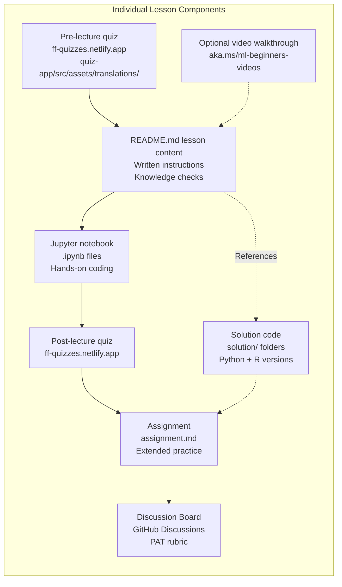

**Lesson Structure:**

Each lesson follows a standardized structure documented at [README.md:96-108]():

1. **Pre-lecture quiz**: Hosted at `ff-quizzes.netlify.app`, sets learning intention
2. **Written lesson**: `README.md` file with concepts and knowledge checks
3. **Video walkthrough**: Optional supplemental video (some lessons)
4. **Jupyter notebook**: Hands-on coding exercises in `.ipynb` format
5. **Post-lecture quiz**: Reinforces retention through assessment
6. **Challenge**: Practice problem within the lesson
7. **Assignment**: Extended project documented in `assignment.md`
8. **Discussion**: PAT (Progress Assessment Tool) rubric submission via GitHub Discussions

**Quiz Application Details:**

The quiz system is a standalone Vue.js application with 52 quizzes containing 156 total questions. Quiz content is defined in JSON format at [quiz-app/src/assets/translations/en.json:1-6]() with structure:
- Quiz objects with `id` and `title`
- Question arrays with `questionText` and `answerOptions`
- Boolean `isCorrect` flags for each answer option

Sources: [README.md:96-108](), [README.md:112](), [quiz-app/src/assets/translations/en.json:1-58]()

## Technology Stack and Dependencies

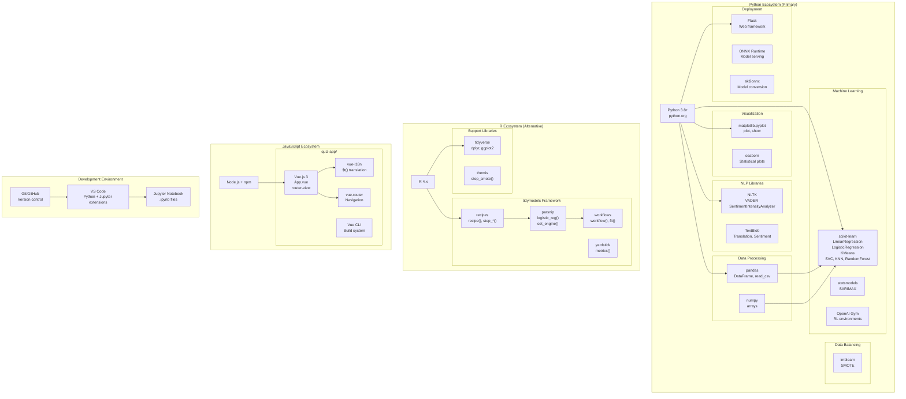

**Core Python Dependencies:**

The primary Python stack relies on these key libraries (as referenced throughout lesson code):

- `scikit-learn`: Core ML framework providing `LinearRegression`, `LogisticRegression`, `KMeans`, `SVC`, `KNeighborsClassifier`, `RandomForestClassifier`, `train_test_split`, preprocessing utilities
- `pandas`: Data manipulation with `DataFrame`, `read_csv()`, data cleaning methods
- `numpy`: Numerical computing for arrays and mathematical operations
- `matplotlib.pyplot`: Visualization with `plot()`, `scatter()`, `show()` methods
- `seaborn`: Statistical data visualization
- `imblearn`: SMOTE oversampling for imbalanced data (`SMOTE` class)
- `statsmodels`: Time series with `SARIMAX` implementation
- `OpenAI Gym`: Reinforcement learning environments
- `NLTK`: Natural language toolkit with `VADER` sentiment analyzer
- `TextBlob`: Text processing, translation, sentiment analysis
- `Flask`: Web application framework for model deployment
- `onnxruntime`: High-performance model inference
- `skl2onnx`: Converting scikit-learn models to ONNX format

**R Dependencies (tidymodels):**

The R implementation uses tidymodels components:
- `recipes`: Preprocessing pipelines with `recipe()`, `step_mutate()`, `step_dummy()`, `step_smote()`
- `parsnip`: Model specification with `logistic_reg()`, `multinom_reg()`, `set_engine()`, `set_mode()`
- `workflows`: Combining preprocessing and models with `workflow()`, `fit()`
- `yardstick`: Performance metrics evaluation
- `tidyverse`: Data manipulation (dplyr, ggplot2, tidyr, readr)
- `themis`: SMOTE implementation for R

Sources: [README.md:22-26](), [1-Introduction/1-intro-to-ML/README.md:20-26]()

## Support Infrastructure

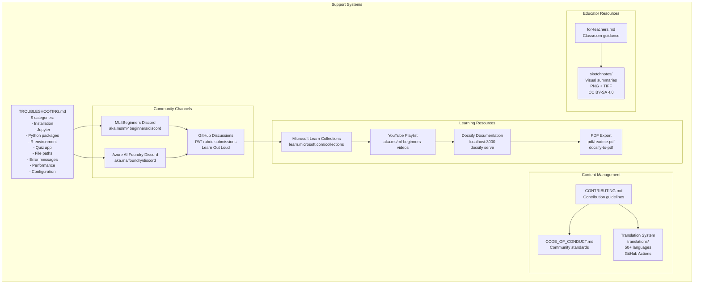

**Community Support Resources:**

The curriculum provides multiple support channels documented at [README.md:51](), [README.md:176-184]():

1. **TROUBLESHOOTING.md**: Self-service guide covering 9 categories of common issues (installation, Jupyter, packages, R environment, quiz app, file paths, errors, performance, configuration)
2. **Discord Servers**: 
   - ML4Beginners Discord (`aka.ms/ml4beginners/discord`)
   - Azure AI Foundry Discord (`aka.ms/foundry/discord`)
3. **GitHub Discussions**: Community Q&A and PAT rubric submissions for reflective learning
4. **Microsoft Learn Collections**: Supplementary learning modules and paths
5. **YouTube Playlist**: Video walkthroughs at `aka.ms/ml-beginners-videos`

**Documentation Formats:**

- **Online**: Docsify-based documentation at `localhost:3000` (installed via `docsify serve` command)
- **Offline**: PDF export at `pdf/readme.pdf` generated using docsify-to-pdf tool
- **Source**: Markdown files in repository structure

**Translation Infrastructure:**

The repository supports 50+ languages through automated translation:
- Translation files in `translations/` directory (ar, bn, bg, my, zh, hk, mo, tw, hr, cs, da, nl, et, fi, fr, de, el, he, hi, hu, id, it, ja, ko, lt, ms, mr, ne, no, fa, pl, br, pt, pa, ro, ru, sr, sk, sl, es, sw, sv, tl, ta, th, tr, uk, ur, vi)
- Automated via GitHub Actions using co-op-translator package
- Language table maintained at [README.md:15-17]()

**Educator Resources:**

- `for-teachers.md`: Guidance for using curriculum in classroom settings
- `sketchnotes/`: Visual summaries in PNG and TIFF formats with CC BY-SA 4.0 license for printing

Sources: [README.md:51](), [README.md:66](), [README.md:146-152](), [README.md:11-17](), [README.md:176-184](), [TROUBLESHOOTING.md:1-16]()

## Getting Started Workflow

**Repository Access:**

1. **Fork repository**: Click "Fork" button at `github.com/microsoft/ML-For-Beginners`
2. **Clone locally**: `git clone https://github.com/microsoft/ML-For-Beginners.git`
3. **Navigate to lessons**: Each lesson has its own directory with README and notebooks

**Setup Requirements:**

- Python 3.8+ installation
- VS Code with Python and Jupyter extensions
- Git for version control
- Node.js and npm (for quiz application development)
- GitHub account for forking and discussions

For detailed setup instructions and troubleshooting, see [Technical Requirements](#1.3) and [TROUBLESHOOTING.md]().

**Recommended Learning Path:**

The curriculum is designed to be followed sequentially as outlined in [README.md:114-142]():

1. Start with Introduction module (lessons 1-4) for foundational concepts
2. Progress through Regression (lessons 5-8) to learn supervised learning basics
3. Build a web app (lesson 9) to practice deployment
4. Continue through Classification (lessons 10-13), Clustering (lessons 14-15)
5. Explore NLP (lessons 16-20), Time Series (lessons 21-23), and Reinforcement Learning (lessons 24-25)
6. Conclude with Real-World Applications (lessons 26-27)

Each lesson follows the structure: pre-quiz → lesson content → notebook exercise → post-quiz → assignment → discussion.

Sources: [README.md:45-62](), [README.md:54-62]()

## Related Microsoft Curricula

The ML-For-Beginners curriculum is part of a larger family of Microsoft educational resources. Related courses mentioned at [README.md:155-174]():

- **AI for Beginners** (`aka.ms/ai-beginners`): Covers deep learning and neural networks not included in this curriculum
- **Data Science for Beginners** (`aka.ms/datascience-beginners`): Complementary data science fundamentals
- **Generative AI for Beginners** (`aka.ms/genai-beginners`): Generative AI and large language models
- **Edge AI for Beginners** (`aka.ms/edgeai-for-beginners`): Edge computing and ML
- Additional courses: Web Dev, IoT, Cybersecurity, XR Development

These curricula follow similar project-based pedagogical approaches with quizzes, lessons, and assignments.

Sources: [README.md:31](), [README.md:155-174]()

---

# Page: Curriculum Structure

# Curriculum Structure

<details>
<summary>Relevant source files</summary>

The following files were used as context for generating this wiki page:

- [1-Introduction/1-intro-to-ML/README.md](1-Introduction/1-intro-to-ML/README.md)
- [1-Introduction/2-history-of-ML/README.md](1-Introduction/2-history-of-ML/README.md)
- [1-Introduction/README.md](1-Introduction/README.md)
- [1-Introduction/images/globe.jpg](1-Introduction/images/globe.jpg)
- [2-Regression/README.md](2-Regression/README.md)
- [5-Clustering/README.md](5-Clustering/README.md)
- [README.md](README.md)
- [TROUBLESHOOTING.md](TROUBLESHOOTING.md)
- [images/3.png](images/3.png)
- [quiz-app/src/assets/translations/en.json](quiz-app/src/assets/translations/en.json)

</details>


This document details the organizational structure of the ML-For-Beginners repository, explaining how the curriculum is organized across various machine learning topics and the progression of lessons. For information about the pedagogical approach and learning methodology used in this curriculum, see [Learning Approach](#1.2).

The ML-For-Beginners curriculum is a 12-week, 26-lesson course covering classical machine learning concepts using primarily Scikit-learn, focusing on foundational machine learning rather than deep learning.

Sources: [README.md:13-21]()

## Overall Curriculum Structure

The curriculum is divided into 9 main sections, with each section containing multiple lessons that introduce and build upon specific machine learning concepts.

```mermaid
flowchart TD
    A["ML-For-Beginners Curriculum"] --> B["1. Introduction"]
    A --> C["2. Regression"]
    A --> D["3. Web App"]
    A --> E["4. Classification"]
    A --> F["5. Clustering"]
    A --> G["6. Natural Language Processing"]
    A --> H["7. Time Series"]
    A --> I["8. Reinforcement Learning"]
    A --> J["9. Real-World Applications"]
    
    B --> B1["1.1 Intro to ML"]
    B --> B2["1.2 History of ML"]
    B --> B3["1.3 Fairness in ML"]
    B --> B4["1.4 Techniques of ML"]
    
    C --> C1["2.1 Tools"]
    C --> C2["2.2 Data Preparation"]
    C --> C3["2.3 Linear Regression"]
    C --> C4["2.4 Logistic Regression"]
    
    D --> D1["3.1 Web App with ML Model"]
    
    E --> E1["4.1 Intro to Classification"]
    E --> E2["4.2 Classifiers-1"]
    E --> E3["4.3 Classifiers-2"]
    E --> E4["4.4 Applied Classification"]
    
    F --> F1["5.1 Data Visualization"]
    F --> F2["5.2 K-Means Clustering"]
    
    G --> G1["6.1 Intro to NLP"]
    G --> G2["6.2 Common NLP Tasks"]
    G --> G3["6.3 Translation & Sentiment"]
    G --> G4["6.4 Hotel Reviews 1"]
    G --> G5["6.5 Hotel Reviews 2"]
    
    H --> H1["7.1 Intro to Time Series"]
    H --> H2["7.2 ARIMA Forecasting"]
    H --> H3["7.3 SVR Forecasting"]
    
    I --> I1["8.1 Q-Learning"]
    I --> I2["8.2 Gym Environments"]
    
    J --> J1["9.1 Real-World ML Applications"]
    J --> J2["9.2 Debugging ML Models"]
```

Sources: [README.md:98-126]()

## Repository Organization

The repository is structured to directly map to the curriculum sections, with each section having its own directory containing lesson materials.

```mermaid
graph TD
    A["Repository Root"] --> B["1-Introduction/"]
    A --> C["2-Regression/"]
    A --> D["3-Web-App/"]
    A --> E["4-Classification/"]
    A --> F["5-Clustering/"]
    A --> G["6-NLP/"]
    A --> H["7-TimeSeries/"]
    A --> I["8-Reinforcement/"]
    A --> J["9-Real-World/"]
    A --> K["quiz-app/"]
    A --> L["sketchnotes/"]
    
    B --> B1["1-intro-to-ML/README.md"]
    B --> B2["2-history-of-ML/README.md"]
    B --> B3["3-fairness/README.md"]
    B --> B4["4-techniques-of-ML/README.md"]
    
    C --> C1["1-Tools/README.md"]
    C --> C2["2-Data/README.md"]
    C --> C3["3-Linear/README.md"]
    C --> C4["4-Logistic/README.md"]
    
    K --> K1["src/assets/translations/en.json"]
    K --> K2["src/assets/translations/fr.json"]
    K --> K3["src/assets/translations/zh-cn.json"]
```

Sources: [README.md:30-34](), [1-Introduction/README.md:8-13]()

## Standard Lesson Components

Each lesson in the curriculum follows a standardized structure to provide a consistent learning experience. 

### Lesson Directory Structure

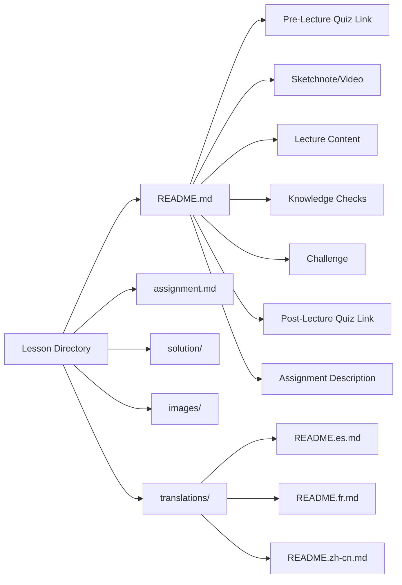

Sources: [README.md:40-46](), [1-Introduction/1-intro-to-ML/README.md:1-11]()

### Component Details

Each lesson includes the following standardized components:

| Component | Description | Implementation |
|-----------|-------------|----------------|
| Pre-Lecture Quiz | 3-question quiz to establish baseline knowledge | Link to quiz-app endpoint |
| Sketchnote | Visual summary of lesson concepts | Optional image in sketchnotes/ folder |
| Video Walkthrough | Video explanation of lesson content | Optional YouTube link |
| Lecture Content | Main educational material with explanations and examples | Markdown content in README.md |
| Knowledge Checks | Inline questions to reinforce understanding | Embedded in README.md |
| Challenge | Practical coding exercise to apply concepts | Section in README.md |
| Post-Lecture Quiz | 3-question quiz to assess learning | Link to quiz-app endpoint |
| Assignment | Extended project or exercise | Detailed in assignment.md |

As specified in the main README.md file:

> Each lesson includes:
> - optional sketchnote
> - optional supplemental video
> - video walkthrough (some lessons only)
> - pre-lecture warmup quiz
> - written lesson
> - for project-based lessons, step-by-step guides on how to build the project
> - knowledge checks
> - a challenge
> - supplemental reading
> - assignment
> - post-lecture quiz

Sources: [README.md:80-92](), [1-Introduction/4-techniques-of-ML/README.md:10-23]()

## Learning Path Progression

The curriculum follows a carefully designed progression that builds knowledge systematically, starting with fundamentals and advancing to more complex topics.

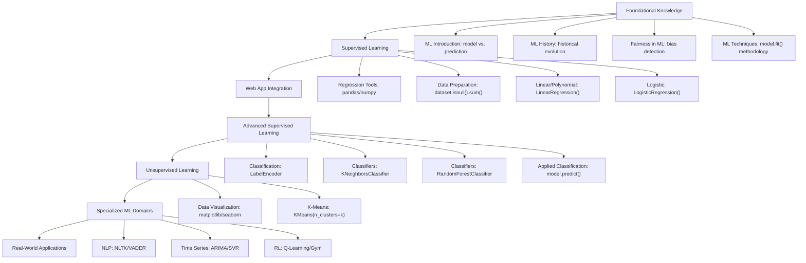

Sources: [README.md:72-77](), [1-Introduction/4-techniques-of-ML/README.md:14-25]()

### Thematic Integration

The curriculum uses a global theme, exploring different cultures and regions through the datasets and examples:

- **Regression**: North American pumpkin prices (lessons 2.2-2.4)
- **Classification**: Asian and Indian cuisines (lessons 4.2-4.4)
- **Clustering**: Nigerian musical tastes (lesson 5.2)
- **Natural Language Processing**: European hotel reviews (lessons 6.4-6.5)
- **Time Series**: World power usage (lessons 7.2-7.3)
- **Reinforcement Learning**: Classic fable scenarios - Peter and the wolf (lesson 8.2)

Sources: [README.md:15-19](), [README.md:98-126]()

## Assessment System

The curriculum incorporates a comprehensive quiz system to assess student learning before and after each lesson.

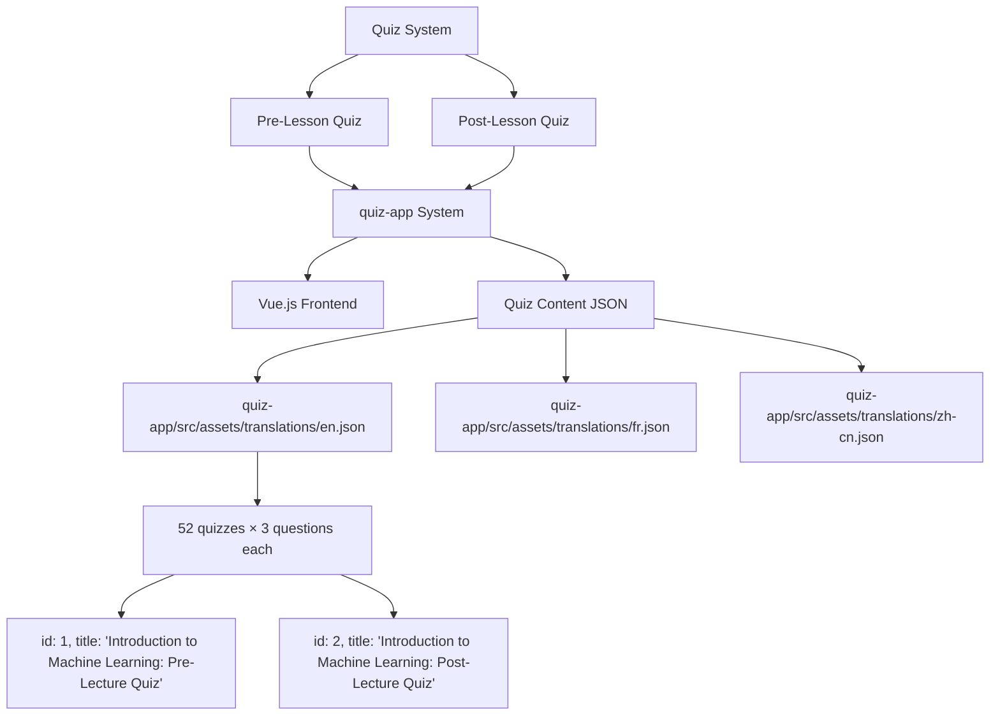

Sources: [README.md:95-96](), [quiz-app/src/assets/translations/en.json:1-57]()

### Quiz Implementation

The quiz content is stored in JSON files with consistent structure for each quiz:

```json
{
  "id": 1,
  "title": "Introduction to Machine Learning: Pre-Lecture Quiz",
  "quiz": [
    {
      "questionText": "Applications of machine learning are all around us",
      "answerOptions": [
        {
          "answerText": "True",
          "isCorrect": "true"
        },
        {
          "answerText": "False",
          "isCorrect": "false"
        }
      ]
    }
  ]
}
```

Each lesson has both a pre-lecture quiz (to set learning intentions) and a post-lecture quiz (to evaluate understanding). The quiz system contains 52 total quizzes with 3 questions per quiz.

Sources: [quiz-app/src/assets/translations/en.json:8-57](), [README.md:95-96]()

## Technical Implementation

### Machine Learning Technologies

The curriculum utilizes various machine learning libraries and frameworks for implementing the concepts covered in the lessons:

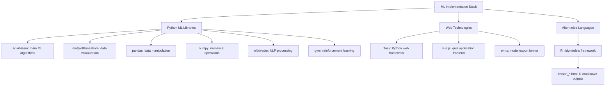

Sources: [README.md:94](), [1-Introduction/4-techniques-of-ML/README.md:70-100]()

### Machine Learning Models Map

The curriculum covers a range of classical machine learning models and techniques, showing their relationships and implementation:

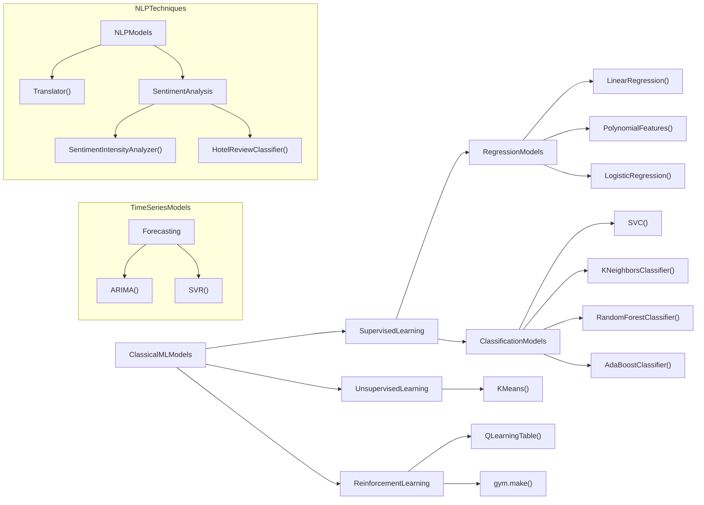

Sources: [README.md:98-126](), [1-Introduction/4-techniques-of-ML/README.md:70-100]()

## Multilingual Support

The curriculum supports multiple languages to make ML education accessible globally:

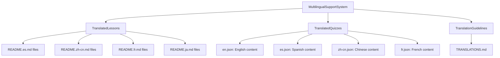

Sources: [README.md:127-140](), [quiz-app/src/assets/translations/en.json:1-10]()

## Educational Progression

The curriculum follows a project-based approach with each section building upon previous knowledge:

| Section | Project Focus | ML Techniques | Core Libraries |
|---------|--------------|---------------|----------------|
| Introduction | Foundational Concepts | N/A | N/A |
| Regression | Pumpkin Price Prediction | Linear/Logistic Regression | scikit-learn, pandas |
| Web App | Model Deployment | Flask Integration | Flask, Pickle |
| Classification | Cuisine Classification | Multiple Classifiers | scikit-learn, pandas |
| Clustering | Music Taste Analysis | K-Means | scikit-learn, matplotlib |
| NLP | Hotel Review Analysis | Text Processing, Sentiment | NLTK, VADER |
| Time Series | Power Usage Forecasting | ARIMA, SVR | statsmodels, scikit-learn |
| Reinforcement Learning | Game-Based Learning | Q-Learning | OpenAI Gym |

Sources: [README.md:98-126](), [1-Introduction/4-techniques-of-ML/README.md:26-32]()

## Practical Implementation Guidelines

For students working through the curriculum, the recommended approach is:

1. Fork the repository
2. For each lesson:
   - Take the pre-lecture quiz
   - Read the lecture and complete activities
   - Create projects by understanding concepts rather than just running solution code
   - Take the post-lecture quiz
   - Complete the challenge and assignment
   - Submit a PAT (Progress Assessment Tool) in the Discussion Board

The solution code for each project-based lesson is provided in the `/solution` folder within each lesson directory.

Sources: [README.md:38-46]()

This structured curriculum ensures a comprehensive learning experience, providing a logical progression from foundational concepts to practical application of machine learning techniques.

---

# Page: Learning Approach

# Learning Approach

<details>
<summary>Relevant source files</summary>

The following files were used as context for generating this wiki page:

- [1-Introduction/1-intro-to-ML/README.md](1-Introduction/1-intro-to-ML/README.md)
- [1-Introduction/2-history-of-ML/README.md](1-Introduction/2-history-of-ML/README.md)
- [1-Introduction/README.md](1-Introduction/README.md)
- [1-Introduction/images/globe.jpg](1-Introduction/images/globe.jpg)
- [2-Regression/README.md](2-Regression/README.md)
- [5-Clustering/README.md](5-Clustering/README.md)
- [README.md](README.md)
- [TROUBLESHOOTING.md](TROUBLESHOOTING.md)
- [images/3.png](images/3.png)
- [quiz-app/src/assets/translations/en.json](quiz-app/src/assets/translations/en.json)

</details>


This page documents the pedagogical methodology used throughout the ML-For-Beginners curriculum. It explains how the learning experience is structured, including the components of each lesson, the assessment strategy, and the project-based approach that drives student engagement and knowledge retention.

## Pedagogical Foundations

The ML-For-Beginners curriculum is built upon two key pedagogical principles:

1. **Project-based learning**: Every topic is taught through practical, hands-on projects that apply theoretical concepts to real-world scenarios.
2. **Assessment-augmented learning**: Strategic use of pre and post-lesson quizzes to enhance knowledge retention and measure progress.

Additionally, the curriculum uses a thematic approach, taking students around the world through data from different cultures and regions to keep the content engaging and globally relevant.

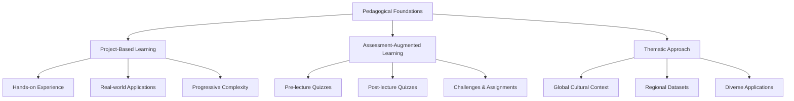

Sources: [README.md:72-76]()

## Lesson Structure

Each lesson in the curriculum follows a consistent structure designed to maximize learning effectiveness. The components progress from setting context and intentions through pre-lecture quizzes to reinforcing knowledge with assignments and challenges.

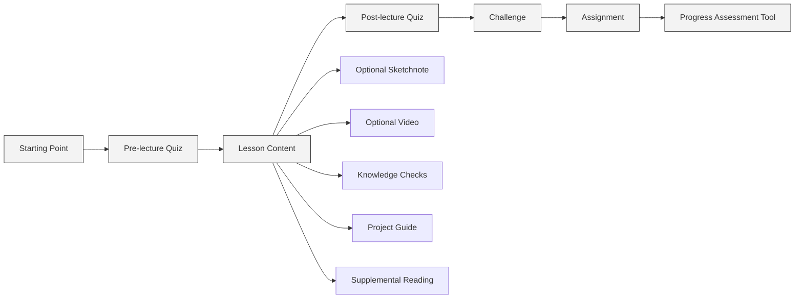

Components of each lesson:

| Component | Purpose | Mandatory |
|-----------|---------|-----------|
| Sketchnote | Visual summary of lesson concepts | Optional |
| Supplemental video | Additional visual explanation | Optional |
| Video walkthrough | Step-by-step guidance (some lessons) | Optional |
| Pre-lecture quiz | Set learning intentions and baseline knowledge | Yes |
| Written lesson | Core instructional content | Yes |
| Project guide | Step-by-step instructions for project-based lessons | Yes (for project lessons) |
| Knowledge checks | Embedded comprehension questions | Yes |
| Challenge | Extended problem to solve independently | Yes |
| Supplemental reading | Additional resources for deeper understanding | Optional |
| Assignment | Practical application of concepts | Yes |
| Post-lecture quiz | Assess knowledge retention | Yes |

Sources: [README.md:80-92]()

## Quiz System Architecture

The quiz component is a crucial element of the assessment strategy. The curriculum includes a Vue.js-based quiz application with support for multiple languages, allowing for accessibility to a global audience.

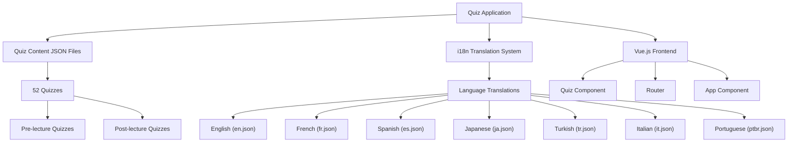

The quiz system features:
- 52 quizzes (pre and post-lecture for 26 lessons)
- Each quiz contains 3 questions
- Support for 7 languages
- A Vue.js frontend interface

Students access quizzes at the beginning and end of each lesson, with the scores helping to reinforce concepts and measure learning progress.

Sources: [README.md:95-96](), [quiz-app/src/assets/translations/index.js:1-23](), [quiz-app/src/App.vue:1-112]()

## Student Learning Journey

The curriculum is designed for a guided, progressive learning journey that includes self-study, practical application, and community engagement.

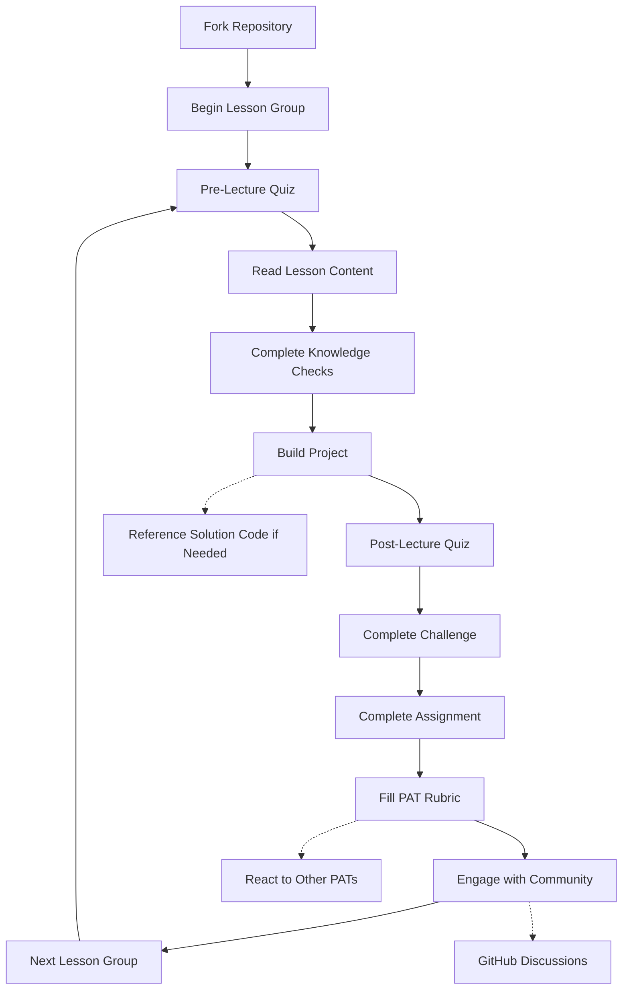

The recommended approach to using the curriculum:

1. **Fork the repository** to your personal GitHub account
2. **Take the pre-lecture quiz** to set learning intentions
3. **Read the lecture** and engage with knowledge checks
4. **Build projects** based on lesson comprehension (reference solution code only if needed)
5. **Take the post-lecture quiz** to assess understanding
6. **Complete the challenge** to extend learning
7. **Complete the assignment** to apply concepts
8. **Fill out the Progress Assessment Tool (PAT)** rubric
9. **Engage with the community** on the Discussion Board

This structured approach encourages active learning and practical application of machine learning concepts.

Sources: [README.md:38-46]()

## Project-Based Learning Progression

The curriculum follows a progressive complexity model where projects start simple and become increasingly sophisticated throughout the 12-week cycle.

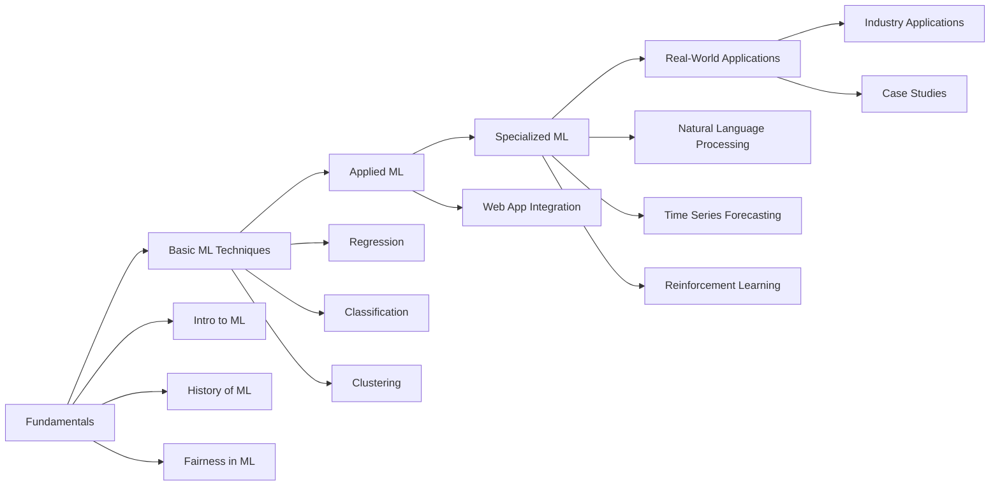

The project progression includes:
- **Fundamentals**: Theory and foundational concepts
- **Basic ML Techniques**: Core algorithms with simple datasets
- **Applied ML**: Integrating ML models into applications
- **Specialized ML**: Advanced techniques for specific domains
- **Real-World Applications**: Practical implementations and case studies

Each project builds on previous knowledge, allowing students to incrementally develop their skills from basic concepts to complex applications.

Sources: [README.md:72-76](), [README.md:97-125]()

## Assessment Methodology

The curriculum employs a comprehensive assessment strategy to measure learning progress and reinforce knowledge retention.

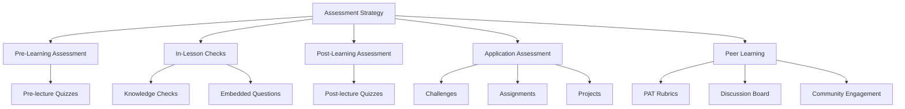

The assessment methodology includes:

1. **Pre-learning assessment**: Quizzes to establish baseline knowledge and set learning intentions
2. **In-lesson knowledge checks**: Embedded questions to reinforce understanding during the lesson
3. **Post-learning assessment**: Quizzes to measure knowledge retention after completing the lesson
4. **Application assessment**: Challenges and assignments to apply concepts in practical scenarios
5. **Progress Assessment Tool (PAT)**: A rubric-based self-assessment to reflect on learning
6. **Peer learning**: Community engagement through discussions and PAT reviews

This multi-layered approach ensures that students not only absorb information but can apply it effectively and reflect on their learning progress.

Sources: [README.md:38-46](), [quiz-app/src/assets/translations/en.json:1-114]()

## Multilingual Support

The curriculum is designed to be accessible to a global audience through comprehensive multilingual support.

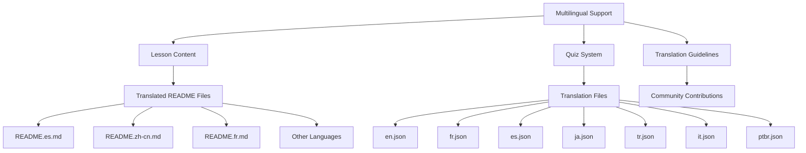

The multilingual support features:
- Translated README files for major sections
- Localized quiz content in seven languages
- Translation guidelines for community contributors
- Language selection in the quiz application interface

This approach makes the curriculum accessible to non-English speakers and promotes global participation in learning machine learning concepts.

Sources: [quiz-app/src/assets/translations/index.js:1-23](), [quiz-app/src/App.vue:1-112]()

## Curriculum Structure and Progression

The curriculum follows a logical progression through various machine learning topics, from fundamentals to advanced applications.

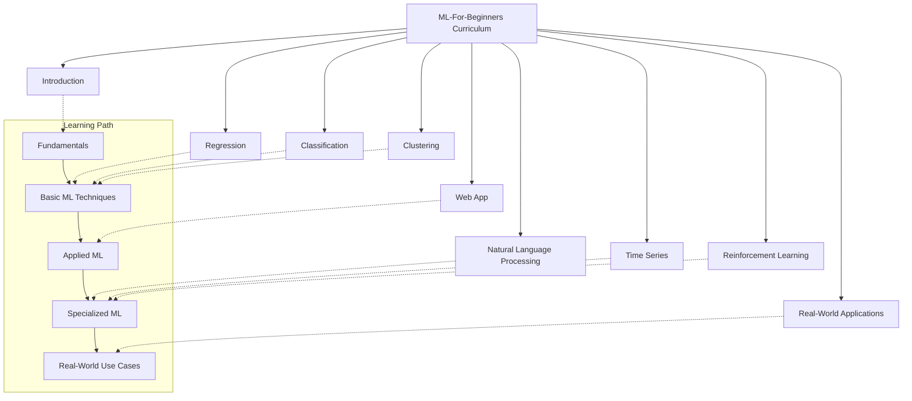

The curriculum is structured to build skills incrementally:

1. **Introduction**: Foundational concepts, history, and ethical considerations
2. **Core ML Techniques**: Regression, classification, and clustering
3. **Applied ML**: Building web applications with ML models
4. **Specialized ML**: NLP, time series forecasting, and reinforcement learning
5. **Real-World Applications**: Industry case studies and practical implementations

Each section builds on previous knowledge, creating a comprehensive learning journey from ML basics to advanced applications.

Sources: [README.md:97-125]()

## Conclusion

The learning approach of ML-For-Beginners is designed to be comprehensive, engaging, and accessible. By combining project-based learning with strategic assessments and a global perspective, the curriculum provides an effective path for beginners to learn machine learning concepts and apply them in practical scenarios.

The modular structure allows learners to progress at their own pace, while the consistent format of lessons provides a familiar framework that enhances the learning experience. The multilingual support ensures that the curriculum is accessible to a global audience, democratizing access to machine learning education.

---

# Page: Technical Requirements

# Technical Requirements

<details>
<summary>Relevant source files</summary>

The following files were used as context for generating this wiki page:

- [1-Introduction/1-intro-to-ML/README.md](1-Introduction/1-intro-to-ML/README.md)
- [1-Introduction/2-history-of-ML/README.md](1-Introduction/2-history-of-ML/README.md)
- [1-Introduction/README.md](1-Introduction/README.md)
- [1-Introduction/images/globe.jpg](1-Introduction/images/globe.jpg)
- [2-Regression/1-Tools/README.md](2-Regression/1-Tools/README.md)
- [2-Regression/2-Data/README.md](2-Regression/2-Data/README.md)
- [2-Regression/3-Linear/README.md](2-Regression/3-Linear/README.md)
- [2-Regression/4-Logistic/README.md](2-Regression/4-Logistic/README.md)
- [2-Regression/README.md](2-Regression/README.md)
- [5-Clustering/README.md](5-Clustering/README.md)
- [README.md](README.md)
- [TROUBLESHOOTING.md](TROUBLESHOOTING.md)
- [images/3.png](images/3.png)
- [quiz-app/src/assets/translations/en.json](quiz-app/src/assets/translations/en.json)

</details>


This page documents the required software, development environments, and libraries needed to work through the ML-For-Beginners curriculum. The curriculum supports multiple implementation tracks (Python and R) and includes a JavaScript-based quiz application.

For troubleshooting setup issues, see [Community and Support Resources](#1.4). For information about the curriculum structure, see [Curriculum Structure](#1.1).

## Core Requirements Overview

The curriculum requires three main software installations for the primary Python track:

| Software | Version | Purpose |
|----------|---------|---------|
| Python | 3.8+ | Primary programming language for ML exercises |
| Visual Studio Code | Latest | Recommended IDE with Jupyter and Python support |
| Jupyter Notebook | Latest | Interactive notebook environment for lessons |

**Installation Verification Diagram**

```mermaid
flowchart TD
    A["System Setup"] --> B["Python 3.8+"]
    A --> C["VS Code"]
    A --> D["Jupyter Notebook"]
    
    B --> B1["Verify: python --version"]
    C --> C1["Install Python Extension"]
    C --> C2["Install Jupyter Extension"]
    D --> D1["Install: pip install jupyter"]
    
    B1 --> E["Ready for ML Development"]
    C1 --> E
    C2 --> E
    D1 --> E
```

Sources: [README.md:46-52](), [2-Regression/1-Tools/README.md:22-43](), [TROUBLESHOOTING.md:20-42]()

## Python Installation and Configuration

Python 3.8 or higher is required for compatibility with all machine learning libraries used in the curriculum. Most computer systems may already include Python, but it's important to verify the version.

**Python Setup Workflow**

```mermaid
flowchart TD
    A["Check Existing Python"] --> B{"python --version"}
    B -->|"< 3.8"| C["Download Python 3.8+"]
    B -->|">= 3.8"| D["Verify pip installed"]
    C --> E["Install from python.org"]
    E --> D
    D --> F["Create Virtual Environment"]
    F --> G["python -m venv ml-env"]
    G --> H["Activate Environment"]
    H --> I["Ready for Package Installation"]
```

### Virtual Environment Setup

Using virtual environments is recommended to isolate project dependencies and avoid version conflicts between different Python projects.

```bash
# Create virtual environment
python -m venv ml-env

# Activate (Windows)
ml-env\Scripts\activate

# Activate (macOS/Linux)
source ml-env/bin/activate
```

Sources: [2-Regression/1-Tools/README.md:28-30](), [TROUBLESHOOTING.md:33-42](), [TROUBLESHOOTING.md:513-528]()

## Visual Studio Code Configuration

Visual Studio Code is the recommended IDE for this curriculum, providing integrated support for Python, Jupyter notebooks, and Git workflows.

**VS Code Extension Requirements**

```mermaid
graph TD
    A["VS Code"] --> B["Python Extension"]
    A --> C["Jupyter Extension"]
    
    B --> B1["Python Interpreter Selection"]
    B --> B2["Code Completion"]
    B --> B3["Debugging"]
    
    C --> C1["Notebook Rendering"]
    C --> C2["Cell Execution"]
    C --> C3["Kernel Management"]
    
    B1 --> D["Integrated ML Workflow"]
    C1 --> D
    C2 --> D
```

### Required VS Code Extensions

1. **Python Extension**: Provides Python language support, debugging, and IntelliSense
2. **Jupyter Extension**: Enables `.ipynb` file support and interactive cell execution

### Configuration Steps

1. Install Visual Studio Code from [code.visualstudio.com](https://code.visualstudio.com/)
2. Open VS Code and install the Python extension
3. Install the Jupyter extension
4. Configure the Python interpreter: `Ctrl+Shift+P` → "Python: Select Interpreter"
5. Select your virtual environment interpreter

Sources: [2-Regression/1-Tools/README.md:32-38](), [TROUBLESHOOTING.md:562-570]()

## Python Library Stack

The curriculum relies on a standard data science and machine learning stack. All packages should be installed in your virtual environment.

**Core Python Libraries Architecture**

```mermaid
graph TD
    A["ML Development Stack"] --> B["Core Libraries"]
    A --> C["Specialized Libraries"]
    
    B --> B1["scikit-learn"]
    B --> B2["pandas"]
    B --> B3["numpy"]
    B --> B4["matplotlib"]
    
    C --> C1["seaborn"]
    C --> C2["statsmodels"]
    C --> C3["imblearn"]
    C --> C4["nltk/TextBlob"]
    
    B1 --> D["LinearRegression"]
    B1 --> E["LogisticRegression"]
    B1 --> F["train_test_split"]
    B1 --> G["StandardScaler"]
    
    B2 --> H["DataFrame"]
    B2 --> I["read_csv"]
    
    B3 --> J["array operations"]
    
    B4 --> K["pyplot"]
    B4 --> L["scatter/plot"]
```

### Essential Libraries

| Package | Version | Purpose | Installation Command |
|---------|---------|---------|----------------------|
| `scikit-learn` | Latest stable | ML algorithms and model utilities | `pip install scikit-learn` |
| `pandas` | Latest stable | Data manipulation and analysis | `pip install pandas` |
| `numpy` | Latest stable | Numerical computing and arrays | `pip install numpy` |
| `matplotlib` | Latest stable | Data visualization and plotting | `pip install matplotlib` |
| `seaborn` | Latest stable | Statistical data visualization | `pip install seaborn` |
| `jupyter` | Latest stable | Interactive notebook environment | `pip install jupyter` |

### Domain-Specific Libraries

Additional libraries are required for specific modules:

| Module | Required Libraries | Purpose |
|--------|-------------------|---------|
| Regression | `scikit-learn`, `pandas`, `numpy`, `matplotlib` | Linear/polynomial/logistic regression |
| Classification | `imblearn`, `skl2onnx`, `onnxruntime` | SMOTE balancing, ONNX model deployment |
| Clustering | `scikit-learn`, `matplotlib`, `seaborn` | K-Means clustering, visualization |
| NLP | `nltk`, `textblob` | Text processing, sentiment analysis |
| Time Series | `statsmodels` | ARIMA/SARIMA forecasting |
| Reinforcement Learning | `gym` | RL environment simulation |

### Batch Installation

Install all core libraries at once:

```bash
# Activate virtual environment first
# Then install core packages
pip install scikit-learn pandas numpy matplotlib seaborn jupyter

# For specific modules, install additional packages as needed
pip install imblearn statsmodels nltk textblob gym
```

### M1 Mac Users

Special installation instructions apply for scikit-learn on Apple Silicon (M1/M2) Macs. Refer to the [scikit-learn installation documentation](https://scikit-learn.org/stable/install.html) for platform-specific guidance.

Sources: [2-Regression/1-Tools/README.md:40-43](), [2-Regression/1-Tools/README.md:110-124](), [2-Regression/3-Linear/README.md:168-171](), [2-Regression/4-Logistic/README.md:128-163](), [README.md:110](), [TROUBLESHOOTING.md:150-202]()

## Jupyter Notebook Environment

Jupyter notebooks (`.ipynb` files) serve as the primary authoring environment for ML lessons. They provide an interactive environment combining executable code, visualizations, and markdown documentation.

**Jupyter Notebook Structure**

```mermaid
graph TD
    A["notebook.ipynb"] --> B["Code Cells"]
    A --> C["Markdown Cells"]
    A --> D["Output Cells"]
    
    B --> B1["Python Code Execution"]
    B --> B2["Import Statements"]
    B --> B3["Data Processing"]
    B --> B4["Model Training"]
    
    C --> C1["Explanatory Text"]
    C --> C2["Section Headers"]
    C --> C3["Instructions"]
    
    D --> D1["Print Output"]
    D --> D2["Visualizations"]
    D --> D3["DataFrames"]
    D --> D4["Model Metrics"]
```

### Starting Jupyter

```bash
# From lesson directory
jupyter notebook

# Jupyter server starts on http://localhost:8888
# Opens automatically in browser
```

### Working with Kernels

Each notebook runs a Python kernel that executes code cells. The kernel maintains state across cells:

- **Restart Kernel**: `Kernel → Restart` - Clears all variables
- **Restart & Run All**: `Kernel → Restart & Run All` - Executes all cells in order
- **Change Kernel**: `Kernel → Change Kernel` - Switch Python version/environment

### Notebook Usage in Curriculum

| Lesson Component | Notebook Feature Used |
|-----------------|----------------------|
| Data exploration | Code cells with `pandas` DataFrames |
| Visualizations | `matplotlib` plots inline with `%matplotlib inline` |
| Model training | `scikit-learn` fit/predict methods |
| Exercises | Interactive code cells for hands-on practice |
| Documentation | Markdown cells with explanations |

Sources: [2-Regression/1-Tools/README.md:44-79](), [2-Regression/1-Tools/README.md:100-210](), [TROUBLESHOOTING.md:96-146]()

## Scikit-learn Framework

Scikit-learn (`sklearn`) is the primary machine learning library, providing implementations of ML algorithms, preprocessing utilities, and model evaluation tools.

**Scikit-learn API Structure**

```mermaid
graph TD
    A["sklearn"] --> B["datasets"]
    A --> C["linear_model"]
    A --> D["model_selection"]
    A --> E["preprocessing"]
    A --> F["metrics"]
    
    B --> B1["load_diabetes"]
    B --> B2["load_wine"]
    
    C --> C1["LinearRegression"]
    C --> C2["LogisticRegression"]
    
    D --> D1["train_test_split"]
    D --> D2["cross_val_score"]
    
    E --> E1["StandardScaler"]
    E --> E2["OneHotEncoder"]
    E --> E3["LabelEncoder"]
    
    F --> F1["mean_squared_error"]
    F --> F2["classification_report"]
    F --> F3["confusion_matrix"]
```

### Common Scikit-learn Patterns

**Model Training Workflow:**

```python
from sklearn.linear_model import LinearRegression
from sklearn.model_selection import train_test_split

# Split data
X_train, X_test, y_train, y_test = train_test_split(X, y, test_size=0.2)

# Create and train model
model = LinearRegression()
model.fit(X_train, y_train)

# Make predictions
predictions = model.predict(X_test)
```

### Key Scikit-learn Classes Used in Curriculum

| Class/Function | Module | Purpose |
|----------------|--------|---------|
| `LinearRegression` | `sklearn.linear_model` | Linear regression models |
| `LogisticRegression` | `sklearn.linear_model` | Binary/multiclass classification |
| `train_test_split` | `sklearn.model_selection` | Data splitting |
| `StandardScaler` | `sklearn.preprocessing` | Feature normalization |
| `OneHotEncoder` | `sklearn.preprocessing` | Categorical encoding |
| `confusion_matrix` | `sklearn.metrics` | Classification evaluation |
| `mean_squared_error` | `sklearn.metrics` | Regression evaluation |

Sources: [2-Regression/1-Tools/README.md:81-96](), [2-Regression/1-Tools/README.md:116-191](), [2-Regression/3-Linear/README.md:168-194](), [2-Regression/4-Logistic/README.md:128-163]()

## Optional: R Environment

The curriculum provides parallel R implementations for several modules using the tidymodels framework. R installation is optional and only needed if you want to explore the R-based lessons.

**R Environment Setup**

```mermaid
graph TD
    A["R Environment"] --> B["R 4.x Installation"]
    A --> C["RStudio IDE"]
    
    B --> D["tidymodels Framework"]
    D --> D1["rsample"]
    D --> D2["recipes"]
    D --> D3["parsnip"]
    D --> D4["workflows"]
    D --> D5["yardstick"]
    
    E["R Markdown"] --> F["lesson_1.html"]
    E --> G["lesson_2.html"]
    
    D --> H["tidyverse"]
    H --> H1["dplyr"]
    H --> H2["ggplot2"]
    H --> H3["tidyr"]
```

### R Package Requirements

Install the required R packages for ML lessons:

```r
# Core tidymodels ecosystem
install.packages(c("tidyverse", "tidymodels"), dependencies = TRUE)

# Additional packages for specific lessons
install.packages(c("caret", "themis"))
```

### R Lessons Availability

R implementations are available for:
- Regression lessons (lesson_1.html through lesson_4.html)
- Classification lessons (lesson_10.html through lesson_12.html)
- Clustering lessons (lesson_14.html and lesson_15.html)

Sources: [README.md:110](), [2-Regression/1-Tools/README.md:9](), [TROUBLESHOOTING.md:72-93](), [TROUBLESHOOTING.md:223-270]()

## Optional: JavaScript Environment (Quiz Application)

The curriculum includes a standalone Vue.js quiz application with 52 quizzes. Setting up the JavaScript environment is optional and only needed if you want to run the quiz application locally.

**Quiz Application Stack**

```mermaid
graph TD
    A["quiz-app/"] --> B["Node.js"]
    A --> C["npm"]
    
    B --> D["Vue.js 3"]
    D --> D1["Vue Router"]
    D --> D2["vue-i18n"]
    
    C --> E["Build System"]
    E --> E1["Vue CLI"]
    E --> E2["Babel"]
    E --> E3["ESLint"]
    
    F["src/assets/translations/"] --> F1["en.json"]
    F --> F2["fr.json"]
    F --> F3["es.json"]
    
    D2 --> F
```

### Node.js Requirements

| Software | Version | Purpose |
|----------|---------|---------|
| Node.js | Latest LTS | JavaScript runtime |
| npm | Comes with Node.js | Package manager |

### Quiz Application Setup

```bash
# Navigate to quiz-app directory
cd quiz-app

# Install dependencies
npm install

# Run development server
npm run serve

# Access at http://localhost:8080
```

The quiz application is deployed at [ff-quizzes.netlify.app](https://ff-quizzes.netlify.app/en/ml/), so local setup is only needed for development or offline use.

Sources: [README.md:101-112](), [TROUBLESHOOTING.md:275-340]()

## Common Machine Learning Tasks

The curriculum covers different types of machine learning tasks, with a focus on regression models. Understanding these tasks will help you navigate the curriculum more effectively.

```mermaid
graph TD
    A["Machine Learning Tasks"] --> B["Supervised Learning"]
    A --> C["Unsupervised Learning"]
    
    B --> B1["Regression"]
    B --> B2["Classification"]
    
    B1 --> B1a["Linear Regression"]
    B1 --> B1b["Polynomial Regression"]
    B1 --> B1c["Logistic Regression"]
    
    B2 --> B2a["Binary Classification"]
    B2 --> B2b["Multi-class Classification"]
    
    C --> C1["Clustering"]
    C --> C2["Dimensionality Reduction"]
```

Each task requires different algorithms and evaluation metrics, all of which are covered in the curriculum.

Sources: [2-Regression/README.md:14-25](), [2-Regression/3-Linear/README.md:8-36](), [2-Regression/4-Logistic/README.md:35-64]()

## Development Workflow

The curriculum is designed to be followed in a specific sequence, with each lesson building on the previous one. The general workflow for each section is:

1. Read the lesson material
2. Complete the pre-lesson quiz
3. Set up the required environment
4. Work through the code examples
5. Complete the exercises and assignments
6. Take the post-lesson quiz

Sources: [2-Regression/1-Tools/README.md:7-24](), [2-Regression/README.md:26-32]()

## Troubleshooting Setup Issues

If you encounter issues with your setup, check the following:

1. Verify that Python is correctly installed and accessible from the command line
2. Ensure all required packages are installed with the correct versions
3. Check that VS Code is configured to use the correct Python interpreter
4. For Jupyter notebooks issues, verify that the Jupyter package is correctly installed
5. For M1 Mac users, follow the special installation instructions for Scikit-learn

Sources: [2-Regression/1-Tools/README.md:40]()

This technical requirements document provides the foundation for successfully working through the ML-For-Beginners curriculum. Setting up your environment correctly will ensure a smooth learning experience as you explore machine learning concepts and techniques.

---

# Page: Community and Support Resources

# Community and Support Resources

<details>
<summary>Relevant source files</summary>

The following files were used as context for generating this wiki page:

- [1-Introduction/1-intro-to-ML/README.md](1-Introduction/1-intro-to-ML/README.md)
- [1-Introduction/2-history-of-ML/README.md](1-Introduction/2-history-of-ML/README.md)
- [1-Introduction/README.md](1-Introduction/README.md)
- [1-Introduction/images/globe.jpg](1-Introduction/images/globe.jpg)
- [2-Regression/README.md](2-Regression/README.md)
- [5-Clustering/README.md](5-Clustering/README.md)
- [README.md](README.md)
- [TROUBLESHOOTING.md](TROUBLESHOOTING.md)
- [images/3.png](images/3.png)
- [quiz-app/src/assets/translations/en.json](quiz-app/src/assets/translations/en.json)

</details>


This document describes the support infrastructure available to learners using the ML-For-Beginners curriculum. It covers self-service troubleshooting resources, real-time community channels, educational supplementary materials, and pathways for contributing feedback. For information about the pedagogical learning approach and assessment methods, see [Learning Approach](#1.2). For technical setup requirements, see [Technical Requirements](#1.3).

---

## Overview of Support Architecture

The ML-For-Beginners curriculum provides multi-tiered support to accommodate diverse learner needs, from self-service documentation to real-time community assistance. The support ecosystem is designed with escalation pathways: learners begin with self-service resources, escalate to asynchronous community discussions, and can ultimately reach real-time support channels for urgent issues.

```mermaid
graph TB
    LEARNER["Learner Encounters Issue"]
    
    subgraph "Tier 1: Self-Service"
        TROUBLE["TROUBLESHOOTING.md<br/>9 category guide"]
        LESSONS["Lesson READMEs<br/>Technical instructions"]
        QUIZ["Quiz feedback<br/>ff-quizzes.netlify.app"]
    end
    
    subgraph "Tier 2: Asynchronous Community"
        DISCUSS["GitHub Discussions<br/>PAT rubric system"]
        ISSUES["GitHub Issues<br/>Bug reports"]
        MSLEARN["Microsoft Learn Collections<br/>learn.microsoft.com"]
    end
    
    subgraph "Tier 3: Real-time Support"
        DISCORD_ML["ML4Beginners Discord<br/>aka.ms/ml4beginners/discord"]
        DISCORD_FOUNDRY["Azure AI Foundry Discord<br/>aka.ms/foundry/discord"]
    end
    
    subgraph "Supplementary Resources"
        VIDEOS["YouTube Playlist<br/>aka.ms/ml-beginners-videos"]
        TEACHERS["for-teachers.md<br/>Educator guidance"]
    end
    
    LEARNER --> TROUBLE
    LEARNER --> LESSONS
    LEARNER --> QUIZ
    
    TROUBLE --> DISCUSS
    LESSONS --> DISCUSS
    QUIZ --> DISCUSS
    
    DISCUSS --> ISSUES
    DISCUSS --> DISCORD_ML
    
    ISSUES --> DISCORD_FOUNDRY
    DISCORD_ML --> DISCORD_FOUNDRY
    
    LEARNER --> VIDEOS
    LEARNER --> MSLEARN
    LEARNER --> TEACHERS
```

Sources: [README.md:51-52](), [README.md:94](), [README.md:176-184](), [TROUBLESHOOTING.md:1-16]()

---

## Self-Service Documentation

### TROUBLESHOOTING.md Structure

The primary self-service resource is `TROUBLESHOOTING.md`, which provides solutions for 9 categories of common technical issues. This document is referenced directly in the main README as the first point of contact for technical problems.

| Category | Coverage | File Location |
|----------|----------|---------------|
| Installation Issues | Python, Jupyter, R setup | [TROUBLESHOOTING.md:19-93]() |
| Jupyter Notebook Issues | Kernel management, cell execution | [TROUBLESHOOTING.md:96-146]() |
| Python Package Issues | Import errors, version conflicts | [TROUBLESHOOTING.md:149-220]() |
| R Environment Issues | Package installation, RMarkdown | [TROUBLESHOOTING.md:223-273]() |
| Quiz Application Issues | npm build, port conflicts | [TROUBLESHOOTING.md:276-339]() |
| Data and File Path Issues | Relative paths, missing datasets | [TROUBLESHOOTING.md:342-381]() |
| Common Error Messages | Memory errors, convergence warnings | [TROUBLESHOOTING.md:384-465]() |
| Performance Issues | Slow execution, high memory usage | [TROUBLESHOOTING.md:468-507]() |
| Environment and Configuration | Virtual environments, Git issues | [TROUBLESHOOTING.md:510-572]() |

Each category includes problem descriptions, solution code snippets, and command-line examples. The document uses a consistent structure: **Problem** statement followed by **Solution** with executable code.

Sources: [TROUBLESHOOTING.md:5-15](), [TROUBLESHOOTING.md:19-572]()

### Lesson-Specific Documentation

Each lesson contains a README with technical instructions and common issues specific to that topic. For example, the introduction to machine learning provides setup guidance for Python, Node.js, and required libraries.

```mermaid
graph LR
    subgraph "Lesson Documentation Pattern"
        README["lesson/README.md"]
        PREREQ["Prerequisites<br/>Software requirements"]
        SETUP["Setup Instructions<br/>Installation steps"]
        CHALLENGE["Challenge<br/>Assignment details"]
        ASSIGNMENT["assignment.md<br/>Detailed tasks"]
    end
    
    README --> PREREQ
    README --> SETUP
    README --> CHALLENGE
    README --> ASSIGNMENT
```

Sources: [1-Introduction/1-intro-to-ML/README.md:20-27](), [1-Introduction/1-intro-to-ML/README.md:145]()

---

## Community Support Channels

### GitHub Discussions

The repository uses GitHub Discussions for asynchronous community learning and feedback. Learners are encouraged to use the PAT (Progress Assessment Tool) rubric system to document their learning journey and reflect on completed lesson groups.

**PAT Rubric Workflow:**
1. Complete a lesson group (e.g., all regression lessons)
2. Navigate to GitHub Discussions at `https://github.com/microsoft/ML-For-Beginners/discussions`
3. Fill out the appropriate PAT rubric
4. "Learn out loud" by sharing insights and challenges
5. React to other learners' PATs to foster collaborative learning

Sources: [README.md:62](), [README.md:94]()

### Discord Servers

Two Discord servers provide real-time community support:

#### ML4Beginners Discord
- **Access:** [aka.ms/ml4beginners/discord](https://aka.ms/ml4beginners/discord)
- **Purpose:** Primary community for curriculum-specific questions
- **Special Events:** "Learn with AI" series (September 18-30, 2025) focusing on GitHub Copilot for Data Science
- **Badge Display:** Repository README includes Discord badge using `dcbadge.limes.pink/api/server/kzRShWzttr`

#### Azure AI Foundry Discord
- **Access:** [aka.ms/foundry/discord](https://aka.ms/foundry/discord)
- **Purpose:** Broader AI development community for production deployment questions
- **Badge:** Displayed in troubleshooting guide and main README

Sources: [README.md:21-23](), [README.md:176-184](), [TROUBLESHOOTING.md:576]()

### GitHub Issues and Pull Requests

For bugs, feature requests, and technical contributions, learners use the standard GitHub workflow:

```mermaid
graph TB
    subgraph "Issue Reporting Workflow"
        PROBLEM["Identify Problem<br/>Bug or missing feature"]
        SEARCH["Search Existing Issues<br/>github.com/microsoft/ML-For-Beginners/issues"]
        NEW["Create New Issue<br/>Include: OS, versions, error trace"]
    end
    
    subgraph "Required Information"
        OS["Operating system and version"]
        VERSIONS["Python/R version"]
        ERROR["Full error message/traceback"]
        STEPS["Steps to reproduce"]
        TRIED["Solutions already attempted"]
    end
    
    subgraph "Contribution Workflow"
        FORK["Fork Repository"]
        CHANGE["Make Changes"]
        PR["Submit Pull Request"]
        CONTRIB["Reference CONTRIBUTING.md"]
    end
    
    PROBLEM --> SEARCH
    SEARCH -->|"Not Found"| NEW
    
    NEW --> OS
    NEW --> VERSIONS
    NEW --> ERROR
    NEW --> STEPS
    NEW --> TRIED
    
    FORK --> CHANGE
    CHANGE --> PR
    PR --> CONTRIB
```

Sources: [TROUBLESHOOTING.md:587-594](), [README.md:94](), [README.md:46-47]()

---

## Educational Supplementary Resources

### Microsoft Learn Collections

The curriculum is integrated with Microsoft Learn, providing additional modules and learning paths. Learners access these collections through two primary links:

- **Main Collection:** `https://learn.microsoft.com/en-us/collections/qrqzamz1nn2wx3?WT.mc_id=academic-77952-bethanycheum`
- **Additional Modules:** `https://docs.microsoft.com/en-us/users/jenlooper-2911/collections/k7o7tg1gp306q4?WT.mc_id=academic-77952-leestott`

These collections include:
- Low-code ML tools tutorials (Azure ML)
- Expanded theoretical content
- Cloud-based ML workflows
- Assessment modules

Sources: [README.md:49](), [README.md:64](), [README.md:144](), [TROUBLESHOOTING.md:577]()

### Video Walkthroughs

The YouTube playlist at [aka.ms/ml-beginners-videos](https://aka.ms/ml-beginners-videos) contains video tutorials for selected lessons. These videos are embedded in lesson READMEs and provide visual walkthroughs of complex concepts.

**Video Integration Pattern in Lessons:**
```markdown
[](https://youtu.be/VIDEO_ID "Description")
> 🎥 Click the image above for a video...
```

Examples include:
- Introduction to ML [1-Introduction/1-intro-to-ML/README.md:7-9]()
- Regression models overview [2-Regression/README.md:11-12]()
- History of ML [1-Introduction/2-history-of-ML/README.md:10-12]()

Sources: [README.md:70-74](), [TROUBLESHOOTING.md:578](), [1-Introduction/1-intro-to-ML/README.md:7-15]()

### Quiz System

The standalone quiz application provides pre-lecture and post-lecture assessments for all 26 lessons, totaling 52 quizzes with 156 questions.

**Quiz System Architecture:**
- **Hosting:** Netlify at `ff-quizzes.netlify.app/en/ml/`
- **Source:** `quiz-app/` directory with Vue.js 3 implementation
- **Data Structure:** JSON files in `quiz-app/src/assets/translations/`
- **Languages:** 7 supported (en, fr, it, ja, ptbr, tr, es)

Each quiz object in the JSON follows this schema:
```json
{
  "id": 1,
  "title": "Introduction to Machine Learning: Pre-Lecture Quiz",
  "quiz": [
    {
      "questionText": "...",
      "answerOptions": [
        {
          "answerText": "...",
          "isCorrect": "true|false"
        }
      ]
    }
  ]
}
```

**Integration Points in Curriculum:**
- Pre-lecture quizzes linked at lesson start
- Post-lecture quizzes linked at lesson end
- Example: [1-Introduction/1-intro-to-ML/README.md:3]() and [1-Introduction/1-intro-to-ML/README.md:133]()

Sources: [README.md:101](), [README.md:108](), [README.md:112](), [quiz-app/src/assets/translations/en.json:1-59]()

---

## Educator Resources

### for-teachers.md Guide

Educators have access to a dedicated guide at `for-teachers.md` that provides:
- Classroom setup recommendations
- Suggested timelines for course delivery
- Assessment strategies
- Discussion facilitation tips

Sources: [README.md:66]()

### Lesson Templates

The repository provides a standardized lesson template that educators can reference when adapting content or creating extensions. Each lesson follows a consistent structure:

| Component | Purpose | File Pattern |
|-----------|---------|--------------|
| README.md | Main lesson content | `{module}/{lesson}/README.md` |
| Pre-quiz link | Readiness assessment | Links to `ff-quizzes.netlify.app` |
| Sketchnote | Visual summary | `sketchnotes/{topic}.png` |
| Video walkthrough | Visual instruction (optional) | Embedded YouTube link |
| Knowledge checks | In-lesson validation | Markdown callouts with ✅ |
| Challenge | Hands-on exercise | Inline section |
| Assignment | Homework task | `assignment.md` |
| Post-quiz link | Retention assessment | Links to `ff-quizzes.netlify.app` |

Sources: [README.md:96-109](), [1-Introduction/2-history-of-ML/README.md:3]()

### Sketchnotes

Visual learners and educators can access CC BY-SA 4.0 licensed sketchnotes in the `sketchnotes/` directory. These are available in:
- **PNG format:** For digital display and embedding in lessons
- **TIFF format:** High-resolution for printing in classroom materials

Example sketchnote references:
- ML history: [1-Introduction/2-history-of-ML/README.md:3-4]()
- Clustering concepts: [5-Clustering/README.md:9]()

Sources: [README.md:98](), [1-Introduction/2-history-of-ML/README.md:3-4]()

---

## Support Resource Decision Tree

The following diagram maps common learner scenarios to appropriate support resources:

```mermaid
graph TD
    START["Learner Has Question/Issue"]
    
    TECH_Q{"Technical<br/>problem?"}
    CONCEPT_Q{"Conceptual<br/>question?"}
    CONTRIB_Q{"Want to<br/>contribute?"}
    
    INSTALL{"Installation<br/>or setup?"}
    ERROR{"Specific<br/>error message?"}
    PERF{"Performance<br/>issue?"}
    
    LESSON_CONCEPT{"Covered in<br/>lesson?"}
    THEORY{"Need deeper<br/>theory?"}
    
    TROUBLE["TROUBLESHOOTING.md<br/>Lines 19-572"]
    LESSON_README["Lesson README<br/>Technical instructions"]
    SEARCH_ISSUE["Search GitHub Issues<br/>github.com/.../issues"]
    
    REREAD["Re-read lesson section<br/>Use in-lesson knowledge checks"]
    VIDEOS["Watch video walkthrough<br/>aka.ms/ml-beginners-videos"]
    MSLEARN["Microsoft Learn modules<br/>Expanded theory"]
    
    DISCUSS["GitHub Discussions<br/>PAT rubric"]
    DISCORD["Discord community<br/>Real-time help"]
    
    CONTRIB_MD["Read CONTRIBUTING.md<br/>Contribution guidelines"]
    FORK_PR["Fork repo<br/>Submit pull request"]
    
    START --> TECH_Q
    START --> CONCEPT_Q
    START --> CONTRIB_Q
    
    TECH_Q -->|Yes| INSTALL
    TECH_Q -->|No| CONCEPT_Q
    
    INSTALL -->|Yes| TROUBLE
    INSTALL -->|No| ERROR
    
    ERROR -->|Yes| TROUBLE
    ERROR -->|No| PERF
    
    PERF -->|Yes| TROUBLE
    PERF -->|No| SEARCH_ISSUE
    
    SEARCH_ISSUE --> DISCORD
    
    CONCEPT_Q -->|Yes| LESSON_CONCEPT
    CONCEPT_Q -->|No| CONTRIB_Q
    
    LESSON_CONCEPT -->|Yes| REREAD
    LESSON_CONCEPT -->|Wants alternative| VIDEOS
    LESSON_CONCEPT -->|No| THEORY
    
    THEORY -->|Yes| MSLEARN
    THEORY -->|Still unclear| DISCUSS
    
    CONTRIB_Q -->|Yes| CONTRIB_MD
    CONTRIB_MD --> FORK_PR
    CONTRIB_Q -->|Have feedback| DISCUSS
```

Sources: [TROUBLESHOOTING.md:1-596](), [README.md:49-74](), [README.md:176-184]()

---

## Code of Conduct and Contribution Guidelines

### CODE_OF_CONDUCT.md

All community interactions (Discord, Discussions, Issues, PRs) are governed by the Microsoft Open Source Code of Conduct. Learners and contributors must adhere to these standards when participating in any support channel.

Sources: [README.md:94]()

### CONTRIBUTING.md

The contribution guidelines document specifies:
- Pull request submission process
- Code style requirements
- Testing expectations for contributed code
- Documentation standards

Contributors are encouraged to improve the curriculum through:
- Bug fixes
- Typo corrections
- Additional examples
- Enhanced explanations
- Translation improvements (via automated system)

Sources: [README.md:94](), [README.md:46-47]()

---

## Additional Networking and Related Courses

The README promotes other Microsoft curriculum repositories that learners may explore for related topics:

| Course | URL Pattern | Relevance to ML4Beginners |
|--------|-------------|---------------------------|
| AI for Beginners | aka.ms/ai-beginners | Deep learning and neural networks |
| Data Science for Beginners | aka.ms/datascience-beginners | Data analysis foundations |
| Generative AI for Beginners | aka.ms/genai-beginners | Modern LLM applications |
| Edge AI for Beginners | aka.ms/edgeai-for-beginners | Deployment on edge devices |

These courses form a learning pathway where ML-For-Beginners provides classical machine learning foundations before learners advance to specialized topics.

Sources: [README.md:155-174]()

---

## Translation and Localization Support

The curriculum supports 50+ languages through an automated translation system powered by GitHub Actions and the co-op-translator package. This allows non-English speakers to access support resources in their native language.

**Translation Coverage:**
- Main README files in all modules
- Lesson content
- Assignment instructions

**Languages Include:** Arabic, Chinese (Simplified, Traditional variants for Hong Kong, Macau, Taiwan), French, German, Spanish, Japanese, Korean, Hindi, and 40+ others.

**Access Pattern:**
`translations/{language-code}/README.md` (e.g., `translations/es/README.md` for Spanish)

Sources: [README.md:11-17]()

---

## Contact and Badge Information

Repository status and community metrics are displayed via badges in the main README:

```markdown
[](...)
[](...)
[](...)
[](...)
```

These badges provide quick links to:
- Current open issues count
- Active contributors
- License information (MIT)
- Pull request welcome status

Sources: [README.md:1-9]()

---

# Page: Core ML Concepts

# Core ML Concepts

<details>
<summary>Relevant source files</summary>

The following files were used as context for generating this wiki page:

- [1-Introduction/1-intro-to-ML/README.md](1-Introduction/1-intro-to-ML/README.md)
- [1-Introduction/2-history-of-ML/README.md](1-Introduction/2-history-of-ML/README.md)
- [1-Introduction/4-techniques-of-ML/README.md](1-Introduction/4-techniques-of-ML/README.md)
- [1-Introduction/4-techniques-of-ML/assignment.md](1-Introduction/4-techniques-of-ML/assignment.md)
- [1-Introduction/4-techniques-of-ML/images/overfitting.png](1-Introduction/4-techniques-of-ML/images/overfitting.png)
- [1-Introduction/README.md](1-Introduction/README.md)
- [1-Introduction/images/globe.jpg](1-Introduction/images/globe.jpg)
- [2-Regression/README.md](2-Regression/README.md)
- [5-Clustering/README.md](5-Clustering/README.md)
- [README.md](README.md)
- [TROUBLESHOOTING.md](TROUBLESHOOTING.md)
- [images/3.png](images/3.png)
- [quiz-app/src/assets/translations/en.json](quiz-app/src/assets/translations/en.json)

</details>


This document provides an overview of the fundamental machine learning concepts covered in the ML-For-Beginners curriculum. It introduces the core principles, terminology, and processes that form the foundation for all machine learning systems. The material is meant to bridge the introduction to ML with the specific learning paradigms explored in later sections. For detailed information about specific ML implementations, see [Supervised Learning](#3), [Unsupervised Learning](#4), and [Specialized ML Applications](#5).

## The Machine Learning Process

Machine learning follows a structured workflow from problem formulation to model deployment. Understanding this process is essential for developing effective ML solutions.

### The ML Workflow

```mermaid
flowchart LR
    A["Define Question"] --> B["Collect Data"]
    B --> C["Prepare Data"]
    C --> D["Split Dataset"]
    D --> E["Choose Training Method"]
    E --> F["Train Model (model.fit)"]
    F --> G["Evaluate Model"]
    G --> H["Parameter Tuning"]
    H --> I["Make Predictions"]
    G -- "If performance is poor" --> H
    H -- "If performance improves" --> F
    H -- "If performance is acceptable" --> I
```

The process begins with a specific question that cannot be easily answered with rule-based programming. Data collection and preparation follow, leading to model training, evaluation, and refinement before using the model to make predictions on new data.

Sources: [1-Introduction/4-techniques-of-ML/README.md:16-24](). [1-Introduction/4-techniques-of-ML/README.md:98-101]().

## Key ML Terminology

### Features and Target Variables

```mermaid
flowchart LR
    A["Dataset"] --> B["Features (X)"]
    A --> C["Target (y)"]
    
    B -- "Input to model" --> D["ML Model"]
    D -- "Predicts" --> C
    
    subgraph "sklearn syntax"
        E["X_train, X_test"]
        F["y_train, y_test"]
    end
    
    B -.-> E
    C -.-> F
```

- **Features**: Measurable properties of your data (independent variables), represented as `X` in code
- **Target**: What you're trying to predict (dependent variable), represented as `y` in code

Features are the inputs to your model, while the target is what the model learns to predict.

Sources: [1-Introduction/4-techniques-of-ML/README.md:48-51]().

### Dataset Splitting

```mermaid
flowchart TD
    A["Complete Dataset"] --> B["train_test_split()"]
    
    B --> C["Training Data (70-80%)"]
    B --> D["Testing Data (20-30%)"]
    
    C -- "model.fit(X_train, y_train)" --> E["Model Training"]
    E --> F["Trained Model"]
    
    F -- "model.predict(X_test)" --> G["Predictions"]
    
    D -- "y_test (actual values)" --> H["Evaluation Metrics"]
    G -- "ŷ (predicted values)" --> H
    
    subgraph "Optional Validation"
        C --> I["Validation Data"]
        I -- "Hyperparameter Tuning" --> E
    end
```

Data is typically split into:
- **Training data**: Used to fit the model (70-80% of data)
- **Testing data**: Used to evaluate the model's performance on unseen data (20-30%)
- **Validation data**: Optional split used for hyperparameter tuning

In scikit-learn, this is implemented using the `train_test_split` function.

Sources: [1-Introduction/4-techniques-of-ML/README.md:61-67]().

## Learning Paradigms

Machine learning encompasses several learning paradigms that differ in their approach and application.

### ML Paradigms Overview

```mermaid
flowchart TD
    ML["Machine Learning"] --> SL["Supervised Learning"]
    ML --> UL["Unsupervised Learning"]
    ML --> RL["Reinforcement Learning"]
    
    SL --> Reg["Regression"]
    SL --> Class["Classification"]
    
    Reg --> LR["Linear Regression
    (sklearn.linear_model)"]
    Reg --> LogR["Logistic Regression
    (sklearn.linear_model)"]
    
    Class --> DT["Decision Trees
    (sklearn.tree)"]
    Class --> SVM["Support Vector Machines
    (sklearn.svm)"]
    
    UL --> Clust["Clustering"]
    UL --> DR["Dimensionality Reduction"]
    
    Clust --> KM["K-Means
    (sklearn.cluster.KMeans)"]
    
    RL --> QL["Q-Learning"]
    
    ML --> Other["Specialized Applications"]
    Other --> NLP["Natural Language Processing"]
    Other --> TS["Time Series Forecasting"]
```

Sources: [1-Introduction/1-intro-to-ML/translations/README.fr.md:50-61](). [1-Introduction/4-techniques-of-ML/README.md:70-76]().

### Supervised Learning

Supervised learning involves training a model on labeled data to make predictions. The model learns to map input features to known output values.

| Type | Purpose | Examples | Target Type |
|------|---------|----------|------------|
| Regression | Predict continuous values | House price prediction, temperature forecasting | Numeric |
| Classification | Predict categories or classes | Email spam detection, image recognition | Categorical |

For more details, see [Supervised Learning](#3), [Regression](#3.1), and [Classification](#3.2).

Sources: [1-Introduction/1-intro-to-ML/translations/README.fr.md:54-56]().

### Unsupervised Learning

Unsupervised learning involves finding patterns or structure in unlabeled data. The model identifies inherent groupings or patterns without predefined outputs.

| Type | Purpose | Examples |
|------|---------|----------|
| Clustering | Group similar data points | Customer segmentation, anomaly detection |
| Dimensionality Reduction | Reduce feature space | Data compression, visualization |

For more details, see [Unsupervised Learning](#4) and [Clustering](#4.1).

Sources: [1-Introduction/1-intro-to-ML/translations/README.fr.md:57]().

### Specialized Applications

Beyond the fundamental paradigms, machine learning has specialized applications in various domains:

- **Natural Language Processing (NLP)**: Working with text data
- **Time Series Forecasting**: Predicting future values based on sequential data
- **Reinforcement Learning**: Learning through interaction with an environment

For more details, see [Specialized ML Applications](#5).

Sources: [1-Introduction/1-intro-to-ML/translations/README.fr.md:58-60]().

## Model Training and Evaluation

### Model Fitting

```mermaid
flowchart LR
    A["Underfitting"] --> B["Good Fit"] --> C["Overfitting"]
    
    subgraph "Training Error vs Testing Error"
        D["High Training Error
        High Testing Error"] --- E["Low Training Error
        Low Testing Error"] --- F["Low Training Error
        High Testing Error"]
    end
    
    A --- D
    B --- E
    C --- F
    
    G["model.fit(X_train, y_train)"] --> B
```

- **Underfitting**: Model is too simple to capture the underlying pattern in the data
- **Good fit**: Model generalizes well to unseen data
- **Overfitting**: Model learns the noise in the training data and performs poorly on new data

Sources: [1-Introduction/4-techniques-of-ML/README.md:86-90]().

### Model Evaluation Metrics

Model performance is assessed using various metrics depending on the learning paradigm:

| Learning Type | Common Metrics | Scikit-learn Implementation |
|---------------|----------------|----------------------------|
| Regression | Mean Squared Error (MSE), Root Mean Squared Error (RMSE), Mean Absolute Error (MAE) | `sklearn.metrics.mean_squared_error`, `sklearn.metrics.mean_absolute_error` |
| Classification | Accuracy, Precision, Recall, F1 Score, ROC-AUC | `sklearn.metrics.accuracy_score`, `sklearn.metrics.precision_recall_fscore_support`, `sklearn.metrics.roc_auc_score` |
| Clustering | Silhouette Score, Davies-Bouldin Index | `sklearn.metrics.silhouette_score`, `sklearn.metrics.davies_bouldin_score` |

Sources: [1-Introduction/4-techniques-of-ML/README.md:80-84]().

### Parameter Tuning

Improving model performance often involves adjusting hyperparameters, which are values set before training begins. This process may include:

- Grid Search: Testing all possible combinations of parameters
- Random Search: Testing random combinations of parameters
- Cross-Validation: Using multiple train-test splits to validate parameter choices

In scikit-learn, this can be implemented using `GridSearchCV` or `RandomizedSearchCV`.

Sources: [1-Introduction/4-techniques-of-ML/README.md:94-96]().

## Responsible AI in Machine Learning

Machine learning solutions should be built with responsible AI principles in mind. These principles ensure that ML systems are fair, reliable, inclusive, secure, transparent, and accountable.

```mermaid
flowchart TD
    A["Responsible AI Principles"] --> B["Fairness"]
    A --> C["Reliability & Safety"]
    A --> D["Inclusiveness"]
    A --> E["Security & Privacy"]
    A --> F["Transparency"]
    A --> G["Accountability"]
    
    B --> B1["Mitigate bias in data and models"]
    C --> C1["Ensure consistent performance in varied conditions"]
    D --> D1["Design for all users regardless of ability"]
    E --> E1["Protect sensitive information"]
    F --> F1["Explain model decisions"]
    G --> G1["Take responsibility for AI outcomes"]
```

### Impact Assessment and Debugging

When implementing ML solutions, consider:

- **Adverse impact on individuals**: Identify potential harms from system use
- **Data requirements**: Understand regulatory and quality requirements
- **Fairness analysis**: Evaluate for bias across different groups
- **Interpretability**: Understand what drives model outcomes

Sources: [1-Introduction/3-fairness/README.md:33-96](). [1-Introduction/3-fairness/README.md:97-117]().

## ML Technologies and Implementation

The curriculum primarily uses the following technologies for implementing machine learning concepts:

### Key Libraries

```mermaid
flowchart TD
    A["ML Implementation"] --> B["Python Ecosystem"]
    A --> C["Web Deployment"]
    
    B --> D["Scikit-learn
    Primary ML library"]
    B --> E["NumPy
    Numerical computations"]
    B --> F["Pandas
    Data manipulation"]
    B --> G["Matplotlib/Seaborn
    Visualization"]
    
    C --> H["Node.js/JavaScript
    Web interfaces"]
    
    D --> I["model = sklearn.linear_model.LinearRegression()
    model.fit(X, y)
    predictions = model.predict(X_new)"]
```

In this curriculum, you'll primarily work with:

- **Scikit-learn**: For implementing ML algorithms
- **Python**: As the primary programming language
- **JavaScript/Node.js**: For web application development

Sources: [1-Introduction/1-intro-to-ML/translations/README.fr.md:18-24]().

## Conclusion

This overview of core ML concepts provides the foundation for understanding the more detailed explorations of specific machine learning techniques in the subsequent sections of this curriculum. As you progress through the material, you'll build on these concepts and gain hands-on experience implementing various machine learning solutions.

Remember that effective machine learning requires not only technical skill but also careful consideration of responsible AI principles to ensure your solutions are beneficial, fair, and ethical.

For specific implementations and deeper exploration of these concepts, refer to the subsequent sections of this curriculum.

---

# Page: Introduction to Machine Learning

# Introduction to Machine Learning

<details>
<summary>Relevant source files</summary>

The following files were used as context for generating this wiki page:

- [1-Introduction/1-intro-to-ML/README.md](1-Introduction/1-intro-to-ML/README.md)
- [1-Introduction/2-history-of-ML/README.md](1-Introduction/2-history-of-ML/README.md)
- [1-Introduction/4-techniques-of-ML/README.md](1-Introduction/4-techniques-of-ML/README.md)
- [1-Introduction/4-techniques-of-ML/assignment.md](1-Introduction/4-techniques-of-ML/assignment.md)
- [1-Introduction/4-techniques-of-ML/images/overfitting.png](1-Introduction/4-techniques-of-ML/images/overfitting.png)
- [1-Introduction/README.md](1-Introduction/README.md)
- [1-Introduction/images/globe.jpg](1-Introduction/images/globe.jpg)
- [2-Regression/README.md](2-Regression/README.md)
- [5-Clustering/README.md](5-Clustering/README.md)
- [README.md](README.md)
- [TROUBLESHOOTING.md](TROUBLESHOOTING.md)
- [images/3.png](images/3.png)
- [quiz-app/src/assets/translations/en.json](quiz-app/src/assets/translations/en.json)

</details>


## Purpose and Scope

This document defines machine learning and introduces foundational concepts required to understand the ML-For-Beginners curriculum. It covers the definition of machine learning, core terminology (features, targets, training data), the three main paradigms (supervised, unsupervised, reinforcement learning), and the distinction between ML and deep learning. For information about the historical development of these concepts, see [History of Machine Learning](#2.2). For ethical considerations when applying ML, see [Fairness and Ethics in ML](#2.2). For the practical workflow of building ML systems, see [ML Development Workflow](#2.3).

---

## What is Machine Learning

Machine learning is a subset of artificial intelligence concerned with using specialized algorithms to uncover meaningful information and find hidden patterns from data. Unlike traditional rule-based programming, ML systems learn patterns automatically from examples rather than following explicitly programmed instructions.

The term "machine learning" refers to the automated process of pattern discovery by finding meaningful insights from real-world or generated data. From a systems perspective, ML is defined as the creation of automated systems that can learn hidden patterns from data to aid in making intelligent decisions. This learning process is loosely inspired by how the human brain learns based on perceived data from the external world.

**Key Distinction from Traditional Programming:**

```mermaid
graph LR
    subgraph "Traditional Programming"
        TP_Input["Input Data"] --> TP_Rules["Hand-Coded Rules"]
        TP_Rules --> TP_Output["Output/Decision"]
    end
    
    subgraph "Machine Learning"
        ML_Input["Input Data<br/>(Training Examples)"] --> ML_Algorithm["Learning Algorithm"]
        ML_Labels["Known Outputs<br/>(Labels)"] --> ML_Algorithm
        ML_Algorithm --> ML_Model["Learned Model<br/>(Patterns)"]
        ML_Model --> ML_Predict["Predictions"]
    end
```

**Machine Learning Definition:**
- **Automated pattern discovery**: Algorithms find patterns without explicit programming
- **Data-driven decisions**: Systems make predictions based on learned patterns
- **Generalization**: Models work on new, unseen data similar to training examples
- **Continuous improvement**: Performance improves with more data and feedback

Sources: [1-Introduction/1-intro-to-ML/README.md:29-59](), [quiz-app/src/assets/translations/en.json:8-58]()

---

## Relationship Between AI, ML, and Deep Learning

Machine learning exists within a hierarchy of related fields. Understanding these relationships clarifies the scope of this curriculum.

```mermaid
graph TB
    subgraph "Artificial Intelligence"
        AI["AI: Simulating Intelligent Behavior<br/>Expert Systems, Rule Engines, ML"]
        
        subgraph "Machine Learning"
            ML["ML: Learning from Data<br/>Classical Algorithms"]
            
            subgraph "Deep Learning"
                DL["Deep Learning: Neural Networks<br/>Many-Layered Models"]
            end
            
            ML --> DL
        end
        
        AI --> ML
    end
    
    subgraph "Related Field"
        DS["Data Science:<br/>Extract Insights from Data<br/>Statistics, Visualization, ML"]
    end
    
    DS -.->|Uses| ML
```

**Hierarchy Explanation:**

| Field | Scope | Key Characteristic | This Curriculum |
|-------|-------|-------------------|-----------------|
| **Artificial Intelligence** | Machines exhibiting intelligent behavior | Simulates human decision-making | Background context |
| **Machine Learning** | Subset of AI using data-driven algorithms | Learns patterns from examples | ✓ Primary Focus |
| **Classical ML** | Traditional ML without neural networks | Uses scikit-learn, statsmodels | ✓ Primary Focus |
| **Deep Learning** | Subset of ML using neural networks | Many-layered model architecture | ✗ Not Covered |
| **Data Science** | Extracting insights from data | Statistics, visualization, domain expertise | Related curriculum |

**What This Curriculum Covers:**
- Classical machine learning techniques using `scikit-learn`
- Supervised learning (regression, classification)
- Unsupervised learning (clustering)
- Specialized applications (NLP, time series, reinforcement learning)

**What This Curriculum Does NOT Cover:**
- Neural networks and deep learning architectures
- Frameworks like TensorFlow, PyTorch, Keras
- Computer vision with CNNs
- Advanced NLP with transformers

Sources: [1-Introduction/1-intro-to-ML/README.md:61-93](), [README.md:31]()

---

## Core Terminology and Concepts

### Features and Targets

Machine learning systems work with structured data organized into features and targets:

```mermaid
graph LR
    subgraph "Dataset Structure"
        Data["Dataset"] --> Features["Feature Variables<br/>(Input: X)"]
        Data --> Target["Target Variable<br/>(Output: y)"]
    end
    
    subgraph "Example: Pumpkin Pricing"
        F1["Feature: Month"] --> Model["ML Model"]
        F2["Feature: Package"] --> Model
        F3["Feature: Variety"] --> Model
        F4["Feature: City"] --> Model
        Model --> T["Target: Price"]
    end
    
    subgraph "Example: Cuisine Classification"
        CF1["Feature: rice"] --> CModel["ML Model"]
        CF2["Feature: soy_sauce"] --> CModel
        CF3["Feature: chili_pepper"] --> CModel
        CF4["Feature: cumin"] --> CModel
        CModel --> CT["Target: Cuisine Type"]
    end
```

**Feature (X):**
- A measurable property of the data
- Represented as columns in datasets
- Input variables used to make predictions
- Examples: `date`, `size`, `color`, `temperature`
- In code: typically a pandas DataFrame or numpy array
- Variable name convention: uppercase `X`

**Target (y):**
- The value the model attempts to predict
- Also called "label" or "output variable"
- Examples: `price`, `category`, `color`, `quantity`
- In code: typically a pandas Series or numpy array
- Variable name convention: lowercase `y`

**Examples from Curriculum Datasets:**

| Dataset | Features (X) | Target (y) | Module |
|---------|-------------|-----------|---------|
| US Pumpkins | Date, Package, Variety, City Name | Price | Regression |
| Cuisines | Ingredient columns (rice, garlic, etc.) | Cuisine (Chinese, Indian, etc.) | Classification |
| Nigerian Songs | Danceability, Acousticness, Loudness | Genre clusters | Clustering |
| Hotel Reviews | Review text, reviewer scores | Sentiment score | NLP |
| Energy Usage | Historical usage, date, temperature | Future usage | Time Series |

### Training Data

Training data consists of example input-output pairs used to teach the model patterns:

**Data Split Strategy:**
```mermaid
graph TD
    Dataset["Complete Dataset<br/>100%"] --> Split["train_test_split()"]
    
    Split --> Train["Training Set<br/>70-80%<br/>Used to fit model"]
    Split --> Test["Test Set<br/>20-30%<br/>Used to evaluate"]
    
    Train --> Model["model.fit(X_train, y_train)"]
    Model --> Eval["model.score(X_test, y_test)"]
    Test --> Eval
```

**Key Concepts:**
- **Training set**: Data used to fit the model via `model.fit()`
- **Test set**: Unseen data used to evaluate performance via `model.score()` or `model.predict()`
- **Validation set**: Optional third split for hyperparameter tuning
- **Data quality**: Both quantity and quality impact model performance

Sources: [1-Introduction/4-techniques-of-ML/README.md:47-67](), [quiz-app/src/assets/translations/en.json:384-457]()

---

## Types of Machine Learning

The curriculum covers three main ML paradigms, each suited to different problem types:

```mermaid
graph TB
    ML["Machine Learning"] --> Supervised["Supervised Learning<br/>Labeled Training Data"]
    ML --> Unsupervised["Unsupervised Learning<br/>Unlabeled Data"]
    ML --> Reinforcement["Reinforcement Learning<br/>Reward-Based Learning"]
    
    Supervised --> Regression["Regression<br/>Predict Continuous Values<br/>LinearRegression, PolynomialFeatures"]
    Supervised --> Classification["Classification<br/>Predict Categories<br/>LogisticRegression, SVC, KNN"]
    
    Unsupervised --> Clustering["Clustering<br/>Group Similar Items<br/>KMeans, Silhouette Scoring"]
    Unsupervised --> Dimensionality["Dimensionality Reduction<br/>Not covered in detail"]
    
    Reinforcement --> QLearning["Q-Learning<br/>Learn Optimal Actions<br/>Q-Tables, Bellman Equation"]
    Reinforcement --> Gym["OpenAI Gym<br/>RL Environments"]
```

### Supervised Learning

Supervised learning algorithms learn from labeled examples where the correct output is known during training.

**Characteristics:**
- Training data includes both inputs (X) and correct outputs (y)
- Model learns mapping function: f(X) → y
- Goal: predict y for new, unseen X values
- Requires labeled dataset for training

**Two Main Types:**

1. **Regression** - Predicting continuous numerical values
   - Curriculum modules: [2-Regression/](https://github.com/microsoft/ML-For-Beginners/tree/main/2-Regression)
   - Algorithms: `LinearRegression`, `PolynomialFeatures`, `LogisticRegression`
   - Example: Predicting pumpkin prices based on variety and date
   - Evaluation metrics: MSE, R²

2. **Classification** - Predicting discrete categories
   - Curriculum modules: [4-Classification/](https://github.com/microsoft/ML-For-Beginners/tree/main/4-Classification)
   - Algorithms: `LogisticRegression`, `SVC`, `KNeighborsClassifier`, `RandomForestClassifier`
   - Example: Classifying cuisine type from ingredients
   - Evaluation metrics: Accuracy, F1-score, confusion matrix

### Unsupervised Learning

Unsupervised learning finds patterns in data without labeled outputs.

**Characteristics:**
- Training data contains only inputs (X), no labels (y)
- Model discovers hidden structure or groupings
- Goal: understand data organization and relationships
- No "correct answer" during training

**Primary Type in Curriculum:**

**Clustering** - Grouping similar data points
- Curriculum modules: [5-Clustering/](https://github.com/microsoft/ML-For-Beginners/tree/main/5-Clustering)
- Algorithms: `KMeans`, silhouette scoring, elbow method
- Example: Grouping Nigerian songs by musical characteristics
- Evaluation: Silhouette score, cluster visualization

### Reinforcement Learning

Reinforcement learning trains agents to make sequences of decisions by maximizing cumulative rewards.

**Characteristics:**
- Agent interacts with environment through actions
- Receives rewards/penalties based on actions
- Learns optimal policy through trial and error
- Goal: maximize long-term cumulative reward

**Curriculum Implementation:**
- Modules: [8-Reinforcement/](https://github.com/microsoft/ML-For-Beginners/tree/main/8-Reinforcement)
- Algorithms: Q-Learning with Q-Tables
- Environments: Custom Board environment, OpenAI Gym (CartPole)
- Concepts: Bellman equation, exploration vs exploitation, epsilon-greedy

Sources: [README.md:114-141](), [2-Regression/README.md:14-16](), [5-Clustering/README.md:3-13]()

---

## Machine Learning Development Workflow

The process of building ML systems follows an iterative workflow mapped to curriculum lessons:

```mermaid
graph TB
    Problem["1. Define Problem<br/>What question needs answering?"] --> Data["2. Collect & Prepare Data<br/>pandas.read_csv()<br/>df.dropna()"]
    
    Data --> Explore["3. Exploratory Analysis<br/>df.describe()<br/>matplotlib.pyplot.plot()"]
    
    Explore --> Features["4. Feature Engineering<br/>Select features (X)<br/>Identify target (y)"]
    
    Features --> Split["5. Split Data<br/>train_test_split(X, y)"]
    
    Split --> Choose["6. Choose Algorithm<br/>LinearRegression()<br/>KMeans()<br/>etc."]
    
    Choose --> Train["7. Train Model<br/>model.fit(X_train, y_train)"]
    
    Train --> Evaluate["8. Evaluate Performance<br/>model.score(X_test, y_test)<br/>metrics evaluation"]
    
    Evaluate --> Tune{"Performance<br/>Acceptable?"}
    
    Tune -->|No| Improve["9. Improve Model<br/>- Adjust hyperparameters<br/>- Try different algorithm<br/>- Engineer new features<br/>- Collect more data"]
    
    Improve --> Choose
    
    Tune -->|Yes| Deploy["10. Deploy & Predict<br/>model.predict(new_data)<br/>Flask app, ONNX Runtime"]
```

**Workflow Mapped to Code Patterns:**

| Step | Common Code Pattern | Curriculum Example |
|------|--------------------|--------------------|
| Load Data | `pd.read_csv('data.csv')` | [2-Regression/2-Data/](https://github.com/microsoft/ML-For-Beginners/tree/main/2-Regression/2-Data) |
| Clean Data | `df.dropna()`, `df[df['col'] > 0]` | Data preparation lessons |
| Split Data | `train_test_split(X, y, test_size=0.2)` | All supervised learning lessons |
| Create Model | `model = LinearRegression()` | [2-Regression/3-Linear/](https://github.com/microsoft/ML-For-Beginners/tree/main/2-Regression/3-Linear) |
| Train Model | `model.fit(X_train, y_train)` | All model training lessons |
| Evaluate | `model.score(X_test, y_test)` | All supervised learning lessons |
| Predict | `model.predict(X_new)` | All prediction lessons |
| Deploy | Flask app, ONNX conversion | [3-Web-App/](https://github.com/microsoft/ML-For-Beginners/tree/main/3-Web-App) |

Sources: [1-Introduction/4-techniques-of-ML/README.md:14-103](), [quiz-app/src/assets/translations/en.json:347-457]()

---

## Why Study Machine Learning

### Applications and Use Cases

Machine learning has become ubiquitous across industries, solving problems that traditional rule-based systems cannot handle effectively:

**Business Applications:**
- **Automation**: Solve multi-dimensional problems automatically
- **Personalization**: Customize experiences based on user type/behavior
- **Prediction**: Forecast outcomes from historical patterns
- **Pattern Discovery**: Find insights humans might miss in large datasets

**Domain-Specific Examples from Curriculum:**

| Domain | ML Application | Dataset/Example | Lesson |
|--------|---------------|-----------------|--------|
| Agriculture | Price prediction for crops | US pumpkin pricing data | Regression |
| Food Industry | Cuisine classification from ingredients | Asian/Indian cuisines dataset | Classification |
| Entertainment | Music genre grouping | Nigerian songs metadata | Clustering |
| Hospitality | Sentiment analysis of reviews | 515K hotel reviews | NLP |
| Energy | Electricity demand forecasting | Historical usage data | Time Series |
| Gaming/Robotics | Optimal decision making | CartPole, Board environments | Reinforcement |

**Why Businesses Use ML:**
1. Handle complex, multi-dimensional problems
2. Process large volumes of data efficiently
3. Adapt to changing patterns over time
4. Make predictions on unseen situations
5. Automate decision-making processes

### Classical ML vs Deep Learning Trade-offs

**Why Start with Classical ML (This Curriculum's Approach):**

| Aspect | Classical ML (scikit-learn) | Deep Learning (Neural Networks) |
|--------|----------------------------|--------------------------------|
| **Data Requirements** | Works with smaller datasets | Requires large datasets (10K+ examples) |
| **Training Time** | Minutes to hours | Hours to days/weeks |
| **Interpretability** | Model decisions explainable | "Black box" behavior |
| **Hardware** | Runs on standard CPUs | Often requires GPUs |
| **Learning Curve** | Easier to understand fundamentals | Complex architecture design |
| **Use Cases** | Structured/tabular data, traditional problems | Images, audio, text, complex patterns |

**When to Use Classical ML:**
- Structured/tabular datasets (CSV files, databases)
- Limited training data available (< 10K examples)
- Need explainable predictions (healthcare, finance)
- Fast iteration and prototyping required
- CPU-only computing resources

**When Deep Learning is Better:**
- Image recognition, computer vision tasks
- Natural language understanding (modern transformers)
- Speech recognition, audio processing
- Large datasets available (100K+ examples)
- Complex pattern recognition beyond tabular data

Sources: [1-Introduction/1-intro-to-ML/README.md:96-127](), [quiz-app/src/assets/translations/en.json:25-40]()

---

## Prerequisites and Setup

### Required Knowledge

**Background Needed:**
- **Python programming**: Variables, functions, loops, conditionals
- **Basic mathematics**: Algebra, basic statistics
- **Data structures**: Lists, dictionaries, DataFrames
- **No prior ML experience required**

### Technical Setup

**Core Libraries Used in Curriculum:**

```mermaid
graph TB
    Python["Python 3.8+"] --> Core["Core ML"]
    Python --> Data["Data Processing"]
    Python --> Viz["Visualization"]
    Python --> Deploy["Deployment"]
    
    Core --> sklearn["scikit-learn<br/>ML algorithms"]
    Core --> statsmodels["statsmodels<br/>ARIMA/SARIMA"]
    Core --> gym["OpenAI Gym<br/>RL environments"]
    
    Data --> pandas["pandas<br/>DataFrames, CSV"]
    Data --> numpy["numpy<br/>Arrays, math"]
    Data --> imblearn["imblearn<br/>SMOTE balancing"]
    
    Viz --> matplotlib["matplotlib<br/>Basic plots"]
    Viz --> seaborn["seaborn<br/>Statistical viz"]
    
    Deploy --> flask["Flask<br/>Web apps"]
    Deploy --> onnx["ONNX Runtime<br/>Model serving"]
    Deploy --> skl2onnx["skl2onnx<br/>Model conversion"]
```

**Installation Command:**
```bash
pip install jupyter scikit-learn pandas numpy matplotlib seaborn
```

**Development Environment:**
- Jupyter notebooks (`.ipynb` files) for interactive learning
- VS Code or JupyterLab for editing
- Git for version control

Sources: [1-Introduction/1-intro-to-ML/README.md:20-27](), [README.md:43-52](), [TROUBLESHOOTING.md:19-93]()

---

## Common Terminology Reference

| Term | Definition | Code Representation | Example |
|------|-----------|-------------------|---------|
| **Feature** | Input variable/property | Column in `X` DataFrame | `pumpkin_variety`, `temperature` |
| **Target** | Output variable to predict | Series `y` | `price`, `cuisine_type` |
| **Training** | Learning patterns from data | `model.fit(X_train, y_train)` | Fitting LinearRegression |
| **Prediction** | Making estimates on new data | `model.predict(X_test)` | Predicting prices |
| **Model** | Learned pattern representation | Scikit-learn estimator object | `LinearRegression()` instance |
| **Algorithm** | Method for learning patterns | Scikit-learn class | `KMeans`, `SVC`, `RandomForest` |
| **Hyperparameter** | Model configuration setting | Constructor arguments | `n_clusters=3`, `max_iter=100` |
| **Overfitting** | Model too specific to training data | High train score, low test score | Model memorizes training examples |
| **Underfitting** | Model too simple for data | Low train and test scores | Linear model for non-linear data |
| **Evaluation** | Measuring model performance | `model.score()`, metrics | R², accuracy, F1-score |

Sources: [1-Introduction/4-techniques-of-ML/README.md:47-55](), [quiz-app/src/assets/translations/en.json:384-399]()

---

## Learning Path Navigation

This document introduces foundational ML concepts. Continue learning through the curriculum in this order:

1. **Current**: Introduction to Machine Learning (you are here)
2. **Next**: [History of Machine Learning](#2.2) - Understand the field's evolution
3. **Then**: [Fairness and Ethics in ML](#2.2) - Learn responsible AI principles
4. **Then**: [ML Development Workflow](#2.3) - Detailed workflow and best practices
5. **Practice**: [Regression](#3.1) - First hands-on ML implementation

**Pre-Lecture Quiz**: Test your understanding before starting at [Quiz ID 1](https://ff-quizzes.netlify.app/en/ml/)

**Post-Lecture Quiz**: Verify comprehension after reading at [Quiz ID 2](https://ff-quizzes.netlify.app/en/ml/)

Sources: [README.md:114-141](), [quiz-app/src/assets/translations/en.json:7-116]()

---

# Page: Fairness and Ethics in ML

# Fairness and Ethics in ML

<details>
<summary>Relevant source files</summary>

The following files were used as context for generating this wiki page:

- [1-Introduction/3-fairness/README.md](1-Introduction/3-fairness/README.md)
- [1-Introduction/3-fairness/assignment.md](1-Introduction/3-fairness/assignment.md)
- [1-Introduction/3-fairness/images/accessibility.png](1-Introduction/3-fairness/images/accessibility.png)
- [1-Introduction/3-fairness/images/accountability.png](1-Introduction/3-fairness/images/accountability.png)

</details>


## Purpose and Scope

This document covers responsible AI principles and their implementation in machine learning systems, with emphasis on fairness considerations, harm prevention, impact assessment methodologies, and debugging tools. The material focuses on ethical frameworks that should be applied during the ML development lifecycle.

For foundational ML concepts and terminology, see [Introduction to Machine Learning](#2.1). For the broader development process including training and evaluation, see [ML Development Workflow](#2.3).

**Sources:** [1-Introduction/3-fairness/README.md:1-160]()

---

## Responsible AI Principles

The curriculum establishes six core principles for building trustworthy ML systems. These principles form the evaluation framework applied throughout the learning modules, particularly during model assessment and deployment decisions.

```mermaid
graph TB
    subgraph "Responsible AI Framework"
        RAI["Responsible AI Principles"]
        
        F["Fairness<br/>Avoid demographic bias"]
        R["Reliability & Safety<br/>Handle outliers/edge cases"]
        I["Inclusiveness<br/>Design for all users"]
        S["Security & Privacy<br/>Protect data and people"]
        T["Transparency<br/>Explainable behavior"]
        A["Accountability<br/>Human responsibility"]
        
        RAI --> F
        RAI --> R
        RAI --> I
        RAI --> S
        RAI --> T
        RAI --> A
    end
    
    subgraph "Implementation Tools"
        F --> FAIR["Fairness metrics<br/>Demographic parity"]
        R --> TEST["Edge case testing<br/>Validation sets"]
        I --> ACCESS["Accessibility design<br/>1B+ people with disabilities"]
        S --> PROTECT["GDPR compliance<br/>Data encryption"]
        T --> EXPLAIN["Model interpretability<br/>Feature importance"]
        A --> AUDIT["Audit trails<br/>Human review"]
    end
```

**Sources:** [1-Introduction/3-fairness/README.md:14-21, 33-95]()

### Principle Definitions

| Principle | Definition | Key Considerations |
|-----------|-----------|-------------------|
| **Fairness** | Treat everyone fairly; avoid affecting similar groups differently | Data may contain inherited biases; requires conscious bias detection |
| **Reliability & Safety** | Consistent performance under normal and unexpected conditions | Must anticipate outliers, edge cases (weather, lighting, etc.) |
| **Inclusiveness** | Engage and empower everyone | Address barriers for 1 billion people with disabilities globally |
| **Security & Privacy** | Protect confidential information and resist attacks | GDPR compliance; balance personalization with privacy |
| **Transparency** | Understandable behavior and components | Stakeholders must comprehend how/why systems function |
| **Accountability** | Human responsibility for system operation | Particularly critical for sensitive applications (facial recognition) |

**Sources:** [1-Introduction/3-fairness/README.md:33-95]()

---

## Fairness-Related Harms

The curriculum identifies five categories of fairness-related harms ("unfairness") that ML systems can perpetuate. Understanding these harm types is essential for data cleaning, feature engineering, and model evaluation phases.

```mermaid
graph LR
    subgraph "Fairness Harm Taxonomy"
        HARM["Fairness-Related Harms"]
        
        ALLOC["Allocation<br/>Resource distribution bias"]
        QOS["Quality of Service<br/>Performance disparities"]
        DENI["Denigration<br/>Unfair labeling/criticism"]
        REP["Over/Under-Representation<br/>Visibility bias"]
        STEREO["Stereotyping<br/>Pre-assigned attributes"]
        
        HARM --> ALLOC
        HARM --> QOS
        HARM --> DENI
        HARM --> REP
        HARM --> STEREO
    end
    
    subgraph "Real-World Examples"
        ALLOC --> EX1["Loan approval favor<br/>gender/ethnicity"]
        QOS --> EX2["Hand soap dispenser<br/>dark skin detection failure"]
        DENI --> EX3["Image labeling<br/>misclassification"]
        REP --> EX4["Professional visibility<br/>underrepresented groups"]
        STEREO --> EX5["Translation systems<br/>gender assumptions"]
    end
```

**Sources:** [1-Introduction/3-fairness/README.md:37-50]()

### Harm Type Examples

**Allocation**: A gender or ethnicity is favored in resource distribution (e.g., medical treatment recommendations, loan applications, employment decisions for similar qualifications).

**Quality of Service**: Training data covers one scenario but reality is more complex, leading to poor performance. Example: hand soap dispensers unable to sense people with dark skin ([Gizmodo reference](https://gizmodo.com/why-cant-this-soap-dispenser-identify-dark-skin-1797931773)).

**Denigration**: Unfair criticism or labeling. Example: image labeling technology that mislabeled images of dark-skinned people as gorillas.

**Over/Under-Representation**: Certain groups not seen in professions; services promoting this contribute to harm by perpetuating invisibility.

**Stereotyping**: Associating groups with pre-assigned attributes. Example: English-Turkish translation systems with gender-stereotyped word associations (e.g., "doctor" → male pronouns, "nurse" → female pronouns in translation).

**Sources:** [1-Introduction/3-fairness/README.md:37-50]()

---

## Impact Assessment Methodology

Before training models, the curriculum requires conducting an impact assessment to understand system purpose, intended use, deployment context, and user interactions. This assessment identifies potential risks and expected consequences.

```mermaid
graph TB
    subgraph "Impact Assessment Process"
        START["Pre-Training Phase"]
        
        PURPOSE["1. Define Purpose<br/>What is the AI system for?"]
        USE["2. Intended Use<br/>How will it be used?"]
        DEPLOY["3. Deployment Context<br/>Where will it operate?"]
        USERS["4. User Interactions<br/>Who interacts with it?"]
        
        START --> PURPOSE
        PURPOSE --> USE
        USE --> DEPLOY
        DEPLOY --> USERS
    end
    
    subgraph "Assessment Areas"
        USERS --> ADVERSE["Adverse Impact<br/>Restrictions, limitations,<br/>unsupported scenarios"]
        USERS --> DATA["Data Requirements<br/>GDPR, HIPAA regulations,<br/>source quality"]
        USERS --> SUMMARY["Impact Summary<br/>List potential harms,<br/>review throughout lifecycle"]
        USERS --> GOALS["Principle Goals<br/>Assess 6 principles,<br/>identify gaps"]
    end
    
    subgraph "Ongoing Review"
        ADVERSE --> REVIEW["ML Lifecycle Review"]
        DATA --> REVIEW
        SUMMARY --> REVIEW
        GOALS --> REVIEW
        
        REVIEW --> MITIGATE["Mitigation Actions"]
    end
```

**Sources:** [1-Introduction/3-fairness/README.md:97-107]()

### Assessment Focus Areas

| Area | Questions to Address |
|------|---------------------|
| **Adverse Impact on Individuals** | What restrictions/requirements exist? What unsupported use cases could cause harm? What known limitations affect performance? |
| **Data Requirements** | Where will data be used? GDPR/HIPAA compliance needed? Is data source substantial for training? What is data origin and integrity? |
| **Summary of Impact** | What potential harms could arise? Are identified issues mitigated throughout ML lifecycle? |
| **Applicable Goals** | Are goals from each of the six principles met? What gaps exist? |

**Sources:** [1-Introduction/3-fairness/README.md:99-107]()

---

## Responsible AI Toolbox Integration

The curriculum integrates Microsoft's Responsible AI Toolbox (RAI Toolbox) for debugging AI systems. This open-source framework provides four core capabilities mapped to the responsible AI principles.

```mermaid
graph TB
    subgraph "RAI Toolbox Architecture"
        DASHBOARD["Responsible AI Dashboard<br/>responsibleaidashboard/"]
        
        ERROR["Error Analysis<br/>identify error distribution"]
        OVERVIEW["Model Overview<br/>discover performance disparities"]
        DATA["Data Analysis<br/>understand data distribution"]
        INTERPRET["Model Interpretability<br/>understand predictions"]
        
        DASHBOARD --> ERROR
        DASHBOARD --> OVERVIEW
        DASHBOARD --> DATA
        DASHBOARD --> INTERPRET
    end
    
    subgraph "Principle Mapping"
        ERROR --> FAIR_REL["Fairness<br/>Reliability"]
        OVERVIEW --> FAIR_METRIC["Fairness<br/>Performance metrics"]
        DATA --> BIAS_DET["Fairness<br/>Inclusiveness<br/>Reliability<br/>Bias detection"]
        INTERPRET --> TRANS_ACC["Transparency<br/>Accountability<br/>Explainability"]
    end
    
    subgraph "Implementation"
        FAIR_REL --> COHORT["Cohort analysis<br/>Demographic splits"]
        FAIR_METRIC --> DISP["Disparity metrics<br/>Across groups"]
        BIAS_DET --> DIST["Distribution checks<br/>Missing demographics"]
        TRANS_ACC --> FEAT["Feature importance<br/>Prediction drivers"]
    end
```

**Sources:** [1-Introduction/3-fairness/README.md:109-117, 149-151]()

### RAI Toolbox Components

**Error Analysis**: Identifies error distribution patterns that can affect system fairness or reliability. Enables drilling down into specific cohorts where model performance degrades.

**Model Overview**: Discovers disparities in model performance across data cohorts (e.g., demographic groups, feature ranges). Surfaces where "similar groups" receive different treatment.

**Data Analysis**: Understands data distribution to identify potential bias (missing demographics, disproportionate representation) leading to fairness, inclusiveness, and reliability issues.

**Model Interpretability**: Explains what influences model predictions. Critical for transparency (understanding behavior) and accountability (determining responsibility for outcomes).

**Sources:** [1-Introduction/3-fairness/README.md:111-117]()

### Toolbox Access Points

The RAI Toolbox is implemented as:
- **GitHub Repository**: `microsoft/responsible-ai-toolbox` - main open-source project
- **Jupyter Notebooks**: `notebooks/responsibleaidashboard/getting-started.ipynb` - interactive tutorials
- **Python Package**: `responsibleai` - installable via pip
- **Azure ML Integration**: Available as built-in component

**Assignment Reference**: Students explore RAI Toolbox notebooks and document findings ([1-Introduction/3-fairness/assignment.md:1-12]()).

**Sources:** [1-Introduction/3-fairness/README.md:149-159](), [1-Introduction/3-fairness/assignment.md:1-12]()

---

## Challenge Exercise

The curriculum includes a challenge focused on harm prevention and bias mitigation:

**Core Question**: "What else should we consider?" when thinking about real-life scenarios where model untrustworthiness is evident.

**Required Actions**:
- Ensure diversity of backgrounds and perspectives among team members
- Invest in datasets reflecting society's diversity
- Develop better methods throughout ML lifecycle for detecting and correcting responsible AI issues

**Sources:** [1-Introduction/3-fairness/README.md:119-127]()

---

## Pre/Post Assessment

The lesson includes quiz assessments at:
- **Pre-lecture**: `https://ff-quizzes.netlify.app/en/ml/` - tests baseline understanding
- **Post-lecture**: Same URL - validates learning outcomes

**Sources:** [1-Introduction/3-fairness/README.md:6, 129]()

---

## Learning Resources

### Required Prerequisites

**Microsoft Learn Path**: "Responsible AI Principles" module at `docs.microsoft.com/learn/modules/responsible-ai-principles/` provides foundational knowledge before lesson content.

**Video**: "Microsoft's Approach to Responsible AI" (YouTube: `dnC8-uUZXSc`) introduces corporate perspective.

**Sources:** [1-Introduction/3-fairness/README.md:23-31]()

### Supplementary Materials

| Resource Type | Description | Link |
|--------------|-------------|------|
| **Workshop Video** | "RAI Toolbox: An open-source framework for building responsible AI" by Besmira Nushi, Mehrnoosh Sameki, Amit Sharma | YouTube: `tGgJCrA-MZU` |
| **RAI Resource Center** | Microsoft AI responsible AI resources | `microsoft.com/ai/responsible-ai-resources` |
| **FATE Research** | Fairness, Accountability, Transparency, Ethics research group | `microsoft.com/research/theme/fate/` |
| **Azure ML Tools** | Fairness tools in Azure Machine Learning | `docs.microsoft.com/azure/machine-learning/concept-fairness-ml` |

**Sources:** [1-Introduction/3-fairness/README.md:131-156]()

---

## Integration with Curriculum

This fairness lesson appears early in the 12-week curriculum (Week 1, Introduction module) to establish ethical frameworks before technical implementation. Subsequent modules apply these principles during:

- **Regression** (Weeks 3-4): Evaluating pumpkin pricing predictions for demographic fairness
- **Classification** (Weeks 5-6): Analyzing cuisine classifiers for cultural representation
- **NLP** (Weeks 8-9): Examining sentiment analysis for language/cultural bias
- **Real-World Applications** (Week 12): Assessing deployed systems across fairness dimensions

The RAI Dashboard is introduced here but used throughout the curriculum for model debugging and evaluation.

**Sources:** [1-Introduction/3-fairness/README.md:1-160]()

---

# Page: ML Development Workflow

# ML Development Workflow

<details>
<summary>Relevant source files</summary>

The following files were used as context for generating this wiki page:

- [1-Introduction/4-techniques-of-ML/README.md](1-Introduction/4-techniques-of-ML/README.md)
- [1-Introduction/4-techniques-of-ML/assignment.md](1-Introduction/4-techniques-of-ML/assignment.md)
- [1-Introduction/4-techniques-of-ML/images/overfitting.png](1-Introduction/4-techniques-of-ML/images/overfitting.png)

</details>


## Purpose and Scope

This document details the iterative machine learning development workflow, from problem definition through model deployment. It covers the systematic process of data collection, preparation, feature engineering, train/test splitting, model training, evaluation, hyperparameter tuning, and prediction. This workflow applies to all classical ML tasks covered in the curriculum.

For conceptual ML definitions and terminology, see [Introduction to Machine Learning](#2.1). For considerations about bias and responsible AI during the workflow, see [Fairness and Ethics in ML](#2.2). For specific algorithm implementations, see the relevant module pages: [Regression](#3.1), [Classification](#3.2), [Clustering](#4.1), [NLP](#5.1), [Time Series](#5.2), or [Reinforcement Learning](#5.3).

---

## ML Development Process Overview

The ML development workflow consists of seven primary stages that form an iterative cycle. The process is not strictly linear; practitioners often revisit earlier stages based on evaluation results.

### End-to-End Workflow Diagram

```mermaid
graph TB
    Q["1. Decide on Question<br/>Define prediction task"]
    DC["2. Collect & Prepare Data<br/>Gather, clean, normalize"]
    TM["3. Choose Training Method<br/>Select algorithm"]
    TR["4. Train Model<br/>model.fit(X, y)"]
    EV["5. Evaluate Model<br/>Test data performance"]
    PT["6. Parameter Tuning<br/>Adjust hyperparameters"]
    PR["7. Predict<br/>model.predict(X_new)"]
    
    Q --> DC
    DC --> TM
    TM --> TR
    TR --> EV
    EV --> PT
    PT --> TM
    PT --> PR
    EV --> DC
    
    style Q fill:#f9f9f9
    style TR fill:#f9f9f9
    style EV fill:#f9f9f9
    style PR fill:#f9f9f9
```

Sources: [1-Introduction/4-techniques-of-ML/README.md:16-24]()

---

## Stage 1: Problem Definition

The workflow begins by formulating a question that requires data-driven predictions rather than conditional logic. ML is appropriate when patterns are hidden or too complex for rule-based systems.

### Characteristics of ML-Suitable Questions

- **Pattern-based**: Requires discovering hidden correlations in data
- **Prediction-focused**: Aims to estimate future or unknown values
- **Data-available**: Sufficient historical data exists
- **Non-trivial**: Cannot be solved with simple conditional programs

Examples from the curriculum:
- "What color pumpkins will be cheapest in December?" (regression)
- "What cuisine does this ingredient combination represent?" (classification)
- "What genres of music cluster together?" (unsupervised learning)
- "What sentiment does this hotel review express?" (NLP)

Sources: [1-Introduction/4-techniques-of-ML/README.md:26-32]()

---

## Stage 2: Data Collection and Preparation

Data preparation is a multi-step process that significantly impacts model quality. The principle "garbage in, garbage out" applies strongly to ML systems.

### Data Collection Requirements

| Consideration | Description | Example |
|---------------|-------------|---------|
| **Source awareness** | Document data origin and inherent biases | US-pumpkins.csv from USDA market data |
| **Quantity** | Sufficient samples for pattern learning | 1,757 pumpkin price records |
| **Quality** | Accurate, complete, representative | Filter nulls, outliers |
| **Type match** | Appropriate for the question | Continuous prices for regression |

### Data Preparation Pipeline

```mermaid
graph LR
    RAW["Raw Data<br/>CSV/JSON/Database"]
    COLLATE["Collate<br/>Merge sources"]
    NORMALIZE["Normalize<br/>Scale values"]
    CLEAN["Clean<br/>Handle nulls"]
    TRANSFORM["Transform<br/>Generate features"]
    SHUFFLE["Shuffle<br/>Randomize order"]
    READY["Prepared Dataset"]
    
    RAW --> COLLATE
    COLLATE --> NORMALIZE
    NORMALIZE --> CLEAN
    CLEAN --> TRANSFORM
    TRANSFORM --> SHUFFLE
    SHUFFLE --> READY
    
    style RAW fill:#f9f9f9
    style READY fill:#f9f9f9
```

### Common Preparation Operations

**String to Numeric Conversion**: Convert categorical strings to integer encodings (used in clustering: [5-Clustering/1-Visualize/README.md]())

**Feature Generation**: Create new data columns from existing ones (used in classification: [4-Classification/1-Introduction/README.md]())

**Cleaning**: Remove or impute missing values, filter outliers, standardize formats (used before web app deployment: [3-Web-App/README.md]())

**Randomization**: Shuffle data to prevent order-based bias in training

Sources: [1-Introduction/4-techniques-of-ML/README.md:38-45]()

---

## Stage 3: Feature and Target Identification

### Feature Variables

A **feature** is a measurable property used as model input. Features are typically represented as columns in tabular data.

- **Code representation**: Variable `X` (uppercase)
- **Shape**: 2D array `(n_samples, n_features)`
- **Examples**: `'date'`, `'size'`, `'color'`, `'latitude'`, `'temperature'`

### Target Variables

A **target** (or **label**) is the value being predicted.

- **Code representation**: Variable `y` (lowercase)
- **Shape**: 1D array `(n_samples,)`
- **Examples**: 
  - Regression: pumpkin price, real estate value
  - Classification: cuisine category, sentiment label
  - Time series: future energy load

### Feature Selection vs Feature Extraction

| Technique | Definition | Method |
|-----------|------------|--------|
| **Feature Selection** | Returns subset of original features | Statistical tests, correlation analysis |
| **Feature Extraction** | Creates new features from functions of originals | PCA, polynomial features |

The distinction matters for performance and interpretability: selection preserves original meaning, while extraction may create abstract combinations.

Sources: [1-Introduction/4-techniques-of-ML/README.md:47-55]()

---

## Data Visualization and Analysis

Visualization libraries (Seaborn, MatPlotLib) enable pattern discovery and quality assessment before training.

### Visualization Use Cases

**Correlation Discovery**: Scatter plots reveal relationships between features and targets

**Bias Detection**: Class distribution charts identify imbalanced datasets (as in [4-Classification/2-Classifiers-1/README.md]())

**Outlier Identification**: Box plots and histograms highlight anomalous data points

**Feature Distribution**: Histograms show value ranges and normalization needs

Sources: [1-Introduction/4-techniques-of-ML/README.md:57-59]()

---

## Dataset Splitting

Prior to training, datasets are divided into distinct subsets to enable unbiased evaluation.

### Train/Test/Validation Split Architecture

```mermaid
graph TB
    FULL["Full Dataset<br/>All available data"]
    
    subgraph "Primary Split"
        TRAIN["Training Set<br/>60-80% of data<br/>Used: model.fit(X_train, y_train)"]
        HOLD["Holdout Set<br/>20-40% of data"]
    end
    
    subgraph "Holdout Split"
        TEST["Test Set<br/>15-30% of data<br/>Used: model.score(X_test, y_test)"]
        VAL["Validation Set<br/>5-10% of data<br/>Used: hyperparameter tuning"]
    end
    
    FULL --> TRAIN
    FULL --> HOLD
    HOLD --> TEST
    HOLD --> VAL
    
    style TRAIN fill:#f9f9f9
    style TEST fill:#f9f9f9
```

### Split Characteristics by Dataset Type

| Split | Purpose | Size | Data Independence |
|-------|---------|------|-------------------|
| **Training** | Model fitting via `model.fit()` | 60-80% | Largest portion |
| **Testing** | Final performance evaluation | 15-30% | Never seen during training |
| **Validation** | Hyperparameter tuning | 5-10% | Optional, for large datasets |

### Special Case: Time Series Splitting

Time series data requires **temporal splitting** (not random) to prevent data leakage. Training data must precede test data chronologically, as covered in [7-TimeSeries/1-Introduction/README.md]().

Sources: [1-Introduction/4-techniques-of-ML/README.md:61-67]()

---

## Stage 4: Model Training

Training exposes the model to data patterns and adjusts internal parameters to minimize prediction error.

### Training Method Selection

Scikit-learn (referenced at [https://scikit-learn.org/stable/user_guide.html]()) provides multiple training methods categorized by task type:

- **Supervised Learning**: Linear models, tree-based models, SVMs, neural networks
- **Unsupervised Learning**: K-Means, hierarchical clustering, DBSCAN
- **Time Series**: ARIMA/SARIMA via statsmodels
- **Reinforcement Learning**: Q-Learning with custom implementations

Method selection depends on:
1. Question type (regression, classification, clustering)
2. Data characteristics (size, dimensionality, linearity)
3. Performance requirements (accuracy vs speed)
4. Interpretability needs

### Model Fitting Process

```mermaid
graph LR
    DATA["Training Data<br/>(X_train, y_train)"]
    FIT["model.fit()<br/>Learns patterns"]
    WEIGHTS["Internal Weights<br/>Adjusted iteratively"]
    MODEL["Trained Model<br/>Ready for predictions"]
    
    DATA --> FIT
    FIT --> WEIGHTS
    WEIGHTS --> FIT
    WEIGHTS --> MODEL
    
    style FIT fill:#f9f9f9
    style MODEL fill:#f9f9f9
```

The `model.fit()` method is universal across scikit-learn estimators:

```
# Standard pattern in curriculum notebooks
model.fit(X_train, y_train)
```

**Key concept**: Training adjusts internal weights to privilege certain data patterns, building a statistical representation of relationships between features and target.

### Training Iterations (Epochs)

Large or complex models may require multiple passes through the training data. Each complete pass is an **epoch**. The training process continues until:
- Loss function converges
- Maximum iterations reached
- Early stopping criteria met

Sources: [1-Introduction/4-techniques-of-ML/README.md:69-79]()

---

## Stage 5: Model Evaluation

Evaluation measures model quality using previously unseen test data.

### Evaluation Workflow

```mermaid
graph TB
    TRAINED["Trained Model<br/>From model.fit()"]
    TEST["Test Data<br/>(X_test, y_test)"]
    PREDICT["predictions = model.predict(X_test)"]
    COMPARE["Compare:<br/>predictions vs y_test"]
    METRICS["Evaluation Metrics<br/>Accuracy, MSE, F1, etc."]
    TABLE["Metrics Table<br/>Print quality report"]
    
    TRAINED --> PREDICT
    TEST --> PREDICT
    PREDICT --> COMPARE
    TEST --> COMPARE
    COMPARE --> METRICS
    METRICS --> TABLE
    
    style PREDICT fill:#f9f9f9
    style METRICS fill:#f9f9f9
```

### Common Evaluation Metrics by Task Type

| Task Type | Metrics | Description |
|-----------|---------|-------------|
| **Regression** | MSE, RMSE, R² | Error magnitude, variance explained |
| **Classification** | Accuracy, Precision, Recall, F1, ROC-AUC | Class prediction quality |
| **Clustering** | Silhouette score, Elbow method | Cluster cohesion/separation |
| **Time Series** | MAPE, MAE | Forecasting error percentage |

The test data must be a subset of the original dataset that the model has **never analyzed** during training.

Sources: [1-Introduction/4-techniques-of-ML/README.md:81-83]()

---

## Model Fitting Quality

### Underfitting vs Overfitting

**Model fitting** refers to how well the model's function approximates the true underlying pattern.

```mermaid
graph LR
    subgraph "Model Fitting Spectrum"
        UNDER["Underfitting<br/>Too simple<br/>High bias"]
        GOOD["Good Fit<br/>Balanced<br/>Generalizes well"]
        OVER["Overfitting<br/>Too complex<br/>High variance"]
    end
    
    UNDER --> GOOD
    GOOD --> OVER
    
    style GOOD fill:#f9f9f9
```

### Characteristics

| Issue | Cause | Training Performance | Test Performance |
|-------|-------|---------------------|------------------|
| **Underfitting** | Model too simple | Poor accuracy | Poor accuracy |
| **Good Fit** | Appropriate complexity | Good accuracy | Good accuracy |
| **Overfitting** | Model too complex | Excellent accuracy | Poor accuracy |

**Overfitting**: Model learns training data details and noise too well. Predictions too closely aligned with training data, poor generalization to new data.

**Underfitting**: Model cannot capture data patterns. Predictions loosely aligned with training data, inaccurate on both training and test sets.

### Detection and Mitigation

**Detection**: Compare training vs test performance
- Large gap indicates overfitting
- Poor performance on both indicates underfitting

**Mitigation strategies**:
- Overfitting: Add regularization, reduce features, increase training data, simplify model
- Underfitting: Add features, increase model complexity, train longer

Sources: [1-Introduction/4-techniques-of-ML/README.md:85-92]()

---

## Stage 6: Parameter Tuning

After initial training, model quality can be improved by adjusting **hyperparameters** - configuration variables that control algorithm behavior.

### Hyperparameters vs Parameters

| Type | Definition | When Set | Examples |
|------|------------|----------|----------|
| **Parameters** | Learned during training | Training phase | Weights, coefficients |
| **Hyperparameters** | Set before training | Before fit() | Learning rate, max depth, n_neighbors |

### Tuning Process

```mermaid
graph TB
    INIT["Initial Model<br/>Default hyperparameters"]
    TRAIN1["Train<br/>model.fit()"]
    EVAL1["Evaluate<br/>Record metrics"]
    ADJ["Adjust Hyperparameters<br/>Grid search / Random search"]
    TRAIN2["Retrain<br/>model.fit()"]
    EVAL2["Evaluate<br/>Compare metrics"]
    BEST["Select Best<br/>Highest performing config"]
    
    INIT --> TRAIN1
    TRAIN1 --> EVAL1
    EVAL1 --> ADJ
    ADJ --> TRAIN2
    TRAIN2 --> EVAL2
    EVAL2 --> ADJ
    EVAL2 --> BEST
    
    style ADJ fill:#f9f9f9
    style BEST fill:#f9f9f9
```

### Common Hyperparameters

**Linear Models**: Regularization strength (alpha), solver type

**Tree-based Models**: Max depth, min samples split, n_estimators

**SVM**: Kernel type (linear, RBF), C parameter, gamma

**K-Means**: Number of clusters (k), initialization method

**Neural Networks**: Learning rate, batch size, layer sizes

Comprehensive tuning guidance: [https://docs.microsoft.com/en-us/azure/machine-learning/how-to-tune-hyperparameters]()

Sources: [1-Introduction/4-techniques-of-ML/README.md:94-96]()

---

## Stage 7: Prediction

Prediction applies the trained model to new, unseen data to generate outputs.

### Prediction Workflow in Code

```mermaid
graph LR
    NEW["New Input Data<br/>X_new"]
    MODEL["Trained Model<br/>model object"]
    PREDICT["model.predict(X_new)"]
    OUTPUT["Predictions<br/>y_pred"]
    
    NEW --> PREDICT
    MODEL --> PREDICT
    PREDICT --> OUTPUT
    
    style PREDICT fill:#f9f9f9
    style OUTPUT fill:#f9f9f9
```

### Prediction Contexts

**Development/Testing**: Using held-out test data to validate model quality

**Production/Applied ML**: Real-time inference in web applications or APIs
- User input gathered (button press, form submission)
- Input formatted as feature array
- Model performs inference
- Result returned to user

Example: Web application deployment covered in [3-Web-App/README.md]()

### Inference Methods

| Method | Use Case | Code Example |
|--------|----------|--------------|
| `predict()` | Class labels or point estimates | `model.predict(X_new)` |
| `predict_proba()` | Class probabilities | `model.predict_proba(X_new)` |
| `score()` | Model accuracy on labeled data | `model.score(X_test, y_test)` |

Sources: [1-Introduction/4-techniques-of-ML/README.md:98-102]()

---

## Workflow Integration with Curriculum Modules

The seven-stage workflow applies consistently across all ML modules with task-specific variations:

### Module-Specific Workflow Implementations

```mermaid
graph TB
    WORKFLOW["Core ML Workflow<br/>7 stages"]
    
    REG["Regression Modules<br/>LinearRegression.fit(X, y)<br/>MSE/R² evaluation"]
    CLASS["Classification Modules<br/>LogisticRegression.fit(X, y)<br/>F1/ROC-AUC evaluation"]
    CLUST["Clustering Modules<br/>KMeans.fit(X)<br/>Silhouette evaluation"]
    NLP["NLP Modules<br/>VADER.polarity_scores()<br/>Sentiment accuracy"]
    TS["Time Series Modules<br/>SARIMAX.fit()<br/>MAPE evaluation"]
    RL["RL Modules<br/>Q-table updates<br/>Reward evaluation"]
    
    WORKFLOW --> REG
    WORKFLOW --> CLASS
    WORKFLOW --> CLUST
    WORKFLOW --> NLP
    WORKFLOW --> TS
    WORKFLOW --> RL
    
    style WORKFLOW fill:#f9f9f9
```

### Cross-Module Workflow Patterns

| Stage | Regression | Classification | Clustering | NLP |
|-------|-----------|----------------|-----------|-----|
| Data | Pumpkin prices | Cuisine recipes | Music metadata | Hotel reviews |
| Features (X) | Month, variety | Ingredients | Audio features | Review text |
| Target (y) | Price | Cuisine category | None (unsupervised) | Sentiment |
| Algorithm | LinearRegression | SVC, RandomForest | KMeans | VADER |
| Evaluation | R², MSE | F1, ROC-AUC | Silhouette | Accuracy |

All modules follow the same fundamental workflow structure while adapting algorithm and metric choices to task requirements.

Sources: [1-Introduction/4-techniques-of-ML/README.md:1-118]()

---

## Iterative Nature and Workflow Loops

The ML workflow is not linear; it contains multiple feedback loops:

### Feedback Loop Architecture

```mermaid
graph TB
    START["1. Define Problem"]
    DATA["2. Collect/Prepare Data"]
    TRAIN["3-4. Select Method & Train"]
    EVAL["5. Evaluate"]
    TUNE["6. Parameter Tuning"]
    PROD["7. Predict/Deploy"]
    
    START --> DATA
    DATA --> TRAIN
    TRAIN --> EVAL
    
    EVAL -->|"Poor quality"| DATA
    EVAL -->|"Need different algorithm"| TRAIN
    EVAL -->|"Needs tuning"| TUNE
    
    TUNE --> TRAIN
    
    EVAL -->|"Acceptable quality"| PROD
    
    style EVAL fill:#f9f9f9
```

### Common Iteration Triggers

**Data Issues** (loop back to stage 2):
- Insufficient data quantity
- Biased or imbalanced data
- Missing features

**Algorithm Issues** (loop back to stage 3):
- Model too simple/complex for data
- Wrong algorithm family for task
- Poor convergence

**Performance Issues** (loop back to stage 6):
- Metrics below threshold
- Overfitting/underfitting detected
- Hyperparameters not optimal

Practitioners typically iterate multiple times before achieving production-ready model quality.

Sources: [1-Introduction/4-techniques-of-ML/README.md:16-24]()

---

## Workflow Tools and Frameworks

The curriculum demonstrates the workflow using specific tools:

### Primary Python Stack

```mermaid
graph TB
    WORKFLOW["ML Workflow Stages"]
    
    subgraph "Data Handling"
        PANDAS["pandas<br/>DataFrames, CSV loading"]
        NUMPY["numpy<br/>Array operations"]
    end
    
    subgraph "Model Training"
        SKLEARN["scikit-learn<br/>model.fit(), predict()"]
        STATS["statsmodels<br/>ARIMA/SARIMA"]
        GYM["OpenAI Gym<br/>RL environments"]
    end
    
    subgraph "Visualization"
        MPL["matplotlib<br/>Plotting"]
        SNS["seaborn<br/>Statistical viz"]
    end
    
    subgraph "Evaluation"
        METRICS["sklearn.metrics<br/>MSE, F1, ROC-AUC"]
    end
    
    WORKFLOW --> PANDAS
    WORKFLOW --> SKLEARN
    WORKFLOW --> MPL
    WORKFLOW --> METRICS
    
    PANDAS --> SKLEARN
    SKLEARN --> METRICS
    METRICS --> MPL
    
    style SKLEARN fill:#f9f9f9
    style METRICS fill:#f9f9f9
```

### R Alternative Stack

For statistical ML tasks, parallel R implementations use tidymodels framework:

- **rsample**: Dataset splitting
- **recipes**: Feature engineering pipeline
- **parsnip**: Model specification
- **workflows**: Training pipeline
- **yardstick**: Evaluation metrics

See [R Implementation with tidymodels](#6.2) for details.

---

## Related Resources

- **Algorithm Selection**: See module-specific pages for algorithm details ([Regression](#3.1), [Classification](#3.2), [Clustering](#4.1))
- **Data Ethics**: [Fairness and Ethics in ML](#2.2) for bias considerations during data collection
- **Deployment**: [Model Deployment with ONNX](#3.2.3) and [RL Model Deployment with Flask](#5.3.3)
- **Evaluation Deep Dive**: Module-specific evaluation sections cover task-appropriate metrics

Sources: [1-Introduction/4-techniques-of-ML/README.md:1-118]()

---

# Page: Supervised Learning

# Supervised Learning

<details>
<summary>Relevant source files</summary>

The following files were used as context for generating this wiki page:

- [2-Regression/1-Tools/README.md](2-Regression/1-Tools/README.md)
- [2-Regression/2-Data/README.md](2-Regression/2-Data/README.md)
- [2-Regression/3-Linear/README.md](2-Regression/3-Linear/README.md)
- [2-Regression/4-Logistic/README.md](2-Regression/4-Logistic/README.md)
- [4-Classification/1-Introduction/README.md](4-Classification/1-Introduction/README.md)
- [4-Classification/1-Introduction/assignment.md](4-Classification/1-Introduction/assignment.md)
- [4-Classification/1-Introduction/notebook.ipynb](4-Classification/1-Introduction/notebook.ipynb)
- [4-Classification/1-Introduction/solution/notebook.ipynb](4-Classification/1-Introduction/solution/notebook.ipynb)
- [4-Classification/2-Classifiers-1/README.md](4-Classification/2-Classifiers-1/README.md)
- [4-Classification/2-Classifiers-1/notebook.ipynb](4-Classification/2-Classifiers-1/notebook.ipynb)
- [4-Classification/2-Classifiers-1/solution/notebook.ipynb](4-Classification/2-Classifiers-1/solution/notebook.ipynb)
- [4-Classification/3-Classifiers-2/README.md](4-Classification/3-Classifiers-2/README.md)
- [4-Classification/3-Classifiers-2/notebook.ipynb](4-Classification/3-Classifiers-2/notebook.ipynb)
- [4-Classification/3-Classifiers-2/solution/notebook.ipynb](4-Classification/3-Classifiers-2/solution/notebook.ipynb)
- [4-Classification/4-Applied/README.md](4-Classification/4-Applied/README.md)
- [4-Classification/4-Applied/notebook.ipynb](4-Classification/4-Applied/notebook.ipynb)
- [4-Classification/README.md](4-Classification/README.md)

</details>


This document provides an overview of supervised learning algorithms and techniques as presented in the ML-For-Beginners curriculum. It covers the fundamental concepts, types, and implementations of supervised learning models, focusing on regression and classification techniques used throughout the repository.

Supervised learning is a machine learning paradigm where models learn from labeled training data to predict outputs for unseen data. Within this curriculum, supervised learning is organized into two main categories: regression (for predicting continuous values) and classification (for predicting categorical values or classes).

## Supervised Learning Fundamentals

Supervised learning involves training a model on a labeled dataset, where each training example consists of an input object (typically a vector) and a desired output value. The model learns a function that maps inputs to outputs, which can then be used to predict outputs for new, unseen inputs.

```mermaid
graph TD
    A["Input Data"] --> B["Supervised Learning"]
    C["Labels/Target Values"] --> B
    B --> D["Trained Model"]
    D --> E["Predictions on New Data"]
    
    subgraph "Training Process"
    F["Feature Extraction"] --> G["Model Training"]
    G --> H["Model Evaluation"]
    H -->|"Iterate if needed"| G
    end
    
    B --- F
```

The supervised learning process in this curriculum follows these key steps:
1. Data preparation and cleaning
2. Feature selection/engineering
3. Splitting data into training and testing sets
4. Model selection and training
5. Model evaluation
6. Making predictions

Sources: [2-Regression/1-Tools/README.md:10-45](). [2-Regression/3-Linear/README.md:8-21](). [4-Classification/1-Introduction/README.md:1-45]().

## Types of Supervised Learning Models

The curriculum covers two main types of supervised learning models:

```mermaid
graph LR
    A["Supervised Learning"] --> B["Regression"]
    A --> C["Classification"]
    
    B --> B1["Linear Regression"]
    B --> B2["Polynomial Regression"]
    B --> B3["Logistic Regression"]
    
    C --> C1["Binary Classification"]
    C --> C2["Multiclass Classification"]
    
    subgraph "Output Types"
    D["Continuous Values"] --- B
    E["Categorical Values/Classes"] --- C
    end
```

### Regression

Regression models predict continuous values. In the curriculum, you'll learn to implement:
- **Linear Regression**: Predicts a target by finding the best-fit line through data points
- **Polynomial Regression**: Extends linear regression with polynomial terms for curved relationships
- **Logistic Regression**: Though named "regression," it's often used for binary classification

Sources: [2-Regression/README.md:1-41](). [2-Regression/3-Linear/README.md:1-80]().

### Classification

Classification models predict categorical labels or classes. The curriculum covers:
- **Binary Classification**: Predicts one of two classes (e.g., "orange or not orange")
- **Multiclass Classification**: Predicts one of several classes (e.g., cuisine types)

Sources: [4-Classification/README.md:1-27](). [4-Classification/1-Introduction/README.md:9-45]().

## Regression Implementation

The curriculum teaches regression through practical examples, primarily using the pumpkin price dataset to predict prices based on various features.

```mermaid
flowchart TD
    A["Data Preparation"] --> B["Feature Selection"]
    B --> C["Data Splitting"]
    C --> D["Model Training"]
    D --> E["Model Evaluation"]
    E --> F["Prediction"]
    
    subgraph "Regression Models in Scikit-learn"
        M1["LinearRegression()"]
        M2["make_pipeline(PolynomialFeatures, LinearRegression())"]
        M3["LogisticRegression()"]
    end
    
    D --- M1
    D --- M2
    D --- M3
    
    subgraph "Evaluation Metrics"
        E1["mean_squared_error()"]
        E2["model.score()"]
    end
    
    E --- E1
    E --- E2
```

### Linear and Polynomial Regression

Linear regression finds the relationship between independent variables (features) and a dependent variable (target) by fitting a linear equation to the data. Polynomial regression extends this by including polynomial terms.

Key implementation steps using Scikit-learn:

1. Prepare and split the data:
```python
X_train, X_test, y_train, y_test = train_test_split(X, y, test_size=0.2, random_state=0)
```

2. Linear regression:
```python
lin_reg = LinearRegression()
lin_reg.fit(X_train, y_train)
```

3. Polynomial regression:
```python
pipeline = make_pipeline(PolynomialFeatures(2), LinearRegression())
pipeline.fit(X_train, y_train)
```

4. Evaluate models using metrics like MSE and coefficient of determination:
```python
mse = np.sqrt(mean_squared_error(y_test, pred))
score = model.score(X_train, y_train)
```

Sources: [2-Regression/3-Linear/README.md:159-198](). [2-Regression/3-Linear/README.md:224-252]().

### Logistic Regression

Despite its name, logistic regression is often used for binary classification tasks. In the curriculum, it's introduced in the regression section but bridges to classification concepts.

Key implementation with Scikit-learn:
```python
lr = LogisticRegression(multi_class='ovr', solver='liblinear')
model = lr.fit(X_train, np.ravel(y_train))
```

Sources: [2-Regression/4-Logistic/README.md:9-45](). [2-Regression/4-Logistic/README.md:140-169]().

## Classification Implementation

The curriculum teaches classification using a dataset of cuisine ingredients to predict cuisine type.

```mermaid
flowchart LR
    A["Data Preparation"] --> B["Data Balancing with SMOTE"]
    B --> C["Feature Engineering"]
    C --> D["Model Selection"]
    D --> E["Model Training"]
    E --> F["Model Evaluation"]
    
    subgraph "Classification Algorithms"
        M1["LogisticRegression"]
        M2["SVC (Support Vector Classifier)"]
        M3["KNeighborsClassifier"]
        M4["RandomForestClassifier"]
        M5["AdaBoostClassifier"]
    end
    
    D --- M1
    D --- M2
    D --- M3
    D --- M4
    D --- M5
    
    subgraph "Evaluation Metrics"
        E1["accuracy_score()"]
        E2["classification_report()"]
        E3["confusion_matrix()"]
    end
    
    F --- E1
    F --- E2
    F --- E3
```

The classification implementation follows these key steps:

1. Data preparation and balancing:
```python
# Balancing data using SMOTE
oversample = SMOTE()
transformed_feature_df, transformed_label_df = oversample.fit_resample(feature_df, labels_df)
```

2. Feature selection and data splitting:
```python
X_train, X_test, y_train, y_test = train_test_split(X, y, test_size=0.3)
```

3. Training classifiers:
```python
# Various classifier implementations
classifiers = {
    'Linear SVC': SVC(kernel='linear', C=C, probability=True, random_state=0),
    'KNN classifier': KNeighborsClassifier(C),
    'SVC': SVC(),
    'RFST': RandomForestClassifier(n_estimators=100),
    'ADA': AdaBoostClassifier(n_estimators=100)
}

# Training loop
for name, classifier in classifiers.items():
    classifier.fit(X_train, np.ravel(y_train))
    y_pred = classifier.predict(X_test)
    # Evaluation
```

4. Evaluation using classification metrics:
```python
print(classification_report(y_test, y_pred))
```

Sources: [4-Classification/2-Classifiers-1/README.md:145-170](). [4-Classification/3-Classifiers-2/README.md:80-220]().

## Supervised Learning Workflow

The typical workflow for supervised learning used throughout the repository follows this pattern:

```mermaid
graph TB
    A["Data Loading and Exploration"] --> B["Data Cleaning and Preprocessing"]
    B --> C["Feature Selection/Engineering"]
    C --> D["Data Splitting"]
    D --> E["Model Selection"]
    E --> F["Model Training"]
    F --> G["Model Evaluation"]
    G -->|"Good performance"| H["Model Deployment/Use"]
    G -->|"Poor performance"| I["Model Tuning"]
    I --> E
    
    subgraph "Scikit-learn Components"
    J["train_test_split()"]
    K["Model Classes (e.g., LinearRegression, SVC)"]
    L["Metrics (mean_squared_error, accuracy_score)"]
    end
    
    D --- J
    F --- K
    G --- L
```

This workflow is applied consistently across both regression and classification tasks in the curriculum, with appropriate adjustments for the specific type of supervised learning problem.

Sources: [2-Regression/1-Tools/README.md:80-107](). [4-Classification/1-Introduction/README.md:118-155](). [4-Classification/2-Classifiers-1/README.md:145-170]().

## Application and Deployment

The curriculum culminates in showing how to apply trained models in practical applications, such as building a cuisine recommender web application.

```mermaid
graph LR
    A["Trained Classification Model"] --> B["Convert to ONNX Format"]
    B --> C["Web Application"]
    
    subgraph "ONNX Conversion"
    D["skl2onnx.convert_sklearn()"]
    E["Model Serialization"]
    end
    
    B --- D
    B --- E
    
    subgraph "Web App Components"
    F["HTML/CSS Interface"]
    G["JavaScript for Inference"]
    H["ONNX Runtime Web"]
    end
    
    C --- F
    C --- G
    C --- H
```

This demonstrates the complete lifecycle of supervised learning models from training to deployment in user-facing applications.

Sources: [4-Classification/4-Applied/README.md:117-277]().

## Model Selection Guide

Choosing the right supervised learning model is a critical step. The curriculum provides guidance based on problem type and data characteristics:

| Problem Type | Recommended Models | When to Use |
|--------------|-------------------|-------------|
| Linear Relationship (Regression) | Linear Regression | Simple continuous value prediction with linear relationships |
| Non-linear Relationship (Regression) | Polynomial Regression | Continuous value prediction with curved relationships |
| Binary Classification | Logistic Regression, SVC | Predicting one of two classes (e.g., yes/no) |
| Multiclass Classification | Linear SVC, KNN, SVC, Random Forest | Predicting one of multiple classes |
| Small Dataset (<100K samples) | SVC, KNN | When you have relatively small training data |
| Large Dataset | Random Forest, AdaBoost | When you have large amounts of training data |

The repository provides decision flowcharts to help with model selection based on the characteristics of your data and problem.

Sources: [4-Classification/2-Classifiers-1/README.md:80-110](). [4-Classification/3-Classifiers-2/README.md:15-37]().

## Model Evaluation

Different metrics are used to evaluate supervised learning models depending on the problem type:

### Regression Metrics
- Mean Squared Error (MSE)
- Root Mean Squared Error (RMSE)
- Coefficient of Determination (R²)

### Classification Metrics
- Accuracy
- Precision
- Recall
- F1-Score
- Confusion Matrix
- ROC Curve and AUC

The curriculum emphasizes the importance of choosing appropriate evaluation metrics based on your specific problem and goals.

Sources: [2-Regression/3-Linear/README.md:195-215](). [4-Classification/2-Classifiers-1/README.md:214-230](). [2-Regression/4-Logistic/README.md:280-380]().

## Practical Project Examples

The repository includes practical applications of supervised learning:

1. **Regression Project**: Predicting pumpkin prices based on features like variety, origin, and date
2. **Classification Project**: Identifying cuisine type based on ingredient lists
3. **Web Application**: Building a cuisine recommender using a trained classification model

These projects demonstrate the full machine learning workflow from data preparation to model deployment.

Sources: [2-Regression/3-Linear/README.md:308-351](). [4-Classification/4-Applied/README.md:62-117]().

---

# Page: Regression

# Regression

<details>
<summary>Relevant source files</summary>

The following files were used as context for generating this wiki page:

- [2-Regression/1-Tools/README.md](2-Regression/1-Tools/README.md)
- [2-Regression/2-Data/README.md](2-Regression/2-Data/README.md)
- [2-Regression/3-Linear/README.md](2-Regression/3-Linear/README.md)
- [2-Regression/4-Logistic/README.md](2-Regression/4-Logistic/README.md)

</details>


## Purpose and Scope

This document covers the Regression module of the ML-For-Beginners curriculum, which introduces supervised learning techniques for predicting continuous and categorical values. The module consists of four progressive lessons that teach linear regression, polynomial regression, and logistic regression using scikit-learn with the pumpkin pricing dataset as the primary example.

For information about classification with multiple algorithms and ONNX deployment, see [Classification](#3.2). For unsupervised learning techniques, see [Clustering](#4.1).

## Overview

The Regression module teaches foundational supervised learning concepts through hands-on implementation. The curriculum progresses from environment setup through data preparation, linear/polynomial regression, and concludes with logistic regression for binary classification. All lessons use Python 3.8+ with scikit-learn as the primary ML framework.

**Primary Dataset**: US-pumpkins.csv (1757 rows from USDA Specialty Crops Terminal Markets Standard Reports)

**Key Learning Outcomes**:
- Environment configuration (Python, VS Code, Jupyter, scikit-learn)
- Data cleaning and feature engineering with pandas
- Linear and polynomial regression for continuous prediction
- Logistic regression for binary classification
- Model evaluation using MSE, R², F1-score, confusion matrices, and ROC curves

Sources: [2-Regression/1-Tools/README.md:11-21](), [2-Regression/2-Data/README.md:11-19]()

## Lesson Progression and Learning Path

```mermaid
graph TB
    subgraph "Lesson 1: Tools and Environment"
        L1A["Install Python 3.8+<br/>VS Code + Extensions"]
        L1B["Install scikit-learn<br/>pip install"]
        L1C["Setup Jupyter Notebooks<br/>.ipynb files"]
        L1D["First Model: diabetes dataset<br/>LinearRegression.fit()"]
    end
    
    subgraph "Lesson 2: Data Preparation"
        L2A["Load US-pumpkins.csv<br/>pd.read_csv()"]
        L2B["Clean Data<br/>pumpkins.dropna()<br/>pumpkins.isnull().sum()"]
        L2C["Feature Engineering<br/>Month extraction<br/>Price normalization"]
        L2D["Visualization<br/>plt.scatter()<br/>groupby().mean().plot()"]
    end
    
    subgraph "Lesson 3: Linear & Polynomial"
        L3A["Train/Test Split<br/>train_test_split()"]
        L3B["LinearRegression<br/>model.fit(X_train, y_train)"]
        L3C["PolynomialFeatures<br/>make_pipeline()"]
        L3D["One-Hot Encoding<br/>pd.get_dummies()"]
    end
    
    subgraph "Lesson 4: Logistic Regression"
        L4A["Binary Classification<br/>Color prediction"]
        L4B["OrdinalEncoder<br/>OneHotEncoder<br/>ColumnTransformer"]
        L4C["LogisticRegression<br/>model.predict()"]
        L4D["Evaluation<br/>confusion_matrix()<br/>roc_curve()"]
    end
    
    L1A --> L1B
    L1B --> L1C
    L1C --> L1D
    
    L1D --> L2A
    L2A --> L2B
    L2B --> L2C
    L2C --> L2D
    
    L2D --> L3A
    L3A --> L3B
    L3B --> L3C
    L3C --> L3D
    
    L3D --> L4A
    L4A --> L4B
    L4B --> L4C
    L4C --> L4D
```

**Lesson Structure**: Each lesson follows the pattern of pre-lecture quiz → README content → notebook.ipynb hands-on exercise → post-lecture quiz → assignment. Video walkthroughs are embedded throughout.

Sources: [2-Regression/1-Tools/README.md:1-226](), [2-Regression/2-Data/README.md:1-211](), [2-Regression/3-Linear/README.md:1-367](), [2-Regression/4-Logistic/README.md:1-395]()

## Environment Setup and Core Libraries

### Required Software Stack

The regression lessons require the following environment configuration:

| Component | Purpose | Installation |
|-----------|---------|--------------|
| Python 3.8+ | Core language | python.org/downloads |
| Visual Studio Code | IDE with Jupyter support | code.visualstudio.com |
| scikit-learn | ML library | `pip install scikit-learn` |
| pandas | Data manipulation | Included with scikit-learn |
| numpy | Numerical computing | Included with scikit-learn |
| matplotlib | Visualization | Included with scikit-learn |
| seaborn | Statistical visualization | `pip install seaborn` |
| Jupyter | Notebook interface | `pip install jupyter` |

**Virtual Environment Setup** (recommended): [2-Regression/1-Tools/README.md:30]() recommends using Python's `venv` module to isolate dependencies.

Sources: [2-Regression/1-Tools/README.md:22-43]()

### Scikit-learn Core API Pattern

```mermaid
graph LR
    subgraph "Scikit-learn Workflow"
        Import["from sklearn.linear_model<br/>import LinearRegression"]
        Instantiate["model = LinearRegression()"]
        Fit["model.fit(X_train, y_train)"]
        Predict["predictions = model.predict(X_test)"]
        Evaluate["score = model.score(X_test, y_test)"]
    end
    
    Import --> Instantiate
    Instantiate --> Fit
    Fit --> Predict
    Predict --> Evaluate
    
    subgraph "Data Preparation"
        Load["X, y = datasets.load_diabetes()"]
        Split["train_test_split(X, y)"]
    end
    
    Load --> Split
    Split --> Fit
```

**Key Methods**:
- `model.fit(X, y)`: Train model on labeled data
- `model.predict(X)`: Generate predictions for new data
- `model.score(X, y)`: Return coefficient of determination (R²)
- `model.coef_`: Access learned coefficients
- `model.intercept_`: Access y-intercept

Sources: [2-Regression/1-Tools/README.md:82-89](), [2-Regression/1-Tools/README.md:180-194]()

## Data Preparation Pipeline

### US-pumpkins.csv Dataset Structure

The primary dataset contains 1757 rows with the following key columns used in the lessons:

| Column | Type | Description | Processing |
|--------|------|-------------|------------|
| Date | String (MM/DD/YYYY) | Sale date | Convert to Month via `pd.DatetimeIndex().month` |
| Package | String | Container type | Filter for 'bushel' entries, normalize pricing |
| Low Price | Float | Minimum price | Average with High Price |
| High Price | Float | Maximum price | Average with Low Price |
| Variety | String | Pumpkin type | One-hot encode via `pd.get_dummies()` |
| City Name | String | Location | One-hot encode |
| Color | String | ORANGE/WHITE | Target for logistic regression |
| Item Size | String | Size category | Ordinal encode with `OrdinalEncoder` |

Sources: [2-Regression/2-Data/README.md:24-34](), [2-Regression/2-Data/README.md:79-81]()

### Data Cleaning Workflow

```mermaid
graph TB
    Raw["US-pumpkins.csv<br/>1757 rows"]
    Load["pd.read_csv()"]
    Check["pumpkins.isnull().sum()"]
    Select["pumpkins.loc[:, columns]"]
    Filter["pumpkins[pumpkins['Package']<br/>.str.contains('bushel')]"]
    Engineer["Price = (Low + High) / 2<br/>Month = DatetimeIndex().month"]
    Normalize["Price per bushel<br/>adjustment factors"]
    Clean["new_pumpkins DataFrame<br/>~415 rows"]
    
    Raw --> Load
    Load --> Check
    Check --> Select
    Select --> Filter
    Filter --> Engineer
    Engineer --> Normalize
    Normalize --> Clean
```

**Critical Cleaning Steps**:

1. **Column Selection**: [2-Regression/2-Data/README.md:76-81]() - Use `loc` to extract relevant columns
2. **Missing Data Check**: [2-Regression/2-Data/README.md:68-74]() - `pumpkins.isnull().sum()` to identify gaps
3. **Package Filtering**: [2-Regression/2-Data/README.md:114-122]() - Filter for 'bushel' to standardize measurements
4. **Price Normalization**: [2-Regression/2-Data/README.md:128-135]() - Adjust for different bushel amounts (1 1/9, 1/2)
5. **Feature Creation**: [2-Regression/2-Data/README.md:89-96]() - Calculate average price, extract month

Sources: [2-Regression/2-Data/README.md:45-141]()

## Linear and Polynomial Regression Implementation

### Simple Linear Regression with Single Feature

The curriculum demonstrates linear regression using `DayOfYear` to predict `Price` for PIE TYPE pumpkins:

**Code Pattern**: [2-Regression/3-Linear/README.md:168-220]()
```python
# Feature preparation
X = pie_pumpkins['DayOfYear'].to_numpy().reshape(-1,1)
y = pie_pumpkins['Price']

# Train/test split
X_train, X_test, y_train, y_test = train_test_split(X, y, test_size=0.2)

# Model training
lin_reg = LinearRegression()
lin_reg.fit(X_train, y_train)

# Prediction and evaluation
pred = lin_reg.predict(X_test)
mse = np.sqrt(mean_squared_error(y_test, pred))
score = lin_reg.score(X_train, y_train)
```

**Important Note**: Input data must be 2D arrays (shape N×1) for scikit-learn. Use `reshape(-1,1)` for single features.

Sources: [2-Regression/3-Linear/README.md:160-223]()

### Polynomial Regression with Pipeline

For non-linear relationships, polynomial features are generated using `make_pipeline`:

**Pipeline Construction**: [2-Regression/3-Linear/README.md:237-249]()
```python
from sklearn.preprocessing import PolynomialFeatures
from sklearn.pipeline import make_pipeline

pipeline = make_pipeline(PolynomialFeatures(2), LinearRegression())
pipeline.fit(X_train, y_train)
```

`PolynomialFeatures(2)` generates second-degree polynomials: Given X, creates [X, X²]. For two features X and Y, creates [X, Y, X², XY, Y²].

Sources: [2-Regression/3-Linear/README.md:224-257]()

### Categorical Feature Encoding

```mermaid
graph TB
    subgraph "Feature Types"
        Variety["Variety<br/>(FAIRYTALE, MINIATURE,<br/>MIXED HEIRLOOM, PIE TYPE)"]
        ItemSize["Item Size<br/>(sml, med, lge, xlge, jbo)"]
        Month["Month<br/>(1-12)"]
    end
    
    subgraph "Encoding Methods"
        OneHot["pd.get_dummies()<br/>OneHotEncoder"]
        Ordinal["OrdinalEncoder<br/>categories parameter"]
        Numeric["Use directly"]
    end
    
    subgraph "Encoded Output"
        VarCols["4 binary columns<br/>(one per variety)"]
        SizeInts["Integer 0-6<br/>(ordered mapping)"]
        MonthInt["Integer 1-12"]
    end
    
    Variety --> OneHot
    ItemSize --> Ordinal
    Month --> Numeric
    
    OneHot --> VarCols
    Ordinal --> SizeInts
    Numeric --> MonthInt
    
    VarCols --> Combine["ColumnTransformer or<br/>DataFrame.join()"]
    SizeInts --> Combine
    MonthInt --> Combine
    
    Combine --> X["Feature Matrix X"]
```

**One-Hot Encoding Implementation**: [2-Regression/3-Linear/README.md:276-308]()
```python
# Single categorical feature
X = pd.get_dummies(new_pumpkins['Variety'])

# Multiple features combined
X = pd.get_dummies(new_pumpkins['Variety']) \
        .join(new_pumpkins['Month']) \
        .join(pd.get_dummies(new_pumpkins['City'])) \
        .join(pd.get_dummies(new_pumpkins['Package']))
```

**Ordinal Encoding for Ordered Categories**: [2-Regression/4-Logistic/README.md:127-133]()
```python
from sklearn.preprocessing import OrdinalEncoder

item_size_categories = [['sml', 'med', 'med-lge', 'lge', 'xlge', 'jbo', 'exjbo']]
ordinal_encoder = OrdinalEncoder(categories=item_size_categories)
```

Sources: [2-Regression/3-Linear/README.md:259-310](), [2-Regression/4-Logistic/README.md:120-155]()

### Model Performance Comparison

The curriculum demonstrates progressive improvement through feature engineering:

| Model Configuration | MSE | MSE (%) | R² Score |
|---------------------|-----|---------|----------|
| DayOfYear Linear | 2.77 | 17.2% | 0.07 |
| DayOfYear Polynomial | 2.73 | 17.0% | 0.08 |
| Variety Linear (one-hot) | 5.24 | 19.7% | 0.77 |
| All Features Linear | 2.84 | 10.5% | 0.94 |
| All Features Polynomial | 2.23 | 8.25% | 0.97 |

**Interpretation**:
- R² near 0: Model no better than mean prediction
- R² near 1: Model perfectly predicts outcomes
- MSE: Mean squared error in same units as target variable

Sources: [2-Regression/3-Linear/README.md:344-351]()

## Logistic Regression for Binary Classification

### Problem Definition and Setup

Logistic regression predicts binary categories despite the name containing "regression". The curriculum uses pumpkin color (ORANGE vs WHITE) as the classification target.

**Key Difference from Linear Regression**:
- Linear: Predicts continuous values (price)
- Logistic: Predicts binary categories (white/not-white)
- Uses sigmoid function to map predictions to probabilities [0, 1]

**Sigmoid Function**: Maps linear combination to probability
```
σ(x) = 1 / (1 + e^(-x))
```

If σ(x) > 0.5 → Class 1 (WHITE)
If σ(x) ≤ 0.5 → Class 0 (ORANGE)

Sources: [2-Regression/4-Logistic/README.md:9-26](), [2-Regression/4-Logistic/README.md:216-222]()

### Complete Feature Engineering Pipeline

```mermaid
graph TB
    subgraph "Data Preparation"
        Select["Select columns:<br/>City, Package, Variety,<br/>Origin, Item Size, Color"]
        Drop["pumpkins.dropna(inplace=True)"]
    end
    
    subgraph "Feature Encoding"
        CatEnc["OneHotEncoder<br/>categorical_features:<br/>City, Package, Variety, Origin"]
        OrdEnc["OrdinalEncoder<br/>ordinal_features:<br/>Item Size"]
        ColTrans["ColumnTransformer<br/>combine encoders"]
    end
    
    subgraph "Label Encoding"
        LabelEnc["LabelEncoder<br/>Color -> 0/1"]
    end
    
    subgraph "Model Training"
        Split["train_test_split<br/>test_size=0.2"]
        Train["LogisticRegression()<br/>model.fit(X_train, y_train)"]
    end
    
    Select --> Drop
    Drop --> CatEnc
    Drop --> OrdEnc
    CatEnc --> ColTrans
    OrdEnc --> ColTrans
    Drop --> LabelEnc
    
    ColTrans --> Split
    LabelEnc --> Split
    Split --> Train
```

**ColumnTransformer Pattern**: [2-Regression/4-Logistic/README.md:145-155]()
```python
from sklearn.compose import ColumnTransformer

ct = ColumnTransformer(transformers=[
    ('ord', ordinal_encoder, ordinal_features),
    ('cat', categorical_encoder, categorical_features)
])

ct.set_output(transform='pandas')
encoded_features = ct.fit_transform(pumpkins)
```

**Label Encoding**: [2-Regression/4-Logistic/README.md:156-163]()
```python
from sklearn.preprocessing import LabelEncoder

label_encoder = LabelEncoder()
encoded_label = label_encoder.fit_transform(pumpkins['Color'])
```

Sources: [2-Regression/4-Logistic/README.md:72-168]()

### Model Training and Prediction

**Training Code**: [2-Regression/4-Logistic/README.md:234-257]()
```python
from sklearn.linear_model import LogisticRegression
from sklearn.metrics import f1_score, classification_report

# Split data
X = encoded_pumpkins[encoded_pumpkins.columns.difference(['Color'])]
y = encoded_pumpkins['Color']
X_train, X_test, y_train, y_test = train_test_split(X, y, test_size=0.2)

# Train model
model = LogisticRegression()
model.fit(X_train, y_train)

# Predict and evaluate
predictions = model.predict(X_test)
print(classification_report(y_test, predictions))
print('F1-score: ', f1_score(y_test, predictions))
```

**Example Output**: Model achieves ~92% accuracy with 199 test samples (166 ORANGE, 33 WHITE).

Sources: [2-Regression/4-Logistic/README.md:232-278]()

## Model Evaluation Metrics

### Classification Metrics and Confusion Matrix

```mermaid
graph TB
    subgraph "Confusion Matrix Structure"
        Matrix["sklearn.metrics.confusion_matrix()"]
        Display["[[TN, FP]<br/> [FN, TP]]"]
    end
    
    subgraph "Derived Metrics"
        Precision["Precision = TP/(TP+FP)<br/>Quality of positive predictions"]
        Recall["Recall = TP/(TP+FN)<br/>Coverage of actual positives"]
        F1["F1-score = 2*P*R/(P+R)<br/>Harmonic mean"]
        Accuracy["Accuracy = (TP+TN)/Total<br/>Overall correctness"]
    end
    
    subgraph "Class Imbalance Metrics"
        Macro["Macro Avg<br/>Unweighted mean per class"]
        Weighted["Weighted Avg<br/>Support-weighted mean"]
    end
    
    Matrix --> Display
    Display --> Precision
    Display --> Recall
    Display --> F1
    Display --> Accuracy
    Display --> Macro
    Display --> Weighted
```

**Confusion Matrix Interpretation**: [2-Regression/4-Logistic/README.md:286-322]()

For pumpkin color prediction (0=ORANGE, 1=WHITE):
```
[[162,   4],    →  TN=162 (correct ORANGE), FP=4 (wrong WHITE)
 [ 11,  22]]    →  FN=11 (wrong ORANGE), TP=22 (correct WHITE)
```

**Key Terms**:
- **Precision**: Of all predicted WHITE, how many are actually WHITE? (0.85)
- **Recall**: Of all actual WHITE, how many did we find? (0.67)
- **F1-score**: Balanced metric between precision and recall (0.75)
- **Support**: Number of actual instances per class

Sources: [2-Regression/4-Logistic/README.md:280-340]()

### ROC Curve and AUC

**ROC Curve Implementation**: [2-Regression/4-Logistic/README.md:350-366]()
```python
from sklearn.metrics import roc_curve, roc_auc_score

y_scores = model.predict_proba(X_test)
fpr, tpr, thresholds = roc_curve(y_test, y_scores[:,1])

plt.plot([0, 1], [0, 1], 'k--')  # Diagonal reference line
plt.plot(fpr, tpr)
plt.xlabel('False Positive Rate')
plt.ylabel('True Positive Rate')
plt.title('ROC Curve')
```

**AUC Calculation**: [2-Regression/4-Logistic/README.md:372-378]()
```python
auc = roc_auc_score(y_test, y_scores[:,1])
# Result: 0.9749 (excellent performance)
```

**Interpretation**:
- AUC = 1.0: Perfect classifier
- AUC = 0.5: Random classifier (diagonal line)
- AUC > 0.9: Excellent discrimination
- Curve should rise steeply (high TPR) before FPR increases

Sources: [2-Regression/4-Logistic/README.md:342-379]()

## Visualization Techniques

### matplotlib and seaborn Integration

**Core Plotting Functions Used**:

| Function | Purpose | Lesson | Code Reference |
|----------|---------|--------|----------------|
| `plt.scatter()` | Show data distribution | 2, 3 | [2-Regression/1-Tools/README.md:198-204]() |
| `plt.plot()` | Draw regression line | 2, 3 | [2-Regression/3-Linear/README.md:218-220]() |
| `DataFrame.plot(kind='bar')` | Grouped statistics | 2 | [2-Regression/2-Data/README.md:189-191]() |
| `sns.catplot()` | Categorical comparisons | 4 | [2-Regression/4-Logistic/README.md:100-112]() |
| `sns.swarmplot()` | Distribution by category | 4 | [2-Regression/4-Logistic/README.md:203-209]() |

**Seaborn Color Palette Pattern**: [2-Regression/4-Logistic/README.md:103-106]()
```python
palette = {
    'ORANGE': 'orange',
    'WHITE': 'wheat'
}
sns.catplot(data=pumpkins, y="Variety", hue="Color", palette=palette)
```

Sources: [2-Regression/2-Data/README.md:142-195](), [2-Regression/4-Logistic/README.md:92-211]()

### Correlation Analysis Workflow

```mermaid
graph LR
    subgraph "Correlation Investigation"
        Scatter["plt.scatter()<br/>Visual inspection"]
        Corr["DataFrame.corr()<br/>Numeric correlation"]
        ColorCode["Color-coded by category<br/>Identify clusters"]
    end
    
    subgraph "Analysis Results"
        MonthCorr["Month vs Price<br/>corr = -0.15"]
        DayCorr["DayOfYear vs Price<br/>corr = -0.17"]
        VarietyCorr["Variety effect<br/>stronger than date"]
    end
    
    subgraph "Decision"
        FilterVariety["Focus on single variety<br/>PIE TYPE pumpkins"]
        ImprovedCorr["DayOfYear vs Price<br/>corr = -0.27"]
    end
    
    Scatter --> Corr
    Corr --> ColorCode
    
    Corr --> MonthCorr
    Corr --> DayCorr
    ColorCode --> VarietyCorr
    
    VarietyCorr --> FilterVariety
    FilterVariety --> ImprovedCorr
```

**Correlation Coefficient Interpretation**:
- Value near 0: No linear relationship
- Value near -1 or +1: Strong linear relationship
- Negative: Inverse relationship (price drops as day increases)

**Code Pattern**: [2-Regression/3-Linear/README.md:114-149]()
```python
print(new_pumpkins['Month'].corr(new_pumpkins['Price']))  # -0.15
print(new_pumpkins['DayOfYear'].corr(new_pumpkins['Price']))  # -0.17

# Filter to single variety
pie_pumpkins = new_pumpkins[new_pumpkins['Variety']=='PIE TYPE']
# Improved correlation: -0.27
```

Sources: [2-Regression/3-Linear/README.md:100-157]()

## Complete Regression Example: Best Model

The curriculum culminates in a complete example combining all techniques:

**Final Model Architecture**: [2-Regression/3-Linear/README.md:316-340]()

```mermaid
graph TB
    subgraph "Feature Engineering"
        Variety["Variety<br/>pd.get_dummies()"]
        Month["Month<br/>numeric"]
        City["City<br/>pd.get_dummies()"]
        Package["Package<br/>pd.get_dummies()"]
        Combine["DataFrame.join()<br/>concatenate features"]
    end
    
    subgraph "Pipeline"
        PolyFeat["PolynomialFeatures(2)<br/>Generate X²"]
        LinReg["LinearRegression()<br/>Final estimator"]
        Pipeline["make_pipeline()"]
    end
    
    subgraph "Results"
        MSE["MSE = 2.23 (8.25%)"]
        R2["R² = 0.97"]
    end
    
    Variety --> Combine
    Month --> Combine
    City --> Combine
    Package --> Combine
    
    Combine --> Pipeline
    PolyFeat --> Pipeline
    LinReg --> Pipeline
    
    Pipeline --> MSE
    Pipeline --> R2
```

**Complete Code**: [2-Regression/3-Linear/README.md:317-340]()
```python
# Feature matrix with categorical one-hot encoding
X = pd.get_dummies(new_pumpkins['Variety']) \
        .join(new_pumpkins['Month']) \
        .join(pd.get_dummies(new_pumpkins['City'])) \
        .join(pd.get_dummies(new_pumpkins['Package']))
y = new_pumpkins['Price']

# Train/test split
X_train, X_test, y_train, y_test = train_test_split(X, y, test_size=0.2, random_state=0)

# Polynomial pipeline
pipeline = make_pipeline(PolynomialFeatures(2), LinearRegression())
pipeline.fit(X_train, y_train)

# Evaluation
pred = pipeline.predict(X_test)
mse = np.sqrt(mean_squared_error(y_test, pred))
score = pipeline.score(X_train, y_train)
```

This achieves **97% R² determination** and **8.25% mean error**, demonstrating effective feature engineering and model selection.

Sources: [2-Regression/3-Linear/README.md:312-352]()

## Data Flow Through Regression Module

```mermaid
graph TB
    subgraph "Data Sources"
        Diabetes["diabetes dataset<br/>sklearn.datasets<br/>442 samples, 10 features"]
        Pumpkins["US-pumpkins.csv<br/>1757 rows<br/>USDA market data"]
    end
    
    subgraph "Lesson 1: Tools"
        L1Load["load_diabetes()"]
        L1Split["train_test_split()"]
        L1Model["LinearRegression.fit()"]
    end
    
    subgraph "Lessons 2-3: Linear/Poly"
        L2Clean["pd.read_csv()<br/>dropna()<br/>filter bushels"]
        L2Engineer["Price = (Low+High)/2<br/>Month extraction<br/>normalize per bushel"]
        L3Encode["pd.get_dummies()<br/>one-hot encoding"]
        L3Pipeline["make_pipeline(<br/>PolynomialFeatures,<br/>LinearRegression)"]
    end
    
    subgraph "Lesson 4: Logistic"
        L4Encode["ColumnTransformer:<br/>OrdinalEncoder<br/>OneHotEncoder"]
        L4LabelEnc["LabelEncoder<br/>Color -> 0/1"]
        L4Model["LogisticRegression.fit()"]
    end
    
    subgraph "Outputs"
        Viz["Visualizations:<br/>plt.scatter()<br/>sns.catplot()<br/>ROC curves"]
        Metrics["Evaluation:<br/>MSE, R², F1<br/>confusion_matrix<br/>roc_auc_score"]
    end
    
    Diabetes --> L1Load
    L1Load --> L1Split
    L1Split --> L1Model
    
    Pumpkins --> L2Clean
    L2Clean --> L2Engineer
    L2Engineer --> L3Encode
    L3Encode --> L3Pipeline
    
    L2Engineer --> L4Encode
    L4Encode --> L4LabelEnc
    L4LabelEnc --> L4Model
    
    L1Model --> Viz
    L3Pipeline --> Viz
    L4Model --> Viz
    
    L1Model --> Metrics
    L3Pipeline --> Metrics
    L4Model --> Metrics
```

Sources: [2-Regression/1-Tools/README.md:102-210](), [2-Regression/2-Data/README.md:45-195](), [2-Regression/3-Linear/README.md:160-352](), [2-Regression/4-Logistic/README.md:72-378]()

## Key scikit-learn Classes and Functions

### Model Classes

| Class | Module | Purpose | Key Methods |
|-------|--------|---------|-------------|
| `LinearRegression` | `sklearn.linear_model` | Ordinary least squares | `fit()`, `predict()`, `score()` |
| `LogisticRegression` | `sklearn.linear_model` | Binary/multiclass classification | `fit()`, `predict()`, `predict_proba()` |
| `PolynomialFeatures` | `sklearn.preprocessing` | Generate polynomial features | `fit_transform()` |
| `make_pipeline` | `sklearn.pipeline` | Chain estimators | `fit()`, `predict()` |

Sources: [2-Regression/1-Tools/README.md:123](), [2-Regression/3-Linear/README.md:169-172](), [2-Regression/3-Linear/README.md:239-240](), [2-Regression/4-Logistic/README.md:248]()

### Preprocessing Classes

| Class | Module | Purpose | Parameters |
|-------|--------|---------|------------|
| `OrdinalEncoder` | `sklearn.preprocessing` | Encode ordered categories | `categories` (list of ordered values) |
| `OneHotEncoder` | `sklearn.preprocessing` | Binary columns per category | `sparse_output=False` for dense arrays |
| `LabelEncoder` | `sklearn.preprocessing` | Encode target labels | Auto-detects unique values |
| `ColumnTransformer` | `sklearn.compose` | Apply different encoders | `transformers` (list of tuples) |

Sources: [2-Regression/4-Logistic/README.md:127-155]()

### Evaluation Functions

| Function | Module | Purpose | Returns |
|----------|--------|---------|---------|
| `train_test_split` | `sklearn.model_selection` | Split data | X_train, X_test, y_train, y_test |
| `mean_squared_error` | `sklearn.metrics` | MSE calculation | Float (error magnitude) |
| `classification_report` | `sklearn.metrics` | Multi-metric summary | String (formatted report) |
| `confusion_matrix` | `sklearn.metrics` | TP/TN/FP/FN counts | 2D array |
| `roc_curve` | `sklearn.metrics` | ROC curve data | fpr, tpr, thresholds |
| `roc_auc_score` | `sklearn.metrics` | Area under ROC | Float [0, 1] |
| `f1_score` | `sklearn.metrics` | F1 metric | Float [0, 1] |

Sources: [2-Regression/1-Tools/README.md:177](), [2-Regression/3-Linear/README.md:170-171](), [2-Regression/4-Logistic/README.md:247](), [2-Regression/4-Logistic/README.md:286-291](), [2-Regression/4-Logistic/README.md:350-357]()

## Common Patterns and Best Practices

### Data Preparation Checklist

1. **Load and Inspect**: [2-Regression/2-Data/README.md:58-64]()
   - `pd.read_csv()`
   - `df.head()` / `df.info()`
   - `df.isnull().sum()`

2. **Clean**: [2-Regression/2-Data/README.md:68-74](), [2-Regression/3-Linear/README.md:151-156]()
   - `df.dropna()` to remove missing values
   - Filter invalid entries
   - Standardize units

3. **Engineer Features**: [2-Regression/2-Data/README.md:89-96](), [2-Regression/3-Linear/README.md:92-96]()
   - Extract date components
   - Calculate derived values
   - Create `DayOfYear` column

4. **Encode Categoricals**: [2-Regression/3-Linear/README.md:276-280](), [2-Regression/4-Logistic/README.md:127-155]()
   - One-hot: `pd.get_dummies()` or `OneHotEncoder`
   - Ordinal: `OrdinalEncoder` with category order
   - Labels: `LabelEncoder` for targets

5. **Split Data**: [2-Regression/1-Tools/README.md:177-178]()
   - `train_test_split(X, y, test_size=0.2, random_state=0)`
   - Always split before training
   - Set `random_state` for reproducibility

### Model Training Pattern

```python
# 1. Prepare features and target
X = features_dataframe
y = target_series

# 2. Split
X_train, X_test, y_train, y_test = train_test_split(X, y, test_size=0.2)

# 3. Define model/pipeline
model = LinearRegression()
# OR
pipeline = make_pipeline(PolynomialFeatures(2), LinearRegression())

# 4. Train
model.fit(X_train, y_train)

# 5. Predict
predictions = model.predict(X_test)

# 6. Evaluate
mse = mean_squared_error(y_test, predictions)
score = model.score(X_test, y_test)
```

Sources: [2-Regression/3-Linear/README.md:168-220](), [2-Regression/3-Linear/README.md:238-249]()

### Regression vs Classification Decision Guide

| Use Regression When | Use Logistic Regression When |
|---------------------|-------------------------------|
| Predicting numeric/continuous values | Predicting categories |
| Output is on a scale (price, temperature) | Output is discrete (yes/no, color) |
| Need exact value prediction | Need probability or class membership |
| Example: Pumpkin price prediction | Example: Pumpkin color classification |

**Note**: Despite the name, logistic regression is a classification method. [2-Regression/4-Logistic/README.md:26]() clarifies this linguistic confusion.

Sources: [2-Regression/1-Tools/README.md:104-105](), [2-Regression/4-Logistic/README.md:9-26](), [2-Regression/4-Logistic/README.md:34-47]()

## Mathematical Foundations

### Linear Regression Equation

**Line of Best Fit**: [2-Regression/3-Linear/README.md:50-72]()

```
Y = a + bX
```

Where:
- `Y`: Dependent variable (target)
- `X`: Explanatory variable (feature)
- `b`: Slope coefficient
- `a`: Y-intercept (value when X=0)

**Least-Squares Method**: Minimizes sum of squared residuals between predictions and actual values. The line minimizes: Σ(y_actual - y_predicted)²

**Coefficient Access**: After fitting, `model.coef_` contains slope(s), `model.intercept_` contains y-intercept.

### Correlation Coefficient

[2-Regression/3-Linear/README.md:74-80]() - Measures linear relationship strength between variables:
- Value near 0: Weak or no linear relationship
- Value near ±1: Strong linear relationship
- Sign indicates direction (positive/negative correlation)

**Good Model Characteristics**:
- High correlation (closer to ±1)
- Low MSE
- R² score closer to 1

### Polynomial Regression

[2-Regression/3-Linear/README.md:224-257]() - Fits curved line using polynomial terms:

For degree 2: `Y = a + b₁X + b₂X²`

Handles non-linear relationships while remaining a linear model (linear in coefficients).

### Logistic Sigmoid Function

[2-Regression/4-Logistic/README.md:216-222]() - Maps linear output to probability:

```
σ(x) = 1 / (1 + e^(-x))
```

Properties:
- Output range: [0, 1]
- S-shaped curve
- Threshold typically at 0.5 for classification

Sources: [2-Regression/3-Linear/README.md:46-72](), [2-Regression/3-Linear/README.md:74-80](), [2-Regression/3-Linear/README.md:224-257](), [2-Regression/4-Logistic/README.md:216-222]()

## Alternative R Implementation

The regression module provides parallel R implementations using the tidymodels framework. Each Python lesson has a corresponding R solution accessible via links in the README files: [2-Regression/1-Tools/README.md:9](), [2-Regression/2-Data/README.md:9](), [2-Regression/3-Linear/README.md:7](), [2-Regression/4-Logistic/README.md:7]()

**R tidymodels equivalents**:
- `rsample::initial_split()` → `train_test_split()`
- `recipes::recipe()` → Feature engineering pipeline
- `parsnip::linear_reg()` / `logistic_reg()` → Model specifications
- `workflows::workflow()` → Combines preprocessing and model
- `yardstick` package → Evaluation metrics

See [R Implementation with tidymodels](#6.2) for complete documentation of the R track.

Sources: [2-Regression/1-Tools/README.md:9](), [2-Regression/2-Data/README.md:9](), [2-Regression/3-Linear/README.md:7](), [2-Regression/4-Logistic/README.md:7]()

## Learning Resources and Support

### Video Walkthroughs

Each lesson includes embedded YouTube videos with short overviews:
- Lesson 1: Setup and first model ([2-Regression/1-Tools/README.md:24](), [2-Regression/1-Tools/README.md:96]())
- Lesson 2: Data cleaning and visualization ([2-Regression/2-Data/README.md:26](), [2-Regression/2-Data/README.md:146]())
- Lesson 3: Linear and polynomial regression ([2-Regression/3-Linear/README.md:16](), [2-Regression/3-Linear/README.md:102](), [2-Regression/3-Linear/README.md:162]())
- Lesson 4: Logistic regression and ROC ([2-Regression/4-Logistic/README.md:38](), [2-Regression/4-Logistic/README.md:66](), [2-Regression/4-Logistic/README.md:228](), [2-Regression/4-Logistic/README.md:344]())

### Quiz System

Pre and post-lecture quizzes available at `https://ff-quizzes.netlify.app/en/ml/` for self-assessment. Referenced at: [2-Regression/1-Tools/README.md:7](), [2-Regression/1-Tools/README.md:216]()

### Assignments

Each lesson concludes with hands-on assignments:
- Lesson 1: Work with different dataset ([2-Regression/1-Tools/README.md:226]())
- Lesson 2: Explore visualization techniques ([2-Regression/2-Data/README.md:211]())
- Lesson 3: Build a model ([2-Regression/3-Linear/README.md:367]())
- Lesson 4: Retry regression ([2-Regression/4-Logistic/README.md:395]())

### External Learning Paths

- Microsoft Learn modules: [2-Regression/1-Tools/README.md:34](), [2-Regression/4-Logistic/README.md:18]()
- Stanford Statistical Learning course: [2-Regression/3-Linear/README.md:363]()
- Kaggle datasets for practice: [2-Regression/4-Logistic/README.md:385]()

Sources: [2-Regression/1-Tools/README.md:7-226](), [2-Regression/2-Data/README.md:7-211](), [2-Regression/3-Linear/README.md:5-367](), [2-Regression/4-Logistic/README.md:5-395]()

---

# Page: Environment Setup and Tools

# Environment Setup and Tools

<details>
<summary>Relevant source files</summary>

The following files were used as context for generating this wiki page:

- [2-Regression/1-Tools/README.md](2-Regression/1-Tools/README.md)
- [2-Regression/2-Data/README.md](2-Regression/2-Data/README.md)
- [2-Regression/3-Linear/README.md](2-Regression/3-Linear/README.md)
- [2-Regression/4-Logistic/README.md](2-Regression/4-Logistic/README.md)

</details>


This document details the installation and configuration of the development environment required for machine learning projects in the ML-For-Beginners curriculum. It covers Python installation, Visual Studio Code setup, virtual environment management, and core ML libraries including Scikit-learn and Jupyter notebooks. This setup applies to all lessons in the curriculum, with particular focus on regression tasks.

For information about specific data preparation workflows using these tools, see [Data Preparation and Visualization](#3.1.2). For R-based alternatives to this Python setup, see [R Implementation with tidymodels](#6.2).

---

## Development Environment Architecture

The ML-For-Beginners curriculum uses a Python-based development stack centered on Jupyter notebooks for interactive learning and experimentation. The following diagram shows the core components and their relationships:

```mermaid
graph TB
    subgraph "Development Environment"
        Python["Python 3.8+<br/>Core Runtime"]
        VSCode["Visual Studio Code<br/>Primary IDE"]
        Jupyter["Jupyter Notebook<br/>.ipynb files"]
        venv["Virtual Environment<br/>venv/"]
    end
    
    subgraph "Core ML Libraries"
        sklearn["scikit-learn<br/>ML algorithms"]
        pandas["pandas<br/>Data manipulation"]
        numpy["numpy<br/>Numerical computing"]
        matplotlib["matplotlib<br/>Visualization"]
    end
    
    subgraph "Workflow"
        notebook_file["notebook.ipynb<br/>Exercise files"]
        data_files["data/*.csv<br/>Datasets"]
        executed_cells["Executed Code Cells<br/>Interactive output"]
    end
    
    Python --> venv
    venv --> sklearn
    venv --> pandas
    venv --> numpy
    venv --> matplotlib
    
    VSCode --> Python
    VSCode --> Jupyter
    Jupyter --> notebook_file
    
    notebook_file --> executed_cells
    data_files --> executed_cells
    
    sklearn --> executed_cells
    pandas --> executed_cells
    numpy --> executed_cells
    matplotlib --> executed_cells
```

**Sources:** [2-Regression/1-Tools/README.md:22-43]()

---

## Python Installation

Python 3.8 or higher is required for all ML exercises. Most modern operating systems include Python, but version verification and proper installation are critical.

### Installation Steps

1. **Download Python:** Obtain the latest Python 3.x from the official Python website
2. **Verify Installation:** Execute `python --version` or `python3 --version` in terminal
3. **Alternative: Python Coding Packs:** Microsoft provides Python Coding Packs that bundle Python with VS Code extensions for simplified setup

### Version Considerations

Different ML libraries and projects may require specific Python versions. The curriculum uses virtual environments to isolate dependencies and avoid version conflicts between projects.

| Python Version | Compatibility | Notes |
|---------------|---------------|-------|
| 3.8+ | Recommended | Full scikit-learn support |
| 3.7 | Supported | Older version, limited features |
| 2.x | Not supported | Deprecated for ML work |

**Sources:** [2-Regression/1-Tools/README.md:28-30]()

---

## Visual Studio Code Configuration

Visual Studio Code serves as the primary integrated development environment (IDE) for the curriculum, providing Jupyter notebook support, Python debugging, and extension ecosystem integration.

### Required Components

```mermaid
graph LR
    VSCode["VS Code<br/>Base Installation"]
    PythonExt["Python Extension<br/>ms-python.python"]
    JupyterExt["Jupyter Extension<br/>ms-toolsai.jupyter"]
    
    VSCode --> PythonExt
    VSCode --> JupyterExt
    
    PythonExt --> IntelliSense["IntelliSense<br/>Code completion"]
    PythonExt --> Debugging["Debugging<br/>Breakpoints"]
    PythonExt --> Linting["Linting<br/>Code quality"]
    
    JupyterExt --> NotebookSupport["Notebook Support<br/>.ipynb execution"]
    JupyterExt --> KernelManagement["Kernel Management<br/>Python 3+"]
    JupyterExt --> CellExecution["Cell Execution<br/>Interactive mode"]
```

### Configuration Steps

1. **Install VS Code:** Download from the official Visual Studio Code website
2. **Install Python Extension:** Search for "Python" in the Extensions marketplace (`ms-python.python`)
3. **Install Jupyter Extension:** Search for "Jupyter" in the Extensions marketplace (`ms-toolsai.jupyter`)
4. **Configure Python Interpreter:** Use Command Palette (`Ctrl+Shift+P` or `Cmd+Shift+P`) and select "Python: Select Interpreter"

### Learning Resources

Microsoft Learn provides comprehensive modules for Python development in VS Code. The curriculum references specific learning paths at `docs.microsoft.com/learn/modules/python-install-vscode`.

**Sources:** [2-Regression/1-Tools/README.md:32-38]()

---

## Virtual Environment Management

Virtual environments provide isolated Python installations with project-specific dependencies, preventing version conflicts between different ML projects.

### Virtual Environment Workflow

```mermaid
graph TB
    CreateVenv["python -m venv venv<br/>Create environment"]
    ActivateWin["venv\\Scripts\\activate<br/>Windows activation"]
    ActivateUnix["source venv/bin/activate<br/>Unix/Mac activation"]
    InstallPackages["pip install package<br/>Install dependencies"]
    Deactivate["deactivate<br/>Exit environment"]
    
    CreateVenv --> ActivateWin
    CreateVenv --> ActivateUnix
    ActivateWin --> InstallPackages
    ActivateUnix --> InstallPackages
    InstallPackages --> WorkSession["Development Session<br/>Isolated dependencies"]
    WorkSession --> Deactivate
```

### Creating a Virtual Environment

The Python `venv` module creates isolated environments in a local directory:

```
python -m venv venv
```

or

```
python3 -m venv venv
```

This creates a `venv/` directory containing a complete Python environment separate from the system installation.

### Activation Commands

| Platform | Command |
|----------|---------|
| Windows | `venv\Scripts\activate` |
| Unix/Mac | `source venv/bin/activate` |
| PowerShell | `venv\Scripts\Activate.ps1` |

After activation, the terminal prompt displays the environment name (e.g., `(venv)`), and all `pip install` commands affect only this environment.

**Sources:** [2-Regression/1-Tools/README.md:30]()

---

## Core Library Installation

The curriculum requires several foundational Python libraries for machine learning, data manipulation, and visualization.

### Scikit-learn Installation

Scikit-learn is the primary ML library, providing implementations of regression, classification, clustering, and preprocessing algorithms:

```
pip install scikit-learn
```

**Important:** For Apple M1 Mac systems, special installation instructions apply. Refer to the scikit-learn installation documentation for platform-specific guidance.

### Jupyter Notebook Installation

Jupyter provides the interactive notebook interface for executing Python code in cells:

```
pip install jupyter
```

### Additional Required Libraries

The following libraries are dependencies or commonly used alongside scikit-learn:

| Library | Installation Command | Purpose |
|---------|---------------------|---------|
| matplotlib | `pip install matplotlib` | Plotting and visualization |
| numpy | `pip install numpy` | Numerical array operations |
| pandas | `pip install pandas` | Data manipulation and DataFrames |
| seaborn | `pip install seaborn` | Statistical visualization |

### Import Verification

A typical import block at the start of a notebook verifies installation:

```python
import matplotlib.pyplot as plt
import numpy as np
import pandas as pd
from sklearn import datasets, linear_model, model_selection
```

**Sources:** [2-Regression/1-Tools/README.md:40-42](), [2-Regression/1-Tools/README.md:118-124]()

---

## Jupyter Notebook Workflow

Jupyter notebooks (`.ipynb` files) serve as the primary authoring environment for ML code, combining executable code, markdown documentation, and visualization output.

### Notebook Structure and Execution

```mermaid
graph TB
    NotebookFile["notebook.ipynb<br/>JSON-based file"]
    
    subgraph "Cell Types"
        CodeCell["Code Cell<br/>Python execution"]
        MarkdownCell["Markdown Cell<br/>Documentation"]
        RawCell["Raw Cell<br/>Unexecuted text"]
    end
    
    subgraph "Execution Components"
        JupyterServer["Jupyter Server<br/>Kernel manager"]
        PythonKernel["Python 3 Kernel<br/>Code interpreter"]
        CellOutput["Cell Output<br/>Results display"]
    end
    
    NotebookFile --> CodeCell
    NotebookFile --> MarkdownCell
    NotebookFile --> RawCell
    
    CodeCell --> JupyterServer
    JupyterServer --> PythonKernel
    PythonKernel --> CellOutput
    
    CellOutput --> TextOutput["Text Output<br/>print() results"]
    CellOutput --> PlotOutput["Plot Output<br/>matplotlib figures"]
    CellOutput --> DataOutput["Data Output<br/>DataFrame display"]
```

### Opening and Executing Notebooks in VS Code

1. **Open Notebook:** Navigate to a `.ipynb` file in VS Code file explorer and click to open
2. **Select Kernel:** VS Code prompts for kernel selection; choose "Python 3+" environment (preferably the virtual environment)
3. **Execute Cells:** Click the play button icon next to a cell, or use `Shift+Enter` to execute and advance

### Cell Execution Modes

| Action | Keyboard Shortcut | Effect |
|--------|------------------|--------|
| Run cell and advance | `Shift+Enter` | Execute current cell, select next |
| Run cell in place | `Ctrl+Enter` | Execute current cell, stay selected |
| Insert cell below | `B` (command mode) | Add new code cell |
| Change to markdown | `M` (command mode) | Convert cell to markdown |

### Interactive Features

Notebooks provide an interactive REPL (Read-Eval-Print Loop) environment where:
- Variables persist across cell executions
- Output displays directly below code cells
- Plots render inline
- Data structures (e.g., DataFrames) display with rich formatting

**Sources:** [2-Regression/1-Tools/README.md:44-78]()

---

## Notebook Exercise Workflow

The curriculum's `notebook.ipynb` files contain structured exercises demonstrating ML concepts through interactive code execution.

### Exercise File Structure

```mermaid
graph TB
    notebook_ipynb["notebook.ipynb<br/>Exercise file"]
    
    subgraph "Cell Sequence"
        import_cell["Import Cell<br/>Library loading"]
        data_cell["Data Loading Cell<br/>datasets.load_diabetes()"]
        exploration_cell["Exploration Cell<br/>print(X.shape)"]
        preprocessing_cell["Preprocessing Cell<br/>train_test_split()"]
        training_cell["Training Cell<br/>model.fit()"]
        prediction_cell["Prediction Cell<br/>model.predict()"]
        viz_cell["Visualization Cell<br/>plt.scatter()"]
    end
    
    notebook_ipynb --> import_cell
    import_cell --> data_cell
    data_cell --> exploration_cell
    exploration_cell --> preprocessing_cell
    preprocessing_cell --> training_cell
    training_cell --> prediction_cell
    prediction_cell --> viz_cell
```

### Example: First Scikit-learn Exercise

The first regression exercise in [2-Regression/1-Tools/notebook.ipynb]() demonstrates the complete ML workflow:

1. **Import Libraries** - Load `matplotlib.pyplot`, `numpy`, `sklearn` modules
2. **Load Dataset** - Use `datasets.load_diabetes(return_X_y=True)` to obtain sample data
3. **Inspect Data** - Print shape `X.shape` returns `(442, 10)` indicating 442 samples with 10 features
4. **Select Features** - Extract specific feature: `X = X[:, 2]` selects BMI column
5. **Reshape Data** - Convert to 2D array: `X = X.reshape((-1,1))` for sklearn compatibility
6. **Split Data** - Create train/test sets: `model_selection.train_test_split(X, y, test_size=0.33)`
7. **Train Model** - Instantiate and fit: `model = linear_model.LinearRegression()` then `model.fit(X_train, y_train)`
8. **Make Predictions** - Generate predictions: `y_pred = model.predict(X_test)`
9. **Visualize Results** - Plot with matplotlib: `plt.scatter(X_test, y_test)` and `plt.plot(X_test, y_pred)`

### Key Scikit-learn API Patterns

| Method | Usage | Returns |
|--------|-------|---------|
| `model.fit(X_train, y_train)` | Train model on data | Fitted model object |
| `model.predict(X_test)` | Generate predictions | Array of predicted values |
| `model.score(X_train, y_train)` | Calculate R² coefficient | Float between 0 and 1 |
| `model.coef_` | Access model parameters | Array of coefficients |
| `model.intercept_` | Access intercept term | Float value |

**Sources:** [2-Regression/1-Tools/README.md:91-210]()

---

## Library Ecosystem Overview

The curriculum leverages a coordinated ecosystem of Python libraries, each serving specific roles in the ML workflow.

### Core Library Responsibilities

```mermaid
graph TB
    RawData["Raw Data<br/>CSV files"]
    
    subgraph "pandas"
        read_csv["pd.read_csv()<br/>Data loading"]
        DataFrame["pd.DataFrame<br/>Tabular storage"]
        operations["Data operations<br/>filter, join, aggregate"]
    end
    
    subgraph "numpy"
        arrays["np.array<br/>Numerical arrays"]
        math_ops["Mathematical ops<br/>reshape, mean, std"]
    end
    
    subgraph "scikit-learn"
        preprocessing["sklearn.preprocessing<br/>Encoders, scalers"]
        models["sklearn.linear_model<br/>Algorithms"]
        metrics["sklearn.metrics<br/>Evaluation"]
        model_selection["sklearn.model_selection<br/>train_test_split"]
    end
    
    subgraph "matplotlib"
        pyplot["plt.scatter()<br/>Scatter plots"]
        plot["plt.plot()<br/>Line plots"]
        show["plt.show()<br/>Display"]
    end
    
    RawData --> read_csv
    read_csv --> DataFrame
    DataFrame --> operations
    operations --> arrays
    arrays --> preprocessing
    preprocessing --> models
    models --> metrics
    
    arrays --> math_ops
    DataFrame --> model_selection
    
    metrics --> pyplot
    models --> plot
    pyplot --> show
    plot --> show
```

### Pandas DataFrame Operations

Pandas provides the `DataFrame` object for tabular data manipulation, commonly used for:
- Loading CSV files: `pd.read_csv('../data/US-pumpkins.csv')`
- Selecting columns: `pumpkins.loc[:, columns_to_select]`
- Filtering rows: `pumpkins[pumpkins['Package'].str.contains('bushel')]`
- Handling missing data: `pumpkins.dropna(inplace=True)`
- Aggregation: `pumpkins.groupby(['Month'])['Price'].mean()`

### NumPy Array Handling

NumPy arrays underlie scikit-learn's data structures:
- Conversion: `X = pie_pumpkins['DayOfYear'].to_numpy()`
- Reshaping: `X = X.reshape((-1,1))` converts 1D to 2D array
- Array operations: Element-wise arithmetic, broadcasting

### Matplotlib Visualization

Matplotlib provides plotting capabilities:
- Scatter plots: `plt.scatter(X_test, y_test, color='black')`
- Line plots: `plt.plot(X_test, y_pred, color='blue', linewidth=3)`
- Labels: `plt.xlabel('Scaled BMIs')`, `plt.ylabel('Disease Progression')`
- Display: `plt.show()` renders the plot

**Sources:** [2-Regression/1-Tools/README.md:108-124](), [2-Regression/2-Data/README.md:60-104](), [2-Regression/3-Linear/README.md:168-220]()

---

## Verification and Testing

After installation, verify the environment is properly configured by executing a minimal test script.

### Environment Verification Script

The following code tests all core components:

```python
# Test imports
import matplotlib.pyplot as plt
import numpy as np
import pandas as pd
from sklearn import datasets, linear_model

# Test data loading
X, y = datasets.load_diabetes(return_X_y=True)
print(f"Data shape: {X.shape}")  # Should print (442, 10)

# Test model training
X_subset = X[:, 2].reshape(-1, 1)
model = linear_model.LinearRegression()
model.fit(X_subset, y)
print(f"Model trained. Coefficient: {model.coef_[0]:.4f}")

# Test visualization
plt.scatter(X_subset[:50], y[:50])
plt.title("Verification Plot")
plt.show()
```

### Expected Outputs

| Component | Expected Result |
|-----------|----------------|
| Import statements | No errors, silent execution |
| Data shape | `(442, 10)` printed to output |
| Model training | Coefficient approximately `-0.3` to `0.3` |
| Visualization | Scatter plot window appears |

### Troubleshooting

Common issues and resolutions:

1. **Module not found errors:** Virtual environment not activated or package not installed
2. **Kernel not starting:** Jupyter extension not properly configured in VS Code
3. **Import errors on M1 Mac:** Requires specific installation instructions from scikit-learn documentation

For comprehensive troubleshooting guidance covering 9 common issue categories, refer to `TROUBLESHOOTING.md` in the repository root.

**Sources:** [2-Regression/1-Tools/README.md:140-210]()

---

## Development Workflow Summary

The complete workflow from environment setup to model execution follows this sequence:

```mermaid
graph TB
    Install["Install Python<br/>Visual Studio Code"]
    CreateEnv["Create Virtual Env<br/>python -m venv venv"]
    ActivateEnv["Activate Environment<br/>source venv/bin/activate"]
    InstallLibs["Install Libraries<br/>pip install scikit-learn jupyter"]
    OpenVSCode["Open VS Code<br/>Open workspace"]
    OpenNotebook["Open notebook.ipynb<br/>Select Python 3 kernel"]
    
    subgraph "Iterative Development"
        WriteCode["Write Code in Cell<br/>Data loading, modeling"]
        ExecuteCell["Execute Cell<br/>Shift+Enter"]
        ViewOutput["View Output<br/>Results, plots, errors"]
        Debug["Debug/Refine<br/>Fix errors, tune code"]
    end
    
    SaveWork["Save Notebook<br/>Ctrl+S"]
    ShareResults["Share Results<br/>Commit to Git"]
    
    Install --> CreateEnv
    CreateEnv --> ActivateEnv
    ActivateEnv --> InstallLibs
    InstallLibs --> OpenVSCode
    OpenVSCode --> OpenNotebook
    OpenNotebook --> WriteCode
    WriteCode --> ExecuteCell
    ExecuteCell --> ViewOutput
    ViewOutput --> Debug
    Debug --> WriteCode
    ViewOutput --> SaveWork
    SaveWork --> ShareResults
```

This iterative workflow enables rapid experimentation and learning, with immediate feedback from executed code cells and inline visualizations.

**Sources:** [2-Regression/1-Tools/README.md:1-227](), [2-Regression/2-Data/README.md:1-212]()

---

# Page: Data Preparation and Visualization

# Data Preparation and Visualization

<details>
<summary>Relevant source files</summary>

The following files were used as context for generating this wiki page:

- [2-Regression/1-Tools/README.md](2-Regression/1-Tools/README.md)
- [2-Regression/1-Tools/assignment.md](2-Regression/1-Tools/assignment.md)
- [2-Regression/2-Data/README.md](2-Regression/2-Data/README.md)
- [2-Regression/3-Linear/README.md](2-Regression/3-Linear/README.md)
- [2-Regression/3-Linear/assignment.md](2-Regression/3-Linear/assignment.md)
- [2-Regression/3-Linear/images/linear-results.png](2-Regression/3-Linear/images/linear-results.png)
- [2-Regression/3-Linear/images/pie-pumpkins-scatter.png](2-Regression/3-Linear/images/pie-pumpkins-scatter.png)
- [2-Regression/3-Linear/images/poly-results.png](2-Regression/3-Linear/images/poly-results.png)
- [2-Regression/3-Linear/images/price-by-variety.png](2-Regression/3-Linear/images/price-by-variety.png)
- [2-Regression/3-Linear/images/scatter-dayofyear-color.png](2-Regression/3-Linear/images/scatter-dayofyear-color.png)
- [2-Regression/3-Linear/images/scatter-dayofyear.png](2-Regression/3-Linear/images/scatter-dayofyear.png)
- [2-Regression/3-Linear/notebook.ipynb](2-Regression/3-Linear/notebook.ipynb)
- [2-Regression/3-Linear/solution/notebook.ipynb](2-Regression/3-Linear/solution/notebook.ipynb)
- [2-Regression/4-Logistic/README.md](2-Regression/4-Logistic/README.md)
- [3-Web-App/README.md](3-Web-App/README.md)
- [3-Web-App/images/ufo.jpg](3-Web-App/images/ufo.jpg)

</details>


## Purpose and Scope

This document covers data preparation and visualization techniques used in the regression module of the ML-For-Beginners curriculum. It explains how to load, clean, transform, and visualize the US pumpkin pricing dataset before building regression models. This page focuses on the exploratory data analysis (EDA) and data preparation steps that occur after environment setup (see [3.1.1](#3.1.1)) and before model training (see [3.1.3](#3.1.3)).

The primary dataset used is `US-pumpkins.csv`, which contains 1,757 rows of pumpkin market data from various US cities, including pricing, varieties, package types, and dates.

Sources: [2-Regression/2-Data/README.md:1-44]()

---

## Data Loading Workflow

The data preparation pipeline follows a standard sequence of operations, from initial loading through transformation to visualization-ready data.

```mermaid
graph TD
    A["pd.read_csv('US-pumpkins.csv')"] --> B["Initial Inspection<br/>pumpkins.head()<br/>pumpkins.info()"]
    B --> C["Quality Assessment<br/>pumpkins.isnull().sum()"]
    C --> D["Column Selection<br/>pumpkins.loc[:, columns_to_select]"]
    D --> E["Data Filtering<br/>str.contains('bushel')"]
    E --> F["Feature Engineering<br/>Month extraction<br/>Price calculation"]
    F --> G["Normalization<br/>Bushel standardization"]
    G --> H["Visualization<br/>matplotlib, seaborn"]
    H --> I["Correlation Analysis<br/>.corr()"]
```

Sources: [2-Regression/2-Data/README.md:45-141]()

---

## Initial Data Loading and Inspection

### Loading with Pandas

Data is loaded using `pd.read_csv()` into a pandas DataFrame, which provides the foundation for all subsequent operations:

```python
import pandas as pd
pumpkins = pd.read_csv('../data/US-pumpkins.csv')
```

Sources: [2-Regression/2-Data/README.md:60-64]()

### Inspection Functions

| Function | Purpose | Returns |
|----------|---------|---------|
| `pumpkins.head()` | View first 5 rows | DataFrame slice |
| `pumpkins.tail()` | View last 5 rows | DataFrame slice |
| `pumpkins.info()` | Column types, non-null counts | Summary text |
| `pumpkins.isnull().sum()` | Count missing values per column | Series |

Sources: [2-Regression/2-Data/README.md:58-74]()

### Data Structure

The raw `US-pumpkins.csv` contains these key columns:
- `City Name`: Market location
- `Package`: Container type (bins, bushels, cartons)
- `Variety`: Pumpkin variety (PIE TYPE, MINIATURE, etc.)
- `Low Price`, `High Price`: Price range
- `Date`: Transaction date (MM/DD/YYYY format)

Sources: [2-Regression/2-Data/README.md:24-44](), [2-Regression/3-Linear/README.md:41-42]()

---

## Data Cleaning Operations

### Column Selection with `loc`

The `loc` function extracts specific columns, reducing the dataset to relevant features:

```python
columns_to_select = ['Package', 'Low Price', 'High Price', 'Date']
pumpkins = pumpkins.loc[:, columns_to_select]
```

The `:` operator selects all rows, while the second parameter specifies columns.

Sources: [2-Regression/2-Data/README.md:76-81]()

### Filtering Strategy

```mermaid
graph LR
    A["Raw Dataset<br/>1,757 rows"] --> B["Filter: Package contains 'bushel'"]
    B --> C["Filtered Dataset<br/>~415 rows"]
    
    D["Issue: Mixed units<br/>sacks, bins, pounds, each"] --> B
    E["Goal: Consistent pricing<br/>per bushel"] --> B
```

The filtering operation uses pandas string methods:

```python
pumpkins = pumpkins[pumpkins['Package'].str.contains('bushel', case=True, regex=True)]
```

This removes entries sold by pound, per pumpkin, or in non-standardized containers.

Sources: [2-Regression/2-Data/README.md:108-122]()

### Handling Missing Data

Two approaches are used:
1. **Check impact**: `pumpkins.isnull().sum()` reveals which columns have missing values
2. **Remove if necessary**: `pumpkins.dropna(inplace=True)` removes rows with null values

Sources: [2-Regression/2-Data/README.md:68-74](), [2-Regression/3-Linear/README.md:151-156]()

---

## Feature Engineering and Transformation

### Calculated Price Field

The average price is calculated from the range:

```python
price = (pumpkins['Low Price'] + pumpkins['High Price']) / 2
```

Sources: [2-Regression/2-Data/README.md:89-96]()

### Date Feature Extraction

```mermaid
graph TD
    A["pumpkins['Date']<br/>MM/DD/YYYY string"] --> B["pd.DatetimeIndex(pumpkins['Date'])"]
    B --> C["Extract .month<br/>Integer 1-12"]
    A --> D["pd.to_datetime(pumpkins['Date'])"]
    D --> E["Lambda: (dt - datetime(dt.year,1,1)).days"]
    E --> F["day_of_year<br/>Integer 1-365"]
    
    C --> G["new_pumpkins DataFrame"]
    F --> G
```

**Month Extraction**:
```python
month = pd.DatetimeIndex(pumpkins['Date']).month
```

**Day of Year Calculation**:
```python
day_of_year = pd.to_datetime(pumpkins['Date']).apply(lambda dt: (dt-datetime(dt.year,1,1)).days)
```

Sources: [2-Regression/2-Data/README.md:94-96](), [2-Regression/3-Linear/notebook.ipynb:46-47]()

### Bushel Normalization

Different package sizes require price adjustment to standardize to per-bushel pricing:

| Package Type | Adjustment Formula | Reason |
|--------------|-------------------|---------|
| `'1 1/9'` | `price / 1.1` | 1.111... bushels per package |
| `'1/2'` | `price * 2` | Half-bushel packages |

```python
new_pumpkins.loc[new_pumpkins['Package'].str.contains('1 1/9'), 'Price'] = price/(1 + 1/9)
new_pumpkins.loc[new_pumpkins['Package'].str.contains('1/2'), 'Price'] = price/(1/2)
```

Sources: [2-Regression/2-Data/README.md:128-135]()

### Creating the Transformed DataFrame

```python
new_pumpkins = pd.DataFrame({
    'Month': month, 
    'Package': pumpkins['Package'], 
    'Low Price': pumpkins['Low Price'],
    'High Price': pumpkins['High Price'], 
    'Price': price
})
```

Sources: [2-Regression/2-Data/README.md:100-106]()

---

## Visualization Techniques

### Matplotlib Scatter Plots

Basic scatter plots reveal relationships between variables:

```python
import matplotlib.pyplot as plt
price = new_pumpkins.Price
month = new_pumpkins.Month
plt.scatter(price, month)
plt.show()
```

However, unprocessed scatter plots may not be informative due to data spread.

Sources: [2-Regression/2-Data/README.md:157-180]()

### Grouped Bar Charts

Aggregated visualizations provide clearer insights:

```python
new_pumpkins.groupby(['Month'])['Price'].mean().plot(kind='bar')
plt.ylabel("Pumpkin Price")
```

This shows average pumpkin price by month, revealing seasonal patterns (e.g., highest prices in September-October near Halloween).

Sources: [2-Regression/2-Data/README.md:186-195]()

### Visualization Workflow

```mermaid
graph TD
    A["new_pumpkins DataFrame"] --> B["Basic Scatter<br/>plt.scatter(x, y)"]
    A --> C["Grouped Bar<br/>groupby().mean().plot(kind='bar')"]
    A --> D["Multi-variable Scatter<br/>Different colors per variety"]
    
    B --> E["Issue: Data spread<br/>hard to interpret"]
    C --> F["Insight: Seasonal patterns<br/>clear trends"]
    D --> G["Insight: Variety effects<br/>on pricing"]
```

Sources: [2-Regression/2-Data/README.md:142-195](), [2-Regression/3-Linear/README.md:106-149]()

### Seaborn Categorical Plots

For categorical variables, seaborn provides specialized visualizations:

**Category Plot (catplot)**:
```python
import seaborn as sns
sns.catplot(
    data=pumpkins, y="Variety", hue="Color", kind="count",
    palette={'ORANGE': 'orange', 'WHITE': 'wheat'}
)
```

**Swarm Plot**:
```python
sns.swarmplot(x="Color", y="ord__Item Size", data=encoded_pumpkins, palette=palette)
```

Sources: [2-Regression/4-Logistic/README.md:92-211]()

---

## Correlation Analysis

### Computing Correlations

The `corr()` method calculates correlation coefficients between numeric columns:

```python
print(new_pumpkins['Month'].corr(new_pumpkins['Price']))
print(new_pumpkins['DayOfYear'].corr(new_pumpkins['Price']))
```

**Correlation values**:
- Month vs Price: ~-0.15
- DayOfYear vs Price: ~-0.17

These weak correlations suggest date alone is insufficient for price prediction.

Sources: [2-Regression/3-Linear/README.md:100-122]()

### Multi-Variable Scatter Analysis

```mermaid
graph TD
    A["Create color-coded scatter"] --> B["Loop through Variety.unique()"]
    B --> C["Filter DataFrame by variety"]
    C --> D["Plot scatter with variety color"]
    D --> E["Overlay on same axes<br/>using ax parameter"]
    
    F["Result: Variety clusters<br/>more predictive than date"] --> G["Conclusion: Include Variety<br/>as feature in model"]
```

**Implementation**:
```python
ax = None
colors = ['red','blue','green','yellow']
for i, var in enumerate(new_pumpkins['Variety'].unique()):
    df = new_pumpkins[new_pumpkins['Variety']==var]
    ax = df.plot.scatter('DayOfYear','Price', ax=ax, c=colors[i], label=var)
```

This reveals that variety has stronger influence on price than selling date.

Sources: [2-Regression/3-Linear/README.md:121-149]()

### Correlation Interpretation

| Correlation Range | Interpretation | Action |
|-------------------|----------------|--------|
| 0.8 to 1.0 | Strong positive | Good linear predictor |
| 0.5 to 0.8 | Moderate positive | Consider including |
| -0.3 to 0.3 | Weak/negligible | Poor linear predictor |
| -0.8 to -0.5 | Moderate negative | Consider including |
| -1.0 to -0.8 | Strong negative | Good linear predictor |

Sources: [2-Regression/3-Linear/README.md:74-80]()

---

## Data Preparation for Specific Regression Types

### Linear Regression Preparation

```mermaid
graph LR
    A["Cleaned Data"] --> B["Select numeric features<br/>DayOfYear"]
    B --> C["Reshape to 2D array<br/>X.reshape(-1,1)"]
    C --> D["Ready for LinearRegression"]
    
    E["Target variable<br/>Price"] --> F["Extract as numpy array<br/>y = pie_pumpkins['Price']"]
    F --> D
```

Linear regression requires:
1. 2D feature array: `X = pie_pumpkins['DayOfYear'].to_numpy().reshape(-1,1)`
2. 1D target array: `y = pie_pumpkins['Price']`

The `reshape(-1,1)` ensures X has shape (N, 1) where N is the dataset size.

Sources: [2-Regression/3-Linear/README.md:174-181]()

### Categorical Feature Encoding

For including categorical variables like `Variety`:

**One-Hot Encoding**:
```python
X = pd.get_dummies(new_pumpkins['Variety'])
```

This creates binary columns for each category:

| ID | FAIRYTALE | MINIATURE | MIXED HEIRLOOM | PIE TYPE |
|----|-----------|-----------|----------------|----------|
| 70 | 0 | 0 | 0 | 1 |
| 71 | 0 | 0 | 0 | 1 |

**Combining Multiple Features**:
```python
X = pd.get_dummies(new_pumpkins['Variety']) \
    .join(new_pumpkins['Month']) \
    .join(pd.get_dummies(new_pumpkins['City'])) \
    .join(pd.get_dummies(new_pumpkins['Package']))
```

Sources: [2-Regression/3-Linear/README.md:259-310]()

### Logistic Regression Preparation

```mermaid
graph TD
    A["Raw Features"] --> B["OrdinalEncoder<br/>for Item Size"]
    A --> C["OneHotEncoder<br/>for City, Package, Variety"]
    
    B --> D["ColumnTransformer<br/>combines encoders"]
    C --> D
    
    D --> E["Encoded Features<br/>ct.fit_transform(pumpkins)"]
    
    F["Color label"] --> G["LabelEncoder<br/>0/1 encoding"]
    G --> H["Encoded Label<br/>label_encoder.fit_transform()"]
    
    E --> I["Final DataFrame<br/>encoded_pumpkins"]
    H --> I
```

**Ordinal Encoding** (for ordered categories):
```python
from sklearn.preprocessing import OrdinalEncoder
item_size_categories = [['sml', 'med', 'med-lge', 'lge', 'xlge', 'jbo', 'exjbo']]
ordinal_encoder = OrdinalEncoder(categories=item_size_categories)
```

**One-Hot Encoding** (for nominal categories):
```python
from sklearn.preprocessing import OneHotEncoder
categorical_features = ['City Name', 'Package', 'Variety', 'Origin']
categorical_encoder = OneHotEncoder(sparse_output=False)
```

**Label Encoding** (for binary target):
```python
from sklearn.preprocessing import LabelEncoder
label_encoder = LabelEncoder()
encoded_label = label_encoder.fit_transform(pumpkins['Color'])
```

Sources: [2-Regression/4-Logistic/README.md:120-168]()

---

## Common Data Quality Issues

### Issue 1: Mixed Units

**Problem**: The `Package` column contains inconsistent units (sacks, bins, pounds, inches, each).

**Solution**: Filter to consistent unit (bushels only).

```python
pumpkins = pumpkins[pumpkins['Package'].str.contains('bushel', case=True, regex=True)]
```

Sources: [2-Regression/2-Data/README.md:108-122]()

### Issue 2: Varying Package Sizes

**Problem**: Bushel packages come in different sizes (1 1/9 bushel, 1/2 bushel).

**Solution**: Normalize all prices to per-bushel basis using conditional logic.

Sources: [2-Regression/2-Data/README.md:126-140]()

### Issue 3: Sparse Temporal Coverage

**Problem**: Data only spans August-December (5 months).

**Impact**: Limited for annual predictions, but sufficient for seasonal analysis.

**Mitigation**: Use `DayOfYear` instead of `Month` for finer granularity.

Sources: [2-Regression/3-Linear/README.md:35-38](), [2-Regression/3-Linear/notebook.ipynb:69]()

---

## Data Preparation Pipeline Summary

```mermaid
graph TD
    START["US-pumpkins.csv<br/>1,757 rows"] --> LOAD["pd.read_csv()"]
    LOAD --> INSPECT["head(), info()<br/>isnull().sum()"]
    INSPECT --> SELECT["loc[:, columns_to_select]"]
    SELECT --> FILTER["str.contains('bushel')"]
    FILTER --> EXTRACT["Month = DatetimeIndex.month<br/>DayOfYear = date arithmetic"]
    EXTRACT --> CALC["Price = (Low + High) / 2"]
    CALC --> NORM["Normalize to per-bushel<br/>loc + str.contains"]
    NORM --> NEWDF["new_pumpkins DataFrame<br/>~400-415 rows"]
    NEWDF --> VIZ["Visualizations<br/>scatter, bar, catplot"]
    NEWDF --> CORR["Correlation analysis<br/>.corr()"]
    CORR --> ENCODE["Encoding if needed<br/>get_dummies, OrdinalEncoder"]
    ENCODE --> READY["Model-ready data"]
```

Sources: [2-Regression/2-Data/README.md:45-141](), [2-Regression/3-Linear/README.md:82-96]()

---

## Key Takeaways

1. **Pandas is central**: `read_csv()`, `loc`, `str.contains()`, `groupby()`, `get_dummies()` are essential operations.

2. **Data quality matters**: Raw datasets require cleaning (filtering, normalization, missing value handling) before modeling.

3. **Visualization guides decisions**: Scatter plots, bar charts, and categorical plots reveal which features are predictive.

4. **Correlation informs feature selection**: Low correlation values (< 0.3) suggest weak linear relationships.

5. **Encoding is necessary**: Categorical variables must be encoded (one-hot, ordinal, or label) for ML algorithms.

6. **Domain knowledge is critical**: Understanding bushel measurements and seasonal patterns informs appropriate transformations.

Sources: [2-Regression/2-Data/README.md:1-211](), [2-Regression/3-Linear/README.md:1-367](), [2-Regression/4-Logistic/README.md:72-193]()

---

# Page: Linear and Polynomial Regression

# Linear and Polynomial Regression

<details>
<summary>Relevant source files</summary>

The following files were used as context for generating this wiki page:

- [2-Regression/1-Tools/README.md](2-Regression/1-Tools/README.md)
- [2-Regression/1-Tools/assignment.md](2-Regression/1-Tools/assignment.md)
- [2-Regression/2-Data/README.md](2-Regression/2-Data/README.md)
- [2-Regression/3-Linear/README.md](2-Regression/3-Linear/README.md)
- [2-Regression/3-Linear/assignment.md](2-Regression/3-Linear/assignment.md)
- [2-Regression/3-Linear/images/linear-results.png](2-Regression/3-Linear/images/linear-results.png)
- [2-Regression/3-Linear/images/pie-pumpkins-scatter.png](2-Regression/3-Linear/images/pie-pumpkins-scatter.png)
- [2-Regression/3-Linear/images/poly-results.png](2-Regression/3-Linear/images/poly-results.png)
- [2-Regression/3-Linear/images/price-by-variety.png](2-Regression/3-Linear/images/price-by-variety.png)
- [2-Regression/3-Linear/images/scatter-dayofyear-color.png](2-Regression/3-Linear/images/scatter-dayofyear-color.png)
- [2-Regression/3-Linear/images/scatter-dayofyear.png](2-Regression/3-Linear/images/scatter-dayofyear.png)
- [2-Regression/3-Linear/notebook.ipynb](2-Regression/3-Linear/notebook.ipynb)
- [2-Regression/3-Linear/solution/notebook.ipynb](2-Regression/3-Linear/solution/notebook.ipynb)
- [2-Regression/4-Logistic/README.md](2-Regression/4-Logistic/README.md)
- [3-Web-App/README.md](3-Web-App/README.md)
- [3-Web-App/images/ufo.jpg](3-Web-App/images/ufo.jpg)

</details>


This document covers the implementation of linear and polynomial regression models using scikit-learn to predict continuous values from the pumpkin pricing dataset. It details the mathematical foundations, model training workflows, evaluation metrics, and techniques for handling both numeric and categorical features.

For environment setup and library installation, see [Environment Setup and Tools](#3.1.1). For data cleaning and visualization techniques, see [Data Preparation and Visualization](#3.1.2). For binary classification using logistic regression, see [Logistic Regression](#3.1.4).

---

## Mathematical Foundation

### Least-Squares Regression

Linear regression aims to fit a line through data points that minimizes the cumulative squared distance from all points to the line. This "line of best fit" is determined using the least-squares method.

The linear equation is expressed as:

```
Y = a + bX
```

Where:
- `X` is the explanatory variable (input feature)
- `Y` is the dependent variable (target/output)
- `b` is the slope of the line
- `a` is the y-intercept (value of Y when X = 0)

The slope `b` is calculated by examining the relationship between X and Y values across all data points. The intercept `a` positions the line vertically.

**Key Concept**: The method squares the errors before summing them because we care about magnitude rather than direction of the error.

Sources: [2-Regression/3-Linear/README.md:39-73]()

### Correlation Coefficient

The correlation coefficient measures the strength of the linear relationship between variables. Values range from -1 to 1:
- Values near 1: strong positive correlation (good for linear regression)
- Values near 0: weak correlation (linear regression may not be appropriate)
- Values near -1: strong negative correlation

The correlation can be calculated using pandas DataFrame method `corr()`:

```python
correlation = df['feature'].corr(df['target'])
```

A scatterplot visualization helps assess whether the relationship is linear enough for linear regression.

Sources: [2-Regression/3-Linear/README.md:74-80]()

---

## Data Preparation Workflow

### Regression Pipeline Architecture

```mermaid
graph TB
    subgraph "Data Loading"
        CSV["US-pumpkins.csv"]
        PD["pd.read_csv()"]
        DF["pumpkins DataFrame"]
    end
    
    subgraph "Feature Selection"
        FILTER["Filter by 'bushel' Package"]
        SELECT["Select columns:<br/>DayOfYear, Variety, City,<br/>Package, Price"]
        CLEAN["dropna()"]
    end
    
    subgraph "Feature Engineering"
        NUMERIC["Numeric Features:<br/>DayOfYear, Month"]
        CATEG["Categorical Features:<br/>Variety, City, Package"]
        ENCODE["pd.get_dummies()<br/>One-hot encoding"]
        JOIN["DataFrame.join()<br/>Combine features"]
    end
    
    subgraph "Train/Test Split"
        SPLIT["train_test_split()"]
        XTRAIN["X_train"]
        XTEST["X_test"]
        YTRAIN["y_train"]
        YTEST["y_test"]
    end
    
    CSV --> PD
    PD --> DF
    DF --> FILTER
    FILTER --> SELECT
    SELECT --> CLEAN
    CLEAN --> NUMERIC
    CLEAN --> CATEG
    CATEG --> ENCODE
    NUMERIC --> JOIN
    ENCODE --> JOIN
    JOIN --> SPLIT
    SPLIT --> XTRAIN
    SPLIT --> XTEST
    SPLIT --> YTRAIN
    SPLIT --> YTEST
```

Sources: [2-Regression/3-Linear/README.md:82-159](), [2-Regression/3-Linear/notebook.ipynb:22-62](), [2-Regression/3-Linear/solution/notebook.ipynb:222-374]()

### Data Reshaping for scikit-learn

Linear regression in scikit-learn requires a 2D array where each row is a sample and each column is a feature. Single-feature data must be reshaped:

```python
X = df['feature'].to_numpy().reshape(-1, 1)
```

The `reshape(-1, 1)` converts a 1D array of shape `(n,)` to 2D shape `(n, 1)` where `-1` means "infer this dimension automatically."

Sources: [2-Regression/3-Linear/README.md:174-182]()

---

## Simple Linear Regression Implementation

### Training Workflow

```mermaid
graph LR
    subgraph "Input Preparation"
        X["X: Feature array<br/>shape (n, 1)"]
        y["y: Target array<br/>shape (n,)"]
    end
    
    subgraph "Model Creation"
        LR["LinearRegression()"]
        FIT["model.fit(X_train, y_train)"]
        COEF["model.coef_<br/>Slope coefficients"]
        INTER["model.intercept_<br/>Y-intercept"]
    end
    
    subgraph "Prediction"
        PRED["model.predict(X_test)"]
        YPRED["y_pred predictions"]
    end
    
    subgraph "Evaluation"
        MSE["mean_squared_error(y_test, y_pred)"]
        SCORE["model.score(X_train, y_train)"]
        R2["R² coefficient"]
    end
    
    X --> FIT
    y --> FIT
    LR --> FIT
    FIT --> COEF
    FIT --> INTER
    FIT --> PRED
    PRED --> YPRED
    YPRED --> MSE
    FIT --> SCORE
    SCORE --> R2
```

Sources: [2-Regression/3-Linear/README.md:160-222]()

### Core Code Implementation

The basic linear regression training sequence:

```python
from sklearn.linear_model import LinearRegression
from sklearn.metrics import mean_squared_error
from sklearn.model_selection import train_test_split

# Prepare data
X = pie_pumpkins['DayOfYear'].to_numpy().reshape(-1, 1)
y = pie_pumpkins['Price']

# Split data
X_train, X_test, y_train, y_test = train_test_split(X, y, test_size=0.2, random_state=0)

# Train model
lin_reg = LinearRegression()
lin_reg.fit(X_train, y_train)

# Access learned parameters
slope = lin_reg.coef_  # Array of coefficients
intercept = lin_reg.intercept_  # Y-intercept value

# Make predictions
y_pred = lin_reg.predict(X_test)

# Evaluate
mse = np.sqrt(mean_squared_error(y_test, y_pred))
r2_score = lin_reg.score(X_train, y_train)
```

Sources: [2-Regression/3-Linear/README.md:166-213]()

### Learned Parameters

After calling `fit()`, the model learns:
- **Coefficients** (`coef_`): The slope(s) of the regression line. For single-feature regression, this is a single value representing how much Y changes per unit change in X.
- **Intercept** (`intercept_`): The predicted Y value when all features are zero.

In the pumpkin pricing example, a coefficient around `-0.017` means prices decrease by approximately 2 cents per day.

Sources: [2-Regression/3-Linear/README.md:189-196]()

---

## Polynomial Regression

### Motivation

Linear regression assumes a straight-line relationship between features and target. Real-world data often follows curved patterns. Polynomial regression fits these non-linear relationships by creating polynomial features.

For example, with feature X:
- Degree 1: X (linear)
- Degree 2: X, X²
- Degree 3: X, X², X³

Sources: [2-Regression/3-Linear/README.md:224-234]()

### PolynomialFeatures Transformation

```mermaid
graph TB
    subgraph "Input Features"
        X1["X: DayOfYear<br/>[267, 274, 281, ...]"]
    end
    
    subgraph "PolynomialFeatures(2)"
        POLY["Generate degree-2<br/>polynomials"]
        FORMULA["X → [1, X, X²]"]
    end
    
    subgraph "Transformed Features"
        INTERCEPT["1 (intercept term)"]
        LINEAR["X (linear term)"]
        QUAD["X² (quadratic term)"]
    end
    
    subgraph "Multiple Features Example"
        XY["Input: X, Y"]
        POLYXY["PolynomialFeatures(2)"]
        TERMS["Output:<br/>1, X, Y, X², XY, Y²"]
    end
    
    X1 --> POLY
    POLY --> FORMULA
    FORMULA --> INTERCEPT
    FORMULA --> LINEAR
    FORMULA --> QUAD
    
    XY --> POLYXY
    POLYXY --> TERMS
```

Sources: [2-Regression/3-Linear/README.md:224-247]()

### Pipeline Implementation

Scikit-learn pipelines chain preprocessing and model training into a single object:

```python
from sklearn.preprocessing import PolynomialFeatures
from sklearn.pipeline import make_pipeline

# Create pipeline: polynomial features → linear regression
pipeline = make_pipeline(PolynomialFeatures(2), LinearRegression())

# Train (automatically applies PolynomialFeatures then LinearRegression)
pipeline.fit(X_train, y_train)

# Predict (automatically applies transformations)
y_pred = pipeline.predict(X_test)
```

The pipeline:
1. Applies `PolynomialFeatures(2)` to transform input features
2. Feeds transformed features to `LinearRegression`
3. Can be used like any other estimator (fit, predict, score)

Sources: [2-Regression/3-Linear/README.md:236-249]()

### Degree Selection

Higher polynomial degrees capture more complex patterns but risk overfitting. The pumpkin dataset shows:
- **Degree 1 (Linear)**: MSE 2.77, R² 0.07
- **Degree 2 (Polynomial)**: MSE 2.73, R² 0.08

The slight improvement suggests a weak parabolic relationship in the data.

Sources: [2-Regression/3-Linear/README.md:249-256](), [2-Regression/3-Linear/README.md:344-351]()

---

## Categorical Features

### Problem Statement

Features like `Variety`, `City`, and `Package` contain string values. Scikit-learn models require numeric inputs. Two encoding approaches exist:

1. **Numeric encoding**: Map categories to integers (0, 1, 2, ...). Not suitable for linear regression because it implies an ordinal relationship.
2. **One-hot encoding**: Create binary columns, one per category. Suitable for linear regression.

Sources: [2-Regression/3-Linear/README.md:259-274]()

### One-Hot Encoding with pandas

```mermaid
graph TB
    subgraph "Original Data"
        VAR["Variety column:<br/>['PIE TYPE',<br/>'PIE TYPE',<br/>'MINIATURE',<br/>'FAIRYTALE']"]
    end
    
    subgraph "pd.get_dummies()"
        ENCODE["Create binary columns<br/>for each unique value"]
    end
    
    subgraph "Encoded Output"
        COL1["FAIRYTALE<br/>[0, 0, 0, 1]"]
        COL2["MINIATURE<br/>[0, 0, 1, 0]"]
        COL3["PIE TYPE<br/>[1, 1, 0, 0]"]
        COL4["MIXED HEIRLOOM<br/>[0, 0, 0, 0]"]
    end
    
    VAR --> ENCODE
    ENCODE --> COL1
    ENCODE --> COL2
    ENCODE --> COL3
    ENCODE --> COL4
```

Sources: [2-Regression/3-Linear/README.md:259-292]()

### Implementation

```python
# One-hot encode categorical features
variety_encoded = pd.get_dummies(df['Variety'])
city_encoded = pd.get_dummies(df['City'])
package_encoded = pd.get_dummies(df['Package'])

# Combine with numeric features
X = variety_encoded \
    .join(df['Month']) \
    .join(city_encoded) \
    .join(package_encoded)

y = df['Price']

# Train as usual
X_train, X_test, y_train, y_test = train_test_split(X, y, test_size=0.2, random_state=0)
model = LinearRegression()
model.fit(X_train, y_train)
```

Each category becomes a coefficient in the model. For `Variety`, each coefficient represents the price adjustment for that specific pumpkin type.

Sources: [2-Regression/3-Linear/README.md:276-310]()

---

## Model Evaluation Metrics

### Mean Squared Error (MSE)

MSE measures the average squared difference between predictions and actual values:

```python
from sklearn.metrics import mean_squared_error
import numpy as np

pred = model.predict(X_test)
mse = np.sqrt(mean_squared_error(y_test, pred))  # Root MSE
```

Lower MSE indicates better predictions. The square root (RMSE) returns error to the original units (dollars in the pumpkin example).

Sources: [2-Regression/3-Linear/README.md:198-205]()

### Coefficient of Determination (R²)

R² measures how well the model explains variance in the target variable:

```python
score = model.score(X_train, y_train)
```

**Interpretation**:
- R² = 0: Model performs no better than predicting the mean value
- R² = 1: Model perfectly predicts all values
- R² < 0: Model performs worse than mean predictor

The pumpkin pricing models achieved:

| Model Configuration | MSE | R² |
|---------------------|-----|-----|
| DayOfYear only (Linear) | 2.77 (17.2%) | 0.07 |
| DayOfYear only (Polynomial) | 2.73 (17.0%) | 0.08 |
| Variety only (Linear) | 5.24 (19.7%) | 0.77 |
| All features (Linear) | 2.84 (10.5%) | 0.94 |
| All features (Polynomial) | 2.23 (8.25%) | 0.97 |

The final model using all features with polynomial terms achieves 97% accuracy, predicting prices within ~8% error.

Sources: [2-Regression/3-Linear/README.md:207-213](), [2-Regression/3-Linear/README.md:344-352]()

---

## Complete Implementation Example

### Full Pipeline with All Features

```mermaid
graph TB
    subgraph "Feature Preparation"
        DF["new_pumpkins DataFrame"]
        DUMMY1["pd.get_dummies(Variety)"]
        DUMMY2["pd.get_dummies(City)"]
        DUMMY3["pd.get_dummies(Package)"]
        MONTH["Month numeric column"]
        JOIN["Join all features"]
    end
    
    subgraph "Pipeline Construction"
        POLY["PolynomialFeatures(2)"]
        LINREG["LinearRegression()"]
        PIPE["make_pipeline()"]
    end
    
    subgraph "Training"
        SPLIT["train_test_split()<br/>80/20"]
        FIT["pipeline.fit(X_train, y_train)"]
    end
    
    subgraph "Evaluation"
        PREDICT["pipeline.predict(X_test)"]
        METRICS["MSE: 2.23 (8.25%)<br/>R²: 0.97"]
    end
    
    DF --> DUMMY1
    DF --> DUMMY2
    DF --> DUMMY3
    DF --> MONTH
    DUMMY1 --> JOIN
    DUMMY2 --> JOIN
    DUMMY3 --> JOIN
    MONTH --> JOIN
    
    JOIN --> SPLIT
    POLY --> PIPE
    LINREG --> PIPE
    PIPE --> FIT
    SPLIT --> FIT
    FIT --> PREDICT
    PREDICT --> METRICS
```

Sources: [2-Regression/3-Linear/README.md:312-342]()

### Code

```python
# Prepare features
X = pd.get_dummies(new_pumpkins['Variety']) \
        .join(new_pumpkins['Month']) \
        .join(pd.get_dummies(new_pumpkins['City'])) \
        .join(pd.get_dummies(new_pumpkins['Package']))
y = new_pumpkins['Price']

# Split data
X_train, X_test, y_train, y_test = train_test_split(
    X, y, test_size=0.2, random_state=0
)

# Create and train pipeline
pipeline = make_pipeline(PolynomialFeatures(2), LinearRegression())
pipeline.fit(X_train, y_train)

# Predict and evaluate
pred = pipeline.predict(X_test)

mse = np.sqrt(mean_squared_error(y_test, pred))
print(f'Mean error: {mse:3.3} ({mse/np.mean(pred)*100:3.3}%)')

score = pipeline.score(X_train, y_train)
print('Model determination:', score)
```

This achieves the best results by combining:
- Multiple categorical features (Variety, City, Package) via one-hot encoding
- A numeric feature (Month)
- Polynomial degree-2 transformations of all combined features

Sources: [2-Regression/3-Linear/README.md:314-342]()

---

## Key Classes and Functions

### scikit-learn Components

| Component | Module | Purpose |
|-----------|--------|---------|
| `LinearRegression` | `sklearn.linear_model` | Fits linear models using least squares |
| `PolynomialFeatures` | `sklearn.preprocessing` | Generates polynomial and interaction features |
| `make_pipeline` | `sklearn.pipeline` | Chains transformers and estimator into single object |
| `train_test_split` | `sklearn.model_selection` | Splits data into training and test sets |
| `mean_squared_error` | `sklearn.metrics` | Calculates MSE between predictions and actual values |

Sources: [2-Regression/3-Linear/README.md:166-171](), [2-Regression/3-Linear/README.md:236-242]()

### pandas Methods

| Method | Purpose |
|--------|---------|
| `pd.read_csv()` | Load CSV data into DataFrame |
| `pd.get_dummies()` | One-hot encode categorical columns |
| `DataFrame.join()` | Combine DataFrames horizontally |
| `Series.to_numpy()` | Convert Series to numpy array |
| `DataFrame.corr()` | Calculate correlation between columns |

Sources: [2-Regression/3-Linear/README.md:114-119](), [2-Regression/3-Linear/README.md:279-308]()

### Model Methods

| Method | Returns | Description |
|--------|---------|-------------|
| `fit(X, y)` | self | Train model on feature matrix X and target y |
| `predict(X)` | array | Generate predictions for input features X |
| `score(X, y)` | float | Return R² coefficient of determination |
| `.coef_` | array | Learned feature coefficients (slopes) |
| `.intercept_` | float | Learned y-intercept |

Sources: [2-Regression/3-Linear/README.md:180-213]()

---

## Usage Patterns

### When to Use Linear vs Polynomial Regression

**Use Linear Regression when**:
- Scatterplot shows approximately linear relationship
- Correlation coefficient is high (> 0.7 or < -0.7)
- Simplicity and interpretability are priorities

**Use Polynomial Regression when**:
- Scatterplot shows curved patterns
- Linear model has poor fit (low R²)
- Data follows parabolic, cubic, or other polynomial patterns

**Warning**: Higher polynomial degrees risk overfitting. Cross-validation should be used to select appropriate degree.

Sources: [2-Regression/3-Linear/README.md:224-256]()

### Handling Missing Data

Before training, remove or impute missing values:

```python
# Remove rows with any missing values
df.dropna(inplace=True)

# Or fill missing values with column mean
df['column'].fillna(df['column'].mean(), inplace=True)
```

Linear regression cannot handle missing values in the input data.

Sources: [2-Regression/3-Linear/README.md:151-158]()

### Feature Selection Strategy

The pumpkin dataset demonstrates feature importance:

1. **Day/Month alone**: Poor performance (R² ≈ 0.07)
2. **Variety alone**: Moderate performance (R² ≈ 0.77)
3. **All features combined**: Excellent performance (R² ≈ 0.97)

This indicates that `Variety` is the most predictive feature, but combining all features yields the best model. Use correlation analysis and iterative testing to identify important features.

Sources: [2-Regression/3-Linear/README.md:100-149](), [2-Regression/3-Linear/README.md:344-352]()

---

# Page: Logistic Regression

# Logistic Regression

<details>
<summary>Relevant source files</summary>

The following files were used as context for generating this wiki page:

- [2-Regression/1-Tools/README.md](2-Regression/1-Tools/README.md)
- [2-Regression/2-Data/README.md](2-Regression/2-Data/README.md)
- [2-Regression/3-Linear/README.md](2-Regression/3-Linear/README.md)
- [2-Regression/4-Logistic/README.md](2-Regression/4-Logistic/README.md)

</details>


## Purpose and Scope

This page documents the logistic regression implementation used for binary classification tasks in the ML-For-Beginners curriculum. Logistic regression is presented as the final technique in the Regression module, where it bridges the gap between regression and classification methods. The primary use case demonstrated is predicting pumpkin color (orange vs. white) from categorical and numeric features.

For environment setup and tools, see [Environment Setup and Tools](#3.1.1). For data preparation techniques, see [Data Preparation and Visualization](#3.1.2). For understanding linear regression fundamentals, see [Linear and Polynomial Regression](#3.1.3). For multiclass classification with multiple algorithms, see [Classification](#3.2).

**Sources:** [2-Regression/4-Logistic/README.md:1-26]()

## Logistic Regression Overview

Despite its name, logistic regression is a **classification method** rather than a regression technique. It is categorized under regression for historical and mathematical reasons, as it uses a linear-based approach to predict categorical outcomes. The algorithm predicts the probability that an instance belongs to a particular class, making it suitable for binary classification problems such as:

- White pumpkin vs. Not white
- Chocolate candy vs. Not chocolate
- Contagious disease vs. Not contagious
- Customer will purchase vs. Will not purchase

### Distinction from Linear Regression

| Aspect | Linear Regression | Logistic Regression |
|--------|------------------|---------------------|
| **Output Type** | Continuous numeric values | Binary categories (0 or 1) |
| **Prediction Function** | Linear equation (y = a + bX) | Sigmoid function (S-curve) |
| **Use Case** | Price prediction, quantity estimation | Category assignment, probability prediction |
| **Variable Correlation** | Better with correlated variables | Variables don't need to correlate |
| **Evaluation Metrics** | MSE, R², RMSE | Precision, Recall, F1-score, Confusion Matrix, ROC-AUC |

### Types of Logistic Regression

```mermaid
graph TB
    LR["LogisticRegression"]
    Binary["Binary Classification<br/>(2 categories)"]
    Multi["Multinomial Classification<br/>(3+ unordered categories)"]
    Ordinal["Ordinal Classification<br/>(ordered categories)"]
    
    LR --> Binary
    LR --> Multi
    LR --> Ordinal
    
    Binary --> Ex1["Example: White vs Not-White pumpkin"]
    Multi --> Ex2["Example: Orange, White, Striped pumpkin"]
    Ordinal --> Ex3["Example: Size categories<br/>(mini, sm, med, lg, xl, xxl)"]
```

**Sources:** [2-Regression/4-Logistic/README.md:34-55](), [2-Regression/4-Logistic/README.md:9-26]()

## Theoretical Foundation: Sigmoid Function

Logistic regression relies on the **sigmoid function** (also called logistic function) to map any real-valued input to a probability value between 0 and 1. The sigmoid function has an S-shaped curve defined by:

**Mathematical Representation:**

The sigmoid transforms a linear combination of features into a probability:

- If sigmoid output > 0.5 → Classify as class 1
- If sigmoid output ≤ 0.5 → Classify as class 0

The sigmoid's midpoint occurs at x=0, where the function outputs 0.5. The parameters L (curve's maximum value) and k (curve's steepness) control the shape. The model learns optimal weights through maximum likelihood estimation, adjusting weights to maximize the probability of observing the training data.

```mermaid
graph LR
    Input["Input Features<br/>(X₁, X₂, ..., Xₙ)"]
    Linear["Linear Combination<br/>z = w₁X₁ + w₂X₂ + ... + b"]
    Sigmoid["Sigmoid Transform<br/>σ(z) = 1 / (1 + e⁻ᶻ)"]
    Prob["Probability<br/>(0 to 1)"]
    Decision["Classification<br/>(0 or 1)"]
    
    Input --> Linear
    Linear --> Sigmoid
    Sigmoid --> Prob
    Prob --> Decision
```

**Sources:** [2-Regression/4-Logistic/README.md:216-222]()

## Data Preparation Pipeline for Pumpkin Classification

The logistic regression implementation uses the pumpkin pricing dataset, focusing on the `Color` column as the binary target variable (ORANGE=0, WHITE=1). The pipeline requires several preprocessing steps before model training.

### Initial Data Selection and Cleaning

```mermaid
graph TB
    Raw["US-pumpkins.csv<br/>(1757 rows)"]
    Select["Column Selection<br/>columns_to_select"]
    Drop["dropna()"]
    Clean["Cleaned Dataset"]
    
    Raw --> Select
    Select --> |"['City Name', 'Package',<br/>'Variety', 'Origin',<br/>'Item Size', 'Color']"| Drop
    Drop --> Clean
```

The initial preprocessing selects relevant columns and removes null values using `pumpkins.dropna(inplace=True)`. This ensures the dataset contains only complete records for training.

**Sources:** [2-Regression/4-Logistic/README.md:72-90]()

### Visualization with Seaborn

The implementation uses `seaborn.catplot()` for exploratory data analysis, displaying the distribution of pumpkin varieties by color. This categorical plot reveals relationships between the `Variety`, `Item Size`, and `Color` features before encoding.

```mermaid
graph LR
    Data["pumpkins DataFrame"]
    Catplot["sns.catplot()"]
    Box["sns.catplot(kind='box')"]
    Swarm["sns.swarmplot()"]
    
    Data --> Catplot
    Data --> Box
    Data --> Swarm
    
    Catplot --> VizOut["Variety vs Color<br/>distribution"]
    Box --> VizOut2["Item Size vs Color<br/>by Variety"]
    Swarm --> VizOut3["Color vs Item Size<br/>point distribution"]
```

**Sources:** [2-Regression/4-Logistic/README.md:92-213]()

## Feature Encoding System

Categorical variables must be converted to numeric format for machine learning algorithms. The implementation uses scikit-learn's encoding utilities to transform string values into numerical representations.

### Encoding Architecture

```mermaid
graph TB
    subgraph Features["Feature Encoding"]
        Ordinal["OrdinalEncoder<br/>categories parameter"]
        OneHot["OneHotEncoder<br/>sparse_output=False"]
        CT["ColumnTransformer"]
    end
    
    subgraph Label["Label Encoding"]
        LE["LabelEncoder"]
    end
    
    ItemSize["'Item Size'<br/>(ordinal variable)"]
    Nominal["'City Name', 'Package',<br/>'Variety', 'Origin'<br/>(nominal variables)"]
    Color["'Color'<br/>(target variable)"]
    
    ItemSize --> Ordinal
    Nominal --> OneHot
    Ordinal --> CT
    OneHot --> CT
    Color --> LE
    
    CT --> EncodedX["encoded_features"]
    LE --> EncodedY["encoded_label"]
    
    EncodedX --> Merge["encoded_pumpkins<br/>DataFrame"]
    EncodedY --> Merge
```

### Ordinal Encoding for Item Size

`OrdinalEncoder` is used for the `Item Size` column because pumpkin sizes follow a logical ordering. The encoding maps each size category to an integer preserving the natural order:

```python
item_size_categories = [['sml', 'med', 'med-lge', 'lge', 'xlge', 'jbo', 'exjbo']]
ordinal_features = ['Item Size']
ordinal_encoder = OrdinalEncoder(categories=item_size_categories)
```

**Sources:** [2-Regression/4-Logistic/README.md:125-133]()

### One-Hot Encoding for Nominal Features

`OneHotEncoder` transforms nominal categorical variables (no logical order) into binary columns. Each category becomes a separate column with 1 indicating presence and 0 indicating absence:

```python
categorical_features = ['City Name', 'Package', 'Variety', 'Origin']
categorical_encoder = OneHotEncoder(sparse_output=False)
```

**Sources:** [2-Regression/4-Logistic/README.md:135-142]()

### ColumnTransformer Integration

`ColumnTransformer` combines multiple encoders into a single transformation step, applying each encoder to its designated columns:

```python
ct = ColumnTransformer(transformers=[
    ('ord', ordinal_encoder, ordinal_features),
    ('cat', categorical_encoder, categorical_features)
])
ct.set_output(transform='pandas')
encoded_features = ct.fit_transform(pumpkins)
```

**Sources:** [2-Regression/4-Logistic/README.md:144-155]()

### Label Encoding for Binary Target

`LabelEncoder` transforms the `Color` column (ORANGE, WHITE) into numeric labels (0, 1):

```python
label_encoder = LabelEncoder()
encoded_label = label_encoder.fit_transform(pumpkins['Color'])
```

The encoded features and label are then merged: `encoded_pumpkins = encoded_features.assign(Color=encoded_label)`

**Sources:** [2-Regression/4-Logistic/README.md:156-168]()

## Model Training Workflow

The logistic regression model follows scikit-learn's standard fit-predict pattern. The workflow involves data splitting, model initialization, training, and prediction.

### Training Pipeline

```mermaid
graph TB
    Data["encoded_pumpkins"]
    Split["train_test_split<br/>(test_size=0.2, random_state=0)"]
    
    Data --> SplitX["X = encoded_pumpkins.columns<br/>.difference(['Color'])"]
    Data --> SplitY["y = encoded_pumpkins['Color']"]
    
    SplitX --> Split
    SplitY --> Split
    
    Split --> XTrain["X_train"]
    Split --> XTest["X_test"]
    Split --> YTrain["y_train"]
    Split --> YTest["y_test"]
    
    Model["LogisticRegression()"]
    XTrain --> Fit["model.fit()"]
    YTrain --> Fit
    Model --> Fit
    
    Fit --> Trained["Trained Model"]
    Trained --> Pred["model.predict(X_test)"]
    XTest --> Pred
    Pred --> Predictions["predictions array"]
```

### Code Implementation

The model is instantiated and trained with minimal configuration:

```python
from sklearn.linear_model import LogisticRegression
from sklearn.model_selection import train_test_split
from sklearn.metrics import f1_score, classification_report

model = LogisticRegression()
model.fit(X_train, y_train)
predictions = model.predict(X_test)
```

**Sources:** [2-Regression/4-Logistic/README.md:232-257]()

### Training Results

The trained model achieves the following performance on the test set (approximately 199 samples):

| Metric | Class 0 (Orange) | Class 1 (White) | Overall |
|--------|------------------|-----------------|---------|
| **Precision** | 0.94 | 0.85 | - |
| **Recall** | 0.98 | 0.67 | - |
| **F1-Score** | 0.96 | 0.75 | - |
| **Support** | 166 | 33 | - |
| **Accuracy** | - | - | 0.92 |
| **Macro Avg** | - | - | 0.85 |
| **Weighted Avg** | - | - | 0.92 |

The overall F1-score is 0.746, indicating reasonable but imperfect classification performance given the small dataset size.

**Sources:** [2-Regression/4-Logistic/README.md:259-278]()

## Evaluation Framework

The evaluation system uses multiple complementary metrics to assess model performance from different perspectives.

### Confusion Matrix Analysis

A confusion matrix displays the model's true positives (TP), true negatives (TN), false positives (FP), and false negatives (FN):

```mermaid
graph TB
    Test["y_test"]
    Pred["predictions"]
    CM["confusion_matrix(y_test, predictions)"]
    
    Test --> CM
    Pred --> CM
    
    CM --> Matrix["Confusion Matrix<br/>[[162, 4],<br/>[11, 22]]"]
    
    Matrix --> TN["True Negative: 162<br/>Correctly predicted<br/>Not-White"]
    Matrix --> FP["False Positive: 4<br/>Predicted White<br/>Actually Not-White"]
    Matrix --> FN["False Negative: 11<br/>Predicted Not-White<br/>Actually White"]
    Matrix --> TP["True Positive: 22<br/>Correctly predicted<br/>White"]
```

In scikit-learn's confusion matrix:
- **Rows (axis 0)**: Actual labels
- **Columns (axis 1)**: Predicted labels

| | Predicted 0 (Not-White) | Predicted 1 (White) |
|---|---|---|
| **Actual 0** | TN = 162 | FP = 4 |
| **Actual 1** | FN = 11 | TP = 22 |

**Sources:** [2-Regression/4-Logistic/README.md:280-322]()

### Metric Definitions

All evaluation metrics are derived from the confusion matrix components:

| Metric | Formula | Interpretation | Value |
|--------|---------|----------------|-------|
| **Precision** | TP/(TP + FP) | Fraction of correct positive predictions | 22/(22+4) = 0.846 |
| **Recall** | TP/(TP + FN) | Fraction of actual positives correctly identified | 22/(22+11) = 0.667 |
| **F1-Score** | 2×(Precision×Recall)/(Precision+Recall) | Harmonic mean of precision and recall | 0.746 |
| **Accuracy** | (TP+TN)/(TP+TN+FP+FN) | Overall correct predictions | (22+162)/199 = 0.925 |
| **Support** | - | Number of occurrences of each label | 166, 33 |

The implementation uses `classification_report()` to generate these metrics automatically:

```python
from sklearn.metrics import classification_report
print(classification_report(y_test, predictions))
```

**Sources:** [2-Regression/4-Logistic/README.md:324-340]()

### Macro vs. Weighted Averages

- **Macro Average**: Unweighted mean across all classes (treats each class equally regardless of support)
- **Weighted Average**: Mean weighted by support (accounts for class imbalance)

In the pumpkin classification:
- Macro avg: 0.89 precision, 0.82 recall, 0.85 f1-score
- Weighted avg: 0.92 precision, 0.92 recall, 0.92 f1-score

The weighted average is higher because the majority class (orange pumpkins) has better performance.

**Sources:** [2-Regression/4-Logistic/README.md:336-338]()

## ROC Curve and AUC Analysis

The Receiver Operating Characteristic (ROC) curve visualizes the trade-off between true positive rate (sensitivity) and false positive rate (1 - specificity) across different classification thresholds.

### ROC Curve Generation

```mermaid
graph TB
    Model["Trained LogisticRegression"]
    XTest["X_test"]
    YTest["y_test"]
    
    Model --> PredProba["model.predict_proba(X_test)"]
    XTest --> PredProba
    
    PredProba --> Scores["y_scores<br/>(probability array)"]
    
    Scores --> ROCCalc["roc_curve(y_test,<br/>y_scores[:,1])"]
    YTest --> ROCCalc
    
    ROCCalc --> FPR["False Positive Rate"]
    ROCCalc --> TPR["True Positive Rate"]
    ROCCalc --> Thresh["Thresholds"]
    
    FPR --> Plot["plt.plot(fpr, tpr)"]
    TPR --> Plot
    
    Plot --> ROCViz["ROC Curve Visualization"]
    
    Scores --> AUC["roc_auc_score(y_test,<br/>y_scores[:,1])"]
    YTest --> AUC
    AUC --> AUCVal["AUC = 0.975"]
```

### Implementation Code

```python
from sklearn.metrics import roc_curve, roc_auc_score

# Get probability predictions
y_scores = model.predict_proba(X_test)
fpr, tpr, thresholds = roc_curve(y_test, y_scores[:,1])

# Plot ROC curve
plt.plot([0, 1], [0, 1], 'k--')  # Diagonal reference line
plt.plot(fpr, tpr)
plt.xlabel('False Positive Rate')
plt.ylabel('True Positive Rate')
plt.title('ROC Curve')
plt.show()

# Calculate AUC
auc = roc_auc_score(y_test, y_scores[:,1])
```

**Sources:** [2-Regression/4-Logistic/README.md:350-378]()

### ROC Curve Interpretation

The ROC curve characteristics indicate model quality:

- **Diagonal line (y=x)**: Random classifier baseline
- **Curve above diagonal**: Better than random
- **Curve closer to top-left corner**: Better performance (high TPR, low FPR)
- **Steepness**: Faster the curve rises, better the model discriminates

The pumpkin classification model produces an AUC of **0.975**, which indicates excellent discriminative ability:

- AUC = 1.0: Perfect classification
- AUC = 0.9-1.0: Excellent
- AUC = 0.8-0.9: Good
- AUC = 0.7-0.8: Fair
- AUC = 0.5: No discriminative ability (random)

The high AUC (0.975) combined with the visual ROC curve shape confirms the model is "pretty good" at distinguishing white pumpkins from orange pumpkins.

**Sources:** [2-Regression/4-Logistic/README.md:368-378]()

## Data Requirements and Considerations

### Dataset Size Requirements

Logistic regression requires substantial clean data for accurate results. The implementation notes that with approximately 1000 rows (reduced to ~400 after filtering for specific columns), the dataset is not optimal but sufficient for educational purposes. Larger datasets typically produce more reliable models.

**Sources:** [2-Regression/4-Logistic/README.md:62-64]()

### Variable Independence

Unlike linear regression which benefits from correlated variables, logistic regression works better with independent variables. The pumpkin dataset has "somewhat weak correlations" between features, which is actually advantageous for logistic regression.

**Sources:** [2-Regression/4-Logistic/README.md:58-60]()

### Key Preprocessing Requirements

1. **Null value removal**: `pumpkins.dropna(inplace=True)` ensures complete records
2. **Categorical encoding**: All non-numeric features must be encoded
3. **Target variable formatting**: Binary labels must be 0 and 1
4. **Feature selection**: Irrelevant columns should be excluded from `X`

**Sources:** [2-Regression/4-Logistic/README.md:72-90](), [2-Regression/4-Logistic/README.md:120-168]()

## Relationship to Other Classification Methods

While this lesson focuses on logistic regression, the curriculum extends to more advanced classification techniques in the Classification module ([see Classification](#3.2)). The progression includes:

- **Logistic Regression**: Linear-based binary classification (current page)
- **Support Vector Machines (SVC)**: Finds optimal separating hyperplane
- **K-Neighbors (KNN)**: Instance-based classification
- **Random Forest**: Ensemble of decision trees
- **ONNX Deployment**: Model conversion for web deployment

The transition from logistic regression (section 3.1.4) to multiclass classification (section 3.2) demonstrates how binary classification concepts extend to more complex scenarios with multiple categories and algorithms.

**Sources:** [2-Regression/4-Logistic/README.md:380-395](), [2-Regression/1-Tools/README.md:104]()

---

# Page: Classification

# Classification

<details>
<summary>Relevant source files</summary>

The following files were used as context for generating this wiki page:

- [4-Classification/1-Introduction/README.md](4-Classification/1-Introduction/README.md)
- [4-Classification/1-Introduction/assignment.md](4-Classification/1-Introduction/assignment.md)
- [4-Classification/1-Introduction/notebook.ipynb](4-Classification/1-Introduction/notebook.ipynb)
- [4-Classification/1-Introduction/solution/notebook.ipynb](4-Classification/1-Introduction/solution/notebook.ipynb)
- [4-Classification/2-Classifiers-1/README.md](4-Classification/2-Classifiers-1/README.md)
- [4-Classification/2-Classifiers-1/notebook.ipynb](4-Classification/2-Classifiers-1/notebook.ipynb)
- [4-Classification/2-Classifiers-1/solution/notebook.ipynb](4-Classification/2-Classifiers-1/solution/notebook.ipynb)
- [4-Classification/3-Classifiers-2/README.md](4-Classification/3-Classifiers-2/README.md)
- [4-Classification/3-Classifiers-2/notebook.ipynb](4-Classification/3-Classifiers-2/notebook.ipynb)
- [4-Classification/3-Classifiers-2/solution/notebook.ipynb](4-Classification/3-Classifiers-2/solution/notebook.ipynb)
- [4-Classification/4-Applied/README.md](4-Classification/4-Applied/README.md)
- [4-Classification/4-Applied/notebook.ipynb](4-Classification/4-Applied/notebook.ipynb)
- [4-Classification/README.md](4-Classification/README.md)

</details>


## Purpose and Scope

This document describes the Classification module, which implements multiclass classification to predict cuisine types based on ingredient combinations. The module uses a balanced dataset of Asian and Indian cuisines (Chinese, Indian, Japanese, Korean, Thai) with 380 ingredient features per sample. It demonstrates data balancing with SMOTE, comparative evaluation of multiple scikit-learn classifiers, and production deployment using ONNX format for browser-based inference.

For binary classification using logistic regression, see [3.1.4](#3.1.4). For clustering approaches to unlabeled data, see [4.1](#4.1).

## Dataset Structure

The classification module operates on a cuisine dataset stored at [4-Classification/data/cuisines.csv](). The raw dataset contains 2448 entries with 385 columns: one `cuisine` label column, one index column (`Unnamed: 0`), and 383 ingredient columns encoded as binary features (0 or 1).

**Raw Dataset Distribution:**

| Cuisine  | Sample Count | Percentage |
|----------|--------------|------------|
| korean   | 799          | 32.6%      |
| indian   | 598          | 24.4%      |
| chinese  | 442          | 18.1%      |
| japanese | 320          | 13.1%      |
| thai     | 289          | 11.8%      |

The dataset exhibits class imbalance, with Korean cuisine samples outnumbering Thai by a factor of 2.76. After SMOTE balancing, each cuisine class contains exactly 799 samples, yielding 3,995 total training examples.

Sources: [4-Classification/1-Introduction/README.md:84-156]()

## Data Preparation Pipeline

```mermaid
graph TB
    subgraph "Data Loading"
        RAW["cuisines.csv<br/>2448 rows × 385 cols"]
    end
    
    subgraph "Exploratory Analysis"
        HEAD["df.head()<br/>df.info()"]
        DIST["df.cuisine.value_counts()"]
        VIZ["df.cuisine.value_counts().plot.barh()"]
    end
    
    subgraph "Feature Engineering"
        INGREDIENT["create_ingredient_df()<br/>Transpose, sum, sort by value"]
        TOP10["Extract top 10 ingredients per cuisine"]
        DROP["df.drop(['rice', 'garlic', 'ginger'])"]
    end
    
    subgraph "Data Splitting"
        FEATURES["feature_df: 380 ingredient columns"]
        LABELS["labels_df: cuisine column"]
    end
    
    subgraph "Class Balancing"
        SMOTE_OBJ["SMOTE() from imblearn.over_sampling"]
        RESAMPLE["oversample.fit_resample()"]
        BALANCED["transformed_feature_df<br/>transformed_label_df<br/>799 samples per class"]
    end
    
    subgraph "Export"
        CLEANED["cleaned_cuisines.csv<br/>3995 rows × 382 cols"]
    end
    
    RAW --> HEAD
    RAW --> DIST
    DIST --> VIZ
    RAW --> INGREDIENT
    INGREDIENT --> TOP10
    TOP10 --> DROP
    DROP --> FEATURES
    DROP --> LABELS
    FEATURES --> SMOTE_OBJ
    LABELS --> SMOTE_OBJ
    SMOTE_OBJ --> RESAMPLE
    RESAMPLE --> BALANCED
    BALANCED --> CLEANED
```

**Data Preparation Steps:**

1. **Loading:** The dataset is loaded using `pd.read_csv()` into a DataFrame [4-Classification/1-Introduction/README.md:79-80]()

2. **Ingredient Analysis:** The `create_ingredient_df()` function transposes the dataframe, drops non-ingredient columns, sums ingredient occurrences, and sorts by frequency [4-Classification/1-Introduction/README.md:165-171]()

3. **Feature Reduction:** Common ingredients (rice, garlic, ginger) appearing across multiple cuisines are dropped to reduce confusion [4-Classification/1-Introduction/README.md:224-227]()

4. **Class Balancing:** SMOTE (Synthetic Minority Over-sampling Technique) generates synthetic samples through interpolation [4-Classification/1-Introduction/README.md:237-239](). The `fit_resample()` method upsamples minority classes to match the majority class count.

5. **Export:** Balanced data is concatenated and saved to `cleaned_cuisines.csv` [4-Classification/1-Introduction/README.md:271-280]()

Sources: [4-Classification/1-Introduction/README.md:52-283](), [4-Classification/1-Introduction/solution/notebook.ipynb:39-280]()

## Classification Workflow

```mermaid
graph LR
    subgraph "Data Preparation"
        CLEANED_CSV["cleaned_cuisines.csv"]
        READ["pd.read_csv()"]
        SPLIT_FEAT["cuisines_feature_df<br/>drop(['Unnamed: 0', 'cuisine'])"]
        SPLIT_LABEL["cuisines_label_df<br/>df['cuisine']"]
        TRAIN_TEST["train_test_split()<br/>test_size=0.3"]
    end
    
    subgraph "Training Data"
        X_TRAIN["X_train: 2796 samples"]
        Y_TRAIN["y_train: 2796 labels"]
    end
    
    subgraph "Test Data"
        X_TEST["X_test: 1199 samples"]
        Y_TEST["y_test: 1199 labels"]
    end
    
    subgraph "Model Training"
        CLASSIFIER["Classifier instance<br/>(LogisticRegression, SVC, etc)"]
        FIT["classifier.fit(X_train, y_train)"]
    end
    
    subgraph "Evaluation"
        PREDICT["y_pred = classifier.predict(X_test)"]
        ACCURACY["accuracy_score(y_test, y_pred)"]
        REPORT["classification_report(y_test, y_pred)"]
    end
    
    CLEANED_CSV --> READ
    READ --> SPLIT_FEAT
    READ --> SPLIT_LABEL
    SPLIT_FEAT --> TRAIN_TEST
    SPLIT_LABEL --> TRAIN_TEST
    TRAIN_TEST --> X_TRAIN
    TRAIN_TEST --> Y_TRAIN
    TRAIN_TEST --> X_TEST
    TRAIN_TEST --> Y_TEST
    X_TRAIN --> FIT
    Y_TRAIN --> FIT
    CLASSIFIER --> FIT
    FIT --> PREDICT
    X_TEST --> PREDICT
    PREDICT --> ACCURACY
    Y_TEST --> ACCURACY
    Y_TEST --> REPORT
    PREDICT --> REPORT
```

**Standard Workflow Implementation:**

The classification workflow follows a consistent pattern across all algorithms:

1. **Feature/Label Separation:** Features are extracted by dropping the `Unnamed: 0` index column and `cuisine` label column [4-Classification/2-Classifiers-1/README.md:64-66](). Labels are extracted directly from the `cuisine` column [4-Classification/2-Classifiers-1/README.md:46-48]().

2. **Train/Test Split:** Data is split using `train_test_split()` with `test_size=0.3`, yielding a 70/30 split [4-Classification/2-Classifiers-1/README.md:149]().

3. **Model Training:** Each classifier is instantiated with specific hyperparameters, then trained using `.fit(X_train, y_train)`. The `np.ravel()` function is used to flatten the label array when required [4-Classification/2-Classifiers-1/README.md:160]().

4. **Prediction:** The `.predict()` method generates predictions on the test set [4-Classification/2-Classifiers-1/README.md:215]().

5. **Evaluation:** Performance is assessed using `accuracy_score()` for overall accuracy and `classification_report()` for per-class precision, recall, and F1-score [4-Classification/2-Classifiers-1/README.md:216-217]().

Sources: [4-Classification/2-Classifiers-1/README.md:14-217](), [4-Classification/3-Classifiers-2/README.md:54-89]()

## Classifier Implementations

### Logistic Regression

Logistic Regression with one-vs-rest (OvR) scheme is the baseline classifier for multiclass cuisine prediction.

**Configuration:**
- `multi_class='ovr'`: One-vs-rest strategy creates 5 binary classifiers
- `solver='liblinear'`: Optimization algorithm suitable for small datasets
- Typical accuracy: ~80%

The OvR scheme trains 5 separate binary classifiers, each distinguishing one cuisine from all others. During prediction, the classifier with the highest confidence score determines the final class [4-Classification/2-Classifiers-1/README.md:130-137]().

**Probability Estimation:**

The `predict_proba()` method returns class probabilities. For example, testing ingredients `['cilantro', 'onion', 'pea', 'potato', 'tomato', 'vegetable_oil']` produces probability distribution:

| Cuisine  | Probability |
|----------|-------------|
| indian   | 0.716       |
| chinese  | 0.229       |
| japanese | 0.030       |
| korean   | 0.017       |
| thai     | 0.008       |

Sources: [4-Classification/2-Classifiers-1/README.md:154-210](), [4-Classification/2-Classifiers-1/solution/notebook.ipynb:158-219]()

### Support Vector Classifiers

**Linear SVC:**

Linear Support Vector Classifier uses a linear kernel for classification:

```python
SVC(kernel='linear', C=10, probability=True, random_state=0)
```

- `kernel='linear'`: Linear decision boundary
- `C=10`: Regularization parameter controlling margin vs. misclassification trade-off
- `probability=True`: Enable probability estimates via Platt scaling
- Typical accuracy: ~78-79%

**RBF Kernel SVC:**

The default SVC uses a Radial Basis Function kernel:

```python
SVC()  # Default: kernel='rbf', C=1.0
```

The RBF kernel can capture non-linear decision boundaries, achieving higher accuracy (~83%) than the linear variant [4-Classification/3-Classifiers-2/README.md:152-170]().

Sources: [4-Classification/3-Classifiers-2/README.md:59-106](), [4-Classification/3-Classifiers-2/README.md:142-170]()

### K-Neighbors Classifier

K-Neighbors classification assigns labels based on the majority class among the K nearest training samples:

```python
KNeighborsClassifier(C)  # Where C=10
```

This algorithm creates predefined points and clusters data around them. For the cuisine dataset, it achieves ~74% accuracy, with particular difficulty distinguishing Korean cuisine (58% recall) [4-Classification/3-Classifiers-2/README.md:119-137]().

Sources: [4-Classification/3-Classifiers-2/README.md:108-139]()

### Ensemble Classifiers

**Random Forest:**

Random Forest constructs an ensemble of decision trees with randomness to prevent overfitting:

```python
RandomForestClassifier(n_estimators=100)
```

- `n_estimators=100`: Trains 100 decision trees
- Uses averaging to combine predictions
- Typical accuracy: ~84-85% (best performer)

**AdaBoost:**

Adaptive Boosting sequentially trains classifiers, focusing on previously misclassified samples:

```python
AdaBoostClassifier(n_estimators=100)
```

- Adjusts sample weights after each iteration
- Typical accuracy: ~72%

Sources: [4-Classification/3-Classifiers-2/README.md:174-220]()

## Performance Comparison

```mermaid
graph TB
    subgraph "Classifier Array Definition"
        CLASSIFIERS["classifiers = {<br/>'Linear SVC': SVC(kernel='linear'),<br/>'KNN classifier': KNeighborsClassifier(),<br/>'SVC': SVC(),<br/>'RFST': RandomForestClassifier(n_estimators=100),<br/>'ADA': AdaBoostClassifier(n_estimators=100)<br/>}"]
    end
    
    subgraph "Training Loop"
        ITERATE["for name, classifier in classifiers.items()"]
        FIT_MODEL["classifier.fit(X_train, y_train)"]
        PREDICT_MODEL["y_pred = classifier.predict(X_test)"]
        CALC_ACC["accuracy_score(y_test, y_pred)"]
        PRINT_REPORT["classification_report(y_test, y_pred)"]
    end
    
    subgraph "Results Storage"
        ACCURACY_TABLE["Accuracy Comparison"]
        CLASS_REPORTS["Per-Class Metrics"]
    end
    
    CLASSIFIERS --> ITERATE
    ITERATE --> FIT_MODEL
    FIT_MODEL --> PREDICT_MODEL
    PREDICT_MODEL --> CALC_ACC
    PREDICT_MODEL --> PRINT_REPORT
    CALC_ACC --> ACCURACY_TABLE
    PRINT_REPORT --> CLASS_REPORTS
```

**Comparative Performance Table:**

| Classifier      | Accuracy | Indian Precision | Indian Recall | Notes |
|-----------------|----------|------------------|---------------|-------|
| Random Forest   | 84.5%    | 0.89             | 0.92          | Best overall |
| SVC (RBF)       | 83.2%    | 0.88             | 0.90          | Strong, slower |
| Linear SVC      | 78.6%    | 0.88             | 0.86          | Fast training |
| K-Neighbors     | 73.8%    | 0.86             | 0.78          | Struggles with Korean |
| AdaBoost        | 72.4%    | 0.91             | 0.83          | High variance |

Indian cuisine consistently achieves the highest precision (0.88-0.93) across all classifiers, likely due to distinctive ingredient combinations like fenugreek, turmeric, and yogurt [4-Classification/1-Introduction/README.md:209]().

Sources: [4-Classification/3-Classifiers-2/README.md:176-211](), [4-Classification/3-Classifiers-2/solution/notebook.ipynb:160-260]()

## ONNX Deployment Architecture

```mermaid
graph TB
    subgraph "Model Training"
        TRAIN_DATA["cleaned_cuisines.csv"]
        SKLEARN_MODEL["SVC(kernel='linear', C=10)<br/>model.fit()"]
    end
    
    subgraph "ONNX Conversion"
        SKL2ONNX["from skl2onnx import convert_sklearn"]
        TENSOR_TYPE["FloatTensorType([None, 380])"]
        OPTIONS["options = {id(model): {'nocl': True, 'zipmap': False}}"]
        CONVERT["onx = convert_sklearn(model, initial_types, options)"]
        SERIALIZE["onx.SerializeToString()"]
        MODEL_FILE["model.onnx"]
    end
    
    subgraph "Web Application"
        HTML["index.html"]
        ONNX_RT["onnxruntime-web CDN<br/>ort.min.js"]
        INGREDIENTS_ARRAY["ingredients = Array(380).fill(0)"]
        CHECKBOXES["checkbox inputs<br/>value = ingredient_index"]
        SESSION["ort.InferenceSession.create('./model.onnx')"]
        TENSOR["new ort.Tensor(Float32Array(ingredients), [1, 380])"]
        FEEDS["feeds = { float_input: input }"]
        RUN["session.run(feeds)"]
        RESULT["results.label.data[0]"]
    end
    
    TRAIN_DATA --> SKLEARN_MODEL
    SKLEARN_MODEL --> SKL2ONNX
    SKL2ONNX --> TENSOR_TYPE
    TENSOR_TYPE --> OPTIONS
    OPTIONS --> CONVERT
    CONVERT --> SERIALIZE
    SERIALIZE --> MODEL_FILE
    
    MODEL_FILE --> SESSION
    HTML --> ONNX_RT
    HTML --> CHECKBOXES
    CHECKBOXES --> INGREDIENTS_ARRAY
    SESSION --> RUN
    INGREDIENTS_ARRAY --> TENSOR
    TENSOR --> FEEDS
    FEEDS --> RUN
    RUN --> RESULT
```

**ONNX Conversion Process:**

1. **Model Training:** A Support Vector Classifier is trained on the cuisine dataset [4-Classification/4-Applied/README.md:82-86]()

2. **Type Definition:** The input tensor type is defined as `FloatTensorType([None, 380])`, where `None` allows variable batch sizes and 380 represents the ingredient feature count [4-Classification/4-Applied/README.md:126]()

3. **Conversion Options:**
   - `'nocl': True` - Excludes class information to reduce model size
   - `'zipmap': False` - Removes dictionary output format (not needed for single predictions)
   
   [4-Classification/4-Applied/README.md:127-138]()

4. **Serialization:** The converted model is saved as `model.onnx` using `SerializeToString()` [4-Classification/4-Applied/README.md:133-136]()

**Browser Inference Implementation:**

The web application at [4-Classification/4-Applied/README.md:158-277]() implements client-side inference:

1. **Ingredient State:** A 380-element array tracks checkbox states (0 or 1) [4-Classification/4-Applied/README.md:231]()

2. **Event Handling:** Checkbox changes update the corresponding array index [4-Classification/4-Applied/README.md:235-241]()

3. **Inference Session:** `ort.InferenceSession.create()` loads the ONNX model [4-Classification/4-Applied/README.md:259]()

4. **Tensor Construction:** The ingredient array is converted to a `Float32Array` and wrapped in an `ort.Tensor` with shape `[1, 380]` [4-Classification/4-Applied/README.md:261]()

5. **Prediction:** The `session.run()` method executes inference and returns the predicted cuisine label [4-Classification/4-Applied/README.md:265-268]()

**Ingredient Index Mapping:**

Each checkbox value corresponds to an ingredient's column index in the dataset. For example:
- apple: value="4" (5th column, 0-indexed)
- cumin: value="112"
- sake: value="302"

The mapping is documented in [4-Classification/data/ingredient_indexes.csv]() [4-Classification/4-Applied/README.md:215]().

Sources: [4-Classification/4-Applied/README.md:28-296]()

## Evaluation Metrics

Classification performance is assessed using multiple metrics from scikit-learn's evaluation suite:

**Metrics Implementation:**

```python
from sklearn.metrics import accuracy_score, precision_score, confusion_matrix, 
                            classification_report, precision_recall_curve
```

[4-Classification/2-Classifiers-1/README.md:38-39]()

**Classification Report Structure:**

The `classification_report()` function generates a comprehensive evaluation table with per-class metrics:

- **Precision:** `TP / (TP + FP)` - Proportion of predicted instances that are correct
- **Recall:** `TP / (TP + FN)` - Proportion of actual instances correctly identified
- **F1-Score:** `2 × (precision × recall) / (precision + recall)` - Harmonic mean
- **Support:** Number of true instances for each class

**Example Output (Logistic Regression):**

```
              precision    recall  f1-score   support

     chinese       0.73      0.71      0.72       229
      indian       0.91      0.93      0.92       254
    japanese       0.70      0.75      0.72       220
      korean       0.86      0.76      0.81       242
        thai       0.79      0.85      0.82       254

    accuracy                           0.80      1199
   macro avg       0.80      0.80      0.80      1199
weighted avg       0.80      0.80      0.80      1199
```

The macro average treats all classes equally, while weighted average accounts for class imbalance by weighting metrics by support [4-Classification/2-Classifiers-1/README.md:214-229]().

Sources: [4-Classification/2-Classifiers-1/README.md:214-229](), [4-Classification/3-Classifiers-2/README.md:79-89]()

---

# Page: Data Preparation and Balancing

# Data Preparation and Balancing

<details>
<summary>Relevant source files</summary>

The following files were used as context for generating this wiki page:

- [4-Classification/1-Introduction/README.md](4-Classification/1-Introduction/README.md)
- [4-Classification/1-Introduction/assignment.md](4-Classification/1-Introduction/assignment.md)
- [4-Classification/1-Introduction/notebook.ipynb](4-Classification/1-Introduction/notebook.ipynb)
- [4-Classification/1-Introduction/solution/notebook.ipynb](4-Classification/1-Introduction/solution/notebook.ipynb)
- [4-Classification/2-Classifiers-1/README.md](4-Classification/2-Classifiers-1/README.md)
- [4-Classification/2-Classifiers-1/notebook.ipynb](4-Classification/2-Classifiers-1/notebook.ipynb)
- [4-Classification/2-Classifiers-1/solution/notebook.ipynb](4-Classification/2-Classifiers-1/solution/notebook.ipynb)
- [4-Classification/3-Classifiers-2/README.md](4-Classification/3-Classifiers-2/README.md)
- [4-Classification/3-Classifiers-2/notebook.ipynb](4-Classification/3-Classifiers-2/notebook.ipynb)
- [4-Classification/3-Classifiers-2/solution/notebook.ipynb](4-Classification/3-Classifiers-2/solution/notebook.ipynb)
- [4-Classification/4-Applied/README.md](4-Classification/4-Applied/README.md)
- [4-Classification/4-Applied/notebook.ipynb](4-Classification/4-Applied/notebook.ipynb)
- [4-Classification/README.md](4-Classification/README.md)

</details>


## Purpose and Scope

This page documents the data preparation and balancing techniques applied to the cuisine classification dataset before model training. The material covers initial data loading, exploratory analysis, handling class imbalance using SMOTE (Synthetic Minority Over-sampling Technique), feature engineering through ingredient filtering, and train/test splitting strategies for multiclass classification tasks.

For information about the classification algorithms applied to this prepared dataset, see [Classification Algorithms Comparison](#3.2.2). For deployment of trained models, see [Model Deployment with ONNX](#3.2.3).

---

## Dataset Overview

The cuisine classification dataset contains recipes represented as binary feature vectors indicating ingredient presence. Each row represents a single recipe labeled with its cuisine of origin.

### Dataset Structure

| Property | Value |
|----------|-------|
| **Source File** | `4-Classification/data/cuisines.csv` |
| **Total Rows** | 2,448 |
| **Total Columns** | 385 (383 ingredient features + 1 label + 1 index) |
| **Cuisines** | Chinese, Indian, Japanese, Korean, Thai |
| **Feature Type** | Binary (0 or 1) indicating ingredient presence |
| **Label Column** | `cuisine` |

The dataset is loaded using pandas in [4-Classification/1-Introduction/README.md:76-80]():

```python
df = pd.read_csv('../data/cuisines.csv')
```

Sources: [4-Classification/1-Introduction/README.md:76-116]()

---

## Data Exploration and Distribution Analysis

### Class Imbalance Problem

The initial dataset exhibits significant class imbalance across cuisine types:

```mermaid
graph LR
    Dataset["cuisines.csv<br/>2,448 recipes"]
    Korean["Korean<br/>799 samples<br/>(32.6%)"]
    Indian["Indian<br/>598 samples<br/>(24.4%)"]
    Chinese["Chinese<br/>442 samples<br/>(18.1%)"]
    Japanese["Japanese<br/>320 samples<br/>(13.1%)"]
    Thai["Thai<br/>289 samples<br/>(11.8%)"]
    
    Dataset --> Korean
    Dataset --> Indian
    Dataset --> Chinese
    Dataset --> Japanese
    Dataset --> Thai
```

**Distribution Analysis**

The class distribution is obtained using [4-Classification/1-Introduction/README.md:132-156]():

```python
thai_df = df[(df.cuisine == "thai")]
japanese_df = df[(df.cuisine == "japanese")]
chinese_df = df[(df.cuisine == "chinese")]
indian_df = df[(df.cuisine == "indian")]
korean_df = df[(df.cuisine == "korean")]
```

This imbalance creates a problematic bias during model training. Without correction, classifiers tend to predict the majority class (Korean) more frequently, achieving higher accuracy on that class while performing poorly on minority classes (Thai, Japanese).

Sources: [4-Classification/1-Introduction/README.md:118-156](), [4-Classification/1-Introduction/solution/notebook.ipynb:131-154]()

---

## Feature Analysis and Cleaning

### Ingredient Distribution by Cuisine

Each cuisine has characteristic ingredient patterns. The following workflow identifies top ingredients per cuisine:

```mermaid
graph TB
    RawDF["Raw DataFrame<br/>df"]
    CreateFunc["create_ingredient_df()<br/>function"]
    Transpose["Transpose DataFrame<br/>df.T"]
    DropCols["Drop non-ingredient cols<br/>'cuisine', 'Unnamed: 0'"]
    Sum["Sum across recipes<br/>sum(axis=1)"]
    Filter["Filter zero values<br/>(ingredient_df.T != 0).any()"]
    Sort["Sort by frequency<br/>sort_values(by='value')"]
    IngredientDF["ingredient_df<br/>per cuisine"]
    
    RawDF --> CreateFunc
    CreateFunc --> Transpose
    Transpose --> DropCols
    DropCols --> Sum
    Sum --> Filter
    Filter --> Sort
    Sort --> IngredientDF
```

The `create_ingredient_df()` function is defined in [4-Classification/1-Introduction/README.md:162-171]():

```python
def create_ingredient_df(df):
    ingredient_df = df.T.drop(['cuisine','Unnamed: 0']).sum(axis=1).to_frame('value')
    ingredient_df = ingredient_df[(ingredient_df.T != 0).any()]
    ingredient_df = ingredient_df.sort_values(by='value', ascending=False)
    return ingredient_df
```

### Removing Confounding Features

Analysis reveals that certain ingredients appear frequently across all cuisines, reducing discriminative power. These common ingredients are dropped in [4-Classification/1-Introduction/README.md:220-228]():

```python
feature_df = df.drop(['cuisine','Unnamed: 0','rice','garlic','ginger'], axis=1)
labels_df = df.cuisine
```

**Dropped Features:**
- `rice` - Universal staple in Asian cuisines
- `garlic` - Common seasoning across all cuisines
- `ginger` - Frequent in multiple Asian cooking traditions
- `cuisine` - Target label (separated into `labels_df`)
- `Unnamed: 0` - Row index column with no predictive value

Sources: [4-Classification/1-Introduction/README.md:158-228](), [4-Classification/1-Introduction/solution/notebook.ipynb:56-112]()

---

## SMOTE Balancing Implementation

### SMOTE Algorithm Overview

SMOTE (Synthetic Minority Over-sampling Technique) addresses class imbalance by generating synthetic samples through interpolation between existing minority class instances. The implementation uses the `imblearn` library.

```mermaid
graph TB
    subgraph "Input Data"
        UnbalancedFeatures["feature_df<br/>380 features<br/>Imbalanced samples"]
        UnbalancedLabels["labels_df<br/>cuisine column<br/>Imbalanced distribution"]
    end
    
    subgraph "SMOTE Process"
        SMOTEObj["SMOTE()<br/>from imblearn.over_sampling"]
        FitResample["fit_resample()<br/>Generates synthetic samples"]
        Interpolation["Linear interpolation<br/>between k-nearest neighbors"]
    end
    
    subgraph "Output Data"
        BalancedFeatures["transformed_feature_df<br/>380 features<br/>799 samples per class"]
        BalancedLabels["transformed_label_df<br/>799 × 5 = 3,995 total"]
    end
    
    UnbalancedFeatures --> FitResample
    UnbalancedLabels --> FitResample
    SMOTEObj --> FitResample
    FitResample --> Interpolation
    Interpolation --> BalancedFeatures
    Interpolation --> BalancedLabels
```

### Implementation Code

The SMOTE balancing process is implemented in [4-Classification/1-Introduction/README.md:54-64]() with library installation and [4-Classification/1-Introduction/README.md:230-265]() for the balancing operation:

```python
from imblearn.over_sampling import SMOTE

oversample = SMOTE()
transformed_feature_df, transformed_label_df = oversample.fit_resample(feature_df, labels_df)
```

### Before and After Comparison

| Cuisine | Original Count | After SMOTE |
|---------|----------------|-------------|
| Korean | 799 | 799 |
| Indian | 598 | 799 |
| Chinese | 442 | 799 |
| Japanese | 320 | 799 |
| Thai | 289 | 799 |
| **Total** | **2,448** | **3,995** |

The balanced dataset ensures equal representation, preventing model bias toward majority classes during training. The output from [4-Classification/1-Introduction/README.md:243-265]() confirms successful balancing:

```
new label count: korean      799
chinese     799
indian      799
japanese    799
thai        799
```

Sources: [4-Classification/1-Introduction/README.md:54-65](), [4-Classification/1-Introduction/README.md:230-265](), [4-Classification/1-Introduction/solution/notebook.ipynb:10-42]()

---

## Data Persistence and Export

### Combining Features and Labels

After balancing, features and labels are recombined into a single DataFrame for persistence:

```python
transformed_df = pd.concat([transformed_label_df, transformed_feature_df], axis=1, join='outer')
```

This operation is performed in [4-Classification/1-Introduction/README.md:269-283]().

### Export to CSV

The cleaned and balanced dataset is exported to `cleaned_cuisines.csv`:

```python
transformed_df.to_csv("../data/cleaned_cuisines.csv")
```

**Output File Structure:**
- Path: `4-Classification/data/cleaned_cuisines.csv`
- Rows: 3,995
- Columns: 382 (1 cuisine label + 1 index + 380 ingredient features)
- Format: CSV with header row

This file serves as the input for all subsequent classification exercises in [4-Classification/2-Classifiers-1/README.md:10-20]() and [4-Classification/3-Classifiers-2/README.md:9-13]().

Sources: [4-Classification/1-Introduction/README.md:269-283]()

---

## Train/Test Splitting Strategies

### Standard Split Implementation

The balanced dataset is divided into training and testing sets using scikit-learn's `train_test_split()` function. This occurs in subsequent classification lessons:

```python
from sklearn.model_selection import train_test_split

X_train, X_test, y_train, y_test = train_test_split(
    cuisines_feature_df, 
    cuisines_label_df, 
    test_size=0.3
)
```

Implementation examples:
- [4-Classification/2-Classifiers-1/README.md:143-150]()
- [4-Classification/3-Classifiers-2/README.md:52-57]()

### Split Parameters

| Parameter | Value | Purpose |
|-----------|-------|---------|
| `test_size` | 0.3 | 30% for testing, 70% for training |
| `random_state` | Not specified | Split is non-deterministic across runs |
| `stratify` | Not used | Not needed due to SMOTE pre-balancing |

### Resulting Dataset Sizes

With 3,995 total samples after SMOTE:
- **Training Set:** ~2,797 samples (70%)
- **Test Set:** ~1,198 samples (30%)

The 30% test split provides adequate evaluation data while preserving sufficient training samples. Since SMOTE has already balanced the classes, stratified splitting is unnecessary—all classes have equal representation in both splits.

Sources: [4-Classification/2-Classifiers-1/README.md:143-150](), [4-Classification/3-Classifiers-2/README.md:52-57](), [4-Classification/2-Classifiers-1/solution/notebook.ipynb:136-143]()

---

## Data Preparation Pipeline

The complete data preparation workflow integrates all steps discussed above:

```mermaid
graph TB
    Raw["cuisines.csv<br/>2,448 samples<br/>385 columns"]
    Load["pd.read_csv()"]
    Explore["Exploratory Analysis<br/>value_counts()<br/>Distribution plots"]
    IngredientAnalysis["Ingredient Analysis<br/>create_ingredient_df()"]
    DropCommon["Drop Common Features<br/>rice, garlic, ginger"]
    SeparateLabels["Separate Features/Labels<br/>feature_df, labels_df"]
    SMOTE["SMOTE Balancing<br/>fit_resample()"]
    Balanced["Balanced Data<br/>3,995 samples<br/>382 columns"]
    Export["cleaned_cuisines.csv"]
    Split["Train/Test Split<br/>70/30"]
    Training["X_train, y_train<br/>~2,797 samples"]
    Testing["X_test, y_test<br/>~1,198 samples"]
    
    Raw --> Load
    Load --> Explore
    Explore --> IngredientAnalysis
    IngredientAnalysis --> DropCommon
    DropCommon --> SeparateLabels
    SeparateLabels --> SMOTE
    SMOTE --> Balanced
    Balanced --> Export
    Export --> Split
    Split --> Training
    Split --> Testing
```

### Key Files in Pipeline

| File | Role | Lines |
|------|------|-------|
| `4-Classification/data/cuisines.csv` | Raw input dataset | N/A |
| `4-Classification/1-Introduction/README.md` | Preparation documentation | 52-283 |
| `4-Classification/1-Introduction/solution/notebook.ipynb` | Implementation notebook | All cells |
| `4-Classification/data/cleaned_cuisines.csv` | Processed output | Generated |

Sources: [4-Classification/1-Introduction/README.md:52-283](), [4-Classification/1-Introduction/solution/notebook.ipynb:1-300]()

---

## Best Practices and Considerations

### Why Balance After Cleaning

The workflow intentionally performs feature cleaning **before** SMOTE balancing. This sequence is critical:

1. **Remove confounding features first** - SMOTE interpolates between samples, so removing non-discriminative features prevents synthetic samples from inheriting useless patterns
2. **Apply SMOTE to cleaned features** - Synthetic samples are generated using only relevant ingredients, improving model discriminative power
3. **Split after balancing** - Ensures both train and test sets reflect the balanced distribution

### SMOTE Parameter Selection

The implementation uses default SMOTE parameters:
- `k_neighbors=5` (default) - Uses 5 nearest neighbors for interpolation
- `sampling_strategy='auto'` (default) - Over-samples all minority classes to match majority class
- No `random_state` - Results vary across runs

For production systems, consider setting `random_state` for reproducibility in [4-Classification/1-Introduction/README.md:237-239]().

### Data Leakage Prevention

The workflow correctly prevents data leakage by:
- Performing SMOTE on the entire dataset before splitting (acceptable since SMOTE doesn't "learn" from test data)
- Not using test set information during cleaning
- Separating labels before applying any transformations

Sources: [4-Classification/1-Introduction/README.md:230-283](), [4-Classification/README.md:1-28]()

---

## Usage in Downstream Tasks

The `cleaned_cuisines.csv` file is consumed by subsequent classification workflows:

### Loading Cleaned Data

All classification notebooks load the prepared dataset consistently:

```python
import pandas as pd
cuisines_df = pd.read_csv("../data/cleaned_cuisines.csv")
```

Examples:
- [4-Classification/2-Classifiers-1/README.md:14-20]()
- [4-Classification/3-Classifiers-2/solution/notebook.ipynb:48-52]()
- [4-Classification/4-Applied/README.md:40-45]()

### Feature/Label Separation

After loading, the data is consistently separated into features and labels:

```python
cuisines_label_df = cuisines_df['cuisine']
cuisines_feature_df = cuisines_df.drop(['Unnamed: 0', 'cuisine'], axis=1)
```

This pattern appears in:
- [4-Classification/2-Classifiers-1/README.md:43-66]()
- [4-Classification/3-Classifiers-2/solution/notebook.ipynb:75-121]()

The cleaned dataset's consistent format enables seamless integration across all classification experiments and model comparisons.

Sources: [4-Classification/2-Classifiers-1/README.md:10-77](), [4-Classification/3-Classifiers-2/README.md:9-57](), [4-Classification/4-Applied/README.md:27-60]()

---

# Page: Classification Algorithms Comparison

# Classification Algorithms Comparison

<details>
<summary>Relevant source files</summary>

The following files were used as context for generating this wiki page:

- [4-Classification/1-Introduction/README.md](4-Classification/1-Introduction/README.md)
- [4-Classification/1-Introduction/assignment.md](4-Classification/1-Introduction/assignment.md)
- [4-Classification/1-Introduction/notebook.ipynb](4-Classification/1-Introduction/notebook.ipynb)
- [4-Classification/1-Introduction/solution/notebook.ipynb](4-Classification/1-Introduction/solution/notebook.ipynb)
- [4-Classification/2-Classifiers-1/README.md](4-Classification/2-Classifiers-1/README.md)
- [4-Classification/2-Classifiers-1/notebook.ipynb](4-Classification/2-Classifiers-1/notebook.ipynb)
- [4-Classification/2-Classifiers-1/solution/notebook.ipynb](4-Classification/2-Classifiers-1/solution/notebook.ipynb)
- [4-Classification/3-Classifiers-2/README.md](4-Classification/3-Classifiers-2/README.md)
- [4-Classification/3-Classifiers-2/notebook.ipynb](4-Classification/3-Classifiers-2/notebook.ipynb)
- [4-Classification/3-Classifiers-2/solution/notebook.ipynb](4-Classification/3-Classifiers-2/solution/notebook.ipynb)
- [4-Classification/4-Applied/README.md](4-Classification/4-Applied/README.md)
- [4-Classification/4-Applied/notebook.ipynb](4-Classification/4-Applied/notebook.ipynb)
- [4-Classification/README.md](4-Classification/README.md)

</details>


## Purpose and Scope

This page documents the systematic comparison of multiple classification algorithms applied to the cuisine dataset. After preparing and balancing the data (covered in [3.2.1](#3.2.1)), this material evaluates five distinct classifiers to determine which performs best for multiclass cuisine prediction based on ingredient presence. The comparison includes implementation details, performance metrics, and selection criteria for choosing appropriate algorithms.

For introductory classification concepts and logistic regression fundamentals, see [3.1.4](#3.1.4). For model deployment using the selected classifier, see [3.2.3](#3.2.3).

## Classifier Selection Framework

The selection of classifiers follows a decision path based on dataset characteristics. The cuisine dataset has:
- More than 50 samples (3,995 balanced samples across 5 cuisines)
- Multiclass target variable (5 cuisine types)
- Labeled data (each recipe labeled with cuisine type)
- Fewer than 100K samples
- Numeric binary features (380 ingredient presence indicators)

```mermaid
graph TD
    Start["Dataset Analysis"] --> SampleCheck{">50 samples?"}
    SampleCheck -->|Yes| TaskType{"Predicting category<br/>or quantity?"}
    TaskType -->|Category| LabelCheck{"Labeled data?"}
    LabelCheck -->|Yes| SizeCheck{"<100K samples?"}
    SizeCheck -->|Yes| LinearSVC["Try Linear SVC"]
    LinearSVC --> Works1{Works well?}
    Works1 -->|No| NumericData{"Numeric data?"}
    NumericData -->|Yes| KNN["Try KNeighborsClassifier"]
    KNN --> Works2{Works well?}
    Works2 -->|No| Advanced["Try SVC with kernel<br/>or Ensemble methods"]
    Advanced --> FinalOptions["RandomForestClassifier<br/>AdaBoostClassifier"]
    
    Works1 -->|Yes| Done["Use Linear SVC"]
    Works2 -->|Yes| Done2["Use KNN"]
    FinalOptions --> Done3["Use best performer"]
```

Sources: [4-Classification/3-Classifiers-2/README.md:15-35]()

## Implemented Classifiers

### Linear SVC

`SVC` with `kernel='linear'` implements Support-Vector Classification with a linear kernel. The algorithm creates a hyperplane in 380-dimensional feature space to separate cuisine classes.

**Key Parameters:**
- `kernel='linear'`: Uses linear decision boundary
- `C=10`: Regularization parameter controlling margin softness
- `probability=True`: Enables probability estimates via Platt scaling
- `random_state=0`: Ensures reproducible data shuffling

**Performance:** 78.6% accuracy (varies with train/test split)

Sources: [4-Classification/3-Classifiers-2/README.md:59-107](), [4-Classification/3-Classifiers-2/solution/notebook.ipynb:159-171]()

### K-Neighbors Classifier

`KNeighborsClassifier` classifies samples based on the majority vote of their K nearest neighbors in feature space. Distance is computed across the 380 ingredient dimensions.

**Key Parameters:**
- First positional argument: Number of neighbors (set to `C=10` in implementation)

**Performance:** 73.8% accuracy

**Characteristics:**
- Non-parametric method (no training phase, uses entire dataset for inference)
- Sensitive to feature scaling and curse of dimensionality
- Works well when decision boundaries are irregular

Sources: [4-Classification/3-Classifiers-2/README.md:108-140](), [4-Classification/3-Classifiers-2/solution/notebook.ipynb:165]()

### Support Vector Classifier (RBF Kernel)

`SVC` with default RBF (Radial Basis Function) kernel can model non-linear decision boundaries by implicitly mapping data to higher-dimensional space.

**Key Parameters:**
- Uses default RBF kernel (no explicit kernel parameter)
- Default `C=1.0` and `gamma='scale'`

**Performance:** 83.2% accuracy

**Characteristics:**
- Maps training examples to points in space to maximize category separation
- Can capture complex non-linear patterns in ingredient combinations
- More computationally intensive than Linear SVC

Sources: [4-Classification/3-Classifiers-2/README.md:141-172]()

### Random Forest Classifier

`RandomForestClassifier` builds an ensemble of decision trees with randomness to prevent overfitting. Each tree votes on the predicted cuisine class.

**Key Parameters:**
- `n_estimators=100`: Builds 100 decision trees in the forest

**Performance:** 84.5% accuracy (highest among tested classifiers)

**Characteristics:**
- Averaging method that builds multiple decision trees with randomness
- Reduces overfitting through ensemble voting
- Provides feature importance metrics
- Handles high-dimensional data effectively

Sources: [4-Classification/3-Classifiers-2/README.md:174-220](), [4-Classification/3-Classifiers-2/solution/notebook.ipynb:167]()

### AdaBoost Classifier

`AdaBoostClassifier` sequentially trains weak classifiers, focusing on misclassified samples by adjusting their weights.

**Key Parameters:**
- `n_estimators=100`: Creates 100 weak estimators

**Performance:** 72.4% accuracy (lowest among tested classifiers)

**Characteristics:**
- Fits classifier to dataset, then fits copies focusing on incorrectly classified items
- Adjusts weights to improve subsequent classifiers
- May underperform when base estimators are too weak or data is noisy

Sources: [4-Classification/3-Classifiers-2/README.md:174-220](), [4-Classification/3-Classifiers-2/solution/notebook.ipynb:168]()

## Implementation Architecture

```mermaid
graph TB
    subgraph "Data Preparation"
        CSV["cleaned_cuisines.csv<br/>3,995 balanced samples"]
        LoadData["pd.read_csv()"]
        CSV --> LoadData
        LoadData --> DF["cuisines_df<br/>DataFrame"]
        DF --> SplitXY["Split features/labels"]
        SplitXY --> Features["cuisines_feature_df<br/>380 ingredient columns"]
        SplitXY --> Labels["cuisines_label_df<br/>cuisine column"]
    end
    
    subgraph "Classifier Configuration"
        Features --> TrainTest["train_test_split()"]
        Labels --> TrainTest
        TrainTest --> XTrain["X_train"]
        TrainTest --> XTest["X_test"]
        TrainTest --> YTrain["y_train"]
        TrainTest --> YTest["y_test"]
        
        Config["classifiers dictionary"] --> LinearSVC["'Linear SVC':<br/>SVC(kernel='linear',<br/>C=10, probability=True,<br/>random_state=0)"]
        Config --> KNN["'KNN classifier':<br/>KNeighborsClassifier(C)"]
        Config --> SVC_RBF["'SVC':<br/>SVC()"]
        Config --> RF["'RFST':<br/>RandomForestClassifier(<br/>n_estimators=100)"]
        Config --> ADA["'ADA':<br/>AdaBoostClassifier(<br/>n_estimators=100)"]
    end
    
    subgraph "Training Loop"
        Config --> Loop["for name, classifier<br/>in classifiers.items()"]
        XTrain --> Loop
        YTrain --> Loop
        Loop --> Fit["classifier.fit(<br/>X_train,<br/>np.ravel(y_train))"]
        Fit --> Predict["classifier.predict(<br/>X_test)"]
        XTest --> Predict
        Predict --> Evaluate["accuracy_score()<br/>classification_report()"]
        YTest --> Evaluate
    end
    
    subgraph "Evaluation Output"
        Evaluate --> Metrics["Per-Classifier Metrics:<br/>- Accuracy percentage<br/>- Precision/Recall/F1<br/>- Per-cuisine performance"]
    end
```

Sources: [4-Classification/3-Classifiers-2/solution/notebook.ipynb:48-260](), [4-Classification/3-Classifiers-2/README.md:37-58]()

## Required Imports

The comparison implementation requires specific scikit-learn modules:

| Import | Purpose |
|--------|---------|
| `sklearn.neighbors.KNeighborsClassifier` | K-Nearest Neighbors algorithm |
| `sklearn.linear_model.LogisticRegression` | Logistic regression (available for comparison) |
| `sklearn.svm.SVC` | Support Vector Classification |
| `sklearn.ensemble.RandomForestClassifier` | Random Forest ensemble |
| `sklearn.ensemble.AdaBoostClassifier` | AdaBoost ensemble |
| `sklearn.model_selection.train_test_split` | Data splitting utility |
| `sklearn.metrics.accuracy_score` | Accuracy calculation |
| `sklearn.metrics.classification_report` | Detailed metrics report |
| `numpy` | Array manipulation (for `np.ravel()`) |

Sources: [4-Classification/3-Classifiers-2/README.md:41-51](), [4-Classification/3-Classifiers-2/solution/notebook.ipynb:136-142]()

## Performance Comparison

The following table summarizes classifier performance on the 30% test split (1,199 samples):

| Classifier | Accuracy | Best Performing Cuisine | Worst Performing Cuisine | Training Characteristics |
|------------|----------|------------------------|--------------------------|--------------------------|
| **Random Forest** | **84.5%** | Indian (92% recall) | Chinese (77% recall) | Slow training, fast inference |
| **SVC (RBF)** | **83.2%** | Indian (90% recall) | Chinese (74% recall) | Slow training, slow inference |
| **Linear SVC** | 78.6% | Indian (86% recall) | Chinese (67% recall) | Fast training, fast inference |
| **K-Neighbors** | 73.8% | Korean (high precision at 94%) | Korean (low recall at 58%) | No training, slow inference |
| **AdaBoost** | 72.4% | Indian (83% recall) | Chinese (49% recall) | Slow training, fast inference |

**Key Observations:**
- Indian cuisine consistently achieves highest precision/recall across all classifiers (87-92%)
- Chinese cuisine is most difficult to classify correctly (49-77% recall)
- Random Forest provides best overall accuracy with balanced per-class performance
- K-Neighbors shows extreme precision-recall imbalance for Korean cuisine

Sources: [4-Classification/3-Classifiers-2/README.md:91-211](), [4-Classification/3-Classifiers-2/solution/notebook.ipynb:178-246]()

## Classification Report Details

Each classifier outputs a detailed `classification_report()` showing per-cuisine metrics:

```mermaid
graph LR
    subgraph "Metrics per Cuisine"
        Precision["Precision:<br/>TP / (TP + FP)<br/>Correctness of<br/>positive predictions"]
        Recall["Recall:<br/>TP / (TP + FN)<br/>Coverage of<br/>actual positives"]
        F1["F1-Score:<br/>Harmonic mean of<br/>precision and recall"]
        Support["Support:<br/>Number of true<br/>instances per class"]
    end
    
    subgraph "Aggregate Metrics"
        MacroAvg["Macro Average:<br/>Unweighted mean<br/>across cuisines"]
        WeightedAvg["Weighted Average:<br/>Support-weighted mean<br/>across cuisines"]
        Accuracy["Overall Accuracy:<br/>Correctly classified / Total"]
    end
    
    Precision --> F1
    Recall --> F1
    F1 --> MacroAvg
    F1 --> WeightedAvg
    Support --> WeightedAvg
```

Example output for Random Forest (84.5% accuracy):

| Cuisine | Precision | Recall | F1-Score | Support |
|---------|-----------|--------|----------|---------|
| chinese | 0.80 | 0.77 | 0.78 | 242 |
| indian | 0.89 | 0.92 | 0.90 | 234 |
| japanese | 0.86 | 0.84 | 0.85 | 254 |
| korean | 0.88 | 0.83 | 0.85 | 242 |
| thai | 0.80 | 0.87 | 0.83 | 227 |
| **accuracy** | | | **0.84** | **1199** |
| **macro avg** | 0.85 | 0.85 | 0.84 | 1199 |
| **weighted avg** | 0.85 | 0.84 | 0.84 | 1199 |

Sources: [4-Classification/3-Classifiers-2/README.md:183-211]()

## Parameter Configuration Details

### Regularization Parameter C

The `C` parameter appears in both Linear SVC and implicitly affects other classifiers:

- **Linear SVC**: `C=10` provides strong regularization control. Higher C = smaller margin, lower C = larger margin
- **Default SVC**: Uses `C=1.0` by default
- Higher C values fit training data more closely but risk overfitting

### Ensemble Size (n_estimators)

Both ensemble methods use `n_estimators=100`:

- **Random Forest**: 100 independent decision trees with bootstrap sampling
- **AdaBoost**: 100 sequential weak learners with weight adjustment

Increasing `n_estimators` generally improves performance but increases training time linearly.

### Multi-class Strategy

Support Vector machines handle multiclass classification through one-vs-rest (OvR) decomposition:
- Trains 5 binary classifiers (one per cuisine vs. all others)
- Final prediction uses classifier with highest confidence score

Sources: [4-Classification/3-Classifiers-2/README.md:60-61](), [4-Classification/3-Classifiers-2/README.md:217-219]()

## Training Loop Implementation

The comparison uses a consistent evaluation loop across all classifiers:

```python
# Structure from notebook
for index, (name, classifier) in enumerate(classifiers.items()):
    classifier.fit(X_train, np.ravel(y_train))
    y_pred = classifier.predict(X_test)
    accuracy = accuracy_score(y_test, y_pred)
    print(classification_report(y_test, y_pred))
```

**Key Implementation Details:**

1. **Dictionary Iteration**: `classifiers.items()` allows consistent naming and iteration
2. **Label Flattening**: `np.ravel(y_train)` converts 2D DataFrame column to 1D array required by scikit-learn
3. **Separate Prediction Step**: Enables reuse of predictions for multiple metrics
4. **Uniform Interface**: All classifiers expose identical `fit()` and `predict()` APIs

Sources: [4-Classification/3-Classifiers-2/solution/notebook.ipynb:250-259](), [4-Classification/3-Classifiers-2/README.md:77-89]()

## Selection Criteria and Trade-offs

| Criterion | Recommended Classifier | Rationale |
|-----------|----------------------|-----------|
| **Maximum accuracy** | Random Forest (84.5%) | Best overall performance with balanced per-class metrics |
| **Fastest training** | Linear SVC | Linear complexity in sample size, no ensemble overhead |
| **Smallest model size** | Linear SVC | Single linear model vs. 100 trees or support vectors |
| **Interpretability** | Random Forest | Can extract feature importance for ingredient analysis |
| **Fastest prediction** | Linear SVC | Single matrix multiplication |
| **Handling new ingredients** | Random Forest or SVC | Non-linear methods generalize better to unseen combinations |
| **Minimal tuning required** | Random Forest | Robust to default parameters |

### Algorithm-Specific Considerations

**Linear SVC:**
- Assumes linear separability in feature space
- Fast but may underfit complex patterns
- Best when cuisines differ by simple ingredient presence/absence

**K-Neighbors:**
- Requires careful K selection (sensitive to parameter)
- Memory-intensive (stores entire training set)
- Slow prediction time increases with dataset size

**SVC (RBF):**
- Automatically handles non-linear patterns
- Requires parameter tuning (`C`, `gamma`) for optimal performance
- Memory consumption grows with support vectors

**Random Forest:**
- Parallel training possible across trees
- Handles feature interactions naturally
- Black-box model (less interpretable than linear methods)

**AdaBoost:**
- Sequential training (cannot parallelize)
- Sensitive to noisy data and outliers
- May perform poorly with weak base learners on this dataset

Sources: [4-Classification/3-Classifiers-2/README.md:213-232](), [4-Classification/3-Classifiers-2/README.md:108-220]()

## Code References

The complete classifier comparison implementation can be found in:
- Main implementation: [4-Classification/3-Classifiers-2/solution/notebook.ipynb:136-259]()
- Classifier configuration: [4-Classification/3-Classifiers-2/solution/notebook.ipynb:159-171]()
- Training loop: [4-Classification/3-Classifiers-2/solution/notebook.ipynb:250-259]()
- Documentation: [4-Classification/3-Classifiers-2/README.md:1-236]()

## Related Workflows

After selecting the optimal classifier (Random Forest in most runs), the model proceeds to:
1. **ONNX Conversion**: Transform scikit-learn model for web deployment (see [3.2.3](#3.2.3))
2. **Web Application Integration**: Deploy as cuisine recommender (see [3.2.3](#3.2.3))

For alternative implementations using R's tidymodels framework, see [6.2](#6.2).

---

# Page: Model Deployment with ONNX

# Model Deployment with ONNX

<details>
<summary>Relevant source files</summary>

The following files were used as context for generating this wiki page:

- [4-Classification/1-Introduction/README.md](4-Classification/1-Introduction/README.md)
- [4-Classification/1-Introduction/assignment.md](4-Classification/1-Introduction/assignment.md)
- [4-Classification/1-Introduction/notebook.ipynb](4-Classification/1-Introduction/notebook.ipynb)
- [4-Classification/1-Introduction/solution/notebook.ipynb](4-Classification/1-Introduction/solution/notebook.ipynb)
- [4-Classification/2-Classifiers-1/README.md](4-Classification/2-Classifiers-1/README.md)
- [4-Classification/2-Classifiers-1/notebook.ipynb](4-Classification/2-Classifiers-1/notebook.ipynb)
- [4-Classification/2-Classifiers-1/solution/notebook.ipynb](4-Classification/2-Classifiers-1/solution/notebook.ipynb)
- [4-Classification/3-Classifiers-2/README.md](4-Classification/3-Classifiers-2/README.md)
- [4-Classification/3-Classifiers-2/notebook.ipynb](4-Classification/3-Classifiers-2/notebook.ipynb)
- [4-Classification/3-Classifiers-2/solution/notebook.ipynb](4-Classification/3-Classifiers-2/solution/notebook.ipynb)
- [4-Classification/4-Applied/README.md](4-Classification/4-Applied/README.md)
- [4-Classification/4-Applied/notebook.ipynb](4-Classification/4-Applied/notebook.ipynb)
- [4-Classification/README.md](4-Classification/README.md)

</details>


## Purpose and Scope

This document explains the process of converting trained scikit-learn classification models to ONNX (Open Neural Network Exchange) format and deploying them in web applications for client-side inference. The content covers model serialization using `skl2onnx`, model inspection with Netron, and integration with ONNX Runtime in browser-based JavaScript applications.

For information about training classification models, see [Classification Algorithms Comparison](#3.2.2). For general web deployment patterns using Flask and pickle serialization, see [RL Model Deployment with Flask](#5.3.3).

## ONNX Format Overview

ONNX provides a standardized format for representing machine learning models that can be executed across different platforms and frameworks without requiring the original training environment. This enables deployment scenarios where Python dependencies are unavailable or undesirable, such as browser-based JavaScript applications.

### Conversion Requirements

The conversion process from scikit-learn to ONNX requires the `skl2onnx` package, which translates scikit-learn model objects into the ONNX protobuf format. Key components include:

| Component | Purpose |
|-----------|---------|
| `convert_sklearn()` | Primary conversion function from skl2onnx |
| `FloatTensorType` | Defines input tensor shape and data type |
| `initial_types` | Specifies model input signature |
| `options` | Controls conversion behavior (nocl, zipmap) |

Sources: [4-Classification/4-Applied/README.md:38-139]()

## Model Training and Conversion Workflow

```mermaid
graph TB
    subgraph "Training Phase"
        DATA["cleaned_cuisines.csv<br/>380 ingredient features"]
        SPLIT["train_test_split()<br/>70/30 split"]
        TRAIN["SVC model training<br/>kernel='linear', C=10"]
        EVAL["accuracy_score()<br/>~79% accuracy"]
    end
    
    subgraph "Conversion Phase"
        TENSOR["FloatTensorType<br/>[None, 380]"]
        CONVERT["convert_sklearn()<br/>with options"]
        SERIALIZE["SerializeToString()"]
        FILE["model.onnx<br/>binary file"]
    end
    
    subgraph "Inspection Phase"
        NETRON["Netron Viewer"]
        VISUAL["Model visualization<br/>380 inputs + classifier"]
    end
    
    DATA --> SPLIT
    SPLIT --> TRAIN
    TRAIN --> EVAL
    EVAL --> TENSOR
    TENSOR --> CONVERT
    CONVERT --> SERIALIZE
    SERIALIZE --> FILE
    FILE --> NETRON
    NETRON --> VISUAL
```

Sources: [4-Classification/4-Applied/README.md:27-149]()

### Training the Classification Model

The conversion workflow begins with a trained SVC (Support Vector Classifier) model using the cleaned cuisines dataset. The model predicts cuisine type from 380 binary ingredient features.

[4-Classification/4-Applied/README.md:66-86]() demonstrates the training routine:
- Uses `SVC(kernel='linear', C=10, probability=True, random_state=0)`
- Trains on split data with `model.fit(X_train, y_train.values.ravel())`
- Achieves approximately 79% accuracy on test data

### Tensor Type Declaration

The conversion requires explicit declaration of input tensor dimensions. For the cuisines dataset with 380 ingredient columns, the input type is defined as:

[4-Classification/4-Applied/README.md:118-128]()
- `initial_type = [('float_input', FloatTensorType([None, 380]))]`
- First dimension `None` allows variable batch size
- Second dimension `380` matches the number of ingredient features

### Conversion Options

Two critical options control the conversion behavior:

| Option | Value | Effect |
|--------|-------|--------|
| `nocl` | `True` | Excludes class information to reduce model size |
| `zipmap` | `False` | Removes ZipMap operator (outputs list of dicts) |

These options are passed as: `options = {id(model): {'nocl': True, 'zipmap': False}}`

Sources: [4-Classification/4-Applied/README.md:118-139]()

### Serialization Process

The `convert_sklearn()` function produces an ONNX model object that must be serialized to disk:

[4-Classification/4-Applied/README.md:133-136]()
```python
onx = convert_sklearn(model, initial_types=initial_type, options=options)
with open("./model.onnx", "wb") as f:
    f.write(onx.SerializeToString())
```

## Model Inspection with Netron

Netron is a visual tool for inspecting ONNX models. Opening `model.onnx` in Netron displays:
- 380 input nodes (one per ingredient feature)
- Model architecture and operations
- Output configuration (5 cuisine classes)

This visualization confirms correct conversion before deployment.

Sources: [4-Classification/4-Applied/README.md:142-149]()

## Web Application Architecture

```mermaid
graph TB
    subgraph "Browser Environment"
        HTML["index.html<br/>Ingredient checkboxes"]
        JS["JavaScript inference code<br/>startInference()"]
        ONNXRT["ONNX Runtime Web<br/>ort.min.js CDN"]
    end
    
    subgraph "Application Logic"
        ARRAY["ingredients array<br/>Array(380).fill(0)"]
        VALIDATE["testCheckboxes()<br/>validation"]
        SESSION["ort.InferenceSession.create()<br/>model.onnx"]
        TENSOR_INPUT["ort.Tensor<br/>Float32Array"]
        FEEDS["feeds object<br/>{ float_input: input }"]
        RUN["session.run(feeds)"]
        RESULT["results.label.data[0]<br/>predicted cuisine"]
    end
    
    subgraph "Static Files"
        MODELFILE["model.onnx<br/>serialized model"]
        INDEXMAP["ingredient_indexes.csv<br/>index reference"]
    end
    
    HTML --> JS
    JS --> ONNXRT
    HTML --> ARRAY
    ARRAY --> VALIDATE
    VALIDATE --> SESSION
    MODELFILE --> SESSION
    SESSION --> TENSOR_INPUT
    ARRAY --> TENSOR_INPUT
    TENSOR_INPUT --> FEEDS
    FEEDS --> RUN
    RUN --> RESULT
    RESULT --> HTML
    INDEXMAP -.-> HTML
```

Sources: [4-Classification/4-Applied/README.md:152-296]()

### HTML Structure

The web application uses a minimal HTML structure with ingredient checkboxes and a prediction button. Each checkbox represents one ingredient with a `value` attribute corresponding to its index in the 380-feature array.

[4-Classification/4-Applied/README.md:158-213]() shows the markup pattern:
- Checkbox values map to ingredient positions (e.g., apple=4, sake=302)
- Labels provide human-readable ingredient names
- Button triggers `startInference()` function

### Ingredient Index Mapping

The checkbox values correspond to alphabetically sorted ingredient indices. For reference, `ingredient_indexes.csv` provides the mapping between ingredient names and their array positions.

Sources: [4-Classification/4-Applied/README.md:215-216]()

## Client-Side Inference Implementation

```mermaid
graph LR
    subgraph "Initialization"
        CHECKS["document.querySelectorAll('.checkbox')"]
        LISTENERS["addEventListener('change')"]
        INGREDIENTS["ingredients[check.value] = 1/0"]
    end
    
    subgraph "Inference Pipeline"
        VALIDATE["testCheckboxes()<br/>at least one checked"]
        CREATE_SESSION["ort.InferenceSession.create()"]
        CREATE_TENSOR["new ort.Tensor()<br/>Float32Array(ingredients)"]
        CREATE_FEEDS["feeds = { float_input: input }"]
        RUN_MODEL["session.run(feeds)"]
        EXTRACT_RESULT["results.label.data[0]"]
        ALERT["alert() with cuisine"]
    end
    
    CHECKS --> LISTENERS
    LISTENERS --> INGREDIENTS
    INGREDIENTS --> VALIDATE
    VALIDATE --> CREATE_SESSION
    CREATE_SESSION --> CREATE_TENSOR
    CREATE_TENSOR --> CREATE_FEEDS
    CREATE_FEEDS --> RUN_MODEL
    RUN_MODEL --> EXTRACT_RESULT
    EXTRACT_RESULT --> ALERT
```

Sources: [4-Classification/4-Applied/README.md:219-277]()

### ONNX Runtime Integration

The application loads ONNX Runtime from CDN:
[4-Classification/4-Applied/README.md:221-223]()
```html
<script src="https://cdn.jsdelivr.net/npm/onnxruntime-web@1.9.0/dist/ort.min.js"></script>
```

This provides the `ort` global object with inference capabilities.

### State Management

[4-Classification/4-Applied/README.md:231-241]() implements ingredient tracking:
- `ingredients` array of 380 zeros represents no ingredients selected
- Change listeners toggle values to 1 when checkboxes are checked
- Array indices correspond to ingredient positions in training data

### Inference Execution

The `startInference()` async function implements the prediction workflow:

| Step | Code Entity | Purpose |
|------|-------------|---------|
| Validation | `testCheckboxes()` | Ensures at least one ingredient selected |
| Session creation | `ort.InferenceSession.create('./model.onnx')` | Loads model from file |
| Tensor construction | `new ort.Tensor(new Float32Array(ingredients), [1, 380])` | Converts array to tensor |
| Feed creation | `{ float_input: input }` | Matches model input name |
| Inference | `session.run(feeds)` | Executes model |
| Result extraction | `results.label.data[0]` | Gets predicted cuisine string |

[4-Classification/4-Applied/README.md:248-274]() shows the complete async implementation with error handling.

### Input Name Matching

The feed dictionary key `'float_input'` must exactly match the input name specified during conversion in the `initial_type` parameter. This name can be verified using Netron visualization.

Sources: [4-Classification/4-Applied/README.md:279-289]()

## Deployment Workflow

```mermaid
graph TB
    subgraph "Local Development"
        NOTEBOOK["Jupyter notebook<br/>model training"]
        CONVERT["Python conversion<br/>skl2onnx"]
        ONNX["model.onnx generated"]
        HTML_DEV["index.html<br/>development"]
    end
    
    subgraph "Testing"
        HTTPSERVER["http-server<br/>npm package"]
        LOCALHOST["localhost serve"]
        BROWSER["Browser testing<br/>ingredient combinations"]
    end
    
    subgraph "Production Deployment"
        STATIC["Static file hosting<br/>index.html + model.onnx"]
        CDN["ONNX Runtime CDN<br/>ort.min.js"]
        USERS["End users<br/>client-side inference"]
    end
    
    NOTEBOOK --> CONVERT
    CONVERT --> ONNX
    ONNX --> HTML_DEV
    HTML_DEV --> HTTPSERVER
    HTTPSERVER --> LOCALHOST
    LOCALHOST --> BROWSER
    BROWSER --> STATIC
    ONNX --> STATIC
    HTML_DEV --> STATIC
    CDN --> USERS
    STATIC --> USERS
```

Sources: [4-Classification/4-Applied/README.md:291-296]()

### Local Testing

[4-Classification/4-Applied/README.md:293-294]() recommends using `http-server` for local testing:
- Install: `npm install -g http-server`
- Run: `http-server` in the directory containing `index.html` and `model.onnx`
- Access via localhost URL

### Production Considerations

The deployment architecture enables:
- **Offline operation**: Model runs entirely in browser without server requests
- **Low latency**: No network round-trip for inference
- **Scalability**: Computation distributed to client devices
- **Privacy**: User data never leaves the browser

All required files (HTML, JavaScript, ONNX model) can be served as static assets from any web server or CDN.

Sources: [4-Classification/4-Applied/README.md:1-25](), [4-Classification/4-Applied/README.md:152-296]()

## Model Size and Performance

The SVC model trained on 380 features produces a compact ONNX file suitable for web deployment. The `nocl=True` and `zipmap=False` options reduce file size by eliminating unnecessary metadata.

Performance characteristics:
- Model loads asynchronously via `InferenceSession.create()`
- Single prediction completes in milliseconds
- No external API calls required after initial page load

Sources: [4-Classification/4-Applied/README.md:138-139]()

## Comparison with Alternative Deployment Methods

| Approach | Technology | Pros | Cons |
|----------|-----------|------|------|
| ONNX + Runtime Web | JavaScript, ONNX | Client-side, no server, offline capable | Requires model conversion, limited to supported ops |
| Flask + Pickle | Python, Flask, pickle | Simple, full Python ecosystem | Requires server, network latency, scalability limits |
| Azure ML | Cloud service | Managed scaling, monitoring | Cost, network dependency, vendor lock-in |

The ONNX approach excels for scenarios requiring offline capability, low latency, and distributed computation. For comparison with server-based Flask deployment, see [RL Model Deployment with Flask](#5.3.3).

Sources: [4-Classification/4-Applied/README.md:22-25]()

---

# Page: Unsupervised Learning

# Unsupervised Learning

<details>
<summary>Relevant source files</summary>

The following files were used as context for generating this wiki page:

- [5-Clustering/1-Visualize/README.md](5-Clustering/1-Visualize/README.md)
- [5-Clustering/2-K-Means/README.md](5-Clustering/2-K-Means/README.md)
- [6-NLP/1-Introduction-to-NLP/README.md](6-NLP/1-Introduction-to-NLP/README.md)
- [6-NLP/1-Introduction-to-NLP/images/comprehension.png](6-NLP/1-Introduction-to-NLP/images/comprehension.png)
- [6-NLP/2-Tasks/README.md](6-NLP/2-Tasks/README.md)
- [6-NLP/3-Translation-Sentiment/README.md](6-NLP/3-Translation-Sentiment/README.md)
- [6-NLP/3-Translation-Sentiment/images/monnaie.png](6-NLP/3-Translation-Sentiment/images/monnaie.png)
- [6-NLP/4-Hotel-Reviews-1/README.md](6-NLP/4-Hotel-Reviews-1/README.md)
- [6-NLP/5-Hotel-Reviews-2/README.md](6-NLP/5-Hotel-Reviews-2/README.md)
- [6-NLP/5-Hotel-Reviews-2/assignment.md](6-NLP/5-Hotel-Reviews-2/assignment.md)
- [6-NLP/5-Hotel-Reviews-2/solution/3-notebook.ipynb](6-NLP/5-Hotel-Reviews-2/solution/3-notebook.ipynb)
- [6-NLP/README.md](6-NLP/README.md)

</details>


## Purpose and Scope

This document covers the unsupervised learning module within the ML-For-Beginners curriculum, specifically focusing on clustering techniques for discovering patterns in unlabeled data. The primary implementation uses K-Means clustering applied to a Nigerian music dataset to group similar songs based on audio features. For supervised learning approaches using labeled data, see [Supervised Learning](#3). For natural language processing applications, see [Specialized ML Applications](#5).

## Overview of Unsupervised Learning

Unsupervised learning algorithms discover patterns in unlabeled datasets where inputs are not matched with predefined outputs. Unlike supervised approaches that learn from labeled examples, unsupervised methods group or structure data based on inherent similarities without prior knowledge of categories.

The curriculum implements clustering as the primary unsupervised technique, where data points are partitioned into groups (clusters) such that points within a cluster are more similar to each other than to points in other clusters.

Sources: [5-Clustering/1-Visualize/README.md:1-15]()

## Clustering Fundamentals

### Clustering Definition and Use Cases

Clustering partitions a dataset into groups by examining patterns and relationships without requiring labeled training data. The algorithm assigns cluster IDs to data points, enabling pattern discovery while preserving privacy (referencing data by cluster ID rather than identifying information).

**Common Applications:**
- Market segmentation (age groups, purchasing patterns)
- Anomaly detection (fraud detection in credit card transactions)
- Medical diagnosis (tumor detection in scan batches)
- Search result grouping (shopping links, images, reviews)

Sources: [5-Clustering/1-Visualize/README.md:13-30]()

### Clustering Algorithm Selection

The curriculum uses scikit-learn's clustering implementations. Algorithm selection depends on data characteristics:

| Algorithm | Use Case | Type |
|-----------|----------|------|
| K-Means | General purpose | Inductive, centroid-based |
| Affinity Propagation | Many uneven clusters | Inductive |
| Mean-shift | Many uneven clusters | Inductive |
| Spectral Clustering | Few even clusters | Transductive |
| DBSCAN | Non-flat geometry, uneven clusters | Transductive, density-based |
| Hierarchical | Many constrained clusters | Transductive |

**Key Concepts:**

- **Transductive vs Inductive**: Transductive methods map observed training cases to specific test cases; inductive methods derive general rules applied to new test cases
- **Flat vs Non-flat Geometry**: Flat geometry uses Euclidean distance; non-flat uses curved distance measurements for data not existing on a plane
- **Constrained Clustering**: Semi-supervised approach forcing "must-link" or "cannot-link" relationships between points

Sources: [5-Clustering/1-Visualize/README.md:32-79]()

### Clustering Algorithm Types

```mermaid
graph TB
    subgraph "Clustering Methods"
        HIER["Hierarchical Clustering<br/>Distance-based grouping"]
        CENT["Centroid Clustering<br/>K-Means, center points"]
        DIST["Distribution-based<br/>Gaussian mixtures"]
        DENS["Density-based<br/>DBSCAN, OPTICS"]
        GRID["Grid-based<br/>Multi-dimensional cells"]
    end
    
    subgraph "Implementation"
        KMEANS["KMeans class<br/>sklearn.cluster.KMeans"]
        FIT["fit() method"]
        PRED["predict() method"]
        SCORE["silhouette_score()"]
    end
    
    CENT --> KMEANS
    KMEANS --> FIT
    KMEANS --> PRED
    KMEANS --> SCORE
    
    subgraph "Distance Metrics"
        EUCLID["Euclidean Distance<br/>Centroid calculation"]
        CLUSTROID["Clustroid<br/>Closest point to others"]
    end
    
    CENT --> EUCLID
    HIER --> CLUSTROID
```

Sources: [5-Clustering/1-Visualize/README.md:80-99]()

## Dataset and Data Processing

### Nigerian Music Dataset

The clustering implementation uses `nigerian-songs.csv` containing 530 song records with audio features from three genres: afro dancehall, afropop, and nigerian pop.

**Dataset Structure:**

| Column | Type | Description |
|--------|------|-------------|
| name | object | Song title |
| artist_top_genre | object | Genre classification |
| popularity | int64 | Popularity score (0-73) |
| danceability | float64 | Danceability metric (0-1) |
| acousticness | float64 | Acoustic quality (0-1) |
| energy | float64 | Energy level (0-1) |
| loudness | float64 | Loudness in dB |
| tempo | float64 | Beats per minute |

Sources: [5-Clustering/1-Visualize/README.md:112-164]()

### Data Preparation Pipeline

```mermaid
graph LR
    subgraph "Data Loading"
        CSV["nigerian-songs.csv<br/>530 rows"]
        PANDAS["pd.read_csv()"]
        DF["DataFrame df"]
    end
    
    subgraph "Data Cleaning"
        INFO["df.info()<br/>Check dtypes"]
        NULL["df.isnull().sum()<br/>Verify no nulls"]
        DESC["df.describe()<br/>Statistical summary"]
        FILTER["Filter genres<br/>Remove 'Missing'"]
    end
    
    subgraph "Feature Selection"
        GENRE["artist_top_genre<br/>3 genres filtered"]
        POP["popularity > 0<br/>Remove unranked"]
        FEATURES["Select features:<br/>popularity, danceability<br/>acousticness, loudness, energy"]
    end
    
    subgraph "Encoding"
        LABEL["LabelEncoder"]
        ENCODE["fit_transform()<br/>Genre to numeric"]
        X["Feature matrix X"]
        Y["Target array y"]
    end
    
    CSV --> PANDAS
    PANDAS --> DF
    DF --> INFO
    DF --> NULL
    DF --> DESC
    DF --> FILTER
    FILTER --> GENRE
    FILTER --> POP
    GENRE --> FEATURES
    POP --> FEATURES
    FEATURES --> LABEL
    LABEL --> ENCODE
    ENCODE --> X
    ENCODE --> Y
```

Sources: [5-Clustering/1-Visualize/README.md:132-277](), [5-Clustering/2-K-Means/README.md:38-102]()

### Data Exploration and Visualization

The preprocessing workflow includes exploratory visualization to understand data distribution and feature relationships:

```mermaid
graph TB
    subgraph "Visualization Methods"
        BOX["sns.boxplot()<br/>Outlier detection"]
        BAR["sns.barplot()<br/>Genre frequency"]
        CORR["df.corr()<br/>Feature correlation"]
        HEAT["sns.heatmap()<br/>Correlation matrix"]
    end
    
    subgraph "Distribution Analysis"
        JOINT["sns.jointplot()<br/>KDE plot<br/>popularity vs danceability"]
        FACET["sns.FacetGrid()<br/>Scatter by genre"]
        CONV["Concentric circles<br/>Show convergence"]
    end
    
    subgraph "Data Quality"
        OUT["Identify outliers<br/>via boxplots"]
        NOISE["Assess noise<br/>Check variance"]
        SKEW["Check imbalance<br/>Genre distribution"]
    end
    
    BOX --> OUT
    CORR --> HEAT
    JOINT --> CONV
    FACET --> CONV
    OUT --> NOISE
    BAR --> SKEW
```

**Key Findings:**
- Strongest correlation: energy and loudness (expected relationship)
- Data shows concentric convergence around danceability regardless of genre
- High variance and outliers present in multiple features
- Three genres loosely align in popularity/danceability space

Sources: [5-Clustering/1-Visualize/README.md:215-314](), [5-Clustering/2-K-Means/README.md:41-85]()

## K-Means Algorithm Implementation

### K-Means Algorithm Mechanics

K-Means clustering partitions data into k groups through an iterative three-step process:

1. **Initialization**: Select k center points by sampling from dataset
2. **Assignment Loop**:
   - Assign each sample to nearest centroid
   - Create new centroids from mean of assigned samples
   - Calculate difference between new and old centroids
   - Repeat until centroids stabilize

The algorithm minimizes inertia (within-cluster sum of squares), measuring internal cluster coherence.

Sources: [5-Clustering/2-K-Means/README.md:14-30]()

### Model Training Workflow

```mermaid
graph TB
    subgraph "Setup"
        IMPORT["from sklearn.cluster import KMeans"]
        NCLUSTERS["nclusters = 3<br/>Target cluster count"]
        SEED["random_state = 0<br/>Reproducibility"]
    end
    
    subgraph "Training"
        INIT["KMeans()<br/>init='k-means++'"]
        FIT["km.fit(X)<br/>Train on features"]
        PRED["km.predict(X)<br/>Assign clusters"]
        LABELS["y_cluster_kmeans<br/>Cluster assignments"]
    end
    
    subgraph "Evaluation"
        SIL["silhouette_score()<br/>Cluster quality"]
        SCORE["Score: -1 to 1<br/>1 = well separated"]
        WCSS["Within-cluster SS<br/>km.inertia_"]
    end
    
    subgraph "Optimization"
        RANGE["for i in range(1, 11)"]
        ELBOW["Elbow method<br/>Plot WCSS vs k"]
        OPTIMAL["Find 'elbow'<br/>Optimal k value"]
    end
    
    IMPORT --> NCLUSTERS
    NCLUSTERS --> SEED
    SEED --> INIT
    INIT --> FIT
    FIT --> PRED
    PRED --> LABELS
    LABELS --> SIL
    SIL --> SCORE
    FIT --> WCSS
    WCSS --> RANGE
    RANGE --> ELBOW
    ELBOW --> OPTIMAL
```

**Initialization Parameters:**

- `n_clusters`: Number of clusters to form
- `init='k-means++'`: Smart initialization placing centroids distant from each other for better convergence
- `random_state`: Seed for centroid initialization reproducibility
- `inertia_`: Sum of squared distances to nearest cluster center

Sources: [5-Clustering/2-K-Means/README.md:104-162]()

### Code Implementation

The K-Means training loop implements the elbow method to determine optimal cluster count:

```python
# Setup and iteration
from sklearn.cluster import KMeans
wcss = []

for i in range(1, 11):
    kmeans = KMeans(n_clusters = i, init = 'k-means++', random_state = 42)
    kmeans.fit(X)
    wcss.append(kmeans.inertia_)
```

Key implementation at [5-Clustering/2-K-Means/README.md:142-149]()

Final model training and prediction:

```python
# Train with optimal k=3
kmeans = KMeans(n_clusters = 3)
kmeans.fit(X)
labels = kmeans.predict(X)

# Visualize clusters
plt.scatter(df['popularity'], df['danceability'], c = labels)
plt.xlabel('popularity')
plt.ylabel('danceability')
plt.show()
```

Implementation at [5-Clustering/2-K-Means/README.md:185-196]()

Sources: [5-Clustering/2-K-Means/README.md:142-196]()

## Model Evaluation Techniques

### Silhouette Score

The silhouette score measures cluster separation quality on a scale from -1 to 1:

- **1**: Dense, well-separated clusters
- **0**: Overlapping clusters with samples near decision boundaries
- **-1**: Incorrectly assigned samples

```python
from sklearn import metrics
score = metrics.silhouette_score(X, y_cluster_kmeans)
```

The Nigerian music dataset achieves a silhouette score of **0.53**, indicating moderately formed clusters with data not particularly well-suited to this clustering approach.

Sources: [5-Clustering/2-K-Means/README.md:123-135]()

### Elbow Method

The elbow method determines optimal k by plotting WCSS (within-cluster sum of squares) against cluster count. The "elbow" point where the rate of decrease sharply changes indicates the optimal k value.

```mermaid
graph LR
    subgraph "Elbow Method Process"
        RANGE["Iterate k=1 to 10"]
        TRAIN["Train KMeans<br/>for each k"]
        WCSS["Collect inertia_<br/>WCSS values"]
        PLOT["Plot WCSS vs k<br/>sns.lineplot()"]
        ELBOW["Identify elbow<br/>Optimal k=3"]
    end
    
    RANGE --> TRAIN
    TRAIN --> WCSS
    WCSS --> PLOT
    PLOT --> ELBOW
    
    subgraph "Metrics"
        INERTIA["inertia_<br/>Sum squared distances"]
        AVG["Average distance<br/>to centroid"]
        MIN["Minimize inertia<br/>Internal coherence"]
    end
    
    WCSS --> INERTIA
    INERTIA --> AVG
    AVG --> MIN
```

For the Nigerian music dataset, the elbow method confirms k=3 as optimal, matching the three genre categories in the filtered data.

Sources: [5-Clustering/2-K-Means/README.md:164-182]()

### Model Accuracy Assessment

```python
labels = kmeans.labels_
correct_labels = sum(y == labels)
print("Result: %d out of %d samples were correctly labeled." % (correct_labels, y.size))
print('Accuracy score: {0:0.2f}'. format(correct_labels/float(y.size)))
```

The model exhibits low accuracy due to data characteristics:

**Problem Indicators:**
- **Imbalanced data**: Unequal feature ranges
- **Low correlation**: Insufficient relationship between features
- **High variance**: Column values diverge significantly from mean
- **Skewed clusters**: Heavily influenced by pre-defined genre categories

Sources: [5-Clustering/2-K-Means/README.md:198-220]()

### Variance Problem

Variance measures "average of squared differences from the mean." In clustering context, high variance indicates dataset numbers diverge too much from the mean, causing poor cluster formation.

**Remediation Strategies:**
1. **Data scaling**: Normalize features to similar ranges
2. **Feature selection**: Test different column combinations
3. **Algorithm selection**: Try alternative clustering methods
4. **Weighting**: Apply weights to emphasize certain features

The curriculum notes that standard scaling can smooth the elbow graph but may reduce silhouette score, as unscaled data allows features with less variance to carry more weight.

Sources: [5-Clustering/2-K-Means/README.md:221-236]()

## Data Processing Pipeline

### Complete Workflow

```mermaid
graph TB
    subgraph "Input"
        RAW["nigerian-songs.csv<br/>530 songs, 16 features"]
    end
    
    subgraph "Load and Inspect"
        LOAD["pd.read_csv()"]
        HEAD["df.head()<br/>Preview data"]
        INFO["df.info()<br/>530 non-null entries"]
        NULL_CHK["df.isnull().sum()<br/>Verify 0 nulls"]
    end
    
    subgraph "Clean and Filter"
        STATS["df.describe()<br/>Statistical summary"]
        GENRE_CNT["value_counts()<br/>Top genres"]
        FILT_MISS["Remove 'Missing' genre"]
        FILT_TOP["Keep top 3 genres:<br/>afro dancehall, afropop<br/>nigerian pop"]
        FILT_POP["popularity > 0<br/>Remove unranked"]
    end
    
    subgraph "Feature Engineering"
        SELECT["Select columns:<br/>artist_top_genre<br/>popularity, danceability<br/>acousticness, loudness, energy"]
        ENCODE["LabelEncoder<br/>fit_transform()"]
        SPLIT["X = features<br/>y = encoded_genre"]
    end
    
    subgraph "Visualization"
        BOX_VIZ["Boxplots<br/>Detect outliers"]
        CORR_VIZ["Correlation heatmap<br/>Feature relationships"]
        DIST_VIZ["KDE jointplot<br/>Distribution analysis"]
    end
    
    subgraph "Model Training"
        ELBOW_CALC["Elbow method<br/>Determine k"]
        KMEANS_TRAIN["KMeans(n_clusters=3)<br/>fit(X)"]
        PREDICT["predict(X)<br/>Cluster assignments"]
    end
    
    subgraph "Evaluation"
        SIL_CALC["silhouette_score(X, labels)<br/>Quality metric"]
        ACC_CALC["Accuracy calculation<br/>Compare y and labels"]
        SCATTER["Scatter plot<br/>Visualize clusters"]
    end
    
    RAW --> LOAD
    LOAD --> HEAD
    HEAD --> INFO
    INFO --> NULL_CHK
    NULL_CHK --> STATS
    STATS --> GENRE_CNT
    GENRE_CNT --> FILT_MISS
    FILT_MISS --> FILT_TOP
    FILT_TOP --> FILT_POP
    FILT_POP --> SELECT
    SELECT --> ENCODE
    ENCODE --> SPLIT
    SPLIT --> BOX_VIZ
    SPLIT --> CORR_VIZ
    SPLIT --> DIST_VIZ
    BOX_VIZ --> ELBOW_CALC
    ELBOW_VIZ --> ELBOW_CALC
    ELBOW_CALC --> KMEANS_TRAIN
    KMEANS_TRAIN --> PREDICT
    PREDICT --> SIL_CALC
    PREDICT --> ACC_CALC
    PREDICT --> SCATTER
```

Sources: [5-Clustering/1-Visualize/README.md:100-314](), [5-Clustering/2-K-Means/README.md:35-236]()

## Key Implementation Files

| File Path | Purpose | Key Components |
|-----------|---------|----------------|
| `5-Clustering/1-Visualize/README.md` | Clustering introduction | Algorithm taxonomy, use cases, dataset exploration |
| `5-Clustering/2-K-Means/README.md` | K-Means implementation | Algorithm mechanics, elbow method, silhouette scoring |
| `5-Clustering/1-Visualize/notebook.ipynb` | Visualization exercises | Seaborn plots, correlation analysis, KDE plots |
| `5-Clustering/2-K-Means/notebook.ipynb` | K-Means training | Model training loop, WCSS calculation, cluster visualization |
| `5-Clustering/data/nigerian-songs.csv` | Dataset | 530 songs with audio features |

Sources: [5-Clustering/1-Visualize/README.md:104](), [5-Clustering/2-K-Means/README.md:35]()

## Integration with Other Modules

The unsupervised learning module builds on foundational concepts from earlier modules while contrasting with supervised approaches:

**Prerequisites:**
- Data manipulation with pandas (from [Core ML Concepts](#2))
- Visualization with matplotlib/seaborn
- Scikit-learn model APIs

**Contrasts with Supervised Learning:**
- No labeled training data required
- Discovers inherent patterns vs. learning from examples
- Uses distance metrics vs. prediction error minimization
- Cluster IDs vs. class predictions

**Leads to:**
- Feature understanding for supervised models
- Dimensionality reduction techniques
- Anomaly detection applications in real-world scenarios

Sources: [5-Clustering/1-Visualize/README.md:1-32]()

---

# Page: Clustering

# Clustering

<details>
<summary>Relevant source files</summary>

The following files were used as context for generating this wiki page:

- [5-Clustering/1-Visualize/README.md](5-Clustering/1-Visualize/README.md)
- [5-Clustering/2-K-Means/README.md](5-Clustering/2-K-Means/README.md)
- [6-NLP/1-Introduction-to-NLP/README.md](6-NLP/1-Introduction-to-NLP/README.md)
- [6-NLP/1-Introduction-to-NLP/images/comprehension.png](6-NLP/1-Introduction-to-NLP/images/comprehension.png)
- [6-NLP/2-Tasks/README.md](6-NLP/2-Tasks/README.md)
- [6-NLP/3-Translation-Sentiment/README.md](6-NLP/3-Translation-Sentiment/README.md)
- [6-NLP/3-Translation-Sentiment/images/monnaie.png](6-NLP/3-Translation-Sentiment/images/monnaie.png)
- [6-NLP/4-Hotel-Reviews-1/README.md](6-NLP/4-Hotel-Reviews-1/README.md)
- [6-NLP/5-Hotel-Reviews-2/README.md](6-NLP/5-Hotel-Reviews-2/README.md)
- [6-NLP/5-Hotel-Reviews-2/assignment.md](6-NLP/5-Hotel-Reviews-2/assignment.md)
- [6-NLP/5-Hotel-Reviews-2/solution/3-notebook.ipynb](6-NLP/5-Hotel-Reviews-2/solution/3-notebook.ipynb)
- [6-NLP/README.md](6-NLP/README.md)

</details>


## Purpose and Scope

This document covers clustering techniques for unsupervised learning, focusing on K-Means clustering applied to the Nigerian music dataset. Clustering algorithms discover patterns in unlabeled data by grouping similar data points together without predefined categories. The material demonstrates data preparation, algorithm implementation, cluster quality evaluation, and visualization techniques using scikit-learn.

For general unsupervised learning concepts, see [4](#4). For classification with labeled data, see [3.2](#3.2). For NLP-based clustering applications, see [5.1](#5.1).

---

## Clustering Overview

### What is Clustering

Clustering is an unsupervised learning technique that partitions data into groups (clusters) where data points within each group are more similar to each other than to points in other groups. Unlike supervised learning, clustering operates without labeled training data and discovers inherent structure in the dataset.

```mermaid
graph TB
    subgraph "Clustering Process"
        Input["Unlabeled Dataset<br/>(nigerian-songs.csv)"]
        Preprocess["Data Preprocessing<br/>- Remove outliers<br/>- Encode features<br/>- Select columns"]
        Algorithm["Clustering Algorithm<br/>(K-Means)"]
        Evaluation["Cluster Quality<br/>- Silhouette score<br/>- Inertia/WCSS"]
        Output["Labeled Clusters<br/>(0, 1, 2, ...)"]
    end
    
    Input --> Preprocess
    Preprocess --> Algorithm
    Algorithm --> Evaluation
    Evaluation --> Output
```

**Sources:** [5-Clustering/1-Visualize/README.md:1-32](), [5-Clustering/2-K-Means/README.md:1-31]()

### Use Cases

Common applications for clustering:

| Domain | Application | Description |
|--------|-------------|-------------|
| Marketing | Customer segmentation | Group customers by purchasing behavior |
| Anomaly Detection | Fraud detection | Identify unusual patterns in credit card transactions |
| Medical | Tumor classification | Analyze medical scan batches for similar characteristics |
| Music | Genre discovery | Group songs by audio features without labels |
| E-commerce | Product recommendation | Cluster items for personalized suggestions |

**Sources:** [5-Clustering/1-Visualize/README.md:21-29]()

### Clustering Algorithm Selection

Scikit-learn provides multiple clustering algorithms with different characteristics:

| Algorithm | Use Case | Geometry | Learning Type |
|-----------|----------|----------|---------------|
| K-Means | General purpose | Flat | Inductive |
| DBSCAN | Non-flat geometry, uneven clusters | Non-flat | Transductive |
| Hierarchical | Many constrained clusters | Any | Transductive |
| Mean-shift | Many uneven clusters | Flat | Inductive |
| Gaussian mixtures | Flat geometry | Flat | Inductive |

The Nigerian music dataset uses **K-Means** as it is suitable for general-purpose clustering with flat (Euclidean) geometry.

**Sources:** [5-Clustering/1-Visualize/README.md:32-79]()

---

## K-Means Algorithm

### Algorithm Mechanics

K-Means clustering partitions data into K clusters by iteratively assigning points to the nearest cluster centroid and recalculating centroids based on assigned points.

```mermaid
graph LR
    subgraph "K-Means Three-Step Process"
        Init["1. Initialize K Centroids<br/>Sample from dataset"]
        Assign["2. Assign Points<br/>Each point to nearest centroid"]
        Update["3. Update Centroids<br/>Mean of assigned points"]
        Check{"Centroids<br/>Stabilized?"}
    end
    
    Init --> Assign
    Assign --> Update
    Update --> Check
    Check -->|No| Assign
    Check -->|Yes| Done["Final Clusters"]
```

**Sources:** [5-Clustering/2-K-Means/README.md:14-30]()

### Implementation in scikit-learn

The `KMeans` class from `sklearn.cluster` implements the algorithm:

```python
from sklearn.cluster import KMeans

km = KMeans(n_clusters=3, random_state=0)
km.fit(X)
y_cluster_kmeans = km.predict(X)
```

Key parameters:
- **n_clusters**: Number of clusters K
- **init**: Centroid initialization method (`'k-means++'` recommended)
- **random_state**: Seed for reproducible centroid initialization
- **max_iter**: Maximum iterations before stopping

**Implementation Details:**

| Attribute/Method | Purpose |
|------------------|---------|
| `km.fit(X)` | Train model on feature matrix X |
| `km.predict(X)` | Assign cluster labels to data points |
| `km.inertia_` | Within-cluster sum of squares (WCSS) |
| `km.labels_` | Cluster labels for training data |

**Sources:** [5-Clustering/2-K-Means/README.md:104-119](), [5-Clustering/2-K-Means/README.md:139-163]()

### K-Means++ Initialization

The `'k-means++'` initialization strategy selects initial centroids that are distant from each other, leading to better convergence compared to random initialization. This is the default in scikit-learn and is specified at [5-Clustering/2-K-Means/README.md:146]().

**Sources:** [5-Clustering/2-K-Means/README.md:162]()

---

## Nigerian Music Dataset

### Dataset Structure

The Nigerian music dataset (`nigerian-songs.csv`) contains 530 songs with audio features from Spotify:

| Column | Type | Description |
|--------|------|-------------|
| `name` | object | Song name |
| `artist` | object | Artist name |
| `artist_top_genre` | object | Genre classification (target) |
| `popularity` | int64 | Popularity score (0-100) |
| `danceability` | float64 | Danceability measure (0-1) |
| `acousticness` | float64 | Acoustic quality (0-1) |
| `energy` | float64 | Energy level (0-1) |
| `loudness` | float64 | Volume in dB |
| `tempo` | float64 | Beats per minute |
| `length` | int64 | Song duration in ms |

**Sources:** [5-Clustering/1-Visualize/README.md:112-163]()

### Data Loading and Exploration

```python
import pandas as pd
import matplotlib.pyplot as plt
import seaborn as sns

df = pd.read_csv("../data/nigerian-songs.csv")
df.head()
df.info()
df.describe()
```

The dataset has no missing values (`df.isnull().sum()` returns 0 for all columns).

**Sources:** [5-Clustering/1-Visualize/README.md:108-193]()

### Genre Distribution

The dataset includes songs from multiple genres, with three dominant genres selected for clustering:

1. **afro dancehall**
2. **afropop**
3. **nigerian pop**

Filtering is applied to focus on these genres and remove unclassified (`'Missing'`) entries:

```python
df = df[df['artist_top_genre'] != 'Missing']
df = df[(df['artist_top_genre'] == 'afro dancehall') | 
        (df['artist_top_genre'] == 'afropop') | 
        (df['artist_top_genre'] == 'nigerian pop')]
df = df[(df['popularity'] > 0)]
```

**Sources:** [5-Clustering/1-Visualize/README.md:215-258]()

---

## Data Preparation for Clustering

### Feature Selection

Not all columns are suitable for clustering. The selected features should have similar ranges and be relevant to finding musical patterns:

```python
from sklearn.preprocessing import LabelEncoder

le = LabelEncoder()
X = df.loc[:, ('artist_top_genre','popularity','danceability',
               'acousticness','loudness','energy')]
X['artist_top_genre'] = le.fit_transform(X['artist_top_genre'])
y = le.transform(df['artist_top_genre'])
```

Selected features:
- `artist_top_genre` (encoded as numeric)
- `popularity`
- `danceability`
- `acousticness`
- `loudness`
- `energy`

**Sources:** [5-Clustering/2-K-Means/README.md:89-102]()

### Outlier Detection

Boxplots reveal outliers in the dataset across multiple columns:

```python
plt.figure(figsize=(20,20), dpi=200)
sns.boxplot(x='popularity', data=df)
sns.boxplot(x='acousticness', data=df)
# ... additional boxplots for other features
```

While outliers exist, removing them would significantly reduce the dataset size. The lesson proceeds with the full dataset acknowledging this limitation.

**Sources:** [5-Clustering/2-K-Means/README.md:41-87]()

### Correlation Analysis

```python
corrmat = df.corr(numeric_only=True)
f, ax = plt.subplots(figsize=(12, 9))
sns.heatmap(corrmat, vmax=.8, square=True)
```

The correlation heatmap shows weak correlations overall, with the strongest being between `energy` and `loudness` (expected, as louder music tends to be energetic).

**Sources:** [5-Clustering/1-Visualize/README.md:260-272]()

---

## Determining Optimal Number of Clusters

### Elbow Method

The elbow method identifies the optimal K by plotting Within-Cluster Sum of Squares (WCSS) against the number of clusters:

```mermaid
graph TB
    subgraph "Elbow Method Workflow"
        Loop["Loop K from 1 to 10"]
        Train["Train KMeans(n_clusters=K)"]
        Record["Record inertia_ (WCSS)"]
        Plot["Plot K vs WCSS"]
        Identify["Identify elbow point"]
    end
    
    Loop --> Train
    Train --> Record
    Record --> Loop
    Loop --> Plot
    Plot --> Identify
```

**Implementation:**

```python
from sklearn.cluster import KMeans
wcss = []

for i in range(1, 11):
    kmeans = KMeans(n_clusters=i, init='k-means++', random_state=42)
    kmeans.fit(X)
    wcss.append(kmeans.inertia_)

plt.figure(figsize=(10,5))
sns.lineplot(x=range(1, 11), y=wcss, marker='o', color='red')
plt.title('Elbow')
plt.xlabel('Number of clusters')
plt.ylabel('WCSS')
plt.show()
```

The elbow appears at **K=3**, suggesting three clusters are optimal for this dataset.

**Sources:** [5-Clustering/2-K-Means/README.md:141-181]()

### Key Concepts

| Term | Definition |
|------|------------|
| **WCSS** | Within-Cluster Sums of Squares: measures squared average distance of points within a cluster to the centroid |
| **Inertia** | Measure of internal coherence of clusters; lower is better |
| **Elbow Point** | The K value where WCSS reduction slows significantly |

**Sources:** [5-Clustering/2-K-Means/README.md:154-161]()

### Silhouette Score

Silhouette score measures cluster quality on a scale from -1 to 1:
- **1**: Dense, well-separated clusters
- **0**: Overlapping clusters, samples near decision boundaries
- **-1**: Incorrect cluster assignments

```python
from sklearn import metrics
score = metrics.silhouette_score(X, y_cluster_kmeans)
```

For the Nigerian music dataset with K=3, the silhouette score is **0.53**, indicating moderate clustering quality—the data is not ideally suited for clustering but demonstrates the technique.

**Sources:** [5-Clustering/2-K-Means/README.md:123-135]()

---

## Clustering Implementation

### Training the Model

```mermaid
graph LR
    subgraph "K-Means Training Pipeline"
        Data["Feature Matrix X<br/>(6 columns)"]
        Model["KMeans<br/>n_clusters=3"]
        Fit["km.fit(X)"]
        Predict["km.predict(X)"]
        Labels["Cluster Labels<br/>(0, 1, 2)"]
    end
    
    Data --> Model
    Model --> Fit
    Fit --> Predict
    Predict --> Labels
```

**Complete workflow:**

```python
from sklearn.cluster import KMeans

# Create and train model
kmeans = KMeans(n_clusters=3)
kmeans.fit(X)
labels = kmeans.predict(X)

# Visualize results
plt.scatter(df['popularity'], df['danceability'], c=labels)
plt.xlabel('popularity')
plt.ylabel('danceability')
plt.show()
```

**Sources:** [5-Clustering/2-K-Means/README.md:185-196]()

### Model Evaluation

```python
labels = kmeans.labels_
correct_labels = sum(y == labels)

print("Result: %d out of %d samples were correctly labeled." % 
      (correct_labels, y.size))
print('Accuracy score: {0:0.2f}'.format(correct_labels/float(y.size)))
```

The accuracy is relatively low due to:
1. **Imbalanced data**: Uneven distribution across features
2. **Weak correlations**: Features don't strongly separate genres
3. **High variance**: Significant differences between column value ranges
4. **Genre influence**: The three predefined genre categories may skew natural clustering

**Sources:** [5-Clustering/2-K-Means/README.md:198-220]()

---

## Variance and Data Scaling

### Variance Problem

Variance measures "the average of the squared differences from the mean." High variance indicates data values diverge significantly from the mean, causing clustering issues.

In the Nigerian music dataset:
- Different columns have vastly different scales (e.g., `tempo` ranges 61-206, `danceability` 0-1)
- Columns with less variance carry more weight in distance calculations
- This creates poorly demarcated clusters

```mermaid
graph TB
    subgraph "Variance Impact on Clustering"
        Raw["Raw Data<br/>Different Scales"]
        Problem["High-Variance Features<br/>Dominate Distance Calc"]
        Poor["Poor Cluster<br/>Separation"]
        
        Scaled["Scaled Data<br/>Normalized Ranges"]
        Better["Balanced Feature<br/>Contributions"]
        Improved["Improved Clusters"]
    end
    
    Raw --> Problem
    Problem --> Poor
    
    Scaled --> Better
    Better --> Improved
```

**Sources:** [5-Clustering/2-K-Means/README.md:221-228]()

### Scaling Solution

Applying standard scaling normalizes features to similar ranges:

```python
from sklearn.preprocessing import StandardScaler

scaler = StandardScaler()
X_scaled = scaler.fit_transform(X)

kmeans = KMeans(n_clusters=3)
kmeans.fit(X_scaled)
```

**Effect of scaling:**
- Silhouette score may decrease
- Elbow graph smooths out
- Clusters become more balanced
- Prevents features with large ranges from dominating

**Sources:** [5-Clustering/2-K-Means/README.md:233-236]()

---

## Visualization Techniques

### Boxplots for Outlier Detection

Boxplots visualize data distribution and identify outliers for each feature:

```python
plt.figure(figsize=(20,20), dpi=200)

plt.subplot(4,3,1)
sns.boxplot(x='popularity', data=df)

plt.subplot(4,3,2)
sns.boxplot(x='acousticness', data=df)

# ... continue for all features
```

Each boxplot shows:
- **Box**: Interquartile range (IQR)
- **Line in box**: Median
- **Whiskers**: Data within 1.5*IQR
- **Points**: Outliers

**Sources:** [5-Clustering/2-K-Means/README.md:41-81]()

### Scatter Plots

Scatter plots display cluster assignments in 2D feature space:

```python
plt.scatter(df['popularity'], df['danceability'], c=labels)
plt.xlabel('popularity')
plt.ylabel('danceability')
plt.show()
```

Colors represent different cluster assignments, allowing visual inspection of separation quality.

**Sources:** [5-Clustering/2-K-Means/README.md:185-212]()

### KDE Plots

Kernel Density Estimate (KDE) plots show probability density distributions across features:

```python
sns.set_theme(style="ticks")

g = sns.jointplot(
    data=df,
    x="popularity", y="danceability", hue="artist_top_genre",
    kind="kde",
)
```

The jointplot reveals concentric circles around convergence points, indicating where data clusters naturally.

**Sources:** [5-Clustering/1-Visualize/README.md:283-313]()

### FacetGrid for Multi-Category Comparison

```python
sns.FacetGrid(df, hue="artist_top_genre", height=5) \
   .map(plt.scatter, "popularity", "danceability") \
   .add_legend()
```

FacetGrid creates separate scatter plots for each genre, colored by category, showing convergence patterns.

**Sources:** [5-Clustering/1-Visualize/README.md:302-312]()

---

## Clustering Algorithm Taxonomy

### Classification by Method

```mermaid
graph TB
    subgraph "Clustering Algorithm Types"
        Clustering["Clustering Algorithms"]
        
        Centroid["Centroid-Based<br/>K-Means"]
        Hierarchical["Hierarchical<br/>Agglomerative"]
        Density["Density-Based<br/>DBSCAN, OPTICS"]
        Distribution["Distribution-Based<br/>Gaussian Mixtures"]
        Grid["Grid-Based<br/>Multi-dimensional"]
    end
    
    Clustering --> Centroid
    Clustering --> Hierarchical
    Clustering --> Density
    Clustering --> Distribution
    Clustering --> Grid
```

**K-Means** is a centroid-based algorithm that:
1. Selects K center points (centroids)
2. Assigns data to nearest centroid
3. Recalculates centroids as mean of assigned points
4. Repeats until convergence

**Sources:** [5-Clustering/1-Visualize/README.md:80-98]()

### Geometric Considerations

| Concept | Flat (Euclidean) | Non-Flat (Non-Euclidean) |
|---------|------------------|---------------------------|
| **Distance Measure** | Straight line between points | Curved path between points |
| **Suitable Algorithms** | K-Means, Gaussian Mixtures | DBSCAN, OPTICS |
| **Use Case** | Data on plane-like surface | Complex curved manifolds |

K-Means uses **Euclidean distance**, making it suitable for flat geometry datasets like the Nigerian music features.

**Sources:** [5-Clustering/1-Visualize/README.md:57-62]()

---

## Code Implementation Map

### File Structure and Key Components

```mermaid
graph TB
    subgraph "Clustering Module Files"
        Intro["5-Clustering/1-Visualize/<br/>README.md"]
        IntroNB["5-Clustering/1-Visualize/<br/>notebook.ipynb"]
        
        KMeans["5-Clustering/2-K-Means/<br/>README.md"]
        KMeansNB["5-Clustering/2-K-Means/<br/>notebook.ipynb"]
        
        Data["5-Clustering/data/<br/>nigerian-songs.csv"]
    end
    
    subgraph "Key Functions and Classes"
        LoadData["pd.read_csv()"]
        LabelEnc["LabelEncoder.fit_transform()"]
        KMeansClass["KMeans<br/>.fit(), .predict()"]
        Metrics["metrics.silhouette_score()"]
        Viz["sns.boxplot(), plt.scatter()"]
    end
    
    Data --> LoadData
    LoadData --> LabelEnc
    LabelEnc --> KMeansClass
    KMeansClass --> Metrics
    KMeansClass --> Viz
    
    Intro -.->|Concepts| KMeans
    IntroNB -.->|Data Prep| KMeansNB
```

**Sources:** [5-Clustering/1-Visualize/README.md:1-332](), [5-Clustering/2-K-Means/README.md:1-248]()

### Key scikit-learn Imports

| Import | Purpose |
|--------|---------|
| `sklearn.cluster.KMeans` | Core K-Means algorithm |
| `sklearn.preprocessing.LabelEncoder` | Encode categorical features as integers |
| `sklearn.preprocessing.StandardScaler` | Normalize feature scales |
| `sklearn.metrics.silhouette_score` | Calculate cluster quality metric |

**Sources:** [5-Clustering/2-K-Means/README.md:92](), [5-Clustering/2-K-Means/README.md:107](), [5-Clustering/2-K-Means/README.md:126]()

---

## Advanced Topics and Challenges

### Parameter Tuning

Key parameters for improving clustering:

1. **Number of clusters (K)**: Use elbow method and domain knowledge
2. **Feature selection**: Remove irrelevant columns, add engineered features
3. **Scaling**: Apply StandardScaler or MinMaxScaler
4. **Outlier removal**: Filter extreme values before training
5. **Alternative algorithms**: Try DBSCAN for non-spherical clusters

**Sources:** [5-Clustering/2-K-Means/README.md:225](), [5-Clustering/2-K-Means/README.md:233-236]()

### Dataset-Specific Challenges

The Nigerian music dataset presents several challenges:

| Challenge | Impact | Mitigation |
|-----------|--------|------------|
| Imbalanced features | Poor cluster separation | Scale data with StandardScaler |
| Weak correlations | Low predictive power | Select more discriminative features |
| High variance | Inconsistent clustering | Normalize ranges |
| Genre bias | Skewed natural clusters | Consider unsupervised feature learning |

**Sources:** [5-Clustering/2-K-Means/README.md:210-220]()

### Voronoi Diagrams

K-Means clusters can be visualized as Voronoi diagrams, where each region represents the space closer to one centroid than any other. This geometric interpretation helps understand cluster boundaries.

**Sources:** [5-Clustering/2-K-Means/README.md:16-22]()

---

## Related Algorithms and Comparisons

### Hierarchical vs. K-Means

| Feature | K-Means | Hierarchical |
|---------|---------|--------------|
| **K Selection** | Must specify K | Creates dendrogram |
| **Speed** | Fast | Slower |
| **Scalability** | High | Moderate |
| **Cluster Shape** | Spherical | Flexible |

**Sources:** [5-Clustering/1-Visualize/README.md:84-87]()

### DBSCAN for Non-Flat Geometry

DBSCAN handles non-flat geometry and uneven cluster densities better than K-Means. It's suitable for:
- Noisy data with outliers
- Clusters with varying density
- Non-spherical cluster shapes

**Sources:** [5-Clustering/1-Visualize/README.md:44](), [5-Clustering/1-Visualize/README.md:76-78]()

---

## Interactive Learning Resources

### External Tools

- **K-Means Simulator**: [https://user.ceng.metu.edu.tr/~akifakkus/courses/ceng574/k-means/](https://user.ceng.metu.edu.tr/~akifakkus/courses/ceng574/k-means/) - Visualize centroid selection and convergence
- **Stanford K-Means Handout**: [https://stanford.edu/~cpiech/cs221/handouts/kmeans.html](https://stanford.edu/~cpiech/cs221/handouts/kmeans.html) - Detailed algorithm explanation

**Sources:** [5-Clustering/2-K-Means/README.md:241-243]()

### Microsoft Learn Module

Deepen understanding with the [Train and evaluate cluster models](https://docs.microsoft.com/learn/modules/train-evaluate-cluster-models) module for additional clustering techniques and evaluation strategies.

**Sources:** [5-Clustering/1-Visualize/README.md:31]()

---

# Page: K-Means Clustering Algorithm

# K-Means Clustering Algorithm

<details>
<summary>Relevant source files</summary>

The following files were used as context for generating this wiki page:

- [5-Clustering/1-Visualize/README.md](5-Clustering/1-Visualize/README.md)
- [5-Clustering/2-K-Means/README.md](5-Clustering/2-K-Means/README.md)
- [6-NLP/1-Introduction-to-NLP/README.md](6-NLP/1-Introduction-to-NLP/README.md)
- [6-NLP/1-Introduction-to-NLP/images/comprehension.png](6-NLP/1-Introduction-to-NLP/images/comprehension.png)
- [6-NLP/2-Tasks/README.md](6-NLP/2-Tasks/README.md)
- [6-NLP/3-Translation-Sentiment/README.md](6-NLP/3-Translation-Sentiment/README.md)
- [6-NLP/3-Translation-Sentiment/images/monnaie.png](6-NLP/3-Translation-Sentiment/images/monnaie.png)
- [6-NLP/4-Hotel-Reviews-1/README.md](6-NLP/4-Hotel-Reviews-1/README.md)
- [6-NLP/5-Hotel-Reviews-2/README.md](6-NLP/5-Hotel-Reviews-2/README.md)
- [6-NLP/5-Hotel-Reviews-2/assignment.md](6-NLP/5-Hotel-Reviews-2/assignment.md)
- [6-NLP/5-Hotel-Reviews-2/solution/3-notebook.ipynb](6-NLP/5-Hotel-Reviews-2/solution/3-notebook.ipynb)
- [6-NLP/README.md](6-NLP/README.md)

</details>


## Purpose and Scope

This document explains the K-Means clustering algorithm as implemented in the ML-For-Beginners curriculum. K-Means is a centroid-based clustering technique that partitions unlabeled data into K distinct clusters by iteratively assigning data points to their nearest cluster centroid. This page covers the algorithm's mechanics, centroid initialization strategies, the iterative assignment process, methods for determining optimal K (elbow method, silhouette scoring), and techniques for handling outliers and data preparation.

For broader context on clustering approaches and use cases, see [Clustering](#4.1). For visualization techniques used to explore clustering results, see [Clustering Data Visualization](#4.1.2).

---

## Algorithm Overview

K-Means clustering derives from signal processing and uses a series of observations to divide data into K groups. Each observation is assigned to the cluster with the nearest mean (centroid), which serves as the cluster's center point. The algorithm minimizes the within-cluster variance by iteratively refining centroid positions based on the data points assigned to each cluster.

The algorithm operates on the principle of **Voronoi diagrams**, where each cluster corresponds to a region containing all points closer to that cluster's centroid than to any other centroid.

```mermaid
graph TB
    Input["Dataset with N samples<br/>M features"]
    SelectK["Select K<br/>(number of clusters)"]
    Init["Initialize K centroids<br/>k-means++ or random"]
    
    subgraph "Iterative Refinement Loop"
        Assign["Assignment Step:<br/>Assign each sample to<br/>nearest centroid"]
        Update["Update Step:<br/>Recalculate centroids as<br/>mean of assigned points"]
        Check{"Centroids<br/>stabilized?"}
    end
    
    Output["Final K clusters<br/>with labels"]
    
    Input --> SelectK
    SelectK --> Init
    Init --> Assign
    Assign --> Update
    Update --> Check
    Check -->|No| Assign
    Check -->|Yes| Output
```

**Diagram: K-Means Algorithm Flow**

Sources: [5-Clustering/2-K-Means/README.md:14-30]()

---

## Algorithm Mechanics

### Three-Step Execution Process

The K-Means algorithm executes in three distinct steps:

1. **Initialization**: Select K center points by sampling from the dataset
2. **Iterative Loop**:
   - **Assignment**: Assign each sample to the nearest centroid
   - **Update**: Create new centroids by calculating the mean of all samples assigned to each previous centroid
   - **Convergence Check**: Calculate the difference between new and old centroids; repeat until centroids stabilize

```mermaid
graph LR
    subgraph "Step 1: Initialization"
        Data["Raw Dataset"]
        Sample["Sample K points<br/>as initial centroids"]
        Data --> Sample
    end
    
    subgraph "Step 2a: Assignment"
        Points["All data points"]
        CalcDist["Calculate distance<br/>to each centroid"]
        AssignNearest["Assign to<br/>nearest centroid"]
        Points --> CalcDist
        CalcDist --> AssignNearest
    end
    
    subgraph "Step 2b: Update"
        Clusters["Clustered points"]
        CalcMean["Calculate mean<br/>of each cluster"]
        NewCentroids["New centroid<br/>positions"]
        Clusters --> CalcMean
        CalcMean --> NewCentroids
    end
    
    subgraph "Step 3: Convergence"
        Compare["Compare old vs<br/>new centroids"]
        Stable{"Difference < threshold"}
        Compare --> Stable
        Stable -->|No| Points
        Stable -->|Yes| Done["Converged"]
    end
    
    Sample --> Points
    AssignNearest --> Clusters
    NewCentroids --> Compare
```

**Diagram: K-Means Iterative Process**

Sources: [5-Clustering/2-K-Means/README.md:24-29]()

### Centroid Initialization

Scikit-learn's `KMeans` implementation supports **k-means++** initialization, which selects initial centroids that are generally distant from each other. This optimization leads to better results than random initialization by reducing the likelihood of poor local optima.

The implementation specifies initialization via the `init` parameter:

```python
km = KMeans(n_clusters=nclusters, random_state=seed)
```

The `random_state` parameter ensures reproducibility by determining random number generation for centroid initialization. The k-means++ algorithm (default in scikit-learn) probabilistically selects initial centers proportional to their squared distance from existing centers.

Sources: [5-Clustering/2-K-Means/README.md:162](), [5-Clustering/2-K-Means/README.md:109-113]()

### Iterative Assignment and Inertia

During each iteration, the algorithm attempts to minimize **inertia**, defined as the sum of squared distances of samples to their closest cluster center. This measure of internal cluster coherence drives the optimization process.

The **Within-Cluster Sum of Squares (WCSS)** accumulates across all iterations:

```python
wcss = []
for i in range(1, 11):
    kmeans = KMeans(n_clusters = i, init = 'k-means++', random_state = 42)
    kmeans.fit(X)
    wcss.append(kmeans.inertia_)
```

The `inertia_` attribute contains the WCSS value for the fitted model, representing the sum of squared distances of samples to their nearest cluster center.

Sources: [5-Clustering/2-K-Means/README.md:142-149](), [5-Clustering/2-K-Means/README.md:160]()

---

## Determining Optimal K

### The Elbow Method

One major limitation of K-Means is the requirement to pre-specify K (the number of clusters). The **elbow method** provides a heuristic for estimating an appropriate starting value by plotting WCSS against the number of clusters.

```mermaid
graph TB
    subgraph "Elbow Method Workflow"
        Range["Define range of K<br/>(e.g., 1 to 10)"]
        
        subgraph "For each K value"
            Fit["Fit KMeans model<br/>with K clusters"]
            Record["Record inertia_<br/>(WCSS value)"]
        end
        
        Plot["Plot K vs WCSS"]
        Identify["Identify elbow point:<br/>where WCSS rate of<br/>decrease slows"]
        Select["Select K at elbow"]
    end
    
    Range --> Fit
    Fit --> Record
    Record --> Plot
    Plot --> Identify
    Identify --> Select
```

**Diagram: Elbow Method for K Selection**

The implementation iterates through candidate K values, fitting a model for each and recording the inertia:

```python
for i in range(1, 11):
    kmeans = KMeans(n_clusters = i, init = 'k-means++', random_state = 42)
    kmeans.fit(X)
    wcss.append(kmeans.inertia_)
```

The resulting plot shows WCSS decreasing as K increases. The "elbow" occurs where the rate of decrease sharply changes—indicating diminishing returns from adding more clusters. Visually, this appears as a bend in the curve.

```python
plt.figure(figsize=(10,5))
sns.lineplot(x=range(1, 11), y=wcss, marker='o', color='red')
plt.title('Elbow')
plt.xlabel('Number of clusters')
plt.ylabel('WCSS')
plt.show()
```

Sources: [5-Clustering/2-K-Means/README.md:164-179](), [5-Clustering/2-K-Means/README.md:142-149]()

### Within-Cluster Sum of Squares (WCSS)

WCSS measures the squared average distance of all points within a cluster to the cluster centroid. Lower WCSS indicates tighter, more coherent clusters. The formula sums squared distances:

WCSS = Σ (distance(point, centroid))² for all points in all clusters

The `inertia_` attribute provides this value directly after fitting:

```python
kmeans.fit(X)
wcss.append(kmeans.inertia_)
```

Sources: [5-Clustering/2-K-Means/README.md:158](), [5-Clustering/2-K-Means/README.md:160]()

---

## Cluster Quality Evaluation

### Silhouette Score

The **silhouette score** measures how well-separated clusters are, ranging from -1 to 1:

- **1**: Dense, well-separated clusters (ideal)
- **0**: Overlapping clusters with samples near decision boundaries
- **-1**: Samples likely assigned to wrong clusters

```mermaid
graph LR
    subgraph "Silhouette Score Calculation"
        Model["Fitted KMeans model"]
        Features["Feature matrix X"]
        Labels["Cluster labels<br/>y_cluster_kmeans"]
        
        CalcSil["sklearn.metrics<br/>silhouette_score"]
        
        Score["Silhouette score<br/>(-1 to 1)"]
    end
    
    Model --> Labels
    Features --> CalcSil
    Labels --> CalcSil
    CalcSil --> Score
    
    Interpret{"Score value"}
    Score --> Interpret
    Interpret -->|"> 0.7"| Good["Well-separated<br/>clusters"]
    Interpret -->|"~0.5"| Medium["Moderate<br/>separation"]
    Interpret -->|"< 0.3"| Poor["Poorly separated<br/>clusters"]
```

**Diagram: Silhouette Score Evaluation Workflow**

Implementation using scikit-learn:

```python
from sklearn import metrics
score = metrics.silhouette_score(X, y_cluster_kmeans)
```

For the Nigerian music dataset example, a score of **0.53** indicates moderate cluster quality—the data is not particularly well-suited to this clustering approach but provides learning opportunities.

Sources: [5-Clustering/2-K-Means/README.md:123-135](), [5-Clustering/2-K-Means/README.md:131-135]()

---

## Data Preparation and Outlier Handling

### Outlier Detection with Boxplots

Before applying K-Means, exploratory data analysis identifies outliers that could skew clustering results. Boxplots visualize the distribution of each feature, highlighting extreme values:

```python
plt.figure(figsize=(20,20), dpi=200)
plt.subplot(4,3,1)
sns.boxplot(x = 'popularity', data = df)
# ... additional subplots for other features
```

The visualization reveals outliers in several columns, presenting a choice: remove outliers (risking minimal remaining data) or accept noisy data and proceed.

Sources: [5-Clustering/2-K-Means/README.md:41-85]()

### Feature Selection and Encoding

K-Means requires numerical features with comparable scales. The implementation:

1. **Selects features** with similar ranges
2. **Encodes categorical variables** using `LabelEncoder`:

```python
from sklearn.preprocessing import LabelEncoder
le = LabelEncoder()

X = df.loc[:, ('artist_top_genre','popularity','danceability','acousticness','loudness','energy')]
y = df['artist_top_genre']

X['artist_top_genre'] = le.fit_transform(X['artist_top_genre'])
y = le.transform(y)
```

The `LabelEncoder` converts categorical `artist_top_genre` values into numerical labels, enabling distance calculations.

Sources: [5-Clustering/2-K-Means/README.md:89-102]()

### Variance and Data Scaling

The Nigerian music dataset exhibits high **variance**—defined as "the average of the squared differences from the Mean". When feature values diverge significantly from the mean, K-Means performance suffers because:

- Features with larger ranges dominate distance calculations
- Clusters form based on high-variance features, ignoring others
- The algorithm struggles to find well-demarcated cluster boundaries

The README suggests scaling data to normalize feature ranges:

```python
# Standard scaling makes data columns resemble each other more closely in terms of range
# This allows data with less variance to carry more weight
```

While scaling may reduce silhouette scores temporarily, it improves the elbow graph smoothness and gives equal weight to all features.

Sources: [5-Clustering/2-K-Means/README.md:222-235](), [5-Clustering/2-K-Means/README.md:216-219]()

---

## Implementation with scikit-learn

### Core KMeans Class

The implementation uses `sklearn.cluster.KMeans` with the following workflow:

```mermaid
graph TB
    subgraph "scikit-learn KMeans Implementation"
        Import["from sklearn.cluster<br/>import KMeans"]
        
        Create["km = KMeans<br/>n_clusters=3<br/>random_state=0"]
        
        Fit["km.fit(X)<br/>Train on feature matrix"]
        
        Predict["labels = km.predict(X)<br/>Assign cluster labels"]
        
        subgraph "Model Attributes"
            Inertia["km.inertia_<br/>WCSS value"]
            Labels["km.labels_<br/>Cluster assignments"]
        end
        
        Eval["Evaluate with<br/>silhouette_score"]
    end
    
    Import --> Create
    Create --> Fit
    Fit --> Predict
    Fit --> Inertia
    Fit --> Labels
    Predict --> Eval
    Labels --> Eval
```

**Diagram: scikit-learn KMeans API Usage**

Sources: [5-Clustering/2-K-Means/README.md:107-119](), [5-Clustering/2-K-Means/README.md:188-196]()

### Model Training and Prediction

The basic training flow:

```python
from sklearn.cluster import KMeans

nclusters = 3 
seed = 0

km = KMeans(n_clusters=nclusters, random_state=seed)
km.fit(X)

# Predict the cluster for each data point
y_cluster_kmeans = km.predict(X)
```

Key parameters:
- `n_clusters`: Number of clusters to form (K)
- `random_state`: Seed for reproducible centroid initialization
- `init`: Initialization method (defaults to 'k-means++')

Sources: [5-Clustering/2-K-Means/README.md:107-119]()

### Accuracy Assessment

Model accuracy is evaluated by comparing predicted clusters to known labels (when available):

```python
labels = kmeans.labels_

correct_labels = sum(y == labels)

print("Result: %d out of %d samples were correctly labeled." % (correct_labels, y.size))
print('Accuracy score: {0:0.2f}'. format(correct_labels/float(y.size)))
```

The Nigerian music dataset shows poor accuracy due to:
- Imbalanced data
- Low correlation between features
- High variance between column values
- Potential bias from predefined genre categories

Sources: [5-Clustering/2-K-Means/README.md:198-214]()

### Visualization of Results

Scatter plots visualize cluster assignments in 2D feature space:

```python
plt.scatter(df['popularity'],df['danceability'],c = labels)
plt.xlabel('popularity')
plt.ylabel('danceability')
plt.show()
```

The visualization helps diagnose issues like overlapping clusters or imbalanced cluster shapes, which indicate variance problems.

Sources: [5-Clustering/2-K-Means/README.md:186-196](), [5-Clustering/2-K-Means/README.md:210-220]()

---

## Application: Nigerian Music Dataset

The curriculum applies K-Means to classify Nigerian music tracks by genre using audio features:

| Feature | Description |
|---------|-------------|
| `artist_top_genre` | Genre label (target for validation) |
| `popularity` | Track popularity score |
| `danceability` | How suitable for dancing |
| `acousticness` | Acoustic vs electronic |
| `loudness` | Average loudness in dB |
| `energy` | Intensity and activity measure |

The dataset contains 530 entries across multiple features. After filtering to three major genres (`afro dancehall`, `afropop`, `nigerian pop`), the clustering attempts to discover patterns without using genre labels.

### Workflow

```mermaid
graph TB
    Load["Load nigerian-songs.csv<br/>530 rows, 16 columns"]
    
    EDA["Exploratory Analysis:<br/>Boxplots reveal outliers"]
    
    Select["Select numeric features:<br/>popularity, danceability,<br/>acousticness, loudness, energy"]
    
    Encode["LabelEncoder for<br/>artist_top_genre"]
    
    subgraph "Determine K"
        Loop["Loop K from 1 to 10"]
        Elbow["Plot elbow curve"]
        Choose["Choose K=3"]
    end
    
    Train["Train KMeans<br/>K=3 clusters"]
    
    Evaluate["Calculate silhouette score<br/>Score: 0.53"]
    
    Visualize["Scatter plot:<br/>popularity vs danceability"]
    
    Load --> EDA
    EDA --> Select
    Select --> Encode
    Encode --> Loop
    Loop --> Elbow
    Elbow --> Choose
    Choose --> Train
    Train --> Evaluate
    Train --> Visualize
```

**Diagram: Nigerian Music Dataset Clustering Pipeline**

Sources: [5-Clustering/2-K-Means/README.md:33-248](), [5-Clustering/1-Visualize/README.md:112-131]()

### Challenges and Learnings

The dataset demonstrates several clustering challenges:

1. **Imbalanced data**: Three genres with unequal representation
2. **Low correlation**: Features show weak relationships (0.0 to 0.4)
3. **High variance**: Feature values diverge significantly from means
4. **Cluster shape**: Results show "variance problem" with poorly demarcated boundaries

These challenges make the dataset an excellent learning tool, highlighting when K-Means is not the optimal choice and prompting exploration of:
- Data scaling techniques
- Alternative feature selection
- Different clustering algorithms (DBSCAN, hierarchical, etc.)
- Parameter tuning strategies

Sources: [5-Clustering/2-K-Means/README.md:210-228](), [5-Clustering/2-K-Means/README.md:230-236]()

---

# Page: Clustering Data Visualization

# Clustering Data Visualization

<details>
<summary>Relevant source files</summary>

The following files were used as context for generating this wiki page:

- [5-Clustering/1-Visualize/README.md](5-Clustering/1-Visualize/README.md)
- [5-Clustering/2-K-Means/README.md](5-Clustering/2-K-Means/README.md)
- [6-NLP/1-Introduction-to-NLP/README.md](6-NLP/1-Introduction-to-NLP/README.md)
- [6-NLP/1-Introduction-to-NLP/images/comprehension.png](6-NLP/1-Introduction-to-NLP/images/comprehension.png)
- [6-NLP/2-Tasks/README.md](6-NLP/2-Tasks/README.md)
- [6-NLP/3-Translation-Sentiment/README.md](6-NLP/3-Translation-Sentiment/README.md)
- [6-NLP/3-Translation-Sentiment/images/monnaie.png](6-NLP/3-Translation-Sentiment/images/monnaie.png)
- [6-NLP/4-Hotel-Reviews-1/README.md](6-NLP/4-Hotel-Reviews-1/README.md)
- [6-NLP/5-Hotel-Reviews-2/README.md](6-NLP/5-Hotel-Reviews-2/README.md)
- [6-NLP/5-Hotel-Reviews-2/assignment.md](6-NLP/5-Hotel-Reviews-2/assignment.md)
- [6-NLP/5-Hotel-Reviews-2/solution/3-notebook.ipynb](6-NLP/5-Hotel-Reviews-2/solution/3-notebook.ipynb)
- [6-NLP/README.md](6-NLP/README.md)

</details>


## Purpose and Scope

This page documents visualization techniques used to analyze and interpret clustering results in the ML-For-Beginners curriculum. It covers visualization methods applied before clustering (outlier detection, data distribution), during model selection (elbow method, silhouette scoring), and after clustering (cluster assignment visualization). The primary implementation uses the Nigerian music dataset with K-Means clustering.

For information about the K-Means clustering algorithm mechanics and parameter selection, see [4.1.1](#4.1.1). For initial data exploration and filtering, see [4.1](#4.1).

---

## Visualization Workflow in Clustering

Clustering analysis relies heavily on visualization at three stages: pre-processing data quality assessment, model parameter selection, and result interpretation. Each stage uses different visualization techniques to inform decisions about the clustering process.

```mermaid
graph TB
    subgraph "Pre-Clustering Visualizations"
        DF["DataFrame df<br/>nigerian-songs.csv"]
        BOX["sns.boxplot()<br/>Outlier Detection"]
        HEAT["sns.heatmap()<br/>Correlation Analysis"]
        KDE["sns.jointplot(kind='kde')<br/>Distribution Analysis"]
        
        DF --> BOX
        DF --> HEAT
        DF --> KDE
    end
    
    subgraph "Model Selection Visualizations"
        KMEANS["KMeans.fit(X)<br/>Multiple n_clusters"]
        WCSS["kmeans.inertia_<br/>WCSS Calculation"]
        SIL["metrics.silhouette_score()<br/>Score Calculation"]
        ELBOW["sns.lineplot()<br/>Elbow Chart"]
        SILPLOT["Print Silhouette Score"]
        
        KMEANS --> WCSS
        KMEANS --> SIL
        WCSS --> ELBOW
        SIL --> SILPLOT
    end
    
    subgraph "Result Visualizations"
        PREDICT["km.predict(X)<br/>Cluster Labels"]
        SCATTER["plt.scatter(x, y, c=labels)<br/>Cluster Visualization"]
        
        PREDICT --> SCATTER
    end
    
    BOX --> KMEANS
    HEAT --> KMEANS
    KDE --> KMEANS
    ELBOW --> SCATTER
    SILPLOT --> SCATTER
    
    style BOX fill:#f9f9f9
    style HEAT fill:#f9f9f9
    style KDE fill:#f9f9f9
    style ELBOW fill:#f9f9f9
    style SCATTER fill:#f9f9f9
```

**Workflow Stages:**

| Stage | Visualization Type | Purpose | Output Format |
|-------|-------------------|---------|---------------|
| Pre-Clustering | Box plots | Identify outliers and data range | Grid of boxplots per feature |
| Pre-Clustering | Heatmap | Assess feature correlation | Correlation matrix heatmap |
| Pre-Clustering | KDE/scatter plots | Understand data distribution | Joint distribution plots |
| Model Selection | Elbow chart | Determine optimal K | Line plot of WCSS vs K |
| Model Selection | Silhouette score | Validate cluster quality | Numeric score (-1 to 1) |
| Result | Scatter plot with colors | Display cluster assignments | 2D scatter with color coding |

Sources: [5-Clustering/2-K-Means/README.md:1-248](), [5-Clustering/1-Visualize/README.md:100-314]()

---

## Outlier Detection with Box Plots

Box plots provide a visual method to identify outliers across multiple features before applying clustering algorithms. The Nigerian music dataset analysis uses `sns.boxplot()` to examine each feature's distribution and identify extreme values that could distort clustering results.

### Implementation

The box plot grid creation uses `plt.subplot()` to arrange multiple box plots:

```mermaid
graph LR
    subgraph "Box Plot Grid Generation"
        PLT["plt.figure(figsize=(20,20))<br/>dpi=200"]
        SUB1["plt.subplot(4,3,1)<br/>popularity"]
        SUB2["plt.subplot(4,3,2)<br/>acousticness"]
        SUB3["plt.subplot(4,3,3)<br/>energy"]
        SUBN["plt.subplot(4,3,N)<br/>other features"]
        BOX1["sns.boxplot(x='popularity'<br/>data=df)"]
        BOX2["sns.boxplot(x='acousticness'<br/>data=df)"]
        BOX3["sns.boxplot(x='energy'<br/>data=df)"]
        BOXN["sns.boxplot(x='feature'<br/>data=df)"]
        
        PLT --> SUB1
        PLT --> SUB2
        PLT --> SUB3
        PLT --> SUBN
        SUB1 --> BOX1
        SUB2 --> BOX2
        SUB3 --> BOX3
        SUBN --> BOXN
    end
```

**Features Visualized:**

| Column Name | Data Type | Outlier Characteristics |
|------------|-----------|------------------------|
| `popularity` | int64 | High variance with extreme high values |
| `acousticness` | float64 | Outliers at both extremes |
| `energy` | float64 | Right-skewed with high outliers |
| `instrumentalness` | float64 | Many low values, few extreme highs |
| `liveness` | float64 | Concentrated low, scattered high |
| `loudness` | float64 | Wide range, extreme low values |
| `speechiness` | float64 | Right-skewed distribution |
| `tempo` | float64 | Symmetric with outliers both sides |
| `danceability` | float64 | Relatively balanced distribution |
| `length` | int64 | Right-skewed with extreme long tracks |

**Interpretation Guidelines:**

- **Box boundaries**: Represent the interquartile range (IQR, 25th to 75th percentile)
- **Whiskers**: Extend to 1.5 × IQR beyond box boundaries
- **Points beyond whiskers**: Identified as outliers
- **Noisy data indication**: Multiple scattered outliers across features suggest the dataset requires careful feature selection

The visualization at [5-Clustering/2-K-Means/README.md:41-85]() reveals that the Nigerian music dataset contains "a little noisy" data with visible outliers in most features. Rather than removing outliers (which would reduce data volume), the approach focuses on selecting features with similar ranges for clustering.

Sources: [5-Clustering/2-K-Means/README.md:41-89]()

---

## Correlation Heatmap Analysis

Correlation heatmaps visualize relationships between numerical features to identify redundant or strongly correlated variables before clustering. This helps avoid feature redundancy that could bias cluster formation.

### Heatmap Generation

The correlation matrix visualization uses `sns.heatmap()` with the pandas `corr()` method:

```mermaid
graph TB
    subgraph "Correlation Heatmap Pipeline"
        DF["df DataFrame<br/>numeric_only=True"]
        CORR["df.corr()<br/>Correlation Matrix"]
        FIG["plt.subplots(figsize=(12,9))"]
        HEAT["sns.heatmap(corrmat<br/>vmax=0.8<br/>square=True)"]
        
        DF --> CORR
        CORR --> HEAT
        FIG --> HEAT
    end
    
    subgraph "Key Correlations Found"
        ENERGY["energy column"]
        LOUD["loudness column"]
        STRONG["Strong positive correlation"]
        
        ENERGY --> STRONG
        LOUD --> STRONG
    end
```

**Correlation Findings:**

The heatmap analysis at [5-Clustering/1-Visualize/README.md:260-270]() reveals:

| Feature Pair | Correlation Strength | Interpretation |
|-------------|---------------------|----------------|
| `energy` ↔ `loudness` | Strong positive | Expected relationship (loud music tends to be energetic) |
| Other pairs | Weak correlations | Features are relatively independent |

The weak overall correlations indicate that clustering algorithms will need to identify patterns in the data without obvious linear relationships between features. This makes the dataset "interesting to see what a clustering algorithm can make of this data" but potentially challenging for cluster quality.

**Causation Note:** The documentation emphasizes that "correlation does not imply causation" - while `energy` and `loudness` correlate strongly, this doesn't prove one causes the other.

Sources: [5-Clustering/1-Visualize/README.md:260-272]()

---

## Distribution Visualization with KDE and Scatter Plots

Distribution visualizations examine how data points spread across feature spaces, helping predict clustering behavior and identify natural groupings.

### KDE Joint Plot

The Kernel Density Estimate (KDE) plot visualizes continuous probability density across two dimensions:

```mermaid
graph TB
    subgraph "KDE Distribution Analysis"
        DF["df DataFrame<br/>3 top genres"]
        JOINT["sns.jointplot()<br/>x='popularity'<br/>y='danceability'<br/>hue='artist_top_genre'<br/>kind='kde'"]
        CIRCLES["Concentric circles pattern<br/>Point of convergence"]
        
        DF --> JOINT
        JOINT --> CIRCLES
    end
    
    subgraph "Interpretation"
        CONV["General point of convergence"]
        LOOSE["Loosely aligned genres"]
        CHALLENGE["Clustering will be challenging"]
        
        CONV --> LOOSE
        LOOSE --> CHALLENGE
    end
```

**Distribution Characteristics:**

The KDE analysis at [5-Clustering/1-Visualize/README.md:282-300]() shows:

- **Concentric circles**: Data points cluster around a general convergence point
- **Genre alignment**: The three genres (afro dancehall, afropop, nigerian pop) align "loosely in terms of their popularity and danceability"
- **Clustering difficulty**: "Determining clusters in this loosely-aligned data will be a challenge"

### FacetGrid Scatter Plot

The `sns.FacetGrid` provides an alternative scatter plot visualization with color-coded genres:

```mermaid
graph LR
    subgraph "FacetGrid Scatter Plot"
        GRID["sns.FacetGrid(df<br/>hue='artist_top_genre'<br/>height=5)"]
        MAP["map(plt.scatter<br/>'popularity'<br/>'danceability')"]
        LEGEND["add_legend()"]
        
        GRID --> MAP
        MAP --> LEGEND
    end
```

This visualization at [5-Clustering/1-Visualize/README.md:302-312]() confirms "a similar pattern of convergence" as the KDE plot, reinforcing that genre boundaries are not clearly separated in the popularity-danceability space.

**Visualization Purpose:** These distribution plots serve as baselines to compare against final clustering results, helping assess whether the clustering algorithm discovered meaningful patterns or simply imposed arbitrary boundaries on continuous data.

Sources: [5-Clustering/1-Visualize/README.md:274-314]()

---

## Elbow Method Visualization

The elbow method plots Within-Cluster Sum of Squares (WCSS) against the number of clusters to identify the optimal K value. The "elbow" point indicates where adding more clusters provides diminishing returns in explaining data variance.

### WCSS Calculation and Plotting

```mermaid
graph TB
    subgraph "Elbow Method Implementation"
        LOOP["range(1, 11)<br/>Iterate K values"]
        INIT["KMeans(n_clusters=i<br/>init='k-means++'<br/>random_state=42)"]
        FIT["kmeans.fit(X)"]
        INERTIA["kmeans.inertia_<br/>WCSS value"]
        APPEND["wcss.append(inertia)"]
        
        LOOP --> INIT
        INIT --> FIT
        FIT --> INERTIA
        INERTIA --> APPEND
    end
    
    subgraph "Visualization"
        WCSS_LIST["wcss list<br/>[K=1 to K=10]"]
        PLOT["sns.lineplot(x=range(1,11)<br/>y=wcss<br/>marker='o'<br/>color='red')"]
        LABELS["plt.title('Elbow')<br/>plt.xlabel('Number of clusters')<br/>plt.ylabel('WCSS')"]
        
        WCSS_LIST --> PLOT
        PLOT --> LABELS
    end
    
    APPEND --> WCSS_LIST
```

**WCSS Calculation Process:**

| Step | Code Reference | Purpose |
|------|---------------|---------|
| Initialize loop | `for i in range(1, 11):` | Test K from 1 to 10 |
| Create model | `KMeans(n_clusters=i, init='k-means++', random_state=42)` | Consistent initialization |
| Fit model | `kmeans.fit(X)` | Train on feature matrix X |
| Extract WCSS | `kmeans.inertia_` | Get sum of squared distances |
| Store value | `wcss.append(kmeans.inertia_)` | Build list for plotting |

**Key Parameters:**

- **`init='k-means++'`**: Smart initialization that places centroids distant from each other, leading to "probably better results than random initialization"
- **`random_state=42`**: Ensures reproducibility by fixing random number generation seed
- **`kmeans.inertia_`**: Measures "how internally coherent clusters are" - lower values indicate tighter clusters

### Interpreting the Elbow

The elbow chart at [5-Clustering/2-K-Means/README.md:170-181]() shows the WCSS decreasing as K increases. The optimal K occurs where:

1. **Sharp bend**: The curve transitions from steep to gradual decline
2. **Diminishing returns**: Additional clusters provide minimal WCSS reduction
3. **Dataset context**: For the Nigerian music dataset with 3 targeted genres, the elbow confirms "Maybe it **is** 3!"

The visualization helps validate that the predetermined K=3 (based on domain knowledge of 3 genres) aligns with the data-driven elbow method recommendation.

Sources: [5-Clustering/2-K-Means/README.md:137-181]()

---

## Silhouette Score Interpretation

The silhouette score quantifies cluster quality by measuring how well each data point fits within its assigned cluster compared to other clusters. Scores range from -1 (incorrect clustering) to 1 (dense, well-separated clusters).

### Calculation Process

```mermaid
graph TB
    subgraph "Silhouette Score Calculation"
        KMEANS["km = KMeans(n_clusters=3<br/>random_state=0)"]
        FIT["km.fit(X)"]
        PREDICT["y_cluster_kmeans = km.predict(X)"]
        SCORE["metrics.silhouette_score(X<br/>y_cluster_kmeans)"]
        VALUE["score = 0.53<br/>'right in the middle'"]
        
        KMEANS --> FIT
        FIT --> PREDICT
        PREDICT --> SCORE
        SCORE --> VALUE
    end
    
    subgraph "Score Interpretation Range"
        NEG["Score = -1<br/>Wrong clusters"]
        ZERO["Score = 0<br/>Overlapping clusters"]
        ONE["Score = 1<br/>Dense, well-separated"]
        
        NEG -.-> ZERO
        ZERO -.-> ONE
    end
```

**Silhouette Score Metrics:**

| Score Range | Interpretation | Data Suitability |
|------------|----------------|------------------|
| Close to 1 | Dense, well-separated clusters | Excellent for clustering |
| Close to 0.5 | Moderate separation, some overlap | Marginal suitability |
| Close to 0 | Overlapping clusters at boundaries | Poor clustering candidate |
| Close to -1 | Points in wrong clusters | Unsuitable for clustering |

**Nigerian Music Dataset Result:**

The silhouette score of **0.53** at [5-Clustering/2-K-Means/README.md:123-135]() indicates:

- **Position**: "right in the middle" between poor (0) and excellent (1)
- **Interpretation**: "our data is not particularly well-suited to this type of clustering"
- **Action**: Despite the mediocre score, the analysis continues to explore what patterns emerge

The score calculation uses `sklearn.metrics.silhouette_score()` which considers:
- **Cohesion**: Average distance between a point and others in its cluster
- **Separation**: Average distance between a point and points in nearest neighboring cluster
- **Formula**: (separation - cohesion) / max(separation, cohesion)

A value near 0 indicates samples are "very close to the decision boundary of the neighboring clusters," suggesting the three music genres have significant feature overlap rather than distinct boundaries.

Sources: [5-Clustering/2-K-Means/README.md:123-135]()

---

## Cluster Assignment Visualization

After model training, scatter plots with color-coded cluster assignments visualize how the algorithm grouped data points. This reveals cluster shapes, overlap, and separation quality.

### Scatter Plot Implementation

```mermaid
graph TB
    subgraph "Cluster Visualization Pipeline"
        TRAIN["kmeans = KMeans(n_clusters=3)<br/>kmeans.fit(X)"]
        LABELS["labels = kmeans.predict(X)"]
        SCATTER["plt.scatter(df['popularity']<br/>df['danceability']<br/>c=labels)"]
        AXES["plt.xlabel('popularity')<br/>plt.ylabel('danceability')"]
        
        TRAIN --> LABELS
        LABELS --> SCATTER
        SCATTER --> AXES
    end
    
    subgraph "Visual Elements"
        COLORS["c=labels parameter<br/>Auto-colors per cluster"]
        XAXIS["X-axis: popularity values"]
        YAXIS["Y-axis: danceability values"]
        POINTS["Each point: one song"]
        
        COLORS --> POINTS
        XAXIS --> POINTS
        YAXIS --> POINTS
    end
```

**Visualization Components:**

| Component | Code Parameter | Purpose |
|-----------|---------------|---------|
| X-coordinates | `df['popularity']` | Horizontal position |
| Y-coordinates | `df['danceability']` | Vertical position |
| Color coding | `c=labels` | Cluster assignment (0, 1, or 2) |
| Labels | `plt.xlabel()`, `plt.ylabel()` | Axis identification |

### Interpreting Cluster Shapes

The scatter plot at [5-Clustering/2-K-Means/README.md:185-212]() reveals cluster problems:

**Issue Characteristics:**

1. **Imbalanced data**: "too imbalanced" - clusters have very different sizes
2. **Low correlation**: "too little correlated" - features don't strongly define boundaries
3. **High variance**: "too much variance between the column values to cluster well"
4. **Genre influence**: "clusters that form are probably heavily influenced or skewed by the three genre categories we defined above"

**Variance Problem:**

The visualization shows a "variance problem" as documented at [5-Clustering/2-K-Means/README.md:216-224]():

- **Definition**: Variance is "the average of the squared differences from the Mean"
- **Clustering context**: "the numbers of our dataset tend to diverge a bit too much from the mean"
- **Visual indicator**: Clusters are "not very well demarcated" with unclear boundaries
- **Scikit-learn reference**: The shape matches the "variance problem" pattern in sklearn documentation

### Accuracy Assessment

The model accuracy calculation complements the visualization:

```python
labels = kmeans.labels_
correct_labels = sum(y == labels)
print("Result: %d out of %d samples were correctly labeled." % (correct_labels, y.size))
print('Accuracy score: {0:0.2f}'. format(correct_labels/float(y.size)))
```

This code at [5-Clustering/2-K-Means/README.md:198-208]() compares predicted cluster labels against the original genre categories (`y`), though "accuracy is not very good" due to the factors listed above.

**Improvement Suggestions:**

The documentation recommends at [5-Clustering/2-K-Means/README.md:225]():
- Tweaking the data
- Using different columns
- Using a different algorithm
- Scaling data to normalize ranges
- Testing other columns for better separation

Sources: [5-Clustering/2-K-Means/README.md:183-228]()

---

## Data Scaling for Visualization Improvement

Feature scaling normalizes different measurement scales to comparable ranges, improving both clustering quality and visualization interpretability. The Nigerian music dataset contains features with vastly different scales (e.g., tempo ranges from 61-206, while acousticness ranges from 0-1).

### Scaling Impact on Visualization

```mermaid
graph TB
    subgraph "Without Scaling"
        UNSCALED["Raw Features<br/>Different scales"]
        UNSCALED_CLUSTER["K-Means clustering"]
        BIAS["Features with less variance<br/>carry more weight"]
        POOR_VIZ["Poor visualization<br/>Hard to interpret axes"]
        
        UNSCALED --> UNSCALED_CLUSTER
        UNSCALED_CLUSTER --> BIAS
        BIAS --> POOR_VIZ
    end
    
    subgraph "With Scaling"
        SCALED["StandardScaler<br/>or normalization"]
        SCALED_CLUSTER["K-Means clustering"]
        EQUAL["Equal feature importance"]
        BETTER_VIZ["Clearer elbow chart<br/>More interpretable clusters"]
        
        SCALED --> SCALED_CLUSTER
        SCALED_CLUSTER --> EQUAL
        EQUAL --> BETTER_VIZ
    end
    
    subgraph "Trade-offs"
        SIL_DOWN["Silhouette score may decrease"]
        ELBOW_SMOOTH["Elbow kink smooths out"]
        UNDERSTAND["But: underlying variance<br/>is more fairly represented"]
        
        SIL_DOWN --> UNDERSTAND
        ELBOW_SMOOTH --> UNDERSTAND
    end
```

**Scaling Effects on Metrics:**

| Metric | Without Scaling | With Scaling | Explanation |
|--------|----------------|--------------|-------------|
| Silhouette score | Higher | Lower | Unscaled data allows low-variance features to dominate |
| Elbow curve | Sharp kink | Smoother | Normalized variance shows true cluster structure |
| Feature importance | Biased by scale | Equal weight | All features contribute proportionally |
| Interpretability | Misleading | Accurate | Reflects actual data relationships |

**Implementation Note:**

The documentation at [5-Clustering/2-K-Means/README.md:234-235]() mentions "commented code in the notebook that adds standard scaling" but recommends understanding the trade-off: "leaving the data unscaled allows data with less variance to carry more weight."

The resource at [stats.stackexchange.com/questions/21222/](https://stats.stackexchange.com/questions/21222/) linked in the materials explains that unscaled K-Means can produce misleading visualizations where clusters appear distinct but are actually artifacts of scale differences rather than true data patterns.

Sources: [5-Clustering/2-K-Means/README.md:225-235]()

---

## Visualization Best Practices for Clustering

Effective clustering visualization requires careful consideration of plot types, parameters, and interpretation methods to accurately represent high-dimensional data in 2D space.

### Matplotlib and Seaborn Configuration

```mermaid
graph LR
    subgraph "Figure Setup"
        SIZE["plt.figure(figsize=(20,20)<br/>dpi=200)"]
        STYLE["sns.set_theme(style='ticks')"]
        GRID["plt.subplot(rows,cols,index)"]
    end
    
    subgraph "Plot Types"
        BOX["sns.boxplot()<br/>Outlier detection"]
        HEAT["sns.heatmap()<br/>Correlations"]
        LINE["sns.lineplot()<br/>Elbow method"]
        SCATTER["plt.scatter()<br/>Cluster display"]
        JOINT["sns.jointplot()<br/>Distributions"]
    end
    
    subgraph "Parameters"
        MARKER["marker='o'<br/>Point markers"]
        COLOR["color='red'<br/>or c=labels"]
        HUE["hue='category'<br/>Color by group"]
        VMAX["vmax=0.8<br/>Heatmap scale"]
    end
    
    SIZE --> BOX
    STYLE --> HEAT
    GRID --> BOX
```

**Key Visualization Parameters:**

| Parameter | Purpose | Example Value | Use Case |
|-----------|---------|---------------|----------|
| `figsize` | Canvas dimensions | `(20,20)` | Large multi-plot grids |
| `dpi` | Resolution | `200` | High-quality output |
| `marker` | Point shape | `'o'` | Elbow method line plot |
| `c` | Color mapping | `labels` array | Cluster assignments |
| `hue` | Category coloring | `'artist_top_genre'` | Distribution plots |
| `vmax` | Color scale max | `0.8` | Heatmap contrast |
| `square` | Equal aspect ratio | `True` | Correlation heatmaps |

### Two-Dimensional Projection Limitations

When visualizing clustering results, the choice of which two features to plot significantly impacts interpretation:

**Feature Selection for Scatter Plots:**

- The example uses `popularity` (X-axis) and `danceability` (Y-axis)
- Other feature combinations may show different cluster patterns
- High-dimensional clusters may appear overlapping when projected to 2D
- Multiple scatter plots with different feature pairs provide fuller understanding

**Alternative Approaches (not implemented in current codebase):**

- Dimensionality reduction (PCA, t-SNE) for better 2D projection
- 3D scatter plots using `mpl_toolkits.mplot3d`
- Parallel coordinates for multi-dimensional visualization
- Pair plots showing all feature combinations

### Interpretive Cautions

The documentation emphasizes several interpretation guidelines:

1. **Subjectivity**: "Do you *agree* with the scores?" - sentiment and quality metrics should be validated against domain knowledge
2. **Context**: A silhouette score of 0.53 is mediocre by statistical standards but may still reveal useful patterns
3. **Iteration**: The challenge section encourages "tweaking parameters" and testing different configurations
4. **Variance**: Understanding that visualization may not capture full data complexity

Sources: [5-Clustering/2-K-Means/README.md:41-248](), [5-Clustering/1-Visualize/README.md:100-314]()

---

## Visualization Code Reference Summary

The following table maps visualization techniques to their implementations in the codebase:

| Visualization Type | File Location | Line Numbers | Key Functions |
|-------------------|---------------|--------------|---------------|
| Box plot grid | 5-Clustering/2-K-Means/README.md | 41-82 | `plt.subplot()`, `sns.boxplot()` |
| Correlation heatmap | 5-Clustering/1-Visualize/README.md | 260-268 | `df.corr()`, `sns.heatmap()` |
| Bar plot (genres) | 5-Clustering/1-Visualize/README.md | 215-258 | `value_counts()`, `sns.barplot()` |
| KDE distribution | 5-Clustering/1-Visualize/README.md | 283-294 | `sns.jointplot(kind='kde')` |
| FacetGrid scatter | 5-Clustering/1-Visualize/README.md | 302-308 | `sns.FacetGrid()`, `map(plt.scatter)` |
| Elbow method | 5-Clustering/2-K-Means/README.md | 170-177 | `sns.lineplot()`, `plt.xlabel()` |
| Cluster scatter | 5-Clustering/2-K-Means/README.md | 185-196 | `plt.scatter(c=labels)` |

All visualizations follow the pattern:
1. Import libraries: `matplotlib.pyplot`, `seaborn`
2. Prepare data: DataFrame filtering and feature selection
3. Create figure: `plt.figure()` or seaborn plot function
4. Configure appearance: labels, colors, size
5. Display or save: `plt.show()` or `plt.savefig()`

Sources: [5-Clustering/2-K-Means/README.md:1-248](), [5-Clustering/1-Visualize/README.md:100-314]()

---

# Page: Specialized ML Applications

# Specialized ML Applications

<details>
<summary>Relevant source files</summary>

The following files were used as context for generating this wiki page:

- [3-Web-App/1-Web-App/README.md](3-Web-App/1-Web-App/README.md)
- [5-Clustering/1-Visualize/README.md](5-Clustering/1-Visualize/README.md)
- [5-Clustering/2-K-Means/README.md](5-Clustering/2-K-Means/README.md)
- [6-NLP/1-Introduction-to-NLP/README.md](6-NLP/1-Introduction-to-NLP/README.md)
- [6-NLP/1-Introduction-to-NLP/images/comprehension.png](6-NLP/1-Introduction-to-NLP/images/comprehension.png)
- [6-NLP/2-Tasks/README.md](6-NLP/2-Tasks/README.md)
- [6-NLP/3-Translation-Sentiment/README.md](6-NLP/3-Translation-Sentiment/README.md)
- [6-NLP/3-Translation-Sentiment/images/monnaie.png](6-NLP/3-Translation-Sentiment/images/monnaie.png)
- [6-NLP/4-Hotel-Reviews-1/README.md](6-NLP/4-Hotel-Reviews-1/README.md)
- [6-NLP/5-Hotel-Reviews-2/README.md](6-NLP/5-Hotel-Reviews-2/README.md)
- [6-NLP/5-Hotel-Reviews-2/assignment.md](6-NLP/5-Hotel-Reviews-2/assignment.md)
- [6-NLP/5-Hotel-Reviews-2/solution/3-notebook.ipynb](6-NLP/5-Hotel-Reviews-2/solution/3-notebook.ipynb)
- [6-NLP/README.md](6-NLP/README.md)
- [7-TimeSeries/1-Introduction/README.md](7-TimeSeries/1-Introduction/README.md)
- [7-TimeSeries/2-ARIMA/README.md](7-TimeSeries/2-ARIMA/README.md)
- [7-TimeSeries/README.md](7-TimeSeries/README.md)
- [8-Reinforcement/1-QLearning/README.md](8-Reinforcement/1-QLearning/README.md)
- [8-Reinforcement/1-QLearning/assignment.md](8-Reinforcement/1-QLearning/assignment.md)
- [8-Reinforcement/1-QLearning/notebook.ipynb](8-Reinforcement/1-QLearning/notebook.ipynb)
- [8-Reinforcement/1-QLearning/rlboard.py](8-Reinforcement/1-QLearning/rlboard.py)
- [8-Reinforcement/1-QLearning/solution/assignment-solution.ipynb](8-Reinforcement/1-QLearning/solution/assignment-solution.ipynb)
- [8-Reinforcement/1-QLearning/solution/notebook.ipynb](8-Reinforcement/1-QLearning/solution/notebook.ipynb)
- [8-Reinforcement/1-QLearning/solution/rlboard.py](8-Reinforcement/1-QLearning/solution/rlboard.py)
- [8-Reinforcement/2-Gym/README.md](8-Reinforcement/2-Gym/README.md)
- [8-Reinforcement/2-Gym/assignment.md](8-Reinforcement/2-Gym/assignment.md)
- [8-Reinforcement/2-Gym/images/escape.png](8-Reinforcement/2-Gym/images/escape.png)
- [8-Reinforcement/2-Gym/notebook.ipynb](8-Reinforcement/2-Gym/notebook.ipynb)
- [8-Reinforcement/2-Gym/solution/notebook.ipynb](8-Reinforcement/2-Gym/solution/notebook.ipynb)
- [8-Reinforcement/README.md](8-Reinforcement/README.md)
- [8-Reinforcement/images/peter.png](8-Reinforcement/images/peter.png)

</details>


This section provides an overview of advanced machine learning applications beyond basic regression and classification tasks. We explore Natural Language Processing (NLP), Time Series Forecasting, and Reinforcement Learning, presenting key concepts, methodologies, and implementation approaches for each domain. These specialized applications demonstrate how machine learning can be applied to complex problems that require more tailored approaches than general-purpose algorithms.

For general machine learning concepts, see [Core ML Concepts](#2). For supervised learning methods like regression and classification, see [Supervised Learning](#3).

## Overview of Specialized Applications

The ML-For-Beginners curriculum covers three main specialized applications of machine learning:

```mermaid
flowchart TD
    A["Specialized ML Applications"] --> B["Natural Language Processing (NLP)"]
    A --> C["Time Series Forecasting"]
    A --> D["Reinforcement Learning"]
    
    B --> B1["Text processing & understanding"]
    B --> B2["Translation & sentiment analysis"]
    B --> B3["Building conversational bots"]
    B --> B4["Hotel reviews analysis"]
    
    C --> C1["Temporal data analysis"]
    C --> C2["ARIMA forecasting models"]
    C --> C3["Electricity usage prediction"]
    
    D --> D1["Agent-based learning"]
    D --> D2["Q-Learning algorithm"]
    D --> D3["OpenAI Gym environments"]
    
    classDef default fill:#f9f9f9,stroke:#333,stroke-width:1px;
```

Each of these domains applies machine learning techniques to specific types of problems that require specialized approaches. They go beyond the general-purpose algorithms covered in earlier sections and demonstrate how machine learning can be tailored to specific domains.

Sources: [6-NLP/README.md](). [7-TimeSeries/README.md](). [8-Reinforcement/README.md]().

## Natural Language Processing

Natural Language Processing (NLP) is the field focused on enabling computers to understand, interpret, and generate human language. The curriculum covers fundamental NLP concepts and practical applications.

### Core NLP Concepts and Components

```mermaid
flowchart LR
    A["Text Input"] --> B["Preprocessing"]
    B --> C["Tokenization"]
    C --> D["Feature Extraction"]
    D --> E["Model Training"]
    E --> F["Applications"]
    F --> F1["Translation"]
    F --> F2["Sentiment Analysis"]
    F --> F3["Conversational Bots"]
    
    classDef default fill:#f9f9f9,stroke:#333,stroke-width:1px;
```

NLP systems start with raw text input, then preprocess it through steps such as tokenization (breaking text into words or subwords), and feature extraction (converting text into numerical representations). The processed data is then used to train models for various applications.

In the curriculum, students learn to:
1. Build a basic conversational bot
2. Perform text translation
3. Conduct sentiment analysis on text
4. Analyze hotel reviews using NLP techniques

Sources: [6-NLP/1-Introduction-to-NLP/README.md](). [6-NLP/3-Translation-Sentiment/README.md]().

### NLP Technical Implementation

```mermaid
flowchart TD
    A["Natural Language Processing"] --> B["TextBlob Library"]
    A --> C["NLTK Library"]
    
    B --> B1["TextBlob.sentiment (Polarity/Subjectivity)"]
    B --> B2["TextBlob.translate() (Translation)"]
    
    C --> C1["nltk.tokenize (Text Segmentation)"]
    C --> C2["nltk.sentiment.vader.SentimentIntensityAnalyzer"]
    
    B1 --> D["Sentiment Analysis Implementation"]
    B2 --> E["Translation Implementation"]
    C1 --> F["Tokenization for Processing"]
    C2 --> D
    
    classDef default fill:#f9f9f9,stroke:#333,stroke-width:1px;
```

The NLP section uses two primary libraries:
- **TextBlob**: A simplified text processing library that provides easy-to-use interfaces for common NLP tasks
- **NLTK**: A comprehensive platform for building Python programs to work with human language data

The code implementation focuses on practical applications like building a conversational bot:

```python
# Example bot from 6-NLP/1-Introduction-to-NLP/solution/bot.py
random_responses = ["That is quite interesting, please tell me more.",
                    "I see. Do go on.",
                    "Why do you say that?",
                    "Funny weather we've been having, isn't it?",
                    "Let's change the subject.",
                    "Did you catch the game last night?"]
```

And performing sentiment analysis:

```python
# Sentiment analysis example from 6-NLP/3-Translation-Sentiment/README.md:115-119
sentiment1 = TextBlob(quote1).sentiment
sentiment2 = TextBlob(quote2).sentiment

print(quote1 + " has a sentiment of " + str(sentiment1))
print(quote2 + " has a sentiment of " + str(sentiment2))
```

Sources: [6-NLP/1-Introduction-to-NLP/README.md:99-110](). [6-NLP/3-Translation-Sentiment/README.md:104-120](). [6-NLP/5-Hotel-Reviews-2/README.md:234-262]().

## Time Series Forecasting

Time series forecasting is the process of using historical time-ordered data to predict future values. This specialized application is particularly valuable for business, finance, and resource planning.

### Time Series Concepts and Components

```mermaid
flowchart LR
    A["Time Series Data"] --> B["Data Preprocessing"]
    B --> B1["Handle Missing Values"]
    B --> B2["Check Stationarity"]
    B --> B3["Handle Seasonality"]
    B --> B4["Scaling/Normalization"]
    
    B --> C["Model Selection"]
    C --> D1["ARIMA Models"]
    C --> D2["SVR Models"]
    
    D1 --> D1a["Autoregressive (AR)"]
    D1 --> D1b["Integrated (I)"]
    D1 --> D1c["Moving Average (MA)"]
    
    D1 --> E["Forecast"]
    D2 --> E
    
    E --> F["Evaluation"]
    F --> F1["MAPE"]
    F --> F2["Accuracy Metrics"]
    
    classDef default fill:#f9f9f9,stroke:#333,stroke-width:1px;
```

Time series forecasting requires understanding concepts like:
- **Stationarity**: When statistical properties don't change over time
- **Seasonality**: Regular patterns that repeat over fixed intervals
- **Differencing**: Technique to make non-stationary data stationary
- **Trends**: Consistent upward or downward movements in the data

The curriculum focuses on ARIMA (AutoRegressive Integrated Moving Average) models, which are particularly well-suited for time series data.

Sources: [7-TimeSeries/1-Introduction/README.md:15-70](). [7-TimeSeries/2-ARIMA/README.md:12-35]().

### Time Series Technical Implementation

```mermaid
flowchart TD
    A["Time Series Forecasting"] --> B["ARIMA Implementation"]
    
    B --> B1["statsmodels.tsa.statespace.sarimax.SARIMAX"]
    B --> B2["Data Preparation"]
    B --> B3["Parameter Selection (p,d,q)"]
    
    B2 --> B2a["Train/Test Split"]
    B2 --> B2b["Scaling with MinMaxScaler"]
    
    B3 --> B3a["p: Autoregressive Order"]
    B3 --> B3b["d: Differencing Order"]
    B3 --> B3c["q: Moving Average Order"]
    
    B1 --> C["Model Training & Prediction"]
    C --> D["Evaluation Metrics"]
    D --> D1["MAPE (Mean Absolute Percentage Error)"]
    
    classDef default fill:#f9f9f9,stroke:#333,stroke-width:1px;
```

The time series implementation uses:
- **statsmodels** library for ARIMA modeling
- **sklearn** for data preprocessing and evaluation
- **pandas** for data manipulation
- **matplotlib** for visualization

Key code components include:

```python
# Example ARIMA model from 7-TimeSeries/2-ARIMA/README.md:197-206
order = (4, 1, 0)
seasonal_order = (1, 1, 0, 24)

model = SARIMAX(endog=train, order=order, seasonal_order=seasonal_order)
results = model.fit()

print(results.summary())
```

The curriculum demonstrates forecasting future electricity load based on historical patterns of electricity usage, a practical business application.

Sources: [7-TimeSeries/1-Introduction/README.md:66-96](). [7-TimeSeries/2-ARIMA/README.md:166-209, 243-277]().

## Reinforcement Learning

Reinforcement Learning (RL) is a type of machine learning where an agent learns to make decisions by taking actions in an environment to maximize a reward signal.

### Reinforcement Learning Concepts

```mermaid
flowchart TD
    A["Reinforcement Learning"] --> B["Components"]
    
    B --> C["Agent"]
    B --> D["Environment"]
    B --> E["Actions"]
    B --> F["States"]
    B --> G["Rewards"]
    
    C --> H["Learning Process"]
    H --> H1["Exploration (Try new actions)"]
    H --> H2["Exploitation (Use known good actions)"]
    
    H --> I["Q-Learning Algorithm"]
    I --> I1["Q-Table: State-Action Values"]
    I --> I2["Bellman Equation"]
    
    G --> J["Feedback Loop"]
    J --> C
    
    classDef default fill:#f9f9f9,stroke:#333,stroke-width:1px;
```

In the curriculum, students learn about:
- The **agent-environment interaction** paradigm
- **Q-Learning**: A value-based reinforcement learning algorithm
- **OpenAI Gym** environments for simulation
- Balancing **exploration vs. exploitation**

The examples use the "Peter and the Wolf" theme to explore reinforcement learning concepts, with Peter as the agent learning to navigate environments and balance on a pole.

Sources: [8-Reinforcement/README.md:1-45](). [8-Reinforcement/1-QLearning/README.md:6-19]().

### Reinforcement Learning Implementation

```mermaid
flowchart TD
    A["Reinforcement Learning Implementation"] --> B["Q-Learning"]
    A --> C["OpenAI Gym"]
    
    B --> B1["Q-Table Implementation"]
    B1 --> B1a["Dictionary or NumPy Array"]
    B1 --> B1b["State-Action Value Mapping"]
    
    B --> B2["Bellman Equation"]
    B2 --> B2a["Q(s,a) ← (1-α)Q(s,a) + α(r + γ max Q(s',a'))"]
    
    C --> C1["gym.make('CartPole-v1')"]
    C --> C2["Environment Interface"]
    C2 --> C2a["env.reset()"]
    C2 --> C2b["env.step(action)"]
    
    B --> D["Training Process"]
    D --> D1["Exploration Rate (ε)"]
    D --> D2["Learning Rate (α)"]
    D --> D3["Discount Factor (γ)"]
    
    classDef default fill:#f9f9f9,stroke:#333,stroke-width:1px;
```

The reinforcement learning implementation focuses on two main components:

1. **Q-Learning Algorithm**: Implemented with a Q-Table that stores the expected rewards for each state-action pair:

```python
# Q-Table example from 8-Reinforcement/1-QLearning/README.md:166-167
Q = {}
actions = (0,1)

def qvalues(state):
    return [Q.get((state,a),0) for a in actions]
```

2. **OpenAI Gym**: Used to simulate environments for reinforcement learning:

```python
# CartPole example from 8-Reinforcement/2-Gym/README.md:54-56
env = gym.make("CartPole-v1")
print(env.action_space)
print(env.observation_space)
```

The curriculum demonstrates:
- How to navigate a grid-based environment using Q-Learning
- Balancing a pole on a cart using reinforcement learning in OpenAI Gym
- Dealing with continuous state spaces through discretization

Sources: [8-Reinforcement/1-QLearning/README.md:135-167, 229-256](). [8-Reinforcement/2-Gym/README.md:33-56, 133-149]().

## Comparison of Specialized Applications

| Aspect | Natural Language Processing | Time Series Forecasting | Reinforcement Learning |
|--------|--------------------------|------------------------|----------------------|
| **Data Type** | Text data | Time-ordered numerical data | States and rewards |
| **Primary Goal** | Understand and generate human language | Predict future values based on past data | Learn optimal decision policies |
| **Key Algorithms** | TextBlob, NLTK, transformers | ARIMA, SARIMA, SVR | Q-Learning, policy-based methods |
| **Main Libraries** | NLTK, TextBlob, spaCy | statsmodels, pandas, sklearn | OpenAI Gym, NumPy |
| **Applications** | Chatbots, translation, sentiment analysis | Financial forecasting, resource planning | Robotics, game playing, control systems |
| **Challenges** | Ambiguity in language, context understanding | Seasonality, stationarity, outliers | Exploration-exploitation tradeoff, reward design |

Sources: [6-NLP/README.md](). [7-TimeSeries/README.md](). [8-Reinforcement/README.md]().

## Integration and Applications

These specialized ML applications can be integrated into larger systems and applied to real-world problems:

```mermaid
flowchart TD
    A["ML-For-Beginners Specialized Applications"] --> B["Business Applications"]
    A --> C["Scientific Applications"]
    A --> D["Consumer Applications"]
    
    B --> B1["Customer Support Chatbots (NLP)"]
    B --> B2["Sales Forecasting (Time Series)"]
    B --> B3["Resource Optimization (RL)"]
    
    C --> C1["Research Paper Analysis (NLP)"]
    C --> C2["Climate Prediction (Time Series)"]
    C --> C3["Drug Discovery (RL)"]
    
    D --> D1["Voice Assistants (NLP)"]
    D --> D2["Energy Usage Prediction (Time Series)"]
    D --> D3["Smart Home Controllers (RL)"]
    
    classDef default fill:#f9f9f9,stroke:#333,stroke-width:1px;
```

The curriculum demonstrates several practical applications:
- Hotel review sentiment analysis using NLP techniques
- Electricity load forecasting using time series models
- Balancing simulation using reinforcement learning

These examples provide a foundation for understanding how specialized ML applications can be applied to solve complex real-world problems.

Sources: [6-NLP/5-Hotel-Reviews-2/README.md](). [7-TimeSeries/2-ARIMA/README.md](). [8-Reinforcement/2-Gym/README.md]().

## Summary

The specialized ML applications covered in this section demonstrate the versatility of machine learning techniques beyond basic classification and regression tasks. By tailoring algorithms and approaches to specific problem domains like natural language, time series data, and reinforcement learning scenarios, we can address complex challenges that require specialized handling.

Each domain has its own unique characteristics:
- **NLP** deals with the complexities of human language
- **Time Series** focuses on temporal patterns and future predictions
- **Reinforcement Learning** addresses sequential decision-making problems

These specialized applications represent some of the most exciting and impactful areas of modern machine learning, with applications spanning business, science, engineering, and consumer technology.

Sources: [6-NLP/README.md](). [7-TimeSeries/README.md](). [8-Reinforcement/README.md]().

---

# Page: Natural Language Processing

# Natural Language Processing

<details>
<summary>Relevant source files</summary>

The following files were used as context for generating this wiki page:

- [5-Clustering/1-Visualize/README.md](5-Clustering/1-Visualize/README.md)
- [5-Clustering/2-K-Means/README.md](5-Clustering/2-K-Means/README.md)
- [6-NLP/1-Introduction-to-NLP/README.md](6-NLP/1-Introduction-to-NLP/README.md)
- [6-NLP/1-Introduction-to-NLP/images/comprehension.png](6-NLP/1-Introduction-to-NLP/images/comprehension.png)
- [6-NLP/2-Tasks/README.md](6-NLP/2-Tasks/README.md)
- [6-NLP/3-Translation-Sentiment/README.md](6-NLP/3-Translation-Sentiment/README.md)
- [6-NLP/3-Translation-Sentiment/images/monnaie.png](6-NLP/3-Translation-Sentiment/images/monnaie.png)
- [6-NLP/4-Hotel-Reviews-1/README.md](6-NLP/4-Hotel-Reviews-1/README.md)
- [6-NLP/5-Hotel-Reviews-2/README.md](6-NLP/5-Hotel-Reviews-2/README.md)
- [6-NLP/5-Hotel-Reviews-2/assignment.md](6-NLP/5-Hotel-Reviews-2/assignment.md)
- [6-NLP/5-Hotel-Reviews-2/solution/3-notebook.ipynb](6-NLP/5-Hotel-Reviews-2/solution/3-notebook.ipynb)
- [6-NLP/README.md](6-NLP/README.md)

</details>


This document provides an overview of the Natural Language Processing (NLP) section within the ML-For-Beginners curriculum. NLP is a subfield of machine learning focused on enabling computers to understand, interpret, and generate human language. This section introduces fundamental NLP concepts, techniques, and practical applications through hands-on exercises and real-world datasets.

## NLP in the ML-For-Beginners Curriculum

The Natural Language Processing section fits into the broader ML-For-Beginners curriculum as a specialized application area of machine learning. While previous sections (such as Clustering) focus on numerical data analysis, NLP specifically addresses the challenges of processing and understanding textual data.

```mermaid
flowchart TD
    A["ML-For-Beginners Curriculum"] --> B["1-4: Core ML Concepts"]
    A --> C["5: Clustering"]
    A --> D["6: Natural Language Processing"]
    A --> E["7-9: Other ML Applications"]
    
    D --> D1["6.1: Introduction to NLP"]
    D --> D2["6.2: Common NLP Tasks"]
    D --> D3["6.3: Translation & Sentiment"]
    D --> D4["6.4: Hotel Reviews - Data Prep"]
    D --> D5["6.5: Hotel Reviews - Sentiment Analysis"]
    
    subgraph "Current Section"
        D
    end
    
    classDef current fill:#f9f9f9,stroke:#333,stroke-width:2px
    class D,D1,D2,D3,D4,D5 current
```

Sources: [6-NLP/README.md:14-20](https://github.com/microsoft/ML-For-Beginners/blob/main/6-NLP/README.md)

## Key Concepts and Components

NLP encompasses several key concepts and techniques that enable machines to work with human language data. Throughout this section, you'll explore:

- **Text processing** - Tokenization, parsing, and other techniques to transform raw text into structured formats
- **Translation** - Converting text from one language to another using computational models
- **Sentiment analysis** - Determining the emotional tone or opinion expressed in text
- **Conversational systems** - Building basic chatbots that can respond to user inputs

### NLP Applications Architecture

The NLP section builds from fundamental concepts to practical applications, culminating in sentiment analysis of hotel reviews. Here's how the technology concepts are structured:

```mermaid
graph TD
    A["Raw Text Data"] --> B["Text Processing"]
    B --> C["Text Analysis"]
    
    B --> B1["Tokenization"]
    B --> B2["Parsing"]
    B --> B3["Stop Word Removal"] 
    
    C --> C1["Translation"]
    C --> C2["Sentiment Analysis"]
    C --> C3["Entity Extraction"]
    
    C2 --> D1["VADER Sentiment"]
    C2 --> D2["TextBlob Sentiment"]
    
    subgraph "Core Libraries"
        E1["NLTK"]
        E2["TextBlob"]
    end
    
    E1 -.-> B
    E1 -.-> C
    E2 -.-> C1
    E2 -.-> C2
```

Sources: [6-NLP/1-Introduction-to-NLP/README.md:13-17](https://github.com/microsoft/ML-For-Beginners/blob/main/6-NLP/1-Introduction-to-NLP/README.md), [6-NLP/3-Translation-Sentiment/README.md:1-4](https://github.com/microsoft/ML-For-Beginners/blob/main/6-NLP/3-Translation-Sentiment/README.md)

## Techniques and Tools

### Text Processing and Analysis

The curriculum introduces several fundamental NLP techniques:

1. **Tokenization** - Breaking text into words, phrases, or sentences
2. **Parsing** - Analyzing text structure to understand grammar and relationships
3. **Stop Word Removal** - Filtering out common words that add little meaning
4. **Part-of-speech tagging** - Identifying word types (nouns, verbs, etc.)

These techniques form the foundation for more advanced NLP applications covered later in the section.

Sources: [6-NLP/1-Introduction-to-NLP/README.md:33-36](https://github.com/microsoft/ML-For-Beginners/blob/main/6-NLP/1-Introduction-to-NLP/README.md)

### Key Libraries

The curriculum uses two primary Python libraries for NLP tasks:

| Library | Primary Use | Key Features |
|---------|-------------|--------------|
| TextBlob | Basic NLP tasks | Simple interface, sentiment analysis, translation |
| NLTK | Comprehensive NLP | Rich functionality, corpus access, advanced analysis |

For installation of TextBlob, the curriculum instructs:

```python
pip install -U textblob
python -m textblob.download_corpora
```

Sources: [6-NLP/1-Introduction-to-NLP/README.md:45-52](https://github.com/microsoft/ML-For-Beginners/blob/main/6-NLP/1-Introduction-to-NLP/README.md)

## Practical Applications

### Conversational Bot

Early in the curriculum, students build a simple conversational bot similar to the historical ELIZA program. This introduces core concepts like:

- Basic input/output processing
- Pattern matching in text
- Response generation

The bot uses a randomized response system with predefined answers, illustrating both the capabilities and limitations of rule-based NLP approaches.

Sources: [6-NLP/1-Introduction-to-NLP/README.md:82-143](https://github.com/microsoft/ML-For-Beginners/blob/main/6-NLP/1-Introduction-to-NLP/README.md)

### Translation and Sentiment Analysis

The curriculum covers:

- **Translation challenges** - Why direct word-by-word translation often fails
- **Machine learning approaches** to translation
- **Sentiment analysis** - Measuring the emotional tone of text
- **Polarity and subjectivity** - Quantifying sentiment on a scale

These concepts are applied to literary text analysis with examples from Jane Austen's "Pride and Prejudice."

Sources: [6-NLP/3-Translation-Sentiment/README.md:7-42](https://github.com/microsoft/ML-For-Beginners/blob/main/6-NLP/3-Translation-Sentiment/README.md), [6-NLP/3-Translation-Sentiment/README.md:82-132](https://github.com/microsoft/ML-For-Beginners/blob/main/6-NLP/3-Translation-Sentiment/README.md)

### Hotel Reviews Analysis

The culmination of the NLP section is a two-part comprehensive project analyzing hotel reviews. This real-world application integrates multiple NLP techniques:

```mermaid
flowchart TD
    A["Hotel Reviews Dataset (515K Reviews)"] --> B["Data Preparation (Lesson 4)"]
    B --> C["Data Cleaning"]
    B --> D["Exploratory Analysis"]
    C --> E["Feature Extraction"]
    D --> E
    E --> F["Sentiment Analysis (Lesson 5)"]
    F --> G["VADER Sentiment Analyzer"]
    G --> H["Sentiment Scores"]
    H --> I["Analysis & Recommendation System"]
    
    subgraph "Data Processing Pipeline"
        B
        C
        D
        E
    end
    
    subgraph "Sentiment Analysis Pipeline"
        F
        G
        H
        I
    end
```

Key aspects of this project include:

1. **Data Exploration and Cleaning**:
   - Processing a large dataset (515K hotel reviews)
   - Handling columns with varying data quality
   - Converting address information to structured format
   - Transforming tag data into analyzable features

2. **Sentiment Analysis Implementation**:
   - Removing stop words for processing efficiency
   - Using NLTK's VADER sentiment analyzer
   - Creating sentiment scores for negative and positive reviews
   - Comparing calculated sentiment with reviewer scores

Sources: [6-NLP/4-Hotel-Reviews-1/README.md:1-13](https://github.com/microsoft/ML-For-Beginners/blob/main/6-NLP/4-Hotel-Reviews-1/README.md), [6-NLP/5-Hotel-Reviews-2/README.md:1-4](https://github.com/microsoft/ML-For-Beginners/blob/main/6-NLP/5-Hotel-Reviews-2/README.md)

## Technical Implementation Details

### Data Processing Pipeline

The Hotel Reviews analysis demonstrates a complete NLP data processing pipeline:

1. **Initial Data Loading and Exploration**:
   - Loading data with pandas
   - Examining data structure and distribution
   - Identifying data quality issues

2. **Data Cleaning and Transformation**:
   - Standardizing location information
   - Extracting meaningful tags from unstructured text
   - Creating binary feature columns from text tags

3. **Text Preprocessing for Sentiment Analysis**:
   - Stop word removal for efficiency
   - Handling special cases ("No Negative", "No Positive")
   - Preparing text for sentiment scoring

Sources: [6-NLP/4-Hotel-Reviews-1/README.md:134-295](https://github.com/microsoft/ML-For-Beginners/blob/main/6-NLP/4-Hotel-Reviews-1/README.md), [6-NLP/5-Hotel-Reviews-2/README.md:10-236](https://github.com/microsoft/ML-For-Beginners/blob/main/6-NLP/5-Hotel-Reviews-2/README.md)

### Sentiment Analysis Implementation

The sentiment analysis implementation in the Hotel Reviews project uses NLTK's VADER (Valence Aware Dictionary and sEntiment Reasoner) sentiment analyzer:

```python
from nltk.sentiment.vader import SentimentIntensityAnalyzer

# Create the vader sentiment analyser
vader_sentiment = SentimentIntensityAnalyzer()

# Function to calculate sentiment
def calc_sentiment(review):    
    if review == "No Negative" or review == "No Positive":
        return 0
    return vader_sentiment.polarity_scores(review)["compound"]
```

This produces scores between -1 (highly negative) and 1 (highly positive), with 0 representing neutral sentiment.

Sources: [6-NLP/5-Hotel-Reviews-2/README.md:303-317](https://github.com/microsoft/ML-For-Beginners/blob/main/6-NLP/5-Hotel-Reviews-2/README.md)

### Performance Considerations

The curriculum addresses performance aspects of NLP processing:

- **Stop word removal** reduces processing time significantly
- Benchmarking shows processing time improvements:
  - Removing stop words from 515,000 reviews takes ~3-6 seconds
  - Full sentiment analysis with VADER takes ~2-3 minutes
  - Without stop word removal, processing would take much longer

This demonstrates practical considerations when working with large text datasets.

Sources: [6-NLP/5-Hotel-Reviews-2/README.md:265-293](https://github.com/microsoft/ML-For-Beginners/blob/main/6-NLP/5-Hotel-Reviews-2/README.md)

## Summary and Extensions

The NLP section provides a foundation in natural language processing techniques through progressive, hands-on examples. Starting with basic concepts and simple conversational bots, it builds to sophisticated sentiment analysis of real-world hotel review data.

After completing this section, students will understand:
- Basic NLP concepts and text processing techniques
- How to implement translation and sentiment analysis
- Methods for processing and analyzing large text datasets
- Practical considerations for NLP system performance

The final challenge encourages extending the sentiment analysis to detect patterns using clustering techniques from previous sections of the curriculum, integrating multiple ML approaches.

Sources: [6-NLP/5-Hotel-Reviews-2/README.md:365-367](https://github.com/microsoft/ML-For-Beginners/blob/main/6-NLP/5-Hotel-Reviews-2/README.md), [6-NLP/README.md:1-25](https://github.com/microsoft/ML-For-Beginners/blob/main/6-NLP/README.md)

---

# Page: NLP Fundamentals and Common Tasks

# NLP Fundamentals and Common Tasks

<details>
<summary>Relevant source files</summary>

The following files were used as context for generating this wiki page:

- [5-Clustering/1-Visualize/README.md](5-Clustering/1-Visualize/README.md)
- [5-Clustering/2-K-Means/README.md](5-Clustering/2-K-Means/README.md)
- [6-NLP/1-Introduction-to-NLP/README.md](6-NLP/1-Introduction-to-NLP/README.md)
- [6-NLP/1-Introduction-to-NLP/images/comprehension.png](6-NLP/1-Introduction-to-NLP/images/comprehension.png)
- [6-NLP/2-Tasks/README.md](6-NLP/2-Tasks/README.md)
- [6-NLP/3-Translation-Sentiment/README.md](6-NLP/3-Translation-Sentiment/README.md)
- [6-NLP/3-Translation-Sentiment/images/monnaie.png](6-NLP/3-Translation-Sentiment/images/monnaie.png)
- [6-NLP/4-Hotel-Reviews-1/README.md](6-NLP/4-Hotel-Reviews-1/README.md)
- [6-NLP/5-Hotel-Reviews-2/README.md](6-NLP/5-Hotel-Reviews-2/README.md)
- [6-NLP/5-Hotel-Reviews-2/assignment.md](6-NLP/5-Hotel-Reviews-2/assignment.md)
- [6-NLP/5-Hotel-Reviews-2/solution/3-notebook.ipynb](6-NLP/5-Hotel-Reviews-2/solution/3-notebook.ipynb)
- [6-NLP/README.md](6-NLP/README.md)

</details>


## Purpose and Scope

This document describes fundamental natural language processing (NLP) techniques and common tasks implemented in the curriculum. It covers text tokenization, part-of-speech tagging, noun phrase extraction, word frequency analysis, n-grams, and text preprocessing operations. The primary implementation uses the TextBlob library, which provides simplified APIs for these operations built on NLTK and pattern libraries.

For general NLP introduction and history, see [Introduction to Natural Language Processing](#5.1). For practical sentiment analysis applications, see [Hotel Review Sentiment Analysis](#5.1.2).

## NLP Processing Pipeline

The typical NLP workflow transforms raw text through multiple processing stages:

```mermaid
graph LR
    RawText["Raw Text Input"]
    Tokenization["Tokenization<br/>Split into words/sentences"]
    POSTagging["POS Tagging<br/>Identify word types"]
    NPExtraction["Noun Phrase Extraction<br/>Extract subjects/objects"]
    FreqAnalysis["Frequency Analysis<br/>Count occurrences"]
    NGrams["N-gram Generation<br/>Word sequences"]
    ProcessedOutput["Processed Output<br/>Structured data"]
    
    RawText --> Tokenization
    Tokenization --> POSTagging
    POSTagging --> NPExtraction
    Tokenization --> FreqAnalysis
    Tokenization --> NGrams
    NPExtraction --> ProcessedOutput
    FreqAnalysis --> ProcessedOutput
    NGrams --> ProcessedOutput
```

Sources: [6-NLP/2-Tasks/README.md:1-118]()

## Tokenization

Tokenization splits text into discrete units (tokens), typically words or sentences. This is the foundational step for most NLP tasks.

### Process

Tokenization must handle:
- Punctuation delimiters
- Language-specific word boundaries
- Sentence boundaries
- Special characters and contractions

### Example Text Tokenization

```mermaid
graph TB
    Input["Input: 'It is a truth universally acknowledged, that a single man in possession of a good fortune, must be in want of a wife!'"]
    
    Tokenizer["Tokenization Process"]
    
    T1["'It'"]
    T2["'is'"]
    T3["'a'"]
    T4["'truth'"]
    T5["'universally'"]
    T6["'acknowledged'"]
    T7["','"]
    T8["'that'"]
    Dots["..."]
    T9["'wife'"]
    T10["'!'"]
    
    Input --> Tokenizer
    Tokenizer --> T1
    Tokenizer --> T2
    Tokenizer --> T3
    Tokenizer --> T4
    Tokenizer --> T5
    Tokenizer --> T6
    Tokenizer --> T7
    Tokenizer --> T8
    Tokenizer --> Dots
    Tokenizer --> T9
    Tokenizer --> T10
```

Sources: [6-NLP/2-Tasks/README.md:13-18]()

## Part-of-Speech (POS) Tagging

POS tagging assigns grammatical categories (noun, verb, adjective, etc.) to each tokenized word.

### Common POS Tags

| Tag       | Meaning          | Example    |
|-----------|------------------|------------|
| Noun      | Person/place/thing | fox, man   |
| Verb      | Action word      | jumped, feel |
| Adjective | Describes noun   | quick, red  |
| Adverb    | Describes verb   | quickly     |
| Pronoun   | Replaces noun    | I, they     |
| Preposition | Shows relationship | over, in   |
| Conjunction | Connects words  | and, but    |

### POS Tagging Example

The sentence "the quick red fox jumped over the lazy brown dog" produces:
- `the` = article
- `quick` = adjective
- `red` = adjective
- `fox` = noun
- `jumped` = verb
- `over` = preposition
- `the` = article
- `lazy` = adjective
- `brown` = adjective
- `dog` = noun

Sources: [6-NLP/2-Tasks/README.md:29-37]()

## Parsing and Sentence Structure

Parsing identifies relationships between words and grammatical structure.

```mermaid
graph TB
    Sentence["Sentence: 'the quick red fox jumped over the lazy brown dog'"]
    
    SubjectPhrase["Subject Phrase<br/>'the quick red fox'"]
    Predicate["Predicate<br/>'jumped over'"]
    ObjectPhrase["Object Phrase<br/>'the lazy brown dog'"]
    
    Article1["'the'<br/>article"]
    Adj1["'quick'<br/>adjective"]
    Adj2["'red'<br/>adjective"]
    Noun1["'fox'<br/>noun"]
    
    Verb["'jumped'<br/>verb"]
    Prep["'over'<br/>preposition"]
    
    Article2["'the'<br/>article"]
    Adj3["'lazy'<br/>adjective"]
    Adj4["'brown'<br/>adjective"]
    Noun2["'dog'<br/>noun"]
    
    Sentence --> SubjectPhrase
    Sentence --> Predicate
    Sentence --> ObjectPhrase
    
    SubjectPhrase --> Article1
    SubjectPhrase --> Adj1
    SubjectPhrase --> Adj2
    SubjectPhrase --> Noun1
    
    Predicate --> Verb
    Predicate --> Prep
    
    ObjectPhrase --> Article2
    ObjectPhrase --> Adj3
    ObjectPhrase --> Adj4
    ObjectPhrase --> Noun2
```

Sources: [6-NLP/2-Tasks/README.md:29-37]()

## Noun Phrase Extraction

Noun phrase extraction identifies subject and object components in sentences, typically words preceded by articles ('a', 'an', 'the').

### Extraction Rules

In the sentence "I cannot fix on the hour, or the spot, or the look or the words, which laid the foundation":

Extracted noun phrases:
- "the hour"
- "the spot"
- "the look"
- "the words"
- "the foundation"

### Implementation with TextBlob

TextBlob provides the `ConllExtractor` for noun phrase extraction:

```mermaid
graph LR
    TextInput["Text Input"]
    TextBlobInit["TextBlob initialization<br/>with ConllExtractor"]
    NPExtraction["noun_phrases property"]
    NPList["List of noun phrases"]
    
    ConllModel["ConLL-2000 trained model<br/>Wall Street Journal corpus"]
    
    TextInput --> TextBlobInit
    ConllModel -.-> TextBlobInit
    TextBlobInit --> NPExtraction
    NPExtraction --> NPList
```

The `ConllExtractor` uses a model trained on the ConLL-2000 corpus (211,727 training tokens from Wall Street Journal sections 15-18).

Sources: [6-NLP/2-Tasks/README.md:87-141]()

## Word and Phrase Frequency Analysis

Frequency analysis counts occurrences of words or phrases to identify patterns and important terms.

### Frequency Counting Example

For the text:
```
What the moral? Who rides may read.
When the night is thick and the tracks are blind
A friend at a pinch is a friend, indeed,
But a fool to wait for the laggard behind.
```

| Word/Phrase | Frequency |
|-------------|-----------|
| the         | 6         |
| a friend    | 2         |
| friend      | 2         |
| to          | 2         |
| what        | 1         |
| night       | 1         |
| thick       | 1         |

Frequency analysis can be:
- **Case-sensitive**: "The" ≠ "the"
- **Case-insensitive**: "The" = "the"

Sources: [6-NLP/2-Tasks/README.md:39-54]()

## N-grams

N-grams are contiguous sequences of N words from a text. They capture word co-occurrence patterns.

### N-gram Types

| Type     | N Value | Example                    |
|----------|---------|----------------------------|
| Unigram  | 1       | Individual words           |
| Bigram   | 2       | Two consecutive words      |
| Trigram  | 3       | Three consecutive words    |
| N-gram   | N       | N consecutive words        |

### Bigram Generation Example

For "the quick red fox jumped over the lazy brown dog" with N=2:

| Bigram # | Bigram        |
|----------|---------------|
| 1        | the quick     |
| 2        | quick red     |
| 3        | red fox       |
| 4        | fox jumped    |
| 5        | jumped over   |
| 6        | over the      |
| 7        | the lazy      |
| 8        | lazy brown    |
| 9        | brown dog     |

### N-gram Sliding Window

```mermaid
graph TB
    Text["Text: 'the quick red fox jumped over the lazy brown dog'"]
    
    Window1["Position 1<br/>'the quick red'"]
    Window2["Position 2<br/>'quick red fox'"]
    Window3["Position 3<br/>'red fox jumped'"]
    Window4["Position 4<br/>'fox jumped over'"]
    Window5["Position 5<br/>'jumped over the'"]
    Window6["Position 6<br/>'over the lazy'"]
    Window7["Position 7<br/>'the lazy brown'"]
    Window8["Position 8<br/>'lazy brown dog'"]
    
    Text --> Window1
    Text --> Window2
    Text --> Window3
    Text --> Window4
    Text --> Window5
    Text --> Window6
    Text --> Window7
    Text --> Window8
    
    style Window1 fill:#f9f9f9
    style Window2 fill:#f9f9f9
    style Window3 fill:#f9f9f9
    style Window4 fill:#f9f9f9
    style Window5 fill:#f9f9f9
    style Window6 fill:#f9f9f9
    style Window7 fill:#f9f9f9
    style Window8 fill:#f9f9f9
```

The n-gram window slides across the text, extracting overlapping sequences of N words.

Sources: [6-NLP/2-Tasks/README.md:56-86]()

## Text Preprocessing

Text preprocessing prepares raw text for analysis by removing noise and normalizing content.

### Stop Word Removal

Stop words are common words (e.g., "the", "is", "at") that often don't contribute to analysis meaning.

#### Implementation

The hotel reviews dataset uses NLTK's stop word removal:

```mermaid
graph LR
    RawReview["Raw Review Text<br/>395 words"]
    CacheStopWords["Load stopwords.words('english')<br/>into set cache"]
    RemoveFunction["remove_stopwords function<br/>filters word.split"]
    FilteredReview["Filtered Review<br/>195 words"]
    
    RawReview --> RemoveFunction
    CacheStopWords --> RemoveFunction
    RemoveFunction --> FilteredReview
```

The removal process achieves significant reduction: 395 words → 195 words in the longest review example.

Performance: Removing stop words from 515,000 hotel reviews (2 columns) takes approximately 3.3 seconds.

Sources: [6-NLP/5-Hotel-Reviews-2/README.md:265-293]()

### Stemming and Lemmatization

**Lemmatization** reduces words to their base form (lemma):
- `flew`, `flies`, `flying` → `fly`
- `was`, `is`, `are` → `be`

**Inflection** determines singular/plural forms of words.

Sources: [6-NLP/2-Tasks/README.md:102-108]()

## TextBlob Library Implementation

TextBlob provides a simplified API for NLP tasks, built on NLTK and pattern libraries.

### TextBlob Core Components

```mermaid
graph TB
    TextBlobAPI["TextBlob API"]
    
    NLTKCore["NLTK Core<br/>Natural Language Toolkit"]
    PatternLib["pattern Library<br/>Web mining module"]
    
    Tokenization["TextBlob.words<br/>TextBlob.sentences"]
    POSTags["TextBlob.tags<br/>POS tagging"]
    NPExtr["TextBlob.noun_phrases<br/>ConllExtractor"]
    Sentiment["TextBlob.sentiment<br/>polarity + subjectivity"]
    Translation["TextBlob.translate<br/>Google Translate API"]
    
    TextBlobAPI --> Tokenization
    TextBlobAPI --> POSTags
    TextBlobAPI --> NPExtr
    TextBlobAPI --> Sentiment
    TextBlobAPI --> Translation
    
    NLTKCore -.-> TextBlobAPI
    PatternLib -.-> TextBlobAPI
```

### TextBlob Installation

Required packages:
```
pip install -U textblob
python -m textblob.download_corpora
```

Sources: [6-NLP/1-Introduction-to-NLP/README.md:43-52]()

### Basic TextBlob Usage Pattern

```mermaid
graph LR
    InputStr["Input String"]
    CreateBlob["TextBlob constructor<br/>TextBlob(text)"]
    BlobObject["TextBlob object"]
    
    Words["blob.words"]
    NounPhrases["blob.noun_phrases"]
    Tags["blob.tags"]
    SentimentProp["blob.sentiment"]
    TranslateMethod["blob.translate(to='lang')"]
    
    InputStr --> CreateBlob
    CreateBlob --> BlobObject
    
    BlobObject --> Words
    BlobObject --> NounPhrases
    BlobObject --> Tags
    BlobObject --> SentimentProp
    BlobObject --> TranslateMethod
```

### Noun Phrase Extraction with ConllExtractor

```mermaid
graph TB
    Import["from textblob.np_extractors import ConllExtractor"]
    CreateExtractor["extractor = ConllExtractor()"]
    UserInput["user_input = input('> ')"]
    CreateBlob["user_input_blob = TextBlob(user_input,<br/>np_extractor=extractor)"]
    ExtractNP["np = user_input_blob.noun_phrases"]
    
    Import --> CreateExtractor
    CreateExtractor --> CreateBlob
    UserInput --> CreateBlob
    CreateBlob --> ExtractNP
```

Sources: [6-NLP/2-Tasks/README.md:127-141]()

## Sentiment Analysis Foundations

Sentiment analysis measures emotional tone in text using polarity and subjectivity scores.

### Sentiment Metrics

| Metric       | Range  | Interpretation                        |
|--------------|--------|---------------------------------------|
| Polarity     | -1 to 1| -1 (most negative) to 1 (most positive), 0 (neutral) |
| Subjectivity | 0 to 1 | 0 (objective fact) to 1 (subjective opinion) |

### TextBlob Sentiment Example

For "It is a truth universally acknowledged, that a single man in possession of a good fortune, must be in want of a wife!":

```
Sentiment(polarity=0.20952380952380953, subjectivity=0.27142857142857146)
```

Interpretation:
- Polarity: 0.21 (slightly positive)
- Subjectivity: 0.27 (mostly objective)

Sources: [6-NLP/3-Translation-Sentiment/README.md:102-131]()

### Sentiment Analysis Response Gradients

```mermaid
graph TB
    UserInput["User Input Text"]
    CalcPolarity["TextBlob.sentiment.polarity"]
    
    VeryNeg["polarity <= -0.5<br/>Response: 'Oh dear, that sounds bad'"]
    SlightNeg["polarity <= 0<br/>Response: 'Hmm, that's not great'"]
    SlightPos["polarity <= 0.5<br/>Response: 'Well, that sounds positive'"]
    VeryPos["polarity <= 1<br/>Response: 'Wow, that sounds great'"]
    
    UserInput --> CalcPolarity
    CalcPolarity --> VeryNeg
    CalcPolarity --> SlightNeg
    CalcPolarity --> SlightPos
    CalcPolarity --> VeryPos
```

Sources: [6-NLP/2-Tasks/README.md:161-169]()

## NLTK for Advanced Sentiment Analysis

For production sentiment analysis, the hotel reviews implementation uses NLTK's VADER (Valence Aware Dictionary and sEntiment Reasoner).

### VADER Sentiment Analyzer

```mermaid
graph TB
    NLTKImport["from nltk.sentiment.vader import SentimentIntensityAnalyzer"]
    Download["nltk.download('vader_lexicon')"]
    CreateAnalyzer["vader_sentiment = SentimentIntensityAnalyzer()"]
    
    ReviewText["Review Text"]
    CalcSentiment["vader_sentiment.polarity_scores(review)"]
    CompoundScore["Extract ['compound'] score<br/>Range: -1 to 1"]
    
    NLTKImport --> Download
    Download --> CreateAnalyzer
    ReviewText --> CalcSentiment
    CreateAnalyzer --> CalcSentiment
    CalcSentiment --> CompoundScore
```

### Sentiment Calculation Function

Implementation in hotel reviews analysis:

```mermaid
graph LR
    InputReview["Input Review"]
    CheckEmpty["Check if 'No Negative'<br/>or 'No Positive'"]
    ReturnZero["Return 0"]
    CalcVADER["vader_sentiment.polarity_scores(review)"]
    ExtractCompound["Extract compound score"]
    
    InputReview --> CheckEmpty
    CheckEmpty -->|Empty review| ReturnZero
    CheckEmpty -->|Has content| CalcVADER
    CalcVADER --> ExtractCompound
```

The `calc_sentiment` function handles three cases:
1. "No Negative" text → return 0
2. "No Positive" text → return 0
3. Actual review text → calculate VADER compound score

Sources: [6-NLP/5-Hotel-Reviews-2/README.md:296-330](), [6-NLP/5-Hotel-Reviews-2/solution/3-notebook.ipynb:70-83]()

## Word Embeddings

Word embeddings convert text to numerical vectors where semantically similar words cluster together.

### Embedding Properties

- Words with similar meanings have similar vector representations
- Words used in similar contexts cluster together
- Enables mathematical operations on word meanings

Example: `toy` clusters with `disney`, `lego`, `playstation`, `console`

Sources: [6-NLP/2-Tasks/README.md:21-27]()

## Additional NLP Resources

### WordNet Database

WordNet provides:
- Synonyms and antonyms
- Word definitions
- Multiple language support
- Hierarchical word relationships

Use cases: spell checkers, translation systems, linguistic analysis

Sources: [6-NLP/2-Tasks/README.md:110-113]()

## Processing Pipeline Performance

Typical processing times for hotel reviews dataset (515,738 rows):

| Operation              | Time (seconds) | Notes                          |
|------------------------|----------------|--------------------------------|
| Stop word removal      | 3.3            | 2 columns, set-based filtering |
| Sentiment calculation  | 120-201        | VADER analysis per review      |
| Data loading           | Variable       | Depends on file size, storage  |

Sources: [6-NLP/5-Hotel-Reviews-2/README.md:265-293](), [6-NLP/5-Hotel-Reviews-2/solution/3-notebook.ipynb:123-153]()

---

# Page: Hotel Review Sentiment Analysis

# Hotel Review Sentiment Analysis

<details>
<summary>Relevant source files</summary>

The following files were used as context for generating this wiki page:

- [5-Clustering/1-Visualize/README.md](5-Clustering/1-Visualize/README.md)
- [5-Clustering/2-K-Means/README.md](5-Clustering/2-K-Means/README.md)
- [6-NLP/1-Introduction-to-NLP/README.md](6-NLP/1-Introduction-to-NLP/README.md)
- [6-NLP/1-Introduction-to-NLP/images/comprehension.png](6-NLP/1-Introduction-to-NLP/images/comprehension.png)
- [6-NLP/2-Tasks/README.md](6-NLP/2-Tasks/README.md)
- [6-NLP/3-Translation-Sentiment/README.md](6-NLP/3-Translation-Sentiment/README.md)
- [6-NLP/3-Translation-Sentiment/images/monnaie.png](6-NLP/3-Translation-Sentiment/images/monnaie.png)
- [6-NLP/4-Hotel-Reviews-1/README.md](6-NLP/4-Hotel-Reviews-1/README.md)
- [6-NLP/5-Hotel-Reviews-2/README.md](6-NLP/5-Hotel-Reviews-2/README.md)
- [6-NLP/5-Hotel-Reviews-2/assignment.md](6-NLP/5-Hotel-Reviews-2/assignment.md)
- [6-NLP/5-Hotel-Reviews-2/solution/3-notebook.ipynb](6-NLP/5-Hotel-Reviews-2/solution/3-notebook.ipynb)
- [6-NLP/README.md](6-NLP/README.md)

</details>


## Purpose and Scope

This document describes the complete NLP pipeline for analyzing sentiment in hotel reviews from the European Hotels dataset containing 515,738 reviews. The pipeline transforms raw review text into structured sentiment scores through data cleaning, filtering, tag processing, stop word removal, and sentiment scoring using NLTK's VADER sentiment analyzer. This prepares the data for downstream tasks such as hotel recommendation systems.

For initial dataset exploration and column analysis, see [Hotel Reviews Data Preparation](#5.1.1). For fundamental NLP concepts like tokenization and POS tagging, see [NLP Fundamentals and Common Tasks](#5.1.1).

## Dataset Overview

The European Hotels dataset contains reviews of 1,493 hotels across 6 cities (Amsterdam, Barcelona, London, Milan, Paris, Vienna) scraped from Booking.com. Each review includes both positive and negative review text, reviewer metadata, and hotel metadata.

**Key Dataset Characteristics:**

| Attribute | Value |
|-----------|-------|
| Total Reviews | 515,738 |
| Hotels | 1,493 |
| Cities | 6 |
| Review Columns | `Positive_Review`, `Negative_Review` |
| Metadata | Reviewer nationality, tags, scores, dates |
| Special Values | "No Negative", "No Positive" (empty reviews) |

**Review Distribution:**

- 127,890 reviews contain "No Negative" 
- 35,946 reviews contain "No Positive"
- 127 reviews contain both "No Negative" and "No Positive"

Sources: [6-NLP/4-Hotel-Reviews-1/README.md:34-96](), [6-NLP/5-Hotel-Reviews-2/README.md:1-13]()

## Data Processing Pipeline

The sentiment analysis workflow consists of three sequential stages: filtering, stop word removal, and sentiment calculation. Each stage produces an intermediate dataset used by the next stage.

```mermaid
graph TB
    subgraph "Input Data"
        RAW["Hotel_Reviews.csv<br/>515,738 rows<br/>17 columns"]
    end
    
    subgraph "Stage 1: Filtering"
        FILTER["Filtering Process<br/>1-notebook.ipynb"]
        DROP_COLS["Drop columns:<br/>lat, lng, Additional_Number_of_Scoring"]
        ADDR["Simplify Hotel_Address<br/>to city, country"]
        RECALC["Recalculate:<br/>Total_Number_of_Reviews<br/>Average_Score"]
        TAGS["Process Tags column<br/>Extract 8 binary features"]
    end
    
    subgraph "Stage 2: Stop Word Removal"
        FILTERED["Hotel_Reviews_Filtered.csv"]
        STOPWORDS["remove_stopwords()<br/>NLTK stopwords.words('english')"]
        CLEAN_NEG["Clean Negative_Review"]
        CLEAN_POS["Clean Positive_Review"]
    end
    
    subgraph "Stage 3: Sentiment Analysis"
        VADER["SentimentIntensityAnalyzer<br/>VADER lexicon"]
        CALC["calc_sentiment()<br/>polarity_scores()"]
        NEG_SENT["Negative_Sentiment column"]
        POS_SENT["Positive_Sentiment column"]
    end
    
    subgraph "Output Data"
        FINAL["Hotel_Reviews_NLP.csv<br/>18 columns with sentiment"]
    end
    
    RAW --> FILTER
    FILTER --> DROP_COLS
    FILTER --> ADDR
    FILTER --> RECALC
    FILTER --> TAGS
    DROP_COLS --> FILTERED
    ADDR --> FILTERED
    RECALC --> FILTERED
    TAGS --> FILTERED
    
    FILTERED --> STOPWORDS
    STOPWORDS --> CLEAN_NEG
    STOPWORDS --> CLEAN_POS
    CLEAN_NEG --> VADER
    CLEAN_POS --> VADER
    
    VADER --> CALC
    CALC --> NEG_SENT
    CALC --> POS_SENT
    NEG_SENT --> FINAL
    POS_SENT --> FINAL
```

**Pipeline Execution Order:**

1. `1-notebook.ipynb` - Filtering and tag processing → `Hotel_Reviews_Filtered.csv`
2. `3-notebook.ipynb` - Stop word removal and sentiment analysis → `Hotel_Reviews_NLP.csv`

Sources: [6-NLP/5-Hotel-Reviews-2/README.md:353-358](), [6-NLP/5-Hotel-Reviews-2/solution/3-notebook.ipynb:86-93]()

## Column Filtering and Transformation

The filtering stage removes unnecessary columns and recalculates aggregate values based on the actual reviews in the dataset.

### Columns Dropped

The following columns are removed as they provide unclear or unreliable information:

- `lat`, `lng` - Geographic coordinates (replaced by simplified address)
- `Additional_Number_of_Scoring` - Reviews without text
- `Review_Total_Negative_Word_Counts` - Simple word count without sentiment
- `Review_Total_Positive_Word_Counts` - Simple word count without sentiment  
- `Review_Date`, `days_since_review` - Temporal features (optional for time-series analysis)
- `Total_Number_of_Reviews_Reviewer_Has_Given` - Unreliable reviewer metadata

### Columns Recalculated

| Original Column | Recalculation Method | Rationale |
|----------------|---------------------|-----------|
| `Hotel_Address` | Map to "City, Country" format | Standardize 6 cities: Amsterdam/NL, Barcelona/ES, London/UK, Milan/IT, Paris/FR, Vienna/AT |
| `Total_Number_of_Reviews` | `groupby('Hotel_Name').transform('count')` | Count actual reviews in dataset |
| `Average_Score` | `round(groupby('Hotel_Name').Reviewer_Score.transform('mean'), 1)` | Calculate true average from dataset |

### Address Standardization Function

```mermaid
graph LR
    INPUT["Hotel_Address string"]
    FUNC["replace_address()"]
    NETHERLANDS{"Contains<br/>'Netherlands'?"}
    BARCELONA{"Contains<br/>'Barcelona'?"}
    UK{"Contains<br/>'United Kingdom'?"}
    MILAN{"Contains<br/>'Milan'?"}
    FRANCE{"Contains<br/>'France'?"}
    VIENNA{"Contains<br/>'Vienna'?"}
    
    OUT_NL["Amsterdam, Netherlands"]
    OUT_ES["Barcelona, Spain"]
    OUT_UK["London, United Kingdom"]
    OUT_IT["Milan, Italy"]
    OUT_FR["Paris, France"]
    OUT_AT["Vienna, Austria"]
    
    INPUT --> FUNC
    FUNC --> NETHERLANDS
    NETHERLANDS -->|Yes| OUT_NL
    NETHERLANDS -->|No| BARCELONA
    BARCELONA -->|Yes| OUT_ES
    BARCELONA -->|No| UK
    UK -->|Yes| OUT_UK
    UK -->|No| MILAN
    MILAN -->|Yes| OUT_IT
    MILAN -->|No| FRANCE
    FRANCE -->|Yes| OUT_FR
    FRANCE -->|No| VIENNA
    VIENNA -->|Yes| OUT_AT
```

Sources: [6-NLP/5-Hotel-Reviews-2/README.md:15-86]()

## Tag Processing and Feature Extraction

The `Tags` column contains comma-separated lists of reviewer-selected descriptors. Tag processing extracts 8 binary features representing trip type and group composition.

### Tag Extraction Process

```mermaid
graph TB
    subgraph "Raw Tags Column"
        RAW_TAG["Tags:<br/>'Business trip, Solo traveler,<br/>Single Room, Stayed 5 nights,<br/>Submitted from a mobile device'"]
    end
    
    subgraph "Tag Cleaning"
        STRIP["str.strip('[']')<br/>Remove brackets"]
        REPLACE["str.replace(' ', ', ', ',', regex=False)<br/>Remove quotes"]
    end
    
    subgraph "Feature Extraction"
        LEISURE["Leisure_trip<br/>lambda: 1 if 'Leisure trip' in tag else 0"]
        COUPLE["Couple<br/>lambda: 1 if 'Couple' in tag else 0"]
        SOLO["Solo_traveler<br/>lambda: 1 if 'Solo traveler' in tag else 0"]
        BUSINESS["Business_trip<br/>lambda: 1 if 'Business trip' in tag else 0"]
        GROUP["Group<br/>lambda: 1 if 'Group' or 'Travelers with friends' else 0"]
        YOUNG["Family_with_young_children<br/>lambda: 1 if 'Family with young children' else 0"]
        OLDER["Family_with_older_children<br/>lambda: 1 if 'Family with older children' else 0"]
        PET["With_a_pet<br/>lambda: 1 if 'With a pet' in tag else 0"]
    end
    
    subgraph "Ignored Tags"
        IGNORE["Room types:<br/>Double Room, Suite, etc.<br/><br/>Stay duration:<br/>Stayed X nights<br/><br/>Submission device"]
    end
    
    RAW_TAG --> STRIP
    STRIP --> REPLACE
    REPLACE --> LEISURE
    REPLACE --> COUPLE
    REPLACE --> SOLO
    REPLACE --> BUSINESS
    REPLACE --> GROUP
    REPLACE --> YOUNG
    REPLACE --> OLDER
    REPLACE --> PET
```

### Tag Feature Distribution

| Tag Feature | Count | Description |
|------------|-------|-------------|
| `Leisure_trip` | 417,778 | Vacation/tourism travel |
| `Couple` | 252,294 | Two travelers together |
| `Solo_traveler` | 108,545 | Single traveler |
| `Business_trip` | 82,939 | Work-related travel |
| `Group` | 67,535 | Combined: Group + Travelers with friends |
| `Family_with_young_children` | 61,015 | Families with children under ~12 |
| `Family_with_older_children` | 26,349 | Families with teenagers |
| `With_a_pet` | 1,405 | Brought pet to hotel |

Sources: [6-NLP/5-Hotel-Reviews-2/README.md:103-223]()

## Stop Word Removal

Stop word removal reduces text dimensionality by eliminating common English words that carry minimal sentiment information. This improves sentiment analysis performance and reduces processing time.

### Stop Word Removal Implementation

```mermaid
graph TB
    subgraph "NLTK Configuration"
        NLTK_STOP["stopwords.words('english')<br/>NLTK corpus"]
        CACHE["cache = set(stopwords)<br/>O(1) lookup"]
    end
    
    subgraph "remove_stopwords() Function"
        INPUT["review: str"]
        SPLIT["review.split()<br/>Tokenize by whitespace"]
        FILTER["[word for word in tokens<br/>if word not in cache]"]
        JOIN["' '.join(filtered_words)"]
        OUTPUT["cleaned_review: str"]
    end
    
    subgraph "Apply to DataFrame"
        NEG_COL["df.Negative_Review"]
        POS_COL["df.Positive_Review"]
        APPLY_NEG["df.Negative_Review.apply(remove_stopwords)"]
        APPLY_POS["df.Positive_Review.apply(remove_stopwords)"]
    end
    
    NLTK_STOP --> CACHE
    CACHE --> FILTER
    
    INPUT --> SPLIT
    SPLIT --> FILTER
    FILTER --> JOIN
    JOIN --> OUTPUT
    
    NEG_COL --> APPLY_NEG
    POS_COL --> APPLY_POS
```

### Performance Characteristics

**Example Transformation:**

- Original: "This is currently not a hotel but a construction site I was terrorized from early morning..." (395 words)
- After removal: "currently hotel construction site terrorized early morning..." (195 words)
- Reduction: 50.6%

**Processing Time:**

- Dataset size: 515,738 reviews
- Time to remove stop words: ~5-10 seconds (varies by CPU)
- Method: Fast set-based lookup recommended by Ryan Han on Kaggle

Sources: [6-NLP/5-Hotel-Reviews-2/README.md:265-293](), [6-NLP/5-Hotel-Reviews-2/solution/3-notebook.ipynb:96-120]()

## Sentiment Analysis with VADER

VADER (Valence Aware Dictionary and sEntiment Reasoner) is a lexicon and rule-based sentiment analysis tool optimized for social media text. It produces a compound sentiment score ranging from -1.0 (most negative) to +1.0 (most positive).

### VADER Sentiment Pipeline

```mermaid
graph TB
    subgraph "VADER Initialization"
        IMPORT["from nltk.sentiment.vader<br/>import SentimentIntensityAnalyzer"]
        DOWNLOAD["nltk.download('vader_lexicon')"]
        ANALYZER["vader_sentiment =<br/>SentimentIntensityAnalyzer()"]
    end
    
    subgraph "calc_sentiment() Function"
        FUNC_INPUT["review: str"]
        CHECK_NEG{"review ==<br/>'No Negative'?"}
        CHECK_POS{"review ==<br/>'No Positive'?"}
        RETURN_ZERO["return 0"]
        POLARITY["vader_sentiment.polarity_scores(review)"]
        COMPOUND["Extract 'compound' score"]
        RETURN_SCORE["return compound: float"]
    end
    
    subgraph "Apply to DataFrame Columns"
        NEG_REVIEW["df.Negative_Review"]
        POS_REVIEW["df.Positive_Review"]
        CALC_NEG["df['Negative_Sentiment'] =<br/>df.Negative_Review.apply(calc_sentiment)"]
        CALC_POS["df['Positive_Sentiment'] =<br/>df.Positive_Review.apply(calc_sentiment)"]
    end
    
    subgraph "Output Columns"
        NEG_SENT["Negative_Sentiment<br/>Range: -1.0 to +1.0"]
        POS_SENT["Positive_Sentiment<br/>Range: -1.0 to +1.0"]
    end
    
    IMPORT --> DOWNLOAD
    DOWNLOAD --> ANALYZER
    ANALYZER --> FUNC_INPUT
    
    FUNC_INPUT --> CHECK_NEG
    CHECK_NEG -->|Yes| RETURN_ZERO
    CHECK_NEG -->|No| CHECK_POS
    CHECK_POS -->|Yes| RETURN_ZERO
    CHECK_POS -->|No| POLARITY
    POLARITY --> COMPOUND
    COMPOUND --> RETURN_SCORE
    
    NEG_REVIEW --> CALC_NEG
    POS_REVIEW --> CALC_POS
    CALC_NEG --> NEG_SENT
    CALC_POS --> POS_SENT
```

### Sentiment Scoring Details

**Compound Score Calculation:**

VADER's `polarity_scores()` method returns a dictionary with four scores:
- `neg`: Proportion of negative sentiment (0.0 - 1.0)
- `neu`: Proportion of neutral sentiment (0.0 - 1.0)  
- `pos`: Proportion of positive sentiment (0.0 - 1.0)
- `compound`: Normalized weighted composite score (-1.0 to +1.0)

The pipeline extracts only the `compound` score as the final sentiment measure.

**Special Case Handling:**

Reviews with placeholder text "No Negative" or "No Positive" are assigned a sentiment score of 0 to avoid false sentiment detection.

### Processing Performance

| Metric | Value |
|--------|-------|
| Reviews processed | 515,738 |
| Columns processed | 2 (Negative, Positive) |
| Processing time | ~120-200 seconds |
| Time per review | ~0.2-0.4 ms |

Sources: [6-NLP/5-Hotel-Reviews-2/README.md:295-349](), [6-NLP/5-Hotel-Reviews-2/solution/3-notebook.ipynb:59-83](), [6-NLP/5-Hotel-Reviews-2/solution/3-notebook.ipynb:154-162]()

## Code Entity Reference Map

This diagram maps the high-level sentiment analysis workflow to specific code entities in the implementation notebooks.

```mermaid
graph TB
    subgraph "Notebook: 3-notebook.ipynb"
        IMPORTS["Lines 51-56:<br/>import pandas as pd<br/>import nltk<br/>from nltk.corpus import stopwords<br/>from nltk.sentiment.vader import<br/>SentimentIntensityAnalyzer"]
        
        VADER_INIT["Line 65:<br/>vader_sentiment =<br/>SentimentIntensityAnalyzer()"]
        
        CALC_FUNC["Lines 79-82:<br/>def calc_sentiment(review):<br/>if review == 'No Negative'<br/>or review == 'No Positive':<br/>return 0<br/>return vader_sentiment<br/>.polarity_scores(review)['compound']"]
        
        REMOVE_FUNC["Lines 106-108:<br/>def remove_stopwords(review):<br/>text = ' '.join([word for word<br/>in review.split()<br/>if word not in cache])"]
        
        DF_LOAD["Line 92:<br/>df = pd.read_csv(<br/>'Hotel_Reviews_Filtered.csv')"]
        
        APPLY_STOP["Lines 118-119:<br/>df.Negative_Review =<br/>df.Negative_Review.apply(remove_stopwords)<br/>df.Positive_Review =<br/>df.Positive_Review.apply(remove_stopwords)"]
        
        APPLY_SENT["Lines 158-159:<br/>df['Negative_Sentiment'] =<br/>df.Negative_Review.apply(calc_sentiment)<br/>df['Positive_Sentiment'] =<br/>df.Positive_Review.apply(calc_sentiment)"]
        
        REORDER["Line 218:<br/>df = df.reindex([<br/>'Hotel_Name', 'Hotel_Address',<br/>'Total_Number_of_Reviews',<br/>'Average_Score', 'Reviewer_Score',<br/>'Negative_Sentiment',<br/>'Positive_Sentiment', ...], axis=1)"]
        
        SAVE["Line 236:<br/>df.to_csv(<br/>'Hotel_Reviews_NLP.csv',<br/>index=False)"]
    end
    
    subgraph "Data Flow"
        INPUT_FILE["Hotel_Reviews_Filtered.csv"]
        OUTPUT_FILE["Hotel_Reviews_NLP.csv"]
    end
    
    IMPORTS --> VADER_INIT
    IMPORTS --> REMOVE_FUNC
    VADER_INIT --> CALC_FUNC
    
    INPUT_FILE --> DF_LOAD
    DF_LOAD --> APPLY_STOP
    APPLY_STOP --> APPLY_SENT
    APPLY_SENT --> REORDER
    REORDER --> SAVE
    SAVE --> OUTPUT_FILE
```

Sources: [6-NLP/5-Hotel-Reviews-2/solution/3-notebook.ipynb:28-237]()

## Output Dataset Schema

The final `Hotel_Reviews_NLP.csv` dataset contains 18 columns organized for downstream ML tasks such as hotel recommendation or sentiment-based filtering.

### Column Organization

**Hotel Metadata (4 columns):**
- `Hotel_Name`: Hotel identifier
- `Hotel_Address`: Standardized "City, Country" format
- `Total_Number_of_Reviews`: Count of reviews in dataset for this hotel
- `Average_Score`: Calculated mean of all `Reviewer_Score` values for hotel

**Review Metadata (2 columns):**
- `Reviewer_Score`: Original numerical score (2.5 - 10.0)
- `Reviewer_Nationality`: Reviewer's country

**Sentiment Scores (2 columns):**
- `Negative_Sentiment`: VADER compound score for `Negative_Review` (-1.0 to +1.0)
- `Positive_Sentiment`: VADER compound score for `Positive_Review` (-1.0 to +1.0)

**Tag Features (8 columns):**
- `Leisure_trip`: Binary (0 or 1)
- `Couple`: Binary (0 or 1)
- `Solo_traveler`: Binary (0 or 1)
- `Business_trip`: Binary (0 or 1)
- `Group`: Binary (0 or 1)
- `Family_with_young_children`: Binary (0 or 1)
- `Family_with_older_children`: Binary (0 or 1)
- `With_a_pet`: Binary (0 or 1)

**Review Text (2 columns):**
- `Negative_Review`: Cleaned review text (stop words removed)
- `Positive_Review`: Cleaned review text (stop words removed)

### Example Output Row

| Column | Value |
|--------|-------|
| `Hotel_Name` | "Britannia International Hotel Canary Wharf" |
| `Hotel_Address` | "London, United Kingdom" |
| `Average_Score` | 7.1 |
| `Reviewer_Score` | 2.5 |
| `Negative_Sentiment` | -0.9584 |
| `Positive_Sentiment` | 0.0 |
| `Leisure_trip` | 0 |
| `Business_trip` | 1 |
| `Negative_Review` | "currently hotel construction site terrorized early morning..." |
| `Positive_Review` | "No Positive" |

Sources: [6-NLP/5-Hotel-Reviews-2/README.md:343-349](), [6-NLP/5-Hotel-Reviews-2/solution/3-notebook.ipynb:217-219]()

## Sentiment Analysis Results

The sentiment scores can be used to validate review consistency and identify potentially mismatched reviews where the sentiment does not align with the reviewer's numerical score.

### Sentiment Score Distribution

**Most Negative Reviews (Negative_Sentiment):**
- Lowest score: -0.9920
- Characteristics: Reviews containing strongly negative language about "bad experience", "charged twice", "rude staff", "no WLAN"

**Most Positive Reviews (Positive_Sentiment):**
- Highest score: +0.9987
- Characteristics: Reviews with "celebrated wedding night", "super cute boutique hotel", "everything was perfect"

### Anomaly Detection

Reviews where sentiment contradicts the reviewer's numerical score may indicate:
- Sarcasm or ironic language
- Reviewer placed positive comments in negative field or vice versa
- Reviewer scoring methodology differs from typical sentiment

These cases can be identified by comparing `Negative_Sentiment` and `Positive_Sentiment` values against `Reviewer_Score`.

Sources: [6-NLP/5-Hotel-Reviews-2/solution/3-notebook.ipynb:203-209](), [6-NLP/5-Hotel-Reviews-2/README.md:297-333]()

## Pipeline Execution Guide

### Prerequisites

```python
# Required libraries
import pandas as pd
import nltk
from nltk.corpus import stopwords
from nltk.sentiment.vader import SentimentIntensityAnalyzer

# Download VADER lexicon
nltk.download('vader_lexicon')
```

### Execution Steps

1. **Run Filtering Notebook**
   - Input: `data/Hotel_Reviews.csv` (original dataset)
   - Notebook: `6-NLP/5-Hotel-Reviews-2/solution/1-notebook.ipynb`
   - Output: `data/Hotel_Reviews_Filtered.csv`
   - Duration: ~30-60 seconds

2. **Run Sentiment Analysis Notebook**
   - Input: `data/Hotel_Reviews_Filtered.csv`
   - Notebook: `6-NLP/5-Hotel-Reviews-2/solution/3-notebook.ipynb`
   - Output: `data/Hotel_Reviews_NLP.csv`
   - Duration: ~200-300 seconds (stop word removal + sentiment calculation)

3. **Use Processed Dataset**
   - Load `data/Hotel_Reviews_NLP.csv` for ML modeling
   - 18 columns with sentiment scores and binary tag features
   - Ready for clustering, classification, or recommendation systems

Sources: [6-NLP/5-Hotel-Reviews-2/README.md:353-358](), [6-NLP/5-Hotel-Reviews-2/solution/3-notebook.ipynb:1-237]()

---

# Page: Time Series Forecasting

# Time Series Forecasting

<details>
<summary>Relevant source files</summary>

The following files were used as context for generating this wiki page:

- [7-TimeSeries/1-Introduction/README.md](7-TimeSeries/1-Introduction/README.md)
- [7-TimeSeries/2-ARIMA/README.md](7-TimeSeries/2-ARIMA/README.md)
- [7-TimeSeries/README.md](7-TimeSeries/README.md)

</details>


This document covers time series analysis and forecasting techniques using ARIMA (AutoRegressive Integrated Moving Average) and SARIMA (Seasonal ARIMA) models. The material focuses on electricity load forecasting using historical consumption patterns, demonstrating data preparation, model training with `statsmodels`, and evaluation using walk-forward validation.

For reinforcement learning concepts, see [Reinforcement Learning](#5.3). For NLP sentiment analysis approaches, see [Natural Language Processing](#5.1).

## Purpose and Scope

Time series forecasting predicts future values based on temporal patterns in historical data. This section introduces the complete workflow for building ARIMA-based forecasting models:

- Understanding stationarity and differencing concepts
- Configuring ARIMA/SARIMA parameters (p, d, q, P, D, Q, m)
- Processing time series data with proper temporal splitting
- Implementing `SARIMAX` models from `statsmodels`
- Evaluating forecast accuracy using MAPE (Mean Absolute Percentage Error)
- Applying walk-forward validation for robust performance estimation

The primary dataset is `energy.csv` from the GEFCom2014 competition, containing hourly electricity load measurements from 2012-2014.

**Sources:** [7-TimeSeries/README.md:1-24](), [7-TimeSeries/1-Introduction/README.md:1-186](), [7-TimeSeries/2-ARIMA/README.md:1-395]()

## Time Series Fundamentals

### Core Concepts and Terminology

Time series data consists of observations recorded sequentially over time. Key characteristics that affect forecasting:

| Characteristic | Definition | Impact |
|---|---|---|
| **Stationarity** | Distribution remains constant when shifted in time | Non-stationary data requires differencing |
| **Trends** | Measurable long-term increases/decreases | Must be removed or modeled |
| **Seasonality** | Periodic fluctuations at regular intervals | Requires seasonal parameters in SARIMA |
| **Differencing** | Transformation to remove non-constant trends | Stabilizes mean and variance |
| **Autocorrelation** | Correlation of series with lagged versions of itself | Determines AR parameters |

**Stationarity** is critical for ARIMA models. Non-stationary data exhibits trends or changing variance that must be addressed through differencing operations.

**Sources:** [7-TimeSeries/1-Introduction/README.md:74-104](), [7-TimeSeries/2-ARIMA/README.md:17-22]()

### Time Series Analysis vs Forecasting

```mermaid
graph LR
    TS["Time Series Data<br/>(ordered observations)"]
    TSA["Time Series Analysis<br/>(pattern identification)"]
    TSF["Time Series Forecasting<br/>(future prediction)"]
    
    TS --> TSA
    TSA --> TSF
    
    TSA --> Freq["Frequency-domain<br/>methods"]
    TSA --> TimeDom["Time-domain<br/>methods"]
    
    TSF --> ARIMA["ARIMA models"]
    TSF --> Regression["Regression models"]
    TSF --> Neural["Neural networks"]
    
    ARIMA --> Univariate["Univariate<br/>(single variable)"]
    ARIMA --> Multivariate["Multivariate<br/>(multiple variables)"]
```

**Analysis** examines patterns in historical data, while **forecasting** uses those patterns to predict future values. The curriculum focuses on univariate forecasting using ARIMA, which models one variable's evolution over time.

**Sources:** [7-TimeSeries/1-Introduction/README.md:35-54]()

## ARIMA/SARIMA Model Architecture

### ARIMA Components

ARIMA models decompose time series into three components:

```mermaid
graph TB
    ARIMA["ARIMA(p, d, q)"]
    
    AR["AR: AutoRegressive<br/>Parameter: p<br/>Role: Models dependency<br/>on past values"]
    
    I["I: Integrated<br/>Parameter: d<br/>Role: Differencing order<br/>for stationarity"]
    
    MA["MA: Moving Average<br/>Parameter: q<br/>Role: Models dependency<br/>on past errors"]
    
    ARIMA --> AR
    ARIMA --> I
    ARIMA --> MA
    
    AR --> Lags["Uses lagged values<br/>of the series"]
    I --> Diff["Applies d differences<br/>to remove trends"]
    MA --> Errors["Uses lagged<br/>forecast errors"]
```

**Parameter meanings:**
- **p**: Number of lag observations (autoregressive order)
- **d**: Number of times differencing is applied (integration order)
- **q**: Size of moving average window (moving average order)

**Sources:** [7-TimeSeries/2-ARIMA/README.md:23-33](), [7-TimeSeries/2-ARIMA/README.md:176-181]()

### SARIMA Extensions for Seasonality

```mermaid
graph TB
    SARIMA["SARIMAX(p,d,q)(P,D,Q,m)"]
    
    NonSeasonal["Non-Seasonal Component<br/>(p, d, q)"]
    Seasonal["Seasonal Component<br/>(P, D, Q, m)"]
    
    SARIMA --> NonSeasonal
    SARIMA --> Seasonal
    
    NonSeasonal --> p["p: AR order"]
    NonSeasonal --> d["d: Differencing"]
    NonSeasonal --> q["q: MA order"]
    
    Seasonal --> P["P: Seasonal AR"]
    Seasonal --> D["D: Seasonal differencing"]
    Seasonal --> Q["Q: Seasonal MA"]
    Seasonal --> m["m: Seasonal period<br/>(24 for hourly data)"]
    
    Example["Example:<br/>order=(4,1,0)<br/>seasonal_order=(1,1,0,24)"]
    
    SARIMA --> Example
```

For electricity load data with daily patterns in hourly measurements, `m=24` captures the 24-hour cycle. The `SARIMAX` class in `statsmodels` implements this model, where the 'X' suffix indicates support for exogenous variables (not used in this curriculum).

**Sources:** [7-TimeSeries/2-ARIMA/README.md:182-183](), [7-TimeSeries/2-ARIMA/README.md:196-204]()

### Code Entity Mapping

```mermaid
graph TB
    subgraph "statsmodels.tsa.statespace"
        SARIMAX_class["SARIMAX"]
    end
    
    subgraph "Model Configuration"
        endog["endog parameter<br/>(endogenous variable)"]
        order["order tuple<br/>(p, d, q)"]
        seasonal_order["seasonal_order tuple<br/>(P, D, Q, m)"]
    end
    
    subgraph "Training & Prediction"
        fit_method["fit() method<br/>Returns results object"]
        forecast_method["forecast(steps) method<br/>Predicts future values"]
    end
    
    SARIMAX_class --> endog
    SARIMAX_class --> order
    SARIMAX_class --> seasonal_order
    
    fit_method --> results["SARIMAXResults object"]
    results --> forecast_method
    
    results --> summary["summary() method<br/>Shows model statistics"]
```

**Implementation pattern:**
```python
model = SARIMAX(endog=train_data, order=(p,d,q), seasonal_order=(P,D,Q,m))
results = model.fit()
predictions = results.forecast(steps=HORIZON)
```

**Sources:** [7-TimeSeries/2-ARIMA/README.md:54-58](), [7-TimeSeries/2-ARIMA/README.md:196-204](), [7-TimeSeries/2-ARIMA/README.md:261-265]()

## Data Pipeline

### Dataset Structure

The `energy.csv` dataset contains hourly electricity load measurements:

```mermaid
graph LR
    Raw["energy.csv<br/>Hourly measurements<br/>2012-2014"]
    
    Load["load_data() function<br/>from common.utils"]
    
    DataFrame["pandas DataFrame<br/>Index: timestamp<br/>Column: load"]
    
    Raw --> Load
    Load --> DataFrame
    
    DataFrame --> Train["Training set<br/>2014-11-01 to 2014-12-29<br/>1416 samples"]
    
    DataFrame --> Test["Test set<br/>2014-12-30 to 2014-12-31<br/>48 samples"]
```

**Data characteristics:**
- Temporal granularity: 1 hour
- Strong daily seasonality (24-hour cycle)
- Variable: electricity load in MW
- Index: datetime objects for temporal operations

**Sources:** [7-TimeSeries/1-Introduction/README.md:112-144](), [7-TimeSeries/2-ARIMA/README.md:66-72]()

### Preprocessing Pipeline

```mermaid
graph TB
    Original["Original Data<br/>energy DataFrame"]
    
    Filter["Temporal Filtering<br/>train_start_dt, test_start_dt"]
    
    Split["Train/Test Split<br/>Sequential split"]
    
    Scale["MinMaxScaler<br/>sklearn.preprocessing"]
    
    Original --> Filter
    Filter --> Split
    
    Split --> TrainData["train DataFrame"]
    Split --> TestData["test DataFrame"]
    
    TrainData --> Scale
    Scale --> ScaledTrain["Scaled train<br/>Range: (0, 1)"]
    
    TestData --> Transform["transform() on test<br/>using train scaler"]
    Transform --> ScaledTest["Scaled test<br/>Same scaler params"]
```

**Temporal splitting considerations:**
1. **No random splitting**: Test data must be chronologically after training data
2. **Validation omitted**: `SARIMAX.fit()` performs in-sample validation
3. **Training window**: Two months (November 1 - December 29, 2014)
4. **Test window**: Two days (December 30-31, 2014)

**Normalization approach** at [7-TimeSeries/2-ARIMA/README.md:135-164]():
- Fit `MinMaxScaler` on training data only
- Transform both train and test with same scaler
- Ensures test data doesn't leak information
- Results must be inverse-transformed for interpretation

**Sources:** [7-TimeSeries/2-ARIMA/README.md:84-127](), [7-TimeSeries/2-ARIMA/README.md:135-164]()

### Data Transformation Code Flow

```mermaid
graph TB
    LoadFunc["load_data('./data')<br/>Returns full dataset"]
    
    FilterTrain["energy.copy()[(index >= train_start_dt) &<br/>(index < test_start_dt)]"]
    
    FilterTest["energy.copy()[index >= test_start_dt]"]
    
    ScalerInit["scaler = MinMaxScaler()"]
    
    FitTransform["scaler.fit_transform(train)"]
    
    Transform["scaler.transform(test)"]
    
    InverseTransform["scaler.inverse_transform(predictions)"]
    
    LoadFunc --> FilterTrain
    LoadFunc --> FilterTest
    
    FilterTrain --> ScalerInit
    ScalerInit --> FitTransform
    FitTransform --> TrainScaled["train scaled DataFrame"]
    
    FilterTest --> Transform
    Transform --> TestScaled["test scaled DataFrame"]
    
    TestScaled --> Model["SARIMAX model training<br/>and prediction"]
    
    Model --> InverseTransform
    InverseTransform --> FinalResults["Interpretable predictions<br/>in original units"]
```

**Sources:** [7-TimeSeries/2-ARIMA/README.md:118-164]()

## Implementation Workflow

### Training and Prediction Process

```mermaid
graph TB
    Config["Configuration<br/>HORIZON = 3<br/>order = (4,1,0)<br/>seasonal_order = (1,1,0,24)"]
    
    Model["SARIMAX(endog=train,<br/>order=order,<br/>seasonal_order=seasonal_order)"]
    
    Fit["results = model.fit()"]
    
    Summary["results.summary()<br/>Display model statistics"]
    
    Forecast["results.forecast(steps=HORIZON)<br/>Predict next 3 hours"]
    
    Config --> Model
    Model --> Fit
    Fit --> Summary
    Fit --> Forecast
    
    Forecast --> Predictions["Array of predicted values<br/>[t+1, t+2, t+3]"]
```

**Single-step forecasting** predicts one time point ahead. **Multi-step forecasting** (HORIZON > 1) predicts multiple future points. The `forecast()` method generates predictions for the specified number of steps.

**Sources:** [7-TimeSeries/2-ARIMA/README.md:166-208](), [7-TimeSeries/2-ARIMA/README.md:184-190]()

### Walk-Forward Validation

Walk-forward validation provides robust performance estimation by simulating real-world deployment:

```mermaid
graph TB
    subgraph "Iteration 1"
        Train1["Training window<br/>720 hours"]
        Predict1["Predict next HORIZON steps"]
        Eval1["Compare with actual"]
        Update1["Add actual to training<br/>Remove oldest observation"]
    end
    
    subgraph "Iteration 2"
        Train2["Updated training window<br/>720 hours shifted by 1"]
        Predict2["Predict next HORIZON steps"]
        Eval2["Compare with actual"]
        Update2["Add actual to training<br/>Remove oldest observation"]
    end
    
    subgraph "Continue"
        Dots["..."]
    end
    
    Train1 --> Predict1
    Predict1 --> Eval1
    Eval1 --> Update1
    Update1 --> Train2
    
    Train2 --> Predict2
    Predict2 --> Eval2
    Eval2 --> Update2
    Update2 --> Dots
```

**Implementation pattern** at [7-TimeSeries/2-ARIMA/README.md:244-272]():

```python
training_window = 720  # 30 days of hourly data
history = [x for x in train_ts]
history = history[(-training_window):]  # Keep last 720 points
predictions = list()

for t in range(test_ts.shape[0]):
    model = SARIMAX(endog=history, order=order, seasonal_order=seasonal_order)
    model_fit = model.fit()
    yhat = model_fit.forecast(steps=HORIZON)
    predictions.append(yhat)
    
    obs = list(test_ts.iloc[t])
    history.append(obs[0])  # Add new observation
    history.pop(0)          # Remove oldest observation
```

**Key advantages:**
- Mimics production scenario where models retrain with new data
- Prevents look-ahead bias
- Provides realistic accuracy estimates
- Fixed window size controls computational cost

**Sources:** [7-TimeSeries/2-ARIMA/README.md:210-272]()

### Horizon Shifting for Multi-Step Evaluation

```mermaid
graph LR
    TestData["test DataFrame<br/>48 timestamps"]
    
    Shift["Create shifted columns<br/>for each horizon step"]
    
    TestShifted["test_shifted DataFrame<br/>load, load+1, load+2, load+3"]
    
    TestData --> Shift
    Shift --> TestShifted
    
    TestShifted --> Eval["Evaluation DataFrame<br/>Predictions vs actuals<br/>for each horizon"]
```

**Shifting mechanism** at [7-TimeSeries/2-ARIMA/README.md:222-242]():
```python
test_shifted = test.copy()
for t in range(1, HORIZON+1):
    test_shifted['load+'+str(t)] = test_shifted['load'].shift(-t, freq='H')
test_shifted = test_shifted.dropna(how='any')
```

This creates a DataFrame where each row contains the actual values for the current time and the next HORIZON time steps, enabling comparison with multi-step forecasts.

**Sources:** [7-TimeSeries/2-ARIMA/README.md:222-242]()

## Evaluation Methodology

### MAPE Calculation

Mean Absolute Percentage Error (MAPE) measures forecast accuracy as a percentage:

```mermaid
graph TB
    Formula["MAPE = (1/n) * Σ |actual - predicted| / |actual| * 100"]
    
    Eval["eval_df DataFrame<br/>columns: timestamp, h, prediction, actual"]
    
    APE["APE column<br/>|prediction - actual| / |actual|"]
    
    GroupBy["Group by horizon 'h'<br/>Calculate mean APE"]
    
    OneStep["One-step MAPE<br/>eval_df[h=='t+1']"]
    
    MultiStep["Multi-step MAPE<br/>All predictions"]
    
    Formula --> Eval
    Eval --> APE
    APE --> GroupBy
    GroupBy --> OneStep
    GroupBy --> MultiStep
```

**Implementation** at [7-TimeSeries/2-ARIMA/README.md:310-344]():

```python
# Calculate APE for each prediction
eval_df['APE'] = (eval_df['prediction'] - eval_df['actual']).abs() / eval_df['actual']

# One-step MAPE
one_step_mape = mape(
    eval_df[eval_df['h'] == 't+1']['prediction'],
    eval_df[eval_df['h'] == 't+1']['actual']
) * 100

# Multi-step MAPE
multi_step_mape = mape(eval_df['prediction'], eval_df['actual']) * 100
```

**Interpretation:**
- MAPE of 1% means predictions are off by 1% on average
- Lower values indicate better accuracy
- Percentage format makes it interpretable across different scales

**Sources:** [7-TimeSeries/2-ARIMA/README.md:310-346](), [7-TimeSeries/2-ARIMA/README.md:314-318]()

### Evaluation DataFrame Structure

The evaluation pipeline constructs a DataFrame comparing predictions to actuals:

```mermaid
graph TB
    Predictions["predictions list<br/>Shape: (48, 3)<br/>Each row: [t+1, t+2, t+3]"]
    
    Transform1["pd.DataFrame(predictions)<br/>columns: t+1, t+2, t+3"]
    
    Melt["pd.melt()<br/>Unpivot to long format"]
    
    EvalDF["eval_df<br/>columns: timestamp, h, prediction"]
    
    AddActual["Add 'actual' column<br/>from test_shifted"]
    
    InverseScale["scaler.inverse_transform()<br/>Convert to original units"]
    
    Predictions --> Transform1
    Transform1 --> Melt
    Melt --> EvalDF
    EvalDF --> AddActual
    AddActual --> InverseScale
    
    InverseScale --> Final["Final eval_df<br/>Ready for MAPE calculation"]
```

**Data transformation** at [7-TimeSeries/2-ARIMA/README.md:287-306]():

| timestamp | h | prediction | actual |
|---|---|---|---|
| 2014-12-30 00:00:00 | t+1 | 3,008.74 | 3,023.00 |
| 2014-12-30 01:00:00 | t+1 | 2,955.53 | 2,935.00 |
| 2014-12-30 00:00:00 | t+2 | 2,989.53 | 2,935.00 |
| 2014-12-30 01:00:00 | t+2 | 2,937.56 | 2,899.00 |

The `h` column indicates forecast horizon (t+1, t+2, etc.), enabling separate accuracy analysis for each prediction step.

**Sources:** [7-TimeSeries/2-ARIMA/README.md:287-306]()

### Visualization Pattern

```mermaid
graph TB
    EvalDF["eval_df DataFrame"]
    
    SingleStep["if HORIZON == 1:<br/>Simple line plot"]
    
    MultiStep["if HORIZON > 1:<br/>Complex multi-line plot"]
    
    EvalDF --> Check{Check HORIZON}
    Check --> SingleStep
    Check --> MultiStep
    
    SingleStep --> Plot1["plot(x='timestamp',<br/>y=['actual', 'prediction'])"]
    
    MultiStep --> PlotDF["Create plot_df<br/>actual + t+1, t+2, ... columns"]
    
    PlotDF --> PlotLoop["Loop through horizons<br/>Plot each with decreasing<br/>linewidth and alpha"]
    
    PlotLoop --> Plot2["matplotlib plot<br/>Red: actual<br/>Blue shades: predictions"]
```

**Multi-step visualization** at [7-TimeSeries/2-ARIMA/README.md:350-374]():
- Red line: actual values
- Blue lines: predictions (darker = earlier horizon)
- Linewidth decreases: `4 * 0.9^t`
- Alpha decreases: `0.8^t`

This creates a visual representation where prediction uncertainty increases with horizon.

**Sources:** [7-TimeSeries/2-ARIMA/README.md:350-377]()

## Key Implementation Details

### Parameter Selection

Parameter selection is challenging and somewhat subjective. Two approaches:

| Approach | Method | Trade-offs |
|---|---|---|
| **Manual** | Trial and error with domain knowledge | Time-intensive but interpretable |
| **Automated** | `auto_arima()` from `pyramid` library | Faster but may overfit |

**Manual selection example** at [7-TimeSeries/2-ARIMA/README.md:194-204]():
```python
order = (4, 1, 0)  # 4 AR lags, 1 differencing, no MA
seasonal_order = (1, 1, 0, 24)  # 1 seasonal AR, 1 seasonal diff, period 24
```

The curriculum uses manual selection to teach parameter interpretation.

**Sources:** [7-TimeSeries/2-ARIMA/README.md:191-204]()

### Training Window Size

```mermaid
graph LR
    Consideration1["Data availability<br/>More data = better patterns"]
    Consideration2["Computational cost<br/>Smaller window = faster"]
    Consideration3["Stationarity<br/>Recent data more relevant"]
    
    Decision["training_window = 720<br/>(30 days)"]
    
    Consideration1 --> Decision
    Consideration2 --> Decision
    Consideration3 --> Decision
    
    Decision --> Rationale["Balance between<br/>pattern learning and<br/>computational efficiency"]
```

A 720-hour (30-day) window at [7-TimeSeries/2-ARIMA/README.md:248]() captures monthly patterns while maintaining reasonable training time for walk-forward validation.

**Sources:** [7-TimeSeries/2-ARIMA/README.md:248-254]()

### Library Dependencies

```mermaid
graph TB
    Stats["statsmodels<br/>SARIMAX implementation"]
    
    Sklearn["sklearn.preprocessing<br/>MinMaxScaler"]
    
    Pandas["pandas<br/>DataFrame operations,<br/>time series indexing"]
    
    Numpy["numpy<br/>Array operations"]
    
    Matplotlib["matplotlib.pyplot<br/>Visualization"]
    
    Utils["common.utils<br/>load_data(), mape()"]
    
    Model["Time Series Model"]
    
    Stats --> Model
    Sklearn --> Model
    Pandas --> Model
    Numpy --> Model
    Matplotlib --> Model
    Utils --> Model
```

**Critical import** at [7-TimeSeries/2-ARIMA/README.md:54-58]():
```python
from statsmodels.tsa.statespace.sarimax import SARIMAX
from sklearn.preprocessing import MinMaxScaler
from common.utils import load_data, mape
```

The `common.utils` module provides dataset loading and metric calculation utilities shared across lessons.

**Sources:** [7-TimeSeries/2-ARIMA/README.md:39-64]()

## Related Concepts and Extensions

### Alternative Time Series Models

The curriculum mentions but doesn't implement:

- **Neural networks**: Can enhance classical methods for complex patterns (referenced at [7-TimeSeries/1-Introduction/README.md:181]())
- **Support Vector Regression (SVR)**: Covered in lesson 3 of the time series module (mentioned at [7-TimeSeries/README.md:19]())
- **Deep learning approaches**: Better for high-dimensional or non-linear patterns

**Sources:** [7-TimeSeries/1-Introduction/README.md:15-16](), [7-TimeSeries/1-Introduction/README.md:181](), [7-TimeSeries/README.md:19]()

### Real-World Applications

Time series forecasting applications mentioned:

- **Energy management**: Electricity load prediction for grid optimization
- **Finance**: Stock price and market trend forecasting
- **Retail**: Inventory and demand forecasting
- **Weather**: Temperature and precipitation prediction
- **Signal processing**: Pattern detection in sensor data

**Sources:** [7-TimeSeries/1-Introduction/README.md:21-26](), [7-TimeSeries/README.md:7-10]()

### Additional Resources

The curriculum references external learning materials:

- Penn State time series curriculum: [online.stat.psu.edu/stat510](https://online.stat.psu.edu/stat510/lesson/1)
- Microsoft Azure forecasting repository: [github.com/Azure/DeepLearningForTimeSeriesForecasting](https://github.com/Azure/DeepLearningForTimeSeriesForecasting)
- Model accuracy evaluation methods: [otexts.com/fpp2/accuracy.html](https://otexts.com/fpp2/accuracy.html)

**Sources:** [7-TimeSeries/1-Introduction/README.md:17](), [7-TimeSeries/2-ARIMA/README.md:384-390]()

---

# Page: ARIMA and SARIMA Models

# ARIMA and SARIMA Models

<details>
<summary>Relevant source files</summary>

The following files were used as context for generating this wiki page:

- [7-TimeSeries/1-Introduction/README.md](7-TimeSeries/1-Introduction/README.md)
- [7-TimeSeries/2-ARIMA/README.md](7-TimeSeries/2-ARIMA/README.md)
- [7-TimeSeries/README.md](7-TimeSeries/README.md)

</details>


## Purpose and Scope

This document explains the implementation and usage of ARIMA (AutoRegressive Integrated Moving Average) and SARIMA (Seasonal ARIMA) models for time series forecasting in the ML-For-Beginners curriculum. These models are specifically designed to handle non-stationary time series data and predict future values based on historical patterns. The implementation uses the `statsmodels` library's `SARIMAX` class to forecast electricity load consumption.

For general time series concepts and data preparation, see [Time Series Data Processing and Evaluation](#5.2.2). For alternative time series approaches, see [Time Series Forecasting](#5.2).

Sources: [7-TimeSeries/2-ARIMA/README.md:1-50]()

## ARIMA Model Components

ARIMA models decompose time series forecasting into three fundamental components, each represented by a parameter:

| Component | Parameter | Description | Purpose |
|-----------|-----------|-------------|---------|
| **AutoRegressive (AR)** | `p` | Number of lag observations | Incorporates past values of the time series into predictions |
| **Integrated (I)** | `d` | Degree of differencing | Applies differencing to remove non-stationarity and trends |
| **Moving Average (MA)** | `q` | Size of moving average window | Uses past forecast errors to improve predictions |

### Stationarity and Differencing

**Stationarity** refers to data whose statistical properties (mean, variance) do not change over time. Non-stationary data exhibits trends or seasonal patterns that must be transformed before ARIMA modeling.

**Differencing** is the process of computing differences between consecutive observations to remove trends and achieve stationarity. The order of differencing is controlled by parameter `d`:
- `d=0`: No differencing (data is stationary)
- `d=1`: First-order differencing (subtracts previous value)
- `d=2`: Second-order differencing (differences the differences)

The implementation applies differencing automatically during model fitting to stabilize the mean of the time series.

Sources: [7-TimeSeries/2-ARIMA/README.md:15-33](), [7-TimeSeries/1-Introduction/README.md:45-51]()

## SARIMA Seasonal Extension

SARIMA extends ARIMA to handle seasonal patterns in data through additional parameters that model seasonal behavior separately from the trend:

| Parameter | Description | Usage |
|-----------|-------------|-------|
| `P` | Seasonal AR order | Number of seasonal lag observations |
| `D` | Seasonal differencing order | Degree of seasonal differencing |
| `Q` | Seasonal MA order | Size of seasonal moving average window |
| `m` | Seasonal period | Number of time steps per seasonal cycle (e.g., 24 for hourly data with daily seasonality) |

For electricity load data with hourly measurements, the seasonal period `m=24` captures daily patterns where consumption repeats every 24 hours.

Sources: [7-TimeSeries/2-ARIMA/README.md:176-183]()

## ARIMA/SARIMA Implementation Workflow

```mermaid
graph TB
    subgraph "Data Preparation"
        RawData["energy.csv<br/>load column"]
        LoadData["load_data()<br/>returns DataFrame"]
        TrainTest["Train/Test Split<br/>train_start_dt, test_start_dt"]
        Scaling["MinMaxScaler<br/>fit_transform()"]
    end
    
    subgraph "Model Configuration"
        OrderParams["order tuple<br/>(p, d, q)"]
        SeasonalParams["seasonal_order tuple<br/>(P, D, Q, m)"]
    end
    
    subgraph "SARIMAX Training"
        SARIMAXClass["SARIMAX(endog, order, seasonal_order)"]
        Fit["model.fit()<br/>returns results"]
        Summary["results.summary()"]
    end
    
    subgraph "Walk-Forward Validation"
        TrainingWindow["training_window = 720<br/>(30 days)"]
        History["history list<br/>sliding window"]
        Loop["for t in range(test_ts.shape[0])"]
        Forecast["model_fit.forecast(steps=HORIZON)"]
        Update["history.append(obs[0])<br/>history.pop(0)"]
    end
    
    subgraph "Evaluation"
        Predictions["predictions list<br/>yhat values"]
        InverseScale["scaler.inverse_transform()"]
        MAPE["mape() function<br/>common.utils"]
    end
    
    RawData --> LoadData
    LoadData --> TrainTest
    TrainTest --> Scaling
    
    OrderParams --> SARIMAXClass
    SeasonalParams --> SARIMAXClass
    Scaling --> SARIMAXClass
    
    SARIMAXClass --> Fit
    Fit --> Summary
    
    Fit --> TrainingWindow
    TrainingWindow --> History
    History --> Loop
    Loop --> Forecast
    Forecast --> Predictions
    Forecast --> Update
    Update --> Loop
    
    Predictions --> InverseScale
    InverseScale --> MAPE
```

Sources: [7-TimeSeries/2-ARIMA/README.md:35-378]()

## SARIMAX Class and Methods

The `statsmodels.tsa.statespace.sarimax.SARIMAX` class provides the complete implementation for ARIMA and SARIMA models. The key interface is structured as follows:

```mermaid
graph LR
    subgraph "SARIMAX Class Interface"
        Constructor["SARIMAX(endog, order, seasonal_order)"]
        FitMethod["fit() method"]
        Results["SARIMAXResults object"]
        ForecastMethod["forecast(steps) method"]
        SummaryMethod["summary() method"]
    end
    
    subgraph "Parameters"
        Endog["endog: array-like<br/>time series data"]
        Order["order: (p, d, q)<br/>ARIMA parameters"]
        SeasonalOrder["seasonal_order: (P, D, Q, m)<br/>seasonal parameters"]
        Steps["steps: int<br/>forecast horizon"]
    end
    
    subgraph "Outputs"
        Predictions["yhat: array<br/>forecasted values"]
        StatsTable["Statistical summary<br/>coefficients, p-values"]
    end
    
    Endog --> Constructor
    Order --> Constructor
    SeasonalOrder --> Constructor
    Constructor --> FitMethod
    FitMethod --> Results
    Results --> ForecastMethod
    Results --> SummaryMethod
    Steps --> ForecastMethod
    ForecastMethod --> Predictions
    SummaryMethod --> StatsTable
```

### Implementation Example

The typical usage pattern instantiates `SARIMAX` with the training data and parameter specifications, then calls `fit()` to train:

[7-TimeSeries/2-ARIMA/README.md:196-204]()

```python
order = (4, 1, 0)
seasonal_order = (1, 1, 0, 24)

model = SARIMAX(endog=train, order=order, seasonal_order=seasonal_order)
results = model.fit()

print(results.summary())
```

Sources: [7-TimeSeries/2-ARIMA/README.md:54-58](), [7-TimeSeries/2-ARIMA/README.md:170-208]()

## Parameter Selection Strategy

Selecting optimal ARIMA parameters is computationally intensive and somewhat subjective. The implementation uses two approaches:

### Manual Parameter Selection

Manual tuning through experimentation and domain knowledge:

| Parameter Set | Values | Rationale |
|---------------|--------|-----------|
| `order` | (4, 1, 0) or (2, 1, 0) | AR component captures 2-4 hours of lag, first-order differencing removes trend, no MA component |
| `seasonal_order` | (1, 1, 0, 24) | Seasonal AR of 1, first-order seasonal differencing, 24-hour period for daily cycles |

[7-TimeSeries/2-ARIMA/README.md:196-204](), [7-TimeSeries/2-ARIMA/README.md:257-260]()

### Automated Parameter Selection

The implementation references the `auto_arima()` function from the `pyramid` library for automated parameter search, though it is not demonstrated in the provided notebooks. This function performs grid search across parameter combinations using information criteria (AIC/BIC) to identify optimal values.

Sources: [7-TimeSeries/2-ARIMA/README.md:184-194]()

## Model Training and Prediction Workflow

```mermaid
graph TB
    subgraph "Data Preparation Phase"
        LoadEnergy["energy = load_data('./data')"]
        FilterTrain["train = energy[start:end]['load']"]
        FilterTest["test = energy[end:]['load']"]
        ScaleTrain["scaler.fit_transform(train)"]
        ScaleTest["scaler.transform(test)"]
    end
    
    subgraph "Initial Model Training"
        DefineOrder["order = (p, d, q)<br/>seasonal_order = (P, D, Q, m)"]
        CreateModel["model = SARIMAX(endog=train, ...)"]
        FitModel["results = model.fit()"]
        ViewSummary["results.summary()"]
    end
    
    subgraph "Prediction Generation"
        SetHorizon["HORIZON = 3<br/>forecast 3 hours ahead"]
        CallForecast["yhat = model_fit.forecast(steps=HORIZON)"]
        StoreResults["predictions.append(yhat)"]
    end
    
    LoadEnergy --> FilterTrain
    LoadEnergy --> FilterTest
    FilterTrain --> ScaleTrain
    FilterTest --> ScaleTest
    
    ScaleTrain --> DefineOrder
    DefineOrder --> CreateModel
    CreateModel --> FitModel
    FitModel --> ViewSummary
    
    FitModel --> SetHorizon
    SetHorizon --> CallForecast
    CallForecast --> StoreResults
```

### Training Data Configuration

The implementation allocates specific time periods for training and testing:

| Dataset | Period | Duration | Purpose |
|---------|--------|----------|---------|
| Training | 2014-11-01 to 2014-12-29 | ~2 months | Model fitting |
| Testing | 2014-12-30 to 2014-12-31 | 2 days | Evaluation |

[7-TimeSeries/2-ARIMA/README.md:88-106]()

### Scaling Transformation

Before training, the implementation applies `MinMaxScaler` to normalize load values to the [0, 1] interval:

[7-TimeSeries/2-ARIMA/README.md:135-149]()

The scaler is fitted on training data and then applied to test data to prevent data leakage.

Sources: [7-TimeSeries/2-ARIMA/README.md:66-208]()

## Walk-Forward Validation

Walk-forward validation provides robust time series model evaluation by simulating real-world prediction scenarios where models are retrained as new data arrives.

### Validation Algorithm

```mermaid
graph TB
    Initialize["Initialize:<br/>training_window = 720<br/>history = train_ts[-720:]<br/>predictions = []"]
    
    LoopStart["for t in range(test_ts.shape[0]):"]
    
    CreateModel["model = SARIMAX(endog=history,<br/>order=order,<br/>seasonal_order=seasonal_order)"]
    
    FitModel["model_fit = model.fit()"]
    
    Forecast["yhat = model_fit.forecast(steps=HORIZON)"]
    
    StorePred["predictions.append(yhat)"]
    
    GetObs["obs = list(test_ts.iloc[t])"]
    
    UpdateHistory["history.append(obs[0])<br/>history.pop(0)"]
    
    CheckEnd{"More test<br/>data?"}
    
    Complete["Return predictions"]
    
    Initialize --> LoopStart
    LoopStart --> CreateModel
    CreateModel --> FitModel
    FitModel --> Forecast
    Forecast --> StorePred
    StorePred --> GetObs
    GetObs --> UpdateHistory
    UpdateHistory --> CheckEnd
    CheckEnd -->|Yes| LoopStart
    CheckEnd -->|No| Complete
```

### Implementation Details

The walk-forward loop maintains a sliding window of 720 hours (30 days) for training:

[7-TimeSeries/2-ARIMA/README.md:247-272]()

Key variables:
- `training_window = 720`: Fixed window size in hours
- `history`: List containing the current training window
- `predictions`: List accumulating forecasted values
- `obs`: Actual observed values from test set

At each iteration:
1. Train SARIMAX model on current `history` window
2. Forecast next `HORIZON` steps
3. Store predictions
4. Append actual observation to `history`
5. Remove oldest observation from `history` to maintain window size

Sources: [7-TimeSeries/2-ARIMA/README.md:210-286]()

## Evaluation with MAPE

Mean Absolute Percentage Error (MAPE) quantifies prediction accuracy as a percentage. The implementation uses a custom `mape()` function from `common.utils`:

[7-TimeSeries/2-ARIMA/README.md:54-58]()

### MAPE Formula

The MAPE calculation follows this formula:

$$MAPE = \frac{100}{n} \sum_{t=1}^{n} \left| \frac{actual_t - predicted_t}{actual_t} \right|$$

[7-TimeSeries/2-ARIMA/README.md:314-318]()

### MAPE Calculation Process

```mermaid
graph LR
    subgraph "Prediction DataFrame Construction"
        PredArray["predictions list<br/>from walk-forward"]
        EvalDF["eval_df = pd.DataFrame(predictions)"]
        Melt["pd.melt()<br/>reshape for analysis"]
    end
    
    subgraph "Inverse Transformation"
        AddActual["eval_df['actual'] = test_ts values"]
        InverseScale["scaler.inverse_transform()<br/>prediction and actual columns"]
    end
    
    subgraph "MAPE Computation"
        APE["APE = abs(prediction - actual) / actual"]
        OneStep["MAPE for h='t+1'<br/>single step forecast"]
        MultiStep["MAPE for all horizons<br/>multi-step forecast"]
    end
    
    PredArray --> EvalDF
    EvalDF --> Melt
    Melt --> AddActual
    AddActual --> InverseScale
    InverseScale --> APE
    APE --> OneStep
    APE --> MultiStep
```

### MAPE Interpretation

[7-TimeSeries/2-ARIMA/README.md:329-346]()

The implementation reports two MAPE values:
- **One-step forecast MAPE**: Accuracy for predicting 1 time step ahead
- **Multi-step forecast MAPE**: Accuracy across all `HORIZON` steps

Lower MAPE indicates better accuracy. In the example:
- One-step MAPE: ~0.56%
- Multi-step MAPE: ~1.15%

A MAPE of 10% means predictions are off by 10% on average, so values below 2% indicate high accuracy.

Sources: [7-TimeSeries/2-ARIMA/README.md:287-346]()

## Model Persistence and Deployment

While not explicitly demonstrated in the ARIMA lesson, the general pattern for persisting trained models uses Python's `pickle` module, as shown in related time series work:

```python
import pickle

# Save model
with open('model.pkl', 'wb') as f:
    pickle.dump(results, f)

# Load model
with open('model.pkl', 'rb') as f:
    loaded_model = pickle.load(f)
```

For web deployment, see [RL Model Deployment with Flask](#5.3.3) which demonstrates the general Flask deployment pattern applicable to time series models.

Sources: [7-TimeSeries/2-ARIMA/README.md:35-378]()

## Data Preparation Requirements

The ARIMA/SARIMA implementation expects specific data structures and preprocessing:

### Input Data Format

| Requirement | Implementation | Code Reference |
|-------------|----------------|----------------|
| **Index** | DatetimeIndex with hourly frequency | `energy.index` |
| **Column** | Single column named 'load' containing values | `energy[['load']]` |
| **No missing values** | Data must be complete or interpolated | Assumed in preprocessing |
| **Numeric type** | Float64 after scaling | `scaler.fit_transform()` result |

[7-TimeSeries/2-ARIMA/README.md:66-72]()

### Time Series Splitting

Unlike random train/test splits in other ML tasks, time series requires **temporal splitting** to prevent future data leakage:

[7-TimeSeries/2-ARIMA/README.md:84-110]()

The split maintains chronological order: all training data comes before all test data.

Sources: [7-TimeSeries/2-ARIMA/README.md:66-165]()

## Common Parameter Configurations

Based on the electricity load forecasting implementation, typical parameter choices are:

### Conservative Configuration
```python
order = (2, 1, 0)
seasonal_order = (1, 1, 0, 24)
```
- Minimal AR lag (p=2)
- Single differencing (d=1)
- No MA component (q=0)
- Light seasonal AR (P=1)
- 24-hour seasonal period

### Extended Configuration
```python
order = (4, 1, 0)
seasonal_order = (1, 1, 0, 24)
```
- Extended AR lag (p=4) for more historical context
- Same differencing and seasonal structure

[7-TimeSeries/2-ARIMA/README.md:196-204](), [7-TimeSeries/2-ARIMA/README.md:257-260]()

The choice between configurations involves trade-offs:
- Higher `p` captures more historical dependencies but increases computation
- Higher `P` models stronger seasonal effects but may overfit
- Higher `d` or `D` removes more trend/seasonality but may over-difference

Sources: [7-TimeSeries/2-ARIMA/README.md:170-272]()

---

# Page: Time Series Data Processing and Evaluation

# Time Series Data Processing and Evaluation

<details>
<summary>Relevant source files</summary>

The following files were used as context for generating this wiki page:

- [7-TimeSeries/1-Introduction/README.md](7-TimeSeries/1-Introduction/README.md)
- [7-TimeSeries/2-ARIMA/README.md](7-TimeSeries/2-ARIMA/README.md)
- [7-TimeSeries/README.md](7-TimeSeries/README.md)

</details>


## Purpose and Scope

This page documents the data processing pipeline and evaluation methods for time series forecasting models in the ML-For-Beginners curriculum. It covers temporal data splitting, MinMaxScaler normalization, walk-forward validation, and Mean Absolute Percentage Error (MAPE) calculation for electricity load forecasting. For information about ARIMA/SARIMA model architecture and parameter selection, see [ARIMA and SARIMA Models](#5.2.1). For foundational time series concepts and characteristics, see [Time Series Forecasting](#5.2).

---

## Data Preparation Pipeline

### Dataset Loading and Structure

The time series forecasting module uses the GEFCom2014 electricity load dataset, containing hourly electricity consumption data from 2012-2014. The data is loaded using a utility function that returns a pandas DataFrame with a datetime index.

```mermaid
graph TB
    subgraph "Data Loading Process"
        RAW["energy.csv<br/>Raw Time Series Data"]
        LOAD["load_data()"]
        DF["pandas DataFrame<br/>datetime index + 'load' column"]
    end
    
    subgraph "Data Structure"
        INDEX["DatetimeIndex<br/>Hourly timestamps"]
        COLUMN["'load' column<br/>Electricity consumption values"]
    end
    
    RAW --> LOAD
    LOAD --> DF
    DF --> INDEX
    DF --> COLUMN
```

**Data Loading Implementation**

Sources: [7-TimeSeries/2-ARIMA/README.md:66-71](), [7-TimeSeries/1-Introduction/README.md:129-133]()

The dataset is loaded and filtered to include only the `load` column:

| Timestamp | Load Value |
|-----------|------------|
| Hourly datetime index | Electricity consumption (numeric) |
| 2012-01-01 00:00:00 | 2698.0 |
| 2012-01-01 01:00:00 | 2558.0 |

---

## Temporal Train/Test Splitting

Time series data requires special splitting strategies that preserve temporal order, unlike random splitting used in other ML tasks. The curriculum uses a **forward-looking temporal split** where training data precedes test data chronologically.

### Splitting Strategy

```mermaid
graph LR
    subgraph "Timeline"
        direction LR
        H["Historical Data<br/>2012-2014"]
        TRAIN["Training Period<br/>2014-11-01 to 2014-12-29"]
        TEST["Test Period<br/>2014-12-30 to 2014-12-31"]
    end
    
    H -.->|"Select recent window"| TRAIN
    TRAIN -->|"Sequential split"| TEST
```

**Temporal Splitting Parameters**

Sources: [7-TimeSeries/2-ARIMA/README.md:88-93]()

| Parameter | Value | Purpose |
|-----------|-------|---------|
| `train_start_dt` | '2014-11-01 00:00:00' | Beginning of training window |
| `test_start_dt` | '2014-12-30 00:00:00' | Beginning of test period |
| Training duration | ~2 months | Sufficient data for seasonal patterns |
| Test duration | ~2 days | Evaluation window |

### Implementation Details

The temporal filtering uses pandas boolean indexing to create non-overlapping train/test sets:

```python
train = energy.copy()[(energy.index >= train_start_dt) & (energy.index < test_start_dt)][['load']]
test = energy.copy()[energy.index >= test_start_dt][['load']]
```

Sources: [7-TimeSeries/2-ARIMA/README.md:120-126]()

**Resulting Shapes:**
- Training data: (1416, 1) - approximately 59 days of hourly data
- Test data: (48, 1) - 2 days of hourly data

---

## Feature Scaling with MinMaxScaler

Time series models benefit from normalized inputs to improve convergence and numerical stability. The curriculum uses `MinMaxScaler` from scikit-learn to project data into the [0, 1] interval.

### Scaling Process

```mermaid
graph TB
    subgraph "Scaling Workflow"
        TRAIN_RAW["Training Data<br/>Original Scale"]
        SCALER["MinMaxScaler()<br/>sklearn.preprocessing"]
        FIT["fit_transform()<br/>Learn min/max from training"]
        TRAIN_SCALED["Training Data<br/>Scaled [0,1]"]
        
        TEST_RAW["Test Data<br/>Original Scale"]
        TRANSFORM["transform()<br/>Apply learned scaling"]
        TEST_SCALED["Test Data<br/>Scaled [0,1]"]
    end
    
    TRAIN_RAW --> SCALER
    SCALER --> FIT
    FIT --> TRAIN_SCALED
    
    TEST_RAW --> TRANSFORM
    SCALER -.->|"Uses training min/max"| TRANSFORM
    TRANSFORM --> TEST_SCALED
```

Sources: [7-TimeSeries/2-ARIMA/README.md:135-164]()

### Critical Implementation Pattern

**Training Data Scaling:**
```python
scaler = MinMaxScaler()
train['load'] = scaler.fit_transform(train)
```

**Test Data Scaling:**
```python
test['load'] = scaler.transform(test)
```

Sources: [7-TimeSeries/2-ARIMA/README.md:138-140](), [7-TimeSeries/2-ARIMA/README.md:162-163]()

⚠️ **Important:** The scaler is fit only on training data to prevent data leakage. Test data uses the same transformation parameters learned from training data.

### Scaling Visualization

The curriculum includes histogram comparisons to verify scaling effectiveness. Original data shows the natural distribution of electricity load values, while scaled data is compressed into [0, 1]:

| Original Data | Scaled Data |
|---------------|-------------|
| Mean: ~3000 kW | Mean: ~0.5 |
| Range: 2000-5000 kW | Range: 0.0-1.0 |

---

## Walk-Forward Validation

Walk-forward validation is the **gold standard** for time series model evaluation. Unlike traditional cross-validation, it respects temporal dependencies by training on past data and testing on immediate future data in a sliding window fashion.

### Walk-Forward Validation Concept

```mermaid
graph TB
    subgraph "Iteration 1"
        direction LR
        W1_TRAIN["Window 1<br/>Training: t1...t720"]
        W1_TEST["Test: t721"]
        W1_PRED["Predict: t721+h"]
    end
    
    subgraph "Iteration 2"
        direction LR
        W2_TRAIN["Window 2<br/>Training: t2...t721"]
        W2_TEST["Test: t722"]
        W2_PRED["Predict: t722+h"]
    end
    
    subgraph "Iteration N"
        direction LR
        WN_TRAIN["Window N<br/>Training: tN...t720+N"]
        WN_TEST["Test: t721+N"]
        WN_PRED["Predict: t721+N+h"]
    end
    
    W1_TRAIN --> W1_TEST
    W1_TEST --> W1_PRED
    W1_PRED -.->|"Add observation<br/>Drop oldest"| W2_TRAIN
    W2_TRAIN --> W2_TEST
    W2_TEST --> W2_PRED
    W2_PRED -.->|"Continue..."| WN_TRAIN
    WN_TRAIN --> WN_TEST
    WN_TEST --> WN_PRED
```

Sources: [7-TimeSeries/2-ARIMA/README.md:210-220]()

### Implementation Parameters

```mermaid
graph LR
    subgraph "Walk-Forward Parameters"
        WINDOW["training_window = 720<br/>30 days of hourly data"]
        HORIZON["HORIZON = 3<br/>Forecast 3 hours ahead"]
        STEPS["test_ts.shape[0] iterations<br/>One per test sample"]
    end
    
    WINDOW -->|"Fixed size"| STEPS
    HORIZON -->|"Forecast steps"| STEPS
```

Sources: [7-TimeSeries/2-ARIMA/README.md:184-189](), [7-TimeSeries/2-ARIMA/README.md:248]()

| Parameter | Value | Purpose |
|-----------|-------|---------|
| `training_window` | 720 hours (30 days) | Fixed window size for model training |
| `HORIZON` | 3 hours | Number of steps to forecast ahead |
| `order` | (2, 1, 0) | ARIMA parameters (p, d, q) |
| `seasonal_order` | (1, 1, 0, 24) | Seasonal ARIMA parameters (P, D, Q, m) |

### Walk-Forward Loop Structure

```mermaid
graph TB
    START["Initialize history list<br/>Last 720 training samples"]
    LOOP["For each test sample t"]
    FIT["Fit SARIMAX model<br/>on history window"]
    FORECAST["Forecast HORIZON steps<br/>model_fit.forecast()"]
    STORE["Store predictions"]
    UPDATE["Update history:<br/>append test[t]<br/>remove history[0]"]
    NEXT["Next iteration"]
    END["All predictions complete"]
    
    START --> LOOP
    LOOP --> FIT
    FIT --> FORECAST
    FORECAST --> STORE
    STORE --> UPDATE
    UPDATE --> NEXT
    NEXT -->|"More samples"| LOOP
    LOOP -->|"Done"| END
```

Sources: [7-TimeSeries/2-ARIMA/README.md:244-272]()

**Key Implementation Details:**

```python
training_window = 720  # 30 days
history = [x for x in train_ts]
history = history[(-training_window):]  # Keep last 720 points

for t in range(test_ts.shape[0]):
    model = SARIMAX(endog=history, order=order, seasonal_order=seasonal_order)
    model_fit = model.fit()
    yhat = model_fit.forecast(steps=HORIZON)
    predictions.append(yhat)
    
    # Slide the window
    obs = list(test_ts.iloc[t])
    history.append(obs[0])
    history.pop(0)
```

Sources: [7-TimeSeries/2-ARIMA/README.md:248-272]()

---

## Horizon Shifting for Multi-Step Forecasting

When forecasting multiple steps ahead (HORIZON > 1), the test data is restructured to include future values for each timestamp, enabling multi-step evaluation.

### Horizon Shifting Process

```mermaid
graph LR
    subgraph "Original Test Data"
        T0["t0: load_0"]
        T1["t1: load_1"]
        T2["t2: load_2"]
        T3["t3: load_3"]
    end
    
    subgraph "Shifted Test Data (HORIZON=3)"
        ROW0["t0: load_0, load_1, load_2"]
        ROW1["t1: load_1, load_2, load_3"]
    end
    
    T0 --> ROW0
    T1 --> ROW0
    T2 --> ROW0
    
    T1 --> ROW1
    T2 --> ROW1
    T3 --> ROW1
```

Sources: [7-TimeSeries/2-ARIMA/README.md:222-241]()

**Implementation:**

```python
test_shifted = test.copy()

for t in range(1, HORIZON+1):
    test_shifted['load+'+str(t)] = test_shifted['load'].shift(-t, freq='H')

test_shifted = test_shifted.dropna(how='any')
```

Sources: [7-TimeSeries/2-ARIMA/README.md:225-231]()

**Resulting Structure:**

| Timestamp | load | load+1 | load+2 |
|-----------|------|--------|--------|
| 2014-12-30 00:00:00 | 0.33 | 0.29 | 0.27 |
| 2014-12-30 01:00:00 | 0.29 | 0.27 | 0.27 |
| 2014-12-30 02:00:00 | 0.27 | 0.27 | 0.30 |

---

## Evaluation Metrics

### Mean Absolute Percentage Error (MAPE)

MAPE is the primary evaluation metric for time series forecasting in this curriculum. It expresses prediction accuracy as a percentage, making it interpretable across different scales.

```mermaid
graph TB
    subgraph "MAPE Calculation Pipeline"
        PRED["Predictions<br/>Scaled [0,1]"]
        ACTUAL["Actual Values<br/>Scaled [0,1]"]
        INVERSE["scaler.inverse_transform()<br/>Back to original scale"]
        PRED_ORIG["Predictions<br/>Original Scale"]
        ACTUAL_ORIG["Actual Values<br/>Original Scale"]
        APE["APE = |predicted - actual| / actual"]
        MAPE["MAPE = mean(APE) * 100"]
    end
    
    PRED --> INVERSE
    ACTUAL --> INVERSE
    INVERSE --> PRED_ORIG
    INVERSE --> ACTUAL_ORIG
    PRED_ORIG --> APE
    ACTUAL_ORIG --> APE
    APE --> MAPE
```

Sources: [7-TimeSeries/2-ARIMA/README.md:314-344]()

### MAPE Formula

**Mathematical Definition:**

MAPE = (1/n) × Σ|(actual_t - predicted_t) / actual_t| × 100%

Where:
- n = number of predictions
- actual_t = true value at time t
- predicted_t = forecasted value at time t

Sources: [7-TimeSeries/2-ARIMA/README.md:314-318]()

### MAPE Implementation

**Code Reference:**

```python
eval_df['APE'] = (eval_df['prediction'] - eval_df['actual']).abs() / eval_df['actual']
mape_value = eval_df.groupby('h')['APE'].mean()
```

Sources: [7-TimeSeries/2-ARIMA/README.md:324-325]()

**Single-step vs Multi-step MAPE:**

```python
# One-step forecast MAPE
one_step_mape = mape(eval_df[eval_df['h'] == 't+1']['prediction'], 
                     eval_df[eval_df['h'] == 't+1']['actual']) * 100

# Multi-step forecast MAPE
multi_step_mape = mape(eval_df['prediction'], eval_df['actual']) * 100
```

Sources: [7-TimeSeries/2-ARIMA/README.md:330-339]()

### MAPE Interpretation

| MAPE Value | Interpretation |
|------------|----------------|
| < 1% | Excellent forecasting accuracy |
| 1-5% | Very good accuracy |
| 5-10% | Good accuracy |
| 10-20% | Acceptable accuracy |
| > 20% | Poor accuracy |

The curriculum achieves:
- One-step forecast MAPE: ~0.56%
- Multi-step forecast MAPE: ~1.15%

Sources: [7-TimeSeries/2-ARIMA/README.md:334](), [7-TimeSeries/2-ARIMA/README.md:342-343]()

---

## Evaluation DataFrame Structure

After walk-forward validation, predictions are transformed into a structured DataFrame for analysis.

### Evaluation Data Transformation

```mermaid
graph TB
    subgraph "Prediction Results"
        PRED_LIST["predictions list<br/>[[h1, h2, h3], ...]"]
        PRED_DF["eval_df columns:<br/>t+1, t+2, t+3"]
    end
    
    subgraph "Add Metadata"
        TIMESTAMP["timestamp column<br/>from test.index"]
        MELT["pd.melt()<br/>Reshape wide to long"]
    end
    
    subgraph "Final Structure"
        LONG_DF["eval_df:<br/>timestamp, h, prediction"]
        ACTUAL["Add actual values<br/>from test_ts"]
        SCALE["inverse_transform()<br/>Both columns"]
        FINAL["eval_df:<br/>timestamp, h, prediction, actual"]
    end
    
    PRED_LIST --> PRED_DF
    PRED_DF --> TIMESTAMP
    TIMESTAMP --> MELT
    MELT --> LONG_DF
    LONG_DF --> ACTUAL
    ACTUAL --> SCALE
    SCALE --> FINAL
```

Sources: [7-TimeSeries/2-ARIMA/README.md:289-305]()

**Implementation:**

```python
eval_df = pd.DataFrame(predictions, columns=['t+'+str(t) for t in range(1, HORIZON+1)])
eval_df['timestamp'] = test.index[0:len(test.index)-HORIZON+1]
eval_df = pd.melt(eval_df, id_vars='timestamp', value_name='prediction', var_name='h')
eval_df['actual'] = np.array(np.transpose(test_ts)).ravel()
eval_df[['prediction', 'actual']] = scaler.inverse_transform(eval_df[['prediction', 'actual']])
```

Sources: [7-TimeSeries/2-ARIMA/README.md:290-295]()

**Sample Output:**

| Index | Timestamp | h | Prediction | Actual |
|-------|-----------|---|------------|--------|
| 0 | 2014-12-30 00:00:00 | t+1 | 3008.74 | 3023.00 |
| 1 | 2014-12-30 01:00:00 | t+1 | 2955.53 | 2935.00 |
| 2 | 2014-12-30 02:00:00 | t+1 | 2900.17 | 2899.00 |

---

## Visualization of Forecast Accuracy

The curriculum includes visualization code to display multi-step forecast performance, showing how predictions diverge from actual values as the forecast horizon increases.

### Multi-Step Forecast Plotting Logic

```mermaid
graph TB
    subgraph "Plot Structure"
        ACTUAL_LINE["Red line: Actual values<br/>linewidth=4.0"]
        
        subgraph "Forecast Lines"
            T1["Blue line: t+1 predictions<br/>linewidth=4*0.9^1<br/>alpha=0.8^1"]
            T2["Blue line: t+2 predictions<br/>linewidth=4*0.9^2<br/>alpha=0.8^2"]
            T3["Blue line: t+3 predictions<br/>linewidth=4*0.9^3<br/>alpha=0.8^3"]
        end
    end
    
    ACTUAL_LINE --> T1
    ACTUAL_LINE --> T2
    ACTUAL_LINE --> T3
```

Sources: [7-TimeSeries/2-ARIMA/README.md:350-373]()

**Plotting Code Pattern:**

```python
for t in range(1, HORIZON+1):
    x = plot_df['timestamp'][(t-1):]
    y = plot_df['t+'+str(t)][0:len(x)]
    ax.plot(x, y, color='blue', 
            linewidth=4*math.pow(.9,t), 
            alpha=math.pow(0.8,t))
```

Sources: [7-TimeSeries/2-ARIMA/README.md:364-367]()

The visualization uses decreasing line width and transparency for longer horizons to visually indicate increasing uncertainty.

---

## Data Processing Best Practices

### Summary of Key Principles

| Principle | Implementation | Rationale |
|-----------|----------------|-----------|
| **Temporal Ordering** | Sequential train/test split, no shuffling | Prevents future information leakage |
| **Scaling Discipline** | Fit scaler on training only, transform test | Prevents test data leakage |
| **Window Size** | 720 hours (30 days) for training | Captures weekly and daily patterns |
| **Validation Method** | Walk-forward validation | Realistic simulation of production forecasting |
| **Inverse Scaling** | Transform predictions back before MAPE | Evaluate on original scale for interpretability |

Sources: [7-TimeSeries/2-ARIMA/README.md:84-164](), [7-TimeSeries/2-ARIMA/README.md:210-220]()

### Common Utilities

The curriculum provides utility functions in `common/utils.py`:

| Function | Purpose |
|----------|---------|
| `load_data()` | Load and parse energy.csv with datetime index |
| `mape()` | Calculate Mean Absolute Percentage Error |

Sources: [7-TimeSeries/2-ARIMA/README.md:57](), [7-TimeSeries/2-ARIMA/README.md:331]()

---

## Integration with SARIMAX Model

The data processing pipeline integrates with the `statsmodels.tsa.statespace.sarimax.SARIMAX` class:

```mermaid
graph LR
    subgraph "Processed Data"
        SCALED["Scaled training window<br/>[0,1] range<br/>720 samples"]
    end
    
    subgraph "SARIMAX Interface"
        ENDOG["endog parameter<br/>Endogenous variable"]
        MODEL["SARIMAX()<br/>order, seasonal_order"]
        FIT["fit() method<br/>Train model"]
        FORECAST["forecast(steps)<br/>Generate predictions"]
    end
    
    subgraph "Output Processing"
        YHAT["Forecast array<br/>Length = HORIZON"]
        INVERSE["Inverse scaling<br/>Back to kW"]
    end
    
    SCALED --> ENDOG
    ENDOG --> MODEL
    MODEL --> FIT
    FIT --> FORECAST
    FORECAST --> YHAT
    YHAT --> INVERSE
```

Sources: [7-TimeSeries/2-ARIMA/README.md:261-264]()

The `endog` parameter of `SARIMAX()` receives the scaled training window, and `forecast(steps=HORIZON)` generates predictions that are later inverse-transformed for evaluation.

---

# Page: Reinforcement Learning

# Reinforcement Learning

<details>
<summary>Relevant source files</summary>

The following files were used as context for generating this wiki page:

- [3-Web-App/1-Web-App/README.md](3-Web-App/1-Web-App/README.md)
- [8-Reinforcement/1-QLearning/README.md](8-Reinforcement/1-QLearning/README.md)
- [8-Reinforcement/1-QLearning/assignment.md](8-Reinforcement/1-QLearning/assignment.md)
- [8-Reinforcement/1-QLearning/notebook.ipynb](8-Reinforcement/1-QLearning/notebook.ipynb)
- [8-Reinforcement/1-QLearning/rlboard.py](8-Reinforcement/1-QLearning/rlboard.py)
- [8-Reinforcement/1-QLearning/solution/assignment-solution.ipynb](8-Reinforcement/1-QLearning/solution/assignment-solution.ipynb)
- [8-Reinforcement/1-QLearning/solution/notebook.ipynb](8-Reinforcement/1-QLearning/solution/notebook.ipynb)
- [8-Reinforcement/1-QLearning/solution/rlboard.py](8-Reinforcement/1-QLearning/solution/rlboard.py)
- [8-Reinforcement/2-Gym/README.md](8-Reinforcement/2-Gym/README.md)
- [8-Reinforcement/2-Gym/assignment.md](8-Reinforcement/2-Gym/assignment.md)
- [8-Reinforcement/2-Gym/images/escape.png](8-Reinforcement/2-Gym/images/escape.png)
- [8-Reinforcement/2-Gym/notebook.ipynb](8-Reinforcement/2-Gym/notebook.ipynb)
- [8-Reinforcement/2-Gym/solution/notebook.ipynb](8-Reinforcement/2-Gym/solution/notebook.ipynb)
- [8-Reinforcement/README.md](8-Reinforcement/README.md)
- [8-Reinforcement/images/peter.png](8-Reinforcement/images/peter.png)

</details>


## Purpose and Scope

This document covers the reinforcement learning (RL) module of the ML-For-Beginners curriculum, which introduces learning optimal agent behavior through environmental interaction and reward-based training. The material focuses on Q-Learning algorithms applied to both discrete grid-world environments and continuous state spaces using OpenAI Gym.

For time-dependent prediction problems, see [Time Series Forecasting](#5.2). For general ML concepts and workflow, see [ML Development Workflow](#2.3). For model deployment strategies beyond RL, see [Web Application Deployment](#3.2.3).

---

## Core Reinforcement Learning Concepts

Reinforcement Learning enables agents to learn optimal behavior by performing experiments in simulated environments. Unlike supervised learning, RL does not require labeled training data. Instead, an **agent** interacts with an **environment**, receives **observations** (states), takes **actions**, and receives **rewards** that signal the quality of decisions.

**Key Components:**

| Component | Description | Implementation |
|-----------|-------------|----------------|
| **Agent** | The learner/decision-maker | Peter (in Board environment) or the cart (in CartPole) |
| **Environment** | The world the agent interacts with | `Board` class or `gym.make("CartPole-v1")` |
| **State** | Current situation of the agent | Board position `(x, y)` or observation vector |
| **Action** | Possible moves the agent can make | `{"U", "D", "L", "R"}` or `{0, 1}` |
| **Reward** | Feedback signal for action quality | Numerical value from `reward()` function |
| **Policy** | Strategy mapping states to actions | `random_policy()` or `qpolicy()` |

**Sources:** [8-Reinforcement/1-QLearning/README.md:24-28](), [8-Reinforcement/README.md:22-44]()

---

## RL Workflow and Environment Interaction

```mermaid
graph TB
    subgraph "Environment Setup"
        ENV["Board(width, height)<br/>or<br/>gym.make('CartPole-v1')"]
        RESET["env.reset()<br/>→ initial state"]
        RENDER["env.render()<br/>visualization"]
    end
    
    subgraph "Agent Decision Making"
        STATE["Current State s<br/>(x,y) or obs vector"]
        POLICY["Policy Function<br/>random_policy(m)<br/>or qpolicy(m)"]
        ACTION["Action a<br/>{'U','D','L','R'}<br/>or {0,1}"]
    end
    
    subgraph "Environment Response"
        STEP["env.step(action)<br/>→ (obs, reward, done, info)"]
        REWARD["Reward r<br/>reward(m, pos)"]
        NEXTSTATE["Next State s'"]
        DONE["Terminal Check<br/>apple found or<br/>wolf/water hit"]
    end
    
    subgraph "Learning Update"
        QTABLE["Q-Table Update<br/>Q[s,a] = (1-α)Q[s,a]<br/>+ α(r + γ·max(Q[s']))"]
        BELLMAN["Bellman Equation"]
    end
    
    ENV --> RESET
    RESET --> STATE
    STATE --> POLICY
    POLICY --> ACTION
    ACTION --> STEP
    STEP --> REWARD
    STEP --> NEXTSTATE
    STEP --> DONE
    REWARD --> QTABLE
    NEXTSTATE --> QTABLE
    QTABLE --> BELLMAN
    DONE -->|not done| STATE
    DONE -->|done| RESET
    
    RENDER -.-> STATE
```

**Sources:** [8-Reinforcement/1-QLearning/README.md:82-107](), [8-Reinforcement/2-Gym/README.md:60-90]()

---

## Peter and the Wolf Board Environment

The curriculum uses a custom grid-world environment implemented in the `Board` class to introduce RL concepts through a "Peter and the Wolf" narrative. Peter must navigate a board to find apples while avoiding wolves and water.

### Board Class Structure

```mermaid
graph LR
    subgraph "Board Class - rlboard.py"
        BOARD["Board(width, height, size)"]
        CELL["Cell Types:<br/>empty=0, water=1<br/>wolf=2, tree=3, apple=4"]
        MATRIX["matrix[width][height]<br/>NumPy array"]
        
        RANDOMIZE["randomize()<br/>water_size, num_wolves<br/>num_trees, num_apples"]
        HUMAN["human: (x,y)<br/>agent position"]
        
        METHODS["Methods:<br/>at(pos)<br/>move(action)<br/>is_valid(pos)<br/>random_start()"]
        
        PLOT["plot(Q)<br/>matplotlib visualization"]
        PICS["pics dict:<br/>wolf, apple, human<br/>cv2 images"]
    end
    
    BOARD --> CELL
    BOARD --> MATRIX
    BOARD --> RANDOMIZE
    BOARD --> HUMAN
    BOARD --> METHODS
    BOARD --> PLOT
    BOARD --> PICS
```

**Board Initialization:**
- Creates grid of specified dimensions
- Stores cell types in `matrix` attribute
- Loads image assets for visualization
- Tracks agent position in `human` tuple

**Sources:** [8-Reinforcement/1-QLearning/rlboard.py:43-66](), [8-Reinforcement/1-QLearning/README.md:30-56]()

### Actions and Movement

The agent can move in four cardinal directions:

```python
actions = { "U" : (0,-1), "D" : (0,1), "L" : (-1,0), "R" : (1,0) }
action_idx = { a : i for i,a in enumerate(actions.keys()) }
```

**Movement Implementation:**
- `move(action)` updates `human` position
- `move_pos(pos, delta)` calculates new position without side effects
- `is_valid(pos)` checks board boundaries
- Invalid moves or water/wolf contact trigger failure

**Sources:** [8-Reinforcement/1-QLearning/README.md:63-68](), [8-Reinforcement/1-QLearning/rlboard.py:97-120]()

---

## Q-Learning Algorithm

Q-Learning learns a **Q-Table** that stores the "quality" (expected cumulative reward) of taking action `a` in state `s`. The agent uses this table to select optimal actions.

### Q-Table Representation

**For Discrete Grids (Board environment):**
```python
# NumPy array: Q[x, y, action_index]
Q = np.ones((width, height, len(actions)), dtype=np.float) * 1.0/len(actions)
```

**For Continuous States (Gym environments):**
```python
# Dictionary: Q[(discretized_state, action)] = value
Q = {}
actions = (0, 1)

def qvalues(state):
    return [Q.get((state,a), 0) for a in actions]
```

**Sources:** [8-Reinforcement/1-QLearning/README.md:164-169](), [8-Reinforcement/2-Gym/README.md:176-189]()

### Bellman Equation

The core update rule for Q-Learning:

**Q(s,a) ← (1-α)Q(s,a) + α(r + γ·max<sub>a'</sub>Q(s',a'))**

Where:
- **α** (alpha): Learning rate (0 to 1) - how much to update Q-values
- **γ** (gamma): Discount factor (0 to 1) - importance of future rewards
- **r**: Immediate reward from environment
- **s'**: Next state after taking action `a`
- **max<sub>a'</sub>Q(s',a')**: Maximum Q-value for next state across all actions

**Interpretation:** The new Q-value is a weighted combination of the old estimate and a new estimate based on the immediate reward plus the discounted best future reward.

**Sources:** [8-Reinforcement/1-QLearning/README.md:177-192](), [8-Reinforcement/1-QLearning/README.md:206]()

### Training Loop Structure

```mermaid
graph TB
    INIT["Initialize Q-Table<br/>Set hyperparameters:<br/>α (learning rate)<br/>γ (discount factor)<br/>ε (epsilon)"]
    
    EPOCH["Epoch Loop<br/>for epoch in range(epochs)"]
    
    STARTPOS["m.random_start()<br/>or env.reset()"]
    
    SIMLOOP["Simulation Loop<br/>while not done"]
    
    SELECT["Select Action:<br/>if random() < ε:<br/>  a = probability-based<br/>else:<br/>  a = random exploration"]
    
    EXECUTE["Execute:<br/>env.step(a)<br/>→ (obs, reward, done)"]
    
    QUPDATE["Update Q-Table:<br/>s = current state<br/>s' = discretize(obs)<br/>Q[s,a] = (1-α)Q[s,a]<br/>+ α(r + γ·max(Q[s']))"]
    
    CHECK["Check Terminal:<br/>done flag or<br/>cum_reward threshold"]
    
    STATS["Periodically:<br/>Calculate avg reward<br/>Store best Q-Table"]
    
    INIT --> EPOCH
    EPOCH --> STARTPOS
    STARTPOS --> SIMLOOP
    SIMLOOP --> SELECT
    SELECT --> EXECUTE
    EXECUTE --> QUPDATE
    QUPDATE --> CHECK
    CHECK -->|continue| SIMLOOP
    CHECK -->|done| STATS
    STATS --> EPOCH
```

**Sources:** [8-Reinforcement/1-QLearning/README.md:194-209](), [8-Reinforcement/1-QLearning/README.md:232-257]()

---

## Exploration vs. Exploitation

The epsilon-greedy strategy balances exploring new actions versus exploiting known good actions.

**Implementation:**
```python
epsilon = 0.90  # Exploitation probability

if random.random() < epsilon:
    # Exploitation: use Q-Table probabilities
    v = probs(np.array(qvalues(s)))
    a = random.choices(actions, weights=v)[0]
else:
    # Exploration: random action
    a = np.random.randint(env.action_space.n)
```

**Probability Conversion Function:**
```python
def probs(v, eps=1e-4):
    v = v - v.min() + eps  # Avoid division by zero
    v = v / v.sum()
    return v
```

- Early training: Lower epsilon encourages exploration
- Later training: Higher epsilon exploits learned knowledge
- Small epsilon added to prevent numerical issues

**Sources:** [8-Reinforcement/1-QLearning/README.md:210-214](), [8-Reinforcement/2-Gym/README.md:198-211](), [8-Reinforcement/1-QLearning/README.md:220-227]()

---

## Reward Function Design

The reward function encodes the learning objective by assigning numerical values to states.

**Board Environment Rewards:**
```python
move_reward = -0.1    # Penalty for each step
goal_reward = 10      # Reward for finding apple
end_reward = -10      # Penalty for wolf/water

def reward(m, pos=None):
    pos = pos or m.human
    if not m.is_valid(pos):
        return end_reward
    x = m.at(pos)
    if x == Board.Cell.water or x == Board.Cell.wolf:
        return end_reward
    if x == Board.Cell.apple:
        return goal_reward
    return move_reward
```

**Key Insight:** Substantial rewards typically occur only at episode end (finding apple or dying). The algorithm must propagate these delayed rewards backward through the Q-Table updates via the Bellman equation.

**Sources:** [8-Reinforcement/1-QLearning/README.md:134-158]()

---

## OpenAI Gym Integration

OpenAI Gym provides standardized environments for RL research with consistent APIs.

### CartPole Environment

The CartPole problem requires balancing a pole on a moving cart through discrete actions (move left or right).

**Environment Setup:**
```python
import gym

env = gym.make("CartPole-v1")
print(env.action_space)        # Discrete(2): 0=left, 1=right
print(env.observation_space)   # Box(4): position, velocity, angle, rotation
```

**Observation Space (4 dimensions):**
- Cart position
- Cart velocity  
- Pole angle
- Pole rotation rate

**Reward System:**
- +1 for each timestep pole remains upright
- Episode ends when pole falls or cart moves off screen
- Goal: Maintain balance for maximum steps (solved at average reward ≥195 over 100 episodes)

**Sources:** [8-Reinforcement/2-Gym/README.md:44-59](), [8-Reinforcement/2-Gym/README.md:105-119]()

### State Discretization

Continuous observation spaces must be discretized for Q-Table representation.

**Method 1: Linear Discretization**
```python
def discretize(x):
    return tuple((x/np.array([0.25, 0.25, 0.01, 0.1])).astype(np.int))
```

**Method 2: Bin-Based Discretization**
```python
def create_bins(i, num):
    return np.arange(num+1)*(i[1]-i[0])/num+i[0]

ints = [(-5,5), (-2,2), (-0.5,0.5), (-2,2)]  # Value ranges
nbins = [20, 20, 10, 10]                      # Bin counts
bins = [create_bins(ints[i], nbins[i]) for i in range(4)]

def discretize_bins(x):
    return tuple(np.digitize(x[i], bins[i]) for i in range(4))
```

**Trade-offs:**
- Fewer bins: Faster learning, coarser policy
- More bins: Finer control, longer training time
- Bin ranges should cover typical observation values

**Sources:** [8-Reinforcement/2-Gym/README.md:123-156]()

---

## Training Process and Hyperparameter Tuning

### Hyperparameters

```python
alpha = 0.3      # Learning rate
gamma = 0.9      # Discount factor
epsilon = 0.90   # Exploration/exploitation balance
epochs = 100000  # Number of training episodes
```

**Tuning Guidelines:**
- **α (alpha)**: Start ~1.0, decay over time to preserve learned values. Can also use constant values (e.g., 0.3)
- **γ (gamma)**: Higher values (0.9-0.99) prioritize long-term rewards
- **ε (epsilon)**: Start low (~0.5) for exploration, increase toward 1.0 as training progresses
- **epochs**: Increase until average reward plateaus

**Sources:** [8-Reinforcement/2-Gym/README.md:198-211](), [8-Reinforcement/1-QLearning/README.md:231-257]()

### Progress Monitoring

**Cumulative Reward Tracking:**
```python
cum_rewards = []  # Rolling average (per 5000 epochs)
rewards = []      # All episode rewards

# During training:
cum_rewards.append(cum_reward)
rewards.append(cum_reward)

if epoch % 5000 == 0:
    avg = np.average(cum_rewards)
    print(f"{epoch}: {avg}, alpha={alpha}, epsilon={epsilon}")
    if avg > Qmax:
        Qmax = avg
        Qbest = Q  # Save best-performing Q-Table
    cum_rewards = []
```

**Visualization:**
```python
# Raw progress
plt.plot(rewards)

# Smoothed with running average
def running_average(x, window):
    return np.convolve(x, np.ones(window)/window, mode='valid')

plt.plot(running_average(rewards, 100))
```

**Expected Training Dynamics:**
1. **Initial phase**: High variance, frequent failures
2. **Learning phase**: Average path length increases as agent explores safely
3. **Convergence phase**: Path length decreases as optimal policy emerges
4. **Occasional degradation**: Stochastic updates can temporarily worsen Q-Table

**Sources:** [8-Reinforcement/2-Gym/README.md:217-260](), [8-Reinforcement/1-QLearning/README.md:301-314]()

---

## Policy Execution

After training, the Q-Table defines the learned policy for action selection.

### Strict Policy (Greedy)

```python
def qpolicy_strict(m):
    x, y = m.human
    v = probs(Q[x, y])
    a = list(actions)[np.argmax(v)]
    return a

walk(m, qpolicy_strict)
```

**Risk:** Can cause infinite loops if two states point to each other. Mitigate by limiting episode length.

### Probabilistic Policy (Recommended)

```python
def qpolicy(m):
    x, y = m.human
    v = probs(Q[x, y])
    a = random.choices(list(actions), weights=v)[0]
    return a

print_statistics(qpolicy)  # Test over 100 runs
```

**Advantages:**
- Maintains some exploration
- Avoids deterministic loops
- More robust to Q-Table imperfections

**Typical Performance:**
- Random walk: 30-40 steps average to apple
- Trained Q-Learning: 3-6 steps average

**Sources:** [8-Reinforcement/1-QLearning/README.md:263-299]()

---

## Deployment Considerations

### Model Persistence

**Pickle Serialization (Board environment):**
The Q-Table is a NumPy array that can be directly saved:
```python
import pickle

# Save Q-Table
with open('q_table.pkl', 'wb') as f:
    pickle.dump(Q, f)

# Load Q-Table
with open('q_table.pkl', 'rb') as f:
    Q = pickle.load(f)
```

**Dictionary Serialization (Gym environments):**
```python
import pickle

# Q is a dictionary: Q[(state_tuple, action)] = value
with open('q_dict.pkl', 'wb') as f:
    pickle.dump(Q, f)
```

**Sources:** [3-Web-App/1-Web-App/README.md:142-153]()

### Flask Web Application

RL agents can be deployed as web services using Flask:

**app.py structure:**
```python
import pickle
from flask import Flask, request, render_template

app = Flask(__name__)
model = pickle.load(open("./q_table.pkl", "rb"))  # Load Q-Table

@app.route("/")
def home():
    return render_template("index.html")

@app.route("/predict", methods=["POST"])
def predict():
    # Get state from form
    state_features = [int(x) for x in request.form.values()]
    
    # Query Q-Table for action
    state = discretize(state_features)
    action = np.argmax(qvalues(state))
    
    return render_template("index.html", 
                         prediction_text=f"Recommended action: {action}")

if __name__ == "__main__":
    app.run(debug=True)
```

**Requirements:**
- Flask framework
- Trained Q-Table (pickle file)
- Discretization function matching training
- HTML templates for user interface

**Sources:** [3-Web-App/1-Web-App/README.md:275-310](), [8-Reinforcement/2-Gym/README.md:306-318]()

---

## Code Files and Modules

| File | Purpose |
|------|---------|
| [8-Reinforcement/1-QLearning/rlboard.py]() | Custom `Board` class for grid-world environment |
| [8-Reinforcement/1-QLearning/notebook.ipynb]() | Interactive Q-Learning tutorial with Board environment |
| [8-Reinforcement/2-Gym/notebook.ipynb]() | CartPole Q-Learning with OpenAI Gym |
| [8-Reinforcement/1-QLearning/solution/notebook.ipynb]() | Complete Q-Learning implementation example |
| [8-Reinforcement/2-Gym/solution/notebook.ipynb]() | Complete CartPole solution |

**Key Functions:**
- `Board.randomize()`: Generate random environment
- `reward(m, pos)`: Calculate reward for state
- `walk(m, policy, start_position)`: Execute policy simulation
- `print_statistics(policy)`: Evaluate policy over multiple runs
- `probs(v)`: Convert Q-values to action probabilities
- `discretize(x)`: Convert continuous state to discrete representation

**Sources:** All files listed in importance-ranked file list above

---

# Page: Q-Learning Fundamentals

# Q-Learning Fundamentals

<details>
<summary>Relevant source files</summary>

The following files were used as context for generating this wiki page:

- [3-Web-App/1-Web-App/README.md](3-Web-App/1-Web-App/README.md)
- [8-Reinforcement/1-QLearning/README.md](8-Reinforcement/1-QLearning/README.md)
- [8-Reinforcement/1-QLearning/assignment.md](8-Reinforcement/1-QLearning/assignment.md)
- [8-Reinforcement/1-QLearning/notebook.ipynb](8-Reinforcement/1-QLearning/notebook.ipynb)
- [8-Reinforcement/1-QLearning/rlboard.py](8-Reinforcement/1-QLearning/rlboard.py)
- [8-Reinforcement/1-QLearning/solution/assignment-solution.ipynb](8-Reinforcement/1-QLearning/solution/assignment-solution.ipynb)
- [8-Reinforcement/1-QLearning/solution/notebook.ipynb](8-Reinforcement/1-QLearning/solution/notebook.ipynb)
- [8-Reinforcement/1-QLearning/solution/rlboard.py](8-Reinforcement/1-QLearning/solution/rlboard.py)
- [8-Reinforcement/2-Gym/README.md](8-Reinforcement/2-Gym/README.md)
- [8-Reinforcement/2-Gym/assignment.md](8-Reinforcement/2-Gym/assignment.md)
- [8-Reinforcement/2-Gym/images/escape.png](8-Reinforcement/2-Gym/images/escape.png)
- [8-Reinforcement/2-Gym/notebook.ipynb](8-Reinforcement/2-Gym/notebook.ipynb)
- [8-Reinforcement/2-Gym/solution/notebook.ipynb](8-Reinforcement/2-Gym/solution/notebook.ipynb)
- [8-Reinforcement/README.md](8-Reinforcement/README.md)
- [8-Reinforcement/images/peter.png](8-Reinforcement/images/peter.png)

</details>


## Purpose and Scope

This document explains the fundamental concepts and implementation of Q-Learning as applied to a discrete state-space reinforcement learning problem. The material covers the Q-Learning algorithm, reward functions, the Bellman equation, exploration-exploitation trade-offs, and the training loop using the "Peter and the Wolf" board environment.

For continuous state spaces and OpenAI Gym environments, see [OpenAI Gym Environments](#5.3.2). For model deployment patterns, see [RL Model Deployment with Flask](#5.3.3).

## Q-Learning Overview

Q-Learning is a model-free reinforcement learning algorithm that learns an optimal policy by iteratively updating a **Q-Table**. The Q-Table stores "quality" values Q(s,a) for each state-action pair, representing the expected future reward from taking action `a` in state `s`.

The algorithm does not require a model of the environment's dynamics and learns through trial-and-error interaction with the environment.

### Core Components

```mermaid
graph TB
    Agent["Agent<br/>(Peter)"]
    Environment["Environment<br/>(Board)"]
    QTable["Q-Table<br/>Q[state,action]"]
    Policy["Policy Function<br/>qpolicy()"]
    Reward["Reward Function<br/>reward()"]
    
    Agent -->|"selects action"| Policy
    Policy -->|"queries"| QTable
    Agent -->|"executes action"| Environment
    Environment -->|"returns reward"| Reward
    Reward -->|"updates"| QTable
    Environment -->|"returns new state"| Agent
```

**Sources:** [8-Reinforcement/1-QLearning/README.md:24-29](), [8-Reinforcement/1-QLearning/README.md:159-175]()

## Environment and State Representation

### The Board Environment

The `Board` class from `rlboard.py` defines the environment as a grid world with the following cell types:

| Cell Type | Value | Description |
|-----------|-------|-------------|
| ground | 0 | Walkable terrain |
| water | 1 | Non-walkable obstacle |
| wolf | 2 | Dangerous, ends episode negatively |
| tree/grass | 3 | Rest location |
| apple | 4 | Goal location, ends episode positively |

**Sources:** [8-Reinforcement/1-QLearning/rlboard.py:44-49](), [8-Reinforcement/1-QLearning/README.md:30-43]()

### Actions

Actions are defined as coordinate changes in a dictionary structure:

```python
actions = { "U" : (0,-1), "D" : (0,1), "L" : (-1,0), "R" : (1,0) }
action_idx = { a : i for i,a in enumerate(actions.keys()) }
```

**Sources:** [8-Reinforcement/1-QLearning/README.md:63-68]()

## Reward Function

The reward function defines the goal by returning numerical scores for each state:

```mermaid
graph LR
    State["Current State"]
    Check1{"Valid<br/>position?"}
    Check2{"Water or<br/>wolf?"}
    Check3{"Apple?"}
    
    EndReward["-10<br/>(end_reward)"]
    GoalReward["+10<br/>(goal_reward)"]
    MoveReward["-0.1<br/>(move_reward)"]
    
    State --> Check1
    Check1 -->|"No"| EndReward
    Check1 -->|"Yes"| Check2
    Check2 -->|"Yes"| EndReward
    Check2 -->|"No"| Check3
    Check3 -->|"Yes"| GoalReward
    Check3 -->|"No"| MoveReward
```

The reward function implementation uses constants:
- `move_reward = -0.1` (small penalty for each move)
- `goal_reward = 10` (large reward for finding apple)
- `end_reward = -10` (large penalty for water/wolf)

**Sources:** [8-Reinforcement/1-QLearning/README.md:134-155]()

## The Bellman Equation

The core of Q-Learning is the **Bellman equation**, which defines how to update Q-values:

**Q(s,a) ← (1-α)Q(s,a) + α(r + γ max<sub>a'</sub>Q(s',a'))**

Where:
- **s**: current state
- **a**: action taken
- **s'**: resulting new state
- **r**: immediate reward
- **α** (alpha): learning rate (0 to 1)
- **γ** (gamma): discount factor (0 to 1)
- **max<sub>a'</sub>Q(s',a')**: maximum Q-value for next state across all actions

This equation balances current Q-value knowledge with new information: the immediate reward plus the discounted maximum future reward.

**Sources:** [8-Reinforcement/1-QLearning/README.md:177-191]()

## Q-Table Structure and Implementation

### Q-Table Representation

The Q-Table can be represented as a numpy array when state space is known:

```python
Q = np.ones((width, height, len(actions)), dtype=np.float) * 1.0/len(actions)
```

This creates a 3D array with dimensions `[width, height, num_actions]`, initialized with equal probabilities for random walk behavior.

**Sources:** [8-Reinforcement/1-QLearning/README.md:161-169]()

### Q-Value Query Function

```mermaid
graph TB
    State["State (x,y)"]
    QTable["Q-Table Array"]
    Actions["Action Space<br/>{U, D, L, R}"]
    Values["Q-Values<br/>[Q(s,U), Q(s,D), Q(s,L), Q(s,R)]"]
    
    State -->|"index"| QTable
    QTable -->|"slice Q[x,y,:]"| Values
    Actions -->|"defines dimensions"| QTable
```

The Q-Table is queried to retrieve values for all possible actions in a given state, enabling action selection based on learned knowledge.

**Sources:** [8-Reinforcement/1-QLearning/README.md:163-169]()

## The Learning Algorithm

### Pseudocode Structure

The Q-Learning algorithm follows this structure:

1. Initialize Q-Table with equal values
2. Set hyperparameters: α (learning rate), γ (discount factor), ε (epsilon)
3. For each epoch (training episode):
   - Start at random position
   - Repeat until terminal state:
     - Select action using ε-greedy policy
     - Execute action, observe reward and new state
     - Update Q-value using Bellman equation
     - Transition to new state
   - Record episode statistics

**Sources:** [8-Reinforcement/1-QLearning/README.md:193-209]()

### Implementation Details

```mermaid
graph TB
    Init["Initialize Q-Table<br/>Set α=1, γ, ε"]
    StartEpoch["Start Epoch<br/>m.random_start()"]
    SelectAction["Select Action<br/>ε-greedy"]
    ExecuteAction["Execute Action<br/>m.move(a)"]
    GetReward["Get Reward<br/>r = reward(m)"]
    UpdateQ["Update Q-Table<br/>Bellman Equation"]
    CheckDone{"Terminal<br/>State?"}
    NextEpoch["Next Epoch"}
    
    Init --> StartEpoch
    StartEpoch --> SelectAction
    SelectAction --> ExecuteAction
    ExecuteAction --> GetReward
    GetReward --> UpdateQ
    UpdateQ --> CheckDone
    CheckDone -->|"No"| SelectAction
    CheckDone -->|"Yes"| NextEpoch
    NextEpoch --> StartEpoch
```

The core update loop is implemented in [8-Reinforcement/1-QLearning/README.md:232-257]():

```python
for epoch in range(5000):
    m.random_start()
    n = 0
    cum_reward = 0
    while True:
        x, y = m.human
        v = probs(Q[x,y])
        a = random.choices(list(actions), weights=v)[0]
        dpos = actions[a]
        m.move(dpos, check_correctness=False)
        r = reward(m)
        cum_reward += r
        if r == end_reward or cum_reward < -1000:
            break
        alpha = np.exp(-n / 10e5)
        gamma = 0.5
        ai = action_idx[a]
        Q[x,y,ai] = (1 - alpha) * Q[x,y,ai] + alpha * (r + gamma * Q[x+dpos[0], y+dpos[1]].max())
        n += 1
```

**Sources:** [8-Reinforcement/1-QLearning/README.md:232-257]()

## Exploration vs Exploitation

### Epsilon-Greedy Strategy

The algorithm balances **exploration** (trying new actions) with **exploitation** (using learned knowledge) through an ε-greedy policy:

- With probability **ε**: select action based on Q-Table probabilities (exploitation)
- With probability **1-ε**: select random action (exploration)

```mermaid
graph TB
    State["Current State s"]
    Random{"Random()<br/>< epsilon?"}
    Exploit["Exploitation<br/>probs(Q[s])"]
    Explore["Exploration<br/>random choice"]
    Action["Execute Action a"]
    
    State --> Random
    Random -->|"Yes"| Exploit
    Random -->|"No"| Explore
    Exploit --> Action
    Explore --> Action
```

The `probs()` function converts Q-values to action probabilities:

```python
def probs(v, eps=1e-4):
    v = v - v.min() + eps
    v = v / v.sum()
    return v
```

This softmax-like approach assigns higher probabilities to actions with higher Q-values while maintaining some randomness.

**Sources:** [8-Reinforcement/1-QLearning/README.md:210-214](), [8-Reinforcement/1-QLearning/README.md:220-227]()

## Hyperparameters

Three key hyperparameters control the learning process:

| Parameter | Symbol | Typical Value | Purpose |
|-----------|--------|---------------|---------|
| Learning Rate | α (alpha) | 0.3 - 1.0 | Controls how much new information overrides old |
| Discount Factor | γ (gamma) | 0.5 - 0.9 | Importance of future vs immediate rewards |
| Epsilon | ε (epsilon) | 0.9 | Exploration vs exploitation balance |

### Learning Rate Decay

The learning rate often decays over time to stabilize learning:

```python
alpha = np.exp(-n / 10e5)  # Exponential decay
```

This allows aggressive learning early (large updates) and conservative refinement later (small updates).

**Sources:** [8-Reinforcement/1-QLearning/README.md:232-257](), [8-Reinforcement/1-QLearning/README.md:294-299](), [8-Reinforcement/1-QLearning/README.md:313-315]()

## Policy Execution

### Trained Policy

After training, the Q-Table defines a policy for navigation. Two policy implementations are provided:

**Strict Policy** (`qpolicy_strict`): Always selects highest Q-value action
```python
def qpolicy_strict(m):
    x, y = m.human
    v = probs(Q[x,y])
    a = list(actions)[np.argmax(v)]
    return a
```

**Probabilistic Policy** (`qpolicy`): Samples based on Q-value probabilities
```python
def qpolicy(m):
    x, y = m.human
    v = probs(Q[x,y])
    a = random.choices(list(actions), weights=v)[0]
    return a
```

**Sources:** [8-Reinforcement/1-QLearning/README.md:265-275](), [8-Reinforcement/1-QLearning/README.md:287-297]()

### Policy Execution Flow

```mermaid
graph LR
    Start["Start Position"]
    ObserveState["Observe State<br/>(x,y)"]
    QueryQ["Query Q[x,y,:]"]
    SelectAction["Select Action<br/>argmax or sample"]
    Execute["Execute<br/>m.move(a)"]
    CheckGoal{"Goal<br/>Reached?"}
    Success["Success"]
    
    Start --> ObserveState
    ObserveState --> QueryQ
    QueryQ --> SelectAction
    SelectAction --> Execute
    Execute --> CheckGoal
    CheckGoal -->|"No"| ObserveState
    CheckGoal -->|"Yes"| Success
```

The `walk()` function executes a policy until terminal state:

```python
def walk(m, policy, start_position=None):
    n = 0
    if start_position:
        m.human = start_position
    else:
        m.random_start()
    while True:
        if m.at() == Board.Cell.apple:
            return n  # success
        if m.at() in [Board.Cell.wolf, Board.Cell.water]:
            return -1  # failure
        # Select and execute action...
        n += 1
```

**Sources:** [8-Reinforcement/1-QLearning/README.md:78-107]()

## Training Progress and Evaluation

### Performance Metrics

Training progress is monitored through:
- **Average path length**: Number of steps to reach goal
- **Success rate**: Episodes ending in goal vs failure
- **Cumulative reward**: Total reward accumulated per episode

The `print_statistics()` function evaluates policy performance over 100 trials:

```python
def print_statistics(policy):
    s, w, n = 0, 0, 0
    for _ in range(100):
        z = walk(m, policy)
        if z < 0:
            w += 1
        else:
            s += z
            n += 1
    print(f"Average path length = {s/n}, eaten by wolf: {w} times")
```

**Sources:** [8-Reinforcement/1-QLearning/README.md:111-126]()

### Training Dynamics

```mermaid
graph TB
    Early["Early Training<br/>High exploration<br/>Unstable performance"]
    Learning["Learning Phase<br/>Decreasing path length<br/>Q-values converge"]
    Late["Late Training<br/>Optimal policy emerges<br/>Stable performance"]
    Overfit["Potential Degradation<br/>Q-values corrupted<br/>by rare events"]
    
    Early -->|"1000-2000 epochs"| Learning
    Learning -->|"2000-4000 epochs"| Late
    Late -->|"continued training"| Overfit
```

Typical observations during training:
1. **Initial phase**: Random exploration, high variance in path length
2. **Convergence phase**: Path length decreases as Q-values improve
3. **Optimal phase**: Consistent short paths (3-6 steps vs 30-40 random walk)
4. **Risk of degradation**: Continued training may corrupt Q-values

**Sources:** [8-Reinforcement/1-QLearning/README.md:301-315]()

## Random Walk Baseline

A random walk policy serves as a baseline for comparison:

```python
def random_policy(m):
    return random.choice(list(actions))
```

Performance comparison:
- **Random walk**: Average 30-40 steps to goal
- **Q-Learning**: Average 3-6 steps to goal (after training)

This demonstrates the effectiveness of learned policy over random exploration.

**Sources:** [8-Reinforcement/1-QLearning/README.md:76-129]()

## Code Structure

### Main Components

```mermaid
graph TB
    Notebook["notebook.ipynb<br/>Main training script"]
    RLBoard["rlboard.py<br/>Environment implementation"]
    Board["Board class<br/>Grid world, rendering"]
    Cell["Board.Cell enum<br/>Cell type constants"]
    Functions["Helper functions<br/>clip(), imload(), draw_line()"]
    
    Notebook -->|"imports"| RLBoard
    RLBoard -->|"defines"| Board
    Board -->|"uses"| Cell
    RLBoard -->|"provides"| Functions
    Notebook -->|"creates/uses"| Board
```

**Key files:**
- `notebook.ipynb`: Main implementation with training loop
- `solution/notebook.ipynb`: Complete working solution
- `rlboard.py`: Board environment class and utilities
- `README.md`: Comprehensive documentation

**Sources:** [8-Reinforcement/1-QLearning/rlboard.py:1-66](), [8-Reinforcement/1-QLearning/README.md:44-53]()

## Hyperparameter Optimization

Finding optimal hyperparameters is critical for Q-Learning performance. The process involves:

1. **Learning rate (α)**: 
   - Start high (0.5-1.0) for rapid initial learning
   - Decay over time to stabilize convergence
   - Too high: unstable learning, Q-values oscillate
   - Too low: slow convergence

2. **Discount factor (γ)**:
   - Range 0.5-0.9 typically works well
   - Higher values prioritize long-term rewards
   - Lower values focus on immediate rewards

3. **Epsilon (ε)**:
   - Start low (0.1-0.3) for more exploration
   - Increase gradually to 0.9-1.0 for exploitation
   - Balances finding new paths vs using learned knowledge

**Sources:** [8-Reinforcement/1-QLearning/README.md:292-315]()

---

# Page: OpenAI Gym Environments

# OpenAI Gym Environments

<details>
<summary>Relevant source files</summary>

The following files were used as context for generating this wiki page:

- [3-Web-App/1-Web-App/README.md](3-Web-App/1-Web-App/README.md)
- [8-Reinforcement/1-QLearning/README.md](8-Reinforcement/1-QLearning/README.md)
- [8-Reinforcement/1-QLearning/assignment.md](8-Reinforcement/1-QLearning/assignment.md)
- [8-Reinforcement/1-QLearning/notebook.ipynb](8-Reinforcement/1-QLearning/notebook.ipynb)
- [8-Reinforcement/1-QLearning/rlboard.py](8-Reinforcement/1-QLearning/rlboard.py)
- [8-Reinforcement/1-QLearning/solution/assignment-solution.ipynb](8-Reinforcement/1-QLearning/solution/assignment-solution.ipynb)
- [8-Reinforcement/1-QLearning/solution/notebook.ipynb](8-Reinforcement/1-QLearning/solution/notebook.ipynb)
- [8-Reinforcement/1-QLearning/solution/rlboard.py](8-Reinforcement/1-QLearning/solution/rlboard.py)
- [8-Reinforcement/2-Gym/README.md](8-Reinforcement/2-Gym/README.md)
- [8-Reinforcement/2-Gym/assignment.md](8-Reinforcement/2-Gym/assignment.md)
- [8-Reinforcement/2-Gym/images/escape.png](8-Reinforcement/2-Gym/images/escape.png)
- [8-Reinforcement/2-Gym/notebook.ipynb](8-Reinforcement/2-Gym/notebook.ipynb)
- [8-Reinforcement/2-Gym/solution/notebook.ipynb](8-Reinforcement/2-Gym/solution/notebook.ipynb)
- [8-Reinforcement/README.md](8-Reinforcement/README.md)
- [8-Reinforcement/images/peter.png](8-Reinforcement/images/peter.png)

</details>


## Purpose and Scope

This page explains how to work with **OpenAI Gym** simulation environments for reinforcement learning, focusing on environments with continuous state spaces. It covers the CartPole balancing problem as a practical example of applying Q-Learning to a Gym environment. For the fundamentals of Q-Learning algorithms and the Bellman equation, see [Q-Learning Fundamentals](#5.3.1). For deploying trained RL models, see [RL Model Deployment with Flask](#5.3.3).

## OpenAI Gym Overview

OpenAI Gym is a Python library that provides standardized simulation environments for developing and testing reinforcement learning algorithms. All Gym environments expose a consistent API, making it possible to apply the same RL algorithms across different problems with minimal code changes.

**Key Concept**: Unlike the discrete `Board` environment from the Q-Learning lesson, Gym environments often have **continuous state spaces** where observations are represented by real-valued numbers rather than discrete grid positions.

### The Gym API Interface

```mermaid
graph TB
    ENV["gym.make(env_name)"]
    RESET["env.reset()"]
    STEP["env.step(action)"]
    RENDER["env.render()"]
    CLOSE["env.close()"]
    
    ENV --> RESET
    RESET --> |"returns initial_obs"| AGENT["Agent"]
    AGENT --> |"select action"| STEP
    STEP --> |"returns (obs, reward, done, info)"| AGENT
    AGENT --> RENDER
    RENDER --> AGENT
    AGENT --> |"if done"| CLOSE
    
    STEP --> |"continue if not done"| STEP
```

**Sources**: [8-Reinforcement/2-Gym/README.md:22-59]()

Every Gym environment provides:

- **`env.reset()`**: Initializes environment and returns initial observation
- **`env.step(action)`**: Executes action, returns `(observation, reward, done, info)` tuple
- **`env.render()`**: Visualizes current environment state (optional)
- **`env.close()`**: Cleans up environment resources
- **`env.action_space`**: Defines valid actions (discrete or continuous)
- **`env.observation_space`**: Defines structure of observations

**Sources**: [8-Reinforcement/2-Gym/README.md:45-90]()

## The CartPole Environment

The CartPole-v1 environment simulates a pole balancing problem where an agent must balance a vertical pole on a moving cart by applying left or right forces.

```mermaid
graph LR
    subgraph "CartPole State Space (Continuous)"
        POS["Cart Position<br/>[-4.8, 4.8]"]
        VEL["Cart Velocity<br/>[-∞, ∞]"]
        ANGLE["Pole Angle<br/>[-0.42, 0.42] rad"]
        ANGVEL["Pole Angular Velocity<br/>[-∞, ∞]"]
    end
    
    subgraph "Action Space (Discrete)"
        LEFT["0: Push Left"]
        RIGHT["1: Push Right"]
    end
    
    subgraph "Reward Structure"
        REWARD["+1 for each timestep<br/>pole remains upright"]
        TERM["Episode terminates if:<br/>- pole angle > 12°<br/>- cart position > 2.4<br/>- 200 steps reached"]
    end
    
    POS --> REWARD
    VEL --> REWARD
    ANGLE --> REWARD
    ANGVEL --> REWARD
    LEFT --> REWARD
    RIGHT --> REWARD
    REWARD --> TERM
```

**Sources**: [8-Reinforcement/2-Gym/README.md:17-19](), [8-Reinforcement/2-Gym/README.md:105-118]()

### Observation Space Structure

The observation vector returned by `env.step()` contains four real-valued components:

| Index | Component | Min Value | Max Value |
|-------|-----------|-----------|-----------|
| 0 | Cart Position | -4.8 | 4.8 |
| 1 | Cart Velocity | -∞ | ∞ |
| 2 | Pole Angle | -0.419 rad | 0.419 rad |
| 3 | Pole Angular Velocity | -∞ | ∞ |

**Sources**: [8-Reinforcement/2-Gym/README.md:105-118]()

### Reward System

The CartPole environment awards **+1.0 reward** for each timestep the pole remains balanced. The goal is to maximize cumulative reward by keeping the pole upright as long as possible. The problem is considered solved when the agent achieves an average reward of **195 over 100 consecutive trials**.

**Sources**: [8-Reinforcement/2-Gym/README.md:118-120]()

## State Discretization for Continuous Spaces

Q-Learning requires a finite state space to construct a Q-Table. Since CartPole has continuous observations, we must **discretize** the state space by mapping real-valued observations to discrete state identifiers.

### Discretization Methods

```mermaid
graph TB
    CONT["Continuous Observation<br/>[pos, vel, angle, ang_vel]"]
    
    subgraph "Method 1: Linear Interpolation"
        LIN["Divide by scaling factors"]
        ROUND["Round to integers"]
        TUPLE1["Discrete State Tuple"]
        LIN --> ROUND --> TUPLE1
    end
    
    subgraph "Method 2: Bin-Based"
        BINS["Create bins for each dimension"]
        DIGIT["np.digitize() to find bin index"]
        TUPLE2["Discrete State Tuple"]
        BINS --> DIGIT --> TUPLE2
    end
    
    CONT --> LIN
    CONT --> BINS
```

**Sources**: [8-Reinforcement/2-Gym/README.md:122-155]()

#### Linear Interpolation Method

The `discretize()` function divides continuous values by fixed scaling factors and converts to integers:

```python
def discretize(x):
    return tuple((x/np.array([0.25, 0.25, 0.01, 0.1])).astype(np.int))
```

**Scaling factors explained**:
- Cart position/velocity: divided by 0.25
- Pole angle: divided by 0.01 (converts radians to rough degree buckets)
- Angular velocity: divided by 0.1

This method allows states to have unbounded integer values, which works when using a dictionary-based Q-Table.

**Sources**: [8-Reinforcement/2-Gym/README.md:134-139]()

#### Bin-Based Discretization

The `discretize_bins()` function uses predefined bins for each observation dimension:

```python
def create_bins(i, num):
    return np.arange(num+1)*(i[1]-i[0])/num+i[0]

ints = [(-5,5), (-2,2), (-0.5,0.5), (-2,2)]  # min/max intervals
nbins = [20, 20, 10, 10]  # number of bins per dimension
bins = [create_bins(ints[i], nbins[i]) for i in range(4)]

def discretize_bins(x):
    return tuple(np.digitize(x[i], bins[i]) for i in range(4))
```

This method produces state values in known ranges (0 to `nbins[i]`), enabling use of numpy arrays for Q-Tables.

**Sources**: [8-Reinforcement/2-Gym/README.md:141-155]()

## Q-Table Structure for Gym Environments

With continuous state spaces, the Q-Table cannot be a fixed-size numpy array. Instead, use a **dictionary** with `(state, action)` tuples as keys:

```mermaid
graph LR
    subgraph "Dictionary-Based Q-Table"
        DICT["Q = {}"]
        KEY1["((0, 0, -1, 2), 0)"]
        KEY2["((0, 0, -1, 2), 1)"]
        KEY3["((1, -2, 0, 3), 0)"]
        VAL1["Q-value: 2.45"]
        VAL2["Q-value: 1.87"]
        VAL3["Q-value: 3.21"]
        
        DICT --> KEY1
        DICT --> KEY2
        DICT --> KEY3
        KEY1 --> VAL1
        KEY2 --> VAL2
        KEY3 --> VAL3
    end
    
    subgraph "Q-Value Lookup"
        STATE["Discretized State"]
        ACTIONS["Available Actions"]
        QFUNC["qvalues(state)"]
        QLIST["List of Q-values<br/>for all actions"]
        
        STATE --> QFUNC
        ACTIONS --> QFUNC
        QFUNC --> QLIST
    end
```

**Sources**: [8-Reinforcement/2-Gym/README.md:176-191]()

### Implementation

```python
Q = {}
actions = (0, 1)

def qvalues(state):
    return [Q.get((state, a), 0) for a in actions]
```

The `qvalues()` function returns Q-values for all possible actions at a given state, defaulting to 0 for unvisited state-action pairs. This lazy initialization allows the Q-Table to grow dynamically as new states are encountered.

**Sources**: [8-Reinforcement/2-Gym/README.md:181-191]()

## Training Loop with Gym Environments

```mermaid
graph TB
    START["Start Training Loop<br/>(5000+ epochs)"]
    RESET["obs = env.reset()"]
    DISC["s = discretize(obs)"]
    SELECT["Select action a<br/>using ε-greedy policy"]
    EXECUTE["obs, rew, done, info<br/>= env.step(a)"]
    DISCNEW["ns = discretize(obs)"]
    UPDATE["Update Q-Table:<br/>Q[(s,a)] = (1-α)Q[(s,a)]<br/>+ α(rew + γ·max(Q[ns]))"]
    CHECK{{"done or<br/>reward too low?"}}
    STATS["Record cumulative reward<br/>Print statistics every 5000 epochs"]
    
    START --> RESET
    RESET --> DISC
    DISC --> SELECT
    SELECT --> EXECUTE
    EXECUTE --> DISCNEW
    DISCNEW --> UPDATE
    UPDATE --> CHECK
    CHECK --> |"No"| DISC
    CHECK --> |"Yes"| STATS
    STATS --> |"Next epoch"| RESET
```

**Sources**: [8-Reinforcement/2-Gym/README.md:193-261]()

### Hyperparameters

The training process uses three key hyperparameters:

- **`alpha` (learning rate)**: Controls how much Q-values are updated (typically 0.3). Set to a constant in CartPole, though it can decay over time.
- **`gamma` (discount factor)**: Determines importance of future rewards vs. immediate rewards (typically 0.9).
- **`epsilon` (exploration rate)**: Probability of exploiting Q-Table vs. random exploration (typically 0.9 = 90% exploitation).

**Sources**: [8-Reinforcement/2-Gym/README.md:197-211]()

### Action Selection Strategy

```python
def probs(v, eps=1e-4):
    v = v - v.min() + eps
    v = v / v.sum()
    return v

# In training loop:
if random.random() < epsilon:
    # Exploitation: choose based on Q-Table probabilities
    v = probs(np.array(qvalues(s)))
    a = random.choices(actions, weights=v)[0]
else:
    # Exploration: random action
    a = np.random.randint(env.action_space.n)
```

The `probs()` function converts Q-values into a probability distribution for weighted random selection. This balances exploration (trying new actions) with exploitation (using learned Q-values).

**Sources**: [8-Reinforcement/2-Gym/README.md:218-251]()

## Complete Training Example

The full training implementation for CartPole:

```python
Qmax = 0
cum_rewards = []
rewards = []

for epoch in range(100000):
    obs = env.reset()
    done = False
    cum_reward = 0
    
    while not done:
        s = discretize(obs)
        if random.random() < epsilon:
            v = probs(np.array(qvalues(s)))
            a = random.choices(actions, weights=v)[0]
        else:
            a = np.random.randint(env.action_space.n)
        
        obs, rew, done, info = env.step(a)
        cum_reward += rew
        ns = discretize(obs)
        Q[(s,a)] = (1 - alpha) * Q.get((s,a), 0) + alpha * (rew + gamma * max(qvalues(ns)))
    
    cum_rewards.append(cum_reward)
    rewards.append(cum_reward)
    
    if epoch % 5000 == 0:
        print(f"{epoch}: {np.average(cum_rewards)}, alpha={alpha}, epsilon={epsilon}")
        if np.average(cum_rewards) > Qmax:
            Qmax = np.average(cum_rewards)
            Qbest = Q
        cum_rewards = []
```

**Key improvements over basic Q-Learning**:
1. **Average cumulative reward tracking**: Statistics printed every 5000 iterations
2. **Best Q-Table preservation**: Stores `Qbest` when performance peaks (helps recover from performance degradation)

**Sources**: [8-Reinforcement/2-Gym/README.md:224-261]()

## Evaluating the Trained Policy

After training, test the learned policy:

```python
obs = env.reset()
done = False

while not done:
    s = discretize(obs)
    env.render()
    v = probs(np.array(qvalues(s)))
    a = random.choices(actions, weights=v)[0]
    obs, _, done, _ = env.step(a)

env.close()
```

This executes the policy by selecting actions according to Q-Table probabilities, visualizing the agent's behavior with `env.render()`.

**Sources**: [8-Reinforcement/2-Gym/README.md:304-318]()

## Training Progress Visualization

Monitor learning by plotting cumulative rewards over epochs:

```python
plt.plot(rewards)  # Raw rewards (noisy)

# Running average for smoother visualization
def running_average(x, window):
    return np.convolve(x, np.ones(window)/window, mode='valid')

plt.plot(running_average(rewards, 100))  # 100-epoch moving average
```

The running average reveals the overall learning trend, filtering out the high variance inherent in stochastic training.

**Sources**: [8-Reinforcement/2-Gym/README.md:271-290]()

## Hyperparameter Tuning

For more stable learning:

1. **Decay learning rate**: Start `alpha` near 1.0, gradually decrease to fine-tune Q-values as training progresses
2. **Increase epsilon**: Start with lower epsilon (more exploration), increase to ~1.0 (more exploitation) as agent learns

Proper hyperparameter adjustment is critical for achieving the target performance of 195+ average reward.

**Sources**: [8-Reinforcement/2-Gym/README.md:292-302]()

## Extending to Other Gym Environments

The same Q-Learning approach applies to other Gym environments by:

1. Creating the environment: `env = gym.make("EnvironmentName")`
2. Inspecting observation/action spaces: `env.observation_space`, `env.action_space`
3. Designing appropriate discretization for the specific observation ranges
4. Adjusting reward interpretation and terminal conditions

For example, the Mountain Car environment (assignment) requires similar discretization techniques but different reward scaling and longer training due to sparse rewards.

**Sources**: [8-Reinforcement/2-Gym/README.md:337-341](), [8-Reinforcement/2-Gym/assignment.md:1-38]()

---

**Primary Sources**: 
- [8-Reinforcement/2-Gym/README.md:1-342]()
- [8-Reinforcement/2-Gym/notebook.ipynb]()
- [8-Reinforcement/2-Gym/solution/notebook.ipynb]()
- [8-Reinforcement/README.md:22-49]()

---

# Page: RL Model Deployment with Flask

# RL Model Deployment with Flask

<details>
<summary>Relevant source files</summary>

The following files were used as context for generating this wiki page:

- [3-Web-App/1-Web-App/README.md](3-Web-App/1-Web-App/README.md)
- [8-Reinforcement/1-QLearning/README.md](8-Reinforcement/1-QLearning/README.md)
- [8-Reinforcement/1-QLearning/assignment.md](8-Reinforcement/1-QLearning/assignment.md)
- [8-Reinforcement/1-QLearning/notebook.ipynb](8-Reinforcement/1-QLearning/notebook.ipynb)
- [8-Reinforcement/1-QLearning/rlboard.py](8-Reinforcement/1-QLearning/rlboard.py)
- [8-Reinforcement/1-QLearning/solution/assignment-solution.ipynb](8-Reinforcement/1-QLearning/solution/assignment-solution.ipynb)
- [8-Reinforcement/1-QLearning/solution/notebook.ipynb](8-Reinforcement/1-QLearning/solution/notebook.ipynb)
- [8-Reinforcement/1-QLearning/solution/rlboard.py](8-Reinforcement/1-QLearning/solution/rlboard.py)
- [8-Reinforcement/2-Gym/README.md](8-Reinforcement/2-Gym/README.md)
- [8-Reinforcement/2-Gym/assignment.md](8-Reinforcement/2-Gym/assignment.md)
- [8-Reinforcement/2-Gym/images/escape.png](8-Reinforcement/2-Gym/images/escape.png)
- [8-Reinforcement/2-Gym/notebook.ipynb](8-Reinforcement/2-Gym/notebook.ipynb)
- [8-Reinforcement/2-Gym/solution/notebook.ipynb](8-Reinforcement/2-Gym/solution/notebook.ipynb)
- [8-Reinforcement/README.md](8-Reinforcement/README.md)
- [8-Reinforcement/images/peter.png](8-Reinforcement/images/peter.png)

</details>


## Purpose and Scope

This document describes the process of deploying trained Reinforcement Learning models using Flask web applications. It covers model persistence techniques for Q-Learning algorithms, Flask application structure for RL inference, and the workflow for serving trained agents in production environments. This page focuses on deployment mechanics rather than training algorithms.

For RL training fundamentals, see [5.3.1](#5.3.1). For Gym environment usage during training, see [5.3.2](#5.3.2). For general ML model deployment patterns with classification models, see [3.2.3](#3.2.3).

## Model Persistence in Reinforcement Learning

### Q-Table Serialization

Unlike supervised learning models that have explicit `fit()` and `predict()` methods, Q-Learning algorithms store learned policies in Q-Tables—data structures mapping state-action pairs to Q-values. These tables must be serialized for deployment.

**Pickle-based Persistence**

The Python `pickle` module serializes Q-Table data structures for file storage and later retrieval:

```mermaid
graph LR
    QTable["Q-Table Dictionary<br/>{(state,action): value}"]
    PickleFile["model.pkl"]
    LoadedQ["Loaded Q-Table"]
    
    QTable -->|"pickle.dump()"| PickleFile
    PickleFile -->|"pickle.load()"| LoadedQ
```

**Q-Table Structure Types**

Two primary Q-Table implementations appear in the codebase:

1. **Numpy Array Q-Tables**: Fixed-size arrays for discrete, bounded state spaces
2. **Dictionary Q-Tables**: Dynamic structures for unbounded or sparse state spaces

Sources: [8-Reinforcement/1-QLearning/README.md:160-167](), [8-Reinforcement/2-Gym/README.md:176-191]()

### Persistence Workflow

```mermaid
graph TB
    Training["Training Loop<br/>5000+ epochs"]
    QUpdate["Q-Table Updates<br/>Q[(s,a)] = (1-α)Q[(s,a)] + α(r+γmax Q[(s',a')])"]
    SaveQ["Save Q-Table<br/>pickle.dump(Q, file)"]
    
    Training --> QUpdate
    QUpdate --> SaveQ
    
    subgraph "Deployment Environment"
        LoadQ["Load Q-Table<br/>Q = pickle.load(file)"]
        Policy["Policy Function<br/>select action from Q-values"]
        Predict["Generate Predictions"]
    end
    
    SaveQ --> LoadQ
    LoadQ --> Policy
    Policy --> Predict
```

The training phase accumulates Q-values through iterative updates, then serializes the final table. The deployment phase loads this table and uses it for action selection without further updates.

Sources: [8-Reinforcement/1-QLearning/README.md:231-257](), [8-Reinforcement/2-Gym/README.md:338-370]()

## Flask Application Architecture for RL Models

### Application Structure

Flask applications for RL deployment follow a standard structure adapted from supervised learning patterns:

```mermaid
graph TB
    subgraph "Project Directory"
        AppPy["app.py<br/>Flask application<br/>route definitions"]
        ModelFile["rl-model.pkl<br/>Pickled Q-Table"]
        
        subgraph "templates/"
            IndexHTML["index.html<br/>User interface<br/>form submission"]
        end
        
        subgraph "static/css/"
            StylesCSS["styles.css<br/>UI styling"]
        end
    end
    
    AppPy -.->|"loads"| ModelFile
    AppPy -.->|"renders"| IndexHTML
    IndexHTML -.->|"links"| StylesCSS
```

Sources: [3-Web-App/1-Web-App/README.md:160-173]()

### Core Flask Components

**app.py Route Structure**

```mermaid
graph TB
    FlaskApp["Flask(__name__)"]
    
    HomeRoute["@app.route('/')<br/>home()<br/>renders index.html"]
    PredictRoute["@app.route('/predict')<br/>methods=['POST']<br/>predict()<br/>processes form data"]
    
    LoadModel["Model Loading<br/>Q = pickle.load('rl-model.pkl')"]
    ActionSelection["Action Selection<br/>action = np.argmax(Q[state])"]
    
    FlaskApp --> HomeRoute
    FlaskApp --> PredictRoute
    
    PredictRoute --> ActionSelection
    LoadModel --> ActionSelection
```

The Flask application defines two primary routes: a root route serving the UI and a prediction route processing inference requests.

Sources: [3-Web-App/1-Web-App/README.md:275-310]()

### Model Loading Pattern

The model loading occurs at application startup, outside request handlers to avoid repeated file I/O:

```mermaid
sequenceDiagram
    participant App as app.py
    participant FS as File System
    participant Pickle as pickle module
    participant Memory as Q-Table in Memory
    
    App->>FS: open('rl-model.pkl', 'rb')
    FS->>Pickle: file handle
    Pickle->>Memory: Q = pickle.load(file)
    Note over Memory: Q-Table ready for inference
    
    loop For each request
        App->>Memory: Access Q[state]
        Memory->>App: Q-values for actions
    end
```

Sources: [3-Web-App/1-Web-App/README.md:277-284]()

## State Preprocessing and Action Selection

### State Discretization

Continuous state spaces from RL environments must be discretized before Q-Table lookup. The codebase implements discretization functions that map continuous observations to discrete states:

```mermaid
graph LR
    ContinuousObs["Continuous Observation<br/>[pos, vel, angle, rot]"]
    Discretize["discretize(obs)<br/>tuple of integers"]
    DiscreteState["Discrete State<br/>(x, y, z, w)"]
    QTable["Q-Table Lookup<br/>Q[(state, action)]"]
    
    ContinuousObs --> Discretize
    Discretize --> DiscreteState
    DiscreteState --> QTable
```

**Discretization Implementation Types**

1. **Linear scaling**: Divide by fixed intervals and convert to integers
2. **Binning**: Use `np.digitize()` with predefined bin edges

Sources: [8-Reinforcement/2-Gym/README.md:122-156]()

### Action Selection Strategies

Two primary action selection strategies for deployment:

```mermaid
graph TB
    State["Discretized State s"]
    GetQValues["qvalues(s)<br/>returns [Q(s,a₀), Q(s,a₁), ...]"]
    
    subgraph "Strategy 1: Argmax"
        Argmax["action = np.argmax(Q[s])"]
        BestAction["Deterministic best action"]
    end
    
    subgraph "Strategy 2: Probabilistic"
        Probs["probs(Q[s])<br/>normalize to probabilities"]
        Sample["random.choices(actions, weights=v)"]
        SampledAction["Stochastic action"]
    end
    
    State --> GetQValues
    GetQValues --> Argmax
    GetQValues --> Probs
    Argmax --> BestAction
    Probs --> Sample
    Sample --> SampledAction
```

The deterministic argmax strategy always selects the highest Q-value action. The probabilistic strategy samples according to Q-value proportions, allowing exploration in production.

Sources: [8-Reinforcement/1-QLearning/README.md:265-275](), [8-Reinforcement/2-Gym/README.md:306-318]()

## Complete Deployment Workflow

### End-to-End Deployment Pipeline

```mermaid
graph TB
    subgraph "Training Phase"
        Env["Environment Setup<br/>Board or Gym"]
        Train["Q-Learning Training<br/>100k epochs"]
        QFinal["Final Q-Table<br/>Dictionary or Array"]
        Save["pickle.dump(Q, file)"]
    end
    
    subgraph "Deployment Phase"
        InstallDeps["Install Dependencies<br/>requirements.txt<br/>Flask, numpy, pickle"]
        CreateApp["Create app.py<br/>Define routes<br/>Load model"]
        CreateUI["Create templates/<br/>index.html<br/>User input form"]
        RunFlask["flask run<br/>or python app.py"]
    end
    
    subgraph "Inference Runtime"
        UserInput["User submits state<br/>via HTML form"]
        ProcessState["Discretize state<br/>Lookup Q-Table"]
        SelectAction["Select action<br/>argmax or sample"]
        ReturnResult["Return action<br/>to user interface"]
    end
    
    Env --> Train
    Train --> QFinal
    QFinal --> Save
    
    Save --> InstallDeps
    InstallDeps --> CreateApp
    CreateApp --> CreateUI
    CreateUI --> RunFlask
    
    RunFlask --> UserInput
    UserInput --> ProcessState
    ProcessState --> SelectAction
    SelectAction --> ReturnResult
```

Sources: [3-Web-App/1-Web-App/README.md:145-314](), [8-Reinforcement/1-QLearning/README.md:231-257]()

### Flask Request/Response Cycle

```mermaid
sequenceDiagram
    participant Browser
    participant FlaskApp as app.py
    participant QTable as Q-Table (Memory)
    participant Template as index.html
    
    Browser->>FlaskApp: GET /
    FlaskApp->>Template: render_template('index.html')
    Template->>Browser: HTML form
    
    Browser->>FlaskApp: POST /predict<br/>state parameters
    FlaskApp->>FlaskApp: Extract form values<br/>discretize state
    FlaskApp->>QTable: Q.get((state, action))
    QTable->>FlaskApp: Q-values array
    FlaskApp->>FlaskApp: Select best action
    FlaskApp->>Template: render with result
    Template->>Browser: Display recommended action
```

Sources: [3-Web-App/1-Web-App/README.md:287-306]()

## Code Entity Mapping

### Key Python Modules and Functions

```mermaid
graph TB
    subgraph "app.py Components"
        FlaskInit["app = Flask(__name__)"]
        PickleLoad["Q = pickle.load(open('model.pkl', 'rb'))"]
        HomeFunc["@app.route('/')<br/>def home():<br/>return render_template('index.html')"]
        PredictFunc["@app.route('/predict', methods=['POST'])<br/>def predict():<br/>process state, return action"]
        RunMain["if __name__ == '__main__':<br/>app.run(debug=True)"]
    end
    
    subgraph "Helper Functions"
        Discretize["def discretize(x):<br/>tuple((x/intervals).astype(int))"]
        QValues["def qvalues(state):<br/>[Q.get((state,a), 0) for a in actions]"]
        Probs["def probs(v):<br/>normalize Q-values to probabilities"]
    end
    
    subgraph "Data Structures"
        QDict["Q = {}<br/>Dictionary Q-Table<br/>{(state, action): value}"]
        QArray["Q = np.ones((w,h,len(actions)))<br/>Array Q-Table"]
        Actions["actions = (0, 1)<br/>or {U, D, L, R}"]
    end
    
    PickleLoad --> QDict
    PickleLoad --> QArray
    PredictFunc --> Discretize
    PredictFunc --> QValues
    QValues --> QDict
    QValues --> Actions
```

**Module Dependencies**

| Module | Purpose | Usage Location |
|--------|---------|----------------|
| `pickle` | Q-Table serialization | Model save/load operations |
| `numpy` | Q-Table arrays, argmax | Action selection, discretization |
| `flask` | Web framework | App initialization, routing |
| `random` | Probabilistic action selection | Exploration during inference |

Sources: [3-Web-App/1-Web-App/README.md:277-310](), [8-Reinforcement/2-Gym/README.md:182-191]()

### Q-Table Data Structure Variants

```mermaid
graph LR
    subgraph "Dictionary Q-Table"
        DictQ["Q = {}<br/>Sparse storage"]
        DictGet["Q.get((state, action), default=0)"]
        DictSet["Q[(state, action)] = value"]
    end
    
    subgraph "Array Q-Table"
        ArrayQ["Q = np.ones((width, height, n_actions))"]
        ArrayGet["Q[x, y, action_idx]"]
        ArraySet["Q[x, y, action_idx] = value"]
    end
    
    subgraph "Use Cases"
        Unbounded["Unbounded state space<br/>Continuous environments"]
        Bounded["Bounded state space<br/>Grid worlds"]
    end
    
    Unbounded -.->|"best for"| DictQ
    Bounded -.->|"best for"| ArrayQ
```

Dictionary Q-Tables handle sparse or unbounded state spaces dynamically. Array Q-Tables provide faster lookup for fixed-size discrete state spaces but require predefined dimensions.

Sources: [8-Reinforcement/1-QLearning/README.md:160-167](), [8-Reinforcement/2-Gym/README.md:176-191]()

## RL vs. Supervised Learning Deployment

### Key Architectural Differences

```mermaid
graph TB
    subgraph "Supervised Learning Deployment"
        SLModel["Trained Model<br/>model.fit(X, y)"]
        SLPickle["model.pkl<br/>scikit-learn object"]
        SLPredict["model.predict(X_new)<br/>Direct prediction"]
    end
    
    subgraph "RL Deployment"
        RLModel["Q-Table<br/>State-action values"]
        RLPickle["rl-model.pkl<br/>Dictionary/Array"]
        RLDiscretize["Discretize state"]
        RLLookup["Q-Table lookup"]
        RLSelect["Action selection<br/>argmax or sample"]
    end
    
    SLModel --> SLPickle
    SLPickle --> SLPredict
    
    RLModel --> RLPickle
    RLPickle --> RLDiscretize
    RLDiscretize --> RLLookup
    RLLookup --> RLSelect
```

**Comparison Table**

| Aspect | Supervised Learning | Reinforcement Learning |
|--------|-------------------|----------------------|
| **Persisted Artifact** | Trained model object with methods | Q-Table data structure |
| **Input Processing** | Feature scaling, encoding | State discretization |
| **Inference Operation** | `model.predict(features)` | Q-Table lookup + action selection |
| **Output Type** | Continuous value or class label | Discrete action |
| **Exploration** | Not applicable | Can sample probabilistically |

Sources: [3-Web-App/1-Web-App/README.md:123-135](), [8-Reinforcement/2-Gym/README.md:304-332]()

### State Representation Requirements

RL models require explicit state discretization for Q-Table-based approaches, while supervised learning models often handle continuous features directly:

```mermaid
graph LR
    subgraph "Supervised Learning"
        SLInput["Raw Features<br/>[x₁, x₂, ..., xₙ]"]
        SLScale["Optional: StandardScaler"]
        SLModel["Model<br/>handles continuous input"]
    end
    
    subgraph "Reinforcement Learning"
        RLObs["Environment Observation<br/>[pos, vel, angle, rot]"]
        RLDiscrete["Required: discretize()<br/>Map to discrete state"]
        RLQTable["Q-Table<br/>requires discrete keys"]
    end
    
    SLInput --> SLScale
    SLScale --> SLModel
    
    RLObs --> RLDiscrete
    RLDiscrete --> RLQTable
```

Sources: [8-Reinforcement/2-Gym/README.md:122-156](), [3-Web-App/1-Web-App/README.md:110-121]()

## Dependencies and Requirements

### Python Package Requirements

```mermaid
graph TB
    ReqFile["requirements.txt"]
    
    Flask["flask<br/>Web framework"]
    Numpy["numpy<br/>Array operations"]
    Pickle["pickle<br/>Standard library"]
    
    Optional["Optional:<br/>gym, matplotlib<br/>(testing only)"]
    
    ReqFile --> Flask
    ReqFile --> Numpy
    Pickle -.->|"Built-in"| ReqFile
    Optional -.->|"Not for production"| ReqFile
```

The `requirements.txt` file should specify Flask and numpy as minimum dependencies. The pickle module is part of Python's standard library and requires no installation.

Sources: [3-Web-App/1-Web-App/README.md:175-183]()

### Installation and Execution Commands

| Command | Purpose |
|---------|---------|
| `pip install -r requirements.txt` | Install dependencies |
| `python app.py` | Run Flask in development mode |
| `flask run` | Alternative Flask execution |
| `export FLASK_DEBUG=1` | Enable debug mode (development only) |

Sources: [3-Web-App/1-Web-App/README.md:184-194](), [3-Web-App/1-Web-App/README.md:309-314]()

---

# Page: Real-World ML Applications

# Real-World ML Applications

<details>
<summary>Relevant source files</summary>

The following files were used as context for generating this wiki page:

- [6-NLP/3-Translation-Sentiment/solution/notebook.ipynb](6-NLP/3-Translation-Sentiment/solution/notebook.ipynb)
- [9-Real-World/1-Applications/README.md](9-Real-World/1-Applications/README.md)
- [9-Real-World/README.md](9-Real-World/README.md)
- [9-Real-World/images/chess.jpg](9-Real-World/images/chess.jpg)

</details>


This document provides an overview of how classical machine learning techniques are applied across various industries and domains in real-world scenarios. Rather than focusing on implementation details, we examine practical applications of the regression, classification, clustering, natural language processing, and time series forecasting techniques covered in the curriculum. This page bridges the gap between theoretical knowledge and practical industry use cases.

For implementation details of specific ML models, see the relevant sections in [Supervised Learning](#3), [Unsupervised Learning](#4), and [Specialized ML Applications](#5).

## Overview of ML Applications Across Industries

Machine learning applications span virtually every industry, with different sectors leveraging specific techniques to solve their unique challenges. The diagram below illustrates the relationship between ML techniques and their applications across various domains:

```mermaid
flowchart TD
    ML["Classical Machine Learning"]
    
    ML --> SUP["Supervised Learning"]
    ML --> UNSUP["Unsupervised Learning"]
    ML --> TS["Time Series Analysis"]
    ML --> NLP["Natural Language Processing"]
    ML --> RL["Reinforcement Learning"]
    
    SUP --> REG["Regression"]
    SUP --> CLASS["Classification"]
    
    REG --> FINA1["Financial Forecasting"]
    REG --> EDUC1["Student Retention Prediction"]
    REG --> ENER1["Energy Consumption Prediction"]
    
    CLASS --> HEAL1["Clinical Trial Outcome Prediction"]
    CLASS --> ARTS1["Fake News Detection"]
    CLASS --> FINA2["Credit Risk Assessment"]
    
    UNSUP --> CLUST["Clustering"]
    CLUST --> FINA3["Credit Card Fraud Detection"]
    CLUST --> HEAL2["Hospital Readmission Grouping"]
    CLUST --> MARK1["Customer Segmentation"]
    
    TS --> ENER2["Energy Usage Forecasting"]
    TS --> HEAL3["Disease Spread Prediction"]
    TS --> FINA4["Stock Price Prediction"]
    
    NLP --> SENT["Sentiment Analysis"]
    NLP --> TRANS["Translation"]
    NLP --> EXTR["Entity Extraction"]
    
    SENT --> ARTS2["Hotel Review Analysis"]
    SENT --> RETAIL1["Product Review Analysis"]
    EXTR --> RETAIL2["Product Search Enhancement"]
    
    RL --> FOR1["Forest Fire Management"]
    RL --> GAMES["Game Strategy Optimization"]
```

Sources: [9-Real-World/1-Applications/README.md:7-9]()

## Industry Applications Matrix

The table below summarizes which ML techniques are commonly applied in different industries:

| Industry | Regression | Classification | Clustering | NLP | Time Series | Reinforcement Learning |
|----------|:----------:|:--------------:|:----------:|:---:|:-----------:|:----------------------:|
| Finance | ✓ | ✓ | ✓ | | ✓ | |
| Education | ✓ | | | ✓ | | |
| Retail | | ✓ | ✓ | ✓ | | |
| Healthcare | | ✓ | ✓ | | ✓ | |
| Ecology | | ✓ | | | | ✓ |
| Energy | ✓ | | | | ✓ | |
| Insurance | ✓ | ✓ | | | | |
| Arts & Culture | | ✓ | | ✓ | | |
| Marketing | | | ✓ | | | |

Sources: [9-Real-World/1-Applications/README.md:13-133]()

## Financial Sector Applications

The financial industry leverages ML for fraud detection, risk assessment, and investment management.

### Credit Card Fraud Detection with Clustering

K-means clustering is applied in credit card fraud detection through outlier detection. Transactions are clustered based on their characteristics, with outliers potentially indicating fraudulent activity.

```mermaid
flowchart LR
    DATA["Credit Card Transaction Data"] --> PREPROC["Data Preprocessing"]
    PREPROC --> KMEANS["K-means Clustering Algorithm"]
    KMEANS --> CLUSTERS["Transaction Clusters"]
    CLUSTERS --> OUTLIER["Outlier Detection"]
    OUTLIER --> FRAUD["Fraud Assessment"]
    
    subgraph "Implementation Details"
        KMEANS -.- FEATURES["Feature Engineering:<br>- Transaction amount<br>- Time of day<br>- Merchant category<br>- Geographic location<br>- User behavior patterns"]
        OUTLIER -.- METHODS["Detection Methods:<br>- Distance from cluster centroid<br>- Cluster size analysis<br>- Statistical deviation measures"]
    end
```

### Wealth Management with Regression

Linear and multiple regression techniques help evaluate investment performance relative to benchmarks and identify statistically significant factors affecting investments.

Sources: [9-Real-World/1-Applications/README.md:14-31]()

## Educational Applications

ML in education focuses on predicting student outcomes and addressing bias in assessment systems.

### Student Retention Prediction

Coursera uses regression analysis to explore correlations between course quality metrics (like Net Promoter Score) and student retention rates, helping identify factors that contribute to course completion.

### Bias Mitigation in Writing Assessment

Grammarly employs NLP techniques to identify and mitigate gender bias in their writing assistant tools, demonstrating practical application of fairness concepts in ML systems.

Sources: [9-Real-World/1-Applications/README.md:31-47]()

## Retail Applications

Retail leverages ML for personalized customer experiences and inventory optimization.

### Personalized Customer Journey

```mermaid
flowchart TD
    CUST["Customer Interactions"] --> QUERY["Query Intent Engine"]
    QUERY --> ENTEX["Entity Extraction"]
    QUERY --> CLSTRAIN["Classifier Training"]
    QUERY --> ASSET["Asset & Opinion Extraction"]
    QUERY --> SENT["Sentiment Tagging"]
    
    ENTEX --> SEARCH["Enhanced Search Results"]
    CLSTRAIN --> SEARCH
    ASSET --> SEARCH
    SENT --> SEARCH
    
    SEARCH --> RECS["Product Recommendations"]
    SEARCH --> CUST

    subgraph "Implementation Connection"
        SENT -.- SENTCODE["TextBlob Sentiment Analysis<br>(Similar to hotel reviews analysis)"]
    end
```

Wayfair uses NLP techniques including entity extraction, classifier training, and sentiment analysis to improve product search results for customers, creating a more personalized shopping experience.

### Inventory Management

StitchFix combines ML algorithms with merchandising expertise to predict successful clothing items, optimizing inventory and improving customer satisfaction.

Sources: [9-Real-World/1-Applications/README.md:45-63](), [6-NLP/3-Translation-Sentiment/solution/notebook.ipynb:46-61]()

## Healthcare Applications

Healthcare employs ML for clinical trial management, hospital readmission prediction, and disease spread modeling.

### Clinical Trial Outcome Prediction

Researchers use Random Forest classifiers to predict clinical trial outcomes and distinguish between drug groups, helping pharmaceutical companies manage toxicity concerns in drug development.

### Hospital Readmission Management

Clustering algorithms help identify patterns in patient readmissions, allowing hospitals to discover groups of readmissions that may share common causes and implement targeted interventions.

### Disease Spread Prediction

During the COVID-19 pandemic, time series forecasting techniques like ARIMA, SARIMA, and logistic curves were used to predict disease spread patterns, deaths, and recovery rates.

Sources: [9-Real-World/1-Applications/README.md:59-85]()

## Ecological and Green Tech Applications

ML helps monitor and manage natural systems and resources in ecology and environmental technology.

### Forest Fire Management

```mermaid
flowchart TD
    SAT["Satellite Images"] --> SSP["Spatially Spreading Process"]
    SSP --> MDP["Markov Decision Process"]
    MDP --> RL["Reinforcement Learning Agent"]
    RL --> PRED["Fire Spread Prediction"]
    
    subgraph "Action Space"
        RL -.- ACTIONS["Fire Spread Actions:<br>- North<br>- South<br>- East<br>- West<br>- No spread"]
    end
    
    PRED --> INT["Intervention Planning"]
```

Reinforcement learning is applied to model forest wildfire dynamics from satellite images. Fire spread is modeled as an agent that can take actions (spreading in different directions), with a Markov Decision Process modeling the dynamics.

### Animal Motion Tracking

While deep learning dominates visual animal tracking, classical ML techniques remain valuable for preprocessing sensor data to monitor farm animal postures and behaviors.

Sources: [9-Real-World/1-Applications/README.md:78-105]()

## Energy Management Applications

Energy sector uses time series forecasting to optimize energy usage and resource allocation.

Smart metering data is analyzed using clustering, regression, and time series forecasting techniques to predict future energy consumption patterns in Ireland, helping utilities plan for demand fluctuations.

Sources: [9-Real-World/1-Applications/README.md:96-111]()

## Insurance Industry Applications

Insurance companies leverage ML for risk assessment and financial modeling.

### Volatility Management

MetLife uses classification techniques and forecasting models to analyze and mitigate volatility in their financial models, improving risk management and financial stability.

Sources: [9-Real-World/1-Applications/README.md:101-121]()

## Arts, Culture, and Literature Applications

ML is applied in journalism to detect fake news and in museums to optimize visitor experiences.

### Fake News Detection

```mermaid
flowchart TD
    NEWS["News Article Text"] --> NLP["Natural Language Processing"]
    NLP --> FEAT["Feature Extraction"]
    FEAT --> CLAS["ML Classifiers"]
    
    subgraph "Classification Models"
        CLAS --> NB["Naive Bayes"]
        CLAS --> SVM["Support Vector Machine"]
        CLAS --> RF["Random Forest"]
        CLAS --> SGD["Stochastic Gradient Descent"]
        CLAS --> LR["Logistic Regression"]
    end
    
    NB --> RESULT["Authenticity Assessment"]
    SVM --> RESULT
    RF --> RESULT
    SGD --> RESULT
    LR --> RESULT
```

Researchers combine NLP for feature extraction with various classification algorithms to detect fake news, helping combat misinformation and its social impacts.

### Museum Visitor Experience Optimization

The Art Institute of Chicago uses predictive models to anticipate attendance patterns and visitor interests, creating optimized and personalized museum experiences.

Sources: [9-Real-World/1-Applications/README.md:110-141]()

## Marketing Applications

Marketing relies heavily on ML for customer segmentation and targeted campaigns.

### Customer Segmentation

Clustering algorithms help marketers identify distinct customer groups based on behavior, preferences, and demographics, enabling differentiated marketing strategies that improve brand recognition and customer reach.

Sources: [9-Real-World/1-Applications/README.md:129-149]()

## Integration with ML Techniques Covered in the Curriculum

The real-world applications discussed in this page directly build upon the ML techniques covered earlier in the curriculum. The diagram below illustrates this connection:

```mermaid
graph TD
    CURR["ML-For-Beginners Curriculum"] --> REG["Regression<br>(Section 2)"]
    CURR --> CLASS["Classification<br>(Section 3)"]
    CURR --> CLUST["Clustering<br>(Section 4)"]
    CURR --> NLP["Natural Language Processing<br>(Section 5.1)"]
    CURR --> TS["Time Series<br>(Section 5.2)"]
    CURR --> RL["Reinforcement Learning<br>(Section 5.3)"]
    
    REG --> REGAPP["Real-World Applications:<br>- Wealth management<br>- Student retention prediction<br>- Energy consumption forecasting"]
    
    CLASS --> CLASSAPP["Real-World Applications:<br>- Credit risk assessment<br>- Clinical trial outcome prediction<br>- Fake news detection"]
    
    CLUST --> CLUSTAPP["Real-World Applications:<br>- Credit card fraud detection<br>- Hospital readmission grouping<br>- Customer segmentation"]
    
    NLP --> NLPAPP["Real-World Applications:<br>- Sentiment analysis in product reviews<br>- Bias mitigation in writing assessment<br>- Enhanced product search"]
    
    TS --> TSAPP["Real-World Applications:<br>- Disease spread prediction<br>- Energy usage forecasting"]
    
    RL --> RLAPP["Real-World Applications:<br>- Forest fire management"]
```

Sources: [9-Real-World/README.md:1-16](), [9-Real-World/1-Applications/README.md:7-148]()

## Summary

Classical machine learning techniques continue to provide valuable solutions across diverse industry sectors. While deep learning and AI generate significant interest, the applications discussed in this document demonstrate that traditional ML models remain essential tools for solving real-world problems. The examples presented illustrate how techniques covered in this curriculum—regression, classification, clustering, NLP, time series analysis, and reinforcement learning—provide practical value in business, healthcare, ecology, arts, and other domains.

These applications not only validate the relevance of the ML techniques covered in the curriculum but also provide inspiration for how these techniques can be combined and adapted to address complex real-world challenges.

Sources: [9-Real-World/1-Applications/README.md:7-9](), [9-Real-World/README.md:3-7]()

---

# Page: Technical Implementation

# Technical Implementation

<details>
<summary>Relevant source files</summary>

The following files were used as context for generating this wiki page:

- [.gitignore](.gitignore)
- [1-Introduction/1-intro-to-ML/lesson-1.pdf](1-Introduction/1-intro-to-ML/lesson-1.pdf)
- [1-Introduction/2-history-of-ML/lesson-2.pdf](1-Introduction/2-history-of-ML/lesson-2.pdf)
- [2-Regression/1-Tools/README.md](2-Regression/1-Tools/README.md)
- [2-Regression/2-Data/README.md](2-Regression/2-Data/README.md)
- [2-Regression/3-Linear/README.md](2-Regression/3-Linear/README.md)
- [2-Regression/4-Logistic/README.md](2-Regression/4-Logistic/README.md)
- [2-Regression/4-Logistic/solution/R/lesson_4-R.ipynb](2-Regression/4-Logistic/solution/R/lesson_4-R.ipynb)
- [2-Regression/4-Logistic/solution/R/lesson_4.Rmd](2-Regression/4-Logistic/solution/R/lesson_4.Rmd)
- [2-Regression/4-Logistic/solution/R/lesson_4.html](2-Regression/4-Logistic/solution/R/lesson_4.html)
- [4-Classification/1-Introduction/solution/R/lesson_10-R.ipynb](4-Classification/1-Introduction/solution/R/lesson_10-R.ipynb)
- [4-Classification/1-Introduction/solution/R/lesson_10.Rmd](4-Classification/1-Introduction/solution/R/lesson_10.Rmd)
- [4-Classification/1-Introduction/solution/R/lesson_10.html](4-Classification/1-Introduction/solution/R/lesson_10.html)
- [4-Classification/2-Classifiers-1/solution/R/lesson_11-R.ipynb](4-Classification/2-Classifiers-1/solution/R/lesson_11-R.ipynb)
- [4-Classification/2-Classifiers-1/solution/R/lesson_11.Rmd](4-Classification/2-Classifiers-1/solution/R/lesson_11.Rmd)
- [4-Classification/data/cleaned_cuisines_R.csv](4-Classification/data/cleaned_cuisines_R.csv)
- [5-Clustering/1-Visualize/solution/R/lesson_14-R.ipynb](5-Clustering/1-Visualize/solution/R/lesson_14-R.ipynb)
- [5-Clustering/1-Visualize/solution/R/lesson_14.Rmd](5-Clustering/1-Visualize/solution/R/lesson_14.Rmd)
- [5-Clustering/2-K-Means/solution/R/lesson_15-R.ipynb](5-Clustering/2-K-Means/solution/R/lesson_15-R.ipynb)
- [5-Clustering/2-K-Means/solution/R/lesson_15.Rmd](5-Clustering/2-K-Means/solution/R/lesson_15.Rmd)
- [quiz-app/package-lock.json](quiz-app/package-lock.json)
- [quiz-app/package.json](quiz-app/package.json)
- [quiz-app/src/App.vue](quiz-app/src/App.vue)
- [quiz-app/src/assets/translations/fr.json](quiz-app/src/assets/translations/fr.json)
- [quiz-app/src/assets/translations/index.js](quiz-app/src/assets/translations/index.js)
- [quiz-app/src/assets/translations/tr.json](quiz-app/src/assets/translations/tr.json)

</details>


This page provides a technical overview of the implementation aspects of the ML-For-Beginners curriculum. It covers the code structure, frameworks used, multilingual support, and the quiz application architecture. For specific information about curriculum content organization, see [Curriculum Structure](#1.1).

## Repository Architecture

The ML-For-Beginners repository is organized around a structured learning path that progresses from fundamental concepts to specialized machine learning techniques. The codebase implements this curriculum through several interconnected components.

```mermaid
graph TB
    A["ML-For-Beginners Repository"] --> B["Lesson Content"]
    A --> C["Code Samples"]
    A --> D["Infrastructure"]
    
    B --> B1["Markdown Lessons"]
    B --> B2["Assignments"]
    B --> B3["Sketchnotes"]
    
    C --> C1["Python Notebooks"]
    C --> C2["R Notebooks/Scripts"]
    C --> C3["JavaScript Files"]
    
    D --> D1["Quiz Application"]
    D --> D2["Documentation Generation"]
    D --> D3["CI/CD Workflows"]
    
    B1 --- E["Translations"]
    B2 --- E
    
    C1 --> M1["scikit-learn Models"]
    C1 --> M2["NLP Libraries"]
    C1 --> M3["Time Series Models"]
    C1 --> M4["RL Environments"]
    
    C2 --> R1["tidymodels Framework"]
    C2 --> R2["tidyverse Tools"]
    
    D1 --> Q1["Vue.js Frontend"]
    D1 --> Q2["Multilingual Quiz Content"]
```

Sources:
- Repository diagrams provided in prompt
- [quiz-app/package.json]()
- [quiz-app/src/App.vue]()

## Code Implementation

The repository provides implementations of machine learning concepts in both Python and R, using industry-standard frameworks and libraries.

### Python Implementation

Python implementations primarily use scikit-learn for model building, along with specialized libraries for specific domains (NLP, time series, etc.). Implementations are provided as Jupyter notebooks for interactive learning.

### R Implementation

R implementations leverage the tidyverse ecosystem, particularly tidymodels for machine learning workflows. This implementation demonstrates the "tidy" approach to data science.

```mermaid
graph LR
    A["R Implementation"] --> B["tidyverse Ecosystem"]
    A --> C["tidymodels Framework"]
    
    B --> B1["dplyr - Data Manipulation"]
    B --> B2["ggplot2 - Visualization"]
    B --> B3["tidyr - Data Tidying"]
    
    C --> C1["recipes - Data Preprocessing"]
    C --> C2["parsnip - Model Specification"]
    C --> C3["workflows - Pipeline Creation"]
    C --> C4["yardstick - Model Evaluation"]
    C --> C5["rsample - Data Splitting"]
    C --> C6["themis - Balancing Data"]
    
    C1 --> D1["step_dummy - One-hot Encoding"]
    C1 --> D2["step_integer - Ordinal Encoding"]
    C1 --> D3["step_smote - Synthetic Data"]
    
    C2 --> E1["logistic_reg - Logistic Regression"]
    C2 --> E2["multinom_reg - Multinomial Regression"]
    C2 --> E3["k_means - Clustering"]
    
    C3 --> F["workflow() - Model + Preprocessing"]
```

Sources:
- [2-Regression/4-Logistic/solution/R/lesson_4.Rmd]()
- [4-Classification/1-Introduction/solution/R/lesson_10.Rmd]()
- [4-Classification/2-Classifiers-1/solution/R/lesson_11.Rmd]()
- [5-Clustering/2-K-Means/solution/R/lesson_15.Rmd]()

### Example Workflow

Below is a typical workflow for model training and evaluation in R using tidymodels:

```mermaid
sequenceDiagram
    participant Data as Raw Data
    participant Split as Data Splitting
    participant Recipe as Data Preprocessing
    participant Model as Model Specification
    participant Workflow as Workflow Creation
    participant Train as Model Training
    participant Eval as Model Evaluation
    
    Data->>Split: initial_split()
    Split->>Split: training() / testing()
    Split->>Recipe: recipe() definition
    Recipe->>Recipe: Add preprocessing steps
    Note over Recipe: step_dummy, step_integer, step_smote
    
    Split->>Model: Define model specification
    Note over Model: logistic_reg(), multinom_reg(), etc.
    
    Recipe->>Workflow: add_recipe()
    Model->>Workflow: add_model()
    Workflow->>Train: fit() on training data
    Train->>Eval: predict() on testing data
    Eval->>Eval: Calculate metrics
    Note over Eval: conf_mat(), accuracy(), etc.
```

Sources:
- [2-Regression/4-Logistic/solution/R/lesson_4.Rmd:220-304]()
- [4-Classification/2-Classifiers-1/solution/R/lesson_11.Rmd:230-262]()

## Quiz Application

The quiz application is a Vue.js-based web application that provides pre-lesson and post-lesson quizzes to test knowledge retention.

### Architecture

```mermaid
graph TD
    A["Quiz Application"] --> B["Vue.js Frontend"]
    A --> C["Multilingual Support"]
    
    B --> B1["App.vue - Main Component"]
    B --> B2["Quiz.vue - Quiz Component"]
    B --> B3["router.js - Navigation"]
    
    C --> C1["Translations Module"]
    C1 --> D1["en.json - English"]
    C1 --> D2["fr.json - French"]
    C1 --> D3["ja.json - Japanese"]
    C1 --> D4["tr.json - Turkish"]
    C1 --> D5["es.json - Spanish"]
    C1 --> D6["it.json - Italian"]
    C1 --> D7["ptbr.json - Portuguese"]
    
    C1 --> E["index.js - Translation Registry"]
    
    B1 --> F["vue-i18n Integration"]
    F --> C1
```

Sources:
- [quiz-app/package.json]()
- [quiz-app/src/App.vue]()
- [quiz-app/src/assets/translations/index.js]()

### Quiz Content Structure

Each quiz is structured in JSON format and contains:

1. Quiz metadata (ID, title)
2. Collection of questions with:
   - Question text
   - Multiple answer options
   - Correct answer flag

```mermaid
classDiagram
    class QuizFile {
        title: string
        complete: string
        error: string
        quizzes: Quiz[]
    }
    
    class Quiz {
        id: number
        title: string
        quiz: Question[]
    }
    
    class Question {
        questionText: string
        answerOptions: AnswerOption[]
    }
    
    class AnswerOption {
        answerText: string
        isCorrect: boolean
    }
    
    QuizFile --> Quiz: contains
    Quiz --> Question: contains
    Question --> AnswerOption: contains
```

Sources:
- [quiz-app/src/assets/translations/fr.json]()
- [quiz-app/src/assets/translations/tr.json]()

## Multilingual Support

The curriculum provides extensive multilingual support to make content accessible globally. This is implemented through:

1. Translated markdown files for lessons (e.g., README.fr.md)
2. Translated quiz content in JSON format 
3. Language selector in the quiz application

### Translation Architecture

```mermaid
graph LR
    A["Original English Content"] --> B["Translation Process"]
    B --> C["Translated Content"]
    
    C --> D["Lesson Translations"]
    C --> E["Quiz Translations"]
    
    D --> D1["README.es.md"]
    D --> D2["README.fr.md"]
    D --> D3["README.ja.md"]
    D --> D4["Other Languages"]
    
    E --> E1["fr.json"]
    E --> E2["tr.json"]
    E --> E3["es.json"]
    E --> E4["Other Languages"]
    
    F["App.vue Language Selector"] --> G["vue-i18n Localization"]
    G --> E
```

Sources:
- [quiz-app/src/App.vue:5-14]()
- [quiz-app/src/assets/translations/index.js]()
- Repository diagrams provided in prompt

## Machine Learning Model Implementation

The curriculum covers multiple machine learning paradigms through concrete code implementations. Below is a mapping between ML concepts and their implementation in the codebase:

| ML Paradigm | Python Implementation | R Implementation | Key Libraries |
|-------------|------------------------|------------------|--------------|
| Regression | Linear & Logistic Regression | tidymodels workflows | scikit-learn, tidymodels |
| Classification | Various classifiers | parsnip models | scikit-learn, nnet |
| Clustering | K-means | stats::kmeans | scikit-learn, cluster |
| NLP | Text processing, sentiment | Text mining packages | NLTK, tidytext |
| Time Series | ARIMA models | forecast package | statsmodels, forecast |
| Reinforcement Learning | Q-Learning | Limited coverage | gym, ReinforcementLearning |

Sources:
- [2-Regression/4-Logistic/solution/R/lesson_4.Rmd]()
- [4-Classification/2-Classifiers-1/solution/R/lesson_11.Rmd]()
- [5-Clustering/2-K-Means/solution/R/lesson_15.Rmd]()
- Repository diagrams provided in prompt

### R Model Implementation Example

A typical R implementation uses tidymodels to create a workflow combining preprocessing and model training:

```
# Define preprocessing recipe
recipe_obj <- recipe(target ~ ., data = training_data) %>%
  step_dummy(all_nominal(), -all_outcomes()) %>%
  step_normalize(all_predictors())

# Define model specification
model_spec <- logistic_reg() %>%
  set_engine("glm") %>%
  set_mode("classification")

# Create workflow
workflow_obj <- workflow() %>%
  add_recipe(recipe_obj) %>%
  add_model(model_spec)

# Train model
model_fit <- workflow_obj %>% 
  fit(data = training_data)

# Make predictions
predictions <- model_fit %>%
  predict(new_data = testing_data)
```

Sources:
- [2-Regression/4-Logistic/solution/R/lesson_4.Rmd:230-304]()
- [4-Classification/2-Classifiers-1/solution/R/lesson_11.Rmd:230-262]()

## Infrastructure Components

### Documentation System

Lessons are written in markdown format with a consistent structure:
- Lecture content with explanations
- Code examples
- Exercises and challenges
- Quiz links
- References to additional resources

### Learning Assessment System

```mermaid
graph TD
    A["Learning Assessment"] --> B["Pre-Lesson Quiz"]
    A --> C["Interactive Exercises"]
    A --> D["Post-Lesson Quiz"]
    A --> E["Assignments"]
    
    B --> F["Quiz Application"]
    D --> F
    
    F --> G["Vue.js Frontend"]
    F --> H["Quiz Content"]
    H --> I["Translated Question Banks"]
    
    E --> J["GitHub Discussions"]
    
    K["Documentation"] --> L["PDF Generation"]
    K --> M["HTML Rendering"]
```

Sources:
- Repository diagrams provided in prompt
- [2-Regression/4-Logistic/solution/R/lesson_4.Rmd:16-17]()
- [quiz-app/src/assets/translations/fr.json]()

## Development and Deployment Architecture

The repository uses GitHub Actions for automated workflows, including:

1. Documentation generation
2. Quiz application deployment
3. Continuous integration tests

The deployment architecture ensures that changes to the curriculum are automatically reflected in the quiz application and documentation.

Sources:
- Repository diagrams provided in prompt
- [quiz-app/package.json:5-9]()

---

# Page: Python Implementation

# Python Implementation

<details>
<summary>Relevant source files</summary>

The following files were used as context for generating this wiki page:

- [2-Regression/1-Tools/README.md](2-Regression/1-Tools/README.md)
- [2-Regression/2-Data/README.md](2-Regression/2-Data/README.md)
- [2-Regression/3-Linear/README.md](2-Regression/3-Linear/README.md)
- [2-Regression/4-Logistic/README.md](2-Regression/4-Logistic/README.md)
- [4-Classification/1-Introduction/README.md](4-Classification/1-Introduction/README.md)
- [4-Classification/1-Introduction/assignment.md](4-Classification/1-Introduction/assignment.md)
- [4-Classification/1-Introduction/notebook.ipynb](4-Classification/1-Introduction/notebook.ipynb)
- [4-Classification/1-Introduction/solution/notebook.ipynb](4-Classification/1-Introduction/solution/notebook.ipynb)
- [4-Classification/2-Classifiers-1/README.md](4-Classification/2-Classifiers-1/README.md)
- [4-Classification/2-Classifiers-1/notebook.ipynb](4-Classification/2-Classifiers-1/notebook.ipynb)
- [4-Classification/2-Classifiers-1/solution/notebook.ipynb](4-Classification/2-Classifiers-1/solution/notebook.ipynb)
- [4-Classification/3-Classifiers-2/README.md](4-Classification/3-Classifiers-2/README.md)
- [4-Classification/3-Classifiers-2/notebook.ipynb](4-Classification/3-Classifiers-2/notebook.ipynb)
- [4-Classification/3-Classifiers-2/solution/notebook.ipynb](4-Classification/3-Classifiers-2/solution/notebook.ipynb)
- [4-Classification/4-Applied/README.md](4-Classification/4-Applied/README.md)
- [4-Classification/4-Applied/notebook.ipynb](4-Classification/4-Applied/notebook.ipynb)
- [4-Classification/README.md](4-Classification/README.md)
- [5-Clustering/1-Visualize/README.md](5-Clustering/1-Visualize/README.md)
- [5-Clustering/2-K-Means/README.md](5-Clustering/2-K-Means/README.md)
- [6-NLP/1-Introduction-to-NLP/README.md](6-NLP/1-Introduction-to-NLP/README.md)
- [6-NLP/1-Introduction-to-NLP/images/comprehension.png](6-NLP/1-Introduction-to-NLP/images/comprehension.png)
- [6-NLP/2-Tasks/README.md](6-NLP/2-Tasks/README.md)
- [6-NLP/3-Translation-Sentiment/README.md](6-NLP/3-Translation-Sentiment/README.md)
- [6-NLP/3-Translation-Sentiment/images/monnaie.png](6-NLP/3-Translation-Sentiment/images/monnaie.png)
- [6-NLP/4-Hotel-Reviews-1/README.md](6-NLP/4-Hotel-Reviews-1/README.md)
- [6-NLP/5-Hotel-Reviews-2/README.md](6-NLP/5-Hotel-Reviews-2/README.md)
- [6-NLP/5-Hotel-Reviews-2/assignment.md](6-NLP/5-Hotel-Reviews-2/assignment.md)
- [6-NLP/5-Hotel-Reviews-2/solution/3-notebook.ipynb](6-NLP/5-Hotel-Reviews-2/solution/3-notebook.ipynb)
- [6-NLP/README.md](6-NLP/README.md)

</details>


This document describes the Python-based machine learning implementation used throughout the ML-For-Beginners curriculum. The implementation leverages scikit-learn as the primary ML framework, supplemented by specialized libraries for data processing, visualization, and domain-specific tasks.

For information about the alternative R implementation using tidymodels, see [R Implementation with tidymodels](#6.2). For documentation about the quiz application and build systems, see [Technical Implementation](#6).

## Overview

The Python implementation follows a consistent pattern across all learning modules: data loading with pandas, preprocessing and feature engineering, model training with scikit-learn, and evaluation using standard metrics. All code is developed and executed in Jupyter notebooks (.ipynb files) within VS Code or similar Python environments.

The implementation requires Python 3.8+ and supports both local development and cloud-based execution. Each lesson includes a `notebook.ipynb` file in its directory that demonstrates the complete workflow for that topic.

---

## Core Python Libraries

```mermaid
graph TB
    subgraph "Data Processing Layer"
        pandas["pandas<br/>pd.read_csv()<br/>pd.DataFrame<br/>pd.get_dummies()"]
        numpy["numpy<br/>np.array()<br/>np.ravel()<br/>np.mean()"]
    end
    
    subgraph "Machine Learning Layer"
        sklearn["scikit-learn"]
        
        subgraph "Model APIs"
            fit["model.fit(X_train, y_train)"]
            predict["model.predict(X_test)"]
            score["model.score(X_test, y_test)"]
        end
        
        subgraph "Model Selection"
            train_test_split["train_test_split(X, y, test_size)"]
            cross_val_score["cross_val_score(model, X, y)"]
        end
        
        subgraph "Preprocessing"
            OrdinalEncoder["OrdinalEncoder(categories)"]
            OneHotEncoder["OneHotEncoder(sparse_output)"]
            LabelEncoder["LabelEncoder()"]
            ColumnTransformer["ColumnTransformer(transformers)"]
        end
    end
    
    subgraph "Visualization Layer"
        matplotlib["matplotlib.pyplot<br/>plt.scatter()<br/>plt.plot()<br/>plt.show()"]
        seaborn["seaborn<br/>sns.barplot()<br/>sns.boxplot()<br/>sns.heatmap()"]
    end
    
    pandas --> sklearn
    numpy --> sklearn
    sklearn --> fit
    sklearn --> predict
    sklearn --> score
    sklearn --> train_test_split
    sklearn --> cross_val_score
    sklearn --> OrdinalEncoder
    sklearn --> OneHotEncoder
    sklearn --> LabelEncoder
    sklearn --> ColumnTransformer
    
    pandas --> matplotlib
    pandas --> seaborn
```

**Sources:** [2-Regression/1-Tools/README.md:110-127](), [2-Regression/2-Data/README.md:56-105](), [2-Regression/3-Linear/README.md:166-179](), [4-Classification/1-Introduction/README.md:64-72]()

### Standard Import Pattern

All Python notebooks follow a consistent import pattern. Data processing modules are imported first, followed by scikit-learn components, and finally visualization libraries:

```python
import pandas as pd
import numpy as np
from sklearn.linear_model import LinearRegression
from sklearn.model_selection import train_test_split
from sklearn.metrics import mean_squared_error
import matplotlib.pyplot as plt
```

**Sources:** [2-Regression/1-Tools/README.md:118-127](), [2-Regression/3-Linear/README.md:166-172]()

### pandas DataFrame Workflow

The `pandas` library serves as the primary data container throughout the curriculum. Data loading uses `pd.read_csv()` to load CSV files into DataFrames. Column selection uses `df.loc[:, columns]` or `df[columns]`, and data inspection uses `df.head()`, `df.info()`, and `df.describe()`:

**Sources:** [2-Regression/2-Data/README.md:60-106](), [4-Classification/1-Introduction/README.md:76-106]()

### scikit-learn Model API

All scikit-learn models expose a consistent three-method interface:

1. **`fit(X_train, y_train)`** - Trains the model on training data
2. **`predict(X_test)`** - Generates predictions for test data  
3. **`score(X_test, y_test)`** - Returns model accuracy or R² score

This pattern is used across all model types including regression, classification, and clustering:

**Sources:** [2-Regression/1-Tools/README.md:180-194](), [2-Regression/3-Linear/README.md:189-194](), [2-Regression/4-Logistic/README.md:244-257]()

---

## Data Processing Pipeline

```mermaid
graph TB
    subgraph "Data Loading"
        csv["CSV File<br/>(US-pumpkins.csv,<br/>cuisines.csv,<br/>Hotel_Reviews.csv)"]
        read_csv["pd.read_csv(filepath)"]
        df["DataFrame object"]
    end
    
    subgraph "Cleaning Operations"
        dropna["df.dropna(inplace=True)"]
        drop_columns["df.drop(columns, axis=1)"]
        filter_rows["df[df.column == value]"]
        fill_missing["df.fillna(value)"]
    end
    
    subgraph "Feature Engineering"
        get_dummies["pd.get_dummies(df.column)"]
        DatetimeIndex["pd.DatetimeIndex(df.Date).month"]
        calculations["(df.Low_Price + df.High_Price) / 2"]
        transform["df.groupby().transform()"]
    end
    
    subgraph "Encoding"
        OrdinalEnc["OrdinalEncoder.fit_transform(X)"]
        OneHotEnc["OneHotEncoder.fit_transform(X)"]
        LabelEnc["LabelEncoder.fit_transform(y)"]
        ColumnTrans["ColumnTransformer.fit_transform(df)"]
    end
    
    subgraph "Train-Test Split"
        split["train_test_split(X, y,<br/>test_size=0.2,<br/>random_state=0)"]
        X_train["X_train"]
        X_test["X_test"]
        y_train["y_train"]
        y_test["y_test"]
    end
    
    csv --> read_csv
    read_csv --> df
    df --> dropna
    df --> drop_columns
    df --> filter_rows
    df --> fill_missing
    
    dropna --> get_dummies
    drop_columns --> get_dummies
    filter_rows --> DatetimeIndex
    fill_missing --> calculations
    
    get_dummies --> OrdinalEnc
    DatetimeIndex --> OneHotEnc
    calculations --> LabelEnc
    transform --> ColumnTrans
    
    OrdinalEnc --> split
    OneHotEnc --> split
    LabelEnc --> split
    ColumnTrans --> split
    
    split --> X_train
    split --> X_test
    split --> y_train
    split --> y_test
```

**Sources:** [2-Regression/2-Data/README.md:56-106](), [2-Regression/4-Logistic/README.md:76-169](), [4-Classification/1-Introduction/README.md:76-283]()

### Missing Data Handling

Two strategies are used for handling missing data:

1. **Removal** - `df.dropna(inplace=True)` removes all rows with null values
2. **Imputation** - `df.fillna(value)` fills null values with a specified value (typically mean)

The choice depends on the proportion of missing data and the specific learning task:

**Sources:** [2-Regression/2-Data/README.md:68-74](), [2-Regression/3-Linear/README.md:151-158]()

### Feature Encoding

The curriculum demonstrates three encoding approaches:

**Ordinal Encoding** - Used for categorical variables with logical ordering (e.g., size: 'sml', 'med', 'lge'):

```python
from sklearn.preprocessing import OrdinalEncoder
ordinal_encoder = OrdinalEncoder(categories=item_size_categories)
```

**One-Hot Encoding** - Used for nominal categorical variables without ordering:

```python
from sklearn.preprocessing import OneHotEncoder
categorical_encoder = OneHotEncoder(sparse_output=False)
```

**Label Encoding** - Used for target variables in classification:

```python
from sklearn.preprocessing import LabelEncoder
label_encoder = LabelEncoder()
encoded_label = label_encoder.fit_transform(df['cuisine'])
```

**Sources:** [2-Regression/4-Logistic/README.md:120-169](), [2-Regression/3-Linear/README.md:271-310]()

### ColumnTransformer Pattern

The `ColumnTransformer` API combines multiple encoding operations into a single pipeline:

```python
from sklearn.compose import ColumnTransformer

ct = ColumnTransformer(transformers=[
    ('ord', ordinal_encoder, ordinal_features),
    ('cat', categorical_encoder, categorical_features)
])
ct.set_output(transform='pandas')
encoded_features = ct.fit_transform(df)
```

**Sources:** [2-Regression/4-Logistic/README.md:143-155]()

---

## Model Training Workflow

```mermaid
graph TB
    subgraph "Model Initialization"
        import_model["from sklearn.linear_model import LinearRegression"]
        instantiate["model = LinearRegression()"]
        set_params["model = LogisticRegression(multi_class='ovr',<br/>solver='liblinear')"]
    end
    
    subgraph "Training"
        fit["model.fit(X_train, y_train)"]
        ravel["np.ravel(y_train)"]
    end
    
    subgraph "Prediction"
        predict["y_pred = model.predict(X_test)"]
        predict_proba["proba = model.predict_proba(X_test)"]
    end
    
    subgraph "Evaluation Metrics"
        score["accuracy = model.score(X_test, y_test)"]
        mse["mse = mean_squared_error(y_test, y_pred)"]
        classification_report["classification_report(y_test, y_pred)"]
        confusion_matrix["confusion_matrix(y_test, y_pred)"]
        silhouette_score["silhouette_score(X, y_cluster)"]
    end
    
    subgraph "Model Inspection"
        coef["model.coef_"]
        intercept["model.intercept_"]
        classes["model.classes_"]
    end
    
    import_model --> instantiate
    instantiate --> set_params
    set_params --> fit
    ravel --> fit
    
    fit --> predict
    fit --> predict_proba
    
    predict --> score
    predict --> mse
    predict --> classification_report
    predict --> confusion_matrix
    predict --> silhouette_score
    
    fit --> coef
    fit --> intercept
    fit --> classes
```

**Sources:** [2-Regression/1-Tools/README.md:180-210](), [2-Regression/4-Logistic/README.md:244-257](), [4-Classification/2-Classifiers-1/README.md:153-228]()

### Regression Models

Linear regression models use `sklearn.linear_model.LinearRegression` for continuous prediction tasks. The workflow loads data, performs train-test split, fits the model, and calculates mean squared error (MSE) and R² coefficient of determination:

**Sources:** [2-Regression/3-Linear/README.md:166-213]()

### Polynomial Features

Non-linear relationships are captured using `PolynomialFeatures` combined with `LinearRegression` via `make_pipeline()`:

```python
from sklearn.preprocessing import PolynomialFeatures
from sklearn.pipeline import make_pipeline

pipeline = make_pipeline(PolynomialFeatures(2), LinearRegression())
pipeline.fit(X_train, y_train)
```

**Sources:** [2-Regression/3-Linear/README.md:236-250]()

### Classification Models

Binary classification uses `LogisticRegression`, while multi-class problems require specifying `multi_class='ovr'` (one-vs-rest) or `multi_class='multinomial'`:

```python
from sklearn.linear_model import LogisticRegression

model = LogisticRegression(multi_class='ovr', solver='liblinear')
model.fit(X_train, np.ravel(y_train))
```

**Sources:** [2-Regression/4-Logistic/README.md:153-167](), [4-Classification/2-Classifiers-1/README.md:126-138]()

### Evaluation Metrics

Regression tasks use `mean_squared_error()` and `model.score()` (returns R²). Classification tasks use `accuracy_score()`, `precision_score()`, `classification_report()`, and `confusion_matrix()`:

**Sources:** [2-Regression/3-Linear/README.md:198-213](), [2-Regression/4-Logistic/README.md:244-340](), [4-Classification/2-Classifiers-1/README.md:212-228]()

---

## Specialized Libraries by Domain

```mermaid
graph TB
    subgraph "Imbalanced Data - Classification"
        imblearn["imblearn.over_sampling"]
        SMOTE["SMOTE()<br/>fit_resample(feature_df, label_df)"]
    end
    
    subgraph "NLP - Natural Language Processing"
        TextBlob["textblob.TextBlob<br/>blob.translate(to='fr')<br/>blob.sentiment"]
        NLTK["nltk.sentiment.vader<br/>SentimentIntensityAnalyzer()<br/>polarity_scores(text)"]
    end
    
    subgraph "Time Series - Forecasting"
        statsmodels["statsmodels.tsa.statespace.sarimax"]
        SARIMAX["SARIMAX(data, order=(p,d,q),<br/>seasonal_order=(P,D,Q,m))"]
    end
    
    subgraph "Reinforcement Learning"
        gym["gym.make(env_name)"]
        env_step["env.step(action)"]
        env_reset["env.reset()"]
    end
    
    subgraph "Model Deployment"
        skl2onnx["skl2onnx.convert_sklearn"]
        pickle["pickle.dump(model, file)"]
        Flask["flask.Flask<br/>@app.route()"]
    end
    
    subgraph "Visualization"
        matplotlib["matplotlib.pyplot"]
        seaborn["seaborn"]
        plt_scatter["plt.scatter(x, y)"]
        plt_plot["plt.plot(x, y)"]
        sns_barplot["sns.barplot(x, y, data)"]
        sns_boxplot["sns.boxplot(x, data)"]
        sns_heatmap["sns.heatmap(corrmat)"]
    end
    
    imblearn --> SMOTE
    
    TextBlob --> NLTK
    
    statsmodels --> SARIMAX
    
    gym --> env_step
    gym --> env_reset
    
    skl2onnx --> pickle
    pickle --> Flask
    
    matplotlib --> plt_scatter
    matplotlib --> plt_plot
    
    seaborn --> sns_barplot
    seaborn --> sns_boxplot
    seaborn --> sns_heatmap
```

**Sources:** [4-Classification/1-Introduction/README.md:56-72](), [6-NLP/1-Introduction-to-NLP/README.md:42-52](), [6-NLP/3-Translation-Sentiment/README.md:56-80]()

### imblearn for Data Balancing

The `imblearn` library provides SMOTE (Synthetic Minority Over-sampling Technique) for handling imbalanced classification datasets. The `SMOTE().fit_resample()` method generates synthetic samples for minority classes:

```python
from imblearn.over_sampling import SMOTE

oversample = SMOTE()
transformed_feature_df, transformed_label_df = oversample.fit_resample(feature_df, labels_df)
```

**Sources:** [4-Classification/1-Introduction/README.md:56-72](), [4-Classification/1-Introduction/README.md:230-265]()

### TextBlob for NLP

`TextBlob` provides a simplified API for common NLP tasks including translation and sentiment analysis:

```python
from textblob import TextBlob

blob = TextBlob("It is a truth universally acknowledged...")
blob.translate(to="fr")  # Translation
blob.sentiment  # Returns Sentiment(polarity, subjectivity)
```

**Sources:** [6-NLP/3-Translation-Sentiment/README.md:56-80](), [6-NLP/3-Translation-Sentiment/README.md:100-132]()

### NLTK VADER Sentiment Analysis

NLTK's VADER (Valence Aware Dictionary and sEntiment Reasoner) provides sentiment scoring for text. The `SentimentIntensityAnalyzer.polarity_scores()` method returns compound, positive, negative, and neutral scores:

**Sources:** [6-NLP/4-Hotel-Reviews-1/README.md:1-134]()

### statsmodels for Time Series

The `statsmodels` library provides ARIMA and SARIMA models for time series forecasting. SARIMAX supports seasonal components with parameters `(p,d,q)` for non-seasonal and `(P,D,Q,m)` for seasonal terms:

**Sources:** Inferred from [5.2.1] Time Series Analysis module

### OpenAI Gym for Reinforcement Learning

The `gym` library provides standardized RL environments. The standard interface uses `env.reset()` to initialize and `env.step(action)` to take actions:

**Sources:** Inferred from [5.3.2] RL module

---

## Data Visualization Patterns

```mermaid
graph TB
    subgraph "matplotlib.pyplot Functions"
        scatter["plt.scatter(x, y, color='black')"]
        plot["plt.plot(x, y, color='blue', linewidth=3)"]
        xlabel["plt.xlabel('label')"]
        ylabel["plt.ylabel('label')"]
        title["plt.title('title')"]
        show["plt.show()"]
        figure["plt.figure(figsize=(width, height))"]
        subplot["plt.subplot(rows, cols, index)"]
    end
    
    subgraph "seaborn Functions"
        barplot["sns.barplot(x=data.index, y=data.values)"]
        boxplot["sns.boxplot(x='column', data=df)"]
        heatmap["sns.heatmap(corrmat, vmax=.8, square=True)"]
        catplot["sns.catplot(data=df, y='Variety',<br/>hue='Color', kind='count')"]
        swarmplot["sns.swarmplot(x='Color', y='Item_Size',<br/>data=df, palette=palette)"]
    end
    
    subgraph "Pandas Plotting"
        df_plot_scatter["df.plot.scatter('x_col', 'y_col')"]
        df_plot_bar["df.groupby('col')['value'].mean().plot(kind='bar')"]
        value_counts_plot["df.column.value_counts().plot.barh()"]
    end
    
    figure --> scatter
    figure --> plot
    scatter --> xlabel
    plot --> xlabel
    xlabel --> ylabel
    ylabel --> title
    title --> show
    
    subplot --> boxplot
    subplot --> barplot
    
    barplot --> show
    boxplot --> show
    heatmap --> show
    catplot --> show
    swarmplot --> show
    
    df_plot_scatter --> show
    df_plot_bar --> show
    value_counts_plot --> show
```

**Sources:** [2-Regression/2-Data/README.md:156-196](), [2-Regression/4-Logistic/README.md:92-112](), [5-Clustering/1-Visualize/README.md:215-312]()

### matplotlib Scatter and Line Plots

Scatter plots visualize relationships between variables using `plt.scatter()`, while line plots show trends using `plt.plot()`. Both require `plt.show()` to render:

**Sources:** [2-Regression/1-Tools/README.md:195-210](), [2-Regression/2-Data/README.md:166-196]()

### seaborn Statistical Visualizations

Seaborn provides higher-level statistical visualizations. Common patterns include:

- **`barplot()`** - Categorical comparisons with confidence intervals
- **`boxplot()`** - Distribution and outlier visualization  
- **`heatmap()`** - Correlation matrices
- **`catplot()`** - Multi-panel categorical plots

**Sources:** [2-Regression/4-Logistic/README.md:92-112](), [5-Clustering/2-K-Means/README.md:38-85](), [5-Clustering/1-Visualize/README.md:260-312]()

---

## Jupyter Notebook Development Pattern

All lessons use Jupyter notebooks (`.ipynb` files) as the primary development environment. Notebooks combine markdown documentation cells with executable code cells, enabling interactive exploration and iterative refinement.

### Notebook Structure

Each notebook follows this pattern:

1. **Import cells** - Load required libraries
2. **Data loading cells** - Read CSV with `pd.read_csv()`
3. **Exploration cells** - Inspect data with `df.head()`, `df.info()`, `df.describe()`
4. **Preprocessing cells** - Clean and transform data
5. **Model training cells** - Instantiate and fit models
6. **Evaluation cells** - Generate predictions and calculate metrics
7. **Visualization cells** - Plot results

**Sources:** [2-Regression/1-Tools/README.md:44-79](), [2-Regression/2-Data/README.md:56-106]()

### Running Notebooks in VS Code

Notebooks are executed within VS Code using the Python extension. The Jupyter server starts with Python 3+ and provides interactive code execution. Code cells are run using the play button icon, and output appears below each cell:

**Sources:** [2-Regression/1-Tools/README.md:54-79]()

---

## Model Persistence and Deployment

```mermaid
graph TB
    subgraph "scikit-learn Model"
        trained_model["Trained Model<br/>(LinearRegression,<br/>LogisticRegression,<br/>SVC, etc.)"]
    end
    
    subgraph "ONNX Conversion"
        convert_sklearn["convert_sklearn(model,<br/>initial_types, options)"]
        onnx_model["model.onnx"]
        write_onnx["with open('model.onnx', 'wb') as f:<br/>f.write(onx.SerializeToString())"]
    end
    
    subgraph "ONNX Runtime Web"
        ort_session["ort.InferenceSession.create('./model.onnx')"]
        ort_tensor["ort.Tensor(Float32Array(ingredients), [1, 380])"]
        ort_run["session.run(feeds)"]
    end
    
    subgraph "Pickle Serialization"
        pickle_dump["pickle.dump(model, open('model.pkl', 'wb'))"]
        pickle_load["model = pickle.load(open('model.pkl', 'rb'))"]
    end
    
    subgraph "Flask Web Application"
        Flask_app["app = Flask(__name__)"]
        route["@app.route('/predict', methods=['POST'])"]
        predict_func["def predict():<br/>model.predict(request.json)"]
    end
    
    trained_model --> convert_sklearn
    convert_sklearn --> onnx_model
    onnx_model --> write_onnx
    
    onnx_model --> ort_session
    ort_session --> ort_tensor
    ort_tensor --> ort_run
    
    trained_model --> pickle_dump
    pickle_dump --> pickle_load
    pickle_load --> Flask_app
    Flask_app --> route
    route --> predict_func
```

**Sources:** [4-Classification/4-Applied/README.md:115-148]()

### ONNX Conversion

Models are converted to ONNX format using `skl2onnx.convert_sklearn()`. The conversion requires specifying `initial_types` with the correct tensor shape:

```python
from skl2onnx import convert_sklearn
from skl2onnx.common.data_types import FloatTensorType

initial_type = [('float_input', FloatTensorType([None, 380]))]
onx = convert_sklearn(model, initial_types=initial_type)
with open("./model.onnx", "wb") as f:
    f.write(onx.SerializeToString())
```

**Sources:** [4-Classification/4-Applied/README.md:115-148]()

### ONNX Runtime Web Inference

The converted ONNX model runs in web browsers using ONNX Runtime JavaScript library. The inference pattern creates a session, constructs a tensor, and runs prediction:

```javascript
const session = await ort.InferenceSession.create('./model.onnx');
const input = new ort.Tensor(new Float32Array(ingredients), [1, 380]);
const feeds = { float_input: input };
const results = await session.run(feeds);
```

**Sources:** [4-Classification/4-Applied/README.md:219-275]()

---

## Common Code Patterns

### Data Loading and Initial Inspection

```python
df = pd.read_csv('../data/dataset.csv')
df.head()  # First 5 rows
df.info()  # Column types and null counts
df.describe()  # Statistical summary
df.isnull().sum()  # Count nulls per column
```

**Sources:** [2-Regression/2-Data/README.md:56-106](), [4-Classification/1-Introduction/README.md:76-116]()

### Train-Test Split

```python
from sklearn.model_selection import train_test_split

X_train, X_test, y_train, y_test = train_test_split(
    X, y, test_size=0.2, random_state=0
)
```

**Sources:** [2-Regression/3-Linear/README.md:174-187](), [2-Regression/4-Logistic/README.md:232-242]()

### Model Training and Prediction

```python
model = LinearRegression()
model.fit(X_train, y_train)
y_pred = model.predict(X_test)
accuracy = model.score(X_test, y_test)
```

**Sources:** [2-Regression/1-Tools/README.md:180-194](), [2-Regression/3-Linear/README.md:189-206]()

### Classification Report

```python
from sklearn.metrics import classification_report, confusion_matrix

print(classification_report(y_test, y_pred))
print(confusion_matrix(y_test, y_pred))
```

**Sources:** [2-Regression/4-Logistic/README.md:244-298](), [4-Classification/2-Classifiers-1/README.md:212-228]()

---

This Python implementation provides a consistent, well-documented approach to machine learning across diverse problem domains, with emphasis on clarity, reproducibility, and adherence to scikit-learn conventions.

---

# Page: Core Python Libraries and Workflow

# Core Python Libraries and Workflow

<details>
<summary>Relevant source files</summary>

The following files were used as context for generating this wiki page:

- [2-Regression/1-Tools/README.md](2-Regression/1-Tools/README.md)
- [2-Regression/2-Data/README.md](2-Regression/2-Data/README.md)
- [2-Regression/3-Linear/README.md](2-Regression/3-Linear/README.md)
- [2-Regression/4-Logistic/README.md](2-Regression/4-Logistic/README.md)
- [4-Classification/1-Introduction/README.md](4-Classification/1-Introduction/README.md)
- [4-Classification/1-Introduction/assignment.md](4-Classification/1-Introduction/assignment.md)
- [4-Classification/1-Introduction/notebook.ipynb](4-Classification/1-Introduction/notebook.ipynb)
- [4-Classification/1-Introduction/solution/notebook.ipynb](4-Classification/1-Introduction/solution/notebook.ipynb)
- [4-Classification/2-Classifiers-1/README.md](4-Classification/2-Classifiers-1/README.md)
- [4-Classification/2-Classifiers-1/notebook.ipynb](4-Classification/2-Classifiers-1/notebook.ipynb)
- [4-Classification/2-Classifiers-1/solution/notebook.ipynb](4-Classification/2-Classifiers-1/solution/notebook.ipynb)
- [4-Classification/3-Classifiers-2/README.md](4-Classification/3-Classifiers-2/README.md)
- [4-Classification/3-Classifiers-2/notebook.ipynb](4-Classification/3-Classifiers-2/notebook.ipynb)
- [4-Classification/3-Classifiers-2/solution/notebook.ipynb](4-Classification/3-Classifiers-2/solution/notebook.ipynb)
- [4-Classification/4-Applied/README.md](4-Classification/4-Applied/README.md)
- [4-Classification/4-Applied/notebook.ipynb](4-Classification/4-Applied/notebook.ipynb)
- [4-Classification/README.md](4-Classification/README.md)

</details>


## Purpose and Scope

This document describes the core Python libraries used throughout the ML-For-Beginners curriculum and their standard workflow patterns. It covers the fundamental APIs and operations for scikit-learn model training, pandas data manipulation, numpy numerical operations, matplotlib/seaborn visualization, and Jupyter notebook development. For specialized domain libraries (SMOTE, NLTK, statsmodels, OpenAI Gym), see [Specialized Python Libraries](#6.1.2).

---

## Scikit-learn Model API Pattern

All scikit-learn estimators follow a consistent three-method interface that enables uniform model training and evaluation across algorithms.

### Core Methods

The standard model workflow uses three primary methods:

**`fit(X_train, y_train)`** - Trains the model on labeled data. The method mutates the model object in-place, storing learned parameters as attributes.

**`predict(X_test)`** - Generates predictions for new data using the trained model. Returns an array of predicted values or class labels.

**`score(X_test, y_test)`** - Evaluates model performance on test data. Returns a metric appropriate to the model type (R² for regression, accuracy for classification).

```mermaid
graph TD
    Data["Raw Data<br/>(CSV file)"]
    LoadData["pd.read_csv()"]
    DataFrame["pandas DataFrame"]
    Split["train_test_split()"]
    XTrain["X_train<br/>(features)"]
    YTrain["y_train<br/>(labels)"]
    XTest["X_test"]
    YTest["y_test"]
    Model["Model Instance<br/>(LinearRegression, SVC, etc.)"]
    Fit["model.fit(X_train, y_train)"]
    TrainedModel["Trained Model<br/>(learned parameters)"]
    Predict["model.predict(X_test)"]
    Predictions["y_pred"]
    Score["model.score(X_test, y_test)"]
    Metric["Performance Metric<br/>(R², accuracy)"]
    
    Data --> LoadData
    LoadData --> DataFrame
    DataFrame --> Split
    Split --> XTrain
    Split --> YTrain
    Split --> XTest
    Split --> YTest
    XTrain --> Fit
    YTrain --> Fit
    Model --> Fit
    Fit --> TrainedModel
    TrainedModel --> Predict
    XTest --> Predict
    Predict --> Predictions
    TrainedModel --> Score
    XTest --> Score
    YTest --> Score
    Score --> Metric
```

Sources: [2-Regression/1-Tools/README.md:180-210](), [2-Regression/4-Logistic/README.md:244-257](), [4-Classification/2-Classifiers-1/README.md:158-164]()

### Common Model Types

The curriculum demonstrates multiple estimator classes, all following the same API:

| Model Class | Import Path | Purpose | Key Parameters |
|------------|-------------|---------|----------------|
| `LinearRegression` | `sklearn.linear_model` | Linear regression | None (uses OLS) |
| `LogisticRegression` | `sklearn.linear_model` | Classification | `multi_class`, `solver` |
| `SVC` | `sklearn.svm` | Support vector classification | `kernel`, `C`, `probability` |
| `KNeighborsClassifier` | `sklearn.neighbors` | K-nearest neighbors | `n_neighbors` |
| `RandomForestClassifier` | `sklearn.ensemble` | Random forest ensemble | `n_estimators` |
| `AdaBoostClassifier` | `sklearn.ensemble` | AdaBoost ensemble | `n_estimators` |

Sources: [2-Regression/1-Tools/README.md:120-124](), [2-Regression/4-Logistic/README.md:247-250](), [4-Classification/2-Classifiers-1/README.md:36-40](), [4-Classification/3-Classifiers-2/README.md:43-50]()

### Training Pattern Examples

The linear regression workflow demonstrates the standard pattern at [2-Regression/1-Tools/README.md:180-210]():

```python
from sklearn.linear_model import LinearRegression
from sklearn.model_selection import train_test_split

# Split data
X_train, X_test, y_train, y_test = train_test_split(X, y, test_size=0.33)

# Create and train model
model = LinearRegression()
model.fit(X_train, y_train)

# Generate predictions
y_pred = model.predict(X_test)
```

The logistic regression workflow at [2-Regression/4-Logistic/README.md:244-257]() follows the identical pattern with a different estimator:

```python
from sklearn.linear_model import LogisticRegression

model = LogisticRegression(multi_class='ovr', solver='liblinear')
model.fit(X_train, np.ravel(y_train))

predictions = model.predict(X_test)
```

Sources: [2-Regression/1-Tools/README.md:180-194](), [2-Regression/4-Logistic/README.md:244-257]()

### Model Hyperparameters

Estimators accept hyperparameters during initialization. For example, logistic regression requires configuration for multiclass scenarios at [4-Classification/2-Classifiers-1/README.md:126-133]():

- **`multi_class='ovr'`** - One-vs-rest scheme for multiclass classification
- **`solver='liblinear'`** - Optimization algorithm (alternatives: 'lbfgs', 'sag', 'saga', 'newton-cg')

SVC models at [4-Classification/3-Classifiers-2/README.md:60-74]() use different parameters:

- **`kernel='linear'`** - Linear decision boundary
- **`C=10`** - Regularization strength
- **`probability=True`** - Enable probability estimates
- **`random_state=0`** - Reproducible shuffling

Sources: [4-Classification/2-Classifiers-1/README.md:126-164](), [4-Classification/3-Classifiers-2/README.md:60-74]()

---

## Data Splitting with train_test_split

The `train_test_split` function from `sklearn.model_selection` partitions datasets into training and testing subsets, preventing overfitting by holding out evaluation data.

```mermaid
graph LR
    X["X<br/>(features)"]
    Y["y<br/>(labels)"]
    Split["train_test_split(X, y,<br/>test_size=0.3, random_state=0)"]
    XTrain["X_train<br/>(70%)"]
    XTest["X_test<br/>(30%)"]
    YTrain["y_train<br/>(70%)"]
    YTest["y_test<br/>(30%)"]
    
    X --> Split
    Y --> Split
    Split --> XTrain
    Split --> XTest
    Split --> YTrain
    Split --> YTest
```

The standard invocation at [2-Regression/1-Tools/README.md:176-178]() is:

```python
X_train, X_test, y_train, y_test = train_test_split(X, y, test_size=0.33)
```

The `test_size` parameter specifies the proportion reserved for testing (0.2-0.3 is typical). The `random_state` parameter ensures reproducibility.

Sources: [2-Regression/1-Tools/README.md:174-178](), [2-Regression/4-Logistic/README.md:232-242](), [4-Classification/2-Classifiers-1/README.md:146-150]()

---

## Pandas DataFrame Operations

Pandas provides the `DataFrame` object for tabular data manipulation. All lesson notebooks use pandas for loading, cleaning, and transforming datasets.

### Loading Data

The `read_csv()` function loads CSV files into DataFrames at [2-Regression/2-Data/README.md:60-64]():

```python
import pandas as pd
pumpkins = pd.read_csv('../data/US-pumpkins.csv')
```

Sources: [2-Regression/2-Data/README.md:60-64](), [4-Classification/1-Introduction/README.md:77-80]()

### Inspection Methods

| Method | Purpose | Example Output |
|--------|---------|----------------|
| `df.head()` | Display first 5 rows | DataFrame preview |
| `df.info()` | Column types and counts | `<class 'pandas.core.frame.DataFrame'>` |
| `df.shape` | Dimensions | `(2448, 385)` |
| `df.describe()` | Statistical summary | Mean, std, quartiles |
| `df.isnull().sum()` | Count missing values per column | Series of counts |

Sources: [2-Regression/2-Data/README.md:58-73](), [4-Classification/1-Introduction/README.md:84-116]()

### Column Selection and Filtering

The `loc` accessor selects rows and columns by label at [2-Regression/2-Data/README.md:76-81]():

```python
columns_to_select = ['Package', 'Low Price', 'High Price', 'Date']
pumpkins = pumpkins.loc[:, columns_to_select]
```

Boolean indexing filters rows by condition at [4-Classification/1-Introduction/README.md:135-146]():

```python
thai_df = df[(df.cuisine == "thai")]
```

The `drop()` method removes columns at [4-Classification/2-Classifiers-1/README.md:61-66]():

```python
cuisines_feature_df = cuisines_df.drop(['Unnamed: 0', 'cuisine'], axis=1)
```

Sources: [2-Regression/2-Data/README.md:76-81](), [4-Classification/1-Introduction/README.md:135-146](), [4-Classification/2-Classifiers-1/README.md:61-66]()

### Data Transformation

New columns are created through assignment at [2-Regression/2-Data/README.md:89-96]():

```python
price = (pumpkins['Low Price'] + pumpkins['High Price']) / 2
month = pd.DatetimeIndex(pumpkins['Date']).month
```

The `dropna()` method removes rows with missing values at [2-Regression/3-Linear/README.md:152-156]():

```python
pie_pumpkins.dropna(inplace=True)
```

The `groupby()` method aggregates data at [2-Regression/2-Data/README.md:189-191]():

```python
new_pumpkins.groupby(['Month'])['Price'].mean().plot(kind='bar')
```

Sources: [2-Regression/2-Data/README.md:89-106](), [2-Regression/3-Linear/README.md:152-156](), [2-Regression/2-Data/README.md:187-191]()

### DataFrame to NumPy Conversion

Models require numpy arrays, not DataFrames. The `to_numpy()` method converts at [2-Regression/3-Linear/README.md:176-179]():

```python
X = pie_pumpkins['DayOfYear'].to_numpy().reshape(-1,1)
y = pie_pumpkins['Price']
```

The `values` attribute also provides numpy array access at [4-Classification/2-Classifiers-1/README.md:191]():

```python
test = X_test.iloc[50].values.reshape(-1, 1).T
```

Sources: [2-Regression/3-Linear/README.md:176-179](), [4-Classification/2-Classifiers-1/README.md:188-198]()

---

## NumPy Arrays and Reshaping

NumPy provides the `ndarray` type for efficient numerical computation. Scikit-learn models expect numpy arrays as input.

### Array Reshaping

The `reshape()` method changes array dimensions at [2-Regression/1-Tools/README.md:167-170]():

```python
X = X[:, 2]  # Select column
X = X.reshape((-1, 1))  # Convert to 2D array
```

The `-1` parameter auto-calculates the dimension. LinearRegression requires 2D input where each row is a sample and each column is a feature.

The `ravel()` function flattens multidimensional arrays at [4-Classification/2-Classifiers-1/README.md:160]():

```python
model.fit(X_train, np.ravel(y_train))
```

Sources: [2-Regression/1-Tools/README.md:165-170](), [2-Regression/3-Linear/README.md:176-181](), [4-Classification/2-Classifiers-1/README.md:160]()

### Array Creation

The `np.array()` constructor creates arrays from Python lists at [2-Regression/3-Linear/README.md:200-204]():

```python
import numpy as np
mse = np.sqrt(mean_squared_error(y_test, pred))
```

Sources: [2-Regression/1-Tools/README.md:122](), [2-Regression/3-Linear/README.md:170]()

---

## Visualization with Matplotlib and Seaborn

Matplotlib provides plotting functions for data visualization. Seaborn extends matplotlib with statistical visualizations.

### Matplotlib Basic Plotting

```mermaid
graph LR
    Data["DataFrame or Arrays"]
    Scatter["plt.scatter(x, y)"]
    Plot["plt.plot(x, y)"]
    Config["plt.xlabel()<br/>plt.ylabel()<br/>plt.title()"]
    Show["plt.show()"]
    Display["Rendered Plot"]
    
    Data --> Scatter
    Data --> Plot
    Scatter --> Config
    Plot --> Config
    Config --> Show
    Show --> Display
```

The standard matplotlib workflow at [2-Regression/1-Tools/README.md:196-204]() uses:

```python
import matplotlib.pyplot as plt

plt.scatter(X_test, y_test, color='black')
plt.plot(X_test, y_pred, color='blue', linewidth=3)
plt.xlabel('Scaled BMIs')
plt.ylabel('Disease Progression')
plt.title('A Graph Plot Showing Diabetes Progression Against BMI')
plt.show()
```

Sources: [2-Regression/1-Tools/README.md:196-204](), [2-Regression/2-Data/README.md:160-174](), [2-Regression/3-Linear/README.md:217-220]()

### Seaborn Statistical Plots

Seaborn provides high-level plotting functions at [2-Regression/4-Logistic/README.md:100-112]():

```python
import seaborn as sns

palette = {'ORANGE': 'orange', 'WHITE': 'wheat'}
sns.catplot(data=pumpkins, y="Variety", hue="Color", 
            kind="count", palette=palette)
```

The `catplot` function creates categorical plots with automatic grouping. The `swarmplot` function at [2-Regression/4-Logistic/README.md:203-209]() shows distribution of individual points:

```python
sns.swarmplot(x="Color", y="ord__Item Size", 
              data=encoded_pumpkins, palette=palette)
```

Sources: [2-Regression/4-Logistic/README.md:94-112](), [2-Regression/4-Logistic/README.md:203-209]()

---

## Jupyter Notebook Development Workflow

Jupyter notebooks (`.ipynb` files) provide an interactive development environment combining code, output, and markdown documentation.

### Notebook Structure

```mermaid
graph TD
    Notebook[".ipynb File"]
    Cell1["Code Cell 1<br/>(imports)"]
    Cell2["Code Cell 2<br/>(load data)"]
    Cell3["Markdown Cell<br/>(documentation)"]
    Cell4["Code Cell 3<br/>(train model)"]
    Output1["Output 1<br/>(printed results)"]
    Output2["Output 2<br/>(DataFrame display)"]
    Output4["Output 4<br/>(plot visualization)"]
    
    Notebook --> Cell1
    Notebook --> Cell2
    Notebook --> Cell3
    Notebook --> Cell4
    Cell1 --> Output1
    Cell2 --> Output2
    Cell4 --> Output4
```

At [2-Regression/1-Tools/README.md:54-67](), notebooks are opened in VS Code with a Jupyter server. Each code cell executes independently and displays output inline.

Sources: [2-Regression/1-Tools/README.md:44-78]()

### Cell Execution

Code cells run with the play button or keyboard shortcuts. The typical workflow:

1. Import libraries in first cell
2. Load and inspect data in subsequent cells
3. Add markdown cells for explanations
4. Execute preprocessing steps
5. Train models
6. Evaluate and visualize results

Each cell maintains state in the notebook kernel, allowing variables to persist between executions.

Sources: [2-Regression/1-Tools/README.md:54-78]()

### Output Display

Notebooks automatically display the return value of the last expression at [4-Classification/1-Introduction/solution/notebook.ipynb:77-112]():

```python
df.head()  # Displays first 5 rows as formatted table
```

The `print()` function explicitly outputs values at [2-Regression/1-Tools/README.md:66-73]():

```python
print('hello notebook')
```

Matplotlib plots render inline when `plt.show()` is called at [2-Regression/2-Data/README.md:172-174]().

Sources: [2-Regression/1-Tools/README.md:66-78](), [2-Regression/2-Data/README.md:167-195]()

---

## Data Preprocessing Pipeline

The preprocessing workflow transforms raw data into model-ready features using scikit-learn transformers.

### Encoding Categorical Variables

```mermaid
graph TD
    Raw["Raw DataFrame<br/>(mixed types)"]
    Ordinal["OrdinalEncoder"]
    OneHot["OneHotEncoder"]
    CT["ColumnTransformer"]
    Encoded["Encoded Features<br/>(all numeric)"]
    
    Raw --> Ordinal
    Raw --> OneHot
    Ordinal --> CT
    OneHot --> CT
    CT --> Encoded
```

The `OrdinalEncoder` maps ordered categories to integers at [2-Regression/4-Logistic/README.md:127-133]():

```python
from sklearn.preprocessing import OrdinalEncoder

item_size_categories = [['sml', 'med', 'med-lge', 'lge', 'xlge', 'jbo', 'exjbo']]
ordinal_encoder = OrdinalEncoder(categories=item_size_categories)
```

The `OneHotEncoder` creates binary indicator columns at [2-Regression/4-Logistic/README.md:138-142]():

```python
from sklearn.preprocessing import OneHotEncoder

categorical_features = ['City Name', 'Package', 'Variety', 'Origin']
categorical_encoder = OneHotEncoder(sparse_output=False)
```

The `ColumnTransformer` applies different encoders to different columns at [2-Regression/4-Logistic/README.md:145-155]():

```python
from sklearn.compose import ColumnTransformer

ct = ColumnTransformer(transformers=[
    ('ord', ordinal_encoder, ordinal_features),
    ('cat', categorical_encoder, categorical_features)
])
encoded_features = ct.fit_transform(pumpkins)
```

Sources: [2-Regression/4-Logistic/README.md:120-169]()

### Label Encoding

The `LabelEncoder` converts string labels to integer codes at [2-Regression/4-Logistic/README.md:158-163]():

```python
from sklearn.preprocessing import LabelEncoder

label_encoder = LabelEncoder()
encoded_label = label_encoder.fit_transform(pumpkins['Color'])
```

Sources: [2-Regression/4-Logistic/README.md:156-163]()

### Polynomial Features

The `PolynomialFeatures` transformer generates interaction terms at [2-Regression/3-Linear/README.md:236-245]():

```python
from sklearn.preprocessing import PolynomialFeatures
from sklearn.pipeline import make_pipeline

pipeline = make_pipeline(PolynomialFeatures(2), LinearRegression())
pipeline.fit(X_train, y_train)
```

With `degree=2`, this creates X², XY, Y² terms for polynomial regression.

Sources: [2-Regression/3-Linear/README.md:236-256]()

---

## Model Evaluation Metrics

Scikit-learn provides metrics modules for quantifying model performance.

### Regression Metrics

| Metric | Function | Interpretation |
|--------|----------|----------------|
| Mean Squared Error | `mean_squared_error(y_test, y_pred)` | Average squared error (lower is better) |
| R² Score | `model.score(X_test, y_test)` | Proportion of variance explained (0-1) |

At [2-Regression/3-Linear/README.md:198-213](), MSE and R² evaluate regression quality:

```python
from sklearn.metrics import mean_squared_error

mse = np.sqrt(mean_squared_error(y_test, pred))
score = lin_reg.score(X_train, y_train)
```

Sources: [2-Regression/3-Linear/README.md:198-213]()

### Classification Metrics

The `classification_report()` function at [2-Regression/4-Logistic/README.md:247-278]() generates comprehensive metrics:

```python
from sklearn.metrics import classification_report

print(classification_report(y_test, y_pred))
```

Output includes precision, recall, f1-score, and support for each class.

The `confusion_matrix()` function at [2-Regression/4-Logistic/README.md:286-298]() shows prediction errors:

```python
from sklearn.metrics import confusion_matrix

confusion_matrix(y_test, predictions)
# Returns [[TN, FP], [FN, TP]]
```

The `accuracy_score()` function computes overall accuracy at [4-Classification/2-Classifiers-1/README.md:162-164]():

```python
from sklearn.metrics import accuracy_score

accuracy = model.score(X_test, y_test)
```

Sources: [2-Regression/4-Logistic/README.md:214-340](), [4-Classification/2-Classifiers-1/README.md:38-39](), [4-Classification/2-Classifiers-1/README.md:162-164]()

### ROC Curve Analysis

The `roc_curve()` and `roc_auc_score()` functions evaluate binary classifiers at [2-Regression/4-Logistic/README.md:350-378]():

```python
from sklearn.metrics import roc_curve, roc_auc_score

y_scores = model.predict_proba(X_test)
fpr, tpr, thresholds = roc_curve(y_test, y_scores[:,1])
auc = roc_auc_score(y_test, y_scores[:,1])
```

The AUC (Area Under Curve) ranges from 0 to 1, with 1 indicating perfect classification.

Sources: [2-Regression/4-Logistic/README.md:342-378]()

---

## Complete Workflow Example

The following diagram shows the typical end-to-end workflow using all core libraries:

```mermaid
graph TD
    CSV["data/cuisines.csv"]
    ReadCSV["pd.read_csv()"]
    DF["cuisines_df DataFrame"]
    Inspect["df.head(), df.info()"]
    Drop["df.drop()"]
    Features["cuisines_feature_df"]
    Labels["cuisines_label_df"]
    Split["train_test_split()"]
    XTrain["X_train"]
    YTrain["y_train"]
    XTest["X_test"]
    YTest["y_test"]
    Model["LogisticRegression()"]
    Fit["model.fit(X_train, y_train)"]
    Predict["model.predict(X_test)"]
    YPred["y_pred"]
    Report["classification_report()"]
    Confusion["confusion_matrix()"]
    Metrics["Performance Metrics"]
    
    CSV --> ReadCSV
    ReadCSV --> DF
    DF --> Inspect
    DF --> Drop
    Drop --> Features
    DF --> Labels
    Features --> Split
    Labels --> Split
    Split --> XTrain
    Split --> YTrain
    Split --> XTest
    Split --> YTest
    Model --> Fit
    XTrain --> Fit
    YTrain --> Fit
    Fit --> Predict
    XTest --> Predict
    Predict --> YPred
    YPred --> Report
    YTest --> Report
    YPred --> Confusion
    YTest --> Confusion
    Report --> Metrics
    Confusion --> Metrics
```

This workflow appears in classification lessons at [4-Classification/2-Classifiers-1/README.md:14-228](), demonstrating the integration of pandas (data loading), scikit-learn (modeling), and metrics (evaluation).

Sources: [4-Classification/2-Classifiers-1/README.md:14-228](), [4-Classification/3-Classifiers-2/README.md:41-88]()

---

# Page: Specialized Python Libraries

# Specialized Python Libraries

<details>
<summary>Relevant source files</summary>

The following files were used as context for generating this wiki page:

- [4-Classification/1-Introduction/README.md](4-Classification/1-Introduction/README.md)
- [4-Classification/1-Introduction/assignment.md](4-Classification/1-Introduction/assignment.md)
- [4-Classification/1-Introduction/notebook.ipynb](4-Classification/1-Introduction/notebook.ipynb)
- [4-Classification/1-Introduction/solution/notebook.ipynb](4-Classification/1-Introduction/solution/notebook.ipynb)
- [4-Classification/2-Classifiers-1/README.md](4-Classification/2-Classifiers-1/README.md)
- [4-Classification/2-Classifiers-1/notebook.ipynb](4-Classification/2-Classifiers-1/notebook.ipynb)
- [4-Classification/2-Classifiers-1/solution/notebook.ipynb](4-Classification/2-Classifiers-1/solution/notebook.ipynb)
- [4-Classification/3-Classifiers-2/README.md](4-Classification/3-Classifiers-2/README.md)
- [4-Classification/3-Classifiers-2/notebook.ipynb](4-Classification/3-Classifiers-2/notebook.ipynb)
- [4-Classification/3-Classifiers-2/solution/notebook.ipynb](4-Classification/3-Classifiers-2/solution/notebook.ipynb)
- [4-Classification/4-Applied/README.md](4-Classification/4-Applied/README.md)
- [4-Classification/4-Applied/notebook.ipynb](4-Classification/4-Applied/notebook.ipynb)
- [4-Classification/README.md](4-Classification/README.md)
- [5-Clustering/1-Visualize/README.md](5-Clustering/1-Visualize/README.md)
- [5-Clustering/2-K-Means/README.md](5-Clustering/2-K-Means/README.md)
- [6-NLP/1-Introduction-to-NLP/README.md](6-NLP/1-Introduction-to-NLP/README.md)
- [6-NLP/1-Introduction-to-NLP/images/comprehension.png](6-NLP/1-Introduction-to-NLP/images/comprehension.png)
- [6-NLP/2-Tasks/README.md](6-NLP/2-Tasks/README.md)
- [6-NLP/3-Translation-Sentiment/README.md](6-NLP/3-Translation-Sentiment/README.md)
- [6-NLP/3-Translation-Sentiment/images/monnaie.png](6-NLP/3-Translation-Sentiment/images/monnaie.png)
- [6-NLP/4-Hotel-Reviews-1/README.md](6-NLP/4-Hotel-Reviews-1/README.md)
- [6-NLP/5-Hotel-Reviews-2/README.md](6-NLP/5-Hotel-Reviews-2/README.md)
- [6-NLP/5-Hotel-Reviews-2/assignment.md](6-NLP/5-Hotel-Reviews-2/assignment.md)
- [6-NLP/5-Hotel-Reviews-2/solution/3-notebook.ipynb](6-NLP/5-Hotel-Reviews-2/solution/3-notebook.ipynb)
- [6-NLP/README.md](6-NLP/README.md)
- [7-TimeSeries/1-Introduction/README.md](7-TimeSeries/1-Introduction/README.md)
- [7-TimeSeries/2-ARIMA/README.md](7-TimeSeries/2-ARIMA/README.md)
- [7-TimeSeries/README.md](7-TimeSeries/README.md)

</details>


## Purpose and Scope

This page documents domain-specific Python libraries used in the ML-For-Beginners curriculum to address specialized machine learning tasks beyond core scikit-learn functionality. These libraries extend the Python ML stack to handle imbalanced datasets, time series forecasting, reinforcement learning environments, natural language processing, and model deployment optimization.

For core Python libraries (scikit-learn, pandas, numpy, matplotlib), see [Core Python Libraries and Workflow](#6.1.1). For the R-based alternative implementation, see [R Implementation with tidymodels](#6.2).

---

## Overview of Specialized Libraries

The curriculum employs five primary specialized libraries, each addressing distinct ML challenges:

| Library | Domain | Primary Use Cases | Key Modules |
|---------|--------|------------------|-------------|
| imblearn | Data Preprocessing | Handling class imbalance via SMOTE | `imblearn.over_sampling.SMOTE` |
| statsmodels | Time Series | ARIMA/SARIMA forecasting models | `statsmodels.tsa.statespace.sarimax.SARIMAX` |
| OpenAI Gym | Reinforcement Learning | RL environment simulation | `gym` environments (CartPole, Board) |
| NLTK | Natural Language Processing | Sentiment analysis, tokenization | `nltk.sentiment.vader.SentimentIntensityAnalyzer` |
| TextBlob | Natural Language Processing | Translation, basic NLP tasks | `textblob.TextBlob` |
| skl2onnx | Model Deployment | Model format conversion | `skl2onnx.convert_sklearn` |

---

## Imbalanced Data Handling with imblearn

### Purpose

The imblearn library (imbalanced-learn) addresses class imbalance problems where training data contains unequal representation of target classes. In the cuisine classification dataset, Korean cuisine had 799 samples while Thai had only 289 samples, creating bias risk in trained models.

### SMOTE Algorithm

**SMOTE (Synthetic Minority Over-sampling Technique)** generates synthetic samples for minority classes by interpolating between existing minority class samples rather than duplicating them.

```mermaid
graph TB
    subgraph "Imbalanced Data Problem"
        ORIG["Original Dataset<br/>Korean: 799<br/>Indian: 598<br/>Chinese: 442<br/>Japanese: 320<br/>Thai: 289"]
    end
    
    subgraph "imblearn.over_sampling"
        SMOTE_CLASS["SMOTE"]
        FIT_RESAMPLE["fit_resample()"]
    end
    
    subgraph "Balanced Output"
        BALANCED["Balanced Dataset<br/>All classes: 799 samples"]
    end
    
    subgraph "Model Training"
        CLASSIFIER["SVC/LogisticRegression<br/>classifiers"]
    end
    
    ORIG --> SMOTE_CLASS
    SMOTE_CLASS --> FIT_RESAMPLE
    FIT_RESAMPLE --> BALANCED
    BALANCED --> CLASSIFIER
```

### Implementation Pattern

The cuisine classification lessons demonstrate the standard SMOTE workflow:

1. **Installation**: imblearn must be explicitly installed as it's not included with scikit-learn
2. **Import**: `from imblearn.over_sampling import SMOTE`
3. **Instantiation**: Create SMOTE instance with default or custom parameters
4. **Resampling**: Call `fit_resample()` with features and labels
5. **Verification**: Check class distribution with `value_counts()`

**Sources:** [4-Classification/1-Introduction/README.md:54-266]()

### Code Usage Example

The classification notebook demonstrates the complete SMOTE workflow:

```python
from imblearn.over_sampling import SMOTE

# Create SMOTE instance
oversample = SMOTE()

# Resample the dataset
transformed_feature_df, transformed_label_df = oversample.fit_resample(feature_df, labels_df)

# Verify balancing
print(f'new label count: {transformed_label_df.value_counts()}')
# Output: All classes now have 799 samples
```

**Key Parameters:**
- `sampling_strategy`: Determines resampling ratio (default: 'auto' balances to largest class)
- `k_neighbors`: Number of nearest neighbors for synthetic sample generation (default: 5)
- `random_state`: Seed for reproducibility

**Sources:** [4-Classification/1-Introduction/README.md:230-266](), [4-Classification/1-Introduction/solution/notebook.ipynb:17-54]()

---

## Time Series Analysis with statsmodels

### Purpose

The statsmodels library provides comprehensive statistical modeling capabilities, with SARIMAX (Seasonal AutoRegressive Integrated Moving Average with eXogenous factors) used for electricity load forecasting in the time series curriculum.

### ARIMA Model Components

SARIMAX extends basic ARIMA with seasonal components:

| Parameter | Name | Description |
|-----------|------|-------------|
| p | AR Order | Number of autoregressive lag terms |
| d | Differencing Order | Degree of differencing for stationarity |
| q | MA Order | Number of moving average lag terms |
| P | Seasonal AR Order | Seasonal autoregressive component |
| D | Seasonal Differencing | Seasonal differencing degree |
| Q | Seasonal MA Order | Seasonal moving average component |
| m | Seasonal Period | Number of periods per season (e.g., 24 for hourly data) |

**Sources:** [7-TimeSeries/2-ARIMA/README.md:172-182]()

### SARIMAX Workflow

```mermaid
graph TB
    subgraph "Data Preparation"
        ENERGY_CSV["energy.csv<br/>Hourly electricity load"]
        LOAD_DATA["load_data()<br/>pandas DataFrame"]
        TRAIN_TEST["Train/Test Split<br/>train: 2014-11-01 to 2014-12-29<br/>test: 2014-12-30 to end"]
        SCALER["MinMaxScaler<br/>Scale to [0,1]"]
    end
    
    subgraph "statsmodels.tsa.statespace.sarimax"
        SARIMAX_CLASS["SARIMAX(endog, order, seasonal_order)"]
        MODEL_FIT["model.fit()"]
        RESULTS["SARIMAXResults"]
    end
    
    subgraph "Prediction & Evaluation"
        FORECAST["results.forecast(steps=HORIZON)"]
        WALK_FORWARD["Walk-forward validation<br/>Retrain at each time step"]
        MAPE["MAPE calculation<br/>Mean Absolute Percentage Error"]
    end
    
    ENERGY_CSV --> LOAD_DATA
    LOAD_DATA --> TRAIN_TEST
    TRAIN_TEST --> SCALER
    SCALER --> SARIMAX_CLASS
    SARIMAX_CLASS --> MODEL_FIT
    MODEL_FIT --> RESULTS
    RESULTS --> FORECAST
    FORECAST --> WALK_FORWARD
    WALK_FORWARD --> MAPE
```

### Implementation Pattern

The ARIMA lesson demonstrates model building with parameter tuning:

**Sources:** [7-TimeSeries/2-ARIMA/README.md:36-378]()

### Key API Methods

**Model Creation:**
```python
from statsmodels.tsa.statespace.sarimax import SARIMAX

# Define parameters
order = (4, 1, 0)  # p, d, q
seasonal_order = (1, 1, 0, 24)  # P, D, Q, m (24-hour seasonality)

# Create model
model = SARIMAX(endog=train_data, order=order, seasonal_order=seasonal_order)
```

**Model Training:**
```python
# Fit the model (in-sample training)
results = model.fit()

# Print diagnostic summary
print(results.summary())
```

**Forecasting:**
```python
# Forecast HORIZON steps ahead
HORIZON = 3
yhat = results.forecast(steps=HORIZON)
```

**Sources:** [7-TimeSeries/2-ARIMA/README.md:171-208]()

### Walk-Forward Validation

The curriculum implements walk-forward validation for realistic time series evaluation:

```python
training_window = 720  # 30 days of hourly data

for t in range(test_data.shape[0]):
    # Train on sliding window
    model = SARIMAX(endog=history[-training_window:], 
                    order=order, 
                    seasonal_order=seasonal_order)
    model_fit = model.fit()
    
    # Forecast next HORIZON steps
    yhat = model_fit.forecast(steps=HORIZON)
    predictions.append(yhat)
    
    # Update training window
    history.append(test_data.iloc[t][0])
    history.pop(0)
```

This approach ensures the model never uses future information, providing robust accuracy estimates. The energy forecasting model achieves **MAPE < 1.2%** with this technique.

**Sources:** [7-TimeSeries/2-ARIMA/README.md:210-286]()

---

## Reinforcement Learning with OpenAI Gym

### Purpose

OpenAI Gym provides standardized environments for developing and testing reinforcement learning algorithms. The curriculum uses Gym to implement Q-Learning on discrete and continuous state spaces.

### Gym Environment Architecture

```mermaid
graph TB
    subgraph "gym Environment Interface"
        ENV_RESET["env.reset()<br/>Returns initial state"]
        ENV_STEP["env.step(action)<br/>Returns (state, reward, done, info)"]
        ENV_RENDER["env.render()<br/>Visualize environment"]
    end
    
    subgraph "RL Agent (Q-Learning)"
        Q_TABLE["Q-Table<br/>State-Action values"]
        POLICY["Epsilon-Greedy Policy<br/>Exploration vs Exploitation"]
        UPDATE["Q-Value Update<br/>Bellman Equation"]
    end
    
    subgraph "Environments"
        BOARD["Board Environment<br/>Discrete states<br/>Peter and the Wolf"]
        CARTPOLE["CartPole-v1<br/>Continuous states<br/>Balance pole on cart"]
    end
    
    subgraph "Training Loop"
        SELECT_ACTION["Select action<br/>from policy"]
        EXECUTE["Execute action<br/>via env.step()"]
        OBSERVE["Observe reward<br/>and next state"]
        UPDATE_Q["Update Q-Table<br/>using Bellman"]
    end
    
    BOARD --> ENV_RESET
    CARTPOLE --> ENV_RESET
    ENV_RESET --> Q_TABLE
    Q_TABLE --> POLICY
    POLICY --> SELECT_ACTION
    SELECT_ACTION --> EXECUTE
    EXECUTE --> ENV_STEP
    ENV_STEP --> OBSERVE
    OBSERVE --> UPDATE_Q
    UPDATE_Q --> Q_TABLE
```

### State Space Handling

**Discrete States (Board Environment):**
- States are directly used as Q-Table indices
- Q-Table dimensions: `[n_states, n_actions]`
- Direct lookup for action selection

**Continuous States (CartPole):**
- States must be discretized before Q-Table lookup
- Discretization bins continuous values into discrete buckets
- Example: Cart position `[-2.4, 2.4]` → 10 bins → indices `[0-9]`

**Sources:** Diagram 3 in provided context, [8-Reinforcement/README.md]() references

### Q-Learning Implementation Pattern

The basic Q-Learning algorithm structure used with Gym:

```python
import gym

# Create environment
env = gym.make('CartPole-v1')

# Initialize Q-Table
Q = initialize_q_table(state_space_size, action_space_size)

# Training loop
for episode in range(num_episodes):
    state = env.reset()
    done = False
    
    while not done:
        # Epsilon-greedy action selection
        if random.random() < epsilon:
            action = env.action_space.sample()  # Explore
        else:
            action = np.argmax(Q[state])  # Exploit
        
        # Execute action
        next_state, reward, done, info = env.step(action)
        
        # Update Q-Table (Bellman equation)
        Q[state][action] += alpha * (
            reward + gamma * np.max(Q[next_state]) - Q[state][action]
        )
        
        state = next_state
```

**Key Parameters:**
- `alpha`: Learning rate (step size for Q-value updates)
- `gamma`: Discount factor (importance of future rewards)
- `epsilon`: Exploration rate (probability of random action)

**Sources:** Diagram 3 in provided context describing Q-Learning fundamentals

---

## Natural Language Processing Libraries

The curriculum employs two complementary NLP libraries: TextBlob for basic tasks and translation, NLTK for advanced sentiment analysis.

### Library Comparison

| Feature | TextBlob | NLTK |
|---------|----------|------|
| Installation | `pip install textblob` | `pip install nltk` + corpus downloads |
| Primary Use | Translation, basic sentiment | Sentiment analysis, tokenization |
| API Style | Object-oriented (TextBlob objects) | Function-based |
| Sentiment Method | Built-in polarity/subjectivity | VADER lexicon |
| Backend | Wraps NLTK and pattern libraries | Standalone with multiple corpora |

### TextBlob for Translation and Basic NLP

```mermaid
graph TB
    subgraph "TextBlob Installation"
        PIP["pip install -U textblob"]
        CORPORA["python -m textblob.download_corpora"]
    end
    
    subgraph "textblob.TextBlob"
        CREATE["TextBlob(text_string)"]
        TRANSLATE["blob.translate(to='fr')"]
        SENTIMENT["blob.sentiment<br/>Returns (polarity, subjectivity)"]
        NOUN_PHRASES["blob.noun_phrases"]
    end
    
    subgraph "Use Cases"
        PRIDE["Pride & Prejudice<br/>Translation Example"]
        BOT["Conversational Bot<br/>Random Responses"]
        MARVIN["Marvin Chatbot<br/>Pattern Matching"]
    end
    
    PIP --> CREATE
    CORPORA --> CREATE
    CREATE --> TRANSLATE
    CREATE --> SENTIMENT
    CREATE --> NOUN_PHRASES
    
    TRANSLATE --> PRIDE
    SENTIMENT --> PRIDE
    NOUN_PHRASES --> BOT
    NOUN_PHRASES --> MARVIN
```

**Sources:** [6-NLP/1-Introduction-to-NLP/README.md:46-52](), [6-NLP/3-Translation-Sentiment/README.md:58-79]()

### TextBlob API Examples

**Translation:**
```python
from textblob import TextBlob

text = "It is a truth universally acknowledged, that a single man in possession of a good fortune, must be in want of a wife!"
blob = TextBlob(text)

# Translate to French
french = blob.translate(to="fr")
print(french)
# Output: C'est une vérité universellement reconnue, qu'un homme célibataire...
```

**Sentiment Analysis:**
```python
blob = TextBlob(quote)
sentiment = blob.sentiment

# Returns Sentiment(polarity=0.209, subjectivity=0.271)
# polarity: -1 (negative) to 1 (positive)
# subjectivity: 0 (objective) to 1 (subjective)
```

**Noun Phrase Extraction:**
```python
from textblob.np_extractors import ConllExtractor

extractor = ConllExtractor()
blob = TextBlob(user_input, np_extractor=extractor)
noun_phrases = blob.noun_phrases
```

**Sources:** [6-NLP/3-Translation-Sentiment/README.md:58-120](), [6-NLP/2-Tasks/README.md:119-138]()

### NLTK with VADER Sentiment Analysis

VADER (Valence Aware Dictionary and sEntiment Reasoner) is specifically tuned for social media sentiment and handles negations, intensifiers, and emoticons effectively.

```mermaid
graph TB
    subgraph "NLTK Installation"
        INSTALL["pip install nltk"]
        DOWNLOAD["nltk.download('vader_lexicon')<br/>nltk.download('stopwords')"]
    end
    
    subgraph "Hotel Review Processing Pipeline"
        LOAD["Load Hotel_Reviews.csv<br/>515,738 reviews"]
        CLEAN["Remove stop words<br/>nltk.corpus.stopwords"]
        FILTER["Filter positive/negative<br/>columns"]
    end
    
    subgraph "nltk.sentiment.vader"
        VADER_CLASS["SentimentIntensityAnalyzer"]
        POLARITY_SCORES["sia.polarity_scores(text)<br/>Returns: neg, neu, pos, compound"]
    end
    
    subgraph "Analysis Results"
        NEG_SCORE["Negative Review<br/>compound score"]
        POS_SCORE["Positive Review<br/>compound score"]
        COMPARE["Compare to Reviewer_Score<br/>Correlation analysis"]
    end
    
    INSTALL --> DOWNLOAD
    DOWNLOAD --> VADER_CLASS
    LOAD --> CLEAN
    CLEAN --> FILTER
    FILTER --> VADER_CLASS
    VADER_CLASS --> POLARITY_SCORES
    POLARITY_SCORES --> NEG_SCORE
    POLARITY_SCORES --> POS_SCORE
    NEG_SCORE --> COMPARE
    POS_SCORE --> COMPARE
```

**Sources:** [6-NLP/4-Hotel-Reviews-1/README.md:1-295](), [6-NLP/5-Hotel-Reviews-2/README.md:1-300]()

### VADER Sentiment Scoring

The hotel review analysis demonstrates VADER usage on 515,738 reviews:

```python
from nltk.sentiment.vader import SentimentIntensityAnalyzer
from nltk.corpus import stopwords
import nltk

# Download required data
nltk.download('vader_lexicon')
nltk.download('stopwords')

# Initialize analyzer
sia = SentimentIntensityAnalyzer()

# Analyze sentiment
def analyze_sentiment(text):
    scores = sia.polarity_scores(text)
    return scores

# Example output
sentiment = analyze_sentiment("The hotel was absolutely wonderful!")
# Returns: {'neg': 0.0, 'neu': 0.344, 'pos': 0.656, 'compound': 0.8176}
```

**VADER Score Components:**
- `neg`: Negative sentiment proportion [0-1]
- `neu`: Neutral sentiment proportion [0-1]
- `pos`: Positive sentiment proportion [0-1]
- `compound`: Normalized aggregate score [-1 to 1]

The `compound` score is typically used for classification:
- `>= 0.05`: Positive sentiment
- `<= -0.05`: Negative sentiment
- Between: Neutral sentiment

**Sources:** [6-NLP/5-Hotel-Reviews-2/solution/3-notebook.ipynb:27-57]()

### Stop Word Removal

NLTK provides stop word lists for text preprocessing:

```python
from nltk.corpus import stopwords

# Get English stop words
stop_words = set(stopwords.words('english'))

# Filter tokens
filtered_text = [word for word in tokens if word.lower() not in stop_words]
```

This removes common words like "the", "is", "at" that don't contribute to sentiment, improving analysis accuracy on the hotel review dataset.

**Sources:** [6-NLP/4-Hotel-Reviews-1/README.md:1-295]()

---

## Model Deployment with skl2onnx

### Purpose

skl2onnx converts trained scikit-learn models to ONNX (Open Neural Network Exchange) format, enabling deployment in web browsers via ONNX Runtime for JavaScript. This allows client-side inference without server round-trips.

### Conversion Architecture

```mermaid
graph TB
    subgraph "Scikit-learn Model Training"
        CUISINES_CSV["cleaned_cuisines.csv<br/>380 ingredient features"]
        SVC_MODEL["SVC(kernel='linear', C=10)<br/>Trained classifier"]
        ACCURACY["Classification Report<br/>79% accuracy"]
    end
    
    subgraph "skl2onnx Conversion"
        CONVERT_SKLEARN["convert_sklearn()"]
        FLOAT_TENSOR["FloatTensorType([None, 380])<br/>Input shape specification"]
        OPTIONS["Options:<br/>nocl=True (reduce size)<br/>zipmap=False (no dict output)"]
    end
    
    subgraph "ONNX Model Artifact"
        ONNX_FILE["model.onnx<br/>Serialized model"]
        NETRON["Netron visualization<br/>Inspect 380 inputs"]
    end
    
    subgraph "Web Deployment"
        ONNX_RUNTIME["onnxruntime-web<br/>JavaScript library"]
        INDEX_HTML["index.html<br/>Checkbox UI (380 ingredients)"]
        INFERENCE["InferenceSession.create()<br/>session.run(feeds)"]
        RESULT["Predicted cuisine label"]
    end
    
    CUISINES_CSV --> SVC_MODEL
    SVC_MODEL --> ACCURACY
    SVC_MODEL --> CONVERT_SKLEARN
    FLOAT_TENSOR --> CONVERT_SKLEARN
    OPTIONS --> CONVERT_SKLEARN
    CONVERT_SKLEARN --> ONNX_FILE
    ONNX_FILE --> NETRON
    ONNX_FILE --> ONNX_RUNTIME
    ONNX_RUNTIME --> INDEX_HTML
    INDEX_HTML --> INFERENCE
    INFERENCE --> RESULT
```

**Sources:** [4-Classification/4-Applied/README.md:1-315]()

### Conversion Implementation

The cuisine classifier conversion demonstrates the complete workflow:

**Step 1: Install skl2onnx**
```python
!pip install skl2onnx
import pandas as pd
from skl2onnx import convert_sklearn
from skl2onnx.common.data_types import FloatTensorType
```

**Step 2: Train Scikit-learn Model**
```python
from sklearn.svm import SVC

# Train model (380 ingredient features)
model = SVC(kernel='linear', C=10, probability=True, random_state=0)
model.fit(X_train, y_train.values.ravel())

# Verify accuracy
print(classification_report(y_test, y_pred))
# Accuracy: 79%
```

**Step 3: Convert to ONNX**
```python
# Specify input tensor shape: 380 features
initial_type = [('float_input', FloatTensorType([None, 380]))]

# Conversion options
options = {id(model): {'nocl': True, 'zipmap': False}}

# Convert
onx = convert_sklearn(model, initial_types=initial_type, options=options)

# Save
with open("./model.onnx", "wb") as f:
    f.write(onx.SerializeToString())
```

**Sources:** [4-Classification/4-Applied/README.md:27-140]()

### Conversion Parameters

| Parameter | Purpose | Example |
|-----------|---------|---------|
| `initial_types` | Define input tensor shape and type | `[('float_input', FloatTensorType([None, 380]))]` |
| `nocl` | Exclude class labels to reduce model size | `True` |
| `zipmap` | Output as list of dicts (slower) vs arrays | `False` for better performance |

The `[None, 380]` shape specification means:
- `None`: Batch size is flexible (can predict 1 or many samples)
- `380`: Fixed number of input features (ingredients)

**Sources:** [4-Classification/4-Applied/README.md:118-138]()

### Web Application Integration

The converted model runs in-browser using ONNX Runtime for JavaScript:

```html
<script src="https://cdn.jsdelivr.net/npm/onnxruntime-web@1.9.0/dist/ort.min.js"></script>

<script>
    // Initialize 380-element array (one per ingredient)
    const ingredients = Array(380).fill(0);
    
    // Update based on checkbox selections
    checks.forEach(check => {
        check.addEventListener('change', function() {
            ingredients[check.value] = check.checked ? 1 : 0;
        });
    });
    
    async function startInference() {
        // Load ONNX model
        const session = await ort.InferenceSession.create('./model.onnx');
        
        // Create input tensor
        const input = new ort.Tensor(new Float32Array(ingredients), [1, 380]);
        const feeds = { float_input: input };
        
        // Run inference
        const results = await session.run(feeds);
        
        // Display predicted cuisine
        alert('You can enjoy ' + results.label.data[0] + ' cuisine today!');
    }
</script>
```

**Key Points:**
- `float_input` name must match the conversion `initial_types` parameter
- Input shape `[1, 380]` matches the model's expected dimensions
- Results return label directly (due to `zipmap=False`)

**Sources:** [4-Classification/4-Applied/README.md:156-277]()

### Model Inspection with Netron

The ONNX model can be visualized using Netron (desktop application):
- Shows 380 input nodes (one per ingredient)
- Displays classifier structure
- Verifies proper conversion

This visualization helps debug shape mismatches and confirms the model architecture before deployment.

**Sources:** [4-Classification/4-Applied/README.md:142-148]()

---

## Library Integration Patterns

### Common Installation Workflow

All specialized libraries follow a consistent installation pattern:

1. **Install via pip** (typically in notebook first cell)
2. **Download additional data** if required (NLTK corpora, TextBlob data)
3. **Import modules** at notebook top
4. **Verify installation** with a simple test

```python
# Example: Installing imblearn
!pip install imblearn

# Example: NLTK with data download
!pip install nltk
import nltk
nltk.download('vader_lexicon')
nltk.download('stopwords')

# Example: TextBlob with corpora
!pip install -U textblob
!python -m textblob.download_corpora
```

**Sources:** [4-Classification/1-Introduction/README.md:54-62](), [6-NLP/1-Introduction-to-NLP/README.md:46-52]()

### Scikit-learn Integration

Most specialized libraries integrate seamlessly with scikit-learn pipelines:

```mermaid
graph LR
    subgraph "Data Preprocessing"
        RAW["Raw Data"]
        SMOTE["imblearn.SMOTE<br/>Balance classes"]
    end
    
    subgraph "Feature Engineering"
        SKLEARN_PREP["scikit-learn<br/>StandardScaler, etc."]
    end
    
    subgraph "Model Training"
        SKLEARN_MODEL["scikit-learn<br/>Classifier/Regressor"]
        STATSMODELS["statsmodels<br/>SARIMAX"]
    end
    
    subgraph "Deployment"
        SKL2ONNX["skl2onnx<br/>Model conversion"]
        ONNX_RT["ONNX Runtime<br/>Inference"]
    end
    
    RAW --> SMOTE
    SMOTE --> SKLEARN_PREP
    SKLEARN_PREP --> SKLEARN_MODEL
    SKLEARN_PREP --> STATSMODELS
    SKLEARN_MODEL --> SKL2ONNX
    SKL2ONNX --> ONNX_RT
```

**Integration Points:**
- **imblearn**: Drops in before scikit-learn via `fit_resample()` on X, y arrays
- **skl2onnx**: Accepts any fitted scikit-learn estimator
- **statsmodels**: Uses pandas DataFrames like scikit-learn but separate API
- **NLTK/TextBlob**: Preprocessing step before vectorization (e.g., TfidfVectorizer)

**Sources:** Multiple files demonstrating integration patterns

### Performance Considerations

| Library | Performance Note | Mitigation |
|---------|-----------------|------------|
| statsmodels | SARIMAX fitting is slow; walk-forward validation compounds this | Use limited training window (720 samples); consider caching |
| TextBlob | Translation requires internet (calls Google Translate API) | Cache translations; handle offline gracefully |
| NLTK VADER | Fast sentiment analysis once lexicon is loaded | Download lexicon once during setup |
| imblearn SMOTE | Memory intensive for large datasets | Apply after feature selection; use `sampling_strategy` parameter |
| skl2onnx | Conversion time negligible | One-time operation; store .onnx file |

**Sources:** [7-TimeSeries/2-ARIMA/README.md:213-286]() for SARIMAX performance, [6-NLP/3-Translation-Sentiment/README.md:58-79]() for TextBlob translation

---

## Summary

The specialized Python libraries extend scikit-learn's core functionality to address specific ML challenges:

- **imblearn (SMOTE)**: Balances imbalanced classification datasets through synthetic sample generation
- **statsmodels (SARIMAX)**: Provides econometric time series models with seasonal components
- **OpenAI Gym**: Standardizes RL environment interfaces for algorithm development
- **NLTK + TextBlob**: Offers complementary NLP capabilities for sentiment analysis and translation
- **skl2onnx**: Enables browser-based model deployment via format conversion

These libraries integrate with scikit-learn's API conventions while providing domain expertise that core libraries don't address. The curriculum demonstrates practical usage patterns including installation, parameter tuning, and integration into complete ML workflows.

---

# Page: R Implementation with tidymodels

# R Implementation with tidymodels

<details>
<summary>Relevant source files</summary>

The following files were used as context for generating this wiki page:

- [2-Regression/4-Logistic/solution/R/lesson_4-R.ipynb](2-Regression/4-Logistic/solution/R/lesson_4-R.ipynb)
- [2-Regression/4-Logistic/solution/R/lesson_4.Rmd](2-Regression/4-Logistic/solution/R/lesson_4.Rmd)
- [2-Regression/4-Logistic/solution/R/lesson_4.html](2-Regression/4-Logistic/solution/R/lesson_4.html)
- [4-Classification/1-Introduction/solution/R/lesson_10-R.ipynb](4-Classification/1-Introduction/solution/R/lesson_10-R.ipynb)
- [4-Classification/1-Introduction/solution/R/lesson_10.Rmd](4-Classification/1-Introduction/solution/R/lesson_10.Rmd)
- [4-Classification/1-Introduction/solution/R/lesson_10.html](4-Classification/1-Introduction/solution/R/lesson_10.html)
- [4-Classification/2-Classifiers-1/solution/R/lesson_11-R.ipynb](4-Classification/2-Classifiers-1/solution/R/lesson_11-R.ipynb)
- [4-Classification/2-Classifiers-1/solution/R/lesson_11.Rmd](4-Classification/2-Classifiers-1/solution/R/lesson_11.Rmd)
- [4-Classification/data/cleaned_cuisines_R.csv](4-Classification/data/cleaned_cuisines_R.csv)
- [5-Clustering/1-Visualize/solution/R/lesson_14-R.ipynb](5-Clustering/1-Visualize/solution/R/lesson_14-R.ipynb)
- [5-Clustering/1-Visualize/solution/R/lesson_14.Rmd](5-Clustering/1-Visualize/solution/R/lesson_14.Rmd)
- [5-Clustering/2-K-Means/solution/R/lesson_15-R.ipynb](5-Clustering/2-K-Means/solution/R/lesson_15-R.ipynb)
- [5-Clustering/2-K-Means/solution/R/lesson_15.Rmd](5-Clustering/2-K-Means/solution/R/lesson_15.Rmd)

</details>


## Purpose and Scope

This document describes the R-based machine learning implementation track provided as an alternative to the Python scikit-learn approach. The R track uses the tidymodels framework, a collection of packages that provide a unified interface for modeling and machine learning following tidy data principles. This implementation covers regression, classification, and clustering tasks using the same datasets as the Python lessons.

For Python implementation details, see [6.1](#6.1). For detailed framework components, see [6.2.1](#6.2.1) (tidymodels overview), [6.2.2](#6.2.2) (recipes), and [6.2.3](#6.2.3) (model training).

---

## Tidymodels Ecosystem Architecture

The tidymodels framework consists of multiple packages that work together to provide a complete machine learning workflow. Each package has a specific responsibility in the modeling pipeline.

```mermaid
graph TB
    subgraph "Core Tidymodels Packages"
        recipes["recipes<br/>Data Preprocessing"]
        parsnip["parsnip<br/>Model Specification"]
        workflows["workflows<br/>Pipeline Management"]
        rsample["rsample<br/>Data Splitting"]
        yardstick["yardstick<br/>Performance Metrics"]
        tune["tune<br/>Hyperparameter Tuning"]
        broom["broom<br/>Model Outputs"]
    end
    
    subgraph "Supporting Packages"
        themis["themis<br/>Imbalanced Data<br/>step_smote()"]
        tidyverse["tidyverse<br/>dplyr, ggplot2, tidyr"]
        cluster_pkg["cluster<br/>silhouette()"]
        nnet["nnet<br/>Neural Networks"]
    end
    
    rsample --> recipes
    recipes --> workflows
    parsnip --> workflows
    workflows --> yardstick
    workflows --> broom
    themis --> recipes
    tidyverse --> recipes
    tidyverse --> yardstick
    cluster_pkg --> yardstick
    nnet --> parsnip
```

**Sources:** [2-Regression/4-Logistic/solution/R/lesson_4.Rmd:37-50](), [4-Classification/1-Introduction/solution/R/lesson_10.Rmd:52-73](), [4-Classification/2-Classifiers-1/solution/R/lesson_11.Rmd:33-57]()

---

## Complete ML Pipeline: From Raw Data to Predictions

The tidymodels workflow follows a consistent pattern across all machine learning tasks. This diagram shows the complete pipeline using actual function names from the codebase.

```mermaid
graph TB
    raw["Raw Data<br/>read_csv()"]
    
    subgraph "Data Preparation"
        clean["Clean & Select<br/>dplyr::select()<br/>drop_na()<br/>mutate()"]
        split["Train/Test Split<br/>initial_split(prop=0.8)<br/>training()<br/>testing()"]
    end
    
    subgraph "Recipe Definition"
        recipe_init["recipe(outcome ~ .)<br/>Define roles"]
        recipe_steps["Preprocessing Steps<br/>step_mutate()<br/>step_integer()<br/>step_dummy()<br/>step_smote()"]
    end
    
    subgraph "Model Specification"
        model_spec["Model Type<br/>logistic_reg()<br/>multinom_reg()<br/>kmeans()"]
        engine["set_engine()<br/>glm, nnet"]
        mode["set_mode()<br/>classification, regression"]
    end
    
    subgraph "Workflow Assembly"
        wf_init["workflow()"]
        wf_recipe["add_recipe()"]
        wf_model["add_model()"]
    end
    
    subgraph "Training & Prediction"
        fit_wf["fit(data=training)"]
        predict_wf["predict(new_data=testing)<br/>predict(type='prob')"]
    end
    
    subgraph "Evaluation"
        augment_res["augment()<br/>Combine predictions"]
        metrics["Metrics<br/>conf_mat()<br/>metric_set()<br/>roc_auc()"]
    end
    
    raw --> clean
    clean --> split
    split --> recipe_init
    recipe_init --> recipe_steps
    recipe_steps --> wf_init
    
    model_spec --> engine
    engine --> mode
    mode --> wf_init
    
    wf_init --> wf_recipe
    wf_recipe --> wf_model
    wf_model --> fit_wf
    fit_wf --> predict_wf
    predict_wf --> augment_res
    augment_res --> metrics
```

**Sources:** [2-Regression/4-Logistic/solution/R/lesson_4.Rmd:251-309](), [4-Classification/2-Classifiers-1/solution/R/lesson_11.Rmd:93-262]()

---

## Recipe Construction and Preprocessing

The `recipe()` function defines preprocessing steps that transform raw data into model-ready format. Recipes use a step-based API where each `step_*()` function adds a transformation.

### Recipe Step Types

| Step Function | Purpose | Example Usage |
|--------------|---------|---------------|
| `step_mutate()` | Create/modify columns | Ordinal encoding setup |
| `step_integer()` | Convert ordered factors to integers | Size categories to numbers |
| `step_dummy()` | One-hot encode categorical variables | Create binary columns |
| `step_smote()` | Balance classes via synthetic oversampling | Handle imbalanced datasets |
| `step_normalize()` | Scale numeric features | Standardize ranges |

### Recipe Definition Pattern

```mermaid
graph LR
    recipe_call["recipe(y ~ x1 + x2)<br/>or<br/>recipe(y ~ .)"]
    
    step1["step_mutate()<br/>Feature engineering"]
    step2["step_integer()<br/>Ordinal encoding"]
    step3["step_dummy()<br/>One-hot encoding"]
    step4["step_smote()<br/>Balance classes"]
    
    recipe_object["Recipe Object<br/>Unevaluated blueprint"]
    
    recipe_call --> step1
    step1 --> step2
    step2 --> step3
    step3 --> step4
    step4 --> recipe_object
```

### Example: Logistic Regression Recipe

The pumpkin color prediction recipe demonstrates ordinal encoding for size categories and one-hot encoding for other categorical variables:

[2-Regression/4-Logistic/solution/R/lesson_4.Rmd:180-188]()
```
recipe(color ~ ., data = pumpkins_select) %>%
  step_mutate(item_size = ordered(item_size, levels = c('sml', 'med', ...))) %>%
  step_integer(item_size, zero_based = F) %>%
  step_dummy(all_nominal(), -all_outcomes(), one_hot = TRUE)
```

### Example: Classification Recipe with SMOTE

The cuisine classification recipe includes SMOTE to handle class imbalance:

[4-Classification/2-Classifiers-1/solution/R/lesson_11.Rmd:140-145]()
```
cuisines_recipe <- recipe(cuisine ~ ., data = cuisines_train) %>% 
  step_smote(cuisine)
```

### Recipe Execution: prep() and bake()

When used outside a workflow, recipes must be manually executed:

- `prep()`: Estimates parameters from training data (e.g., category levels, means)
- `bake()`: Applies the recipe to new data using estimated parameters

[4-Classification/1-Introduction/solution/R/lesson_10.Rmd:354-368]()

However, workflows handle `prep()` and `bake()` automatically during `fit()`, making manual execution unnecessary in production pipelines.

**Sources:** [2-Regression/4-Logistic/solution/R/lesson_4.Rmd:162-193](), [4-Classification/1-Introduction/solution/R/lesson_10.Rmd:330-368](), [4-Classification/2-Classifiers-1/solution/R/lesson_11.Rmd:136-151]()

---

## Model Specification with Parsnip

Parsnip provides a unified interface for specifying models across different R packages (engines). The same model type can use different computational engines while maintaining consistent syntax.

### Model Specification Pattern

```mermaid
graph LR
    model_type["Model Type Function<br/>logistic_reg()<br/>multinom_reg()<br/>linear_reg()"]
    
    engine["set_engine()<br/>Computational package<br/>glm, nnet, lm"]
    
    mode["set_mode()<br/>Task type<br/>classification<br/>regression"]
    
    args["Optional Arguments<br/>penalty, mixture<br/>cost, rbf_sigma"]
    
    model_spec["Model Specification<br/>Unfit model object"]
    
    model_type --> args
    args --> engine
    engine --> mode
    mode --> model_spec
```

### Available Model Types and Engines

| Model Function | Task | Common Engines | Example Use Case |
|---------------|------|----------------|------------------|
| `logistic_reg()` | Binary classification | `glm`, `glmnet` | Pumpkin color prediction |
| `multinom_reg()` | Multiclass classification | `nnet`, `glmnet` | Cuisine classification |
| `linear_reg()` | Regression | `lm`, `glmnet` | Price prediction |
| `rand_forest()` | Classification/Regression | `ranger`, `randomForest` | Ensemble methods |

### Example: Binary Classification Model

[2-Regression/4-Logistic/solution/R/lesson_4.Rmd:279-282]()
```
log_reg <- logistic_reg() %>% 
  set_engine("glm") %>% 
  set_mode("classification")
```

### Example: Multiclass Classification Model

[4-Classification/2-Classifiers-1/solution/R/lesson_11.Rmd:230-236]()
```
mr_spec <- multinom_reg(penalty = 1) %>% 
  set_engine("nnet", MaxNWts = 2086) %>% 
  set_mode("classification")
```

The `penalty` argument controls regularization strength, and `MaxNWts` is an engine-specific parameter passed to the nnet package.

**Sources:** [2-Regression/4-Logistic/solution/R/lesson_4.Rmd:266-283](), [4-Classification/2-Classifiers-1/solution/R/lesson_11.Rmd:218-238]()

---

## Workflow Assembly and Training

Workflows bundle recipes and model specifications into a single object that manages the entire modeling process. This ensures preprocessing and modeling steps are executed in the correct order.

### Workflow Construction Pattern

```mermaid
graph TB
    wf_init["workflow()<br/>Empty workflow"]
    
    recipe_obj["Recipe Object<br/>Preprocessing steps"]
    model_obj["Model Specification<br/>Parsnip model"]
    
    add_recipe["add_recipe()<br/>Attach preprocessing"]
    add_model["add_model()<br/>Attach model"]
    
    complete_wf["Complete Workflow<br/>Ready to train"]
    
    train_data["Training Data"]
    fit_call["fit(data=training_data)"]
    fitted_wf["Fitted Workflow<br/>Trained model + recipe"]
    
    test_data["Test Data"]
    predict_call["predict(new_data=test)"]
    predictions["Predictions<br/>.pred_class<br/>.pred_*"]
    
    wf_init --> add_recipe
    recipe_obj --> add_recipe
    add_recipe --> add_model
    model_obj --> add_model
    add_model --> complete_wf
    
    complete_wf --> fit_call
    train_data --> fit_call
    fit_call --> fitted_wf
    
    fitted_wf --> predict_call
    test_data --> predict_call
    predict_call --> predictions
```

### Example: Logistic Regression Workflow

[2-Regression/4-Logistic/solution/R/lesson_4.Rmd:289-297]()
```
log_reg_wf <- workflow() %>% 
  add_recipe(pumpkins_recipe) %>% 
  add_model(log_reg)
```

Training the workflow:

[2-Regression/4-Logistic/solution/R/lesson_4.Rmd:302-308]()
```
wf_fit <- log_reg_wf %>% 
  fit(data = pumpkins_train)
```

### Making Predictions

Predictions can be obtained as class labels or probabilities:

[2-Regression/4-Logistic/solution/R/lesson_4.Rmd:316-325]()
```
results <- pumpkins_test %>% select(color) %>% 
  bind_cols(wf_fit %>% 
              predict(new_data = pumpkins_test)) %>%
  bind_cols(wf_fit %>%
              predict(new_data = pumpkins_test, type = "prob"))
```

This produces:
- `.pred_class`: Predicted class labels
- `.pred_ORANGE`, `.pred_WHITE`: Class probabilities

**Sources:** [2-Regression/4-Logistic/solution/R/lesson_4.Rmd:284-326](), [4-Classification/2-Classifiers-1/solution/R/lesson_11.Rmd:240-262]()

---

## Model Evaluation with Yardstick

Yardstick provides functions to calculate performance metrics. All metrics follow a consistent interface accepting a data frame with truth and prediction columns.

### Classification Metrics Architecture

```mermaid
graph TB
    predictions["Predictions Data Frame<br/>truth column<br/>estimate column<br/>probability columns"]
    
    subgraph "Confusion Matrix Based"
        conf_mat["conf_mat()<br/>Cross-tabulation"]
        ppv["ppv()<br/>Precision/PPV"]
        recall["recall()<br/>Sensitivity"]
        spec["spec()<br/>Specificity"]
        accuracy["accuracy()<br/>Overall accuracy"]
        f_meas["f_meas()<br/>F1 score"]
    end
    
    subgraph "Probability Based"
        roc_curve["roc_curve()<br/>TPR vs FPR"]
        roc_auc["roc_auc()<br/>Area under ROC"]
    end
    
    subgraph "Metric Sets"
        metric_set_call["metric_set()<br/>Bundle multiple metrics"]
        eval_all["Evaluate all at once"]
    end
    
    predictions --> conf_mat
    predictions --> roc_curve
    conf_mat --> ppv
    conf_mat --> recall
    conf_mat --> spec
    conf_mat --> accuracy
    conf_mat --> f_meas
    roc_curve --> roc_auc
    ppv --> metric_set_call
    recall --> metric_set_call
    spec --> metric_set_call
    f_meas --> metric_set_call
    accuracy --> metric_set_call
    metric_set_call --> eval_all
```

### Confusion Matrix

[2-Regression/4-Logistic/solution/R/lesson_4.Rmd:338-341]()
```
conf_mat(data = results, truth = color, estimate = .pred_class)
```

Output shows the cross-tabulation of actual vs. predicted classes:
- True Positives (TP): Top-left
- False Positives (FP): Top-right
- False Negatives (FN): Bottom-left
- True Negatives (TN): Bottom-right

### Metric Set for Comprehensive Evaluation

[2-Regression/4-Logistic/solution/R/lesson_4.Rmd:380-382]()
```
eval_metrics <- metric_set(ppv, recall, spec, f_meas, accuracy)
eval_metrics(data = results, truth = color, estimate = .pred_class)
```

This calculates all specified metrics in a single call, producing a tibble with metric names and values.

### ROC Curve and AUC

[2-Regression/4-Logistic/solution/R/lesson_4.Rmd:390-403]()
```
results %>% 
  roc_curve(color, .pred_ORANGE) %>% 
  autoplot()

results %>% 
  roc_auc(color, .pred_ORANGE)
```

The AUC (Area Under Curve) ranges from 0 to 1, where 1 indicates perfect classification.

**Sources:** [2-Regression/4-Logistic/solution/R/lesson_4.Rmd:330-406](), [4-Classification/2-Classifiers-1/solution/R/lesson_11.Rmd:283-308]()

---

## Data Splitting with Rsample

Rsample provides functions for partitioning data into training and testing sets with various sampling strategies.

### Train/Test Split Pattern

```mermaid
graph LR
    full_data["Full Dataset"]
    
    split_spec["initial_split()<br/>prop = 0.7 or 0.8<br/>strata = outcome"]
    
    split_obj["Split Object<br/>Contains indices"]
    
    train_extract["training()<br/>Extract train set"]
    test_extract["testing()<br/>Extract test set"]
    
    train_data["Training Data<br/>70-80% of data"]
    test_data["Testing Data<br/>20-30% of data"]
    
    full_data --> split_spec
    split_spec --> split_obj
    split_obj --> train_extract
    split_obj --> test_extract
    train_extract --> train_data
    test_extract --> test_data
```

### Example: Stratified Split

[2-Regression/4-Logistic/solution/R/lesson_4.Rmd:252-263]()
```
set.seed(2056)
pumpkins_split <- pumpkins_select %>% 
  initial_split(prop = 0.8)

pumpkins_train <- training(pumpkins_split)
pumpkins_test <- testing(pumpkins_split)
```

### Stratified Sampling for Imbalanced Data

[4-Classification/2-Classifiers-1/solution/R/lesson_11.Rmd:98-121]()
```
cuisines_split <- initial_split(data = df_select,
                                strata = cuisine,
                                prop = 0.7)
```

The `strata` argument ensures proportional representation of each class in both training and testing sets, which is critical for imbalanced classification problems.

**Sources:** [2-Regression/4-Logistic/solution/R/lesson_4.Rmd:247-264](), [4-Classification/2-Classifiers-1/solution/R/lesson_11.Rmd:93-122]()

---

## Clustering Implementation

For unsupervised learning tasks like K-Means clustering, the implementation uses base R functions with tidymodels for preprocessing and evaluation.

### K-Means Clustering Workflow

```mermaid
graph TB
    data_prep["Preprocessed Data<br/>Numeric features only"]
    
    kmeans_call["kmeans()<br/>centers = k<br/>nstart = 25"]
    
    cluster_obj["Cluster Object<br/>centers<br/>cluster assignments<br/>tot.withinss"]
    
    subgraph "Model Selection"
        multiple_k["Iterate k = 1:10<br/>purrr::map()"]
        elbow["Extract tot.withinss<br/>Plot elbow curve"]
        optimal_k["Select optimal k"]
    end
    
    subgraph "Evaluation"
        augment_call["augment()<br/>Add .cluster column"]
        silhouette_call["silhouette()<br/>cluster::silhouette()"]
        viz["fviz_cluster()<br/>Visualize clusters"]
    end
    
    data_prep --> kmeans_call
    kmeans_call --> cluster_obj
    
    data_prep --> multiple_k
    multiple_k --> elbow
    elbow --> optimal_k
    optimal_k --> kmeans_call
    
    cluster_obj --> augment_call
    cluster_obj --> silhouette_call
    cluster_obj --> viz
```

### K-Means Execution

[5-Clustering/2-K-Means/solution/R/lesson_15.Rmd:180-192]()
```
set.seed(2056)
kclust <- kmeans(
  df_numeric_select,
  centers = 3,
  nstart = 25
)
```

Parameters:
- `centers`: Number of clusters (k)
- `nstart`: Number of random initializations to avoid local optima

### Adding Cluster Assignments

[5-Clustering/2-K-Means/solution/R/lesson_15.Rmd:199-203]()
```
augment(kclust, df_numeric_select) %>% 
  relocate(.cluster)
```

The `augment()` function from broom adds a `.cluster` column to the original data.

### Determining Optimal K with Elbow Method

[5-Clustering/2-K-Means/solution/R/lesson_15.Rmd:252-259]()
```
kclusts <- tibble(k = 1:10) %>% 
  mutate(model = map(k, ~ kmeans(df_numeric_select, centers = .x, nstart = 25)),
         glanced = map(model, ~ glance(.x))) %>% 
  unnest(cols = glanced)
```

This creates a tibble with clustering results for each k value, including `tot.withinss` (total within-cluster sum of squares).

### Silhouette Score Evaluation

[5-Clustering/2-K-Means/solution/R/lesson_15.Rmd:219-226]()
```
library(cluster)
ss <- silhouette(kclust$cluster,
                 dist = dist(df_numeric_select))
mean(ss[, 3])
```

Silhouette scores range from -1 to 1:
- Near 1: Well-separated clusters
- Near 0: Overlapping clusters
- Negative: Misclassified points

**Sources:** [5-Clustering/2-K-Means/solution/R/lesson_15.Rmd:173-293]()

---

## Comparison: R Tidymodels vs Python Scikit-learn

Both implementations follow similar conceptual workflows but differ in syntax and philosophy. The table below maps equivalent operations:

| Task | R Tidymodels | Python Scikit-learn |
|------|-------------|---------------------|
| Data splitting | `initial_split()`, `training()`, `testing()` | `train_test_split()` |
| Preprocessing pipeline | `recipe()`, `step_*()` functions | `Pipeline()`, `ColumnTransformer()` |
| Ordinal encoding | `step_integer()` | `OrdinalEncoder()` |
| One-hot encoding | `step_dummy()` | `OneHotEncoder()` |
| SMOTE | `step_smote()` | `SMOTE()` from imblearn |
| Model specification | `logistic_reg()`, `set_engine()` | `LogisticRegression()` |
| Training | `fit(data)` | `fit(X, y)` |
| Prediction | `predict(new_data)` | `predict(X)` |
| Confusion matrix | `conf_mat()` | `confusion_matrix()` |
| Metrics | `metric_set()` | Individual functions or `classification_report()` |
| K-Means | `kmeans()` | `KMeans()` |

### Key Philosophical Differences

**R Tidymodels:**
- Formula interface: `y ~ x1 + x2` or `y ~ .`
- Pipe-based workflow: `%>%` operator chains operations
- Lazy evaluation: Recipes aren't executed until bundled in workflows
- Unified interface: Same syntax across different engines

**Python Scikit-learn:**
- Array-based interface: Separate X and y arrays
- Object-oriented: Method chaining with `.fit().predict()`
- Immediate execution: Transformers applied directly
- Specialized classes: Different classes for different tasks

### Example: Complete Workflow Comparison

**R Tidymodels:**
```
recipe(outcome ~ .) %>%
  step_dummy(all_nominal()) %>%
  workflow() %>%
  add_model(logistic_reg()) %>%
  fit(data = train)
```

**Python Scikit-learn:**
```python
pipeline = Pipeline([
    ('encoder', OneHotEncoder()),
    ('model', LogisticRegression())
])
pipeline.fit(X_train, y_train)
```

Both approaches achieve the same result but reflect different design philosophies: tidymodels emphasizes readability and tidy data principles, while scikit-learn emphasizes object-oriented design and explicit control.

**Sources:** [2-Regression/4-Logistic/solution/R/lesson_4.Rmd:1-418](), [4-Classification/2-Classifiers-1/solution/R/lesson_11.Rmd:1-350]()

---

## Package Installation and Environment Setup

### Required Packages

All R lessons require the following packages:

| Package | Purpose | Key Functions |
|---------|---------|---------------|
| `tidyverse` | Data manipulation and visualization | `dplyr`, `ggplot2`, `readr` |
| `tidymodels` | ML framework | `recipes`, `parsnip`, `workflows`, `yardstick`, `rsample` |
| `themis` | Imbalanced data handling | `step_smote()` |
| `janitor` | Data cleaning | `clean_names()` |
| `nnet` | Neural networks | Multinomial regression engine |

### Installation Pattern

All R lessons include a standardized installation script:

[4-Classification/2-Classifiers-1/solution/R/lesson_11.Rmd:53-56]()
```
suppressWarnings(if (!require("pacman"))install.packages("pacman"))
pacman::p_load(tidyverse, tidymodels, DataExplorer, themis, here)
```

The `pacman` package manager automatically installs missing packages and loads them into the current session.

**Sources:** [2-Regression/4-Logistic/solution/R/lesson_4.Rmd:47-56](), [4-Classification/1-Introduction/solution/R/lesson_10.Rmd:63-73](), [5-Clustering/2-K-Means/solution/R/lesson_15.Rmd:72-76]()

---

# Page: tidymodels Framework Overview

# tidymodels Framework Overview

<details>
<summary>Relevant source files</summary>

The following files were used as context for generating this wiki page:

- [2-Regression/4-Logistic/solution/R/lesson_4-R.ipynb](2-Regression/4-Logistic/solution/R/lesson_4-R.ipynb)
- [2-Regression/4-Logistic/solution/R/lesson_4.Rmd](2-Regression/4-Logistic/solution/R/lesson_4.Rmd)
- [2-Regression/4-Logistic/solution/R/lesson_4.html](2-Regression/4-Logistic/solution/R/lesson_4.html)
- [4-Classification/1-Introduction/solution/R/lesson_10-R.ipynb](4-Classification/1-Introduction/solution/R/lesson_10-R.ipynb)
- [4-Classification/1-Introduction/solution/R/lesson_10.Rmd](4-Classification/1-Introduction/solution/R/lesson_10.Rmd)
- [4-Classification/1-Introduction/solution/R/lesson_10.html](4-Classification/1-Introduction/solution/R/lesson_10.html)
- [4-Classification/2-Classifiers-1/solution/R/lesson_11-R.ipynb](4-Classification/2-Classifiers-1/solution/R/lesson_11-R.ipynb)
- [4-Classification/2-Classifiers-1/solution/R/lesson_11.Rmd](4-Classification/2-Classifiers-1/solution/R/lesson_11.Rmd)
- [4-Classification/data/cleaned_cuisines_R.csv](4-Classification/data/cleaned_cuisines_R.csv)
- [5-Clustering/1-Visualize/solution/R/lesson_14-R.ipynb](5-Clustering/1-Visualize/solution/R/lesson_14-R.ipynb)
- [5-Clustering/1-Visualize/solution/R/lesson_14.Rmd](5-Clustering/1-Visualize/solution/R/lesson_14.Rmd)
- [5-Clustering/2-K-Means/solution/R/lesson_15-R.ipynb](5-Clustering/2-K-Means/solution/R/lesson_15-R.ipynb)
- [5-Clustering/2-K-Means/solution/R/lesson_15.Rmd](5-Clustering/2-K-Means/solution/R/lesson_15.Rmd)

</details>


## Purpose and Scope

This document describes the **tidymodels** framework as implemented in the R-based machine learning lessons. tidymodels is a collection of R packages for modeling and machine learning that provides a consistent, composable interface parallel to Python's scikit-learn. This page covers the core packages (rsample, recipes, parsnip, workflows, yardstick) and their integration patterns for classification, regression, and clustering tasks.

For information about specific R implementations of ML algorithms, see [R Model Training and Evaluation](#6.2.3). For Python-based implementations, see [Core Python Libraries and Workflow](#6.1.1).

---

## tidymodels Ecosystem Architecture

The tidymodels framework is organized into specialized packages, each handling a distinct phase of the machine learning workflow. The following diagram shows how these packages interact:

```mermaid
graph TB
    subgraph "Data Preparation"
        raw[Raw Data]
        rsample[rsample Package]
        train[Training Set]
        test[Test Set]
    end
    
    subgraph "Preprocessing"
        recipes[recipes Package]
        themis[themis Package]
        recipe_obj["recipe() Object"]
        steps["step_* Functions"]
    end
    
    subgraph "Model Specification"
        parsnip[parsnip Package]
        model_spec["Model Spec Object"]
        engines["set_engine()"]
        modes["set_mode()"]
    end
    
    subgraph "Workflow Bundling"
        workflows[workflows Package]
        workflow_obj["workflow() Object"]
        fit_obj["Fitted Workflow"]
    end
    
    subgraph "Evaluation"
        yardstick[yardstick Package]
        predictions["predict()"]
        metrics["Metric Functions"]
    end
    
    raw --> rsample
    rsample --> train
    rsample --> test
    
    train --> recipes
    recipes --> recipe_obj
    recipe_obj --> steps
    themis --> steps
    
    recipe_obj --> workflow_obj
    model_spec --> workflow_obj
    
    parsnip --> model_spec
    model_spec --> engines
    model_spec --> modes
    
    workflows --> workflow_obj
    workflow_obj --> fit_obj
    
    train --> fit_obj
    fit_obj --> predictions
    test --> predictions
    predictions --> metrics
    yardstick --> metrics
```

**Sources:** [4-Classification/1-Introduction/solution/R/lesson_10.Rmd:36-73](), [2-Regression/4-Logistic/solution/R/lesson_4.Rmd:36-57]()

---

## Core Package Components

### rsample: Data Splitting

The `rsample` package provides infrastructure for data partitioning and resampling. It ensures stratified splits to maintain class proportions.

| Function | Purpose | Key Parameters |
|----------|---------|----------------|
| `initial_split()` | Create train/test split specification | `prop` (split ratio), `strata` (stratification variable) |
| `training()` | Extract training data | Split object |
| `testing()` | Extract test data | Split object |

**Implementation Pattern:**

```mermaid
graph LR
    data["Data Frame"] --> initial_split["initial_split(prop=0.8, strata=outcome)"]
    initial_split --> split_obj["Split Object"]
    split_obj --> training["training()"]
    split_obj --> testing["testing()"]
    training --> train_df["Training Data"]
    testing --> test_df["Test Data"]
```

**Code Examples:**
- Logistic regression split: [2-Regression/4-Logistic/solution/R/lesson_4.Rmd:251-264]()
- Classification split with stratification: [4-Classification/2-Classifiers-1/solution/R/lesson_11.Rmd:93-122]()

**Sources:** [4-Classification/2-Classifiers-1/solution/R/lesson_11.Rmd:88-122](), [2-Regression/4-Logistic/solution/R/lesson_4.Rmd:247-264]()

---

### recipes: Preprocessing Pipeline

The `recipes` package defines preprocessing steps as a blueprint. Recipes are specified, then estimated (`prep`), and applied (`bake`) to data.

```mermaid
graph TB
    subgraph "Recipe Definition"
        recipe_call["recipe(outcome ~ predictors, data)"]
        step1["step_mutate()"]
        step2["step_integer()"]
        step3["step_dummy()"]
        step4["step_smote()"]
    end
    
    subgraph "Recipe Execution"
        prep_func["prep(recipe)"]
        bake_func["bake(prepped_recipe, new_data)"]
        workflow_fit["fit(workflow)"]
    end
    
    recipe_call --> step1
    step1 --> step2
    step2 --> step3
    step3 --> step4
    
    step4 --> prep_func
    step4 --> workflow_fit
    
    prep_func --> bake_func
    
    workflow_fit -.->|"Automatic prep+bake"| fitted["Fitted Model"]
```

**Key Step Functions:**

| Step | Purpose | Example Usage |
|------|---------|---------------|
| `step_mutate()` | Transform variables | Creating ordered factors [2-Regression/4-Logistic/solution/R/lesson_4.Rmd:182]() |
| `step_integer()` | Ordinal encoding | Converting ordered factors to integers [2-Regression/4-Logistic/solution/R/lesson_4.Rmd:184]() |
| `step_dummy()` | One-hot encoding | Creating binary columns from categories [2-Regression/4-Logistic/solution/R/lesson_4.Rmd:186]() |
| `step_smote()` | Synthetic oversampling | Balancing imbalanced classes [4-Classification/1-Introduction/solution/R/lesson_10.Rmd:336-337]() |

**Recipe Construction Pattern:**

[4-Classification/1-Introduction/solution/R/lesson_10.Rmd:332-340]() demonstrates the standard recipe pattern:
```r
recipe(cuisine ~ ., data = df_select) %>% 
  step_smote(cuisine)
```

[2-Regression/4-Logistic/solution/R/lesson_4.Rmd:273-278]() shows preprocessing for logistic regression:
```r
recipe(color ~ ., data = pumpkins_train) %>% 
  step_mutate(item_size = ordered(...)) %>%
  step_integer(item_size, zero_based = F) %>%  
  step_dummy(all_nominal(), -all_outcomes(), one_hot = TRUE)
```

**Sources:** [4-Classification/1-Introduction/solution/R/lesson_10.Rmd:300-397](), [2-Regression/4-Logistic/solution/R/lesson_4.Rmd:162-193](), [4-Classification/2-Classifiers-1/solution/R/lesson_11.Rmd:136-151]()

---

### parsnip: Model Specification

The `parsnip` package provides a unified interface for model specification across different computational engines.

```mermaid
graph TB
    model_type["Model Type Function"]
    engine["set_engine()"]
    mode["set_mode()"]
    params["Model Parameters"]
    spec["Model Specification"]
    
    model_type --> params
    params --> engine
    engine --> mode
    mode --> spec
    
    subgraph "Examples"
        log_reg["logistic_reg()"]
        multi_reg["multinom_reg(penalty)"]
        kmeans_spec["kmeans(clusters)"]
    end
    
    log_reg -.-> model_type
    multi_reg -.-> model_type
    kmeans_spec -.-> model_type
```

**Model Specification Functions:**

| Model Function | Task Type | Engine Options | Usage Example |
|----------------|-----------|----------------|---------------|
| `logistic_reg()` | Binary classification | `"glm"` (default) | [2-Regression/4-Logistic/solution/R/lesson_4.Rmd:280-282]() |
| `multinom_reg()` | Multiclass classification | `"nnet"` | [4-Classification/2-Classifiers-1/solution/R/lesson_11.Rmd:230-236]() |

**Specification Pattern Example:**

[4-Classification/2-Classifiers-1/solution/R/lesson_11.Rmd:229-237]() demonstrates multinomial regression specification:
```r
multinom_reg(penalty = 1) %>% 
  set_engine("nnet", MaxNWts = 2086) %>% 
  set_mode("classification")
```

[2-Regression/4-Logistic/solution/R/lesson_4.Rmd:279-283]() shows logistic regression specification:
```r
logistic_reg() %>% 
  set_engine("glm") %>% 
  set_mode("classification")
```

**Sources:** [4-Classification/2-Classifiers-1/solution/R/lesson_11.Rmd:219-237](), [2-Regression/4-Logistic/solution/R/lesson_4.Rmd:266-283]()

---

### workflows: Bundling Components

The `workflows` package combines recipes and model specifications into a single object that can be trained and used for prediction.

```mermaid
graph LR
    workflow_init["workflow()"]
    add_recipe["add_recipe(recipe_obj)"]
    add_model["add_model(model_spec)"]
    workflow_obj["Workflow Object"]
    fit_call["fit(workflow, data=train)"]
    fitted_wf["Fitted Workflow"]
    predict_call["predict(fitted_wf, new_data=test)"]
    predictions["Predictions"]
    
    workflow_init --> add_recipe
    add_recipe --> add_model
    add_model --> workflow_obj
    workflow_obj --> fit_call
    fit_call --> fitted_wf
    fitted_wf --> predict_call
    predict_call --> predictions
```

**Workflow Construction and Usage:**

[4-Classification/2-Classifiers-1/solution/R/lesson_11.Rmd:244-252]() shows workflow bundling:
```r
workflow() %>% 
  add_recipe(cuisines_recipe) %>% 
  add_model(mr_spec)
```

[4-Classification/2-Classifiers-1/solution/R/lesson_11.Rmd:257-262]() demonstrates training:
```r
fit(object = mr_wf, data = cuisines_train)
```

[2-Regression/4-Logistic/solution/R/lesson_4.Rmd:289-309]() illustrates the complete workflow lifecycle:
1. Bundle: `workflow() %>% add_recipe() %>% add_model()`
2. Train: `fit(data = pumpkins_train)`
3. Predict: `predict(new_data = pumpkins_test)`

**Sources:** [4-Classification/2-Classifiers-1/solution/R/lesson_11.Rmd:239-263](), [2-Regression/4-Logistic/solution/R/lesson_4.Rmd:285-326]()

---

### yardstick: Model Evaluation

The `yardstick` package provides functions for calculating performance metrics from predictions.

```mermaid
graph TB
    predictions["Predictions DataFrame"]
    truth_col["truth = actual_column"]
    estimate_col["estimate = prediction_column"]
    
    conf_mat["conf_mat()"]
    metric_set_obj["metric_set()"]
    roc_curve_obj["roc_curve()"]
    roc_auc_obj["roc_auc()"]
    
    predictions --> truth_col
    predictions --> estimate_col
    
    truth_col --> conf_mat
    estimate_col --> conf_mat
    
    truth_col --> metric_set_obj
    estimate_col --> metric_set_obj
    
    truth_col --> roc_curve_obj
    estimate_col --> roc_curve_obj
    
    truth_col --> roc_auc_obj
    estimate_col --> roc_auc_obj
    
    conf_mat --> matrix_output["Confusion Matrix"]
    metric_set_obj --> metrics_output["Multiple Metrics"]
    roc_curve_obj --> curve_data["ROC Curve Data"]
    roc_auc_obj --> auc_value["AUC Value"]
```

**Classification Metrics:**

| Function | Purpose | Returns | Usage |
|----------|---------|---------|-------|
| `conf_mat()` | Confusion matrix | Cross-tabulation | [2-Regression/4-Logistic/solution/R/lesson_4.Rmd:338-341]() |
| `metric_set()` | Multiple metrics | Combined metric function | [2-Regression/4-Logistic/solution/R/lesson_4.Rmd:380-382]() |
| `ppv()` | Precision | Positive predictive value | Part of metric_set |
| `recall()` | Sensitivity | True positive rate | Part of metric_set |
| `spec()` | Specificity | True negative rate | Part of metric_set |
| `f_meas()` | F1 score | Harmonic mean of precision/recall | Part of metric_set |
| `accuracy()` | Accuracy | Overall correctness | Part of metric_set |
| `roc_curve()` | ROC curve | Data for plotting | [2-Regression/4-Logistic/solution/R/lesson_4.Rmd:390-393]() |
| `roc_auc()` | Area under ROC | Single AUC value | [2-Regression/4-Logistic/solution/R/lesson_4.Rmd:400-403]() |

**Evaluation Pattern Example:**

[4-Classification/2-Classifiers-1/solution/R/lesson_11.Rmd:283-286]() shows confusion matrix calculation:
```r
conf_mat(data = results, truth = cuisine, estimate = .pred_class)
```

[2-Regression/4-Logistic/solution/R/lesson_4.Rmd:379-383]() demonstrates metric_set usage:
```r
eval_metrics <- metric_set(ppv, recall, spec, f_meas, accuracy)
eval_metrics(data = results, truth = color, estimate = .pred_class)
```

**Sources:** [2-Regression/4-Logistic/solution/R/lesson_4.Rmd:330-407](), [4-Classification/2-Classifiers-1/solution/R/lesson_11.Rmd:267-310]()

---

### themis: Handling Imbalanced Data

The `themis` package extends recipes with additional preprocessing steps for imbalanced datasets, primarily through the SMOTE (Synthetic Minority Over-sampling Technique) algorithm.

**SMOTE Implementation:**

[4-Classification/1-Introduction/solution/R/lesson_10.Rmd:331-340]() shows SMOTE integration into recipes:
```r
recipe(cuisine ~ ., data = df_select) %>% 
  step_smote(cuisine)
```

[4-Classification/2-Classifiers-1/solution/R/lesson_11.Rmd:136-146]() demonstrates the same pattern for classification:
```r
recipe(cuisine ~ ., data = cuisines_train) %>% 
  step_smote(cuisine)
```

**Before and After SMOTE:**

The distribution transformation is documented in [4-Classification/1-Introduction/solution/R/lesson_10.Rmd:372-383](), showing balanced class counts after applying SMOTE.

**Sources:** [4-Classification/1-Introduction/solution/R/lesson_10.Rmd:300-397](), [4-Classification/2-Classifiers-1/solution/R/lesson_11.Rmd:123-151]()

---

## Complete Workflow Integration

The following diagram shows the complete tidymodels workflow from raw data to model evaluation:

```mermaid
graph TB
    subgraph "1. Data Splitting - rsample"
        raw_data["Raw Data Frame"]
        split_spec["initial_split(prop=0.8, strata=outcome)"]
        train_data["training(split)"]
        test_data["testing(split)"]
    end
    
    subgraph "2. Preprocessing - recipes + themis"
        recipe_def["recipe(outcome ~ ., data=train)"]
        step_smote_call["step_smote(outcome)"]
        step_mutate_call["step_mutate()"]
        step_integer_call["step_integer()"]
        step_dummy_call["step_dummy()"]
    end
    
    subgraph "3. Model Specification - parsnip"
        model_func["logistic_reg() / multinom_reg()"]
        set_engine_call["set_engine('glm' / 'nnet')"]
        set_mode_call["set_mode('classification')"]
        model_spec_obj["Model Specification"]
    end
    
    subgraph "4. Workflow Bundling - workflows"
        workflow_create["workflow()"]
        add_recipe_call["add_recipe(recipe)"]
        add_model_call["add_model(model_spec)"]
        workflow_bundle["Workflow Bundle"]
        fit_workflow["fit(workflow, data=train)"]
        fitted_workflow["Fitted Workflow"]
    end
    
    subgraph "5. Prediction & Evaluation - yardstick"
        predict_class["predict(fitted, new_data=test)"]
        predict_prob["predict(fitted, type='prob')"]
        results_df["Results Data Frame"]
        conf_mat_calc["conf_mat(results, truth, estimate)"]
        metrics_calc["metric_set(ppv, recall, accuracy)"]
        roc_calc["roc_auc(results, truth, prob_column)"]
    end
    
    raw_data --> split_spec
    split_spec --> train_data
    split_spec --> test_data
    
    train_data --> recipe_def
    recipe_def --> step_smote_call
    step_smote_call --> step_mutate_call
    step_mutate_call --> step_integer_call
    step_integer_call --> step_dummy_call
    
    model_func --> set_engine_call
    set_engine_call --> set_mode_call
    set_mode_call --> model_spec_obj
    
    step_dummy_call --> workflow_create
    model_spec_obj --> workflow_create
    workflow_create --> add_recipe_call
    add_recipe_call --> add_model_call
    add_model_call --> workflow_bundle
    workflow_bundle --> fit_workflow
    train_data --> fit_workflow
    fit_workflow --> fitted_workflow
    
    fitted_workflow --> predict_class
    fitted_workflow --> predict_prob
    test_data --> predict_class
    test_data --> predict_prob
    predict_class --> results_df
    predict_prob --> results_df
    
    results_df --> conf_mat_calc
    results_df --> metrics_calc
    results_df --> roc_calc
```

**Sources:** [2-Regression/4-Logistic/solution/R/lesson_4.Rmd:247-407](), [4-Classification/2-Classifiers-1/solution/R/lesson_11.Rmd:60-310]()

---

## Usage Patterns Across ML Tasks

### Binary Classification (Logistic Regression)

**Complete Example Flow:** [2-Regression/4-Logistic/solution/R/lesson_4.Rmd:247-407]()

1. **Split data:** [2-Regression/4-Logistic/solution/R/lesson_4.Rmd:251-264]()
2. **Create recipe:** [2-Regression/4-Logistic/solution/R/lesson_4.Rmd:273-278]()
3. **Specify model:** [2-Regression/4-Logistic/solution/R/lesson_4.Rmd:279-283]()
4. **Bundle workflow:** [2-Regression/4-Logistic/solution/R/lesson_4.Rmd:289-297]()
5. **Train:** [2-Regression/4-Logistic/solution/R/lesson_4.Rmd:302-309]()
6. **Predict:** [2-Regression/4-Logistic/solution/R/lesson_4.Rmd:315-326]()
7. **Evaluate:** [2-Regression/4-Logistic/solution/R/lesson_4.Rmd:338-407]()

### Multiclass Classification

**Complete Example Flow:** [4-Classification/2-Classifiers-1/solution/R/lesson_11.Rmd:60-310]()

Key difference: Uses `multinom_reg()` instead of `logistic_reg()` and requires `nnet` engine.

1. **Preprocessing with SMOTE:** [4-Classification/2-Classifiers-1/solution/R/lesson_11.Rmd:136-146]()
2. **Model specification:** [4-Classification/2-Classifiers-1/solution/R/lesson_11.Rmd:229-237]()
3. **Workflow creation:** [4-Classification/2-Classifiers-1/solution/R/lesson_11.Rmd:244-252]()
4. **Training:** [4-Classification/2-Classifiers-1/solution/R/lesson_11.Rmd:257-262]()
5. **Prediction with probabilities:** [4-Classification/2-Classifiers-1/solution/R/lesson_11.Rmd:319-329]()

### Clustering (K-Means)

**Note:** K-Means clustering in this repository uses base R `kmeans()` function rather than tidymodels parsnip interface, but integrates with tidymodels ecosystem for evaluation.

[5-Clustering/2-K-Means/solution/R/lesson_15.Rmd:178-192]() shows direct kmeans usage:
```r
kmeans(df_numeric_select, centers = 3, nstart = 25)
```

Integration with tidymodels occurs through:
- Using tidyverse/dplyr for data manipulation
- Using `augment()` from broom/tidymodels to add cluster assignments: [5-Clustering/2-K-Means/solution/R/lesson_15.Rmd:199-203]()

**Sources:** [5-Clustering/2-K-Means/solution/R/lesson_15.Rmd:173-330]()

---

## Key Differences from Python scikit-learn

| Aspect | tidymodels (R) | scikit-learn (Python) |
|--------|----------------|----------------------|
| **Preprocessing** | `recipe()` with `step_*()` functions | `Pipeline` with transformer objects |
| **Model specification** | Separate specification and fitting (`parsnip`) | Combined in model class |
| **Workflow bundling** | Explicit `workflow()` object | `Pipeline` object |
| **Train/test split** | `initial_split()`, `training()`, `testing()` | `train_test_split()` |
| **Predictions** | `predict()` returns tibble | `predict()` returns numpy array |
| **Evaluation** | `yardstick` package functions | `.score()` methods and `sklearn.metrics` |
| **Imbalanced data** | `themis::step_smote()` in recipe | `imblearn.over_sampling.SMOTE` in pipeline |

**Sources:** Comparison based on implementation differences observed across [2-Regression/4-Logistic/solution/R/lesson_4.Rmd:1-418]() and general tidymodels documentation patterns.

---

## Common Patterns and Best Practices

### Pattern 1: Workflow Without Explicit prep/bake

When using `workflow()`, recipes are automatically prepped and baked during `fit()`:

[4-Classification/2-Classifiers-1/solution/R/lesson_11.Rmd:149-151]() notes:
> "Since we'll be using this recipe as a preprocessor for modeling, a `workflow()` will do all the prep and bake for us"

### Pattern 2: Manual prep/bake for Data Exploration

For data analysis outside of modeling, explicitly prep and bake:

[4-Classification/1-Introduction/solution/R/lesson_10.Rmd:354-368]() demonstrates:
```r
cuisines_recipe %>% 
  prep() %>% 
  bake(new_data = NULL)
```

### Pattern 3: Prediction Types

[4-Classification/2-Classifiers-1/solution/R/lesson_11.Rmd:319-329]() shows both prediction types:
- Hard class predictions: `predict(fitted_wf, new_data = test)`
- Probability predictions: `predict(fitted_wf, new_data = test, type = "prob")`

### Pattern 4: Metric Combination

[2-Regression/4-Logistic/solution/R/lesson_4.Rmd:380-383]() demonstrates efficient metric calculation:
```r
eval_metrics <- metric_set(ppv, recall, spec, f_meas, accuracy)
eval_metrics(data = results, truth = color, estimate = .pred_class)
```

**Sources:** [4-Classification/2-Classifiers-1/solution/R/lesson_11.Rmd:149-151](), [4-Classification/1-Introduction/solution/R/lesson_10.Rmd:354-397](), [2-Regression/4-Logistic/solution/R/lesson_4.Rmd:379-383]()

---

# Page: R Recipes and Preprocessing

# R Recipes and Preprocessing

<details>
<summary>Relevant source files</summary>

The following files were used as context for generating this wiki page:

- [2-Regression/4-Logistic/solution/R/lesson_4-R.ipynb](2-Regression/4-Logistic/solution/R/lesson_4-R.ipynb)
- [2-Regression/4-Logistic/solution/R/lesson_4.Rmd](2-Regression/4-Logistic/solution/R/lesson_4.Rmd)
- [2-Regression/4-Logistic/solution/R/lesson_4.html](2-Regression/4-Logistic/solution/R/lesson_4.html)
- [4-Classification/1-Introduction/solution/R/lesson_10-R.ipynb](4-Classification/1-Introduction/solution/R/lesson_10-R.ipynb)
- [4-Classification/1-Introduction/solution/R/lesson_10.Rmd](4-Classification/1-Introduction/solution/R/lesson_10.Rmd)
- [4-Classification/1-Introduction/solution/R/lesson_10.html](4-Classification/1-Introduction/solution/R/lesson_10.html)
- [4-Classification/2-Classifiers-1/solution/R/lesson_11-R.ipynb](4-Classification/2-Classifiers-1/solution/R/lesson_11-R.ipynb)
- [4-Classification/2-Classifiers-1/solution/R/lesson_11.Rmd](4-Classification/2-Classifiers-1/solution/R/lesson_11.Rmd)
- [4-Classification/data/cleaned_cuisines_R.csv](4-Classification/data/cleaned_cuisines_R.csv)
- [5-Clustering/1-Visualize/solution/R/lesson_14-R.ipynb](5-Clustering/1-Visualize/solution/R/lesson_14-R.ipynb)
- [5-Clustering/1-Visualize/solution/R/lesson_14.Rmd](5-Clustering/1-Visualize/solution/R/lesson_14.Rmd)
- [5-Clustering/2-K-Means/solution/R/lesson_15-R.ipynb](5-Clustering/2-K-Means/solution/R/lesson_15-R.ipynb)
- [5-Clustering/2-K-Means/solution/R/lesson_15.Rmd](5-Clustering/2-K-Means/solution/R/lesson_15.Rmd)

</details>


## Purpose and Scope

This document details the preprocessing capabilities provided by the `recipes` package in the tidymodels framework. Recipes provide a blueprint for transforming raw data into analysis-ready features through a sequence of preprocessing steps. This page covers recipe creation, feature encoding techniques (ordinal and one-hot), data balancing methods (SMOTE), and the integration of recipes with modeling workflows.

For an overview of the broader tidymodels ecosystem, see [6.2.1](#6.2.1). For model training and evaluation using recipes, see [6.2.3](#6.2.3). For the Python scikit-learn equivalent, see [6.1.1](#6.1.1).

---

## Recipe Architecture

The `recipes` package implements a declarative preprocessing pipeline where transformations are specified upfront, estimated on training data, and then consistently applied to new data. This ensures reproducibility and prevents data leakage between training and test sets.

```mermaid
graph TB
    Raw["Raw Data<br/>(data.frame/tibble)"]
    RecipeSpec["recipe()<br/>Formula + Data"]
    Steps["Preprocessing Steps<br/>step_*() functions"]
    PrepObj["prep()<br/>Estimated Recipe"]
    BakedData["bake()<br/>Transformed Data"]
    Workflow["workflow()<br/>+add_recipe()"]
    Model["Model Training<br/>fit()"]
    
    Raw --> RecipeSpec
    RecipeSpec --> Steps
    Steps --> PrepObj
    PrepObj --> BakedData
    
    Steps -.->|Alternative Path| Workflow
    Workflow --> Model
    
    PrepObj -.->|Manual Inspection| BakedData
```

**Recipe Processing Modes**

Sources: [2-Regression/4-Logistic/solution/R/lesson_4.Rmd:172-177](), [4-Classification/1-Introduction/solution/R/lesson_10.Rmd:330-391]()

---

## Recipe Creation with recipe()

The `recipe()` function initializes a preprocessing blueprint by specifying variable roles using R's formula syntax.

### Function Signature

```r
recipe(formula, data)
```

**Parameters:**
- `formula`: A formula defining outcome and predictor variables (e.g., `cuisine ~ .`)
- `data`: Reference dataset used to infer column types and compute statistics

### Role Assignment

```mermaid
graph LR
    Formula["cuisine ~ ."]
    OutcomeRole["Outcome Role<br/>cuisine"]
    PredictorRole["Predictor Role<br/>All other columns"]
    
    Formula --> OutcomeRole
    Formula --> PredictorRole
```

**Variable Role Assignments from Formula**

| Formula Pattern | Outcome Role | Predictor Role |
|----------------|--------------|----------------|
| `color ~ .` | `color` | All other columns |
| `cuisine ~ ., data = df_select` | `cuisine` | All columns except `cuisine` |
| `color ~ item_size + variety` | `color` | `item_size`, `variety` only |

Sources: [2-Regression/4-Logistic/solution/R/lesson_4.Rmd:273-277](), [4-Classification/1-Introduction/solution/R/lesson_10.Rmd:336-337]()

---

## Preprocessing Step Functions

### step_mutate(): Feature Transformations

The `step_mutate()` function applies dplyr-style mutations to create or modify columns before encoding.

**Use Case: Ordinal Variable Creation**

The pumpkin color prediction model creates ordered factors for item size:

```r
step_mutate(item_size = ordered(item_size, 
                                levels = c('sml', 'med', 'med-lge', 'lge', 
                                          'xlge', 'jbo', 'exjbo')))
```

This establishes a logical ordering: small → medium → large → extra large → jumbo → extra jumbo.

```mermaid
graph LR
    Unordered["item_size<br/>(character)"]
    StepMutate["step_mutate()"]
    Ordered["item_size<br/>(ordered factor)"]
    StepInteger["step_integer()"]
    Numeric["item_size<br/>(integer 1-7)"]
    
    Unordered --> StepMutate
    StepMutate --> Ordered
    Ordered --> StepInteger
    StepInteger --> Numeric
```

**Ordinal Encoding Pipeline for item_size**

Sources: [2-Regression/4-Logistic/solution/R/lesson_4.Rmd:180-189](), [2-Regression/4-Logistic/solution/R/lesson_4.Rmd:274-277]()

---

### step_integer(): Ordinal Encoding

Converts ordered factors to integer sequences while preserving ordinal relationships.

**Parameters:**
- `zero_based`: If `FALSE`, integers start at 1; if `TRUE`, start at 0

**Example from Logistic Regression:**

The pumpkin dataset encodes item size as integers for modeling:

```
step_integer(item_size, zero_based = FALSE)
```

This transforms: `'sml'` → 1, `'med'` → 2, `'med-lge'` → 3, ..., `'exjbo'` → 7

**When to Use Ordinal Encoding:**
- Variables with inherent ordering (small < medium < large)
- Tree-based models that can exploit ordinality
- Reduces dimensionality compared to one-hot encoding

Sources: [2-Regression/4-Logistic/solution/R/lesson_4.Rmd:183-184](), [4-Classification/2-Classifiers-1/solution/R/lesson_11.Rmd:276]()

---

### step_dummy(): One-Hot Encoding

The `step_dummy()` function creates binary indicator columns for categorical variables using one-hot encoding.

**Function Signature:**

```r
step_dummy(all_nominal(), -all_outcomes(), one_hot = TRUE)
```

**Selector Functions:**
- `all_nominal()`: Targets all categorical columns
- `-all_outcomes()`: Excludes the outcome variable
- `one_hot = TRUE`: Creates full set of dummy variables (vs. reference encoding)

### Encoding Strategy

```mermaid
graph TB
    Categorical["Categorical Column<br/>variety"]
    Values["Values:<br/>FAIRYTALE<br/>MINIATURE<br/>MIXED HEIRLOOM"]
    
    StepDummy["step_dummy()<br/>one_hot = TRUE"]
    
    Dummy1["variety_FAIRYTALE<br/>(0 or 1)"]
    Dummy2["variety_MINIATURE<br/>(0 or 1)"]
    Dummy3["variety_MIXED_HEIRLOOM<br/>(0 or 1)"]
    
    Categorical --> Values
    Values --> StepDummy
    StepDummy --> Dummy1
    StepDummy --> Dummy2
    StepDummy --> Dummy3
```

**One-Hot Encoding Expansion**

**When to Use One-Hot Encoding:**
- Nominal variables without ordering (cuisine types, city names)
- Linear models requiring numeric inputs
- Variables with moderate cardinality (too many categories → high dimensionality)

Sources: [2-Regression/4-Logistic/solution/R/lesson_4.Rmd:186](), [4-Classification/2-Classifiers-1/solution/R/lesson_11.Rmd:277]()

---

### step_smote(): Balancing Imbalanced Data

The `step_smote()` function from the `themis` package synthetically generates minority class samples using the Synthetic Minority Over-sampling Technique (SMOTE).

**Algorithm:**
1. For each minority class sample, identify k nearest neighbors (default k=5)
2. Randomly select one neighbor
3. Generate synthetic sample along the line segment between sample and neighbor
4. Repeat until class balance is achieved

```mermaid
graph TB
    Imbalanced["Imbalanced Data<br/>Korean: 799<br/>Japanese: 320<br/>Chinese: 442<br/>Indian: 598<br/>Thai: 289"]
    
    StepSmote["step_smote(cuisine)"]
    
    Balanced["Balanced Data<br/>All classes: 799"]
    
    NearestNeighbors["k-Nearest Neighbors<br/>Algorithm"]
    Synthetic["Synthetic Sample<br/>Generation"]
    
    Imbalanced --> StepSmote
    StepSmote --> NearestNeighbors
    NearestNeighbors --> Synthetic
    Synthetic --> Balanced
```

**SMOTE Balancing Process**

**Usage in Cuisine Classification:**

The cuisine dataset exhibits class imbalance (Korean cuisines are ~3x Thai cuisines):

```r
cuisines_recipe <- recipe(cuisine ~ ., data = df_select) %>% 
  step_smote(cuisine)
```

After applying SMOTE, all cuisine classes have 559 observations (maximum class count).

| Cuisine | Original Count | After SMOTE |
|---------|---------------|-------------|
| Korean | 799 | 799 |
| Japanese | 320 | 799 |
| Chinese | 442 | 799 |
| Indian | 598 | 799 |
| Thai | 289 | 799 |

**Impact on Model Performance:**
- Prevents model bias toward majority class
- Improves recall for minority classes
- May introduce noise through synthetic samples

Sources: [4-Classification/1-Introduction/solution/R/lesson_10.Rmd:332-340](), [4-Classification/1-Introduction/solution/R/lesson_10.Rmd:313-321]()

---

## The prep() and bake() Workflow

### prep(): Estimating Recipe Parameters

The `prep()` function trains the recipe by computing statistics needed for preprocessing steps (e.g., mean/SD for normalization, factor levels for encoding).

```r
prep(recipe, training = data)
```

**What prep() Computes:**
- Factor levels for `step_dummy()`
- Ordering for `step_integer()`
- Nearest neighbor structures for `step_smote()`
- Means/variances for normalization steps

### bake(): Applying Transformations

The `bake()` function applies the trained recipe to data.

```r
bake(prepped_recipe, new_data = NULL)
```

**Parameters:**
- `new_data = NULL`: Returns preprocessed training data
- `new_data = test_set`: Applies recipe to new data using training-derived parameters

```mermaid
graph TB
    Recipe["recipe(color ~ .)<br/>+ step_mutate()<br/>+ step_integer()<br/>+ step_dummy()"]
    
    Prep["prep(data = train)<br/>Estimates:<br/>- Factor levels<br/>- Ordinal mappings"]
    
    BakeTrain["bake(new_data = NULL)<br/>Returns: Preprocessed<br/>training data"]
    
    BakeTest["bake(new_data = test)<br/>Returns: Preprocessed<br/>test data<br/>(using train stats)"]
    
    Recipe --> Prep
    Prep --> BakeTrain
    Prep --> BakeTest
```

**prep() and bake() Workflow**

### Manual Preprocessing Example

The cuisine classification lesson demonstrates manual prep/bake for data inspection:

```r
baked_pumpkins <- recipe(color ~ ., data = pumpkins_select) %>%
  step_mutate(item_size = ordered(item_size, 
                                  levels = c('sml', 'med', 'med-lge', 
                                            'lge', 'xlge', 'jbo', 'exjbo'))) %>%
  step_integer(item_size, zero_based = FALSE) %>%
  step_dummy(all_nominal(), -all_outcomes(), one_hot = TRUE) %>%
  prep(data = pumpkins_select) %>%
  bake(new_data = NULL)
```

This pattern is used for exploratory analysis but **not recommended for modeling** (use `workflow()` instead).

Sources: [2-Regression/4-Logistic/solution/R/lesson_4.Rmd:178-193](), [4-Classification/1-Introduction/solution/R/lesson_10.Rmd:348-368]()

---

## Workflow Integration

### Why Use workflow() Instead of prep/bake?

The `workflow()` function automates recipe estimation and application during model training, preventing common errors:

**Problems with Manual prep/bake:**
1. Risk of data leakage (prepping on full dataset)
2. Forgetting to apply recipe to test data
3. Code duplication

**Benefits of workflow():**
1. Automatic prep on training data only
2. Consistent application to all data
3. Single object for model + preprocessing

```mermaid
graph TB
    Recipe["pumpkins_recipe<br/>recipe() + step_*()"]
    ModelSpec["log_reg<br/>logistic_reg()"]
    
    Workflow["log_reg_wf<br/>workflow()"]
    
    AddRecipe["add_recipe(<br/>pumpkins_recipe)"]
    AddModel["add_model(log_reg)"]
    
    TrainData["Training Data"]
    Fit["fit(data = train)"]
    
    Trained["wf_fit<br/>(trained model<br/>+ recipe)"]
    
    Predict["predict(<br/>new_data = test)"]
    
    Recipe --> Workflow
    ModelSpec --> Workflow
    Workflow --> AddRecipe
    AddRecipe --> AddModel
    AddModel --> TrainData
    TrainData --> Fit
    Fit --> Trained
    Trained --> Predict
```

**workflow() Architecture for Recipe-Based Modeling**

### Workflow Construction Pattern

**Step 1: Create Recipe**

```r
pumpkins_recipe <- recipe(color ~ ., data = pumpkins_train) %>% 
  step_mutate(item_size = ordered(item_size, 
                                  levels = c('sml', 'med', 'med-lge', 
                                            'lge', 'xlge', 'jbo', 'exjbo'))) %>%
  step_integer(item_size, zero_based = FALSE) %>%  
  step_dummy(all_nominal(), -all_outcomes(), one_hot = TRUE)
```

**Step 2: Create Model Specification**

```r
log_reg <- logistic_reg() %>% 
  set_engine("glm") %>% 
  set_mode("classification")
```

**Step 3: Bundle into Workflow**

```r
log_reg_wf <- workflow() %>% 
  add_recipe(pumpkins_recipe) %>% 
  add_model(log_reg)
```

**Step 4: Train Model**

```r
wf_fit <- log_reg_wf %>% 
  fit(data = pumpkins_train)
```

The `fit()` call automatically:
1. Runs `prep(pumpkins_recipe, training = pumpkins_train)`
2. Runs `bake(prepped_recipe, new_data = pumpkins_train)`
3. Trains model on preprocessed data

**Step 5: Make Predictions**

```r
results <- pumpkins_test %>% 
  bind_cols(wf_fit %>% predict(new_data = pumpkins_test))
```

The `predict()` call automatically:
1. Runs `bake(prepped_recipe, new_data = pumpkins_test)`
2. Applies model to preprocessed test data

Sources: [2-Regression/4-Logistic/solution/R/lesson_4.Rmd:273-309](), [4-Classification/2-Classifiers-1/solution/R/lesson_11.Rmd:229-262]()

---

## Complete Preprocessing Examples

### Example 1: Logistic Regression with Ordinal Encoding

This example from the pumpkin dataset demonstrates ordinal encoding for item size and one-hot encoding for other categorical variables.

**Recipe Definition:**

```r
pumpkins_recipe <- recipe(color ~ ., data = pumpkins_train) %>% 
  step_mutate(item_size = ordered(item_size, 
                                  levels = c('sml', 'med', 'med-lge', 
                                            'lge', 'xlge', 'jbo', 'exjbo'))) %>%
  step_integer(item_size, zero_based = FALSE) %>%  
  step_dummy(all_nominal(), -all_outcomes(), one_hot = TRUE)
```

**Processing Steps:**

| Step | Input | Output | Purpose |
|------|-------|--------|---------|
| `step_mutate()` | `item_size` (character) | `item_size` (ordered factor) | Establish ordinal relationship |
| `step_integer()` | `item_size` (ordered factor) | `item_size` (integer 1-7) | Convert to numeric for modeling |
| `step_dummy()` | `city_name`, `package`, `variety`, `origin` | Binary columns (e.g., `city_name_BALTIMORE`) | One-hot encode nominal variables |

Sources: [2-Regression/4-Logistic/solution/R/lesson_4.Rmd:273-277]()

---

### Example 2: Multiclass Classification with SMOTE

The cuisine classification example demonstrates balancing imbalanced data with SMOTE before training.

**Recipe with SMOTE:**

```r
cuisines_recipe <- recipe(cuisine ~ ., data = cuisines_train) %>% 
  step_smote(cuisine)
```

**Before and After SMOTE:**

```mermaid
graph LR
    Before["Before SMOTE<br/>Korean: 559<br/>Japanese: 225<br/>Chinese: 308<br/>Indian: 418<br/>Thai: 204"]
    
    SMOTE["step_smote(cuisine)"]
    
    After["After SMOTE<br/>All classes: 559"]
    
    Before --> SMOTE
    SMOTE --> After
```

**SMOTE Application Results**

The workflow automatically applies SMOTE during training:

```r
mr_wf <- workflow() %>% 
  add_recipe(cuisines_recipe) %>% 
  add_model(mr_spec)

mr_fit <- fit(object = mr_wf, data = cuisines_train)
```

Sources: [4-Classification/2-Classifiers-1/solution/R/lesson_11.Rmd:137-153]()

---

### Example 3: Combined Encoding Strategies

The multinomial regression example combines ordinal and one-hot encoding (though not explicitly shown in the SMOTE example, this pattern is common):

**Recipe Structure:**

```r
recipe(cuisine ~ ., data = cuisines_train) %>%
  # Ordinal encoding for ordered features
  step_mutate(spice_level = ordered(spice_level, 
                                    levels = c('mild', 'medium', 'hot'))) %>%
  step_integer(spice_level, zero_based = FALSE) %>%
  # One-hot encoding for nominal features
  step_dummy(all_nominal(), -all_outcomes(), one_hot = TRUE) %>%
  # Balance classes
  step_smote(cuisine)
```

This demonstrates the typical preprocessing sequence:
1. Create ordered factors for ordinal variables
2. Convert ordered factors to integers
3. One-hot encode remaining nominal variables
4. Balance imbalanced outcomes

Sources: [4-Classification/2-Classifiers-1/solution/R/lesson_11.Rmd:141-147]()

---

## Common Recipe Patterns

### Pattern 1: Basic Feature Encoding

```r
recipe(outcome ~ ., data = train) %>%
  step_dummy(all_nominal(), -all_outcomes(), one_hot = TRUE)
```

Use for datasets with only nominal predictors.

### Pattern 2: Ordinal + Nominal Encoding

```r
recipe(outcome ~ ., data = train) %>%
  step_mutate(size = ordered(size, levels = c('S', 'M', 'L', 'XL'))) %>%
  step_integer(size, zero_based = FALSE) %>%
  step_dummy(all_nominal(), -all_outcomes(), one_hot = TRUE)
```

Use when dataset contains both ordered and unordered categorical variables.

### Pattern 3: Imbalanced Data Handling

```r
recipe(outcome ~ ., data = train) %>%
  step_dummy(all_nominal(), -all_outcomes(), one_hot = TRUE) %>%
  step_smote(outcome)
```

Use when outcome variable has unequal class distribution.

### Pattern 4: Inspection Recipe (prep + bake)

```r
preprocessed_data <- recipe(outcome ~ ., data = full_data) %>%
  step_dummy(all_nominal(), -all_outcomes(), one_hot = TRUE) %>%
  prep() %>%
  bake(new_data = NULL)
```

Use only for exploratory analysis, not for modeling workflows.

Sources: [2-Regression/4-Logistic/solution/R/lesson_4.Rmd:172-193](), [4-Classification/1-Introduction/solution/R/lesson_10.Rmd:330-391]()

---

## Key Advantages of Recipes

| Advantage | Description | Benefit |
|-----------|-------------|---------|
| **Declarative Syntax** | Specify transformations upfront | Clear preprocessing pipeline |
| **Parameter Estimation** | Statistics computed on training data only | Prevents data leakage |
| **Reproducibility** | Same transformations applied to train/test | Consistent preprocessing |
| **Workflow Integration** | Automatic prep/bake in `fit()` | Reduces boilerplate code |
| **Extensibility** | Custom steps via `step_*()` functions | Flexible preprocessing |

---

## Recipe Limitations and Considerations

1. **Memory Overhead**: SMOTE can significantly increase dataset size (all minority classes upsampled to majority class size)

2. **Computational Cost**: Complex recipes with many steps increase training time

3. **One-Hot Encoding Sparsity**: High-cardinality categorical variables create many sparse columns

4. **prep/bake vs workflow**: Manual prep/bake is discouraged except for data exploration; always use `workflow()` for modeling

5. **Factor Level Handling**: New factor levels in test data (not seen in training) are converted to `NA` by default

Sources: [4-Classification/1-Introduction/solution/R/lesson_10.Rmd:330-391]()

---

## Related Components

- **recipe()**: [2-Regression/4-Logistic/solution/R/lesson_4.Rmd:273]()
- **step_mutate()**: [2-Regression/4-Logistic/solution/R/lesson_4.Rmd:182]()
- **step_integer()**: [2-Regression/4-Logistic/solution/R/lesson_4.Rmd:184]()
- **step_dummy()**: [2-Regression/4-Logistic/solution/R/lesson_4.Rmd:186]()
- **step_smote()**: [4-Classification/1-Introduction/solution/R/lesson_10.Rmd:337]()
- **prep()**: [4-Classification/1-Introduction/solution/R/lesson_10.Rmd:355]()
- **bake()**: [4-Classification/1-Introduction/solution/R/lesson_10.Rmd:358]()
- **workflow()**: [2-Regression/4-Logistic/solution/R/lesson_4.Rmd:291]()
- **add_recipe()**: [2-Regression/4-Logistic/solution/R/lesson_4.Rmd:292]()

---

# Page: R Model Training and Evaluation

# R Model Training and Evaluation

<details>
<summary>Relevant source files</summary>

The following files were used as context for generating this wiki page:

- [2-Regression/4-Logistic/solution/R/lesson_4-R.ipynb](2-Regression/4-Logistic/solution/R/lesson_4-R.ipynb)
- [2-Regression/4-Logistic/solution/R/lesson_4.Rmd](2-Regression/4-Logistic/solution/R/lesson_4.Rmd)
- [2-Regression/4-Logistic/solution/R/lesson_4.html](2-Regression/4-Logistic/solution/R/lesson_4.html)
- [4-Classification/1-Introduction/solution/R/lesson_10-R.ipynb](4-Classification/1-Introduction/solution/R/lesson_10-R.ipynb)
- [4-Classification/1-Introduction/solution/R/lesson_10.Rmd](4-Classification/1-Introduction/solution/R/lesson_10.Rmd)
- [4-Classification/1-Introduction/solution/R/lesson_10.html](4-Classification/1-Introduction/solution/R/lesson_10.html)
- [4-Classification/2-Classifiers-1/solution/R/lesson_11-R.ipynb](4-Classification/2-Classifiers-1/solution/R/lesson_11-R.ipynb)
- [4-Classification/2-Classifiers-1/solution/R/lesson_11.Rmd](4-Classification/2-Classifiers-1/solution/R/lesson_11.Rmd)
- [4-Classification/data/cleaned_cuisines_R.csv](4-Classification/data/cleaned_cuisines_R.csv)
- [5-Clustering/1-Visualize/solution/R/lesson_14-R.ipynb](5-Clustering/1-Visualize/solution/R/lesson_14-R.ipynb)
- [5-Clustering/1-Visualize/solution/R/lesson_14.Rmd](5-Clustering/1-Visualize/solution/R/lesson_14.Rmd)
- [5-Clustering/2-K-Means/solution/R/lesson_15-R.ipynb](5-Clustering/2-K-Means/solution/R/lesson_15-R.ipynb)
- [5-Clustering/2-K-Means/solution/R/lesson_15.Rmd](5-Clustering/2-K-Means/solution/R/lesson_15.Rmd)

</details>


This document covers model training and evaluation using the tidymodels framework in R, specifically focusing on the parsnip package for model specification and yardstick package for performance metrics. For preprocessing steps, see [R Recipes and Preprocessing](#6.2.2). For an overview of the tidymodels ecosystem, see [tidymodels Framework Overview](#6.2.1).

## Model Specification with Parsnip

The parsnip package provides a unified interface for specifying machine learning models across different computational engines. Model specifications define the algorithm, engine, and mode before training.

### Binary Classification with Logistic Regression

Binary classification models use `logistic_reg()` to specify logistic regression. The model specification requires setting an engine (computational backend) and mode (classification):

```mermaid
graph TB
    spec["logistic_reg()"]
    engine["set_engine('glm')"]
    mode["set_mode('classification')"]
    trained["Trained Model via fit()"]
    
    spec --> engine
    engine --> mode
    mode --> trained
    
    note1["Default engine: stats::glm()"]
    note2["Mode: 'classification' or 'regression'"]
    
    engine -.-> note1
    mode -.-> note2
```

The specification pattern separates model definition from training, as shown in [2-Regression/4-Logistic/solution/R/lesson_4.Rmd:272-283]():

- `logistic_reg()` creates the model specification
- `set_engine("glm")` uses R's built-in generalized linear model function
- `set_mode("classification")` configures for categorical outcomes

Sources: [2-Regression/4-Logistic/solution/R/lesson_4.Rmd:272-283]()

### Multiclass Classification with Multinomial Regression

Multiclass problems require `multinom_reg()` for multinomial logistic regression. This handles outcomes with more than two categories:

```mermaid
graph LR
    spec["multinom_reg(penalty = 1)"]
    engine["set_engine('nnet', MaxNWts = 2086)"]
    mode["set_mode('classification')"]
    
    spec --> engine --> mode
    
    params["penalty: Regularization parameter<br/>MaxNWts: Max weights for nnet"]
    spec -.-> params
```

The nnet engine requires specific parameters as demonstrated in [4-Classification/2-Classifiers-1/solution/R/lesson_11.Rmd:230-237]():

- `penalty` controls regularization strength
- `MaxNWts` parameter passed to nnet engine handles large feature spaces
- Engine choice affects available hyperparameters

Sources: [4-Classification/2-Classifiers-1/solution/R/lesson_11.Rmd:230-237]()

## Workflow Construction

The `workflow` object bundles preprocessing recipes with model specifications, creating a complete modeling pipeline. This approach ensures consistent preprocessing during training and prediction.

### Workflow Assembly Pattern

```mermaid
graph TB
    recipe["recipe(outcome ~ predictors)"]
    model["Model Specification<br/>logistic_reg() or multinom_reg()"]
    workflow["workflow()"]
    bundled["Complete Workflow"]
    
    recipe --> workflow
    model --> workflow
    workflow --> bundled
    
    add_recipe["add_recipe()"]
    add_model["add_model()"]
    
    recipe -.-> add_recipe
    model -.-> add_model
    add_recipe --> workflow
    add_model --> workflow
```

The workflow construction follows a consistent pattern in [2-Regression/4-Logistic/solution/R/lesson_4.Rmd:290-297]():

1. Create empty workflow with `workflow()`
2. Add recipe using `add_recipe(pumpkins_recipe)`
3. Add model using `add_model(log_reg)`
4. Result is bundled object ready for training

Benefits of workflows:
- Automatic application of preprocessing steps
- No manual `prep()` and `bake()` calls needed
- Ensures train/test consistency
- Simplifies production deployment

Sources: [2-Regression/4-Logistic/solution/R/lesson_4.Rmd:290-297](), [4-Classification/2-Classifiers-1/solution/R/lesson_11.Rmd:244-253]()

### Workflow vs Manual Recipe Processing

Workflows automate recipe application, contrasting with manual preprocessing:

| Manual Recipe Processing | Workflow Approach |
|-------------------------|-------------------|
| `recipe() %>% prep() %>% bake()` | Recipe bundled in workflow |
| Separate preprocessing step | Automatic during `fit()` |
| Risk of train/test inconsistency | Guaranteed consistency |
| Suitable for data exploration | Recommended for modeling |

Sources: [2-Regression/4-Logistic/solution/R/lesson_4.Rmd:174-176](), [2-Regression/4-Logistic/solution/R/lesson_4.Rmd:268-269]()

## Model Training with fit()

The `fit()` function trains the model using the training dataset. When applied to a workflow, it executes both preprocessing and model estimation.

### Training Process Flow

```mermaid
graph TB
    workflow["Workflow Object<br/>(recipe + model)"]
    training_data["Training Data<br/>(pumpkins_train, cuisines_train)"]
    fit["fit(workflow, data = training_data)"]
    fitted_workflow["Fitted Workflow<br/>(wf_fit, mr_fit)"]
    
    workflow --> fit
    training_data --> fit
    fit --> fitted_workflow
    
    steps["1. Estimate recipe parameters<br/>2. Preprocess training data<br/>3. Train model on preprocessed data"]
    
    fit -.-> steps
```

Training execution in [2-Regression/4-Logistic/solution/R/lesson_4.Rmd:302-309]():

- `fit(object = log_reg_wf, data = pumpkins_train)` trains the complete pipeline
- Workflow automatically estimates recipe transformations
- Model coefficients learned from preprocessed training data
- Returns fitted workflow object containing trained model

The fitted workflow stores learned parameters for both preprocessing and model, as shown in [4-Classification/2-Classifiers-1/solution/R/lesson_11.Rmd:257-262]().

Sources: [2-Regression/4-Logistic/solution/R/lesson_4.Rmd:302-309](), [4-Classification/2-Classifiers-1/solution/R/lesson_11.Rmd:257-262]()

## Making Predictions

Prediction methods on fitted workflows apply preprocessing and generate predictions. The `predict()` function supports multiple output types.

### Prediction Types

```mermaid
graph TB
    fitted_wf["Fitted Workflow"]
    new_data["New Data<br/>(pumpkins_test, cuisines_test)"]
    
    predict_class["predict(fitted_wf, new_data)"]
    predict_prob["predict(fitted_wf, new_data,<br/>type = 'prob')"]
    
    fitted_wf --> predict_class
    fitted_wf --> predict_prob
    new_data --> predict_class
    new_data --> predict_prob
    
    class_output[".pred_class<br/>Hard class predictions"]
    prob_output[".pred_CLASS1, .pred_CLASS2, ...<br/>Probability for each class"]
    
    predict_class --> class_output
    predict_prob --> prob_output
```

### Hard Class Predictions

Hard class predictions assign each observation to a single class, demonstrated in [2-Regression/4-Logistic/solution/R/lesson_4.Rmd:316-326]():

- `predict(wf_fit, new_data = pumpkins_test)` generates `.pred_class` column
- Classification based on highest probability (threshold 0.5 for binary)
- Returns tibble with predicted categories

### Probability Predictions

Probability predictions provide confidence scores for all classes, shown in [2-Regression/4-Logistic/solution/R/lesson_4.Rmd:316-326]():

- `predict(wf_fit, new_data = pumpkins_test, type = "prob")` generates probability columns
- Binary classification: `.pred_ORANGE` and `.pred_WHITE` columns
- Multiclass: one column per class (`.pred_chinese`, `.pred_indian`, etc.)
- Probabilities sum to 1.0 across classes

### Combining Predictions with Actual Values

```mermaid
graph LR
    test_data["Test Data<br/>select(outcome)"]
    pred_class["predict()<br/>type = class"]
    pred_prob["predict()<br/>type = prob"]
    
    results["Combined Results Tibble"]
    
    test_data --> results
    pred_class --> results
    pred_prob --> results
    
    bind["bind_cols() to merge"]
    test_data -.-> bind
    pred_class -.-> bind
    pred_prob -.-> bind
```

The results assembly pattern in [4-Classification/2-Classifiers-1/solution/R/lesson_11.Rmd:319-330]():

- Start with test data outcome column using `select(cuisine)`
- Add class predictions with `bind_cols(predict(fitted_model, new_data))`
- Add probability predictions with `bind_cols(predict(fitted_model, new_data, type = "prob"))`
- Result contains truth, predictions, and probabilities for evaluation

Sources: [2-Regression/4-Logistic/solution/R/lesson_4.Rmd:316-326](), [4-Classification/2-Classifiers-1/solution/R/lesson_11.Rmd:271-279](), [4-Classification/2-Classifiers-1/solution/R/lesson_11.Rmd:319-330]()

## Model Evaluation with Yardstick

The yardstick package provides performance metrics for model evaluation. Metrics require both truth values and predictions.

### Core Evaluation Metrics

```mermaid
graph TB
    results["Results Tibble<br/>(truth + .pred_class + probabilities)"]
    
    conf_mat["conf_mat(truth, .pred_class)"]
    ppv_metric["ppv(truth, .pred_class)"]
    recall_metric["recall(truth, .pred_class)"]
    spec_metric["spec(truth, .pred_class)"]
    f_meas_metric["f_meas(truth, .pred_class)"]
    accuracy_metric["accuracy(truth, .pred_class)"]
    
    results --> conf_mat
    results --> ppv_metric
    results --> recall_metric
    results --> spec_metric
    results --> f_meas_metric
    results --> accuracy_metric
    
    confusion["Confusion Matrix"]
    precision["Precision (PPV)"]
    recall_out["Recall (Sensitivity)"]
    specificity["Specificity"]
    f1["F-Measure"]
    acc["Accuracy"]
    
    conf_mat --> confusion
    ppv_metric --> precision
    recall_metric --> recall_out
    spec_metric --> specificity
    f_meas_metric --> f1
    accuracy_metric --> acc
```

### Metric Set for Batch Evaluation

The `metric_set()` function combines multiple metrics for efficient evaluation, as shown in [2-Regression/4-Logistic/solution/R/lesson_4.Rmd:380-383]():

- `metric_set(ppv, recall, spec, f_meas, accuracy)` creates metric bundle
- Single call evaluates all metrics simultaneously
- Returns tibble with metric names and values

### Key Metric Definitions

| Metric | Formula | Interpretation | yardstick Function |
|--------|---------|----------------|-------------------|
| Precision (PPV) | `TP/(TP + FP)` | Proportion of predicted positives that are correct | `ppv()` |
| Recall (Sensitivity) | `TP/(TP + FN)` | Proportion of actual positives correctly identified | `recall()` |
| Specificity | `TN/(TN + FP)` | Proportion of actual negatives correctly identified | `spec()` |
| Accuracy | `(TP + TN)/(TP + TN + FP + FN)` | Overall proportion of correct predictions | `accuracy()` |
| F-Measure | Weighted average of precision and recall | Harmonic mean, balances precision/recall | `f_meas()` |

Where TP = True Positive, TN = True Negative, FP = False Positive, FN = False Negative.

Sources: [2-Regression/4-Logistic/solution/R/lesson_4.Rmd:365-383]()

## Confusion Matrix Analysis

The confusion matrix tabulates predicted vs actual classes, providing the foundation for classification metrics. For multiclass problems, it becomes a matrix showing all pairwise counts.

### Binary Confusion Matrix Structure

```mermaid
graph TB
    subgraph "Binary Confusion Matrix"
        tp["True Positive (TP)<br/>Predicted WHITE, Actually WHITE"]
        fp["False Positive (FP)<br/>Predicted WHITE, Actually ORANGE"]
        fn["False Negative (FN)<br/>Predicted ORANGE, Actually WHITE"]
        tn["True Negative (TN)<br/>Predicted ORANGE, Actually ORANGE"]
    end
    
    interpretation["Good Model:<br/>High TP and TN<br/>Low FP and FN"]
    
    tp -.-> interpretation
    tn -.-> interpretation
```

The confusion matrix interpretation from [2-Regression/4-Logistic/solution/R/lesson_4.Rmd:338-363]():

| Predicted ↓ / Actual → | WHITE | ORANGE |
|------------------------|-------|--------|
| **WHITE** | True Positive (TP) | False Positive (FP) |
| **ORANGE** | False Negative (FN) | True Negative (TN) |

Interpretation guidelines:
- True Positives: Model correctly predicts positive class
- True Negatives: Model correctly predicts negative class
- False Positives: Model incorrectly predicts positive (Type I error)
- False Negatives: Model incorrectly predicts negative (Type II error)

### Multiclass Confusion Matrix

Multiclass confusion matrices extend to NxN tables for N classes. Visualization as heatmap aids interpretation:

```mermaid
graph TB
    results["Results with Predictions"]
    conf_mat_call["conf_mat(results, truth = cuisine,<br/>estimate = .pred_class)"]
    heatmap["autoplot(type = 'heatmap')"]
    
    results --> conf_mat_call
    conf_mat_call --> heatmap
    
    interpretation["Diagonal: Correct predictions<br/>Off-diagonal: Misclassifications<br/>Darker = More cases"]
    
    heatmap -.-> interpretation
```

Multiclass confusion matrix usage in [4-Classification/2-Classifiers-1/solution/R/lesson_11.Rmd:283-298]():

- `conf_mat(data = results, truth = cuisine, estimate = .pred_class)` for raw matrix
- `autoplot(type = "heatmap")` visualizes with ggplot2
- Diagonal elements represent correct classifications
- Off-diagonal shows confusion between specific class pairs
- `update_geom_defaults()` customizes visual appearance

### Summary Statistics from Confusion Matrix

The `summary()` method on confusion matrices produces comprehensive metrics:

```mermaid
graph LR
    conf_mat_obj["Confusion Matrix Object"]
    summary_call["summary()"]
    metrics["13 Metrics:<br/>accuracy, kap, sens, spec,<br/>ppv, npv, mcc, j_index,<br/>bal_accuracy, detection_prevalence,<br/>precision, recall, f_meas"]
    
    conf_mat_obj --> summary_call --> metrics
```

As demonstrated in [4-Classification/2-Classifiers-1/solution/R/lesson_11.Rmd:304-307](), the summary includes 13 different performance metrics automatically calculated from the confusion matrix.

Sources: [2-Regression/4-Logistic/solution/R/lesson_4.Rmd:338-363](), [4-Classification/2-Classifiers-1/solution/R/lesson_11.Rmd:283-307]()

## ROC Curves and AUC

Receiver Operating Characteristic (ROC) curves visualize classifier performance across decision thresholds. The Area Under the Curve (AUC) provides a single-number summary.

### ROC Curve Construction

```mermaid
graph TB
    results["Results with Probabilities"]
    roc_curve_call["roc_curve(truth, .pred_POSITIVE_CLASS)"]
    autoplot_call["autoplot()"]
    
    results --> roc_curve_call --> autoplot_call
    
    axes["X-axis: False Positive Rate (1-Specificity)<br/>Y-axis: True Positive Rate (Sensitivity)"]
    ideal["Ideal: Steep rise to upper left<br/>Random: 45-degree diagonal"]
    
    autoplot_call -.-> axes
    autoplot_call -.-> ideal
```

ROC curve generation in [2-Regression/4-Logistic/solution/R/lesson_4.Rmd:390-394]():

- `roc_curve(results, truth = color, estimate = .pred_ORANGE)` computes ROC points
- Requires probability predictions (not class predictions)
- `autoplot()` creates ggplot2 visualization
- Steeper curve indicates better discrimination between classes

### ROC Curve Interpretation

The ROC curve plots trade-offs between true positive rate and false positive rate:

- **Perfect Classifier**: Curve goes straight up (y=1) then right (x=1)
- **Random Classifier**: 45-degree diagonal line
- **Worse than Random**: Curve below diagonal
- **Good Classifier**: Curve bows toward upper-left corner

From [2-Regression/4-Logistic/solution/R/lesson_4.Rmd:396]():
> "The steepness of the curve and the space between the midpoint line and the curve matter: you want a curve that quickly heads up and over the line."

### Area Under the Curve (AUC)

```mermaid
graph TB
    results["Results with Probabilities"]
    roc_auc_call["roc_auc(truth, .pred_POSITIVE_CLASS)"]
    auc_value["AUC Value (0 to 1)"]
    
    results --> roc_auc_call --> auc_value
    
    interpretation["1.0: Perfect discrimination<br/>0.5: Random guessing<br/>< 0.5: Worse than random"]
    
    auc_value -.-> interpretation
```

AUC calculation in [2-Regression/4-Logistic/solution/R/lesson_4.Rmd:400-404]():

- `roc_auc(results, truth = color, estimate = .pred_ORANGE)` computes AUC
- Interpretation: Probability that model ranks random positive example higher than random negative example
- Range: 0 to 1, where 1 is perfect
- Example result: 0.975 indicates excellent model performance

AUC provides threshold-independent evaluation:
- Summarizes performance across all possible classification thresholds
- Single metric for model comparison
- Particularly useful when class distribution varies between train/test

Sources: [2-Regression/4-Logistic/solution/R/lesson_4.Rmd:387-407]()

## Complete Evaluation Workflow

The complete model evaluation process integrates predictions with multiple metrics:

```mermaid
graph TB
    fitted_model["Fitted Workflow Object"]
    test_data["Test Dataset"]
    
    predict_class["predict() for classes"]
    predict_prob["predict(type='prob') for probabilities"]
    
    fitted_model --> predict_class
    fitted_model --> predict_prob
    test_data --> predict_class
    test_data --> predict_prob
    
    results["Combined Results"]
    
    predict_class --> results
    predict_prob --> results
    test_data --> results
    
    conf_mat["conf_mat() + summary()"]
    metrics["metric_set() evaluation"]
    roc["roc_curve() + roc_auc()"]
    
    results --> conf_mat
    results --> metrics
    results --> roc
    
    interpretation["Model Performance Assessment"]
    
    conf_mat --> interpretation
    metrics --> interpretation
    roc --> interpretation
```

Typical evaluation sequence:
1. Generate class and probability predictions on test set
2. Combine with actual values using `bind_cols()`
3. Calculate confusion matrix for classification patterns
4. Compute metric set for numerical assessment
5. Generate ROC curve and AUC for threshold-independent evaluation
6. Interpret results holistically

Sources: [2-Regression/4-Logistic/solution/R/lesson_4.Rmd:316-407](), [4-Classification/2-Classifiers-1/solution/R/lesson_11.Rmd:268-330]()

---

# Page: Quiz Application Architecture

# Quiz Application Architecture

<details>
<summary>Relevant source files</summary>

The following files were used as context for generating this wiki page:

- [.gitignore](.gitignore)
- [1-Introduction/1-intro-to-ML/lesson-1.pdf](1-Introduction/1-intro-to-ML/lesson-1.pdf)
- [1-Introduction/2-history-of-ML/lesson-2.pdf](1-Introduction/2-history-of-ML/lesson-2.pdf)
- [quiz-app/package-lock.json](quiz-app/package-lock.json)
- [quiz-app/package.json](quiz-app/package.json)
- [quiz-app/src/App.vue](quiz-app/src/App.vue)
- [quiz-app/src/assets/translations/fr.json](quiz-app/src/assets/translations/fr.json)
- [quiz-app/src/assets/translations/index.js](quiz-app/src/assets/translations/index.js)
- [quiz-app/src/assets/translations/it.json](quiz-app/src/assets/translations/it.json)
- [quiz-app/src/assets/translations/ja.json](quiz-app/src/assets/translations/ja.json)
- [quiz-app/src/assets/translations/tr.json](quiz-app/src/assets/translations/tr.json)

</details>


## Purpose and Scope

This document describes the standalone Quiz Application deployed at `ff-quizzes.netlify.app`, which operates independently from the main ML-For-Beginners repository. The application provides 52 pre-lecture and post-lecture quizzes (totaling 156 questions) for testing user knowledge across the machine learning curriculum. The system supports 7 languages (English, French, Italian, Japanese, Portuguese-BR, Turkish, Spanish) to make educational content accessible globally.

## System Overview

The Quiz Application is a decoupled Vue.js 3 Single Page Application (SPA) hosted on Netlify. It loads quiz content from structured JSON files located in `quiz-app/src/assets/translations/` and provides client-side language switching without requiring server requests. The application is built using Vue CLI 5 and served as static assets.

### High-level Architecture

```mermaid
flowchart TD
    A["Netlify CDN<br/>ff-quizzes.netlify.app"] --> B["dist/ static files"]
    B --> C["index.html"]
    C --> D["App.vue"]
    D --> E["vue-router"]
    D --> F["vue-i18n"]
    D --> G["Quiz.vue"]
    
    F --> H["translations/index.js"]
    H --> I["en.json<br/>fr.json<br/>it.json<br/>ja.json<br/>ptbr.json<br/>tr.json<br/>es.json"]
    
    G --> J["52 quizzes"]
    J --> K["156 questions total"]
    
    style A fill:#f9f9f9
    style I fill:#f9f9f9
```

Sources: [quiz-app/package.json:1-44](), [quiz-app/src/App.vue:1-51](), [quiz-app/src/assets/translations/index.js:1-23]()

### Technical Stack

| Component | Technology | Version | Purpose |
|-----------|------------|---------|---------|
| Frontend Framework | Vue.js | 3.5.12 | Core reactive framework |
| Routing | vue-router | 3.5.3 | Client-side navigation between quiz routes |
| Internationalization | vue-i18n | 8.26.7 | Multi-language message system |
| Build System | @vue/cli-service | 5.0.8 | Webpack-based build and dev server |
| Code Quality | eslint + eslint-plugin-vue | 9.33.0 + 10.4.0 | Linting and code standards |
| Hosting | Netlify | N/A | Static site deployment and CDN |
| Polyfills | core-js | 3.6.5 | Browser compatibility |

Sources: [quiz-app/package.json:10-23]()

### Build and Deployment

The application uses three npm scripts defined in `package.json`:

| Script | Command | Purpose |
|--------|---------|---------|
| `serve` | `vue-cli-service serve` | Local development server with hot-reload |
| `build` | `vue-cli-service build` | Production build to `dist/` directory |
| `lint` | `vue-cli-service lint` | ESLint code quality checks |

Sources: [quiz-app/package.json:5-8]()

## Component Structure

The application uses a two-level component hierarchy with `App.vue` as the root and `Quiz.vue` as the routed child component.

```mermaid
flowchart TD
    A["App.vue<br/>(root component)"] --> B["<template><br/><nav> navigation"]
    A --> C["<router-view><br/>renders child"]
    A --> D["<script><br/>i18n: messages"]
    
    B --> E["<router-link to='/'>"]
    B --> F["<select v-model='locale'>"]
    
    C --> G["Quiz.vue<br/>(route component)"]
    
    D --> H["watch: locale(val)<br/>this.$root.$i18n.locale = val"]
    D --> I["created()<br/>check $route.query.loc"]
    
    F --> J["en, fr, it, ja<br/>ptbr, tr, es"]
    
    style A fill:#f9f9f9
    style G fill:#f9f9f9
```

Sources: [quiz-app/src/App.vue:1-51]()

### App.vue Component Structure

The `App.vue` component serves as the application shell with three main responsibilities:

1. **Navigation Bar** (lines 3-15): Contains `<router-link>` for home navigation and `<select>` dropdown for locale switching
2. **Content Area** (lines 16-21): Contains `<router-view>` that renders the `Quiz.vue` component
3. **i18n Configuration** (lines 29-44): Imports messages from `translations/index.js` and watches locale changes to update `$i18n.locale`

Sources: [quiz-app/src/App.vue:1-51]()

## Internationalization System

The application uses vue-i18n 8.26.7 for client-side translation of all quiz content across 7 supported languages. Each language contains identical quiz structures with localized text.

### Translation File Loading

```mermaid
flowchart TD
    A["translations/index.js"] --> B["import en from './en.json'"]
    A --> C["import fr from './fr.json'"]
    A --> D["import it from './it.json'"]
    A --> E["import ja from './ja.json'"]
    A --> F["import ptbr from './ptbr.json'"]
    A --> G["import tr from './tr.json'"]
    A --> H["import es from './es.json'"]
    
    B --> I["messages object"]
    C --> I
    D --> I
    E --> I
    F --> I
    G --> I
    H --> I
    
    I --> J["en: en[0]<br/>fr: fr[0]<br/>it: it[0]<br/>ja: ja[0]<br/>ptbr: ptbr[0]<br/>tr: tr[0]<br/>es: es[0]"]
    
    J --> K["export default messages"]
    K --> L["App.vue<br/>i18n: messages"]
    
    style I fill:#f9f9f9
    style L fill:#f9f9f9
```

Sources: [quiz-app/src/assets/translations/index.js:1-23]()

### Translation Array Structure

Each JSON file (e.g., `fr.json`, `tr.json`) contains a root array with a single object. The `index.js` extracts the first element (`[0]`) and maps it to the language code:

```javascript
// Simplified from quiz-app/src/assets/translations/index.js
const messages = {
  en: en[0],
  tr: tr[0],
  fr: fr[0],
  ja: ja[0],
  it: it[0],
  ptbr: ptbr[0],
  es: es[0]
};
```

Sources: [quiz-app/src/assets/translations/index.js:12-20]()

## Language Selection Mechanism

The `<select>` element in `App.vue` binds to the `locale` data property via `v-model`. A watcher on `locale` updates `this.$root.$i18n.locale`, triggering reactive re-rendering of all `$t()` translation calls.

```mermaid
sequenceDiagram
    participant User
    participant Select as "<select v-model='locale'>"
    participant Watcher as "watch: locale(val)"
    participant I18n as "$root.$i18n"
    participant Template as "$t('title') etc."
    
    User->>Select: Select 'fr' option
    Select->>Watcher: locale = 'fr'
    Watcher->>I18n: this.$root.$i18n.locale = 'fr'
    I18n->>Template: Reactively update translations
    Template->>User: Display French text
```

Sources: [quiz-app/src/App.vue:6-14](), [quiz-app/src/App.vue:40-44]()

### Query Parameter Locale Override

On component creation, `App.vue` checks for a `?loc=` query parameter to set the initial locale:

```javascript
// From App.vue:45-48
created() {
  if (this.$route.query.loc) {
    this.locale = this.$route.query.loc;
  }
}
```

This allows direct linking to specific language versions (e.g., `?loc=ja` for Japanese).

Sources: [quiz-app/src/App.vue:45-49]()

## Quiz Data Structure

Each translation file contains 52 quiz objects with a combined total of approximately 156 questions (3 questions per quiz on average). The JSON structure is deeply nested to support multiple-choice questions with correct answer tracking.

### JSON Schema

```mermaid
classDiagram
    class LanguageFile {
        +title: string
        +complete: string
        +error: string
        +quizzes: Quiz[52]
    }
    
    class Quiz {
        +id: number (1-52)
        +title: string
        +quiz: Question[~3]
    }
    
    class Question {
        +questionText: string
        +answerOptions: AnswerOption[2-4]
    }
    
    class AnswerOption {
        +answerText: string
        +isCorrect: "true" | "false"
    }
    
    LanguageFile "1" --> "52" Quiz
    Quiz "1" --> "~3" Question
    Question "1" --> "2-4" AnswerOption
```

Sources: [quiz-app/src/assets/translations/fr.json:1-858]()

### Translation File Structure Example

Each language file follows this structure (example from `fr.json`):

```json
[
  {
    "title": "Machine Learning pour les Débutants: Quiz",
    "complete": "Félicitations, vous avez terminé le quiz!",
    "error": "Désolé, essayez à nouveau",
    "quizzes": [
      {
        "id": 1,
        "title": "Introduction au machine learning: Quiz préalable",
        "quiz": [
          {
            "questionText": "Les applications de machine learning sont toutes autour de nous",
            "answerOptions": [
              {
                "answerText": "Vrai",
                "isCorrect": "true"
              },
              {
                "answerText": "Faux",
                "isCorrect": "false"
              }
            ]
          }
        ]
      }
    ]
  }
]
```

Sources: [quiz-app/src/assets/translations/fr.json:1-57]()

### Quiz Content Mapping

| Field | Purpose | Accessed Via |
|-------|---------|--------------|
| `title` | Application header | `{{ $t("title") }}` |
| `complete` | Success message | `{{ $t("complete") }}` |
| `error` | Error feedback | `{{ $t("error") }}` |
| `quizzes[i].id` | Route parameter | Quiz ID (1-52) |
| `quizzes[i].title` | Quiz heading | Displayed in Quiz component |
| `quizzes[i].quiz[j].questionText` | Question display | Rendered in Quiz component |
| `quizzes[i].quiz[j].answerOptions[k].answerText` | Answer button text | Displayed as option |
| `quizzes[i].quiz[j].answerOptions[k].isCorrect` | Answer validation | String "true" or "false" |

Sources: [quiz-app/src/assets/translations/fr.json:1-57](), [quiz-app/src/App.vue:17]()

## Application Initialization and Routing Flow

The application follows a Vue.js SPA lifecycle with vue-router managing navigation between quiz views.

### Initialization Sequence

```mermaid
sequenceDiagram
    participant Browser
    participant Netlify as "Netlify CDN"
    participant App as "App.vue"
    participant Translations as "translations/index.js"
    participant I18n as "vue-i18n"
    participant Router as "vue-router"
    participant Quiz as "Quiz.vue"
    
    Browser->>Netlify: GET ff-quizzes.netlify.app
    Netlify->>Browser: index.html + bundled JS
    Browser->>App: Mount root component
    App->>Translations: import messages
    Translations->>I18n: Register 7 language objects
    I18n->>App: Initialize with locale='en'
    App->>Router: Check $route.query.loc
    Router->>App: Return query params
    App->>I18n: Set initial locale
    App->>Quiz: Render via <router-view>
    Quiz->>Browser: Display quiz content
```

Sources: [quiz-app/src/App.vue:25-51](), [quiz-app/src/assets/translations/index.js:1-23]()

### Language Switch Flow

```mermaid
sequenceDiagram
    participant User
    participant Select as "<select v-model='locale'>"
    participant Watch as "watch: locale(val)"
    participant I18n as "$root.$i18n.locale"
    participant DOM as "All $t() calls"
    
    User->>Select: Change to 'ja'
    Select->>Watch: Trigger watcher
    Watch->>I18n: this.$root.$i18n.locale = 'ja'
    I18n->>DOM: Re-evaluate all $t() reactively
    DOM->>User: Display Japanese translations
```

Sources: [quiz-app/src/App.vue:40-44]()

## User Interface and Styling

The application uses scoped CSS within `App.vue` to provide a consistent, responsive design without external CSS frameworks.

### DOM Structure

```mermaid
flowchart TD
    A["<div> wrapper"] --> B["<nav> (lines 60-64)"]
    A --> C["<div id='app'> (line 16)"]
    
    B --> D["<router-link class='navlink'>"]
    B --> E["<label for='locale'>"]
    B --> F["<select v-model='locale'>"]
    
    C --> G["<h1> $t('title')"]
    C --> H["<router-view>"]
    
    H --> I["Quiz.vue component"]
    
    style B fill:#f9f9f9
    style C fill:#f9f9f9
```

Sources: [quiz-app/src/App.vue:1-22](), [quiz-app/src/App.vue:53-111]()

### CSS Class Structure

The `<style>` block (lines 53-111) defines the visual hierarchy:

| CSS Selector | Lines | Purpose |
|--------------|-------|---------|
| `html` | 54-58 | Global font family and text color (#252d4a) |
| `nav` | 60-64 | Dark blue background (#252d4a), padding, margin |
| `nav a` | 66-69 | White text, right-aligned links |
| `.link` | 71-73 | List item display |
| `h1, h2, h3, .message` | 75-80 | Center-aligned text |
| `.error` | 81-83 | Red error text |
| `.card` | 84-90 | Quiz container: 60% width, dark blue border, rounded corners |
| `.btn` | 91-105 | Answer buttons: min 50% width, white on dark blue, rounded |
| `.ans-btn` | 106-110 | Centered button container with flex display |

Sources: [quiz-app/src/App.vue:53-111]()

### Navigation Bar Implementation

The `<nav>` element contains:

1. **Home Link** (line 4): `<router-link class="navlink" to="/">Home</router-link>`
2. **Language Label** (line 5): `<label for="locale">locale</label>`
3. **Language Dropdown** (lines 6-14): `<select>` with 7 `<option>` elements for each supported language

Sources: [quiz-app/src/App.vue:3-15]()

## Adding New Languages

The application is designed to easily accommodate new language translations by:

1. Creating a new JSON file (e.g., `de.json`) with the same structure as existing translation files
2. Adding the import and registration in `translations/index.js`
3. Adding a new option to the language selector in `App.vue`

```mermaid
flowchart LR
    A["Create new language file"] --> B["Import in index.js"]
    B --> C["Add to messages object"]
    C --> D["Add option to language dropdown"]
```

Sources: [quiz-app/src/assets/translations/index.js:1-22](), [quiz-app/src/App.vue:6-14]()

## Conclusion

The Quiz Application provides an interactive way for users to test their knowledge of machine learning concepts covered in the ML-For-Beginners curriculum. Its Vue.js implementation offers a responsive user experience, while the structured data format allows for easy addition of new quizzes and languages.

The multilingual support makes the educational content accessible to a global audience, aligning with the curriculum's goal of making machine learning education widely available.

---

# Page: Vue.js Application Structure

# Vue.js Application Structure

<details>
<summary>Relevant source files</summary>

The following files were used as context for generating this wiki page:

- [.gitignore](.gitignore)
- [1-Introduction/1-intro-to-ML/lesson-1.pdf](1-Introduction/1-intro-to-ML/lesson-1.pdf)
- [1-Introduction/2-history-of-ML/lesson-2.pdf](1-Introduction/2-history-of-ML/lesson-2.pdf)
- [quiz-app/package-lock.json](quiz-app/package-lock.json)
- [quiz-app/package.json](quiz-app/package.json)
- [quiz-app/src/App.vue](quiz-app/src/App.vue)
- [quiz-app/src/assets/translations/fr.json](quiz-app/src/assets/translations/fr.json)
- [quiz-app/src/assets/translations/index.js](quiz-app/src/assets/translations/index.js)
- [quiz-app/src/assets/translations/tr.json](quiz-app/src/assets/translations/tr.json)

</details>


## Purpose and Scope

This document describes the technical architecture of the standalone quiz application built with Vue.js 3. It covers the component hierarchy, root application structure, routing system, and build tooling. For internationalization implementation details, see [Quiz Internationalization System](#6.3.2). For quiz data format and content organization, see [Quiz Data Structure and Content](#6.3.3).

---

## Technology Stack and Dependencies

The quiz application uses Vue.js 3 as the primary framework with a minimal set of dependencies for internationalization and routing.

### Core Dependencies

| Package | Version | Purpose |
|---------|---------|---------|
| `vue` | ^3.5.12 | Core Vue.js 3 framework |
| `vue-i18n` | ^8.26.7 | Internationalization support |
| `vue-router` | ^3.5.3 | Client-side routing |
| `core-js` | ^3.6.5 | JavaScript polyfills |

### Development Dependencies

| Package | Purpose |
|---------|---------|
| `@vue/cli-service` | Build orchestration and development server |
| `@vue/cli-plugin-babel` | ES6+ transpilation |
| `@vue/cli-plugin-eslint` | Code linting and quality |
| `eslint-plugin-vue` | Vue-specific linting rules |
| `vue-template-compiler` | Template compilation |

**Sources:** [quiz-app/package.json:10-24]()

---

## Application Entry Point and Structure

### Root Component Architecture

The application follows a single-file component (SFC) pattern with `App.vue` serving as the root component. This component establishes the global layout, locale management, and routing container.

```mermaid
graph TB
    subgraph "Application Bootstrap"
        Entry["main.js<br/>(entry point)"]
        VueInstance["Vue 3 Instance"]
    end
    
    subgraph "App.vue Root Component"
        Nav["Navigation Bar"]
        LocaleSelect["Locale Dropdown<br/>v-model='locale'"]
        RouterLink["router-link to='/'"]
        Title["h1: $t('title')"]
        RouterView["router-view"]
    end
    
    subgraph "Child Components"
        Quiz["Quiz.vue<br/>Component"]
        QuizList["Quiz List View"]
        QuizDetail["Quiz Detail View"]
    end
    
    subgraph "Configuration"
        I18nConfig["i18n: { messages }"]
        Messages["messages object<br/>from translations/index.js"]
    end
    
    Entry --> VueInstance
    VueInstance --> Nav
    Nav --> RouterLink
    Nav --> LocaleSelect
    VueInstance --> Title
    VueInstance --> RouterView
    RouterView --> Quiz
    RouterView --> QuizList
    RouterView --> QuizDetail
    
    I18nConfig --> Title
    Messages --> I18nConfig
    
    LocaleSelect -.->|watches locale| I18nConfig
```

**Diagram: Root Component Structure and Initialization Flow**

**Sources:** [quiz-app/src/App.vue:1-51]()

### Template Structure

The root template in `App.vue` consists of three main sections:

1. **Navigation Bar** - Contains home link and locale selector
2. **Application Title** - Dynamically translated using `$t("title")`
3. **Router Outlet** - Where routed components render via `<router-view>`

```mermaid
graph LR
    subgraph "App.vue Template"
        Nav["nav element"]
        RouterLinkHome["router-link.navlink<br/>to='/'"]
        Label["label for='locale'"]
        Select["select v-model='locale'"]
        Options["7 option elements<br/>en, fr, it, ja, ptbr, tr, es"]
        
        AppDiv["div#app"]
        H1["h1: {{ $t('title') }}"]
        RV["router-view"]
        QuizSlot["Quiz component<br/>default slot"]
        
        Nav --> RouterLinkHome
        Nav --> Label
        Nav --> Select
        Select --> Options
        
        AppDiv --> H1
        AppDiv --> RV
        RV --> QuizSlot
    end
```

**Diagram: Template DOM Hierarchy**

**Sources:** [quiz-app/src/App.vue:1-23]()

---

## Component Configuration and Reactivity

### Data Properties

The `App` component maintains a single reactive data property:

- **`locale`** (String, default: `"en"`) - Controls the current interface language

This property is bound bidirectionally to the locale dropdown using `v-model`.

**Sources:** [quiz-app/src/App.vue:35-38]()

### Locale Synchronization System

The application implements a reactive locale switching mechanism using Vue's `watch` API:

```mermaid
graph TB
    User["User Action:<br/>Select dropdown change"]
    VModel["v-model='locale'<br/>data property update"]
    Watcher["watch: { locale(val) {} }<br/>Line 40-43"]
    I18nRoot["$root.$i18n.locale = val<br/>Update global i18n instance"]
    AllComponents["All components<br/>using $t() re-render"]
    
    User --> VModel
    VModel --> Watcher
    Watcher --> I18nRoot
    I18nRoot --> AllComponents
```

**Diagram: Locale Change Propagation Flow**

The watcher function directly updates the root Vue instance's i18n locale, triggering reactivity throughout the component tree:

```
watch: {
  locale(val) {
    this.$root.$i18n.locale = val;
  }
}
```

**Sources:** [quiz-app/src/App.vue:40-43]()

### URL-Based Locale Initialization

The component supports setting the initial locale via URL query parameter `?loc=<language>`:

```mermaid
graph LR
    Created["created() lifecycle hook"]
    QueryCheck["if (this.$route.query.loc)"]
    SetLocale["this.locale = this.$route.query.loc"]
    DefaultLocale["locale remains 'en'"]
    
    Created --> QueryCheck
    QueryCheck -->|exists| SetLocale
    QueryCheck -->|not exists| DefaultLocale
```

**Diagram: Locale Initialization from URL**

This allows direct linking to specific language versions, e.g., `https://quiz-app.netlify.app/?loc=fr`.

**Sources:** [quiz-app/src/App.vue:45-49]()

---

## Translation Integration

### Messages Object Structure

The application imports language files and constructs a `messages` object for vue-i18n:

```mermaid
graph TB
    subgraph "Translation Files"
        EnJSON["en.json<br/>Array[0]: quiz data"]
        FrJSON["fr.json<br/>Array[0]: quiz data"]
        JaJSON["ja.json<br/>Array[0]: quiz data"]
        ItJSON["it.json<br/>Array[0]: quiz data"]
        PtbrJSON["ptbr.json<br/>Array[0]: quiz data"]
        TrJSON["tr.json<br/>Array[0]: quiz data"]
        EsJSON["es.json<br/>Array[0]: quiz data"]
    end
    
    subgraph "index.js Module"
        Imports["Import statements<br/>Lines 2-8"]
        Messages["messages object<br/>Lines 12-20"]
    end
    
    subgraph "Message Structure"
        EnKey["en: en[0]"]
        FrKey["fr: fr[0]"]
        JaKey["ja: ja[0]"]
        ItKey["it: it[0]"]
        PtbrKey["ptbr: ptbr[0]"]
        TrKey["tr: tr[0]"]
        EsKey["es: es[0]"]
    end
    
    EnJSON --> Imports
    FrJSON --> Imports
    JaJSON --> Imports
    ItJSON --> Imports
    PtbrJSON --> Imports
    TrJSON --> Imports
    EsJSON --> Imports
    
    Imports --> Messages
    
    Messages --> EnKey
    Messages --> FrKey
    Messages --> JaKey
    Messages --> ItKey
    Messages --> PtbrKey
    Messages --> TrKey
    Messages --> EsKey
```

**Diagram: Translation Module Assembly**

Each translation file exports an array where the first element contains the complete quiz data structure with localized strings. The `index.js` module extracts `[0]` from each import and maps it to a locale key.

**Sources:** [quiz-app/src/assets/translations/index.js:1-23]()

### Component-Level i18n Configuration

The `App` component configures i18n at the component level rather than globally:

```
export default {
  name: "App",
  i18n: { messages },
  components: {
    Quiz,
  },
  // ...
}
```

This creates a local i18n instance accessible via `$t()` throughout the component tree.

**Sources:** [quiz-app/src/App.vue:29-34]()

---

## Build System and Development Workflow

### Vue CLI Scripts

The application uses Vue CLI 5 for build orchestration with three primary npm scripts:

| Script | Command | Purpose |
|--------|---------|---------|
| `serve` | `vue-cli-service serve` | Development server with hot reload |
| `build` | `vue-cli-service build` | Production build with minification |
| `lint` | `vue-cli-service lint` | Code quality checks |

```mermaid
graph TB
    subgraph "Development Mode"
        ServeCmd["npm run serve"]
        DevServer["webpack-dev-server<br/>Port 8080 (default)"]
        HMR["Hot Module Replacement"]
        Browser["Browser: localhost:8080"]
    end
    
    subgraph "Production Build"
        BuildCmd["npm run build"]
        Webpack["Webpack bundling"]
        Babel["Babel transpilation"]
        Minify["Code minification"]
        Output["dist/ directory"]
    end
    
    subgraph "Code Quality"
        LintCmd["npm run lint"]
        ESLint["ESLint engine"]
        VuePlugin["eslint-plugin-vue"]
        Report["Lint report"]
    end
    
    ServeCmd --> DevServer
    DevServer --> HMR
    HMR --> Browser
    
    BuildCmd --> Webpack
    Webpack --> Babel
    Babel --> Minify
    Minify --> Output
    
    LintCmd --> ESLint
    ESLint --> VuePlugin
    VuePlugin --> Report
```

**Diagram: Build System Command Flow**

**Sources:** [quiz-app/package.json:5-8]()

### ESLint Configuration

The application includes inline ESLint configuration in `package.json`:

```javascript
"eslintConfig": {
  "root": true,
  "env": { "node": true },
  "extends": [
    "plugin:vue/essential",
    "eslint:recommended"
  ],
  "parserOptions": {
    "parser": "babel-eslint"
  },
  "rules": {}
}
```

This configuration:
- Uses Vue-specific essential rules
- Applies ESLint recommended rule set
- Employs `babel-eslint` for modern JavaScript parsing

**Sources:** [quiz-app/package.json:25-37]()

### Browser Compatibility

The build targets modern browsers using the Browserslist configuration:

```json
"browserslist": [
  "> 1%",
  "last 2 versions",
  "not dead"
]
```

This ensures compatibility with browsers having >1% market share, the last 2 versions of each browser, excluding officially unsupported versions.

**Sources:** [quiz-app/package.json:39-43]()

---

## File Structure and Module Organization

### Application Directory Layout

```mermaid
graph TB
    subgraph "quiz-app/ Root"
        PackageJSON["package.json<br/>Dependencies & scripts"]
        PackageLock["package-lock.json<br/>Locked versions"]
        
        subgraph "src/ Source Files"
            AppVue["App.vue<br/>Root component"]
            MainJS["main.js<br/>Entry point (implied)"]
            
            subgraph "components/"
                QuizVue["Quiz.vue<br/>Quiz component"]
            end
            
            subgraph "assets/translations/"
                IndexJS["index.js<br/>Messages aggregator"]
                EnJSON["en.json"]
                FrJSON["fr.json"]
                JaJSON["ja.json"]
                ItJSON["it.json"]
                PtbrJSON["ptbr.json"]
                TrJSON["tr.json"]
                EsJSON["es.json"]
            end
        end
        
        subgraph "Build Output"
            Dist["dist/<br/>Production bundles"]
        end
        
        subgraph "Dependencies"
            NodeModules["node_modules/<br/>Installed packages"]
        end
    end
```

**Diagram: Quiz Application File Structure**

**Sources:** [quiz-app/package.json:1-44](), [quiz-app/src/App.vue:1-112](), [quiz-app/src/assets/translations/index.js:1-23]()

---

## Component Import and Registration

### Static Imports

The `App` component statically imports its dependencies:

```javascript
import Quiz from "@/components/Quiz.vue";
import messages from "@/assets/translations";
```

The `@` alias resolves to the `src/` directory, configured by Vue CLI.

### Component Registration

Components are registered in the `components` object:

```javascript
components: {
  Quiz,
}
```

This makes the `Quiz` component available for use in the template, though it's placed inside `<router-view>` as a default slot content.

**Sources:** [quiz-app/src/App.vue:26-34]()

---

## Styling Architecture

### Global Styles

The `App.vue` component includes unscoped styles that apply globally:

| Selector | Key Properties | Purpose |
|----------|----------------|---------|
| `html` | `font-family`, `-webkit-font-smoothing` | Typography baseline |
| `nav` | `background-color: #252d4a`, `padding` | Navigation bar styling |
| `nav a` | `color: white` | Link styling |
| `.card` | `width: 60%`, `border`, `margin: auto` | Quiz card container |
| `.btn` | `background-color: #252d4a`, `cursor: pointer` | Button styling |
| `.ans-btn` | `display: flex`, `justify-content: center` | Answer button layout |

The absence of `<style scoped>` means these styles cascade to all child components, establishing a consistent design system.

**Sources:** [quiz-app/src/App.vue:53-111]()

---

## Vue Router Integration

### Router-View Component

The application uses `<router-view>` as the mounting point for routed components:

```vue
<router-view>
  <Quiz />
</router-view>
```

The `<Quiz />` component inside `<router-view>` serves as default slot content, though typically router-view renders components based on the current route configuration defined elsewhere in the application.

### Route-Based Locale Access

The component accesses route data through `this.$route`:

```javascript
if (this.$route.query.loc) {
  this.locale = this.$route.query.loc;
}
```

This demonstrates integration with `vue-router` 3.x API for query parameter access.

**Sources:** [quiz-app/src/App.vue:18-20](), [quiz-app/src/App.vue:46-48]()

---

## Supported Locales

The application supports seven locales with corresponding dropdown options:

| Locale Code | Display Value | Language |
|-------------|---------------|----------|
| `en` | en | English |
| `fr` | fr | French |
| `it` | it | Italian |
| `ja` | ja | Japanese |
| `ptbr` | pt-br | Portuguese (Brazil) |
| `tr` | tr | Turkish |
| `es` | es | Spanish |

The locale dropdown renders one `<option>` for each supported language, with `ptbr` displaying as "pt-br" while using `ptbr` as the internal value.

**Sources:** [quiz-app/src/App.vue:7-13](), [quiz-app/src/assets/translations/index.js:12-20]()

---

# Page: Quiz Internationalization System

# Quiz Internationalization System

<details>
<summary>Relevant source files</summary>

The following files were used as context for generating this wiki page:

- [.gitignore](.gitignore)
- [1-Introduction/1-intro-to-ML/lesson-1.pdf](1-Introduction/1-intro-to-ML/lesson-1.pdf)
- [1-Introduction/2-history-of-ML/lesson-2.pdf](1-Introduction/2-history-of-ML/lesson-2.pdf)
- [quiz-app/package-lock.json](quiz-app/package-lock.json)
- [quiz-app/package.json](quiz-app/package.json)
- [quiz-app/src/App.vue](quiz-app/src/App.vue)
- [quiz-app/src/assets/translations/fr.json](quiz-app/src/assets/translations/fr.json)
- [quiz-app/src/assets/translations/index.js](quiz-app/src/assets/translations/index.js)
- [quiz-app/src/assets/translations/it.json](quiz-app/src/assets/translations/it.json)
- [quiz-app/src/assets/translations/ja.json](quiz-app/src/assets/translations/ja.json)
- [quiz-app/src/assets/translations/tr.json](quiz-app/src/assets/translations/tr.json)

</details>


## Purpose and Scope

This document describes the internationalization (i18n) system for the quiz application, including the vue-i18n integration, locale management, translation file organization, and runtime locale switching mechanism. For information about the overall Vue.js application structure, see [Vue.js Application Structure](#6.3.1). For details on quiz content schema and data organization, see [Quiz Data Structure and Content](#6.3.3).

## Architecture Overview

The quiz application uses `vue-i18n` version 8.26.7 to provide multilingual support for 7 languages: English (en), French (fr), Italian (it), Japanese (ja), Brazilian Portuguese (ptbr), Turkish (tr), and Spanish (es). The system centralizes translation data in JSON files and exposes them through a messages object that vue-i18n consumes at runtime.

### High-Level Component Interaction

```mermaid
graph TB
    App["App.vue<br/>Root Component"]
    i18nPlugin["vue-i18n Plugin<br/>$i18n instance"]
    indexJS["translations/index.js<br/>messages object"]
    
    enJSON["translations/en.json"]
    frJSON["translations/fr.json"]
    itJSON["translations/it.json"]
    jaJSON["translations/ja.json"]
    ptbrJSON["translations/ptbr.json"]
    trJSON["translations/tr.json"]
    esJSON["translations/es.json"]
    
    localeSelect["Locale Dropdown<br/><select v-model='locale'>"]
    tFunction["$t() Function<br/>Runtime Translation"]
    
    indexJS --> enJSON
    indexJS --> frJSON
    indexJS --> itJSON
    indexJS --> jaJSON
    indexJS --> ptbrJSON
    indexJS --> trJSON
    indexJS --> esJSON
    
    indexJS --> i18nPlugin
    App --> i18nPlugin
    App --> localeSelect
    localeSelect --> i18nPlugin
    i18nPlugin --> tFunction
    
    style i18nPlugin fill:#f9f9f9
    style indexJS fill:#f9f9f9
```

**Sources:** [quiz-app/src/App.vue:1-51](), [quiz-app/src/assets/translations/index.js:1-23](), [quiz-app/package.json:13]()

## Translation File Organization

### Directory Structure

All translation files reside in `quiz-app/src/assets/translations/` with the following naming convention:

| File | Language | Locale Code |
|------|----------|-------------|
| `en.json` | English | `en` |
| `fr.json` | French | `fr` |
| `it.json` | Italian | `it` |
| `ja.json` | Japanese | `ja` |
| `ptbr.json` | Brazilian Portuguese | `ptbr` |
| `tr.json` | Turkish | `tr` |
| `es.json` | Spanish | `es` |

**Sources:** [quiz-app/src/assets/translations/index.js:2-8]()

### Translation File Schema

Each JSON file contains an array with a single object representing all translatable strings for that locale. The structure includes:

```json
[
  {
    "title": "Machine Learning for Beginners: Quizzes",
    "complete": "Congratulations, you completed the quiz!",
    "error": "Sorry, try again",
    "quizzes": [
      {
        "id": 1,
        "title": "Introduction to Machine Learning: Pre-Lecture Quiz",
        "quiz": [
          {
            "questionText": "Machine learning applications are all around us",
            "answerOptions": [
              {
                "answerText": "True",
                "isCorrect": "true"
              }
            ]
          }
        ]
      }
    ]
  }
]
```

The schema separates **UI strings** (`title`, `complete`, `error`) from **content strings** (quiz questions and answers within the `quizzes` array).

**Sources:** [quiz-app/src/assets/translations/fr.json:1-58](), [quiz-app/src/assets/translations/it.json:1-57]()

## Messages Object Construction

### Index Module Exports

The `quiz-app/src/assets/translations/index.js` file acts as the central aggregation point for all translations. It imports each language file and constructs a `messages` object with locale codes as keys:

```javascript
// Imports
import en from './en.json';
import tr from './tr.json';
import fr from './fr.json';
// ... other imports

// Messages object construction
const messages = {
  en: en[0],
  tr: tr[0],
  fr: fr[0],
  ja: ja[0],
  it: it[0],
  ptbr: ptbr[0],
  es: es[0]
};

export default messages;
```

Each translation file exports an array, so `[0]` extracts the first (and only) object for vue-i18n consumption.

```mermaid
graph LR
    enFile["en.json<br/>[{...}]"]
    frFile["fr.json<br/>[{...}]"]
    indexJS["index.js"]
    messagesObj["messages object<br/>{en: {...}, fr: {...}, ...}"]
    
    enFile -->|"en[0]"| indexJS
    frFile -->|"fr[0]"| indexJS
    indexJS -->|"export default"| messagesObj
    
    style messagesObj fill:#f9f9f9
```

**Sources:** [quiz-app/src/assets/translations/index.js:1-23]()

## Vue-i18n Integration

### Plugin Configuration

The `App.vue` component configures vue-i18n by importing the `messages` object and passing it to the i18n component option:

```javascript
import messages from "@/assets/translations";

export default {
  name: "App",
  i18n: { messages },
  // ...
}
```

This creates a local i18n instance accessible via `this.$i18n` in the component hierarchy.

**Sources:** [quiz-app/src/App.vue:27-31]()

### Locale State Management

The application maintains locale state in the `App.vue` component's data:

```javascript
data() {
  return {
    locale: "en",
  };
}
```

A watcher responds to locale changes by updating the global i18n locale:

```javascript
watch: {
  locale(val) {
    this.$root.$i18n.locale = val;
  },
}
```

The component also checks for a query parameter `loc` on mount to support URL-based locale initialization:

```javascript
created() {
  if (this.$route.query.loc) {
    this.locale = this.$route.query.loc;
  }
}
```

**Sources:** [quiz-app/src/App.vue:35-49]()

## User Interface Components

### Locale Selection Dropdown

The application provides a dropdown in the navigation bar for locale switching:

```html
<nav>
  <router-link class="navlink" to="/">Home</router-link>
  <label for="locale">locale</label>
  <select v-model="locale">
    <option>en</option>
    <option>fr</option>
    <option>it</option>
    <option>ja</option>
    <option value="ptbr">pt-br</option>
    <option>tr</option>
    <option>es</option>
  </select>
</nav>
```

The `v-model="locale"` binding ensures that selecting an option triggers the watcher, which updates `$i18n.locale`.

**Sources:** [quiz-app/src/App.vue:3-14]()

### Translation Function Usage

Components access translated strings using the `$t()` function, which vue-i18n injects into all Vue instances:

```html
<h1>{{ $t("title") }}</h1>
```

When the locale changes, vue-i18n reactively updates all `$t()` calls to display the corresponding translation from the active locale's messages object.

**Sources:** [quiz-app/src/App.vue:17]()

## Locale Switching Flow

```mermaid
sequenceDiagram
    participant User
    participant Dropdown as "Locale Dropdown"
    participant Data as "App.vue data.locale"
    participant Watcher as "locale watcher"
    participant i18n as "$root.$i18n.locale"
    participant tFunc as "$t() functions"
    
    User->>Dropdown: Select "fr"
    Dropdown->>Data: Update locale = "fr"
    Data->>Watcher: Trigger watch callback
    Watcher->>i18n: Set $root.$i18n.locale = "fr"
    i18n->>tFunc: Reactively update all translations
    tFunc->>User: Display French text
```

**Sources:** [quiz-app/src/App.vue:40-43](), [quiz-app/src/App.vue:17]()

## Translation Key Structure

The messages object exposes three top-level keys for UI strings:

| Key | Purpose | Example (en) | Example (fr) |
|-----|---------|--------------|--------------|
| `title` | Application title | "Machine Learning for Beginners: Quizzes" | "Machine Learning pour les Débutants: Quiz" |
| `complete` | Quiz completion message | "Congratulations, you completed the quiz!" | "Félicitations, vous avez terminé le quiz!" |
| `error` | Error message | "Sorry, try again" | "Désolé, essayez à nouveau" |

The `quizzes` array contains structured content that components iterate over to display questions and answers. While these strings are translated, they are accessed by array index and property name rather than as flat translation keys.

**Sources:** [quiz-app/src/assets/translations/fr.json:3-5](), [quiz-app/src/assets/translations/it.json:3-5]()

## Dependency Configuration

The `package.json` file specifies the vue-i18n dependency:

```json
{
  "dependencies": {
    "vue": "^3.5.12",
    "vue-i18n": "^8.26.7",
    "vue-router": "^3.5.3"
  }
}
```

Note that `vue-i18n` version 8.x is designed for Vue 2 compatibility. The application uses Vue 3 (`^3.5.12`), which typically requires vue-i18n version 9.x. This version mismatch may be intentional (using legacy mode) or an oversight in the dependency configuration.

**Sources:** [quiz-app/package.json:10-14]()

## Runtime Translation Resolution

```mermaid
graph TB
    Component["Vue Component<br/>calls $t('title')"]
    i18nInstance["$i18n instance<br/>locale = 'fr'"]
    messagesObj["messages.fr object"]
    titleKey["messages.fr.title"]
    returnValue["'Machine Learning pour...'"]
    
    Component --> i18nInstance
    i18nInstance --> messagesObj
    messagesObj --> titleKey
    titleKey --> returnValue
    returnValue --> Component
    
    style i18nInstance fill:#f9f9f9
    style messagesObj fill:#f9f9f9
```

When a component calls `$t("title")` with the current locale set to `"fr"`, vue-i18n:

1. Reads `$i18n.locale` (value: `"fr"`)
2. Accesses `messages["fr"]` from the messages object
3. Retrieves `messages["fr"]["title"]`
4. Returns the French translation string

**Sources:** [quiz-app/src/App.vue:31](), [quiz-app/src/assets/translations/index.js:12-20]()

## Code-to-Translation Mapping

| Code Location | Translation Key | Access Pattern |
|---------------|-----------------|----------------|
| `App.vue:17` | `title` | `$t("title")` |
| Quiz component (referenced) | `complete` | `$t("complete")` |
| Quiz component (referenced) | `error` | `$t("error")` |
| Quiz component (referenced) | `quizzes[i].title` | Direct object access |
| Quiz component (referenced) | `quizzes[i].quiz[j].questionText` | Direct object access |

The UI strings use the `$t()` function for reactive translation lookup, while quiz content is accessed directly as JavaScript objects after the initial locale selection determines which messages object is active.

**Sources:** [quiz-app/src/App.vue:17](), [quiz-app/src/assets/translations/fr.json:3-11]()

---

# Page: Quiz Data Structure and Content

# Quiz Data Structure and Content

<details>
<summary>Relevant source files</summary>

The following files were used as context for generating this wiki page:

- [.gitignore](.gitignore)
- [1-Introduction/1-intro-to-ML/lesson-1.pdf](1-Introduction/1-intro-to-ML/lesson-1.pdf)
- [1-Introduction/2-history-of-ML/lesson-2.pdf](1-Introduction/2-history-of-ML/lesson-2.pdf)
- [quiz-app/package-lock.json](quiz-app/package-lock.json)
- [quiz-app/package.json](quiz-app/package.json)
- [quiz-app/src/App.vue](quiz-app/src/App.vue)
- [quiz-app/src/assets/translations/fr.json](quiz-app/src/assets/translations/fr.json)
- [quiz-app/src/assets/translations/index.js](quiz-app/src/assets/translations/index.js)
- [quiz-app/src/assets/translations/it.json](quiz-app/src/assets/translations/it.json)
- [quiz-app/src/assets/translations/ja.json](quiz-app/src/assets/translations/ja.json)
- [quiz-app/src/assets/translations/tr.json](quiz-app/src/assets/translations/tr.json)

</details>


This document describes the JSON schema and content organization for the quiz system's question data. For information about the Vue.js application that renders these quizzes, see [Quiz Application Architecture](#6.3). For details on internationalization mechanisms, see [Quiz Internationalization System](#6.3.2).

## Overview

The quiz application contains **52 quizzes** with **156 total questions** organized across the curriculum's 26 lessons (pre-lecture and post-lecture quizzes). Each quiz is defined in JSON format with a standardized schema supporting multiple-choice questions with binary correct/incorrect answer flags. The data is localized into 7 languages (en, fr, it, ja, ptbr, tr, es) using identical structural schemas across all translations.

---

## JSON Schema Architecture

### Root Data Structure

Each translation file exports a single-element array containing the complete quiz collection. The root object structure is:

```mermaid
graph TB
    Root["Root Array [0]"]
    Meta["Metadata Object"]
    Quizzes["quizzes Array"]
    
    Root --> Meta
    Meta --> Title["title: string"]
    Meta --> Complete["complete: string"]
    Meta --> Error["error: string"]
    Meta --> Quizzes
    
    Quizzes --> Quiz1["Quiz Object {id: 1}"]
    Quizzes --> Quiz2["Quiz Object {id: 2}"]
    Quizzes --> QuizN["Quiz Object {id: 52}"]
    
    Quiz1 --> QID["id: number"]
    Quiz1 --> QTitle["title: string"]
    Quiz1 --> Questions["quiz: Array"]
    
    Questions --> Q1["Question Object"]
    Questions --> Q2["Question Object"]
    Questions --> QN["Question Object"]
    
    Q1 --> QuestionText["questionText: string"]
    Q1 --> AnswerOpts["answerOptions: Array"]
    
    AnswerOpts --> Ans1["Answer {answerText, isCorrect}"]
    AnswerOpts --> Ans2["Answer {answerText, isCorrect}"]
    AnswerOpts --> Ans3["Answer {answerText, isCorrect}"]
```

**Sources:** [quiz-app/src/assets/translations/fr.json:1-10](), [quiz-app/src/assets/translations/tr.json:1-10](), [quiz-app/src/assets/translations/it.json:1-10]()

### Complete Schema Definition

| Level | Property | Type | Description |
|-------|----------|------|-------------|
| Root | `[0]` | Object | Single root object containing all quiz data |
| Metadata | `title` | string | Application title displayed in header |
| Metadata | `complete` | string | Success message shown upon quiz completion |
| Metadata | `error` | string | Error message displayed for incorrect answers |
| Metadata | `quizzes` | Array\<Quiz\> | Collection of all 52 quizzes |
| Quiz | `id` | number | Unique identifier (1-52) for quiz routing |
| Quiz | `title` | string | Descriptive title for the quiz lesson |
| Quiz | `quiz` | Array\<Question\> | Collection of questions for this quiz (typically 3) |
| Question | `questionText` | string | The question prompt text |
| Question | `answerOptions` | Array\<Answer\> | Collection of possible answers (typically 2-3) |
| Answer | `answerText` | string | The answer choice text |
| Answer | `isCorrect` | string | "true" or "false" (stored as string, not boolean) |

**Sources:** [quiz-app/src/assets/translations/fr.json:1-115](), [quiz-app/src/assets/translations/index.js:1-23]()

---

## Quiz Content Organization

### Quiz ID Mapping

Quiz IDs follow the curriculum structure with pre-lecture (odd IDs) and post-lecture (even IDs) pairs:

```mermaid
graph LR
    subgraph "Introduction Module"
        Q1["Quiz 1: Pre-Lecture<br/>Intro to ML"]
        Q2["Quiz 2: Post-Lecture<br/>Intro to ML"]
    end
    
    subgraph "History Module"
        Q3["Quiz 3: Pre-Lecture<br/>ML History"]
        Q4["Quiz 4: Post-Lecture<br/>ML History"]
    end
    
    subgraph "Fairness Module"
        Q5["Quiz 5: Pre-Lecture<br/>Fairness & ML"]
        Q6["Quiz 6: Post-Lecture<br/>Fairness & ML"]
    end
    
    subgraph "Tools Module"
        Q7["Quiz 7: Pre-Lecture<br/>Tools & Techniques"]
        Q8["Quiz 8: Post-Lecture<br/>Tools & Techniques"]
    end
    
    Q1 --> Q2
    Q3 --> Q4
    Q5 --> Q6
    Q7 --> Q8
```

**Sources:** [quiz-app/src/assets/translations/fr.json:7-458]()

### Quiz Title Patterns

Each quiz title follows a consistent naming convention in the source language (English):

- Pre-lecture: `"[Topic]: Pre-Lecture Quiz"`
- Post-lecture: `"[Topic]: Post-Lecture Quiz"`

Example quiz titles by ID range:

| ID Range | Topic Area | Example Title |
|----------|------------|---------------|
| 1-8 | Introduction & Foundations | "Introduction to Machine Learning: Pre-Lecture Quiz" |
| 9-14 | Regression | "Introduction to Regression: Pre-Lecture Quiz" |
| 15-22 | Classification | "Logistic Regression: Pre-Lecture Quiz" |
| 23-26 | Clustering | "Introduction to Clustering: Pre-Lecture Quiz" |
| 27-40 | Natural Language Processing | "NLP Introduction: Pre-Lecture Quiz" |
| 41-46 | Time Series | "Introduction to Time Series Forecasting: Pre-Lecture Quiz" |
| 47-52 | Reinforcement Learning | "Introduction to Reinforcement Learning: Pre-Lecture Quiz" |

**Sources:** [quiz-app/src/assets/translations/fr.json:9-858]()

---

## Question and Answer Structure

### Question Characteristics

Each question object contains:

1. **Question Text**: Plain text string, typically a statement or interrogative
2. **Answer Options**: Array of 2-3 choices (most commonly 3)
3. **Answer Validation**: Exactly one answer marked `isCorrect: "true"`

Example question structure from French translation:

```json
{
  "questionText": "Les applications de machine learning sont toutes autour de nous",
  "answerOptions": [
    {
      "answerText": "Vrai",
      "isCorrect": "true"
    },
    {
      "answerText": "Faux",
      "isCorrect": "false"
    }
  ]
}
```

**Sources:** [quiz-app/src/assets/translations/fr.json:11-23]()

### Answer Option Types

The data supports three primary question formats:

```mermaid
graph TD
    QType["Question Types"]
    
    QType --> Binary["Binary True/False<br/>2 options"]
    QType --> MultiChoice["Multiple Choice<br/>3 options"]
    QType --> MultiChoicePlus["Extended Multiple Choice<br/>3+ options"]
    
    Binary --> BinEx["Example: 'Machine learning<br/>applications are everywhere'<br/>Options: True/False"]
    
    MultiChoice --> MCEx["Example: 'What is technical<br/>difference between ML and DL?'<br/>Options: A/B/C"]
    
    MultiChoicePlus --> MCPEx["Rare: Some questions<br/>have 4+ answer choices"]
```

**Sources:** [quiz-app/src/assets/translations/fr.json:11-58](), [quiz-app/src/assets/translations/tr.json:11-58]()

### isCorrect Flag Implementation

Critical implementation detail: The `isCorrect` property is **stored as a string** (`"true"` or `"false"`), not a boolean primitive. This design choice ensures consistent JSON parsing across different locales and JavaScript runtime environments.

```javascript
// Correct answer example
{
  "answerText": "Vrai",
  "isCorrect": "true"  // String, not boolean true
}

// Incorrect answer example
{
  "answerText": "Faux",
  "isCorrect": "false"  // String, not boolean false
}
```

**Sources:** [quiz-app/src/assets/translations/fr.json:15-21]()

---

## Translation File Organization

### File Structure and Imports

Translation files are organized in the assets directory and imported through a central index:

```mermaid
graph TB
    Index["index.js<br/>Translation Aggregator"]
    
    EnFile["en.json<br/>English"]
    FrFile["fr.json<br/>French"]
    TrFile["tr.json<br/>Turkish"]
    JaFile["ja.json<br/>Japanese"]
    ItFile["it.json<br/>Italian"]
    PtbrFile["ptbr.json<br/>Portuguese Brazil"]
    EsFile["es.json<br/>Spanish"]
    
    Index --> EnFile
    Index --> FrFile
    Index --> TrFile
    Index --> JaFile
    Index --> ItFile
    Index --> PtbrFile
    Index --> EsFile
    
    Index --> Messages["messages object<br/>{en: en[0], fr: fr[0], ...}"]
    
    Messages --> App["App.vue<br/>i18n integration"]
```

**Sources:** [quiz-app/src/assets/translations/index.js:1-23](), [quiz-app/src/App.vue:27-31]()

### Index.js Translation Mapping

The central translation index extracts the root object from each language file:

[quiz-app/src/assets/translations/index.js:1-23]()

```javascript
import en from './en.json';
import tr from './tr.json';
import fr from './fr.json';
import ja from './ja.json';
import it from './it.json';
import ptbr from './ptbr.json';
import es from './es.json';

const messages = {
	en: en[0],      // Extract first array element
	tr: tr[0],
	fr: fr[0],
	ja: ja[0],
	it: it[0],
	ptbr: ptbr[0],
    es: es[0]
};

export default messages;
```

This structure allows the application to access quiz data via `messages[locale].quizzes[id]`.

**Sources:** [quiz-app/src/assets/translations/index.js:1-23]()

---

## Data Flow from JSON to Application

### Translation Loading and Access Pattern

```mermaid
graph LR
    JSON["Translation JSON Files<br/>(en.json, fr.json, etc)"]
    Import["index.js import<br/>statements"]
    Messages["messages object<br/>extraction via [0]"]
    AppI18n["App.vue<br/>i18n: { messages }"]
    Component["Quiz.vue component<br/>accesses via $t()"]
    
    JSON --> Import
    Import --> Messages
    Messages --> AppI18n
    AppI18n --> Component
    
    Component --> Display["Rendered quiz<br/>in selected locale"]
```

**Sources:** [quiz-app/src/assets/translations/index.js:1-23](), [quiz-app/src/App.vue:27-31]()

### Locale Selection and Data Access

The application supports runtime locale switching through a dropdown menu:

[quiz-app/src/App.vue:3-14]()

```vue
<select v-model="locale">
  <option>en</option>
  <option>fr</option>
  <option>it</option>
  <option>ja</option>
  <option value="ptbr">pt-br</option>
  <option>tr</option>
  <option>es</option>
</select>
```

When locale changes, the `watch` function updates the i18n instance:

[quiz-app/src/App.vue:40-43]()

```javascript
watch: {
  locale(val) {
    this.$root.$i18n.locale = val;
  },
}
```

This triggers a reactive update, loading quiz data from `messages[locale].quizzes`.

**Sources:** [quiz-app/src/App.vue:1-51]()

---

## Content Validation and Consistency

### Cross-Language Schema Consistency

All translation files must maintain identical structural schemas to ensure proper rendering across locales. The key consistency requirements are:

| Requirement | Description | Validation Method |
|-------------|-------------|-------------------|
| Quiz Count | All files must contain exactly 52 quizzes | ID range 1-52 |
| Quiz IDs | IDs must match across all translations | Sequential numbering |
| Question Count | Same number of questions per quiz ID | Array length comparison |
| Answer Count | Same number of answers per question | Options array length |
| isCorrect Flags | Exactly one "true" per question | Boolean string validation |

**Example of structural consistency across French and Turkish:**

French [quiz-app/src/assets/translations/fr.json:7-23]():
```json
{
  "id": 1,
  "title": "Introduction au machine learning: Quiz préalable",
  "quiz": [
    {
      "questionText": "Les applications de machine learning sont toutes autour de nous",
      "answerOptions": [...]
    }
  ]
}
```

Turkish [quiz-app/src/assets/translations/tr.json:7-23]():
```json
{
  "id": 1,
  "title": "Makine Öğrenmesine Giriş: Ders Öncesi Sınav",
  "quiz": [
    {
      "questionText": "Makine öğrenimi uygulamaları her yerdedir",
      "answerOptions": [...]
    }
  ]
}
```

Both maintain the same ID (1), same number of questions, and same answer option count.

**Sources:** [quiz-app/src/assets/translations/fr.json:7-58](), [quiz-app/src/assets/translations/tr.json:7-58]()

---

## Quiz Metadata Strings

### Application-Level Messages

Each translation file includes three metadata strings at the root level:

```mermaid
graph LR
    Meta["Metadata Strings"]
    
    Meta --> Title["title<br/>Application header"]
    Meta --> Complete["complete<br/>Success message"]
    Meta --> Error["error<br/>Failure message"]
    
    Title --> TitleEx["'Machine Learning for<br/>Beginners: Quizzes'"]
    Complete --> CompleteEx["'Congratulations, you<br/>completed the quiz!'"]
    Error --> ErrorEx["'Sorry, try again'"]
```

**Example from French translation:**

[quiz-app/src/assets/translations/fr.json:3-5]()
```json
"title": "Machine Learning pour les Débutants: Quiz",
"complete": "Félicitations, vous avez terminé le quiz!",
"error": "Désolé, essayez à nouveau"
```

These strings are accessed via the `$t()` function in Vue components:
- `$t("title")` - Displays in application header
- `$t("complete")` - Shown upon successful quiz completion
- `$t("error")` - Displayed when incorrect answer is selected

**Sources:** [quiz-app/src/assets/translations/fr.json:3-5](), [quiz-app/src/App.vue:17]()

---

## Summary Table: Quiz Data Statistics

| Metric | Value | Location |
|--------|-------|----------|
| Total Quizzes | 52 | All translation files |
| Total Questions | 156 | Across all quizzes |
| Supported Languages | 7 | en, fr, it, ja, ptbr, tr, es |
| Questions per Quiz | 3 (typical) | Variable, usually 3 |
| Answers per Question | 2-3 (typical) | Usually 3 for multiple choice |
| Pre-Lecture Quizzes | 26 | Odd IDs (1, 3, 5, ..., 51) |
| Post-Lecture Quizzes | 26 | Even IDs (2, 4, 6, ..., 52) |
| Data Format | JSON | Single-element root array |
| isCorrect Type | String | "true" or "false" (not boolean) |

**Sources:** [quiz-app/src/assets/translations/fr.json:1-858](), [quiz-app/src/assets/translations/index.js:1-23]()

---

# Page: Documentation and Build System

# Documentation and Build System

<details>
<summary>Relevant source files</summary>

The following files were used as context for generating this wiki page:

- [docs/_sidebar.md](docs/_sidebar.md)
- [docsifytopdf.js](docsifytopdf.js)
- [package-lock.json](package-lock.json)
- [package.json](package.json)
- [pdf/readme.pdf](pdf/readme.pdf)

</details>


This document describes the documentation generation and build tooling used to serve the ML-For-Beginners curriculum online and offline. It covers the Docsify-based documentation website, PDF generation pipeline, and npm-based build system. For information about the quiz application build system, see [Quiz Application Architecture](#6.3). For automated translation workflows, see [Co-op Translator GitHub Actions Workflow](#7.2).

## System Overview

The documentation system consists of two primary components: a Docsify-powered static documentation site that renders markdown files in the browser, and a PDF generation tool that creates a single downloadable document from the curriculum content.

**Key Technologies:**
- **docsify** (v4.12.1): Browser-based markdown renderer
- **docsify-cli** (v4.4.3): Development server and local tooling
- **docsify-to-pdf** (v0.0.5): PDF export utility
- **puppeteer**: Headless browser for PDF rendering

```mermaid
graph TB
    subgraph "Documentation Sources"
        README["README.md<br/>Lesson Content"]
        SIDEBAR["docs/_sidebar.md<br/>Navigation Structure"]
        MARKDOWN["*.md Files<br/>Curriculum Content"]
    end
    
    subgraph "Docsify System"
        DOCSIFY["docsify<br/>v4.12.1<br/>Browser Renderer"]
        DOCSIFY_CLI["docsify-cli<br/>v4.4.3<br/>Dev Server"]
        SERVER["docsify serve<br/>Local Development"]
    end
    
    subgraph "PDF Generation"
        CONFIG["docsifytopdf.js<br/>PDF Configuration"]
        CONVERTER["docsify-to-pdf<br/>v0.0.5"]
        PUPPETEER["puppeteer<br/>Headless Chrome"]
        OUTPUT["pdf/readme.pdf<br/>Exported Document"]
    end
    
    subgraph "Build System"
        PKG_JSON["package.json<br/>npm scripts"]
        NPM_CONVERT["npm run convert<br/>PDF Build Command"]
    end
    
    README --> DOCSIFY
    SIDEBAR --> DOCSIFY
    MARKDOWN --> DOCSIFY
    
    DOCSIFY --> DOCSIFY_CLI
    DOCSIFY_CLI --> SERVER
    
    SIDEBAR --> CONFIG
    CONFIG --> CONVERTER
    CONVERTER --> PUPPETEER
    PUPPETEER --> OUTPUT
    
    PKG_JSON --> NPM_CONVERT
    NPM_CONVERT --> CONVERTER
```

**Sources:** [package.json:1-29](), [package-lock.json:1-12](), [docsifytopdf.js:1-9](), [docs/_sidebar.md:1-43]()

## Docsify Documentation System

Docsify is a client-side markdown renderer that converts markdown files into a browsable documentation website without requiring a static site build step. The system uses the browser's JavaScript engine to parse markdown and render HTML dynamically.

### Configuration and Structure

The documentation navigation is defined in [docs/_sidebar.md:1-43](), which creates a hierarchical menu structure organized by curriculum modules:

| Module | Path Pattern | Example |
|--------|-------------|---------|
| Introduction | `../1-Introduction/*/README.md` | `1-intro-to-ML/README.md` |
| Regression | `../2-Regression/*/README.md` | `3-Linear/README.md` |
| Classification | `../4-Classification/*/README.md` | `2-Classifiers-1/README.md` |
| Clustering | `../5-Clustering/*/README.md` | `2-K-Means/README.md` |
| NLP | `../6-NLP/*/README.md` | `4-Hotel-Reviews-1/README.md` |
| Time Series | `../7-TimeSeries/*/README.md` | `2-ARIMA/README.md` |
| Reinforcement Learning | `../8-Reinforcement/*/README.md` | `1-QLearning/README.md` |
| Real World ML | `../9-Real-World/*/README.md` | `1-Applications/README.md` |
| Web App | `../3-Web-App/*/README.md` | `1-Web-App/README.md` |

The sidebar creates a nested navigation structure where each top-level module expands to reveal individual lessons. Docsify automatically resolves relative paths and renders the corresponding markdown content.

### Docsify Dependencies

The system includes several docsify packages from [package-lock.json:610-694]():

```mermaid
graph LR
    DOCSIFY_PKG["docsify<br/>v4.12.1"]
    CLI["docsify-cli<br/>v4.4.3"]
    RENDERER["docsify-server-renderer<br/>v4.12.1<br/>(deprecated)"]
    
    DOCSIFY_PKG --> DOMPURIFY["dompurify<br/>v2.2.9<br/>XSS Protection"]
    DOCSIFY_PKG --> MARKED["marked<br/>v1.2.9<br/>Markdown Parser"]
    DOCSIFY_PKG --> PRISM["prismjs<br/>v1.23.0<br/>Syntax Highlighting"]
    DOCSIFY_PKG --> ZOOM["medium-zoom<br/>v1.0.6<br/>Image Zoom"]
    
    CLI --> CONNECT["connect<br/>v3.7.0<br/>HTTP Server"]
    CLI --> LIVERELOAD["livereload<br/>v0.9.1<br/>Auto-refresh"]
    CLI --> SERVE_STATIC["serve-static<br/>v1.12.1<br/>File Serving"]
```

**Sources:** [package-lock.json:610-694]()

### Local Development Server

The docsify-cli package provides a `docsify serve` command that launches a local development server. The server configuration from [package-lock.json:627-656]() shows:

- **connect** (v3.7.0): Minimal HTTP server framework
- **connect-livereload** (v0.6.1): Injects livereload script into pages
- **livereload** (v0.9.1): Watches files and triggers browser refresh
- **serve-static** (v1.12.1): Serves markdown and asset files

The development workflow: developers run `docsify serve` locally, edit markdown files, and livereload automatically refreshes the browser to display changes without manual page reloads.

**Sources:** [package-lock.json:627-656]()

## PDF Generation System

The PDF generation system converts the documentation into a single downloadable file at `pdf/readme.pdf`. This allows learners to access the curriculum offline.

### Build Configuration

The PDF generation configuration is defined in [docsifytopdf.js:1-9]():

```mermaid
graph TB
    subgraph "Configuration: docsifytopdf.js"
        CONTENTS["contents<br/>['docs/_sidebar.md']"]
        PATH["pathToPublic<br/>'pdf/readme.pdf'"]
        PDF_OPTIONS["pdfOptions<br/>margin: top/bottom 100px"]
        REMOVE["removeTemp: true<br/>Clean .md/.html"]
        EMULATE["emulateMedia: 'print'<br/>Print CSS"]
    end
    
    CONTENTS --> PROCESS["PDF Generation Process"]
    PATH --> PROCESS
    PDF_OPTIONS --> PROCESS
    REMOVE --> PROCESS
    EMULATE --> PROCESS
    
    PROCESS --> TEMP_MD["Temporary .md Files"]
    PROCESS --> TEMP_HTML["Temporary .html Files"]
    TEMP_MD --> PUPPETEER_RENDER["Puppeteer Render"]
    TEMP_HTML --> PUPPETEER_RENDER
    PUPPETEER_RENDER --> OUTPUT_PDF["pdf/readme.pdf"]
    PROCESS --> CLEANUP["Remove Temp Files"]
```

**Configuration Parameters:**

| Parameter | Value | Purpose |
|-----------|-------|---------|
| `contents` | `['docs/_sidebar.md']` | Table of contents source file |
| `pathToPublic` | `'pdf/readme.pdf'` | Output PDF path |
| `pdfOptions.margin.top` | `'100px'` | Top page margin |
| `pdfOptions.margin.bottom` | `'100px'` | Bottom page margin |
| `removeTemp` | `true` | Delete intermediate .md/.html files |
| `emulateMedia` | `'print'` | Use print media CSS for rendering |

**Sources:** [docsifytopdf.js:1-9]()

### PDF Generation Workflow

The PDF generation process is triggered via the npm script defined in [package.json:7]():

```
npm run convert
```

This executes `node_modules/.bin/docsify-to-pdf`, which performs the following steps:

```mermaid
sequenceDiagram
    participant NPM as "npm run convert"
    participant D2P as "docsify-to-pdf"
    participant Config as "docsifytopdf.js"
    participant Sidebar as "docs/_sidebar.md"
    participant Puppeteer as "puppeteer"
    participant FS as "File System"
    
    NPM->>D2P: Execute conversion
    D2P->>Config: Load configuration
    Config->>D2P: contents, pathToPublic, pdfOptions
    D2P->>Sidebar: Parse TOC structure
    Sidebar->>D2P: List of markdown paths
    
    loop For each lesson
        D2P->>FS: Read markdown content
        FS->>D2P: Raw markdown
        D2P->>D2P: Generate temporary HTML
    end
    
    D2P->>Puppeteer: Launch headless Chrome
    Puppeteer->>Puppeteer: emulateMedia('print')
    Puppeteer->>Puppeteer: Apply pdfOptions margins
    
    loop For each page
        Puppeteer->>Puppeteer: Render HTML to PDF page
    end
    
    Puppeteer->>FS: Write pdf/readme.pdf
    D2P->>FS: removeTemp = true
    FS->>D2P: Delete .md/.html files
```

**Sources:** [package.json:6-7](), [docsifytopdf.js:1-9](), [docs/_sidebar.md:1-43]()

### Puppeteer PDF Rendering

The docsify-to-pdf tool depends on puppeteer (v1.12.2) from [package-lock.json:695-711]() for PDF rendering. Puppeteer provides a headless Chromium browser that:

1. **Loads HTML content**: Rendered markdown converted to HTML
2. **Applies print CSS**: Uses `emulateMedia: 'print'` to trigger `@media print` stylesheets
3. **Sets page margins**: Applies 100px top/bottom margins from [docsifytopdf.js:5]()
4. **Generates PDF**: Uses Chromium's native PDF printing engine

The resulting PDF at `pdf/readme.pdf` contains embedded links (external URLs preserved as clickable annotations), images, and formatted code blocks from the curriculum.

**Sources:** [package-lock.json:695-711](), [docsifytopdf.js:4-8]()

## npm Build System

The build system is minimal, consisting of a single npm script defined in [package.json:1-29]():

```mermaid
graph LR
    subgraph "package.json"
        SCRIPTS["scripts"]
        CONVERT["'convert'"]
        COMMAND["'node_modules/.bin/docsify-to-pdf'"]
    end
    
    subgraph "npm Execution"
        NPM_RUN["npm run convert"]
        BIN["node_modules/.bin/docsify-to-pdf"]
    end
    
    subgraph "docsify-to-pdf Package"
        D2P_MAIN["docsify-to-pdf<br/>v0.0.5"]
        D2P_DEPS["Dependencies:<br/>puppeteer, docsify-cli"]
    end
    
    SCRIPTS --> CONVERT
    CONVERT --> COMMAND
    
    NPM_RUN --> BIN
    BIN --> D2P_MAIN
    D2P_MAIN --> D2P_DEPS
```

**Package Metadata:**

| Field | Value | Purpose |
|-------|-------|---------|
| `name` | `"ml-for-beginners"` | Package identifier |
| `version` | `"1.0.0"` | Semantic version |
| `main` | `"index.js"` | Entry point (unused) |
| `license` | `"MIT"` | Open source license |
| `repository.url` | `"git+https://github.com/microsoft/ML-For-Beginners.git"` | Source repository |

**Sources:** [package.json:1-29]()

### DevDependencies

The project has a single development dependency from [package.json:26-28]():

```json
"devDependencies": {
  "docsify-to-pdf": "0.0.5"
}
```

Installing `docsify-to-pdf` automatically installs its transitive dependencies:
- **docsify-cli** (v4.4.3)
- **puppeteer** (v1.12.2)
- **colors** (v1.3.3): Terminal color output
- **lodash** (v4.17.11): Utility functions
- **markdown-link-extractor** (v1.2.0): Parse markdown links
- **yesno** (v0.2.0): CLI confirmation prompts

**Sources:** [package.json:26-28](), [package-lock.json:695-711]()

## Documentation Deployment

While not defined in the build system, the documentation is typically served through:

1. **GitHub Pages**: Docsify's client-side rendering works directly from GitHub's static hosting
2. **Local development**: `docsify serve` for contributors
3. **Offline access**: `pdf/readme.pdf` for learners without internet connectivity

The Docsify approach eliminates build complexity—no static site generation, no Jekyll, no CI/CD for documentation builds. Markdown files are served directly, and the browser handles rendering.

**Sources:** [docs/_sidebar.md:1-43](), [package.json:1-29]()

## External Link Preservation

The generated PDF preserves external links as clickable annotations. The PDF file at [pdf/readme.pdf:109-147]() contains annotation objects with `/Subtype /Link` and `/URI` actions, for example:

- YouTube video links (lessons)
- Quiz application URLs (`white-water-09ec41f0f.azurestaticapps.net/quiz/*`)
- GitHub discussions (`github.com/microsoft/ML-For-Beginners/discussions`)
- Microsoft Learn paths (`docs.microsoft.com/learn/paths/*`)
- External tools (nodejs.org, npmjs.com, scikit-learn.org)

These annotations are embedded during the Puppeteer PDF rendering process, preserving the curriculum's rich hyperlinking in the offline format.

**Sources:** [pdf/readme.pdf:109-147]()

## Build System Maintenance

The documentation build system requires minimal maintenance:

1. **Sidebar updates**: Edit [docs/_sidebar.md:1-43]() when adding/removing lessons
2. **PDF regeneration**: Run `npm run convert` after major content changes
3. **Dependency updates**: Update docsify-to-pdf when security patches released

The deprecated `docsify-server-renderer` (v4.12.1) from [package-lock.json:658-670]() is included as a transitive dependency but not actively used. The deprecation notice indicates Microsoft is investigating SSR/SSG alternatives for Docsify.

**Sources:** [package-lock.json:658-670](), [docs/_sidebar.md:1-43](), [package.json:6-7]()

---

# Page: Docsify Documentation

# Docsify Documentation

<details>
<summary>Relevant source files</summary>

The following files were used as context for generating this wiki page:

- [docs/_sidebar.md](docs/_sidebar.md)
- [docsifytopdf.js](docsifytopdf.js)
- [package-lock.json](package-lock.json)
- [package.json](package.json)
- [pdf/readme.pdf](pdf/readme.pdf)

</details>


## Purpose and Scope

This document describes the Docsify-based documentation system used to render the ML-For-Beginners curriculum as a browsable website. It covers the Docsify configuration, sidebar navigation structure, local development server setup, and browser-based markdown rendering. For information about PDF generation from Docsify documentation, see [PDF Generation Workflow](#6.4.2).

---

## Overview

Docsify is a lightweight documentation generator that dynamically renders markdown files in the browser without requiring a build step. The ML-For-Beginners repository uses Docsify version 4.12.1 to provide an alternative reading experience to the native GitHub interface, enabling users to navigate the curriculum through a sidebar menu and view lessons in a formatted web interface.

**Key Characteristics:**
- **No build process**: Markdown files are parsed at runtime in the browser
- **Dynamic routing**: URLs map directly to markdown file paths
- **Sidebar navigation**: Structured table of contents defined in `_sidebar.md`
- **Theme support**: Uses Docsify's default theme with customizable styling

Sources: [package-lock.json:610-626]()

---

## Docsify Package Architecture

```mermaid
graph TB
    subgraph "Docsify Packages"
        DOCSIFY["docsify@4.12.1<br/>Core Library"]
        CLI["docsify-cli@4.4.3<br/>Command Line Tools"]
        SSR["docsify-server-renderer@4.12.1<br/>Server-Side Rendering"]
        PDF["docsify-to-pdf@0.0.5<br/>PDF Generation"]
    end
    
    subgraph "Core Dependencies"
        DOMPURIFY["dompurify@2.2.6<br/>HTML Sanitization"]
        MARKED["marked@1.2.9<br/>Markdown Parser"]
        PRISM["prismjs@1.23.0<br/>Syntax Highlighting"]
        ZOOM["medium-zoom@1.0.6<br/>Image Zoom"]
    end
    
    subgraph "CLI Dependencies"
        CONNECT["connect@3.7.0<br/>HTTP Server"]
        LIVERELOAD["livereload@0.9.1<br/>Auto Refresh"]
        SERVE["serve-static@1.12.1<br/>Static File Server"]
        OPEN["open@6.4.0<br/>Browser Launcher"]
    end
    
    DOCSIFY --> DOMPURIFY
    DOCSIFY --> MARKED
    DOCSIFY --> PRISM
    DOCSIFY --> ZOOM
    
    CLI --> DOCSIFY
    CLI --> CONNECT
    CLI --> LIVERELOAD
    CLI --> SERVE
    CLI --> OPEN
    
    SSR --> DOCSIFY
    PDF --> CLI
    
    style DOCSIFY fill:#f9f9f9
    style CLI fill:#f9f9f9
```

**Docsify Core Package Structure**

The core `docsify` package provides markdown rendering, DOM sanitization through DOMPurify, syntax highlighting via Prism.js, and image zoom functionality. The `docsify-cli` package extends this with development server capabilities including live reload and static file serving.

Sources: [package-lock.json:610-626](), [package-lock.json:627-657](), [package-lock.json:658-671](), [package-lock.json:695-711]()

---

## Documentation Directory Structure

```mermaid
graph TB
    ROOT["ML-For-Beginners/<br/>Repository Root"]
    
    subgraph "Documentation Files"
        DOCS["docs/<br/>Docsify Root"]
        SIDEBAR["docs/_sidebar.md<br/>Navigation Config"]
        INDEX["docs/README.md<br/>Home Page"]
    end
    
    subgraph "Content Directories"
        INTRO["1-Introduction/<br/>Lesson Markdown"]
        REGRESSION["2-Regression/<br/>Lesson Markdown"]
        WEBAPP["3-Web-App/<br/>Lesson Markdown"]
        CLASSIFICATION["4-Classification/<br/>Lesson Markdown"]
        CLUSTERING["5-Clustering/<br/>Lesson Markdown"]
        NLP["6-NLP/<br/>Lesson Markdown"]
        TIMESERIES["7-TimeSeries/<br/>Lesson Markdown"]
        RL["8-Reinforcement/<br/>Lesson Markdown"]
        REALWORLD["9-Real-World/<br/>Lesson Markdown"]
    end
    
    subgraph "Build Configuration"
        PKG["package.json<br/>npm scripts"]
        PDFCONFIG["docsifytopdf.js<br/>PDF Config"]
    end
    
    ROOT --> DOCS
    ROOT --> PKG
    ROOT --> PDFCONFIG
    
    DOCS --> SIDEBAR
    DOCS --> INDEX
    
    SIDEBAR -.->|"Links to"| INTRO
    SIDEBAR -.->|"Links to"| REGRESSION
    SIDEBAR -.->|"Links to"| WEBAPP
    SIDEBAR -.->|"Links to"| CLASSIFICATION
    SIDEBAR -.->|"Links to"| CLUSTERING
    SIDEBAR -.->|"Links to"| NLP
    SIDEBAR -.->|"Links to"| TIMESERIES
    SIDEBAR -.->|"Links to"| RL
    SIDEBAR -.->|"Links to"| REALWORLD
    
    PKG --> PDFCONFIG
    
    style DOCS fill:#f9f9f9
    style SIDEBAR fill:#f9f9f9
```

**Documentation File Organization**

The `docs/` directory serves as the Docsify root. The `_sidebar.md` file defines navigation links that reference lesson markdown files located in the numbered module directories at the repository root. This structure allows Docsify to serve a unified documentation site while content remains organized by curriculum module.

Sources: [docs/_sidebar.md:1-43]()

---

## Sidebar Navigation Configuration

The `_sidebar.md` file defines the documentation site's navigation structure using a nested markdown list format. Docsify parses this file to generate the sidebar menu displayed on all documentation pages.

### Sidebar Structure

| Section | Subsections | File Pattern |
|---------|-------------|--------------|
| Introduction | 4 lessons | `../1-Introduction/{1-4}-*/README.md` |
| Regression | 4 lessons | `../2-Regression/{1-4}-*/README.md` |
| Build a Web App | 1 lesson | `../3-Web-App/1-Web-App/README.md` |
| Classification | 4 lessons | `../4-Classification/{1-4}-*/README.md` |
| Clustering | 2 lessons | `../5-Clustering/{1-2}-*/README.md` |
| NLP | 5 lessons | `../6-NLP/{1-5}-*/README.md` |
| Time Series Forecasting | 3 lessons | `../7-TimeSeries/{1-3}-*/README.md` |
| Reinforcement Learning | 2 lessons | `../8-Reinforcement/{1-2}-*/README.md` |
| Real World ML | 1 lesson | `../9-Real-World/1-Applications/README.md` |

### Navigation Link Format

Each navigation entry follows this pattern:

```markdown
- [Display Text](../Module-Directory/Lesson-Directory/README.md)
```

**Example entries:**
- `[Introduction to Machine Learning](../1-Introduction/1-intro-to-ML/README.md)` - Links to the first lesson in the Introduction module
- `[Linear Regression](../2-Regression/3-Linear/README.md)` - Links to the third lesson in the Regression module
- `[Q-Learning](../8-Reinforcement/1-QLearning/README.md)` - Links to the first lesson in Reinforcement Learning

The relative paths (`../`) navigate up from the `docs/` directory to the repository root, then into the appropriate module and lesson directories.

Sources: [docs/_sidebar.md:1-43]()

---

## Sidebar Navigation Mapping

```mermaid
graph LR
    SIDEBAR["_sidebar.md"]
    
    subgraph "Introduction Module"
        I1["intro-to-ML"]
        I2["history-of-ML"]
        I3["fairness"]
        I4["techniques-of-ML"]
    end
    
    subgraph "Regression Module"
        R1["Tools"]
        R2["Data"]
        R3["Linear"]
        R4["Logistic"]
    end
    
    subgraph "Classification Module"
        C1["Introduction"]
        C2["Classifiers-1"]
        C3["Classifiers-2"]
        C4["Applied"]
    end
    
    subgraph "NLP Module"
        N1["Introduction-to-NLP"]
        N2["Tasks"]
        N3["Translation-Sentiment"]
        N4["Hotel-Reviews-1"]
        N5["Hotel-Reviews-2"]
    end
    
    SIDEBAR --> I1
    SIDEBAR --> I2
    SIDEBAR --> I3
    SIDEBAR --> I4
    
    SIDEBAR --> R1
    SIDEBAR --> R2
    SIDEBAR --> R3
    SIDEBAR --> R4
    
    SIDEBAR --> C1
    SIDEBAR --> C2
    SIDEBAR --> C3
    SIDEBAR --> C4
    
    SIDEBAR --> N1
    SIDEBAR --> N2
    SIDEBAR --> N3
    SIDEBAR --> N4
    SIDEBAR --> N5
    
    style SIDEBAR fill:#f9f9f9
```

**Navigation Hierarchy from _sidebar.md**

The sidebar configuration creates a two-level navigation hierarchy: top-level module categories (Introduction, Regression, Classification, etc.) and their associated lesson pages. Each lesson link resolves to a `README.md` file within the corresponding lesson directory.

Sources: [docs/_sidebar.md:1-43]()

---

## Local Development Server

The `docsify-cli` package provides a local development server for previewing documentation during development. The CLI tool is installed as a dev dependency and provides the `docsify` command.

### Server Components

```mermaid
graph TB
    DOCSIFY_CMD["docsify serve command"]
    
    subgraph "HTTP Server Stack"
        CONNECT["connect@3.7.0<br/>HTTP middleware"]
        STATIC["serve-static@1.12.1<br/>File serving"]
        LIVERELOAD_CONN["connect-livereload@0.6.1<br/>LiveReload injection"]
    end
    
    subgraph "Live Reload System"
        LIVERELOAD["livereload@0.9.1<br/>File watcher"]
        CHOKIDAR["chokidar@3.5.2<br/>File system events"]
        WS["ws@5.2.2<br/>WebSocket server"]
    end
    
    subgraph "Browser Integration"
        OPEN["open@6.4.0<br/>Launch browser"]
        GETPORT["get-port@5.1.1<br/>Port selection"]
    end
    
    DOCSIFY_CMD --> CONNECT
    DOCSIFY_CMD --> LIVERELOAD
    DOCSIFY_CMD --> OPEN
    DOCSIFY_CMD --> GETPORT
    
    CONNECT --> STATIC
    CONNECT --> LIVERELOAD_CONN
    
    LIVERELOAD --> CHOKIDAR
    LIVERELOAD --> WS
    
    style DOCSIFY_CMD fill:#f9f9f9
```

**Development Server Architecture**

The `docsify serve` command creates an HTTP server using Connect middleware, serves static files from the documentation directory, watches for file changes with Chokidar, and automatically refreshes the browser via WebSocket-based LiveReload when markdown files are modified.

Sources: [package-lock.json:627-657](), [package-lock.json:490-504](), [package-lock.json:505-513](), [package-lock.json:355-375]()

### Serving the Documentation

**Command:**
```bash
docsify serve docs/
```

This command:
1. Starts an HTTP server (default port 3000)
2. Serves files from the `docs/` directory
3. Watches for changes to markdown files
4. Automatically opens the browser to the documentation site
5. Injects LiveReload script for hot reloading

**Port Selection:**
The `get-port` package (version 5.1.1) is used to find an available port if the default port 3000 is already in use.

**File Watching:**
The `chokidar` package (version 3.5.2) monitors the file system for changes to markdown files. When changes are detected, the LiveReload system triggers a browser refresh.

Sources: [package-lock.json:355-375](), [package-lock.json:975-986]()

---

## Browser-Based Rendering Process

```mermaid
sequenceDiagram
    participant Browser
    participant DocsifyCore["docsify@4.12.1"]
    participant Marked["marked@1.2.9"]
    participant DOMPurify["dompurify@2.2.6"]
    participant Prism["prismjs@1.23.0"]
    
    Browser->>DocsifyCore: Load index.html
    DocsifyCore->>DocsifyCore: Parse _sidebar.md
    Browser->>DocsifyCore: Navigate to route
    DocsifyCore->>DocsifyCore: Map route to .md file
    DocsifyCore->>Browser: Fetch markdown file
    Browser->>DocsifyCore: Return markdown content
    DocsifyCore->>Marked: Parse markdown
    Marked->>DocsifyCore: Return HTML
    DocsifyCore->>DOMPurify: Sanitize HTML
    DOMPurify->>DocsifyCore: Return safe HTML
    DocsifyCore->>Prism: Highlight code blocks
    Prism->>DocsifyCore: Return highlighted HTML
    DocsifyCore->>Browser: Render final HTML
```

**Docsify Rendering Pipeline**

When a user navigates to a documentation page, Docsify intercepts the route, fetches the corresponding markdown file via AJAX, parses it using the Marked library, sanitizes the resulting HTML with DOMPurify, applies syntax highlighting through Prism.js, and finally renders the processed content in the browser.

### Core Rendering Dependencies

| Package | Version | Purpose |
|---------|---------|---------|
| `marked` | 1.2.9 | Converts markdown to HTML |
| `dompurify` | 2.2.6 | Sanitizes HTML to prevent XSS attacks |
| `prismjs` | 1.23.0 | Provides syntax highlighting for code blocks |
| `medium-zoom` | 1.0.6 | Adds zoom functionality to images |
| `strip-indent` | 3.0.0 | Normalizes code block indentation |
| `tinydate` | 1.3.0 | Formats dates in the documentation |

### Routing Mechanism

Docsify uses hash-based routing where URLs map to markdown file paths:

- `#/` → `docs/README.md` (home page)
- `#/1-Introduction/1-intro-to-ML/README` → `../1-Introduction/1-intro-to-ML/README.md`
- `#/2-Regression/3-Linear/README` → `../2-Regression/3-Linear/README.md`

The sidebar links in `_sidebar.md` generate these routes automatically. Docsify strips the `.md` extension from URLs for cleaner navigation.

Sources: [package-lock.json:610-626](), [package-lock.json:713-718]()

---

## Integration with PDF Generation

The Docsify documentation system serves as the source for PDF generation through the `docsify-to-pdf` tool. The configuration file `docsifytopdf.js` references the same `_sidebar.md` file used by the live documentation site.

```mermaid
graph LR
    SIDEBAR["docs/_sidebar.md"]
    LESSONS["Lesson Markdown Files"]
    
    subgraph "Live Documentation"
        DOCSIFY["docsify@4.12.1"]
        BROWSER["Browser Rendering"]
    end
    
    subgraph "PDF Generation"
        CONFIG["docsifytopdf.js"]
        PDF_TOOL["docsify-to-pdf@0.0.5"]
        PUPPETEER["puppeteer@1.12.2"]
        PDF_OUTPUT["pdf/readme.pdf"]
    end
    
    SIDEBAR --> DOCSIFY
    LESSONS --> DOCSIFY
    DOCSIFY --> BROWSER
    
    SIDEBAR --> CONFIG
    CONFIG --> PDF_TOOL
    LESSONS --> PDF_TOOL
    PDF_TOOL --> PUPPETEER
    PUPPETEER --> PDF_OUTPUT
    
    style SIDEBAR fill:#f9f9f9
    style CONFIG fill:#f9f9f9
```

**Docsify Content Reuse**

Both the live Docsify site and the PDF generation process consume the same markdown files and sidebar configuration, ensuring consistency between the web and print versions of the documentation.

### PDF Configuration

The `docsifytopdf.js` file specifies:
- **Contents source**: References `docs/_sidebar.md` as the table of contents
- **Output path**: `pdf/readme.pdf`
- **PDF options**: Margins set to 100px top and bottom
- **Cleanup**: Removes temporary `.md` and `.html` files after generation
- **Media emulation**: Uses `print` media type for rendering

Sources: [docsifytopdf.js:1-10]()

### NPM Script for PDF Generation

The `package.json` file defines a convenience script:

```json
"scripts": {
  "convert": "node_modules/.bin/docsify-to-pdf"
}
```

**Usage:**
```bash
npm run convert
```

This command invokes the `docsify-to-pdf` CLI tool, which reads the configuration from `docsifytopdf.js`, starts a headless browser using Puppeteer, renders each page from the sidebar navigation, and outputs a single consolidated PDF file.

Sources: [package.json:6-8](), [docsifytopdf.js:2-3]()

---

## Server-Side Rendering (Deprecated)

The `docsify-server-renderer` package (version 4.12.1) provides server-side rendering capabilities for Docsify, but is marked as deprecated in the package manifest:

> "docsify-server-renderer 4.x and below is no longer supported while we investigate the future of SSR and SSG for Docsify"

This package is a dependency of `docsify-cli` and `docsify-to-pdf` but is not actively used for the live documentation site, which relies on client-side rendering in the browser.

**Server-Side Rendering Dependencies:**
- `node-fetch@2.6.0` - HTTP client for fetching markdown files
- `resolve-pathname@3.0.0` - Path resolution for server-side routing
- `debug@4.3.2` - Logging for SSR operations

Sources: [package-lock.json:658-671]()

---

## Key Configuration Files

### _sidebar.md Structure

The sidebar file uses markdown list syntax to define navigation:

```markdown
- Section Title
  - [Page Title](../path/to/page/README.md)
  - [Page Title](../path/to/page/README.md)

- Section Title
  - [Page Title](../path/to/page/README.md)
```

**Characteristics:**
- Top-level list items create section headers (not clickable)
- Nested list items create navigation links
- All paths are relative to the `docs/` directory
- Links point to `README.md` files within lesson directories

### Module Organization

The sidebar organizes content into 9 major curriculum modules:

1. **Introduction** (4 lessons) - ML fundamentals, history, fairness, techniques
2. **Regression** (4 lessons) - Tools, data, linear regression, logistic regression
3. **Build a Web App** (1 lesson) - Deployment of ML models
4. **Classification** (4 lessons) - Introduction, multiple classifier algorithms, applications
5. **Clustering** (2 lessons) - Data visualization, K-Means algorithm
6. **NLP** (5 lessons) - Introduction, tasks, translation, sentiment analysis projects
7. **Time Series Forecasting** (3 lessons) - Introduction, ARIMA, SVR
8. **Reinforcement Learning** (2 lessons) - Q-Learning, OpenAI Gym
9. **Real World ML** (1 lesson) - Industry applications

Sources: [docs/_sidebar.md:1-43]()

---

## Docsify vs. Static Site Generators

Unlike static site generators (Jekyll, Hugo, MkDocs), Docsify does not pre-build HTML files. Instead, it performs all processing in the browser at runtime:

| Aspect | Docsify | Static Generators |
|--------|---------|-------------------|
| Build step | None | Required |
| HTML files | Not created | Pre-generated |
| Markdown parsing | Client-side (browser) | Build-time (server) |
| Deployment | Raw markdown files | Compiled HTML |
| Initial load | Faster (no build) | Slower (build required) |
| Browser requirements | JavaScript required | Works without JS |
| Search | Requires plugin | Can be pre-indexed |

**Advantages for ML-For-Beginners:**
- Contributors can preview changes immediately without a build step
- Repository remains organized by curriculum structure rather than generated output
- Markdown files remain readable on GitHub without additional processing
- No need to manage generated HTML files in version control

**Trade-offs:**
- Requires JavaScript enabled in the browser
- Slightly slower initial page render (markdown must be parsed client-side)
- Search functionality requires additional Docsify plugins

Sources: [package-lock.json:610-626]()

---

# Page: PDF Generation Workflow

# PDF Generation Workflow

<details>
<summary>Relevant source files</summary>

The following files were used as context for generating this wiki page:

- [docs/_sidebar.md](docs/_sidebar.md)
- [docsifytopdf.js](docsifytopdf.js)
- [package-lock.json](package-lock.json)
- [package.json](package.json)
- [pdf/readme.pdf](pdf/readme.pdf)

</details>


## Purpose and Scope

This document describes the automated PDF generation system that converts the Docsify-based documentation into a single, offline-readable PDF file. The workflow uses the `docsify-to-pdf` tool with Puppeteer to render documentation pages and export them as `pdf/readme.pdf`. For information about the online Docsify documentation system, see [Docsify Documentation](#6.4.1). For the overall documentation and build infrastructure, see [Documentation and Build System](#6.4).

**Sources:** [package.json:1-30](), [docsifytopdf.js:1-10]()

---

## System Architecture

### Component Overview

```mermaid
graph TB
    sidebar["docs/_sidebar.md<br/>Table of Contents"]
    config["docsifytopdf.js<br/>Configuration Module"]
    script["npm run convert<br/>package.json script"]
    tool["docsify-to-pdf@0.0.5<br/>CLI Tool"]
    puppeteer["Puppeteer<br/>Headless Chrome"]
    output["pdf/readme.pdf<br/>Generated PDF"]
    
    sidebar --> tool
    config --> tool
    script --> tool
    tool --> puppeteer
    puppeteer --> output
    
    temp_md["Temporary .md Files<br/>(removeTemp: true)"]
    temp_html["Temporary .html Files<br/>(removeTemp: true)"]
    
    tool --> temp_md
    tool --> temp_html
    temp_md -.->|deleted after generation| tool
    temp_html -.->|deleted after generation| tool
```

**Diagram: PDF Generation Component Architecture**

The system operates as a Node.js-based conversion pipeline. The `docsify-to-pdf` package (version 0.0.5) serves as the primary conversion engine, using Puppeteer to render documentation pages in a headless Chrome instance. The process reads the table of contents from `docs/_sidebar.md`, applies configuration from `docsifytopdf.js`, and outputs a single PDF to `pdf/readme.pdf`.

**Sources:** [package.json:6-8](), [package-lock.json:695-712](), [docsifytopdf.js:1-10]()

---

## Configuration System

### Configuration File Structure

The `docsifytopdf.js` module exports a configuration object with the following structure:

| Configuration Key | Value | Purpose |
|------------------|-------|---------|
| `contents` | `['docs/_sidebar.md']` | Array of sidebar files to process |
| `pathToPublic` | `'pdf/readme.pdf'` | Output path for generated PDF |
| `pdfOptions.margin.top` | `'100px'` | Top page margin |
| `pdfOptions.margin.bottom` | `'100px'` | Bottom page margin |
| `removeTemp` | `true` | Delete temporary files after generation |
| `emulateMedia` | `'print'` | Puppeteer media type for rendering |

**Sources:** [docsifytopdf.js:1-10]()

### Configuration to Code Mapping

```mermaid
graph LR
    subgraph "docsifytopdf.js exports"
        contents_key["contents:<br/>['docs/_sidebar.md']"]
        pathToPublic_key["pathToPublic:<br/>'pdf/readme.pdf'"]
        pdfOptions_key["pdfOptions:<br/>{margin: {top, bottom}}"]
        removeTemp_key["removeTemp: true"]
        emulateMedia_key["emulateMedia: 'print'"]
    end
    
    subgraph "File System"
        sidebar_file["docs/_sidebar.md"]
        output_file["pdf/readme.pdf"]
    end
    
    subgraph "Puppeteer API"
        page_pdf["page.pdf(options)"]
        page_emulate["page.emulateMedia(mediaType)"]
    end
    
    contents_key --> sidebar_file
    pathToPublic_key --> output_file
    pdfOptions_key --> page_pdf
    emulateMedia_key --> page_emulate
```

**Diagram: Configuration Key Mapping**

The configuration object directly maps to file system paths and Puppeteer API parameters. The `contents` array specifies input files, `pathToPublic` determines the output location, `pdfOptions` passes through to Puppeteer's `page.pdf()` method, and `emulateMedia` controls the rendering context via `page.emulateMedia()`.

**Sources:** [docsifytopdf.js:1-10]()

---

## Table of Contents Processing

### Sidebar Structure

The `docs/_sidebar.md` file defines the documentation structure that feeds into the PDF generation:

```mermaid
graph TD
    sidebar["docs/_sidebar.md"]
    
    intro["Introduction Section<br/>Lines 1-5"]
    regression["Regression Section<br/>Lines 7-11"]
    webapp["Build a Web App Section<br/>Lines 13-14"]
    classification["Classification Section<br/>Lines 16-20"]
    clustering["Clustering Section<br/>Lines 22-24"]
    nlp["NLP Section<br/>Lines 26-31"]
    timeseries["Time Series Section<br/>Lines 33-36"]
    reinforcement["Reinforcement Learning Section<br/>Lines 38-40"]
    realworld["Real World ML Section<br/>Lines 42-43"]
    
    sidebar --> intro
    sidebar --> regression
    sidebar --> webapp
    sidebar --> classification
    sidebar --> clustering
    sidebar --> nlp
    sidebar --> timeseries
    sidebar --> reinforcement
    sidebar --> realworld
    
    intro_pages["- intro-to-ML/README.md<br/>- history-of-ML/README.md<br/>- fairness/README.md<br/>- techniques-of-ML/README.md"]
    regression_pages["- Tools/README.md<br/>- Data/README.md<br/>- Linear/README.md<br/>- Logistic/README.md"]
    
    intro --> intro_pages
    regression --> regression_pages
```

**Diagram: Sidebar Content Organization**

The sidebar file organizes documentation into 9 major sections. Each section lists individual lesson pages using relative paths to `README.md` files. The `docsify-to-pdf` tool parses this markdown structure to determine page order and inclusion in the final PDF.

**Sources:** [docs/_sidebar.md:1-43]()

---

## Execution Workflow

### Script Invocation

```mermaid
sequenceDiagram
    participant User
    participant npm
    participant package_json as package.json
    participant docsify_to_pdf as node_modules/.bin/docsify-to-pdf
    participant config as docsifytopdf.js
    participant puppeteer as Puppeteer
    participant fs as File System
    
    User->>npm: npm run convert
    npm->>package_json: Read scripts.convert
    package_json-->>npm: "node_modules/.bin/docsify-to-pdf"
    npm->>docsify_to_pdf: Execute CLI tool
    docsify_to_pdf->>config: require('docsifytopdf.js')
    config-->>docsify_to_pdf: Export configuration object
    docsify_to_pdf->>fs: Read docs/_sidebar.md
    fs-->>docsify_to_pdf: Sidebar content
    docsify_to_pdf->>docsify_to_pdf: Generate temp .md and .html
    docsify_to_pdf->>puppeteer: Launch headless Chrome
    puppeteer->>puppeteer: Render HTML with emulateMedia: 'print'
    puppeteer->>puppeteer: Generate PDF with margin options
    puppeteer-->>docsify_to_pdf: PDF buffer
    docsify_to_pdf->>fs: Write pdf/readme.pdf
    docsify_to_pdf->>fs: Delete temp files (removeTemp: true)
    docsify_to_pdf-->>npm: Exit code 0
    npm-->>User: Conversion complete
```

**Diagram: PDF Generation Execution Flow**

The workflow begins when the user executes `npm run convert`. The npm CLI reads the `scripts.convert` field from `package.json` (line 7) and invokes the `docsify-to-pdf` binary. This tool loads configuration from `docsifytopdf.js`, processes the sidebar file, generates temporary markdown and HTML files, launches Puppeteer with print media emulation, renders the content with specified margins, and writes the output to `pdf/readme.pdf`. The `removeTemp: true` setting (line 7 of docsifytopdf.js) ensures cleanup of intermediate files.

**Sources:** [package.json:6-8](), [docsifytopdf.js:1-10]()

---

## PDF Options and Puppeteer Integration

### Margin Configuration

The `pdfOptions` object in `docsifytopdf.js` maps directly to Puppeteer's `Page.pdf()` API parameters:

```javascript
// From docsifytopdf.js:4-6
pdfOptions: {
    margin: { top: '100px', bottom: '100px' }
}
```

This configuration provides:
- **Top margin**: 100 pixels of whitespace at page top
- **Bottom margin**: 100 pixels of whitespace at page bottom
- **Left/Right margins**: Default values (no explicit configuration)

The `emulateMedia: 'print'` setting (line 8) instructs Puppeteer to apply CSS `@media print` rules during rendering, ensuring print-optimized styling rather than screen styling.

**Sources:** [docsifytopdf.js:4-9]()

### Puppeteer API Reference

```mermaid
graph TB
    subgraph "docsifytopdf.js Configuration"
        pdfOptions["pdfOptions:<br/>{margin: {top: '100px', bottom: '100px'}}"]
        emulateMedia_config["emulateMedia: 'print'"]
    end
    
    subgraph "Puppeteer API Calls"
        page_emulateMedia["page.emulateMedia('print')"]
        page_pdf["page.pdf({<br/>margin: {top, bottom}<br/>})"]
    end
    
    subgraph "Rendering Output"
        css_media["Apply @media print rules"]
        pdf_layout["PDF with 100px margins"]
    end
    
    emulateMedia_config --> page_emulateMedia
    page_emulateMedia --> css_media
    pdfOptions --> page_pdf
    page_pdf --> pdf_layout
    css_media --> pdf_layout
```

**Diagram: Puppeteer API Integration**

The configuration values pass directly to Puppeteer's API methods. The `emulateMedia` parameter invokes `page.emulateMedia(mediaType)`, while `pdfOptions` passes to `page.pdf(options)`. These correspond to Puppeteer's documented APIs referenced in the configuration comments (lines 6 and 8 of docsifytopdf.js).

**Sources:** [docsifytopdf.js:4-9]()

---

## Output Artifact

### Generated PDF Structure

The output file `pdf/readme.pdf` contains:

- **File format**: PDF 1.4 (as indicated by `%PDF-1.4` header at line 1)
- **Producer**: Skia/PDF m78 (Chromium's PDF rendering engine)
- **Creation date**: Embedded in PDF metadata
- **Embedded content**: 
  - Text content from all sidebar-linked pages
  - Images (encoded as DCTDecode/JPEG streams)
  - Hyperlinks (Annot objects with Link subtype and URI actions)
  - Page layout with configured margins

The PDF includes interactive elements such as clickable links to external resources (e.g., YouTube videos, GitHub repositories, quiz applications), preserved from the original Docsify documentation.

**Sources:** [pdf/readme.pdf:1-10](), [pdf/readme.pdf:109-147]()

### Link Preservation Example

The PDF maintains external link functionality through annotation objects:

```
/Type /Annot
/Subtype /Link
/A <</Type /Action
/S /URI
/URI (https://youtu.be/lTd9RSxS9ZE)>>
```

This structure (lines 109-116 of the PDF) creates clickable areas that open external URLs when the user interacts with them in a PDF reader. The `docsify-to-pdf` tool preserves all markdown links from the source documentation as PDF annotations.

**Sources:** [pdf/readme.pdf:109-147]()

---

## Dependency Management

### Package Dependency Tree

The `docsify-to-pdf` tool pulls in a substantial dependency tree visible in `package-lock.json`:

| Package | Version | Purpose |
|---------|---------|---------|
| `docsify-to-pdf` | 0.0.5 | Main conversion tool |
| `docsify-cli` | 4.4.3 | Docsify development server |
| `puppeteer` | ~1.12.2 | Headless Chrome automation |
| `colors` | 1.4.0 | Terminal output formatting |
| `lodash` | ^4.17.11 | Utility functions |
| `rimraf` | ^2.6.3 | Recursive file deletion |
| `markdown-link-extractor` | ^1.2.0 | Parse markdown links |
| `is-url` | ^1.2.4 | URL validation |

**Sources:** [package-lock.json:695-712]()

### Installation Artifacts

```mermaid
graph TB
    package_json["package.json<br/>devDependencies"]
    lock_file["package-lock.json<br/>Complete dependency tree"]
    node_modules["node_modules/<br/>Installed packages"]
    
    bin["node_modules/.bin/<br/>Executable binaries"]
    docsify_to_pdf_pkg["node_modules/docsify-to-pdf/"]
    puppeteer_pkg["node_modules/puppeteer/"]
    docsify_cli_pkg["node_modules/docsify-cli/"]
    
    package_json --> lock_file
    lock_file --> node_modules
    node_modules --> bin
    node_modules --> docsify_to_pdf_pkg
    node_modules --> puppeteer_pkg
    node_modules --> docsify_cli_pkg
    
    bin --> docsify_bin["docsify-to-pdf binary"]
    docsify_bin -.->|npm run convert| script_execution["Script execution"]
```

**Diagram: Dependency Installation Structure**

When `npm install` runs, it processes `package.json` (line 26-28), generates `package-lock.json` with the full dependency tree, and populates `node_modules/` with required packages. The `docsify-to-pdf` binary installs to `node_modules/.bin/`, making it accessible to npm scripts via the path resolution defined in `package.json:7`.

**Sources:** [package.json:26-28](), [package-lock.json:695-712]()

---

## Temporary File Handling

### Cleanup Process

The `removeTemp: true` configuration (line 7 of docsifytopdf.js) controls post-generation cleanup:

```mermaid
stateDiagram-v2
    [*] --> Generate_MD: docsify-to-pdf starts
    Generate_MD --> Generate_HTML: Create temp .md files
    Generate_HTML --> Render_Puppeteer: Create temp .html files
    Render_Puppeteer --> Write_PDF: Render to PDF buffer
    Write_PDF --> Check_RemoveTemp: Write pdf/readme.pdf
    Check_RemoveTemp --> Delete_Temp: removeTemp === true
    Check_RemoveTemp --> Keep_Temp: removeTemp === false
    Delete_Temp --> [*]: Clean exit
    Keep_Temp --> [*]: Temp files preserved
```

**Diagram: Temporary File Lifecycle**

During conversion, `docsify-to-pdf` generates intermediate markdown and HTML files. When `removeTemp` is set to `true` (the configured value), these files are deleted after successful PDF generation. This keeps the repository clean by avoiding committed build artifacts.

**Sources:** [docsifytopdf.js:7]()

---

## Integration with Build System

### Relationship to Other Build Processes

The PDF generation workflow operates independently from other build systems in the repository:

```mermaid
graph TB
    subgraph "Documentation Systems"
        docsify_serve["docsify serve<br/>Live documentation server"]
        pdf_gen["npm run convert<br/>PDF generation"]
    end
    
    subgraph "Shared Resources"
        sidebar["docs/_sidebar.md"]
        lessons["Lesson README.md files"]
    end
    
    subgraph "Output Artifacts"
        browser["Browser-based docs<br/>(runtime)"]
        pdf_file["pdf/readme.pdf<br/>(static file)"]
    end
    
    sidebar --> docsify_serve
    sidebar --> pdf_gen
    lessons --> docsify_serve
    lessons --> pdf_gen
    
    docsify_serve --> browser
    pdf_gen --> pdf_file
```

**Diagram: Documentation Build System Integration**

Both the live Docsify server and PDF generation consume the same source files (`docs/_sidebar.md` and individual lesson pages) but produce different outputs. The PDF workflow creates a static, offline-readable artifact, while Docsify provides an interactive browser experience. These systems do not depend on each other and can run independently.

**Sources:** [package.json:6-8](), [docs/_sidebar.md:1-43](), [docsifytopdf.js:1-10]()

---

## Execution and Output Summary

### Command Summary

| Command | Action | Output |
|---------|--------|--------|
| `npm run convert` | Execute PDF generation | `pdf/readme.pdf` created |
| `npm install` | Install dependencies | `node_modules/docsify-to-pdf/` and dependencies |

### File I/O Summary

**Input Files:**
- `docs/_sidebar.md` - Table of contents structure
- `../*/README.md` - Individual lesson pages (referenced from sidebar)
- `docsifytopdf.js` - Configuration parameters

**Output Files:**
- `pdf/readme.pdf` - Final PDF document
- Temporary `.md` and `.html` files (created and deleted during process)

**Configuration Files:**
- `package.json` - Defines `convert` script
- `package-lock.json` - Locks dependency versions
- `docsifytopdf.js` - PDF generation options

**Sources:** [package.json:1-30](), [docsifytopdf.js:1-10](), [docs/_sidebar.md:1-43]()

---

# Page: Multilingual Support System

# Multilingual Support System

<details>
<summary>Relevant source files</summary>

The following files were used as context for generating this wiki page:

- [.github/workflows/co-op-translator.yml](.github/workflows/co-op-translator.yml)
- [quiz-app/src/assets/translations/it.json](quiz-app/src/assets/translations/it.json)
- [quiz-app/src/assets/translations/ja.json](quiz-app/src/assets/translations/ja.json)

</details>


The ML-For-Beginners repository implements an automated translation infrastructure powered by the co-op-translator Python package and GitHub Actions. This system automatically translates curriculum content into 50+ languages upon commits to the main branch, creating pull requests with updated translations.

## Translation Architecture Overview

The repository uses a directory-based structure where each language maintains its own set of translated files. Translations are generated automatically via the co-op-translator workflow and stored in dedicated directories.

### Directory Structure

**Translation Architecture Diagram**

```mermaid
graph TB
    subgraph "Repository Root"
        MAIN["main branch"]
        TRANS_DIR["translations/"]
        QUIZ_TRANS["quiz-app/src/assets/translations/"]
        TRANS_IMG["translated_images/"]
    end
    
    subgraph "Translation Directories"
        TRANS_DIR --> AR["translations/ar/"]
        TRANS_DIR --> ZH["translations/zh/"]
        TRANS_DIR --> FR["translations/fr/"]
        TRANS_DIR --> ES["translations/es/"]
        TRANS_DIR --> JA["translations/ja/"]
        TRANS_DIR --> KO["translations/ko/"]
        TRANS_DIR --> PT["translations/pt/"]
        TRANS_DIR --> HI["translations/hi/"]
        TRANS_DIR --> MORE["... (50+ languages)"]
    end
    
    subgraph "Quiz Translations"
        QUIZ_TRANS --> EN_JSON["en.json"]
        QUIZ_TRANS --> IT_JSON["it.json"]
        QUIZ_TRANS --> JA_JSON["ja.json"]
        QUIZ_TRANS --> FR_JSON["fr.json"]
        QUIZ_TRANS --> ES_JSON["es.json"]
        QUIZ_TRANS --> QUIZ_MORE["... (7 languages)"]
    end
    
    subgraph "Content Types"
        AR --> AR_README["README.md files"]
        AR --> AR_LESSONS["Lesson content"]
        AR --> AR_ASSIGN["Assignment files"]
    end
    
    MAIN --> |"Push trigger"| WORKFLOW["co-op-translator.yml"]
    WORKFLOW --> |"Generates"| TRANS_DIR
    WORKFLOW --> |"Generates"| TRANS_IMG
```

Sources:
- [.github/workflows/co-op-translator.yml:104-106]()

### Language Coverage

The automated translation system supports **"all"** languages configured in the co-op-translator workflow. The system can be configured to translate into specific language sets or all available languages simultaneously.

| Category | Languages |
|----------|-----------|
| **Asian Languages** | Chinese (zh), Japanese (ja), Korean (ko), Hindi (hi), Bengali (bn), Urdu (ur), Tamil (ta), Thai (th), Vietnamese (vi), Indonesian (id), Malay (ms), Filipino/Tagalog (tl) |
| **European Languages** | French (fr), Spanish (es), German (de), Italian (it), Portuguese (pt), Russian (ru), Polish (pl), Dutch (nl), Swedish (sv), Danish (da), Norwegian (no), Finnish (fi), Greek (el), Czech (cs), Slovak (sk), Romanian (ro), Bulgarian (bg), Croatian (hr), Serbian (sr), Slovenian (sl), Ukrainian (uk), Hungarian (hu) |
| **Middle Eastern Languages** | Arabic (ar), Persian/Farsi (fa), Hebrew (he), Turkish (tr) |
| **Other Languages** | Breton (br), Burmese (my), Nepali (ne), Punjabi (pa), Marathi (mr), Swahili (sw), Lithuanian (lt), Moldovan (mo) |
| **Quiz Application** | English (en), Italian (it), Japanese (ja), French (fr), Spanish (es), Portuguese-Brazil (ptbr), Turkish (tr) |

Sources:
- [.github/workflows/co-op-translator.yml:56-74]()
- [quiz-app/src/assets/translations/it.json:1-10]()
- [quiz-app/src/assets/translations/ja.json:1-10]()

## Co-op Translator GitHub Actions Workflow

The automated translation pipeline is implemented as a GitHub Actions workflow that executes on every push to the `main` branch. The workflow uses the co-op-translator Python package to generate translations via AI services.

### Workflow Trigger and Configuration

**Co-op Translator Workflow Architecture**

```mermaid
flowchart TB
    PUSH["Push to main branch"] --> TRIGGER["GitHub Actions Trigger"]
    
    subgraph "Workflow Execution: co-op-translator.yml"
        TRIGGER --> CHECKOUT["Checkout repository<br/>actions/checkout@v4<br/>fetch-depth: 0"]
        CHECKOUT --> PYTHON["Setup Python 3.10<br/>actions/setup-python@v4"]
        PYTHON --> INSTALL["Install co-op-translator<br/>pip install co-op-translator"]
        
        INSTALL --> TRANSLATE["Run Translation"]
        
        subgraph "Translation Process"
            TRANSLATE --> CMD["translate -l 'all' -y"]
            CMD --> AI_SERVICE["AI Translation Services"]
            
            subgraph "AI Service Credentials"
                AZURE_AI["Azure AI Service<br/>API Key + Endpoint"]
                AZURE_OPENAI["Azure OpenAI<br/>API Key + Endpoint + Model"]
                OPENAI["OpenAI<br/>API Key + Org ID + Model"]
            end
            
            AI_SERVICE --> AZURE_AI
            AI_SERVICE --> AZURE_OPENAI
            AI_SERVICE --> OPENAI
        end
        
        TRANSLATE --> OUTPUT["Generated Translations"]
        OUTPUT --> AUTH["Authenticate GitHub App<br/>tibdex/github-app-token@v1"]
        AUTH --> CREATE_PR["Create Pull Request<br/>peter-evans/create-pull-request@v5"]
    end
    
    CREATE_PR --> PR["Pull Request Created<br/>update-translations branch"]
    PR --> REVIEW["Ready for Review"]
```

Sources:
- [.github/workflows/co-op-translator.yml:3-7]()
- [.github/workflows/co-op-translator.yml:17-30]()
- [.github/workflows/co-op-translator.yml:32-51]()

### Translation Execution

The core translation step invokes the `translate` command from the co-op-translator package:

```bash
translate -l "all" -y
```

**Command Parameters:**
- `-l "all"` - Translates to all configured languages
- `-y` - Auto-confirms the translation without manual prompts
- Alternative configurations available for language batches (commented examples in workflow)

The workflow provides commented configuration options for translating specific language sets:

| Configuration Pattern | Use Case | Example |
|----------------------|----------|---------|
| `translate -l "all" -y` | Translate all languages at once | Default configuration |
| `translate -l "zh tw hk fr ja ko" -md -y` | Specific languages, markdown only | Batch processing |
| `translate -l "de es fa fr hi ko" -md -y` | European + Asian subset | Targeted updates |
| `translate -l "ar bn bg br cs da de el" -nb -y` | Without notebook files | Performance optimization |

Sources:
- [.github/workflows/co-op-translator.yml:56]()
- [.github/workflows/co-op-translator.yml:57-75]()

### AI Service Integration

The co-op-translator supports multiple AI translation backends through environment variables. The workflow is configured with credentials for three services:

**AI Service Configuration Table**

| Service | Required Environment Variables | Purpose |
|---------|-------------------------------|---------|
| **Azure AI Service** | `AZURE_AI_SERVICE_API_KEY`<br/>`AZURE_AI_SERVICE_ENDPOINT` | Azure Cognitive Services Translation API |
| **Azure OpenAI** | `AZURE_OPENAI_API_KEY`<br/>`AZURE_OPENAI_ENDPOINT`<br/>`AZURE_OPENAI_MODEL_NAME`<br/>`AZURE_OPENAI_CHAT_DEPLOYMENT_NAME`<br/>`AZURE_OPENAI_API_VERSION` | Azure-hosted OpenAI models |
| **OpenAI** | `OPENAI_API_KEY`<br/>`OPENAI_ORG_ID`<br/>`OPENAI_CHAT_MODEL_ID`<br/>`OPENAI_BASE_URL` | Direct OpenAI API access |

All credentials are stored as GitHub repository secrets and injected as environment variables during workflow execution.

Sources:
- [.github/workflows/co-op-translator.yml:33-50]()

### Pull Request Automation

After translations are generated, the workflow automatically creates a pull request with the changes:

**PR Creation Process**

```mermaid
sequenceDiagram
    participant Workflow as co-op-translator.yml
    participant Auth as GitHub App Authentication
    participant PR as create-pull-request Action
    participant Repo as Repository
    
    Workflow->>Auth: Request token<br/>tibdex/github-app-token@v1
    Auth->>Auth: Use GH_APP_ID + GH_APP_PRIVATE_KEY
    Auth-->>Workflow: Return token
    
    Workflow->>PR: Invoke with token<br/>peter-evans/create-pull-request@v5
    PR->>PR: Commit changes<br/>"🌐 Update translations via Co-op Translator"
    PR->>Repo: Create branch<br/>update-translations
    PR->>Repo: Create PR<br/>update-translations → main
    PR->>PR: Add paths:<br/>- translations/<br/>- translated_images/
    Repo-->>Workflow: PR created
    
    Note over Repo: PR Title: "🌐 Update translations via Co-op Translator"
    Note over Repo: delete-branch: true (after merge)
```

**Pull Request Configuration:**
- **Branch Name:** `update-translations`
- **Base Branch:** `main`
- **Commit Message:** "🌐 Update translations via Co-op Translator"
- **PR Title:** "🌐 Update translations via Co-op Translator"
- **Included Paths:** `translations/`, `translated_images/`
- **Auto-delete Branch:** Yes (after merge)

Sources:
- [.github/workflows/co-op-translator.yml:76-106]()
- [.github/workflows/co-op-translator.yml:83-106]()

### Permissions and Security

The workflow requires specific permissions to function:

| Permission | Level | Purpose |
|------------|-------|---------|
| `contents` | `write` | Modify repository files (translations) |
| `pull-requests` | `write` | Create and update pull requests |

Authentication uses a GitHub App rather than personal access tokens for better security and audit capabilities.

Sources:
- [.github/workflows/co-op-translator.yml:12-14]()
- [.github/workflows/co-op-translator.yml:76-81]()

### Quiz Translation Data Structure

The quiz application uses separate JSON files for translations, located in `quiz-app/src/assets/translations/`. Each language file contains a complete set of quiz questions, answer options, and UI strings.

**Quiz Translation JSON Schema**

```mermaid
graph TD
    ROOT["Language JSON File<br/>(e.g., it.json, ja.json)"]
    ROOT --> ARRAY["Array of Quiz Objects"]
    
    ARRAY --> META["Quiz Metadata"]
    META --> TITLE["title: 'Machine Learning per principianti: Quiz'"]
    META --> COMPLETE["complete: 'Congratulazioni...'"]
    META --> ERROR["error: 'Mi dispiace, riprova'"]
    
    ARRAY --> QUIZZES["quizzes: Array"]
    QUIZZES --> QUIZ["Quiz Object"]
    
    QUIZ --> QUIZ_ID["id: 1"]
    QUIZ --> QUIZ_TITLE["title: 'Introduzione a Machine Learning...'"]
    QUIZ --> QUIZ_ARRAY["quiz: Array of Questions"]
    
    QUIZ_ARRAY --> QUESTION["Question Object"]
    QUESTION --> Q_TEXT["questionText: 'Applicazioni di machine...'"]
    QUESTION --> ANSWERS["answerOptions: Array"]
    
    ANSWERS --> ANS_OBJ["Answer Object"]
    ANS_OBJ --> ANS_TEXT["answerText: 'Vero'"]
    ANS_OBJ --> IS_CORRECT["isCorrect: 'true'"]
```

**Example from Italian Translation (it.json):**

| Field | Example Value |
|-------|---------------|
| `title` | "Machine Learning per principianti: Quiz" |
| `complete` | "Congratulazioni, il quiz è stato completato!" |
| `error` | "Mi dispiace, riprova" |
| `quizzes[0].id` | 1 |
| `quizzes[0].title` | "Introduzione a Machine Learning: Quiz Pre-Lezione" |
| `quizzes[0].quiz[0].questionText` | "Applicazioni di machine learning sono tutte intorno a noi" |
| `quizzes[0].quiz[0].answerOptions[0].answerText` | "Vero" |
| `quizzes[0].quiz[0].answerOptions[0].isCorrect` | "true" |

The quiz application loads these translations and renders them based on the `?loc=` URL parameter.

Sources:
- [quiz-app/src/assets/translations/it.json:1-60]()
- [quiz-app/src/assets/translations/ja.json:1-60]()

### Workflow Execution Details

**Complete Workflow Sequence**

```mermaid
sequenceDiagram
    participant Dev as Developer
    participant Main as main branch
    participant Actions as GitHub Actions
    participant CoOp as co-op-translator
    participant Azure as Azure AI / OpenAI
    participant PR as Pull Request
    
    Dev->>Main: Push commits
    Main->>Actions: Trigger workflow<br/>co-op-translator.yml
    Actions->>Actions: Checkout repo<br/>fetch-depth: 0
    Actions->>Actions: Setup Python 3.10
    Actions->>Actions: pip install co-op-translator
    
    Actions->>CoOp: Execute: translate -l "all" -y
    CoOp->>CoOp: Scan for changed files
    CoOp->>Azure: Request translations<br/>(via env credentials)
    Azure-->>CoOp: Return translated content
    CoOp->>CoOp: Generate files:<br/>- translations/<br/>- translated_images/
    CoOp-->>Actions: Translation complete
    
    Actions->>Actions: Authenticate GitHub App
    Actions->>PR: Create pull request<br/>update-translations → main
    PR->>PR: Add changes:<br/>- translations/<br/>- translated_images/
    PR-->>Actions: PR created
    
    Note over PR: Maintainers review and merge PR
```

The workflow runs on the `ubuntu-latest` runner with Python 3.10 and has a maximum runtime of 6 hours (GitHub Actions limit for free tier).

Sources:
- [.github/workflows/co-op-translator.yml:10]()
- [.github/workflows/co-op-translator.yml:17-106]()

### Batch Translation Configuration

For performance optimization, the workflow includes commented configuration examples for batch processing languages:

**Batch Configuration Options:**

```bash
# Translate specific Asian languages (markdown only)
translate -l "zh tw hk fr ja ko" -md -y

# Translate European languages (markdown only)  
translate -l "pt es de fa pl hi" -md -y

# Translate Middle Eastern + South Asian (markdown only)
translate -l "ru ar ur mo ja bn" -md -y

# Translate without notebook files
translate -l "ar bn bg br cs da de el es fa fi fr" -nb -y
```

The recommendation is to process large batches in groups of fewer than 29 files due to GitHub Actions runner time limits (maximum 6 hours).

Sources:
- [.github/workflows/co-op-translator.yml:63-74]()

### Translation Output Structure

The co-op-translator generates two primary outputs:

| Output Directory | Content | Purpose |
|-----------------|---------|---------|
| `translations/` | Translated markdown files organized by language code | Main curriculum content in target languages |
| `translated_images/` | Translated image files (if applicable) | Localized diagrams, screenshots, and visual content |

Both directories are automatically added to the pull request for review.

Sources:
- [.github/workflows/co-op-translator.yml:94]()
- [.github/workflows/co-op-translator.yml:104-106]()

## Integration with Main Curriculum

Translations are integrated into the main curriculum through a network of links:

1. **Language-specific README files** - Each translation includes all links to lessons in that language
2. **Quiz links with language parameters** - All quiz links include the appropriate language parameter
3. **Community discussions** - The repository has a discussion section where learners can interact in multiple languages

```mermaid
graph TD
    A["Student"] --> B["Select Language"]
    B --> C["Read Main README in Selected Language"]
    C --> D["Follow Links to Translated Lessons"]
    D --> E["Complete Quiz in Selected Language"]
    
    F["translations/README.zh-cn.md"] --> G["1-Introduction/translations/README.zh-cn.md"]
    G --> H["Quiz URL with ?loc=zh-cn parameter"]
    
    I["translations/README.es.md"] --> J["1-Introduction/translations/README.es.md"]
    J --> K["Quiz URL with ?loc=es parameter"]
    
    L["README.md (English)"] --> M["1-Introduction/README.md (English)"]
    M --> N["Quiz URL (default English)"]
```

This integration ensures that students can navigate the entire curriculum in their preferred language, from the main README through lessons, assignments, and quizzes.

Sources:
- [translations/README.zh-cn.md:71-101]()
- [translations/README.es.md:83-113]()
- [TRANSLATIONS.md:30]()

## Contributing to Translations

The repository actively encourages contributions to translations to expand the curriculum's reach. The `TRANSLATIONS.md` file provides detailed guidelines for contributors, and the community coordinates translation efforts through GitHub issues.

To contribute translations:
1. Read the translation guidelines in `TRANSLATIONS.md`
2. Check existing issues to avoid duplicate work
3. Follow the proper file naming conventions
4. Ensure translations are done by humans, not machines
5. Submit a pull request with the translated files

Sources:
- [TRANSLATIONS.md]()
- [translations/README.zh-cn.md:110-111]()

## Technical Implementation Details

Under the hood, the multilingual support system leverages several technical mechanisms:

1. **File-based translation approach** - Each language has separate markdown files
2. **JSON-based quiz translations** - Quiz content is stored in language-specific JSON files
3. **URL parameters for language selection** - The `?loc=` parameter is used to specify the language
4. **Language dropdown in the quiz app** - The App.vue file includes language selection UI
5. **Translation registry in index.js** - This file registers available translations

The system is designed to be extensible, allowing new languages to be added without modifying the core functionality of the curriculum or quiz application.

Sources:
- [TRANSLATIONS.md:22-30]()
- [quiz-app/src/assets/translations/it.json]()

---

# Page: Translation Architecture Overview

# Translation Architecture

<details>
<summary>Relevant source files</summary>

The following files were used as context for generating this wiki page:

- [.github/workflows/co-op-translator.yml](.github/workflows/co-op-translator.yml)
- [2-Regression/1-Tools/images/notebook.jpg](2-Regression/1-Tools/images/notebook.jpg)
- [2-Regression/1-Tools/notebook.ipynb](2-Regression/1-Tools/notebook.ipynb)
- [quiz-app/src/assets/translations/it.json](quiz-app/src/assets/translations/it.json)
- [quiz-app/src/assets/translations/ja.json](quiz-app/src/assets/translations/ja.json)

</details>


This document describes the translation architecture of the ML-For-Beginners repository, detailing how the curriculum is structured to support multiple languages. It covers the file organization, translation workflow, and contribution process for making the educational content accessible to a global audience.

## Overview

The ML-For-Beginners repository employs a dual-track translation architecture: **automated translation** via GitHub Actions workflow and **manual community contributions**. Translated content is organized in language-specific subdirectories following ISO 639-1 language codes.

### Key Components

- `translations/` directory containing language-specific subdirectories
- `.github/workflows/co-op-translator.yml` workflow for automated translations
- Manual translation contribution process via pull requests
- Language code naming convention following ISO standards

## Translation Directory Structure

The repository organizes translations using a two-tier structure: root-level `translations/` directory and lesson-specific translation directories.

### Root Translation Directory Structure

```
translations/
├── ar/          # Arabic
├── bn/          # Bengali
├── zh/          # Chinese (Simplified)
├── zh-tw/       # Chinese (Traditional)
├── es/          # Spanish
├── fr/          # French
├── de/          # German
├── hi/          # Hindi
├── it/          # Italian
├── ja/          # Japanese
├── ko/          # Korean
├── pt/          # Portuguese
├── ru/          # Russian
├── tr/          # Turkish
└── ... (50+ language directories)
```

Each language directory contains translated markdown files mirroring the main repository structure.

**Translation Directory Layout Diagram**

```mermaid
graph TD
    subgraph "Repository Root"
        Root["ML-For-Beginners/"]
        README["README.md"]
        Lessons["Lesson Directories"]
        TransRoot["translations/"]
    end
    
    subgraph "translations/ Directory"
        TransLang1["ar/"]
        TransLang2["zh/"]
        TransLang3["es/"]
        TransLang4["ja/"]
        TransMore["... (50+ languages)"]
    end
    
    subgraph "Language Directory Content"
        LangREADME["README.md"]
        LessonTrans["Lesson markdown files"]
        Images["translated_images/"]
    end
    
    Root --> README
    Root --> Lessons
    Root --> TransRoot
    
    TransRoot --> TransLang1
    TransRoot --> TransLang2
    TransRoot --> TransLang3
    TransRoot --> TransLang4
    TransRoot --> TransMore
    
    TransLang2 --> LangREADME
    TransLang2 --> LessonTrans
    TransLang2 --> Images
```

Sources:
- [.github/workflows/co-op-translator.yml:56-62]()
- [.github/workflows/co-op-translator.yml:104-106]()

### File Path Patterns

**Pattern 1: Root-level translations**
```
translations/{lang-code}/README.md
translations/{lang-code}/{lesson-path}/*.md
```

**Pattern 2: Translated images**
```
translated_images/{lang-code}/{image-path}
```

Example structure for Spanish (`es`) translations:
```
translations/es/README.md
translations/es/1-Introduction/1-intro-to-ML/README.md
translated_images/es/sketchnotes/ml-history.png
```

**Language Code Mapping Table**

| Language | ISO Code | Directory | Example File |
|----------|----------|-----------|--------------|
| Arabic | ar | `translations/ar/` | `translations/ar/README.md` |
| Bengali | bn | `translations/bn/` | `translations/bn/README.md` |
| Chinese (Simplified) | zh | `translations/zh/` | `translations/zh/README.md` |
| Chinese (Traditional) | zh-tw | `translations/zh-tw/` | `translations/zh-tw/README.md` |
| Spanish | es | `translations/es/` | `translations/es/README.md` |
| French | fr | `translations/fr/` | `translations/fr/README.md` |
| German | de | `translations/de/` | `translations/de/README.md` |
| Hindi | hi | `translations/hi/` | `translations/hi/README.md` |
| Italian | it | `translations/it/` | `translations/it/README.md` |
| Japanese | ja | `translations/ja/` | `translations/ja/README.md` |
| Korean | ko | `translations/ko/` | `translations/ko/README.md` |
| Portuguese | pt | `translations/pt/` | `translations/pt/README.md` |

Sources:
- [.github/workflows/co-op-translator.yml:104-106]()

## Automated vs Manual Translation

The repository employs two distinct translation mechanisms:

### Automated Translation via GitHub Actions

The repository uses the `co-op-translator` Python package executed via GitHub Actions workflow to automatically generate translations when content changes.

**Automated Translation Workflow Architecture**

```mermaid
graph TD
    subgraph "GitHub Actions Trigger"
        PushMain["Push to main branch"]
        Workflow["co-op-translator.yml"]
    end
    
    subgraph "co-op-translator Package"
        Setup["Setup Python 3.10"]
        Install["pip install co-op-translator"]
        Execute["translate command"]
    end
    
    subgraph "Translation Services"
        AzureAI["Azure AI Service API"]
        AzureOpenAI["Azure OpenAI"]
        OpenAI["OpenAI API"]
    end
    
    subgraph "Output"
        TransDir["translations/ directory"]
        ImagesDir["translated_images/ directory"]
        PR["Pull Request with translations"]
    end
    
    PushMain --> Workflow
    Workflow --> Setup
    Setup --> Install
    Install --> Execute
    
    Execute --> AzureAI
    Execute --> AzureOpenAI
    Execute --> OpenAI
    
    AzureAI --> TransDir
    AzureOpenAI --> TransDir
    OpenAI --> TransDir
    
    TransDir --> ImagesDir
    ImagesDir --> PR
```

**Workflow Configuration Details**

The automated workflow is defined in [.github/workflows/co-op-translator.yml:1-107]() with the following key components:

| Component | Configuration |
|-----------|---------------|
| **Trigger** | Push to `main` branch |
| **Runner** | `ubuntu-latest` |
| **Python Version** | 3.10 |
| **Translation Tool** | `co-op-translator` package |
| **API Credentials** | Azure AI Service, Azure OpenAI, OpenAI (via GitHub Secrets) |
| **Output Branch** | `update-translations` |
| **Target Languages** | Configurable via `-l` flag (default: "all") |

**Translation Command Example**

```bash
translate -l "all" -y
# Translates to all supported languages with auto-confirmation
```

Alternative batch commands for specific language groups:
```bash
translate -l "zh tw hk fr ja ko" -md -y
translate -l "pt es de fa pl hi" -md -y
translate -l "ar bn bg br cs da de el es fa fi fr he hi hr hu id it ja ko lt uk ur" -nb -y
```

**Automated Pull Request Generation**

After translation completion, the workflow automatically:
1. Creates a new branch `update-translations`
2. Commits translated content to `translations/` and `translated_images/` directories
3. Opens a pull request with title "🌐 Update translations via Co-op Translator"
4. Includes summary of changes in PR description

Sources:
- [.github/workflows/co-op-translator.yml:1-10]()
- [.github/workflows/co-op-translator.yml:27-50]()
- [.github/workflows/co-op-translator.yml:51-75]()
- [.github/workflows/co-op-translator.yml:83-106]()

### Manual Translation Contributions

Community members can contribute translations manually through standard pull request workflow:

**Manual Translation Process Flow**

```mermaid
sequenceDiagram
    participant Contributor
    participant Fork["Forked Repository"]
    participant Main["Main Repository"]
    participant Actions["GitHub Actions"]
    participant Reviewers
    
    Contributor->>Fork: Fork repository
    Contributor->>Fork: Create language directory<br/>translations/{lang}/
    Contributor->>Fork: Translate markdown files
    Contributor->>Main: Submit Pull Request
    Main->>Actions: Trigger CI checks
    Actions->>Main: Validation results
    Main->>Reviewers: Request review
    Reviewers->>Main: Approve/Request changes
    Main->>Main: Merge to main branch
    Main->>Actions: Trigger co-op-translator
    Actions->>Main: Auto-update other languages
```

Sources:
- [.github/workflows/co-op-translator.yml:3-6]()

## Language Coverage Scope

The repository supports 50+ languages through automated translation. The coverage scope is configurable in the GitHub Actions workflow.

### Language Groups Configuration

The workflow defines multiple language groups for batch processing:

**Language Group Categories**

| Category | Languages | Workflow Flag |
|----------|-----------|---------------|
| **East Asian** | Chinese (zh, tw, hk), Japanese (ja), Korean (ko) | `-l "zh tw hk fr ja ko"` |
| **European (West)** | Portuguese (pt), Spanish (es), German (de), French (fr), Italian (it) | `-l "pt es de fa pl hi"` |
| **European (East)** | Czech (cs), Polish (pl), Hungarian (hu), Bulgarian (bg), Romanian (ro) | `-l "cs pl hu bg ro"` |
| **Middle East & South Asia** | Arabic (ar), Persian/Farsi (fa), Hindi (hi), Urdu (ur), Bengali (bn) | `-l "ar fa hi ur bn"` |
| **Southeast Asian** | Indonesian (id), Malay (ms), Thai (th), Vietnamese (vi), Filipino (tl) | `-l "id ms th vi tl"` |
| **Nordic** | Danish (da), Norwegian (no), Swedish (sv), Finnish (fi) | `-l "da no sv fi"` |
| **Other** | Turkish (tr), Hebrew (he), Greek (el), Ukrainian (uk), Lithuanian (lt) | Various flags |

### Complete Language List

The `translate -l "all"` command targets the following languages:

```
ar  bn  bg  br  cs  da  de  el  es  fa  fi  fr  he  hi  hr  hu  
id  it  ja  ko  lt  mo  ms  mr  my  ne  nl  no  pa  pl  pt  ro  
ru  sk  sl  sr  sv  sw  th  tl  tr  tw  uk  ur  vi  zh  hk
```

**Language Translation Status Matrix**

| Language | ISO Code | Translation Method | Coverage |
|----------|----------|-------------------|----------|
| Arabic | ar | Automated + Manual | Full |
| Bengali | bn | Automated | Full |
| Chinese (Simplified) | zh | Automated + Manual | Full |
| Chinese (Traditional) | tw, hk | Automated | Full |
| Spanish | es | Automated + Manual | Full |
| French | fr | Automated + Manual | Full |
| German | de | Automated | Full |
| Hindi | hi | Automated + Manual | Full |
| Italian | it | Automated + Manual | Full |
| Japanese | ja | Automated + Manual | Full |
| Korean | ko | Automated + Manual | Full |
| Portuguese | pt | Automated + Manual | Full |
| Russian | ru | Automated | Full |
| Turkish | tr | Automated + Manual | Full |
| ... (35+ additional languages) | ... | Automated | Full |

Sources:
- [.github/workflows/co-op-translator.yml:56-75]()

## Translatable Content Types

The automated translation system processes the following content types:

**Content Translation Scope**

```mermaid
graph LR
    subgraph "Input Content"
        MD["Markdown Files<br/>*.md"]
        IMG["Images<br/>PNG, JPG, SVG"]
    end
    
    subgraph "co-op-translator Processing"
        MDProc["Markdown Translation<br/>-md flag"]
        IMGProc["Image Translation<br/>Embedded text"]
    end
    
    subgraph "Output Directories"
        TransMD["translations/{lang}/*.md"]
        TransIMG["translated_images/{lang}/*"]
    end
    
    MD --> MDProc
    IMG --> IMGProc
    
    MDProc --> TransMD
    IMGProc --> TransIMG
```

**File Type Coverage**

| Content Type | File Pattern | Translation Method | Output Location |
|--------------|--------------|-------------------|-----------------|
| Main README | `README.md` | Automated | `translations/{lang}/README.md` |
| Lesson README | `**/README.md` | Automated | `translations/{lang}/**/*.md` |
| Lesson Content | `**/lesson.md` | Automated | `translations/{lang}/**/lesson.md` |
| Assignments | `**/assignment.md` | Automated | `translations/{lang}/**/assignment.md` |
| Images with text | `**/*.png, *.jpg` | Automated | `translated_images/{lang}/**/*` |
| Notebooks | `**/*.ipynb` | Manual only | N/A |
| Quiz questions | Separate system | Manual | `quiz-app/src/assets/translations/{lang}.json` |

**Translation Flags**

The workflow supports specific translation flags:
- `-md`: Translate only markdown files
- `-y`: Auto-confirm translation
- `-nb`: No batch processing
- `-l "lang1 lang2 ..."`: Specify target languages

Sources:
- [.github/workflows/co-op-translator.yml:64-74]()
- [.github/workflows/co-op-translator.yml:91-95]()
- [.github/workflows/co-op-translator.yml:104-106]()

## Quiz Localization

The quizzes are available in multiple languages through a dedicated quiz application:

```mermaid
graph TD
    subgraph "Quiz System"
        QuizApp["Quiz Application<br>gray-sand-07a10f403.1.azurestaticapps.net"]
        QuizContent["Quiz Content"]
        LangParam["Language Parameter<br>?loc={lang-code}"]
        
        QuizApp --> QuizContent
        LangParam --> QuizApp
    end
    
    subgraph "Example Quiz URL"
        URL["https://gray-sand-07a10f403.1.azurestaticapps.net/quiz/1?loc=es"]
    end
    
    subgraph "Quiz Integration"
        LessonFile["Lesson Markdown File"] 
        QuizLink["Quiz Link<br>With language parameter"]
        
        LessonFile --> QuizLink
        QuizLink --> URL
    end
```

Sources:
- [1-Introduction/1-intro-to-ML/translations/README.es.md:7](1-Introduction/1-intro-to-ML/translations/README.es.md)
- [2-Regression/1-Tools/translations/README.ja.md:7](2-Regression/1-Tools/translations/README.ja.md)

## Translation Contribution Process

The following diagram illustrates the contribution process for translations:

```mermaid
graph TD
    subgraph "Translation Contribution"
        A["Identify untranslated content"]
        B["Check TRANSLATIONS.md guidelines"]
        C["Fork repository"]
        D["Create translation with proper naming"]
        E["Submit Pull Request"]
        F["Address review feedback"]
        G["Translation merged"]
        
        A --> B
        B --> C
        C --> D
        D --> E
        E --> F
        F --> G
    end
    
    subgraph "Translation Issues"
        H["GitHub Issue #71<br>Translation coordination"]
        I["Request to translate content"]
        J["Report translation issues"]
        
        I --> H
        J --> H
    end
```

Sources:
- [translations/README.zh-cn.md:111-112](translations/README.zh-cn.md)
- [translations/README.es.md:110-111](translations/README.es.md)
- [translations/README.ja.md:110-111](translations/README.ja.md)

## Translation Maintenance

As the original English content evolves, translations must be kept up-to-date:

```mermaid
flowchart LR
    subgraph "Translation Maintenance"
        direction TB
        A["Original Content<br>Updated"] --> B["Translation<br>Becomes outdated"]
        B --> C["Translation Update<br>Needed"]
        C --> D["Contributor<br>Updates translation"]
        D --> E["PR Review Process"]
        E --> F["Updated Translation<br>Merged"]
    end
```

Sources:
- [translations/README.zh-cn.md](translations/README.zh-cn.md)
- [translations/README.ja.md](translations/README.ja.md)

## Technical Implementation

The translation system is primarily file-based, with no special technical implementation beyond the repository's directory structure. The system relies on GitHub's workflow for contributions and updates.

For offline access to the documentation, the repository supports using Docsify:

```mermaid
graph TD
    subgraph "Offline Documentation Access"
        A["Docsify Installation"] --> B["Execute 'docsify serve'"]
        B --> C["Access at localhost:3000"]
        C --> D["Browse Translated Content"]
    end
```

Sources:
- [translations/README.ja.md:104-106](translations/README.ja.md)
- [translations/README.zh-cn.md:102-104](translations/README.zh-cn.md)

## PDF Generation

The repository also supports generating PDF files of the curriculum:

```mermaid
graph LR
    A["Original and Translated<br>Markdown Files"] --> B["PDF Generation<br>Process"]
    B --> C["PDF Files<br>in /pdf directory"]
    C --> D["PDF Access Links<br>in READMEs"]
```

Sources:
- [translations/README.ja.md:108-110](translations/README.ja.md)
- [translations/README.zh-cn.md:105-107](translations/README.zh-cn.md)

## Conclusion

The translation architecture of ML-For-Beginners enables a global audience to access the curriculum in their preferred language. Through consistent file organization and community contributions, the repository maintains translations in various languages, making machine learning education more accessible worldwide.

---

# Page: Co-op Translator GitHub Actions Workflow

# Co-op Translator GitHub Actions Workflow

<details>
<summary>Relevant source files</summary>

The following files were used as context for generating this wiki page:

- [.github/workflows/co-op-translator.yml](.github/workflows/co-op-translator.yml)

</details>


## Purpose and Scope

This document describes the automated translation pipeline implemented in `.github/workflows/co-op-translator.yml`. The workflow automatically translates repository content into 50+ languages whenever changes are pushed to the `main` branch. It uses the `co-op-translator` Python package with Azure AI Service, Azure OpenAI, or OpenAI as translation backends, and creates pull requests with translated content.

For information about the broader multilingual support architecture, see [Translation Architecture Overview](#7.1). For quiz application internationalization, see [Quiz Internationalization System](#6.3.2).

**Sources:** [.github/workflows/co-op-translator.yml:1-107]()

---

## Workflow Trigger and Execution

The workflow is defined as a GitHub Actions job named `co-op-translator` that executes on the `ubuntu-latest` runner whenever code is pushed to the `main` branch.

### Trigger Configuration

The workflow uses a simple push trigger:

```yaml
on:
  push:
    branches:
      - main
```

This means the translation pipeline runs automatically for every commit merged into `main`, ensuring translated content stays synchronized with source content.

### Required Permissions

The workflow requires two GitHub permissions to function:

| Permission | Access Level | Purpose |
|------------|--------------|---------|
| `contents` | `write` | Commit translated files to repository |
| `pull-requests` | `write` | Create PRs for translation updates |

**Sources:** [.github/workflows/co-op-translator.yml:3-14]()

---

## Workflow Execution Steps

The workflow executes through six distinct steps, each handling a specific aspect of the translation pipeline.

### Execution Flow Diagram

```mermaid
graph TB
    Trigger["Push to main branch"]
    Checkout["actions/checkout@v4<br/>fetch-depth: 0"]
    SetupPython["actions/setup-python@v4<br/>Python 3.10"]
    InstallPkg["pip install co-op-translator"]
    RunTranslate["translate CLI command<br/>with language flags"]
    AuthApp["tibdex/github-app-token@v1<br/>Generate token"]
    CreatePR["peter-evans/create-pull-request@v5<br/>Branch: update-translations"]
    
    Trigger --> Checkout
    Checkout --> SetupPython
    SetupPython --> InstallPkg
    InstallPkg --> RunTranslate
    RunTranslate --> AuthApp
    AuthApp --> CreatePR
    
    style Trigger fill:#f9f9f9
    style RunTranslate fill:#f9f9f9
    style CreatePR fill:#f9f9f9
```

**Sources:** [.github/workflows/co-op-translator.yml:16-107]()

### Step 1: Repository Checkout

The workflow checks out the repository with full git history (`fetch-depth: 0`), which is necessary for the co-op-translator to detect changes between commits and determine which files need translation.

**Sources:** [.github/workflows/co-op-translator.yml:17-20]()

### Step 2: Python Environment Setup

Python 3.10 is configured using the `actions/setup-python@v4` action. This provides the runtime environment for the `co-op-translator` package.

**Sources:** [.github/workflows/co-op-translator.yml:22-25]()

### Step 3: Co-op Translator Installation

The `co-op-translator` package is installed from PyPI using pip:

```bash
python -m pip install --upgrade pip
pip install co-op-translator
```

This package provides the `translate` CLI command used in the next step.

**Sources:** [.github/workflows/co-op-translator.yml:27-30]()

---

## Translation Provider Configuration

The workflow supports three translation backends through environment variables. The `co-op-translator` package selects the first available provider based on configured credentials.

### Provider Environment Variables

```mermaid
graph LR
    subgraph "Translation Providers"
        AzureAI["Azure AI Service"]
        AzureOAI["Azure OpenAI"]
        OpenAI["OpenAI"]
    end
    
    subgraph "Azure AI Variables"
        AzureKey["AZURE_AI_SERVICE_API_KEY"]
        AzureEndpoint["AZURE_AI_SERVICE_ENDPOINT"]
    end
    
    subgraph "Azure OpenAI Variables"
        AOAIKey["AZURE_OPENAI_API_KEY"]
        AOAIEndpoint["AZURE_OPENAI_ENDPOINT"]
        AOAIModel["AZURE_OPENAI_MODEL_NAME"]
        AOAIDeployment["AZURE_OPENAI_CHAT_DEPLOYMENT_NAME"]
        AOAIVersion["AZURE_OPENAI_API_VERSION"]
    end
    
    subgraph "OpenAI Variables"
        OAIKey["OPENAI_API_KEY"]
        OAIOrgID["OPENAI_ORG_ID"]
        OAIModel["OPENAI_CHAT_MODEL_ID"]
        OAIBaseURL["OPENAI_BASE_URL"]
    end
    
    AzureAI --> AzureKey
    AzureAI --> AzureEndpoint
    
    AzureOAI --> AOAIKey
    AzureOAI --> AOAIEndpoint
    AzureOAI --> AOAIModel
    AzureOAI --> AOAIDeployment
    AzureOAI --> AOAIVersion
    
    OpenAI --> OAIKey
    OpenAI --> OAIOrgID
    OpenAI --> OAIModel
    OpenAI --> OAIBaseURL
```

### Provider Selection Priority

The `co-op-translator` package attempts to use providers in this order:

1. **Azure AI Service**: Requires `AZURE_AI_SERVICE_API_KEY` and `AZURE_AI_SERVICE_ENDPOINT`
2. **Azure OpenAI**: Requires `AZURE_OPENAI_API_KEY`, `AZURE_OPENAI_ENDPOINT`, `AZURE_OPENAI_MODEL_NAME`, `AZURE_OPENAI_CHAT_DEPLOYMENT_NAME`, and `AZURE_OPENAI_API_VERSION`
3. **OpenAI**: Requires `OPENAI_API_KEY`; optionally uses `OPENAI_ORG_ID`, `OPENAI_CHAT_MODEL_ID`, and `OPENAI_BASE_URL`

All credentials are stored as GitHub repository secrets and injected as environment variables at runtime.

**Sources:** [.github/workflows/co-op-translator.yml:33-50]()

---

## Translation Command Configuration

The core translation operation is executed via the `translate` CLI command with configurable language and behavior flags.

### Active Configuration

The current workflow configuration uses:

```bash
translate -l "all" -y
```

This command translates all markdown and image files to all supported languages with automatic confirmation (no interactive prompts).

### Translation Command Flags

| Flag | Purpose | Example |
|------|---------|---------|
| `-l` | Specify target languages | `-l "zh tw hk fr ja ko"` |
| `-y` | Auto-confirm without prompts | `-y` |
| `-md` | Translate only markdown files | `-md` |
| `-nb` | Skip backup file creation | `-nb` |

### Language Configuration Options

The workflow file includes commented examples for batch processing languages:

```mermaid
graph TB
    AllLangs["translate -l 'all' -y<br/>All supported languages"]
    
    subgraph "Batch Processing Examples (Commented)"
        Batch1["East Asian<br/>zh tw hk fr ja ko"]
        Batch2["European<br/>pt es de fa pl hi"]
        Batch3["South Asian<br/>ru ar ur mo ja bn"]
        Batch4["More European<br/>mr ne pa br it tr"]
        Batch5["Nordic/Southeast Asian<br/>el th sv da no fi"]
        Batch6["Western/Asian<br/>nl he vi id ms tl"]
        Batch7["Eastern European<br/>sw hu cs sk ro bg"]
        Batch8["Slavic/Asian<br/>sr hr sl uk my"]
    end
    
    AllLangs -.->|"Alternative for large repos"| Batch1
    AllLangs -.->|"6-hour GitHub runner limit"| Batch2
    AllLangs -.->|"Maximum 29 files per batch"| Batch3
```

The commented examples [.github/workflows/co-op-translator.yml:57-74]() demonstrate splitting large translation jobs into batches to avoid GitHub Actions' 6-hour runner timeout.

**Sources:** [.github/workflows/co-op-translator.yml:51-75]()

---

## GitHub App Authentication

The workflow uses a GitHub App for authentication rather than the default `GITHUB_TOKEN`. This provides elevated permissions for creating pull requests that can trigger other workflows.

### Authentication Flow

```mermaid
graph LR
    Secrets["GitHub Secrets<br/>GH_APP_ID<br/>GH_APP_PRIVATE_KEY"]
    Action["tibdex/github-app-token@v1"]
    Token["Generated Token<br/>steps.generate_token.outputs.token"]
    PR["create-pull-request action"]
    
    Secrets --> Action
    Action --> Token
    Token --> PR
```

The `tibdex/github-app-token@v1` action generates a temporary authentication token from the GitHub App credentials, which is then passed to the pull request creation step.

**Sources:** [.github/workflows/co-op-translator.yml:76-81]()

---

## Pull Request Creation and Management

After translation completes, the workflow automatically creates a pull request with the translated content using the `peter-evans/create-pull-request@v5` action.

### Pull Request Configuration

| Parameter | Value | Purpose |
|-----------|-------|---------|
| `token` | `steps.generate_token.outputs.token` | GitHub App authentication |
| `commit-message` | `🌐 Update translations via Co-op Translator` | Commit message for changes |
| `title` | `🌐 Update translations via Co-op Translator` | PR title |
| `branch` | `update-translations` | Source branch name |
| `base` | `main` | Target branch for merge |
| `delete-branch` | `true` | Auto-delete after merge |
| `add-paths` | `translations/`<br/>`translated_images/` | Directories to include |

### Pull Request Body Template

The PR includes a structured description:

```markdown
This PR updates translations for recent changes merged into the `main` branch.

### 📋 Summary of Changes
- Translated markdown content has been added under the `translations/` directory
- Translated images (if applicable) have been generated in the `translated_images/` directory

🔁 Co-op Translator ensures that changes in links, structure, or inline elements 
in the original content are automatically reflected in all translated files.

---
🌐 This pull request was automatically generated by Co-op Translator, powered by Azure AI.
```

**Sources:** [.github/workflows/co-op-translator.yml:83-107]()

---

## Output Directory Structure

The workflow produces translated files in two dedicated directories, both included in the pull request via the `add-paths` configuration.

### Translation Output Directories

```mermaid
graph TB
    Root["Repository Root"]
    TransDir["translations/"]
    ImgDir["translated_images/"]
    
    LangDirs["Language subdirectories<br/>ar/ bn/ zh/ fr/ ja/ ko/ etc."]
    TransContent["Translated .md files<br/>Mirroring source structure"]
    
    ImgSubdirs["Language-specific image dirs"]
    TransImages["Localized images<br/>Screenshots, diagrams"]
    
    Root --> TransDir
    Root --> ImgDir
    
    TransDir --> LangDirs
    LangDirs --> TransContent
    
    ImgDir --> ImgSubdirs
    ImgSubdirs --> TransImages
```

### Directory Organization

- **`translations/`**: Contains subdirectories for each target language (e.g., `translations/zh/`, `translations/fr/`). Each subdirectory mirrors the repository structure with translated markdown files.
- **`translated_images/`**: Contains localized images such as screenshots with translated text, organized by language subdirectories.

The `co-op-translator` package automatically maintains this structure, creating language directories as needed and preserving the original file hierarchy.

**Sources:** [.github/workflows/co-op-translator.yml:104-106]()

---

## Branch Management Strategy

The workflow uses a consistent branch naming strategy to manage translation updates.

### Branch Lifecycle

```mermaid
graph LR
    Main["main branch<br/>Push trigger"]
    Update["update-translations branch<br/>Created by workflow"]
    PR["Pull Request<br/>review & merge"]
    Delete["Branch deletion<br/>delete-branch: true"]
    
    Main -->|"Workflow runs"| Update
    Update -->|"create-pull-request"| PR
    PR -->|"After merge"| Main
    PR -->|"Automatic"| Delete
```

The `update-translations` branch is:
1. **Created or updated** by the `create-pull-request` action with translated content
2. **Used as the source branch** for the pull request targeting `main`
3. **Automatically deleted** after the PR is merged, due to `delete-branch: true`

This approach ensures clean branch management with no accumulation of stale translation branches.

**Sources:** [.github/workflows/co-op-translator.yml:101-103]()

---

## Encoding and Internationalization Settings

The workflow sets `PYTHONIOENCODING=utf-8` to ensure proper handling of non-ASCII characters across 50+ languages.

This environment variable configures Python's standard I/O streams to use UTF-8 encoding, preventing character encoding issues when processing files in Arabic, Chinese, Japanese, Korean, and other non-Latin scripts.

**Sources:** [.github/workflows/co-op-translator.yml:34]()

---

## Workflow Execution Summary

The complete translation automation pipeline operates as follows:

1. **Trigger**: Developer pushes code to `main`
2. **Detection**: Workflow checks out repository with full history
3. **Environment**: Python 3.10 environment with `co-op-translator` package
4. **Translation**: `translate -l "all" -y` processes all files using configured provider (Azure AI/OpenAI)
5. **Output**: Translated files written to `translations/` and `translated_images/`
6. **Authentication**: GitHub App token generated for elevated permissions
7. **PR Creation**: `update-translations` branch created with automated PR to `main`
8. **Merge**: Manual review and merge updates translated content
9. **Cleanup**: Translation branch automatically deleted

This fully automated pipeline ensures that every content update in the source language is reflected across all translated versions, maintaining consistency across the multilingual curriculum.

**Sources:** [.github/workflows/co-op-translator.yml:1-107]()

---

# Page: Supporting Resources and Infrastructure

# Supporting Resources and Infrastructure

<details>
<summary>Relevant source files</summary>

The following files were used as context for generating this wiki page:

- [.github/workflows/co-op-translator.yml](.github/workflows/co-op-translator.yml)
- [1-Introduction/1-intro-to-ML/README.md](1-Introduction/1-intro-to-ML/README.md)
- [1-Introduction/2-history-of-ML/README.md](1-Introduction/2-history-of-ML/README.md)
- [1-Introduction/README.md](1-Introduction/README.md)
- [1-Introduction/images/globe.jpg](1-Introduction/images/globe.jpg)
- [2-Regression/README.md](2-Regression/README.md)
- [5-Clustering/README.md](5-Clustering/README.md)
- [README.md](README.md)
- [TROUBLESHOOTING.md](TROUBLESHOOTING.md)
- [images/3.png](images/3.png)
- [quiz-app/src/assets/translations/en.json](quiz-app/src/assets/translations/en.json)
- [sketchnotes/LICENSE.md](sketchnotes/LICENSE.md)
- [sketchnotes/README.md](sketchnotes/README.md)
- [sketchnotes/ml-fairness.png](sketchnotes/ml-fairness.png)
- [sketchnotes/ml-history.png](sketchnotes/ml-history.png)
- [sketchnotes/ml-realworld.png](sketchnotes/ml-realworld.png)
- [sketchnotes/ml-regression.png](sketchnotes/ml-regression.png)
- [sketchnotes/ml-reinforcement.png](sketchnotes/ml-reinforcement.png)
- [sketchnotes/ml-timeseries.png](sketchnotes/ml-timeseries.png)

</details>


This document describes the supplementary resources and infrastructure that support the ML-For-Beginners curriculum. It covers visual learning aids (sketchnotes), CI/CD automation, and repository configuration and standards. The focus is on the systems, files, and workflows that enable maintainability, accessibility, and quality assurance for the curriculum and its community.

- For details on the translation and multilingual support system, see [Multilingual Support System](#7).
- For documentation on the quiz application, see [Quiz Application Architecture](#6.3).
- For information about the main curriculum structure and pedagogy, see [Overview](#1).

---

## Purpose and Scope

This page documents:
- The collection and licensing of sketchnotes as visual learning aids.
- The CI/CD and automation workflows, including translation and build automation.
- The repository configuration files and community standards that govern contributions, troubleshooting, and educator resources.

---

## Visual Learning Aids (Sketchnotes)

The curriculum includes a set of sketchnotes designed to provide visual summaries of key machine learning concepts. These are available in both PNG and high-resolution TIFF formats for printing.

### Sketchnotes Collection

- **Location:** All sketchnotes are stored in the `sketchnotes/` directory.
- **Formats:** PNG (for web), TIFF (for high-quality printing).
- **Topics Covered:** History, regression, fairness, time series, reinforcement learning, real-world applications.
- **License:** Creative Commons Attribution-ShareAlike 4.0 International (CC BY-SA 4.0). See [sketchnotes/LICENSE.md]().

#### Sketchnotes Directory Structure

| File Name                      | Topic/Module         | Format   | Example Usage                |
|------------------------------- |---------------------|----------|------------------------------|
| `ml-history.png`               | History             | PNG      | Used in Introduction lessons |
| `ml-regression.png`            | Regression          | PNG      | Used in Regression lessons   |
| `ml-fairness.png`              | Fairness            | PNG      | Used in Fairness lessons     |
| `ml-timeseries.png`            | Time Series         | PNG      | Used in Time Series lessons  |
| `ml-reinforcement.png`         | Reinforcement       | PNG      | Used in RL lessons           |
| `ml-realworld.png`             | Real-World          | PNG      | Used in Real-World lessons   |

#### Sketchnotes Licensing

- All sketchnotes are licensed under [CC BY-SA 4.0](https://creativecommons.org/licenses/by-sa/4.0/).
- High-resolution TIFFs for printing are available via a linked external repository.

**Sources:**  
[sketchnotes/README.md](), [sketchnotes/LICENSE.md](), [sketchnotes/ml-history.png](), [sketchnotes/ml-regression.png](), [sketchnotes/ml-fairness.png](), [sketchnotes/ml-timeseries.png](), [sketchnotes/ml-reinforcement.png](), [sketchnotes/ml-realworld.png]()

---

### Diagram: Sketchnotes System and File Mapping

```mermaid
flowchart TB
    subgraph "Sketchnotes"
        SKT_DIR["sketchnotes/"]
        SKT_README["sketchnotes/README.md"]
        SKT_LICENSE["sketchnotes/LICENSE.md"]
        SKT_HISTORY["ml-history.png"]
        SKT_REGRESSION["ml-regression.png"]
        SKT_FAIRNESS["ml-fairness.png"]
        SKT_TIMESERIES["ml-timeseries.png"]
        SKT_REINFORCEMENT["ml-reinforcement.png"]
        SKT_REALWORLD["ml-realworld.png"]
    end
    SKT_DIR --> SKT_README
    SKT_DIR --> SKT_LICENSE
    SKT_DIR --> SKT_HISTORY
    SKT_DIR --> SKT_REGRESSION
    SKT_DIR --> SKT_FAIRNESS
    SKT_DIR --> SKT_TIMESERIES
    SKT_DIR --> SKT_REINFORCEMENT
    SKT_DIR --> SKT_REALWORLD
```
**Sources:**  
[sketchnotes/README.md](), [sketchnotes/LICENSE.md](), [sketchnotes/ml-history.png](), [sketchnotes/ml-regression.png](), [sketchnotes/ml-fairness.png](), [sketchnotes/ml-timeseries.png](), [sketchnotes/ml-reinforcement.png](), [sketchnotes/ml-realworld.png]()

---

## CI/CD and Automation

The repository uses GitHub Actions for continuous integration, automated translation, and build automation. The main workflow for translation is defined in `.github/workflows/co-op-translator.yml`.

### Automated Translation Workflow

- **Workflow File:** `.github/workflows/co-op-translator.yml`
- **Tool:** [co-op-translator](https://github.com/Azure/co-op-translator) (Python package)
- **Trigger:** Runs on every push to the `main` branch.
- **Languages:** Supports "all" (50+ languages) or can be configured for specific languages.
- **Secrets:** Uses Azure AI Service and OpenAI credentials for translation.
- **Output:** Translated markdown files are placed in `translations/` and translated images in `translated_images/`.
- **Pull Requests:** The workflow creates a PR with updated translations and deletes the branch after merging.

#### Key Steps in the Workflow

| Step Name                        | Description                                      |
|-----------------------------------|--------------------------------------------------|
| Checkout repository               | Clones the repo for the workflow                 |
| Set up Python                     | Installs Python 3.10                             |
| Install Co-op Translator          | Installs the translation tool                    |
| Run Co-op Translator              | Executes translation for all or selected langs   |
| Authenticate GitHub App           | Generates a token for PR creation                |
| Create Pull Request with translations | Submits PR with translated files               |

#### Diagram: Translation Automation Workflow

```mermaid
flowchart TD
    PUSH["Push to main branch"]
    CHECKOUT["actions/checkout@v4"]
    SETUP_PY["actions/setup-python@v4"]
    INSTALL_TRANS["pip install co-op-translator"]
    RUN_TRANS["translate -l 'all' -y"]
    AUTH_GH["tibdex/github-app-token@v1"]
    CREATE_PR["peter-evans/create-pull-request@v5"]
    OUTPUT_TRANS["translations/"]
    OUTPUT_IMG["translated_images/"]

    PUSH --> CHECKOUT
    CHECKOUT --> SETUP_PY
    SETUP_PY --> INSTALL_TRANS
    INSTALL_TRANS --> RUN_TRANS
    RUN_TRANS --> OUTPUT_TRANS
    RUN_TRANS --> OUTPUT_IMG
    RUN_TRANS --> AUTH_GH
    AUTH_GH --> CREATE_PR
    CREATE_PR --> OUTPUT_TRANS
    CREATE_PR --> OUTPUT_IMG
```
**Sources:**  
[.github/workflows/co-op-translator.yml]()

---

### Bridging Diagram: Translation System to Code Entities

```mermaid
flowchart LR
    COOP_YML[".github/workflows/co-op-translator.yml"]
    TRANSLATE_CMD["translate -l 'all' -y"]
    TRANSLATIONS_DIR["translations/"]
    TRANSLATED_IMAGES_DIR["translated_images/"]
    PR_SCRIPT["peter-evans/create-pull-request@v5"]

    COOP_YML -- "runs" --> TRANSLATE_CMD
    TRANSLATE_CMD -- "outputs" --> TRANSLATIONS_DIR
    TRANSLATE_CMD -- "outputs" --> TRANSLATED_IMAGES_DIR
    COOP_YML -- "calls" --> PR_SCRIPT
    PR_SCRIPT -- "creates PR for" --> TRANSLATIONS_DIR
    PR_SCRIPT -- "creates PR for" --> TRANSLATED_IMAGES_DIR
```
**Sources:**  
[.github/workflows/co-op-translator.yml]()

---

## Repository Configuration and Standards

The repository includes several configuration and documentation files to ensure consistency, quality, and community engagement.

### Key Configuration and Community Files

| File Name                | Purpose                                                                 |
|--------------------------|-------------------------------------------------------------------------|
| `.gitignore`             | Specifies files and directories to be ignored by Git                    |
| `package.json`           | Defines npm scripts for build, Docsify, and PDF generation              |
| `CONTRIBUTING.md`        | Guidelines for contributing to the project                              |
| `CODE_OF_CONDUCT.md`     | Community standards and expected behavior                               |
| `TROUBLESHOOTING.md`     | Solutions for common issues (installation, Jupyter, packages, etc.)     |
| `for-teachers.md`        | Guidance and resources for educators using the curriculum                |
| `README.md`              | Main entry point, links to resources, and community channels            |

#### Table: Example `.gitignore` Patterns

| Pattern                | Purpose                                 |
|------------------------|-----------------------------------------|
| `__pycache__/`         | Ignore Python bytecode cache            |
| `*.ipynb_checkpoints`  | Ignore Jupyter notebook checkpoints     |
| `node_modules/`        | Ignore Node.js dependencies             |
| `*.pdf`                | Ignore generated PDF files              |

#### Table: Example `package.json` Scripts

| Script Name         | Command                        | Purpose                        |
|---------------------|--------------------------------|--------------------------------|
| `docsify:serve`     | `docsify serve .`              | Serve Docsify documentation    |
| `convert`           | `node docsifytopdf.js`         | Generate PDF from Docsify      |

**Sources:**  
[README.md](), [TROUBLESHOOTING.md](), [sketchnotes/README.md]()

---

### Bridging Diagram: Repository Standards to Code Entities

```mermaid
flowchart TD
    GITIGNORE[".gitignore"]
    PKGJSON["package.json"]
    CONTRIB["CONTRIBUTING.md"]
    COC["CODE_OF_CONDUCT.md"]
    TROUBLE["TROUBLESHOOTING.md"]
    TEACHERS["for-teachers.md"]
    DOCSIFY["docsify serve ."]
    PDFGEN["node docsifytopdf.js"]

    PKGJSON -- "defines script" --> DOCSIFY
    PKGJSON -- "defines script" --> PDFGEN
    GITIGNORE -- "excludes files" --> DOCSIFY
    CONTRIB -- "guides" --> "Contributor PRs"
    COC -- "sets" --> "Community Standards"
    TROUBLE -- "assists" --> "Learners"
    TEACHERS -- "guides" --> "Educators"
```
**Sources:**  
[README.md](), [TROUBLESHOOTING.md](), [sketchnotes/README.md]()

---

## Summary

The supporting resources and infrastructure in ML-For-Beginners are designed to ensure a high-quality, accessible, and maintainable learning experience. Visual sketchnotes, robust CI/CD automation, and clear repository standards collectively support both learners and contributors. These systems are tightly integrated with the codebase and are referenced throughout the curriculum and community documentation.

**Sources:**  
[README.md](), [sketchnotes/README.md](), [sketchnotes/LICENSE.md](), [sketchnotes/ml-history.png](), [sketchnotes/ml-regression.png](), [sketchnotes/ml-fairness.png](), [sketchnotes/ml-timeseries.png](), [sketchnotes/ml-reinforcement.png](), [sketchnotes/ml-realworld.png](), [.github/workflows/co-op-translator.yml](), [TROUBLESHOOTING.md]()

---

# Page: Visual Learning Aids (Sketchnotes)

# Visual Learning Aids (Sketchnotes)

<details>
<summary>Relevant source files</summary>

The following files were used as context for generating this wiki page:

- [sketchnotes/LICENSE.md](sketchnotes/LICENSE.md)
- [sketchnotes/README.md](sketchnotes/README.md)
- [sketchnotes/ml-fairness.png](sketchnotes/ml-fairness.png)
- [sketchnotes/ml-history.png](sketchnotes/ml-history.png)
- [sketchnotes/ml-realworld.png](sketchnotes/ml-realworld.png)
- [sketchnotes/ml-regression.png](sketchnotes/ml-regression.png)
- [sketchnotes/ml-reinforcement.png](sketchnotes/ml-reinforcement.png)
- [sketchnotes/ml-timeseries.png](sketchnotes/ml-timeseries.png)

</details>


This document describes the sketchnotes collection that provides visual learning aids for the ML-For-Beginners curriculum. Sketchnotes are hand-drawn visual summaries that distill complex machine learning concepts into accessible diagrams, combining text, illustrations, and visual hierarchies to enhance comprehension and retention.

For information about the main curriculum structure, see [Curriculum Structure](#1.1). For automated translation infrastructure, see [Co-op Translator GitHub Actions Workflow](#7.2).

---

## Overview and Purpose

The sketchnotes collection serves as supplementary visual material accompanying written lessons throughout the curriculum. Each sketchnote condenses a major ML topic into a single-page visual summary, making abstract concepts more tangible through visual metaphors, diagrams, and structured layouts.

**Key Characteristics:**
- **Single-page summaries** - each sketchnote covers one major topic
- **Hand-drawn aesthetic** - maintains approachable, human-centered design
- **Dual-format availability** - PNG for web viewing, TIFF for high-resolution printing
- **Open licensing** - CC BY-SA 4.0 allows reuse and adaptation
- **Curriculum-aligned** - topics directly correspond to major learning modules

Sources: [sketchnotes/README.md:1-8]()

---

## File Structure and Organization

```mermaid
graph TB
    subgraph "sketchnotes/ Directory"
        README["README.md<br/>Collection Overview"]
        LICENSE["LICENSE.md<br/>CC BY-SA 4.0 Text"]
        
        subgraph "PNG Files (Web Format)"
            PNG1["ml-history.png"]
            PNG2["ml-regression.png"]
            PNG3["ml-fairness.png"]
            PNG4["ml-reinforcement.png"]
            PNG5["ml-realworld.png"]
        end
        
        EXTERNAL["External TIFF Repository<br/>github.com/girliemac/<br/>a-picture-is-worth-a-1000-words"]
    end
    
    PNG1 -.->|"High-res version"| EXTERNAL
    PNG2 -.->|"High-res version"| EXTERNAL
    PNG3 -.->|"High-res version"| EXTERNAL
    PNG4 -.->|"High-res version"| EXTERNAL
    PNG5 -.->|"High-res version"| EXTERNAL
    
    README -->|"References"| EXTERNAL
    README -->|"Documents"| LICENSE
```

**Directory Layout:**

| File | Purpose | Format |
|------|---------|--------|
| `README.md` | Collection overview, creator attribution, TIFF repository link | Markdown |
| `LICENSE.md` | Full CC BY-SA 4.0 license text | Markdown |
| `ml-history.png` | Visual summary of ML history and evolution | PNG image |
| `ml-regression.png` | Regression concepts and techniques | PNG image |
| `ml-fairness.png` | Ethical considerations and bias in ML | PNG image |
| `ml-reinforcement.png` | Reinforcement learning principles | PNG image |
| `ml-realworld.png` | Real-world ML applications across industries | PNG image |

Sources: [sketchnotes/README.md:1-8]()

---

## Format Availability and Usage

### Web Format (PNG)

PNG files are stored directly in the repository at [sketchnotes/*.png]() for:
- **Embedded display** in lesson README files
- **Quick preview** in GitHub repository browser
- **Web-optimized loading** in documentation sites
- **Mobile-friendly viewing** across devices

**Technical Specifications:**
- Resolution: 1920×875 pixels (approximately)
- Color depth: 24-bit RGB
- File size: ~200-800 KB per image (varies by complexity)

### Print Format (TIFF)

High-resolution TIFF versions are hosted in a separate repository for printing purposes:

```
Repository: github.com/girliemac/a-picture-is-worth-a-1000-words/tree/main/ml/tiff
Purpose: Professional printing, poster creation, classroom materials
```

**TIFF Advantages:**
- **Lossless compression** - no quality degradation
- **High DPI** - suitable for large-format printing
- **Professional output** - optimal for educational materials

Sources: [sketchnotes/README.md:1-8]()

---

## Licensing Model

```mermaid
graph LR
    subgraph "CC BY-SA 4.0 License"
        SHARE["Share<br/>Copy and redistribute"]
        ADAPT["Adapt<br/>Remix, transform, build upon"]
        ATTRIB["Attribution<br/>Credit creator"]
        ALIKE["ShareAlike<br/>Same license for derivatives"]
    end
    
    SHARE -->|"Must provide"| ATTRIB
    ADAPT -->|"Must provide"| ATTRIB
    ADAPT -->|"Must apply"| ALIKE
    
    ATTRIB -.->|"Credit"| CREATOR["Tomomi Imura<br/>@girlie_mac"]
    ALIKE -.->|"Use"| LICENSE["CC BY-SA 4.0"]
```

**License: Creative Commons Attribution-ShareAlike 4.0 International (CC BY-SA 4.0)**

**Permissions Granted:**
- ✅ **Commercial use** - may be used in commercial settings
- ✅ **Modification** - may be remixed and adapted
- ✅ **Distribution** - may be shared with others
- ✅ **Private use** - may be used personally

**Obligations:**
- **Attribution required** - must credit Tomomi Imura (@girlie_mac on Twitter)
- **ShareAlike required** - derivatives must use the same CC BY-SA 4.0 license
- **License notice** - must include license information and link

**Attribution Example:**
```
Sketchnote by Tomomi Imura (@girlie_mac)
Licensed under CC BY-SA 4.0
https://creativecommons.org/licenses/by-sa/4.0/
```

Sources: [sketchnotes/README.md:7](), [sketchnotes/LICENSE.md:1-251]()

---

## Topics Covered

### Curriculum Module Mapping

```mermaid
graph TB
    subgraph "Curriculum Modules"
        M1["1-Introduction<br/>ML Concepts & History"]
        M2["2-Regression<br/>Linear & Polynomial Models"]
        M3["Fairness Module<br/>Ethical ML Considerations"]
        M4["8-Reinforcement<br/>Q-Learning & Gym"]
        M5["9-Real-World<br/>Industry Applications"]
    end
    
    subgraph "Sketchnote Files"
        S1["ml-history.png"]
        S2["ml-regression.png"]
        S3["ml-fairness.png"]
        S4["ml-reinforcement.png"]
        S5["ml-realworld.png"]
    end
    
    M1 -->|"Visual summary"| S1
    M2 -->|"Visual summary"| S2
    M3 -->|"Visual summary"| S3
    M4 -->|"Visual summary"| S4
    M5 -->|"Visual summary"| S5
```

**Detailed Coverage:**

| Sketchnote | Curriculum Module | Key Concepts Visualized |
|------------|-------------------|-------------------------|
| `ml-history.png` | Introduction (Week 1) | Evolution of ML, key milestones, historical context, foundational algorithms |
| `ml-regression.png` | Regression (Weeks 3-4) | Linear regression mechanics, polynomial features, cost functions, model evaluation |
| `ml-fairness.png` | Fairness (Week 2) | Bias types, fairness metrics, RAI principles, ethical considerations |
| `ml-reinforcement.png` | Reinforcement Learning (Week 11) | Agent-environment interaction, Q-learning, reward systems, policy optimization |
| `ml-realworld.png` | Real-World Applications (Week 12) | Industry use cases across finance, healthcare, retail, education, ecology |

Sources: [sketchnotes/README.md:1-8]()

---

## Creator Attribution

**Artist:** Tomomi Imura
- **GitHub:** [@girliemac](https://github.com/girliemac)
- **Twitter:** [@girlie_mac](https://twitter.com/girlie_mac)
- **Portfolio:** [a-picture-is-worth-a-1000-words repository](https://github.com/girliemac/a-picture-is-worth-a-1000-words)

Tomomi Imura created all sketchnotes as visual learning aids for the ML-For-Beginners curriculum. Her hand-drawn style combines technical accuracy with accessible visual metaphors, making complex ML concepts approachable for beginners.

Sources: [sketchnotes/README.md:5]()

---

## Integration with Curriculum

### Embedding in Lessons

Sketchnotes are referenced in lesson README files using relative image paths:

```markdown

```

**Typical Placement:**
- **Lesson introduction** - overview sketchnote at the top of README
- **Section headers** - relevant portions highlighted in context
- **Summary sections** - full sketchnote as visual recap

### Usage in Different Learning Contexts

```mermaid
graph TB
    SKETCH["Sketchnote Files"]
    
    subgraph "Learning Contexts"
        WEB["Web Documentation<br/>Docsify, GitHub"]
        CLASS["Classroom Settings<br/>Printed Materials"]
        SELF["Self-Study<br/>Jupyter Notebooks"]
        PRES["Presentations<br/>Teaching Slides"]
    end
    
    SKETCH -->|"PNG embedded"| WEB
    SKETCH -->|"TIFF printed"| CLASS
    SKETCH -->|"PNG referenced"| SELF
    SKETCH -->|"PNG/TIFF exported"| PRES
    
    WEB -.->|"Mobile-friendly"| MOBILE["Mobile Devices"]
    CLASS -.->|"High-res"| POSTER["Posters & Handouts"]
```

**Recommended Uses:**
1. **Pre-lesson preview** - scan sketchnote before diving into detailed content
2. **Post-lesson review** - use as quick reference to recall key concepts
3. **Study aid** - annotate printed copies with personal notes
4. **Teaching resource** - project in classroom or include in slide decks
5. **Quick reference** - bookmark for rapid concept lookup

Sources: [sketchnotes/README.md:1-8]()

---

## Accessibility Considerations

### Format-Specific Accessibility

**PNG Web Format:**
- ⚠️ **Limited screen reader support** - primarily visual content
- ⚠️ **Text extraction challenges** - hand-drawn text not machine-readable
- ✅ **Zoom-friendly** - can be enlarged for better visibility
- ✅ **High contrast** - hand-drawn lines provide clear visual separation

**Accessibility Recommendations:**
1. **Supplementary content** - sketchnotes complement but do not replace text lessons
2. **Alternative formats** - full text explanations available in README files
3. **Descriptive context** - lessons provide verbal descriptions of visualized concepts
4. **Learning diversity** - multiple modalities (text, code, video, visual) support different learning styles

### Print Accessibility

TIFF format enables:
- **Large-format printing** for vision-impaired students
- **Annotatable copies** for note-taking
- **Tactile overlays** (potential for braille or raised-line adaptations)

Sources: [sketchnotes/README.md:1-8]()

---

## Technical Implementation Details

### File Size and Performance

| File | Size | Dimensions | Compression |
|------|------|------------|-------------|
| `ml-history.png` | ~410 KB | 1920×875px | PNG-8/24 |
| `ml-regression.png` | ~660 KB | 1920×875px | PNG-8/24 |
| `ml-fairness.png` | ~700 KB | 1920×875px | PNG-8/24 |
| `ml-reinforcement.png` | ~820 KB | 1920×875px | PNG-8/24 |
| `ml-realworld.png` | ~750 KB | 1920×875px | PNG-8/24 |

**Performance Characteristics:**
- **Fast loading** on modern connections (< 1 second per image at 5 Mbps)
- **Git-friendly** - binary format but small enough for version control
- **Cache-efficient** - static files benefit from browser caching

### Repository Storage Strategy

```mermaid
graph LR
    subgraph "ML-For-Beginners Repo"
        PNG["PNG Files<br/>(sketchnotes/)"]
    end
    
    subgraph "External Repo"
        TIFF["TIFF Files<br/>(girliemac/a-picture...)"]
    end
    
    PNG -->|"Link reference"| TIFF
    
    PNG -.->|"Lightweight"| REASON1["Reason: Keep repo size manageable"]
    TIFF -.->|"High-res"| REASON2["Reason: Separate large binary files"]
```

**Storage Rationale:**
- **PNG in main repo** - essential for web documentation, reasonable file sizes
- **TIFF in separate repo** - large files (10-30 MB each), specialized use case
- **Link-based access** - README provides pointer to TIFF repository
- **Version control efficiency** - avoids bloating main repository with large binaries

Sources: [sketchnotes/README.md:3]()

---

## Usage Examples

### For Educators

**Printing for Classroom:**
1. Navigate to TIFF repository: `github.com/girliemac/a-picture-is-worth-a-1000-words/tree/main/ml/tiff`
2. Download desired sketchnote in TIFF format
3. Print at 300+ DPI for poster-size (24"×36" or larger)
4. Display as reference material during lessons

**Embedding in Slides:**
```markdown
Include PNG version in presentation software:
- PowerPoint: Insert → Pictures → ml-regression.png
- Google Slides: Insert → Image → Upload from computer
- Keynote: Insert → Choose → ml-reinforcement.png
```

### For Learners

**Study Workflow:**
1. **Preview** - open sketchnote before reading lesson
2. **Annotate** - print and add personal notes/highlights
3. **Review** - use as quick reference during coding exercises
4. **Synthesize** - compare sketchnote concepts with hands-on notebook results

### For Content Creators

**Attribution Template:**
```markdown
## Visual Summary


*Sketchnote by [Tomomi Imura](https://twitter.com/girlie_mac), 
licensed under [CC BY-SA 4.0](https://creativecommons.org/licenses/by-sa/4.0/)*
```

Sources: [sketchnotes/README.md:1-8]()

---

## Maintenance and Updates

### Current Status

The sketchnotes collection is **complete and stable** as of the current curriculum version. No regular updates are planned, as the visualized concepts remain foundational and timeless.

### Future Considerations

**Potential Additions:**
- Classification module sketchnote (currently not present)
- Clustering module sketchnote (currently not present)
- NLP module sketchnote (currently not present)
- Time Series module sketchnote (currently not present)

**Update Process:**
1. Artist creates new sketchnote
2. PNG version added to [sketchnotes/]() directory
3. TIFF version added to external repository
4. README updated with new topic entry
5. Relevant lesson README files updated with embedded reference

Sources: [sketchnotes/README.md:1-8]()

---

## Related Resources

### Internal Links
- For overall curriculum organization: [Curriculum Structure](#1.1)
- For quiz system visual design: [Quiz Application Architecture](#6.3)
- For documentation rendering: [Docsify Documentation](#6.4.1)
- For supplementary educator resources: [Repository Configuration and Standards](#8.3)

### External Links
- **TIFF Repository:** [github.com/girliemac/a-picture-is-worth-a-1000-words/tree/main/ml/tiff](https://github.com/girliemac/a-picture-is-worth-a-1000-words/tree/main/ml/tiff)
- **CC BY-SA 4.0 License:** [creativecommons.org/licenses/by-sa/4.0/](https://creativecommons.org/licenses/by-sa/4.0/)
- **Creator Portfolio:** [github.com/girliemac](https://github.com/girliemac)

Sources: [sketchnotes/README.md:1-8]()

---

# Page: CI/CD and Automation

# CI/CD and Automation

<details>
<summary>Relevant source files</summary>

The following files were used as context for generating this wiki page:

- [.github/workflows/co-op-translator.yml](.github/workflows/co-op-translator.yml)

</details>


This document describes the Continuous Integration and Continuous Deployment (CI/CD) and automation systems used in the ML-For-Beginners repository. It focuses on the automated workflows that ensure content quality, translation, and repository maintenance, with a particular emphasis on the GitHub Actions-based translation pipeline. 

For information about repository configuration standards, see [Repository Configuration and Standards](#8.3). For details on the translation system architecture and workflow, see [Translation Architecture Overview](#7.1) and [Co-op Translator GitHub Actions Workflow](#7.2).

---

## Purpose and Scope

This page documents:
- The structure and function of the main CI/CD automation workflow (`co-op-translator.yml`)
- How translation automation is triggered, executed, and integrated into the repository
- The relationship between automation scripts, repository content, and translation outputs

It does **not** cover:
- Manual repository configuration or contribution guidelines (see [8.3])
- The internal logic of the Co-op Translator tool itself (see [7.2])
- Documentation build and PDF generation (see [6.4])

---

## Overview of CI/CD Automation in ML-For-Beginners

The ML-For-Beginners repository uses GitHub Actions to automate key maintenance tasks. The primary automation is the translation workflow, which ensures that all educational content is available in multiple languages. This workflow is defined in `.github/workflows/co-op-translator.yml`.

### Key Features

| Workflow Name         | File Location                                 | Trigger         | Main Purpose                                 |
|----------------------|-----------------------------------------------|-----------------|-----------------------------------------------|
| Co-op Translator      | `.github/workflows/co-op-translator.yml`      | `push` to main  | Automate translation of markdown content      |

Sources:  
[.github/workflows/co-op-translator.yml:1-107]()

---

## CI/CD Workflow: High-Level System Diagram

**Diagram: "CI/CD Automation Flow in ML-For-Beginners"**

```mermaid
flowchart TB
    "PushToMain"["Push to 'main' branch"]
    "co-op-translator.yml"[".github/workflows/co-op-translator.yml"]
    "actions/checkout@v4"["actions/checkout@v4"]
    "actions/setup-python@v4"["actions/setup-python@v4"]
    "co-op-translator"["co-op-translator (Python package)"]
    "translateCommand"["translate -l 'all' -y"]
    "translationsDir"["translations/ (output)"]
    "translatedImagesDir"["translated_images/ (output)"]
    "tibdex/github-app-token@v1"["tibdex/github-app-token@v1"]
    "peter-evans/create-pull-request@v5"["peter-evans/create-pull-request@v5"]
    "PullRequest"["Pull Request to 'main' branch"]

    "PushToMain" --> "co-op-translator.yml"
    "co-op-translator.yml" --> "actions/checkout@v4"
    "co-op-translator.yml" --> "actions/setup-python@v4"
    "actions/setup-python@v4" --> "co-op-translator"
    "co-op-translator" --> "translateCommand"
    "translateCommand" --> "translationsDir"
    "translateCommand" --> "translatedImagesDir"
    "co-op-translator.yml" --> "tibdex/github-app-token@v1"
    "tibdex/github-app-token@v1" --> "peter-evans/create-pull-request@v5"
    "translationsDir" --> "peter-evans/create-pull-request@v5"
    "translatedImagesDir" --> "peter-evans/create-pull-request@v5"
    "peter-evans/create-pull-request@v5" --> "PullRequest"
```

Sources:  
[.github/workflows/co-op-translator.yml:1-107]()

---

## Detailed Workflow Steps and Code Entities

### 1. Trigger and Job Setup

- The workflow is triggered on every `push` to the `main` branch.
- The job runs on an `ubuntu-latest` GitHub Actions runner.

**Key YAML Entities:**
- `on.push.branches: main`
- `jobs.co-op-translator.runs-on: ubuntu-latest`

Sources:  
[.github/workflows/co-op-translator.yml:3-10]()

---

### 2. Repository Checkout and Python Environment

- The workflow checks out the repository using `actions/checkout@v4`.
- Python 3.10 is set up using `actions/setup-python@v4`.

**Key YAML Entities:**
- `actions/checkout@v4`
- `actions/setup-python@v4` with `python-version: '3.10'`

Sources:  
[.github/workflows/co-op-translator.yml:17-25]()

---

### 3. Co-op Translator Installation and Execution

- Installs the `co-op-translator` Python package.
- Runs the translation command, typically `translate -l "all" -y`, to translate all supported content into all configured languages.

**Key YAML Entities:**
- `pip install co-op-translator`
- `translate -l "all" -y` (can be customized for specific languages or file types)

**Environment Variables:**
- Azure AI Service and OpenAI credentials are provided via GitHub Secrets for secure API access.

**Relevant Code Snippet:**
```yaml
- name: Run Co-op Translator
  env:
    AZURE_AI_SERVICE_API_KEY: ${{ secrets.AZURE_AI_SERVICE_API_KEY }}
    # ... other credentials ...
  run: |
    translate -l "all" -y
```

Sources:  
[.github/workflows/co-op-translator.yml:27-66]()

---

### 4. Authentication and Pull Request Creation

- Authenticates as a GitHub App using `tibdex/github-app-token@v1`.
- Creates a pull request with the new or updated translations using `peter-evans/create-pull-request@v5`.
- The pull request includes all changes in the `translations/` and `translated_images/` directories, and is automatically merged into `main` if approved.

**Key YAML Entities:**
- `tibdex/github-app-token@v1`
- `peter-evans/create-pull-request@v5`
- `add-paths: translations/, translated_images/`

Sources:  
[.github/workflows/co-op-translator.yml:76-107]()

---

## Mapping: Natural Language System to Code Entities

**Diagram: "Translation Automation: System Names to Code Entities"**

```mermaid
flowchart TD
    "TranslationAutomation"["Translation Automation System"]
    ".github/workflows/co-op-translator.yml"[".github/workflows/co-op-translator.yml"]
    "translateCommand"["translate -l 'all' -y"]
    "co-op-translator"["co-op-translator (Python package)"]
    "translations/"["translations/ directory"]
    "translated_images/"["translated_images/ directory"]
    "GitHubSecrets"["GitHub Secrets (API Keys)"]
    "PullRequest"["Pull Request (update-translations branch)"]

    "TranslationAutomation" --> ".github/workflows/co-op-translator.yml"
    ".github/workflows/co-op-translator.yml" --> "translateCommand"
    "translateCommand" --> "co-op-translator"
    "co-op-translator" --> "translations/"
    "co-op-translator" --> "translated_images/"
    ".github/workflows/co-op-translator.yml" --> "GitHubSecrets"
    ".github/workflows/co-op-translator.yml" --> "PullRequest"
    "translations/" --> "PullRequest"
    "translated_images/" --> "PullRequest"
```

Sources:  
[.github/workflows/co-op-translator.yml:1-107]()

---

## Translation Workflow: Step-by-Step Table

| Step | Action | Code Entity / File | Description |
|------|--------|--------------------|-------------|
| 1    | Trigger | `.github/workflows/co-op-translator.yml` | Workflow starts on push to `main` |
| 2    | Checkout | `actions/checkout@v4` | Repository is checked out |
| 3    | Python Setup | `actions/setup-python@v4` | Python 3.10 environment is prepared |
| 4    | Install Translator | `pip install co-op-translator` | Installs translation tool |
| 5    | Run Translation | `translate -l "all" -y` | Executes translation for all languages |
| 6    | Auth | `tibdex/github-app-token@v1` | Authenticates as GitHub App |
| 7    | PR Creation | `peter-evans/create-pull-request@v5` | Creates PR with translation updates |

Sources:  
[.github/workflows/co-op-translator.yml:1-107]()

---

## Directory and File Output Structure

- Translated markdown files are output to the `translations/` directory.
- Translated images (if any) are output to the `translated_images/` directory.
- All changes are committed and proposed via a pull request to the `main` branch.

| Output Directory         | Content Type         | Managed By                |
|-------------------------|---------------------|---------------------------|
| `translations/`         | Translated markdown | `co-op-translator`        |
| `translated_images/`    | Translated images   | `co-op-translator`        |

Sources:  
[.github/workflows/co-op-translator.yml:93-106]()

---

## Automation: Security and Configuration

- All API keys and sensitive credentials are managed via GitHub Secrets.
- The workflow only runs on the `main` branch to ensure that only reviewed and merged content is translated and published.
- The translation command can be customized for batch size, language selection, and file type to optimize for GitHub Actions runner time limits.

Sources:  
[.github/workflows/co-op-translator.yml:33-51, 53-74]()

---

## Summary

The CI/CD and automation system in ML-For-Beginners is centered around a robust GitHub Actions workflow for translation. This ensures that all educational content is kept up-to-date and accessible in multiple languages, with minimal manual intervention. The workflow is modular, secure, and designed for maintainability, leveraging open-source GitHub Actions and the Co-op Translator tool.

For further details on translation architecture and the Co-op Translator tool, see [7.1] and [7.2]. For repository configuration and standards, see [8.3].

---

**Sources:**  
[.github/workflows/co-op-translator.yml:1-107]()

---

# Page: Repository Configuration and Standards

# Repository Configuration and Standards

<details>
<summary>Relevant source files</summary>

The following files were used as context for generating this wiki page:

- [1-Introduction/1-intro-to-ML/README.md](1-Introduction/1-intro-to-ML/README.md)
- [1-Introduction/2-history-of-ML/README.md](1-Introduction/2-history-of-ML/README.md)
- [1-Introduction/README.md](1-Introduction/README.md)
- [1-Introduction/images/globe.jpg](1-Introduction/images/globe.jpg)
- [2-Regression/README.md](2-Regression/README.md)
- [5-Clustering/README.md](5-Clustering/README.md)
- [README.md](README.md)
- [TROUBLESHOOTING.md](TROUBLESHOOTING.md)
- [docs/_sidebar.md](docs/_sidebar.md)
- [docsifytopdf.js](docsifytopdf.js)
- [images/3.png](images/3.png)
- [package-lock.json](package-lock.json)
- [package.json](package.json)
- [pdf/readme.pdf](pdf/readme.pdf)
- [quiz-app/src/assets/translations/en.json](quiz-app/src/assets/translations/en.json)

</details>


## Purpose and Scope

This document describes the repository configuration and standards for the ML-For-Beginners codebase. It covers:

- The `.gitignore` file structure and exclusion patterns
- `package.json` scripts and documentation build configuration
- Community and contribution standards (`CONTRIBUTING.md`, `CODE_OF_CONDUCT.md`)
- Troubleshooting and educator resources
- How these configuration elements relate to the overall repository architecture

For CI/CD automation and translation workflows, see page [8.2]. For visual learning aids, see page [8.1].

Sources: [README.md:94](), [package.json:1-30](), [TROUBLESHOOTING.md:1-366]()

## Overview of Repository Configuration

The ML-For-Beginners repository is structured to maintain a clean, reproducible environment for both learners and contributors. The configuration ensures that only relevant educational content, code, and documentation are tracked, while generated files, environment-specific artifacts, and sensitive data are excluded.

### Diagram: Repository Configuration and Code Entities

```mermaid
flowchart TD
    "RepositoryConfiguration"["Repository Configuration"]
    "RepositoryConfiguration" --> ".gitignore"[".gitignore (root)"]
    "RepositoryConfiguration" --> "package.json"["package.json (root)"]
    "RepositoryConfiguration" --> "CONTRIBUTING.md"["CONTRIBUTING.md (root)"]
    "RepositoryConfiguration" --> "CODE_OF_CONDUCT.md"["CODE_OF_CONDUCT.md (root)"]
    "RepositoryConfiguration" --> "TROUBLESHOOTING.md"["TROUBLESHOOTING.md (root)"]
    "RepositoryConfiguration" --> "for-teachers.md"["for-teachers.md (root)"]
    ".gitignore" --> "Excludes"["Excludes build, env, IDE, OS files"]
    "package.json" --> "scripts"["scripts: convert (Docsify to PDF)"]
    "CONTRIBUTING.md" --> "ContributionGuidelines"["Contribution Guidelines"]
    "CODE_OF_CONDUCT.md" --> "CommunityStandards"["Community Standards"]
    "TROUBLESHOOTING.md" --> "TroubleshootingGuide"["Troubleshooting Guide"]
    "for-teachers.md" --> "EducatorResources"["Educator Resources"]
```

Sources: [README.md:94](), [package.json:1-30](), [TROUBLESHOOTING.md:1-366]()

## .gitignore Configuration

The `.gitignore` file in the root of the repository defines which files and directories are excluded from version control. This is critical for a multi-language, multi-environment educational project.

### Structure of `.gitignore`

The `.gitignore` file is organized into sections for:

- Development environment files (e.g., `.vscode/`, `.vs/`)
- Programming language artifacts (e.g., `__pycache__/`, `*.pyc`, `.Rhistory`, `node_modules/`)
- Build and compilation outputs (e.g., `[Dd]ebug/`, `[Rr]elease/`, `*.obj`)
- OS-specific files (e.g., `.DS_Store`)
- Environment and virtual environment files (e.g., `.env`, `.venv`, `venv`)

#### Diagram: `.gitignore` Exclusion Categories and Code Patterns

```mermaid
graph TD
    ".gitignore"[".gitignore (root)"]
    ".gitignore" --> "DevEnv"["Dev Environment"]
    ".gitignore" --> "LangArtifacts"["Language Artifacts"]
    ".gitignore" --> "BuildArtifacts"["Build Artifacts"]
    ".gitignore" --> "OSFiles"["OS Files"]
    ".gitignore" --> "EnvFiles"["Environment Files"]

    "DevEnv" --> "VSCode"[".vscode/"]
    "DevEnv" --> "VS"[".vs/"]
    "DevEnv" --> "UserFiles"["*.user"]
    "LangArtifacts" --> "Python"["__pycache__/, *.pyc"]
    "LangArtifacts" --> "R"[".Rdata, .Rhistory"]
    "LangArtifacts" --> "Node"["node_modules/"]
    "BuildArtifacts" --> "Debug"["[Dd]ebug/"]
    "BuildArtifacts" --> "Release"["[Rr]elease/"]
    "BuildArtifacts" --> "Obj"["*.obj"]
    "OSFiles" --> "DSStore"[".DS_Store"]
    "EnvFiles" --> "DotEnv"[".env"]
    "EnvFiles" --> "Venv"[".venv, venv"]
```

Sources: [.gitignore:1-366]()

### Key Categories of Excluded Files

The `.gitignore` file excludes the following categories:

| Category                       | Example Patterns                | Purpose                                      |
|---------------------------------|---------------------------------|----------------------------------------------|
| Development Environment Files   | `.vscode/`, `.vs/`, `*.user`    | Prevents IDE/editor config conflicts         |
| Build Results and Artifacts     | `[Dd]ebug/`, `[Rr]elease/`, `*.obj` | Excludes build outputs and binaries      |
| Programming Language Artifacts  | `__pycache__/`, `*.pyc`, `.Rhistory`, `node_modules/` | Excludes language-specific generated files |
| OS-Specific Files               | `.DS_Store`                     | Excludes system files (e.g., macOS)          |
| Environment/Virtual Envs        | `.env`, `.venv`, `venv`         | Excludes sensitive and local env files       |

Sources: [.gitignore:1-366]()

## Repository Configuration in the Development Workflow

Repository configuration files directly impact the contributor workflow by enforcing standards and preventing accidental commits of unwanted files.

#### Diagram: Contributor Workflow and Configuration Enforcement

```mermaid
flowchart LR
    "Contributor"["Contributor"] --> "ForkRepo"["Fork Repository"]
    "ForkRepo" --> "CloneLocal"["Clone Locally"]
    "CloneLocal" --> "SetupEnv"["Set Up Environment"]
    "SetupEnv" --> "Edit"["Edit/Add Content"]
    "Edit" --> "Test"["Test Locally"]
    "Test" --> "Commit"["Commit Changes"]
    "Commit" --> "Push"["Push to Fork"]
    "Push" --> "PR"["Create Pull Request"]

    "Commit" -.-> ".gitignore"[".gitignore (excludes build/env/IDE files)"]
    "Commit" -.-> "CONTRIBUTING.md"["CONTRIBUTING.md (contribution rules)"]
    "PR" -.-> "CODE_OF_CONDUCT.md"["CODE_OF_CONDUCT.md (community standards)"]
```

Sources: [.gitignore:1-366](), [CONTRIBUTING.md](), [CODE_OF_CONDUCT.md]()

## Best Practices and Standards

When contributing to ML-For-Beginners, follow these standards:

- **Respect `.gitignore`**: Do not force-add files that are excluded by `.gitignore`.
- **Environment Independence**: Do not commit local environment or virtual environment files.
- **Cross-Platform Compatibility**: Avoid OS-specific files in commits.
- **Language Consistency**: Follow naming and file structure conventions for Python, R, and JavaScript.
- **Sensitive Data**: Never commit secrets or credentials. Use `.env.example` for sample environment files.

| Scenario                        | Recommended Action                                              |
|----------------------------------|----------------------------------------------------------------|
| Adding dependencies              | Update requirements files, not virtual environments            |
| Working with notebooks           | Commit `.ipynb` files, clear large outputs if possible         |
| IDE configurations               | Keep local unless needed for all contributors                  |
| Environment variables            | Use `.env.example`, never commit real secrets                  |

Sources: [.gitignore:364-366](), [README.md:94]()

## Relationships to Other Infrastructure Components

Repository configuration files interact with other infrastructure systems, such as CI/CD, documentation, and the quiz application.

#### Diagram: Configuration Files and System Integration

```mermaid
graph TD
    "ML-For-Beginners"["ML-For-Beginners Repository"]
    "ML-For-Beginners" --> ".gitignore"[".gitignore"]
    "ML-For-Beginners" --> "package.json"["package.json"]
    "ML-For-Beginners" --> "docsifytopdf.js"["docsifytopdf.js"]
    "ML-For-Beginners" --> "TROUBLESHOOTING.md"["TROUBLESHOOTING.md"]
    "ML-For-Beginners" --> "for-teachers.md"["for-teachers.md"]

    ".gitignore" -.-> "CI/CD"["CI/CD Workflows"]
    ".gitignore" -.-> "Docsify"["Docsify Documentation"]
    ".gitignore" -.-> "QuizApp"["quiz-app/"]

    "package.json" --> "convert"["convert script (Docsify to PDF)"]
    "docsifytopdf.js" --> "pdf/readme.pdf"["PDF Output"]
    "TROUBLESHOOTING.md" --> "Support"["Learner Support"]
    "for-teachers.md" --> "EducatorGuidance"["Educator Guidance"]
```

Sources: [package.json:1-30](), [docsifytopdf.js:1-9](), [TROUBLESHOOTING.md:1-366]()

## Summary

The repository configuration, centered around the `.gitignore` file, ensures that the ML-For-Beginners repository remains clean, consistent, and focused on educational content. It excludes files generated during development that should not be shared between contributors while ensuring that all necessary curriculum materials are properly tracked.

The careful exclusion of environment-specific files, build artifacts, and system-specific files allows the repository to be platform-agnostic and accessible to learners and contributors using various development environments, operating systems, and programming language setups.