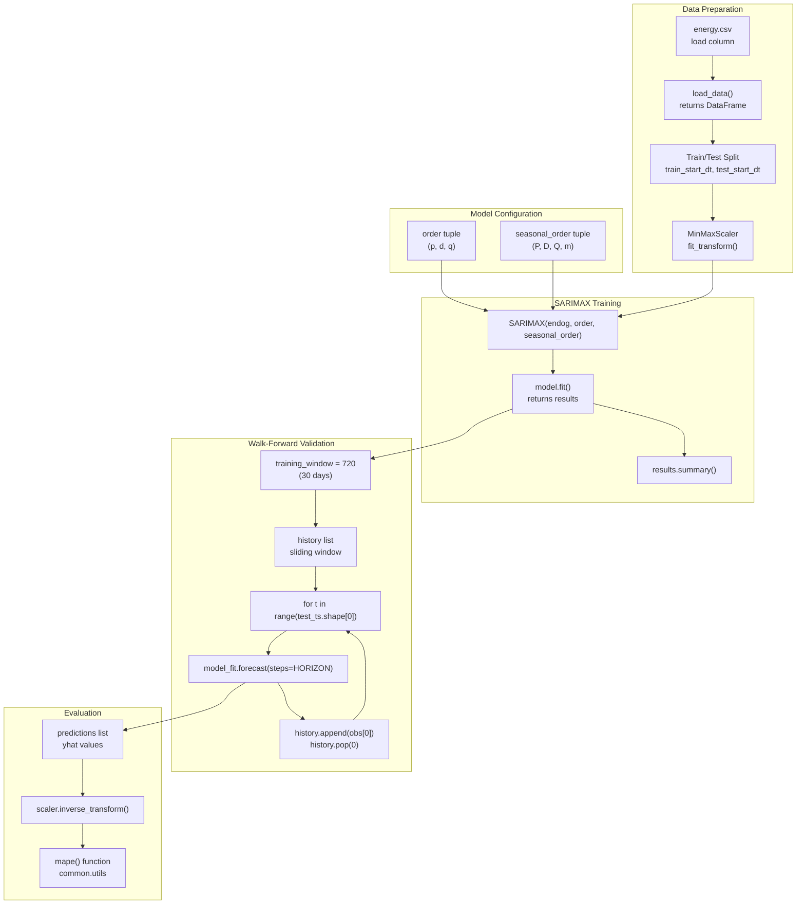
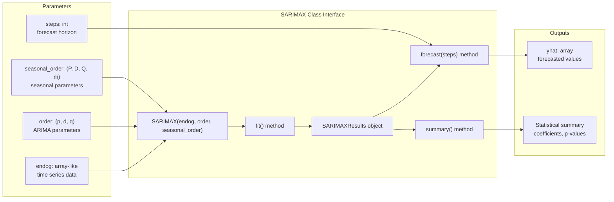
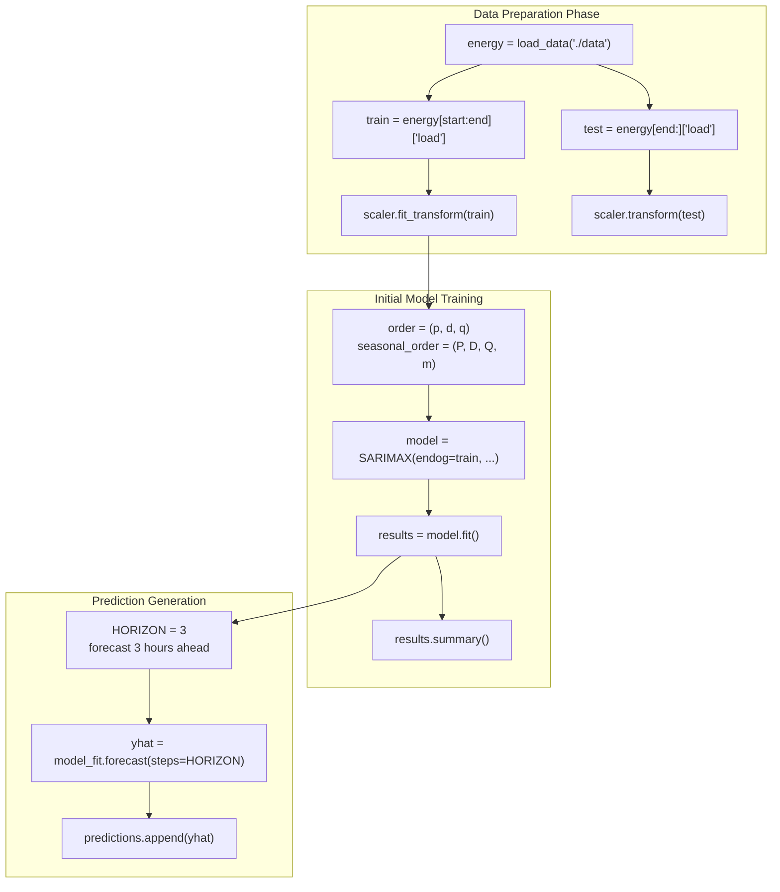
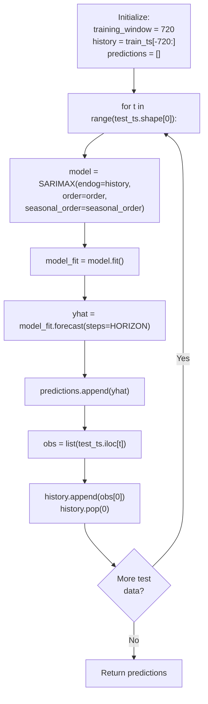
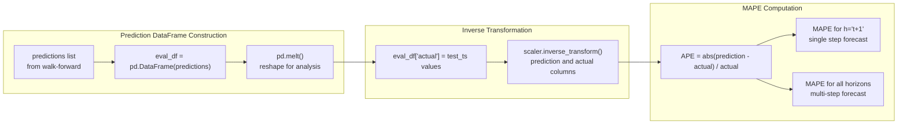

<!-- source: DeepWiki mcp.deepwiki.com · repo microsoft/ML-For-Beginners · extra page ARIMA and SARIMA Models · fetched 2026-10-26 -->

# ARIMA and SARIMA Models

<details>
<summary>Relevant source files</summary>

The following files were used as context for generating this wiki page:

- [7-TimeSeries/1-Introduction/README.md](7-TimeSeries/1-Introduction/README.md)
- [7-TimeSeries/2-ARIMA/README.md](7-TimeSeries/2-ARIMA/README.md)
- [7-TimeSeries/README.md](7-TimeSeries/README.md)

</details>


## Purpose and Scope

This document explains the implementation and usage of ARIMA (AutoRegressive Integrated Moving Average) and SARIMA (Seasonal ARIMA) models for time series forecasting in the ML-For-Beginners curriculum. These models are specifically designed to handle non-stationary time series data and predict future values based on historical patterns. The implementation uses the `statsmodels` library's `SARIMAX` class to forecast electricity load consumption.

For general time series concepts and data preparation, see [Time Series Data Processing and Evaluation](#5.2.2). For alternative time series approaches, see [Time Series Forecasting](#5.2).

Sources: [7-TimeSeries/2-ARIMA/README.md:1-50]()

## ARIMA Model Components

ARIMA models decompose time series forecasting into three fundamental components, each represented by a parameter:

| Component | Parameter | Description | Purpose |
|-----------|-----------|-------------|---------|
| **AutoRegressive (AR)** | `p` | Number of lag observations | Incorporates past values of the time series into predictions |
| **Integrated (I)** | `d` | Degree of differencing | Applies differencing to remove non-stationarity and trends |
| **Moving Average (MA)** | `q` | Size of moving average window | Uses past forecast errors to improve predictions |

### Stationarity and Differencing

**Stationarity** refers to data whose statistical properties (mean, variance) do not change over time. Non-stationary data exhibits trends or seasonal patterns that must be transformed before ARIMA modeling.

**Differencing** is the process of computing differences between consecutive observations to remove trends and achieve stationarity. The order of differencing is controlled by parameter `d`:
- `d=0`: No differencing (data is stationary)
- `d=1`: First-order differencing (subtracts previous value)
- `d=2`: Second-order differencing (differences the differences)

The implementation applies differencing automatically during model fitting to stabilize the mean of the time series.

Sources: [7-TimeSeries/2-ARIMA/README.md:15-33](), [7-TimeSeries/1-Introduction/README.md:45-51]()

## SARIMA Seasonal Extension

SARIMA extends ARIMA to handle seasonal patterns in data through additional parameters that model seasonal behavior separately from the trend:

| Parameter | Description | Usage |
|-----------|-------------|-------|
| `P` | Seasonal AR order | Number of seasonal lag observations |
| `D` | Seasonal differencing order | Degree of seasonal differencing |
| `Q` | Seasonal MA order | Size of seasonal moving average window |
| `m` | Seasonal period | Number of time steps per seasonal cycle (e.g., 24 for hourly data with daily seasonality) |

For electricity load data with hourly measurements, the seasonal period `m=24` captures daily patterns where consumption repeats every 24 hours.

Sources: [7-TimeSeries/2-ARIMA/README.md:176-183]()

## ARIMA/SARIMA Implementation Workflow



Sources: [7-TimeSeries/2-ARIMA/README.md:35-378]()

## SARIMAX Class and Methods

The `statsmodels.tsa.statespace.sarimax.SARIMAX` class provides the complete implementation for ARIMA and SARIMA models. The key interface is structured as follows:



### Implementation Example

The typical usage pattern instantiates `SARIMAX` with the training data and parameter specifications, then calls `fit()` to train:

[7-TimeSeries/2-ARIMA/README.md:196-204]()

```python
order = (4, 1, 0)
seasonal_order = (1, 1, 0, 24)

model = SARIMAX(endog=train, order=order, seasonal_order=seasonal_order)
results = model.fit()

print(results.summary())
```

Sources: [7-TimeSeries/2-ARIMA/README.md:54-58](), [7-TimeSeries/2-ARIMA/README.md:170-208]()

## Parameter Selection Strategy

Selecting optimal ARIMA parameters is computationally intensive and somewhat subjective. The implementation uses two approaches:

### Manual Parameter Selection

Manual tuning through experimentation and domain knowledge:

| Parameter Set | Values | Rationale |
|---------------|--------|-----------|
| `order` | (4, 1, 0) or (2, 1, 0) | AR component captures 2-4 hours of lag, first-order differencing removes trend, no MA component |
| `seasonal_order` | (1, 1, 0, 24) | Seasonal AR of 1, first-order seasonal differencing, 24-hour period for daily cycles |

[7-TimeSeries/2-ARIMA/README.md:196-204](), [7-TimeSeries/2-ARIMA/README.md:257-260]()

### Automated Parameter Selection

The implementation references the `auto_arima()` function from the `pyramid` library for automated parameter search, though it is not demonstrated in the provided notebooks. This function performs grid search across parameter combinations using information criteria (AIC/BIC) to identify optimal values.

Sources: [7-TimeSeries/2-ARIMA/README.md:184-194]()

## Model Training and Prediction Workflow



### Training Data Configuration

The implementation allocates specific time periods for training and testing:

| Dataset | Period | Duration | Purpose |
|---------|--------|----------|---------|
| Training | 2014-11-01 to 2014-12-29 | ~2 months | Model fitting |
| Testing | 2014-12-30 to 2014-12-31 | 2 days | Evaluation |

[7-TimeSeries/2-ARIMA/README.md:88-106]()

### Scaling Transformation

Before training, the implementation applies `MinMaxScaler` to normalize load values to the [0, 1] interval:

[7-TimeSeries/2-ARIMA/README.md:135-149]()

The scaler is fitted on training data and then applied to test data to prevent data leakage.

Sources: [7-TimeSeries/2-ARIMA/README.md:66-208]()

## Walk-Forward Validation

Walk-forward validation provides robust time series model evaluation by simulating real-world prediction scenarios where models are retrained as new data arrives.

### Validation Algorithm



### Implementation Details

The walk-forward loop maintains a sliding window of 720 hours (30 days) for training:

[7-TimeSeries/2-ARIMA/README.md:247-272]()

Key variables:
- `training_window = 720`: Fixed window size in hours
- `history`: List containing the current training window
- `predictions`: List accumulating forecasted values
- `obs`: Actual observed values from test set

At each iteration:
1. Train SARIMAX model on current `history` window
2. Forecast next `HORIZON` steps
3. Store predictions
4. Append actual observation to `history`
5. Remove oldest observation from `history` to maintain window size

Sources: [7-TimeSeries/2-ARIMA/README.md:210-286]()

## Evaluation with MAPE

Mean Absolute Percentage Error (MAPE) quantifies prediction accuracy as a percentage. The implementation uses a custom `mape()` function from `common.utils`:

[7-TimeSeries/2-ARIMA/README.md:54-58]()

### MAPE Formula

The MAPE calculation follows this formula:

$$MAPE = \frac{100}{n} \sum_{t=1}^{n} \left| \frac{actual_t - predicted_t}{actual_t} \right|$$

[7-TimeSeries/2-ARIMA/README.md:314-318]()

### MAPE Calculation Process



### MAPE Interpretation

[7-TimeSeries/2-ARIMA/README.md:329-346]()

The implementation reports two MAPE values:
- **One-step forecast MAPE**: Accuracy for predicting 1 time step ahead
- **Multi-step forecast MAPE**: Accuracy across all `HORIZON` steps

Lower MAPE indicates better accuracy. In the example:
- One-step MAPE: ~0.56%
- Multi-step MAPE: ~1.15%

A MAPE of 10% means predictions are off by 10% on average, so values below 2% indicate high accuracy.

Sources: [7-TimeSeries/2-ARIMA/README.md:287-346]()

## Model Persistence and Deployment

While not explicitly demonstrated in the ARIMA lesson, the general pattern for persisting trained models uses Python's `pickle` module, as shown in related time series work:

```python
import pickle

# Save model
with open('model.pkl', 'wb') as f:
    pickle.dump(results, f)

# Load model
with open('model.pkl', 'rb') as f:
    loaded_model = pickle.load(f)
```

For web deployment, see [RL Model Deployment with Flask](#5.3.3) which demonstrates the general Flask deployment pattern applicable to time series models.

Sources: [7-TimeSeries/2-ARIMA/README.md:35-378]()

## Data Preparation Requirements

The ARIMA/SARIMA implementation expects specific data structures and preprocessing:

### Input Data Format

| Requirement | Implementation | Code Reference |
|-------------|----------------|----------------|
| **Index** | DatetimeIndex with hourly frequency | `energy.index` |
| **Column** | Single column named 'load' containing values | `energy[['load']]` |
| **No missing values** | Data must be complete or interpolated | Assumed in preprocessing |
| **Numeric type** | Float64 after scaling | `scaler.fit_transform()` result |

[7-TimeSeries/2-ARIMA/README.md:66-72]()

### Time Series Splitting

Unlike random train/test splits in other ML tasks, time series requires **temporal splitting** to prevent future data leakage:

[7-TimeSeries/2-ARIMA/README.md:84-110]()

The split maintains chronological order: all training data comes before all test data.

Sources: [7-TimeSeries/2-ARIMA/README.md:66-165]()

## Common Parameter Configurations

Based on the electricity load forecasting implementation, typical parameter choices are:

### Conservative Configuration
```python
order = (2, 1, 0)
seasonal_order = (1, 1, 0, 24)
```
- Minimal AR lag (p=2)
- Single differencing (d=1)
- No MA component (q=0)
- Light seasonal AR (P=1)
- 24-hour seasonal period

### Extended Configuration
```python
order = (4, 1, 0)
seasonal_order = (1, 1, 0, 24)
```
- Extended AR lag (p=4) for more historical context
- Same differencing and seasonal structure

[7-TimeSeries/2-ARIMA/README.md:196-204](), [7-TimeSeries/2-ARIMA/README.md:257-260]()

The choice between configurations involves trade-offs:
- Higher `p` captures more historical dependencies but increases computation
- Higher `P` models stronger seasonal effects but may overfit
- Higher `d` or `D` removes more trend/seasonality but may over-difference

Sources: [7-TimeSeries/2-ARIMA/README.md:170-272]()

---

