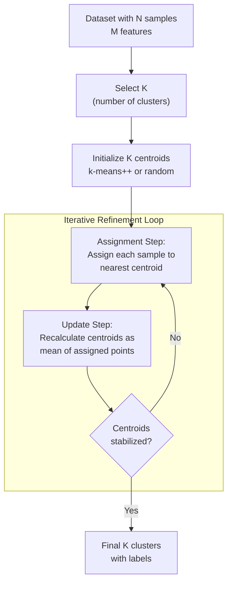
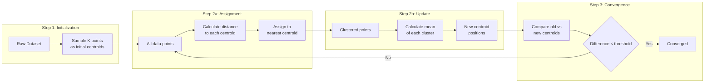
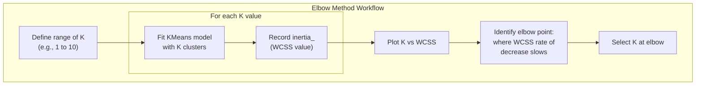
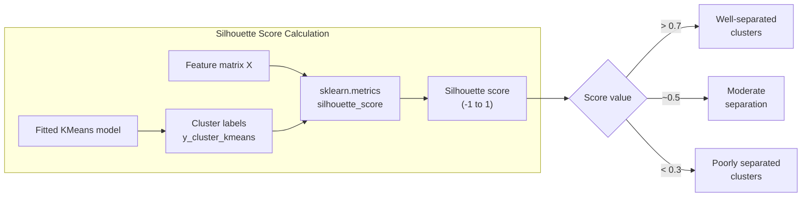
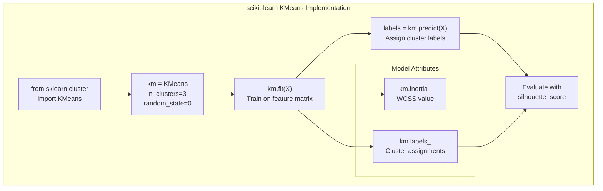
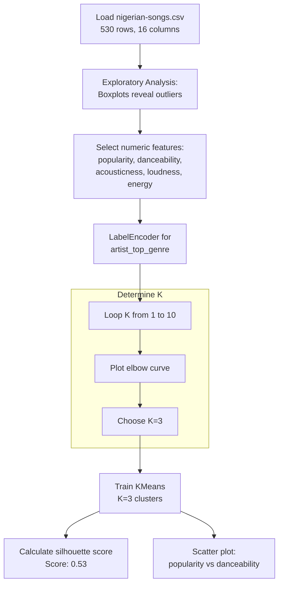

<!-- source: DeepWiki mcp.deepwiki.com · repo microsoft/ML-For-Beginners · extra page K-Means Clustering Algorithm · fetched 2026-10-26 -->

# K-Means Clustering Algorithm

<details>
<summary>Relevant source files</summary>

The following files were used as context for generating this wiki page:

- [5-Clustering/1-Visualize/README.md](5-Clustering/1-Visualize/README.md)
- [5-Clustering/2-K-Means/README.md](5-Clustering/2-K-Means/README.md)
- [6-NLP/1-Introduction-to-NLP/README.md](6-NLP/1-Introduction-to-NLP/README.md)
- [6-NLP/1-Introduction-to-NLP/images/comprehension.png](6-NLP/1-Introduction-to-NLP/images/comprehension.png)
- [6-NLP/2-Tasks/README.md](6-NLP/2-Tasks/README.md)
- [6-NLP/3-Translation-Sentiment/README.md](6-NLP/3-Translation-Sentiment/README.md)
- [6-NLP/3-Translation-Sentiment/images/monnaie.png](6-NLP/3-Translation-Sentiment/images/monnaie.png)
- [6-NLP/4-Hotel-Reviews-1/README.md](6-NLP/4-Hotel-Reviews-1/README.md)
- [6-NLP/5-Hotel-Reviews-2/README.md](6-NLP/5-Hotel-Reviews-2/README.md)
- [6-NLP/5-Hotel-Reviews-2/assignment.md](6-NLP/5-Hotel-Reviews-2/assignment.md)
- [6-NLP/5-Hotel-Reviews-2/solution/3-notebook.ipynb](6-NLP/5-Hotel-Reviews-2/solution/3-notebook.ipynb)
- [6-NLP/README.md](6-NLP/README.md)

</details>


## Purpose and Scope

This document explains the K-Means clustering algorithm as implemented in the ML-For-Beginners curriculum. K-Means is a centroid-based clustering technique that partitions unlabeled data into K distinct clusters by iteratively assigning data points to their nearest cluster centroid. This page covers the algorithm's mechanics, centroid initialization strategies, the iterative assignment process, methods for determining optimal K (elbow method, silhouette scoring), and techniques for handling outliers and data preparation.

For broader context on clustering approaches and use cases, see [Clustering](#4.1). For visualization techniques used to explore clustering results, see [Clustering Data Visualization](#4.1.2).

---

## Algorithm Overview

K-Means clustering derives from signal processing and uses a series of observations to divide data into K groups. Each observation is assigned to the cluster with the nearest mean (centroid), which serves as the cluster's center point. The algorithm minimizes the within-cluster variance by iteratively refining centroid positions based on the data points assigned to each cluster.

The algorithm operates on the principle of **Voronoi diagrams**, where each cluster corresponds to a region containing all points closer to that cluster's centroid than to any other centroid.



**Diagram: K-Means Algorithm Flow**

Sources: [5-Clustering/2-K-Means/README.md:14-30]()

---

## Algorithm Mechanics

### Three-Step Execution Process

The K-Means algorithm executes in three distinct steps:

1. **Initialization**: Select K center points by sampling from the dataset
2. **Iterative Loop**:
   - **Assignment**: Assign each sample to the nearest centroid
   - **Update**: Create new centroids by calculating the mean of all samples assigned to each previous centroid
   - **Convergence Check**: Calculate the difference between new and old centroids; repeat until centroids stabilize



**Diagram: K-Means Iterative Process**

Sources: [5-Clustering/2-K-Means/README.md:24-29]()

### Centroid Initialization

Scikit-learn's `KMeans` implementation supports **k-means++** initialization, which selects initial centroids that are generally distant from each other. This optimization leads to better results than random initialization by reducing the likelihood of poor local optima.

The implementation specifies initialization via the `init` parameter:

```python
km = KMeans(n_clusters=nclusters, random_state=seed)
```

The `random_state` parameter ensures reproducibility by determining random number generation for centroid initialization. The k-means++ algorithm (default in scikit-learn) probabilistically selects initial centers proportional to their squared distance from existing centers.

Sources: [5-Clustering/2-K-Means/README.md:162](), [5-Clustering/2-K-Means/README.md:109-113]()

### Iterative Assignment and Inertia

During each iteration, the algorithm attempts to minimize **inertia**, defined as the sum of squared distances of samples to their closest cluster center. This measure of internal cluster coherence drives the optimization process.

The **Within-Cluster Sum of Squares (WCSS)** accumulates across all iterations:

```python
wcss = []
for i in range(1, 11):
    kmeans = KMeans(n_clusters = i, init = 'k-means++', random_state = 42)
    kmeans.fit(X)
    wcss.append(kmeans.inertia_)
```

The `inertia_` attribute contains the WCSS value for the fitted model, representing the sum of squared distances of samples to their nearest cluster center.

Sources: [5-Clustering/2-K-Means/README.md:142-149](), [5-Clustering/2-K-Means/README.md:160]()

---

## Determining Optimal K

### The Elbow Method

One major limitation of K-Means is the requirement to pre-specify K (the number of clusters). The **elbow method** provides a heuristic for estimating an appropriate starting value by plotting WCSS against the number of clusters.



**Diagram: Elbow Method for K Selection**

The implementation iterates through candidate K values, fitting a model for each and recording the inertia:

```python
for i in range(1, 11):
    kmeans = KMeans(n_clusters = i, init = 'k-means++', random_state = 42)
    kmeans.fit(X)
    wcss.append(kmeans.inertia_)
```

The resulting plot shows WCSS decreasing as K increases. The "elbow" occurs where the rate of decrease sharply changes—indicating diminishing returns from adding more clusters. Visually, this appears as a bend in the curve.

```python
plt.figure(figsize=(10,5))
sns.lineplot(x=range(1, 11), y=wcss, marker='o', color='red')
plt.title('Elbow')
plt.xlabel('Number of clusters')
plt.ylabel('WCSS')
plt.show()
```

Sources: [5-Clustering/2-K-Means/README.md:164-179](), [5-Clustering/2-K-Means/README.md:142-149]()

### Within-Cluster Sum of Squares (WCSS)

WCSS measures the squared average distance of all points within a cluster to the cluster centroid. Lower WCSS indicates tighter, more coherent clusters. The formula sums squared distances:

WCSS = Σ (distance(point, centroid))² for all points in all clusters

The `inertia_` attribute provides this value directly after fitting:

```python
kmeans.fit(X)
wcss.append(kmeans.inertia_)
```

Sources: [5-Clustering/2-K-Means/README.md:158](), [5-Clustering/2-K-Means/README.md:160]()

---

## Cluster Quality Evaluation

### Silhouette Score

The **silhouette score** measures how well-separated clusters are, ranging from -1 to 1:

- **1**: Dense, well-separated clusters (ideal)
- **0**: Overlapping clusters with samples near decision boundaries
- **-1**: Samples likely assigned to wrong clusters



**Diagram: Silhouette Score Evaluation Workflow**

Implementation using scikit-learn:

```python
from sklearn import metrics
score = metrics.silhouette_score(X, y_cluster_kmeans)
```

For the Nigerian music dataset example, a score of **0.53** indicates moderate cluster quality—the data is not particularly well-suited to this clustering approach but provides learning opportunities.

Sources: [5-Clustering/2-K-Means/README.md:123-135](), [5-Clustering/2-K-Means/README.md:131-135]()

---

## Data Preparation and Outlier Handling

### Outlier Detection with Boxplots

Before applying K-Means, exploratory data analysis identifies outliers that could skew clustering results. Boxplots visualize the distribution of each feature, highlighting extreme values:

```python
plt.figure(figsize=(20,20), dpi=200)
plt.subplot(4,3,1)
sns.boxplot(x = 'popularity', data = df)
# ... additional subplots for other features
```

The visualization reveals outliers in several columns, presenting a choice: remove outliers (risking minimal remaining data) or accept noisy data and proceed.

Sources: [5-Clustering/2-K-Means/README.md:41-85]()

### Feature Selection and Encoding

K-Means requires numerical features with comparable scales. The implementation:

1. **Selects features** with similar ranges
2. **Encodes categorical variables** using `LabelEncoder`:

```python
from sklearn.preprocessing import LabelEncoder
le = LabelEncoder()

X = df.loc[:, ('artist_top_genre','popularity','danceability','acousticness','loudness','energy')]
y = df['artist_top_genre']

X['artist_top_genre'] = le.fit_transform(X['artist_top_genre'])
y = le.transform(y)
```

The `LabelEncoder` converts categorical `artist_top_genre` values into numerical labels, enabling distance calculations.

Sources: [5-Clustering/2-K-Means/README.md:89-102]()

### Variance and Data Scaling

The Nigerian music dataset exhibits high **variance**—defined as "the average of the squared differences from the Mean". When feature values diverge significantly from the mean, K-Means performance suffers because:

- Features with larger ranges dominate distance calculations
- Clusters form based on high-variance features, ignoring others
- The algorithm struggles to find well-demarcated cluster boundaries

The README suggests scaling data to normalize feature ranges:

```python
# Standard scaling makes data columns resemble each other more closely in terms of range
# This allows data with less variance to carry more weight
```

While scaling may reduce silhouette scores temporarily, it improves the elbow graph smoothness and gives equal weight to all features.

Sources: [5-Clustering/2-K-Means/README.md:222-235](), [5-Clustering/2-K-Means/README.md:216-219]()

---

## Implementation with scikit-learn

### Core KMeans Class

The implementation uses `sklearn.cluster.KMeans` with the following workflow:



**Diagram: scikit-learn KMeans API Usage**

Sources: [5-Clustering/2-K-Means/README.md:107-119](), [5-Clustering/2-K-Means/README.md:188-196]()

### Model Training and Prediction

The basic training flow:

```python
from sklearn.cluster import KMeans

nclusters = 3 
seed = 0

km = KMeans(n_clusters=nclusters, random_state=seed)
km.fit(X)

# Predict the cluster for each data point
y_cluster_kmeans = km.predict(X)
```

Key parameters:
- `n_clusters`: Number of clusters to form (K)
- `random_state`: Seed for reproducible centroid initialization
- `init`: Initialization method (defaults to 'k-means++')

Sources: [5-Clustering/2-K-Means/README.md:107-119]()

### Accuracy Assessment

Model accuracy is evaluated by comparing predicted clusters to known labels (when available):

```python
labels = kmeans.labels_

correct_labels = sum(y == labels)

print("Result: %d out of %d samples were correctly labeled." % (correct_labels, y.size))
print('Accuracy score: {0:0.2f}'. format(correct_labels/float(y.size)))
```

The Nigerian music dataset shows poor accuracy due to:
- Imbalanced data
- Low correlation between features
- High variance between column values
- Potential bias from predefined genre categories

Sources: [5-Clustering/2-K-Means/README.md:198-214]()

### Visualization of Results

Scatter plots visualize cluster assignments in 2D feature space:

```python
plt.scatter(df['popularity'],df['danceability'],c = labels)
plt.xlabel('popularity')
plt.ylabel('danceability')
plt.show()
```

The visualization helps diagnose issues like overlapping clusters or imbalanced cluster shapes, which indicate variance problems.

Sources: [5-Clustering/2-K-Means/README.md:186-196](), [5-Clustering/2-K-Means/README.md:210-220]()

---

## Application: Nigerian Music Dataset

The curriculum applies K-Means to classify Nigerian music tracks by genre using audio features:

| Feature | Description |
|---------|-------------|
| `artist_top_genre` | Genre label (target for validation) |
| `popularity` | Track popularity score |
| `danceability` | How suitable for dancing |
| `acousticness` | Acoustic vs electronic |
| `loudness` | Average loudness in dB |
| `energy` | Intensity and activity measure |

The dataset contains 530 entries across multiple features. After filtering to three major genres (`afro dancehall`, `afropop`, `nigerian pop`), the clustering attempts to discover patterns without using genre labels.

### Workflow



**Diagram: Nigerian Music Dataset Clustering Pipeline**

Sources: [5-Clustering/2-K-Means/README.md:33-248](), [5-Clustering/1-Visualize/README.md:112-131]()

### Challenges and Learnings

The dataset demonstrates several clustering challenges:

1. **Imbalanced data**: Three genres with unequal representation
2. **Low correlation**: Features show weak relationships (0.0 to 0.4)
3. **High variance**: Feature values diverge significantly from means
4. **Cluster shape**: Results show "variance problem" with poorly demarcated boundaries

These challenges make the dataset an excellent learning tool, highlighting when K-Means is not the optimal choice and prompting exploration of:
- Data scaling techniques
- Alternative feature selection
- Different clustering algorithms (DBSCAN, hierarchical, etc.)
- Parameter tuning strategies

Sources: [5-Clustering/2-K-Means/README.md:210-228](), [5-Clustering/2-K-Means/README.md:230-236]()

---

