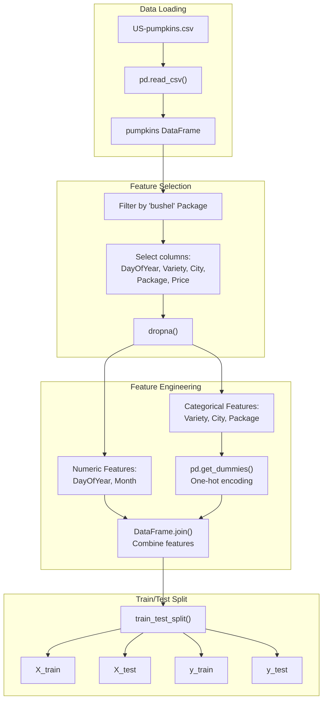
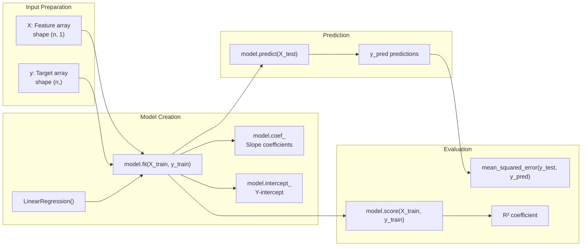
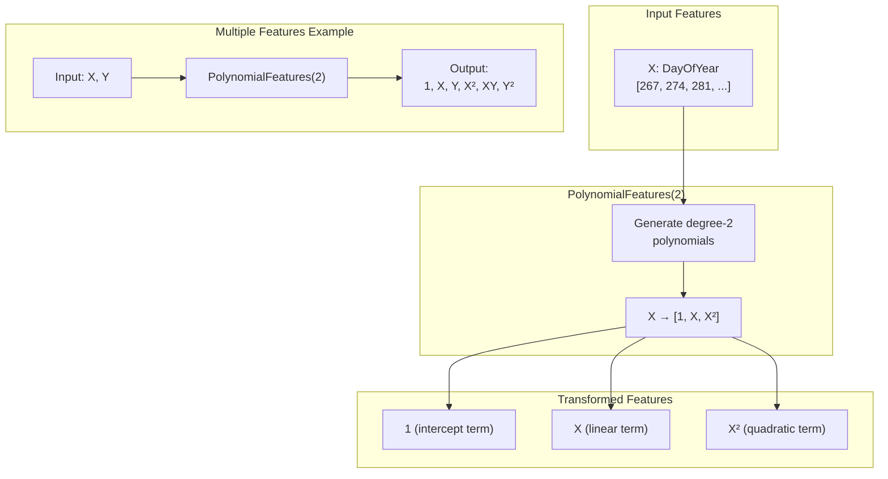
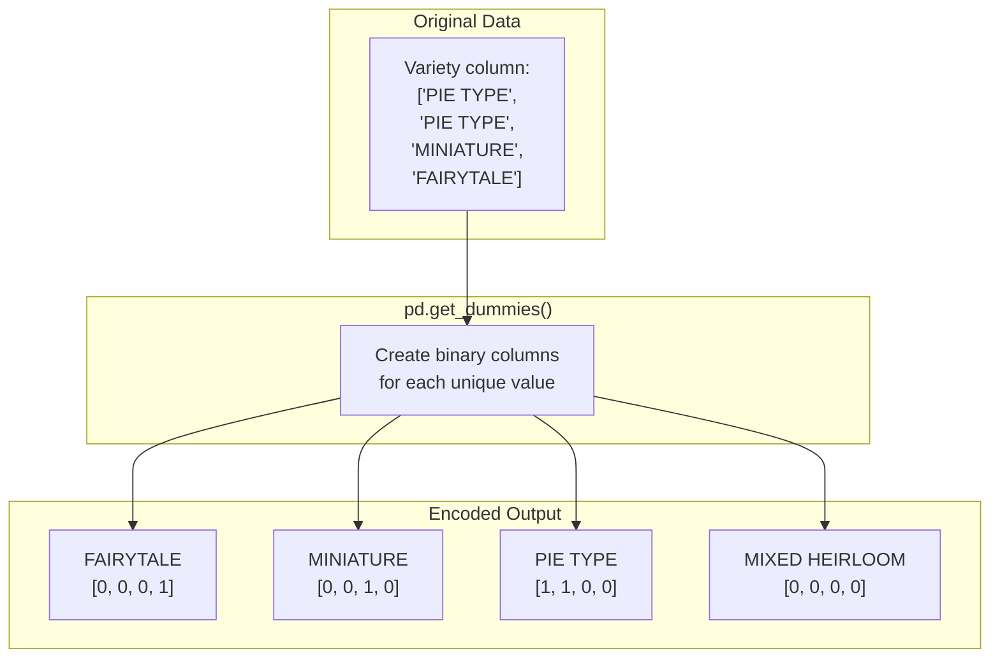
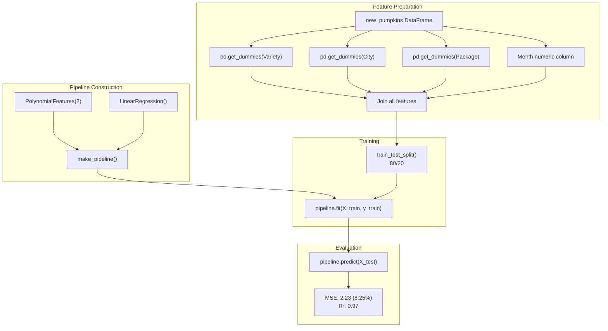

<!-- source: DeepWiki mcp.deepwiki.com · repo microsoft/ML-For-Beginners · extra page Linear and Polynomial Regression · fetched 2026-10-26 -->

# Linear and Polynomial Regression

<details>
<summary>Relevant source files</summary>

The following files were used as context for generating this wiki page:

- [2-Regression/1-Tools/README.md](2-Regression/1-Tools/README.md)
- [2-Regression/1-Tools/assignment.md](2-Regression/1-Tools/assignment.md)
- [2-Regression/2-Data/README.md](2-Regression/2-Data/README.md)
- [2-Regression/3-Linear/README.md](2-Regression/3-Linear/README.md)
- [2-Regression/3-Linear/assignment.md](2-Regression/3-Linear/assignment.md)
- [2-Regression/3-Linear/images/linear-results.png](2-Regression/3-Linear/images/linear-results.png)
- [2-Regression/3-Linear/images/pie-pumpkins-scatter.png](2-Regression/3-Linear/images/pie-pumpkins-scatter.png)
- [2-Regression/3-Linear/images/poly-results.png](2-Regression/3-Linear/images/poly-results.png)
- [2-Regression/3-Linear/images/price-by-variety.png](2-Regression/3-Linear/images/price-by-variety.png)
- [2-Regression/3-Linear/images/scatter-dayofyear-color.png](2-Regression/3-Linear/images/scatter-dayofyear-color.png)
- [2-Regression/3-Linear/images/scatter-dayofyear.png](2-Regression/3-Linear/images/scatter-dayofyear.png)
- [2-Regression/3-Linear/notebook.ipynb](2-Regression/3-Linear/notebook.ipynb)
- [2-Regression/3-Linear/solution/notebook.ipynb](2-Regression/3-Linear/solution/notebook.ipynb)
- [2-Regression/4-Logistic/README.md](2-Regression/4-Logistic/README.md)
- [3-Web-App/README.md](3-Web-App/README.md)
- [3-Web-App/images/ufo.jpg](3-Web-App/images/ufo.jpg)

</details>


This document covers the implementation of linear and polynomial regression models using scikit-learn to predict continuous values from the pumpkin pricing dataset. It details the mathematical foundations, model training workflows, evaluation metrics, and techniques for handling both numeric and categorical features.

For environment setup and library installation, see [Environment Setup and Tools](#3.1.1). For data cleaning and visualization techniques, see [Data Preparation and Visualization](#3.1.2). For binary classification using logistic regression, see [Logistic Regression](#3.1.4).

---

## Mathematical Foundation

### Least-Squares Regression

Linear regression aims to fit a line through data points that minimizes the cumulative squared distance from all points to the line. This "line of best fit" is determined using the least-squares method.

The linear equation is expressed as:

```
Y = a + bX
```

Where:
- `X` is the explanatory variable (input feature)
- `Y` is the dependent variable (target/output)
- `b` is the slope of the line
- `a` is the y-intercept (value of Y when X = 0)

The slope `b` is calculated by examining the relationship between X and Y values across all data points. The intercept `a` positions the line vertically.

**Key Concept**: The method squares the errors before summing them because we care about magnitude rather than direction of the error.

Sources: [2-Regression/3-Linear/README.md:39-73]()

### Correlation Coefficient

The correlation coefficient measures the strength of the linear relationship between variables. Values range from -1 to 1:
- Values near 1: strong positive correlation (good for linear regression)
- Values near 0: weak correlation (linear regression may not be appropriate)
- Values near -1: strong negative correlation

The correlation can be calculated using pandas DataFrame method `corr()`:

```python
correlation = df['feature'].corr(df['target'])
```

A scatterplot visualization helps assess whether the relationship is linear enough for linear regression.

Sources: [2-Regression/3-Linear/README.md:74-80]()

---

## Data Preparation Workflow

### Regression Pipeline Architecture



Sources: [2-Regression/3-Linear/README.md:82-159](), [2-Regression/3-Linear/notebook.ipynb:22-62](), [2-Regression/3-Linear/solution/notebook.ipynb:222-374]()

### Data Reshaping for scikit-learn

Linear regression in scikit-learn requires a 2D array where each row is a sample and each column is a feature. Single-feature data must be reshaped:

```python
X = df['feature'].to_numpy().reshape(-1, 1)
```

The `reshape(-1, 1)` converts a 1D array of shape `(n,)` to 2D shape `(n, 1)` where `-1` means "infer this dimension automatically."

Sources: [2-Regression/3-Linear/README.md:174-182]()

---

## Simple Linear Regression Implementation

### Training Workflow



Sources: [2-Regression/3-Linear/README.md:160-222]()

### Core Code Implementation

The basic linear regression training sequence:

```python
from sklearn.linear_model import LinearRegression
from sklearn.metrics import mean_squared_error
from sklearn.model_selection import train_test_split

# Prepare data
X = pie_pumpkins['DayOfYear'].to_numpy().reshape(-1, 1)
y = pie_pumpkins['Price']

# Split data
X_train, X_test, y_train, y_test = train_test_split(X, y, test_size=0.2, random_state=0)

# Train model
lin_reg = LinearRegression()
lin_reg.fit(X_train, y_train)

# Access learned parameters
slope = lin_reg.coef_  # Array of coefficients
intercept = lin_reg.intercept_  # Y-intercept value

# Make predictions
y_pred = lin_reg.predict(X_test)

# Evaluate
mse = np.sqrt(mean_squared_error(y_test, y_pred))
r2_score = lin_reg.score(X_train, y_train)
```

Sources: [2-Regression/3-Linear/README.md:166-213]()

### Learned Parameters

After calling `fit()`, the model learns:
- **Coefficients** (`coef_`): The slope(s) of the regression line. For single-feature regression, this is a single value representing how much Y changes per unit change in X.
- **Intercept** (`intercept_`): The predicted Y value when all features are zero.

In the pumpkin pricing example, a coefficient around `-0.017` means prices decrease by approximately 2 cents per day.

Sources: [2-Regression/3-Linear/README.md:189-196]()

---

## Polynomial Regression

### Motivation

Linear regression assumes a straight-line relationship between features and target. Real-world data often follows curved patterns. Polynomial regression fits these non-linear relationships by creating polynomial features.

For example, with feature X:
- Degree 1: X (linear)
- Degree 2: X, X²
- Degree 3: X, X², X³

Sources: [2-Regression/3-Linear/README.md:224-234]()

### PolynomialFeatures Transformation



Sources: [2-Regression/3-Linear/README.md:224-247]()

### Pipeline Implementation

Scikit-learn pipelines chain preprocessing and model training into a single object:

```python
from sklearn.preprocessing import PolynomialFeatures
from sklearn.pipeline import make_pipeline

# Create pipeline: polynomial features → linear regression
pipeline = make_pipeline(PolynomialFeatures(2), LinearRegression())

# Train (automatically applies PolynomialFeatures then LinearRegression)
pipeline.fit(X_train, y_train)

# Predict (automatically applies transformations)
y_pred = pipeline.predict(X_test)
```

The pipeline:
1. Applies `PolynomialFeatures(2)` to transform input features
2. Feeds transformed features to `LinearRegression`
3. Can be used like any other estimator (fit, predict, score)

Sources: [2-Regression/3-Linear/README.md:236-249]()

### Degree Selection

Higher polynomial degrees capture more complex patterns but risk overfitting. The pumpkin dataset shows:
- **Degree 1 (Linear)**: MSE 2.77, R² 0.07
- **Degree 2 (Polynomial)**: MSE 2.73, R² 0.08

The slight improvement suggests a weak parabolic relationship in the data.

Sources: [2-Regression/3-Linear/README.md:249-256](), [2-Regression/3-Linear/README.md:344-351]()

---

## Categorical Features

### Problem Statement

Features like `Variety`, `City`, and `Package` contain string values. Scikit-learn models require numeric inputs. Two encoding approaches exist:

1. **Numeric encoding**: Map categories to integers (0, 1, 2, ...). Not suitable for linear regression because it implies an ordinal relationship.
2. **One-hot encoding**: Create binary columns, one per category. Suitable for linear regression.

Sources: [2-Regression/3-Linear/README.md:259-274]()

### One-Hot Encoding with pandas



Sources: [2-Regression/3-Linear/README.md:259-292]()

### Implementation

```python
# One-hot encode categorical features
variety_encoded = pd.get_dummies(df['Variety'])
city_encoded = pd.get_dummies(df['City'])
package_encoded = pd.get_dummies(df['Package'])

# Combine with numeric features
X = variety_encoded \
    .join(df['Month']) \
    .join(city_encoded) \
    .join(package_encoded)

y = df['Price']

# Train as usual
X_train, X_test, y_train, y_test = train_test_split(X, y, test_size=0.2, random_state=0)
model = LinearRegression()
model.fit(X_train, y_train)
```

Each category becomes a coefficient in the model. For `Variety`, each coefficient represents the price adjustment for that specific pumpkin type.

Sources: [2-Regression/3-Linear/README.md:276-310]()

---

## Model Evaluation Metrics

### Mean Squared Error (MSE)

MSE measures the average squared difference between predictions and actual values:

```python
from sklearn.metrics import mean_squared_error
import numpy as np

pred = model.predict(X_test)
mse = np.sqrt(mean_squared_error(y_test, pred))  # Root MSE
```

Lower MSE indicates better predictions. The square root (RMSE) returns error to the original units (dollars in the pumpkin example).

Sources: [2-Regression/3-Linear/README.md:198-205]()

### Coefficient of Determination (R²)

R² measures how well the model explains variance in the target variable:

```python
score = model.score(X_train, y_train)
```

**Interpretation**:
- R² = 0: Model performs no better than predicting the mean value
- R² = 1: Model perfectly predicts all values
- R² < 0: Model performs worse than mean predictor

The pumpkin pricing models achieved:

| Model Configuration | MSE | R² |
|---------------------|-----|-----|
| DayOfYear only (Linear) | 2.77 (17.2%) | 0.07 |
| DayOfYear only (Polynomial) | 2.73 (17.0%) | 0.08 |
| Variety only (Linear) | 5.24 (19.7%) | 0.77 |
| All features (Linear) | 2.84 (10.5%) | 0.94 |
| All features (Polynomial) | 2.23 (8.25%) | 0.97 |

The final model using all features with polynomial terms achieves 97% accuracy, predicting prices within ~8% error.

Sources: [2-Regression/3-Linear/README.md:207-213](), [2-Regression/3-Linear/README.md:344-352]()

---

## Complete Implementation Example

### Full Pipeline with All Features



Sources: [2-Regression/3-Linear/README.md:312-342]()

### Code

```python
# Prepare features
X = pd.get_dummies(new_pumpkins['Variety']) \
        .join(new_pumpkins['Month']) \
        .join(pd.get_dummies(new_pumpkins['City'])) \
        .join(pd.get_dummies(new_pumpkins['Package']))
y = new_pumpkins['Price']

# Split data
X_train, X_test, y_train, y_test = train_test_split(
    X, y, test_size=0.2, random_state=0
)

# Create and train pipeline
pipeline = make_pipeline(PolynomialFeatures(2), LinearRegression())
pipeline.fit(X_train, y_train)

# Predict and evaluate
pred = pipeline.predict(X_test)

mse = np.sqrt(mean_squared_error(y_test, pred))
print(f'Mean error: {mse:3.3} ({mse/np.mean(pred)*100:3.3}%)')

score = pipeline.score(X_train, y_train)
print('Model determination:', score)
```

This achieves the best results by combining:
- Multiple categorical features (Variety, City, Package) via one-hot encoding
- A numeric feature (Month)
- Polynomial degree-2 transformations of all combined features

Sources: [2-Regression/3-Linear/README.md:314-342]()

---

## Key Classes and Functions

### scikit-learn Components

| Component | Module | Purpose |
|-----------|--------|---------|
| `LinearRegression` | `sklearn.linear_model` | Fits linear models using least squares |
| `PolynomialFeatures` | `sklearn.preprocessing` | Generates polynomial and interaction features |
| `make_pipeline` | `sklearn.pipeline` | Chains transformers and estimator into single object |
| `train_test_split` | `sklearn.model_selection` | Splits data into training and test sets |
| `mean_squared_error` | `sklearn.metrics` | Calculates MSE between predictions and actual values |

Sources: [2-Regression/3-Linear/README.md:166-171](), [2-Regression/3-Linear/README.md:236-242]()

### pandas Methods

| Method | Purpose |
|--------|---------|
| `pd.read_csv()` | Load CSV data into DataFrame |
| `pd.get_dummies()` | One-hot encode categorical columns |
| `DataFrame.join()` | Combine DataFrames horizontally |
| `Series.to_numpy()` | Convert Series to numpy array |
| `DataFrame.corr()` | Calculate correlation between columns |

Sources: [2-Regression/3-Linear/README.md:114-119](), [2-Regression/3-Linear/README.md:279-308]()

### Model Methods

| Method | Returns | Description |
|--------|---------|-------------|
| `fit(X, y)` | self | Train model on feature matrix X and target y |
| `predict(X)` | array | Generate predictions for input features X |
| `score(X, y)` | float | Return R² coefficient of determination |
| `.coef_` | array | Learned feature coefficients (slopes) |
| `.intercept_` | float | Learned y-intercept |

Sources: [2-Regression/3-Linear/README.md:180-213]()

---

## Usage Patterns

### When to Use Linear vs Polynomial Regression

**Use Linear Regression when**:
- Scatterplot shows approximately linear relationship
- Correlation coefficient is high (> 0.7 or < -0.7)
- Simplicity and interpretability are priorities

**Use Polynomial Regression when**:
- Scatterplot shows curved patterns
- Linear model has poor fit (low R²)
- Data follows parabolic, cubic, or other polynomial patterns

**Warning**: Higher polynomial degrees risk overfitting. Cross-validation should be used to select appropriate degree.

Sources: [2-Regression/3-Linear/README.md:224-256]()

### Handling Missing Data

Before training, remove or impute missing values:

```python
# Remove rows with any missing values
df.dropna(inplace=True)

# Or fill missing values with column mean
df['column'].fillna(df['column'].mean(), inplace=True)
```

Linear regression cannot handle missing values in the input data.

Sources: [2-Regression/3-Linear/README.md:151-158]()

### Feature Selection Strategy

The pumpkin dataset demonstrates feature importance:

1. **Day/Month alone**: Poor performance (R² ≈ 0.07)
2. **Variety alone**: Moderate performance (R² ≈ 0.77)
3. **All features combined**: Excellent performance (R² ≈ 0.97)

This indicates that `Variety` is the most predictive feature, but combining all features yields the best model. Use correlation analysis and iterative testing to identify important features.

Sources: [2-Regression/3-Linear/README.md:100-149](), [2-Regression/3-Linear/README.md:344-352]()

---

