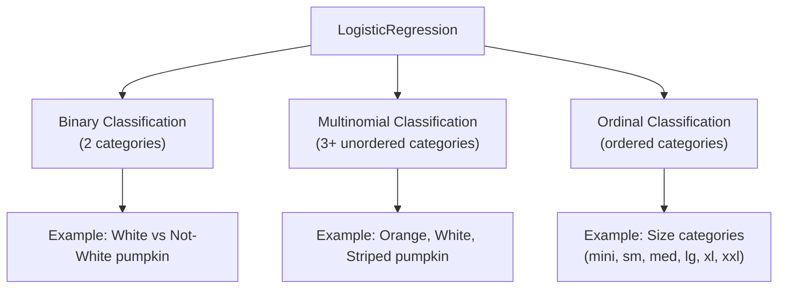
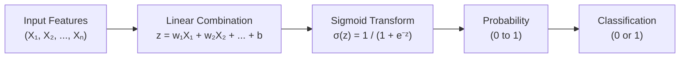
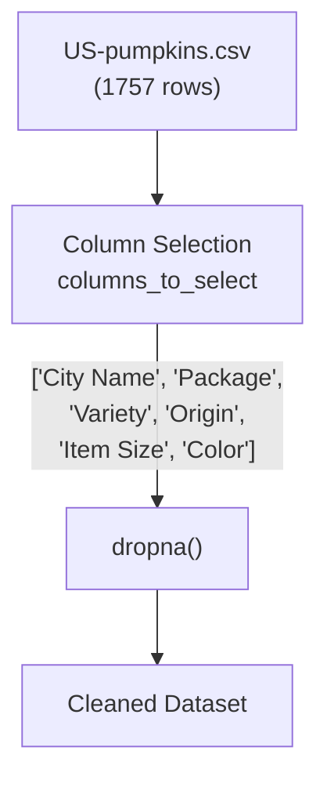
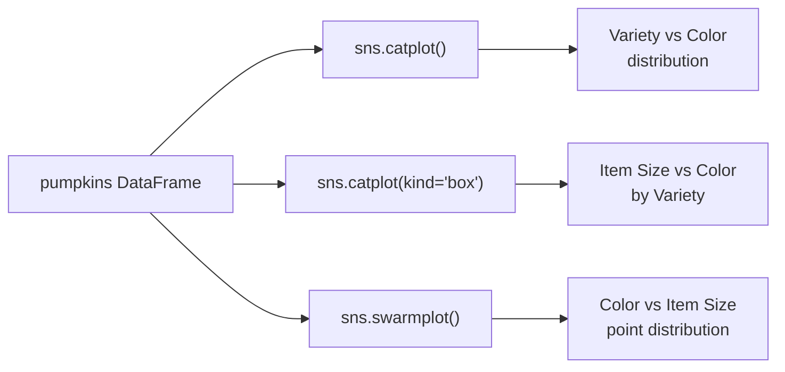
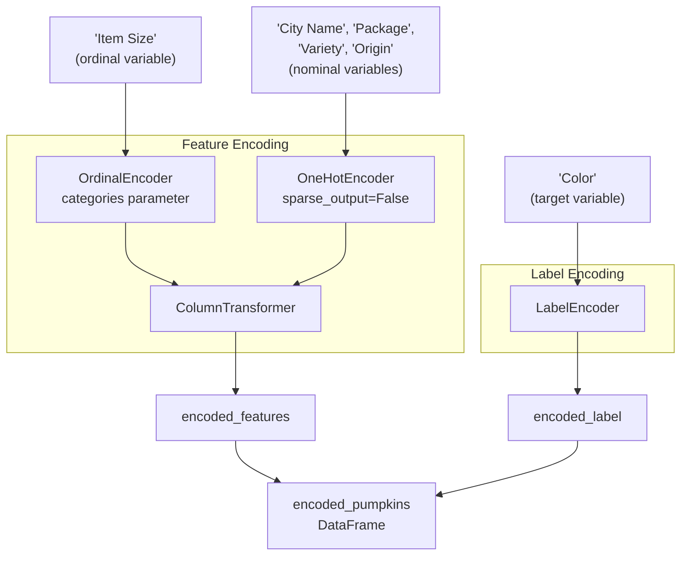
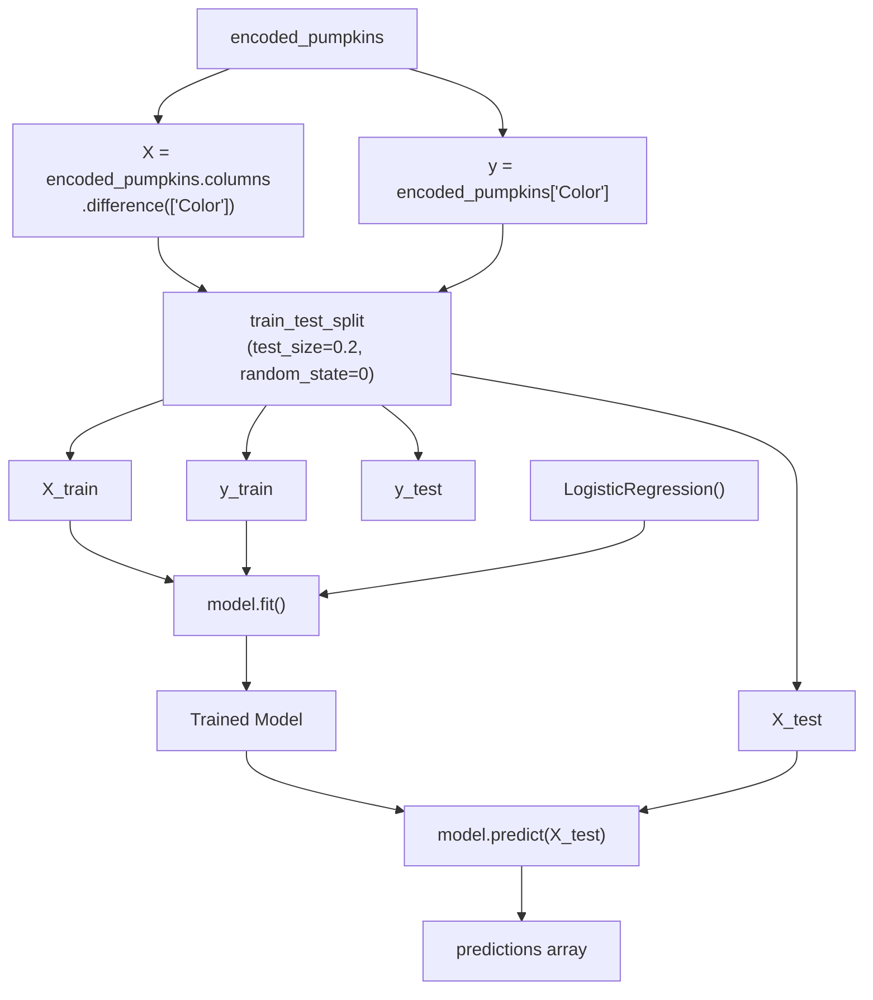
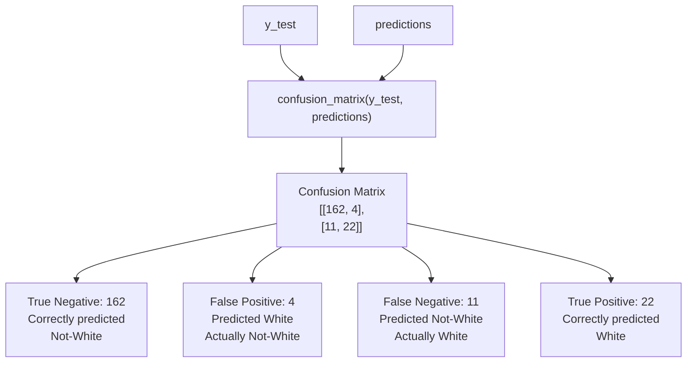
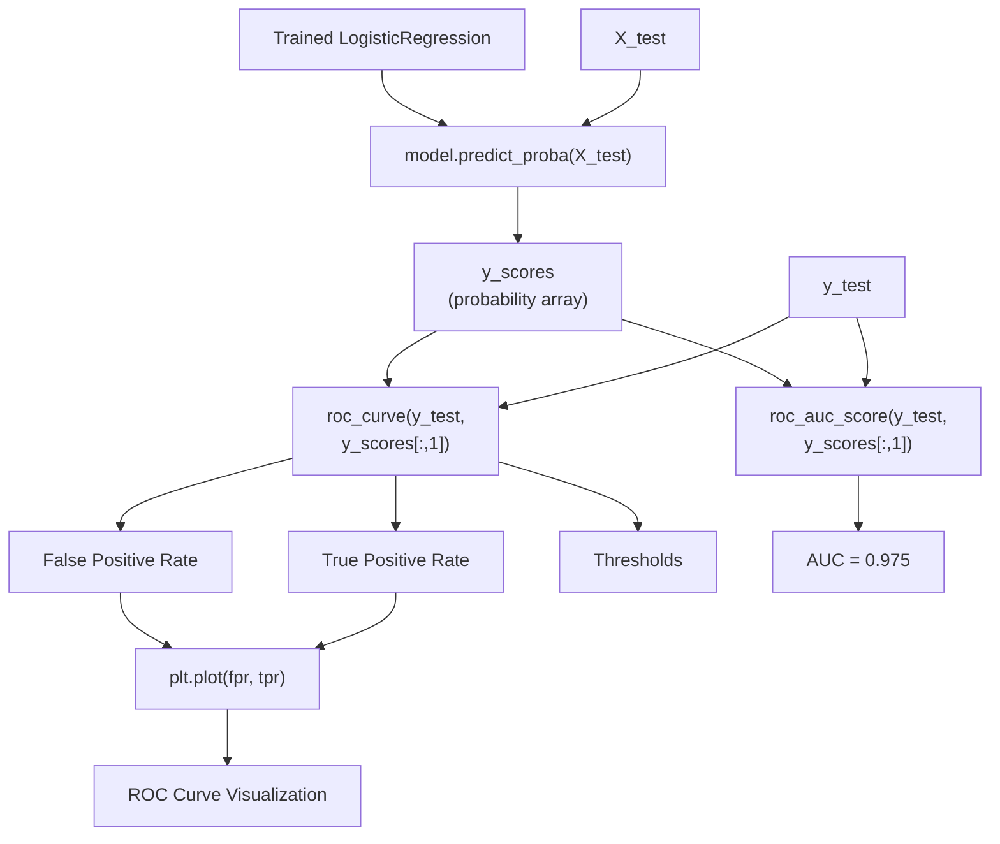

<!-- source: DeepWiki mcp.deepwiki.com · repo microsoft/ML-For-Beginners · extra page Logistic Regression · fetched 2026-10-26 -->

# Logistic Regression

<details>
<summary>Relevant source files</summary>

The following files were used as context for generating this wiki page:

- [2-Regression/1-Tools/README.md](2-Regression/1-Tools/README.md)
- [2-Regression/2-Data/README.md](2-Regression/2-Data/README.md)
- [2-Regression/3-Linear/README.md](2-Regression/3-Linear/README.md)
- [2-Regression/4-Logistic/README.md](2-Regression/4-Logistic/README.md)

</details>


## Purpose and Scope

This page documents the logistic regression implementation used for binary classification tasks in the ML-For-Beginners curriculum. Logistic regression is presented as the final technique in the Regression module, where it bridges the gap between regression and classification methods. The primary use case demonstrated is predicting pumpkin color (orange vs. white) from categorical and numeric features.

For environment setup and tools, see [Environment Setup and Tools](#3.1.1). For data preparation techniques, see [Data Preparation and Visualization](#3.1.2). For understanding linear regression fundamentals, see [Linear and Polynomial Regression](#3.1.3). For multiclass classification with multiple algorithms, see [Classification](#3.2).

**Sources:** [2-Regression/4-Logistic/README.md:1-26]()

## Logistic Regression Overview

Despite its name, logistic regression is a **classification method** rather than a regression technique. It is categorized under regression for historical and mathematical reasons, as it uses a linear-based approach to predict categorical outcomes. The algorithm predicts the probability that an instance belongs to a particular class, making it suitable for binary classification problems such as:

- White pumpkin vs. Not white
- Chocolate candy vs. Not chocolate
- Contagious disease vs. Not contagious
- Customer will purchase vs. Will not purchase

### Distinction from Linear Regression

| Aspect | Linear Regression | Logistic Regression |
|--------|------------------|---------------------|
| **Output Type** | Continuous numeric values | Binary categories (0 or 1) |
| **Prediction Function** | Linear equation (y = a + bX) | Sigmoid function (S-curve) |
| **Use Case** | Price prediction, quantity estimation | Category assignment, probability prediction |
| **Variable Correlation** | Better with correlated variables | Variables don't need to correlate |
| **Evaluation Metrics** | MSE, R², RMSE | Precision, Recall, F1-score, Confusion Matrix, ROC-AUC |

### Types of Logistic Regression



**Sources:** [2-Regression/4-Logistic/README.md:34-55](), [2-Regression/4-Logistic/README.md:9-26]()

## Theoretical Foundation: Sigmoid Function

Logistic regression relies on the **sigmoid function** (also called logistic function) to map any real-valued input to a probability value between 0 and 1. The sigmoid function has an S-shaped curve defined by:

**Mathematical Representation:**

The sigmoid transforms a linear combination of features into a probability:

- If sigmoid output > 0.5 → Classify as class 1
- If sigmoid output ≤ 0.5 → Classify as class 0

The sigmoid's midpoint occurs at x=0, where the function outputs 0.5. The parameters L (curve's maximum value) and k (curve's steepness) control the shape. The model learns optimal weights through maximum likelihood estimation, adjusting weights to maximize the probability of observing the training data.



**Sources:** [2-Regression/4-Logistic/README.md:216-222]()

## Data Preparation Pipeline for Pumpkin Classification

The logistic regression implementation uses the pumpkin pricing dataset, focusing on the `Color` column as the binary target variable (ORANGE=0, WHITE=1). The pipeline requires several preprocessing steps before model training.

### Initial Data Selection and Cleaning



The initial preprocessing selects relevant columns and removes null values using `pumpkins.dropna(inplace=True)`. This ensures the dataset contains only complete records for training.

**Sources:** [2-Regression/4-Logistic/README.md:72-90]()

### Visualization with Seaborn

The implementation uses `seaborn.catplot()` for exploratory data analysis, displaying the distribution of pumpkin varieties by color. This categorical plot reveals relationships between the `Variety`, `Item Size`, and `Color` features before encoding.



**Sources:** [2-Regression/4-Logistic/README.md:92-213]()

## Feature Encoding System

Categorical variables must be converted to numeric format for machine learning algorithms. The implementation uses scikit-learn's encoding utilities to transform string values into numerical representations.

### Encoding Architecture



### Ordinal Encoding for Item Size

`OrdinalEncoder` is used for the `Item Size` column because pumpkin sizes follow a logical ordering. The encoding maps each size category to an integer preserving the natural order:

```python
item_size_categories = [['sml', 'med', 'med-lge', 'lge', 'xlge', 'jbo', 'exjbo']]
ordinal_features = ['Item Size']
ordinal_encoder = OrdinalEncoder(categories=item_size_categories)
```

**Sources:** [2-Regression/4-Logistic/README.md:125-133]()

### One-Hot Encoding for Nominal Features

`OneHotEncoder` transforms nominal categorical variables (no logical order) into binary columns. Each category becomes a separate column with 1 indicating presence and 0 indicating absence:

```python
categorical_features = ['City Name', 'Package', 'Variety', 'Origin']
categorical_encoder = OneHotEncoder(sparse_output=False)
```

**Sources:** [2-Regression/4-Logistic/README.md:135-142]()

### ColumnTransformer Integration

`ColumnTransformer` combines multiple encoders into a single transformation step, applying each encoder to its designated columns:

```python
ct = ColumnTransformer(transformers=[
    ('ord', ordinal_encoder, ordinal_features),
    ('cat', categorical_encoder, categorical_features)
])
ct.set_output(transform='pandas')
encoded_features = ct.fit_transform(pumpkins)
```

**Sources:** [2-Regression/4-Logistic/README.md:144-155]()

### Label Encoding for Binary Target

`LabelEncoder` transforms the `Color` column (ORANGE, WHITE) into numeric labels (0, 1):

```python
label_encoder = LabelEncoder()
encoded_label = label_encoder.fit_transform(pumpkins['Color'])
```

The encoded features and label are then merged: `encoded_pumpkins = encoded_features.assign(Color=encoded_label)`

**Sources:** [2-Regression/4-Logistic/README.md:156-168]()

## Model Training Workflow

The logistic regression model follows scikit-learn's standard fit-predict pattern. The workflow involves data splitting, model initialization, training, and prediction.

### Training Pipeline



### Code Implementation

The model is instantiated and trained with minimal configuration:

```python
from sklearn.linear_model import LogisticRegression
from sklearn.model_selection import train_test_split
from sklearn.metrics import f1_score, classification_report

model = LogisticRegression()
model.fit(X_train, y_train)
predictions = model.predict(X_test)
```

**Sources:** [2-Regression/4-Logistic/README.md:232-257]()

### Training Results

The trained model achieves the following performance on the test set (approximately 199 samples):

| Metric | Class 0 (Orange) | Class 1 (White) | Overall |
|--------|------------------|-----------------|---------|
| **Precision** | 0.94 | 0.85 | - |
| **Recall** | 0.98 | 0.67 | - |
| **F1-Score** | 0.96 | 0.75 | - |
| **Support** | 166 | 33 | - |
| **Accuracy** | - | - | 0.92 |
| **Macro Avg** | - | - | 0.85 |
| **Weighted Avg** | - | - | 0.92 |

The overall F1-score is 0.746, indicating reasonable but imperfect classification performance given the small dataset size.

**Sources:** [2-Regression/4-Logistic/README.md:259-278]()

## Evaluation Framework

The evaluation system uses multiple complementary metrics to assess model performance from different perspectives.

### Confusion Matrix Analysis

A confusion matrix displays the model's true positives (TP), true negatives (TN), false positives (FP), and false negatives (FN):



In scikit-learn's confusion matrix:
- **Rows (axis 0)**: Actual labels
- **Columns (axis 1)**: Predicted labels

| | Predicted 0 (Not-White) | Predicted 1 (White) |
|---|---|---|
| **Actual 0** | TN = 162 | FP = 4 |
| **Actual 1** | FN = 11 | TP = 22 |

**Sources:** [2-Regression/4-Logistic/README.md:280-322]()

### Metric Definitions

All evaluation metrics are derived from the confusion matrix components:

| Metric | Formula | Interpretation | Value |
|--------|---------|----------------|-------|
| **Precision** | TP/(TP + FP) | Fraction of correct positive predictions | 22/(22+4) = 0.846 |
| **Recall** | TP/(TP + FN) | Fraction of actual positives correctly identified | 22/(22+11) = 0.667 |
| **F1-Score** | 2×(Precision×Recall)/(Precision+Recall) | Harmonic mean of precision and recall | 0.746 |
| **Accuracy** | (TP+TN)/(TP+TN+FP+FN) | Overall correct predictions | (22+162)/199 = 0.925 |
| **Support** | - | Number of occurrences of each label | 166, 33 |

The implementation uses `classification_report()` to generate these metrics automatically:

```python
from sklearn.metrics import classification_report
print(classification_report(y_test, predictions))
```

**Sources:** [2-Regression/4-Logistic/README.md:324-340]()

### Macro vs. Weighted Averages

- **Macro Average**: Unweighted mean across all classes (treats each class equally regardless of support)
- **Weighted Average**: Mean weighted by support (accounts for class imbalance)

In the pumpkin classification:
- Macro avg: 0.89 precision, 0.82 recall, 0.85 f1-score
- Weighted avg: 0.92 precision, 0.92 recall, 0.92 f1-score

The weighted average is higher because the majority class (orange pumpkins) has better performance.

**Sources:** [2-Regression/4-Logistic/README.md:336-338]()

## ROC Curve and AUC Analysis

The Receiver Operating Characteristic (ROC) curve visualizes the trade-off between true positive rate (sensitivity) and false positive rate (1 - specificity) across different classification thresholds.

### ROC Curve Generation



### Implementation Code

```python
from sklearn.metrics import roc_curve, roc_auc_score

# Get probability predictions
y_scores = model.predict_proba(X_test)
fpr, tpr, thresholds = roc_curve(y_test, y_scores[:,1])

# Plot ROC curve
plt.plot([0, 1], [0, 1], 'k--')  # Diagonal reference line
plt.plot(fpr, tpr)
plt.xlabel('False Positive Rate')
plt.ylabel('True Positive Rate')
plt.title('ROC Curve')
plt.show()

# Calculate AUC
auc = roc_auc_score(y_test, y_scores[:,1])
```

**Sources:** [2-Regression/4-Logistic/README.md:350-378]()

### ROC Curve Interpretation

The ROC curve characteristics indicate model quality:

- **Diagonal line (y=x)**: Random classifier baseline
- **Curve above diagonal**: Better than random
- **Curve closer to top-left corner**: Better performance (high TPR, low FPR)
- **Steepness**: Faster the curve rises, better the model discriminates

The pumpkin classification model produces an AUC of **0.975**, which indicates excellent discriminative ability:

- AUC = 1.0: Perfect classification
- AUC = 0.9-1.0: Excellent
- AUC = 0.8-0.9: Good
- AUC = 0.7-0.8: Fair
- AUC = 0.5: No discriminative ability (random)

The high AUC (0.975) combined with the visual ROC curve shape confirms the model is "pretty good" at distinguishing white pumpkins from orange pumpkins.

**Sources:** [2-Regression/4-Logistic/README.md:368-378]()

## Data Requirements and Considerations

### Dataset Size Requirements

Logistic regression requires substantial clean data for accurate results. The implementation notes that with approximately 1000 rows (reduced to ~400 after filtering for specific columns), the dataset is not optimal but sufficient for educational purposes. Larger datasets typically produce more reliable models.

**Sources:** [2-Regression/4-Logistic/README.md:62-64]()

### Variable Independence

Unlike linear regression which benefits from correlated variables, logistic regression works better with independent variables. The pumpkin dataset has "somewhat weak correlations" between features, which is actually advantageous for logistic regression.

**Sources:** [2-Regression/4-Logistic/README.md:58-60]()

### Key Preprocessing Requirements

1. **Null value removal**: `pumpkins.dropna(inplace=True)` ensures complete records
2. **Categorical encoding**: All non-numeric features must be encoded
3. **Target variable formatting**: Binary labels must be 0 and 1
4. **Feature selection**: Irrelevant columns should be excluded from `X`

**Sources:** [2-Regression/4-Logistic/README.md:72-90](), [2-Regression/4-Logistic/README.md:120-168]()

## Relationship to Other Classification Methods

While this lesson focuses on logistic regression, the curriculum extends to more advanced classification techniques in the Classification module ([see Classification](#3.2)). The progression includes:

- **Logistic Regression**: Linear-based binary classification (current page)
- **Support Vector Machines (SVC)**: Finds optimal separating hyperplane
- **K-Neighbors (KNN)**: Instance-based classification
- **Random Forest**: Ensemble of decision trees
- **ONNX Deployment**: Model conversion for web deployment

The transition from logistic regression (section 3.1.4) to multiclass classification (section 3.2) demonstrates how binary classification concepts extend to more complex scenarios with multiple categories and algorithms.

**Sources:** [2-Regression/4-Logistic/README.md:380-395](), [2-Regression/1-Tools/README.md:104]()

---

