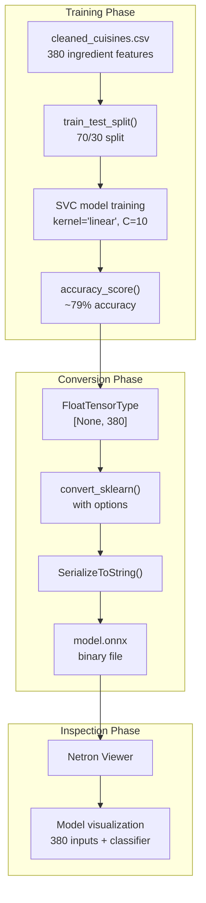
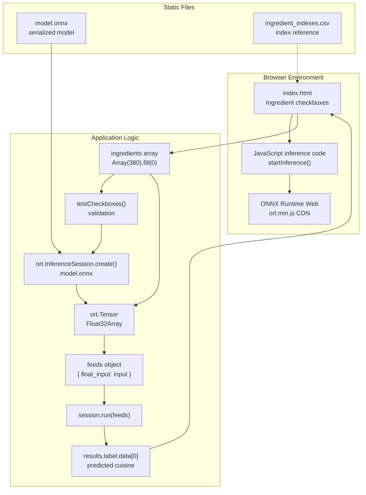
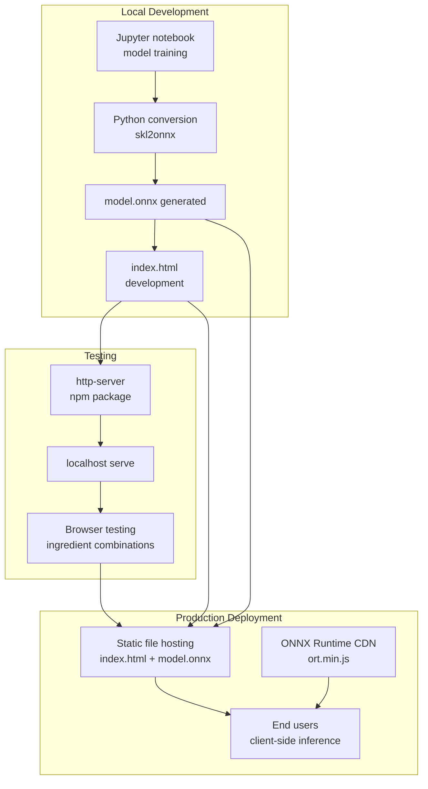

<!-- source: DeepWiki mcp.deepwiki.com · repo microsoft/ML-For-Beginners · extra page Model Deployment with ONNX · fetched 2026-10-26 -->

# Model Deployment with ONNX

<details>
<summary>Relevant source files</summary>

The following files were used as context for generating this wiki page:

- [4-Classification/1-Introduction/README.md](4-Classification/1-Introduction/README.md)
- [4-Classification/1-Introduction/assignment.md](4-Classification/1-Introduction/assignment.md)
- [4-Classification/1-Introduction/notebook.ipynb](4-Classification/1-Introduction/notebook.ipynb)
- [4-Classification/1-Introduction/solution/notebook.ipynb](4-Classification/1-Introduction/solution/notebook.ipynb)
- [4-Classification/2-Classifiers-1/README.md](4-Classification/2-Classifiers-1/README.md)
- [4-Classification/2-Classifiers-1/notebook.ipynb](4-Classification/2-Classifiers-1/notebook.ipynb)
- [4-Classification/2-Classifiers-1/solution/notebook.ipynb](4-Classification/2-Classifiers-1/solution/notebook.ipynb)
- [4-Classification/3-Classifiers-2/README.md](4-Classification/3-Classifiers-2/README.md)
- [4-Classification/3-Classifiers-2/notebook.ipynb](4-Classification/3-Classifiers-2/notebook.ipynb)
- [4-Classification/3-Classifiers-2/solution/notebook.ipynb](4-Classification/3-Classifiers-2/solution/notebook.ipynb)
- [4-Classification/4-Applied/README.md](4-Classification/4-Applied/README.md)
- [4-Classification/4-Applied/notebook.ipynb](4-Classification/4-Applied/notebook.ipynb)
- [4-Classification/README.md](4-Classification/README.md)

</details>


## Purpose and Scope

This document explains the process of converting trained scikit-learn classification models to ONNX (Open Neural Network Exchange) format and deploying them in web applications for client-side inference. The content covers model serialization using `skl2onnx`, model inspection with Netron, and integration with ONNX Runtime in browser-based JavaScript applications.

For information about training classification models, see [Classification Algorithms Comparison](#3.2.2). For general web deployment patterns using Flask and pickle serialization, see [RL Model Deployment with Flask](#5.3.3).

## ONNX Format Overview

ONNX provides a standardized format for representing machine learning models that can be executed across different platforms and frameworks without requiring the original training environment. This enables deployment scenarios where Python dependencies are unavailable or undesirable, such as browser-based JavaScript applications.

### Conversion Requirements

The conversion process from scikit-learn to ONNX requires the `skl2onnx` package, which translates scikit-learn model objects into the ONNX protobuf format. Key components include:

| Component | Purpose |
|-----------|---------|
| `convert_sklearn()` | Primary conversion function from skl2onnx |
| `FloatTensorType` | Defines input tensor shape and data type |
| `initial_types` | Specifies model input signature |
| `options` | Controls conversion behavior (nocl, zipmap) |

Sources: [4-Classification/4-Applied/README.md:38-139]()

## Model Training and Conversion Workflow



Sources: [4-Classification/4-Applied/README.md:27-149]()

### Training the Classification Model

The conversion workflow begins with a trained SVC (Support Vector Classifier) model using the cleaned cuisines dataset. The model predicts cuisine type from 380 binary ingredient features.

[4-Classification/4-Applied/README.md:66-86]() demonstrates the training routine:
- Uses `SVC(kernel='linear', C=10, probability=True, random_state=0)`
- Trains on split data with `model.fit(X_train, y_train.values.ravel())`
- Achieves approximately 79% accuracy on test data

### Tensor Type Declaration

The conversion requires explicit declaration of input tensor dimensions. For the cuisines dataset with 380 ingredient columns, the input type is defined as:

[4-Classification/4-Applied/README.md:118-128]()
- `initial_type = [('float_input', FloatTensorType([None, 380]))]`
- First dimension `None` allows variable batch size
- Second dimension `380` matches the number of ingredient features

### Conversion Options

Two critical options control the conversion behavior:

| Option | Value | Effect |
|--------|-------|--------|
| `nocl` | `True` | Excludes class information to reduce model size |
| `zipmap` | `False` | Removes ZipMap operator (outputs list of dicts) |

These options are passed as: `options = {id(model): {'nocl': True, 'zipmap': False}}`

Sources: [4-Classification/4-Applied/README.md:118-139]()

### Serialization Process

The `convert_sklearn()` function produces an ONNX model object that must be serialized to disk:

[4-Classification/4-Applied/README.md:133-136]()
```python
onx = convert_sklearn(model, initial_types=initial_type, options=options)
with open("./model.onnx", "wb") as f:
    f.write(onx.SerializeToString())
```

## Model Inspection with Netron

Netron is a visual tool for inspecting ONNX models. Opening `model.onnx` in Netron displays:
- 380 input nodes (one per ingredient feature)
- Model architecture and operations
- Output configuration (5 cuisine classes)

This visualization confirms correct conversion before deployment.

Sources: [4-Classification/4-Applied/README.md:142-149]()

## Web Application Architecture



Sources: [4-Classification/4-Applied/README.md:152-296]()

### HTML Structure

The web application uses a minimal HTML structure with ingredient checkboxes and a prediction button. Each checkbox represents one ingredient with a `value` attribute corresponding to its index in the 380-feature array.

[4-Classification/4-Applied/README.md:158-213]() shows the markup pattern:
- Checkbox values map to ingredient positions (e.g., apple=4, sake=302)
- Labels provide human-readable ingredient names
- Button triggers `startInference()` function

### Ingredient Index Mapping

The checkbox values correspond to alphabetically sorted ingredient indices. For reference, `ingredient_indexes.csv` provides the mapping between ingredient names and their array positions.

Sources: [4-Classification/4-Applied/README.md:215-216]()

## Client-Side Inference Implementation

```mermaid
graph LR
    subgraph "Initialization"
        CHECKS["document.querySelectorAll('.checkbox')"]
        LISTENERS["addEventListener('change')"]
        INGREDIENTS["ingredients[check.value] = 1/0"]
    end
    
    subgraph "Inference Pipeline"
        VALIDATE["testCheckboxes()<br/>at least one checked"]
        CREATE_SESSION["ort.InferenceSession.create()"]
        CREATE_TENSOR["new ort.Tensor()<br/>Float32Array(ingredients)"]
        CREATE_FEEDS["feeds = { float_input: input }"]
        RUN_MODEL["session.run(feeds)"]
        EXTRACT_RESULT["results.label.data[0]"]
        ALERT["alert() with cuisine"]
    end
    
    CHECKS --> LISTENERS
    LISTENERS --> INGREDIENTS
    INGREDIENTS --> VALIDATE
    VALIDATE --> CREATE_SESSION
    CREATE_SESSION --> CREATE_TENSOR
    CREATE_TENSOR --> CREATE_FEEDS
    CREATE_FEEDS --> RUN_MODEL
    RUN_MODEL --> EXTRACT_RESULT
    EXTRACT_RESULT --> ALERT
```



Sources: [4-Classification/4-Applied/README.md:219-277]()

### ONNX Runtime Integration

The application loads ONNX Runtime from CDN:
[4-Classification/4-Applied/README.md:221-223]()
```html
<script src="https://cdn.jsdelivr.net/npm/onnxruntime-web@1.9.0/dist/ort.min.js"></script>
```

This provides the `ort` global object with inference capabilities.

### State Management

[4-Classification/4-Applied/README.md:231-241]() implements ingredient tracking:
- `ingredients` array of 380 zeros represents no ingredients selected
- Change listeners toggle values to 1 when checkboxes are checked
- Array indices correspond to ingredient positions in training data

### Inference Execution

The `startInference()` async function implements the prediction workflow:

| Step | Code Entity | Purpose |
|------|-------------|---------|
| Validation | `testCheckboxes()` | Ensures at least one ingredient selected |
| Session creation | `ort.InferenceSession.create('./model.onnx')` | Loads model from file |
| Tensor construction | `new ort.Tensor(new Float32Array(ingredients), [1, 380])` | Converts array to tensor |
| Feed creation | `{ float_input: input }` | Matches model input name |
| Inference | `session.run(feeds)` | Executes model |
| Result extraction | `results.label.data[0]` | Gets predicted cuisine string |

[4-Classification/4-Applied/README.md:248-274]() shows the complete async implementation with error handling.

### Input Name Matching

The feed dictionary key `'float_input'` must exactly match the input name specified during conversion in the `initial_type` parameter. This name can be verified using Netron visualization.

Sources: [4-Classification/4-Applied/README.md:279-289]()

## Deployment Workflow



Sources: [4-Classification/4-Applied/README.md:291-296]()

### Local Testing

[4-Classification/4-Applied/README.md:293-294]() recommends using `http-server` for local testing:
- Install: `npm install -g http-server`
- Run: `http-server` in the directory containing `index.html` and `model.onnx`
- Access via localhost URL

### Production Considerations

The deployment architecture enables:
- **Offline operation**: Model runs entirely in browser without server requests
- **Low latency**: No network round-trip for inference
- **Scalability**: Computation distributed to client devices
- **Privacy**: User data never leaves the browser

All required files (HTML, JavaScript, ONNX model) can be served as static assets from any web server or CDN.

Sources: [4-Classification/4-Applied/README.md:1-25](), [4-Classification/4-Applied/README.md:152-296]()

## Model Size and Performance

The SVC model trained on 380 features produces a compact ONNX file suitable for web deployment. The `nocl=True` and `zipmap=False` options reduce file size by eliminating unnecessary metadata.

Performance characteristics:
- Model loads asynchronously via `InferenceSession.create()`
- Single prediction completes in milliseconds
- No external API calls required after initial page load

Sources: [4-Classification/4-Applied/README.md:138-139]()

## Comparison with Alternative Deployment Methods

| Approach | Technology | Pros | Cons |
|----------|-----------|------|------|
| ONNX + Runtime Web | JavaScript, ONNX | Client-side, no server, offline capable | Requires model conversion, limited to supported ops |
| Flask + Pickle | Python, Flask, pickle | Simple, full Python ecosystem | Requires server, network latency, scalability limits |
| Azure ML | Cloud service | Managed scaling, monitoring | Cost, network dependency, vendor lock-in |

The ONNX approach excels for scenarios requiring offline capability, low latency, and distributed computation. For comparison with server-based Flask deployment, see [RL Model Deployment with Flask](#5.3.3).

Sources: [4-Classification/4-Applied/README.md:22-25]()

---

