<!-- source: DeepWiki mcp.deepwiki.com · repo microsoft/ML-For-Beginners · extra page NLP Fundamentals and Common Tasks · fetched 2026-10-26 -->

# NLP Fundamentals and Common Tasks

<details>
<summary>Relevant source files</summary>

The following files were used as context for generating this wiki page:

- [5-Clustering/1-Visualize/README.md](5-Clustering/1-Visualize/README.md)
- [5-Clustering/2-K-Means/README.md](5-Clustering/2-K-Means/README.md)
- [6-NLP/1-Introduction-to-NLP/README.md](6-NLP/1-Introduction-to-NLP/README.md)
- [6-NLP/1-Introduction-to-NLP/images/comprehension.png](6-NLP/1-Introduction-to-NLP/images/comprehension.png)
- [6-NLP/2-Tasks/README.md](6-NLP/2-Tasks/README.md)
- [6-NLP/3-Translation-Sentiment/README.md](6-NLP/3-Translation-Sentiment/README.md)
- [6-NLP/3-Translation-Sentiment/images/monnaie.png](6-NLP/3-Translation-Sentiment/images/monnaie.png)
- [6-NLP/4-Hotel-Reviews-1/README.md](6-NLP/4-Hotel-Reviews-1/README.md)
- [6-NLP/5-Hotel-Reviews-2/README.md](6-NLP/5-Hotel-Reviews-2/README.md)
- [6-NLP/5-Hotel-Reviews-2/assignment.md](6-NLP/5-Hotel-Reviews-2/assignment.md)
- [6-NLP/5-Hotel-Reviews-2/solution/3-notebook.ipynb](6-NLP/5-Hotel-Reviews-2/solution/3-notebook.ipynb)
- [6-NLP/README.md](6-NLP/README.md)

</details>


## Purpose and Scope

This document describes fundamental natural language processing (NLP) techniques and common tasks implemented in the curriculum. It covers text tokenization, part-of-speech tagging, noun phrase extraction, word frequency analysis, n-grams, and text preprocessing operations. The primary implementation uses the TextBlob library, which provides simplified APIs for these operations built on NLTK and pattern libraries.

For general NLP introduction and history, see [Introduction to Natural Language Processing](#5.1). For practical sentiment analysis applications, see [Hotel Review Sentiment Analysis](#5.1.2).

## NLP Processing Pipeline

The typical NLP workflow transforms raw text through multiple processing stages:

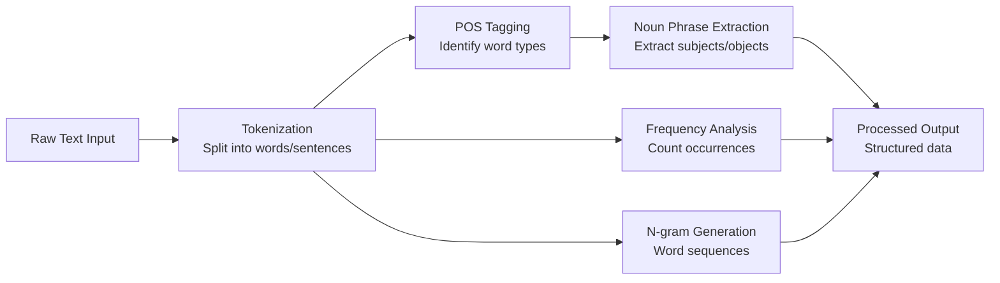

Sources: [6-NLP/2-Tasks/README.md:1-118]()

## Tokenization

Tokenization splits text into discrete units (tokens), typically words or sentences. This is the foundational step for most NLP tasks.

### Process

Tokenization must handle:
- Punctuation delimiters
- Language-specific word boundaries
- Sentence boundaries
- Special characters and contractions

### Example Text Tokenization

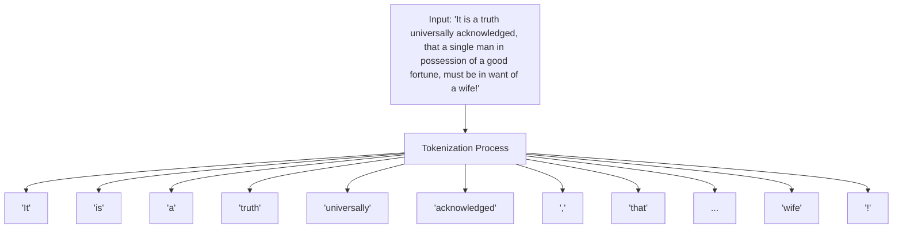

Sources: [6-NLP/2-Tasks/README.md:13-18]()

## Part-of-Speech (POS) Tagging

POS tagging assigns grammatical categories (noun, verb, adjective, etc.) to each tokenized word.

### Common POS Tags

| Tag       | Meaning          | Example    |
|-----------|------------------|------------|
| Noun      | Person/place/thing | fox, man   |
| Verb      | Action word      | jumped, feel |
| Adjective | Describes noun   | quick, red  |
| Adverb    | Describes verb   | quickly     |
| Pronoun   | Replaces noun    | I, they     |
| Preposition | Shows relationship | over, in   |
| Conjunction | Connects words  | and, but    |

### POS Tagging Example

The sentence "the quick red fox jumped over the lazy brown dog" produces:
- `the` = article
- `quick` = adjective
- `red` = adjective
- `fox` = noun
- `jumped` = verb
- `over` = preposition
- `the` = article
- `lazy` = adjective
- `brown` = adjective
- `dog` = noun

Sources: [6-NLP/2-Tasks/README.md:29-37]()

## Parsing and Sentence Structure

Parsing identifies relationships between words and grammatical structure.

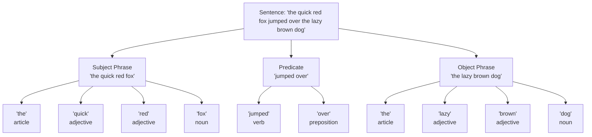

Sources: [6-NLP/2-Tasks/README.md:29-37]()

## Noun Phrase Extraction

Noun phrase extraction identifies subject and object components in sentences, typically words preceded by articles ('a', 'an', 'the').

### Extraction Rules

In the sentence "I cannot fix on the hour, or the spot, or the look or the words, which laid the foundation":

Extracted noun phrases:
- "the hour"
- "the spot"
- "the look"
- "the words"
- "the foundation"

### Implementation with TextBlob

TextBlob provides the `ConllExtractor` for noun phrase extraction:

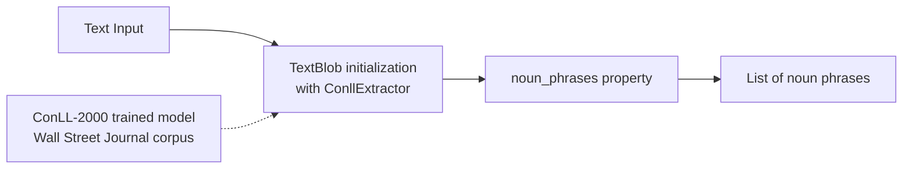

The `ConllExtractor` uses a model trained on the ConLL-2000 corpus (211,727 training tokens from Wall Street Journal sections 15-18).

Sources: [6-NLP/2-Tasks/README.md:87-141]()

## Word and Phrase Frequency Analysis

Frequency analysis counts occurrences of words or phrases to identify patterns and important terms.

### Frequency Counting Example

For the text:
```
What the moral? Who rides may read.
When the night is thick and the tracks are blind
A friend at a pinch is a friend, indeed,
But a fool to wait for the laggard behind.
```

| Word/Phrase | Frequency |
|-------------|-----------|
| the         | 6         |
| a friend    | 2         |
| friend      | 2         |
| to          | 2         |
| what        | 1         |
| night       | 1         |
| thick       | 1         |

Frequency analysis can be:
- **Case-sensitive**: "The" ≠ "the"
- **Case-insensitive**: "The" = "the"

Sources: [6-NLP/2-Tasks/README.md:39-54]()

## N-grams

N-grams are contiguous sequences of N words from a text. They capture word co-occurrence patterns.

### N-gram Types

| Type     | N Value | Example                    |
|----------|---------|----------------------------|
| Unigram  | 1       | Individual words           |
| Bigram   | 2       | Two consecutive words      |
| Trigram  | 3       | Three consecutive words    |
| N-gram   | N       | N consecutive words        |

### Bigram Generation Example

For "the quick red fox jumped over the lazy brown dog" with N=2:

| Bigram # | Bigram        |
|----------|---------------|
| 1        | the quick     |
| 2        | quick red     |
| 3        | red fox       |
| 4        | fox jumped    |
| 5        | jumped over   |
| 6        | over the      |
| 7        | the lazy      |
| 8        | lazy brown    |
| 9        | brown dog     |

### N-gram Sliding Window

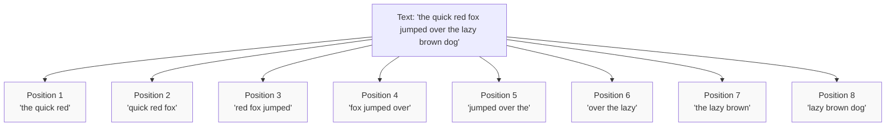

The n-gram window slides across the text, extracting overlapping sequences of N words.

Sources: [6-NLP/2-Tasks/README.md:56-86]()

## Text Preprocessing

Text preprocessing prepares raw text for analysis by removing noise and normalizing content.

### Stop Word Removal

Stop words are common words (e.g., "the", "is", "at") that often don't contribute to analysis meaning.

#### Implementation

The hotel reviews dataset uses NLTK's stop word removal:

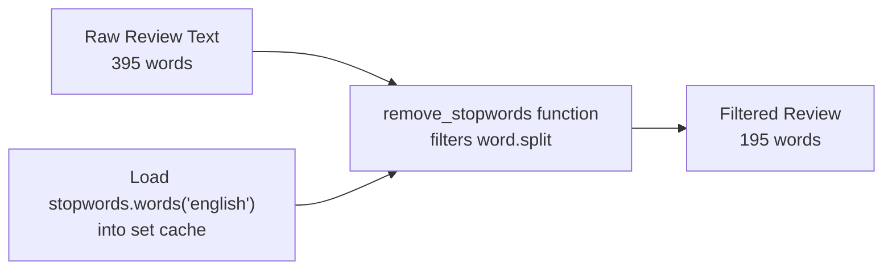

The removal process achieves significant reduction: 395 words → 195 words in the longest review example.

Performance: Removing stop words from 515,000 hotel reviews (2 columns) takes approximately 3.3 seconds.

Sources: [6-NLP/5-Hotel-Reviews-2/README.md:265-293]()

### Stemming and Lemmatization

**Lemmatization** reduces words to their base form (lemma):
- `flew`, `flies`, `flying` → `fly`
- `was`, `is`, `are` → `be`

**Inflection** determines singular/plural forms of words.

Sources: [6-NLP/2-Tasks/README.md:102-108]()

## TextBlob Library Implementation

TextBlob provides a simplified API for NLP tasks, built on NLTK and pattern libraries.

### TextBlob Core Components

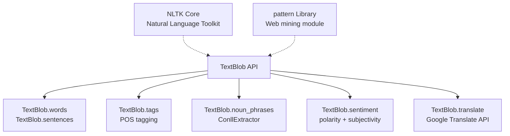

### TextBlob Installation

Required packages:
```
pip install -U textblob
python -m textblob.download_corpora
```

Sources: [6-NLP/1-Introduction-to-NLP/README.md:43-52]()

### Basic TextBlob Usage Pattern

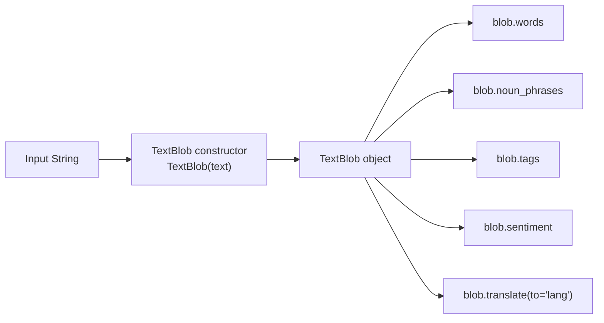

### Noun Phrase Extraction with ConllExtractor

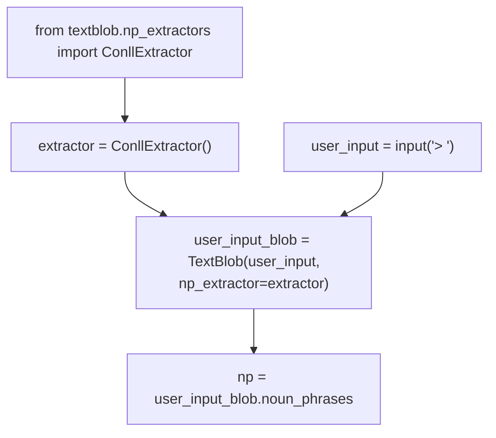

Sources: [6-NLP/2-Tasks/README.md:127-141]()

## Sentiment Analysis Foundations

Sentiment analysis measures emotional tone in text using polarity and subjectivity scores.

### Sentiment Metrics

| Metric       | Range  | Interpretation                        |
|--------------|--------|---------------------------------------|
| Polarity     | -1 to 1| -1 (most negative) to 1 (most positive), 0 (neutral) |
| Subjectivity | 0 to 1 | 0 (objective fact) to 1 (subjective opinion) |

### TextBlob Sentiment Example

For "It is a truth universally acknowledged, that a single man in possession of a good fortune, must be in want of a wife!":

```
Sentiment(polarity=0.20952380952380953, subjectivity=0.27142857142857146)
```

Interpretation:
- Polarity: 0.21 (slightly positive)
- Subjectivity: 0.27 (mostly objective)

Sources: [6-NLP/3-Translation-Sentiment/README.md:102-131]()

### Sentiment Analysis Response Gradients

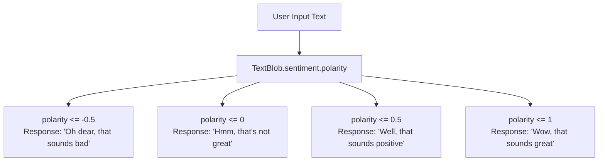

Sources: [6-NLP/2-Tasks/README.md:161-169]()

## NLTK for Advanced Sentiment Analysis

For production sentiment analysis, the hotel reviews implementation uses NLTK's VADER (Valence Aware Dictionary and sEntiment Reasoner).

### VADER Sentiment Analyzer

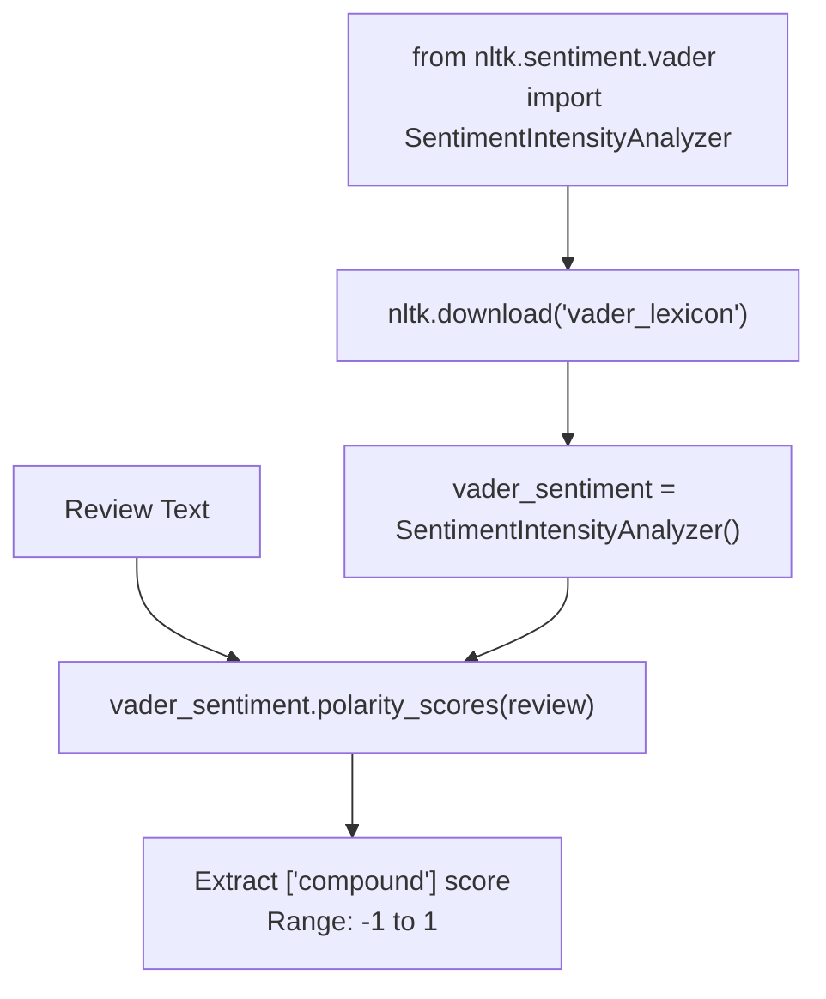

### Sentiment Calculation Function

Implementation in hotel reviews analysis:

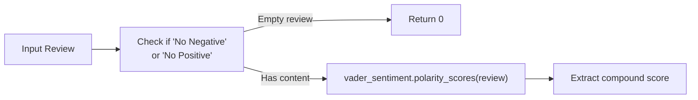

The `calc_sentiment` function handles three cases:
1. "No Negative" text → return 0
2. "No Positive" text → return 0
3. Actual review text → calculate VADER compound score

Sources: [6-NLP/5-Hotel-Reviews-2/README.md:296-330](), [6-NLP/5-Hotel-Reviews-2/solution/3-notebook.ipynb:70-83]()

## Word Embeddings

Word embeddings convert text to numerical vectors where semantically similar words cluster together.

### Embedding Properties

- Words with similar meanings have similar vector representations
- Words used in similar contexts cluster together
- Enables mathematical operations on word meanings

Example: `toy` clusters with `disney`, `lego`, `playstation`, `console`

Sources: [6-NLP/2-Tasks/README.md:21-27]()

## Additional NLP Resources

### WordNet Database

WordNet provides:
- Synonyms and antonyms
- Word definitions
- Multiple language support
- Hierarchical word relationships

Use cases: spell checkers, translation systems, linguistic analysis

Sources: [6-NLP/2-Tasks/README.md:110-113]()

## Processing Pipeline Performance

Typical processing times for hotel reviews dataset (515,738 rows):

| Operation              | Time (seconds) | Notes                          |
|------------------------|----------------|--------------------------------|
| Stop word removal      | 3.3            | 2 columns, set-based filtering |
| Sentiment calculation  | 120-201        | VADER analysis per review      |
| Data loading           | Variable       | Depends on file size, storage  |

Sources: [6-NLP/5-Hotel-Reviews-2/README.md:265-293](), [6-NLP/5-Hotel-Reviews-2/solution/3-notebook.ipynb:123-153]()

---

