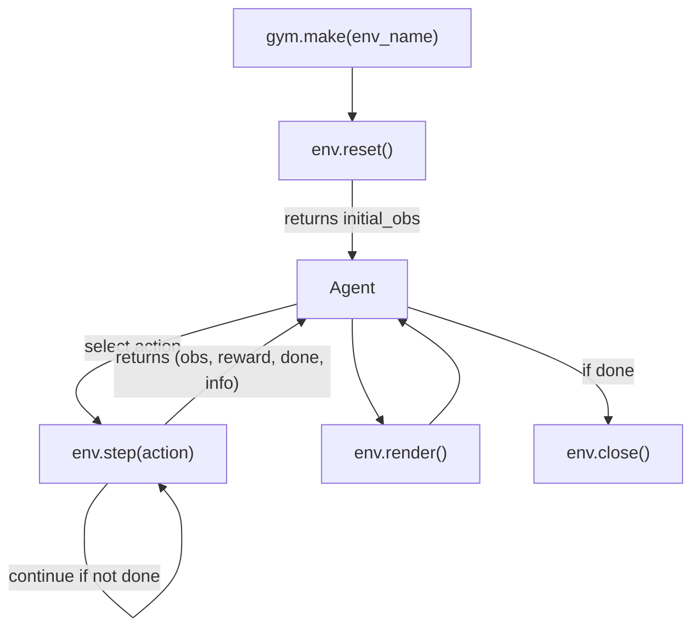
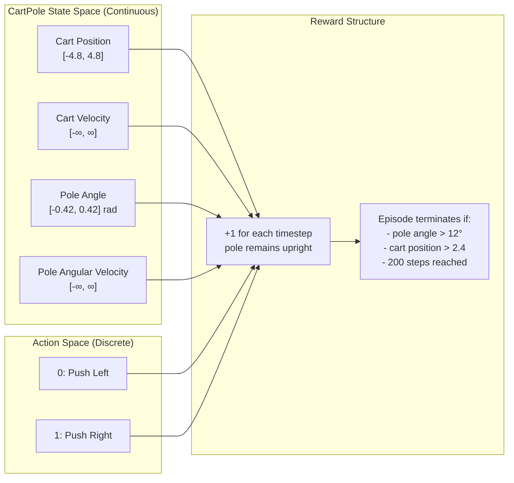
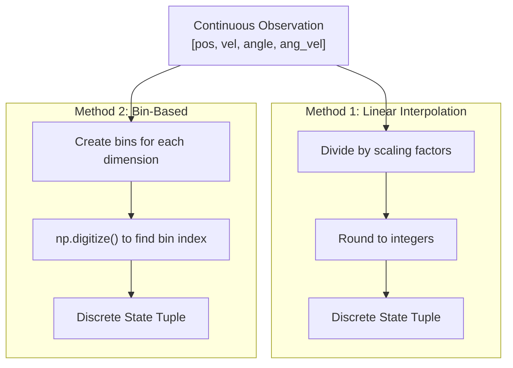
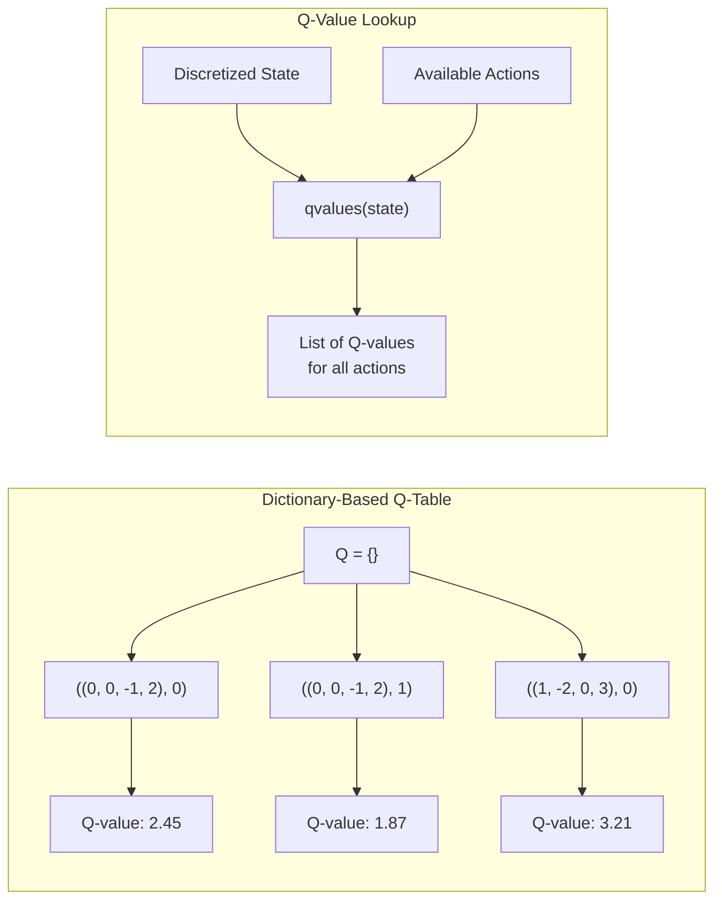
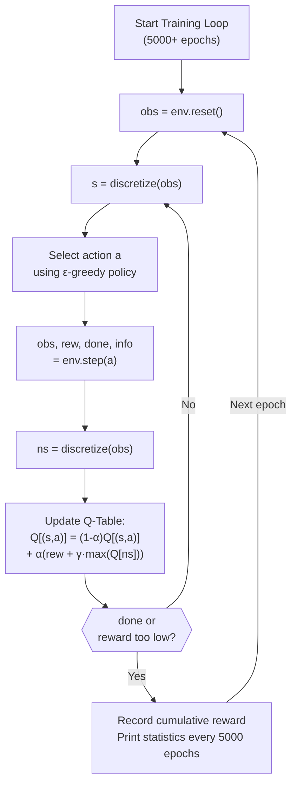

<!-- source: DeepWiki mcp.deepwiki.com · repo microsoft/ML-For-Beginners · extra page OpenAI Gym Environments · fetched 2026-10-26 -->

# OpenAI Gym Environments

<details>
<summary>Relevant source files</summary>

The following files were used as context for generating this wiki page:

- [3-Web-App/1-Web-App/README.md](3-Web-App/1-Web-App/README.md)
- [8-Reinforcement/1-QLearning/README.md](8-Reinforcement/1-QLearning/README.md)
- [8-Reinforcement/1-QLearning/assignment.md](8-Reinforcement/1-QLearning/assignment.md)
- [8-Reinforcement/1-QLearning/notebook.ipynb](8-Reinforcement/1-QLearning/notebook.ipynb)
- [8-Reinforcement/1-QLearning/rlboard.py](8-Reinforcement/1-QLearning/rlboard.py)
- [8-Reinforcement/1-QLearning/solution/assignment-solution.ipynb](8-Reinforcement/1-QLearning/solution/assignment-solution.ipynb)
- [8-Reinforcement/1-QLearning/solution/notebook.ipynb](8-Reinforcement/1-QLearning/solution/notebook.ipynb)
- [8-Reinforcement/1-QLearning/solution/rlboard.py](8-Reinforcement/1-QLearning/solution/rlboard.py)
- [8-Reinforcement/2-Gym/README.md](8-Reinforcement/2-Gym/README.md)
- [8-Reinforcement/2-Gym/assignment.md](8-Reinforcement/2-Gym/assignment.md)
- [8-Reinforcement/2-Gym/images/escape.png](8-Reinforcement/2-Gym/images/escape.png)
- [8-Reinforcement/2-Gym/notebook.ipynb](8-Reinforcement/2-Gym/notebook.ipynb)
- [8-Reinforcement/2-Gym/solution/notebook.ipynb](8-Reinforcement/2-Gym/solution/notebook.ipynb)
- [8-Reinforcement/README.md](8-Reinforcement/README.md)
- [8-Reinforcement/images/peter.png](8-Reinforcement/images/peter.png)

</details>


## Purpose and Scope

This page explains how to work with **OpenAI Gym** simulation environments for reinforcement learning, focusing on environments with continuous state spaces. It covers the CartPole balancing problem as a practical example of applying Q-Learning to a Gym environment. For the fundamentals of Q-Learning algorithms and the Bellman equation, see [Q-Learning Fundamentals](#5.3.1). For deploying trained RL models, see [RL Model Deployment with Flask](#5.3.3).

## OpenAI Gym Overview

OpenAI Gym is a Python library that provides standardized simulation environments for developing and testing reinforcement learning algorithms. All Gym environments expose a consistent API, making it possible to apply the same RL algorithms across different problems with minimal code changes.

**Key Concept**: Unlike the discrete `Board` environment from the Q-Learning lesson, Gym environments often have **continuous state spaces** where observations are represented by real-valued numbers rather than discrete grid positions.

### The Gym API Interface



**Sources**: [8-Reinforcement/2-Gym/README.md:22-59]()

Every Gym environment provides:

- **`env.reset()`**: Initializes environment and returns initial observation
- **`env.step(action)`**: Executes action, returns `(observation, reward, done, info)` tuple
- **`env.render()`**: Visualizes current environment state (optional)
- **`env.close()`**: Cleans up environment resources
- **`env.action_space`**: Defines valid actions (discrete or continuous)
- **`env.observation_space`**: Defines structure of observations

**Sources**: [8-Reinforcement/2-Gym/README.md:45-90]()

## The CartPole Environment

The CartPole-v1 environment simulates a pole balancing problem where an agent must balance a vertical pole on a moving cart by applying left or right forces.



**Sources**: [8-Reinforcement/2-Gym/README.md:17-19](), [8-Reinforcement/2-Gym/README.md:105-118]()

### Observation Space Structure

The observation vector returned by `env.step()` contains four real-valued components:

| Index | Component | Min Value | Max Value |
|-------|-----------|-----------|-----------|
| 0 | Cart Position | -4.8 | 4.8 |
| 1 | Cart Velocity | -∞ | ∞ |
| 2 | Pole Angle | -0.419 rad | 0.419 rad |
| 3 | Pole Angular Velocity | -∞ | ∞ |

**Sources**: [8-Reinforcement/2-Gym/README.md:105-118]()

### Reward System

The CartPole environment awards **+1.0 reward** for each timestep the pole remains balanced. The goal is to maximize cumulative reward by keeping the pole upright as long as possible. The problem is considered solved when the agent achieves an average reward of **195 over 100 consecutive trials**.

**Sources**: [8-Reinforcement/2-Gym/README.md:118-120]()

## State Discretization for Continuous Spaces

Q-Learning requires a finite state space to construct a Q-Table. Since CartPole has continuous observations, we must **discretize** the state space by mapping real-valued observations to discrete state identifiers.

### Discretization Methods



**Sources**: [8-Reinforcement/2-Gym/README.md:122-155]()

#### Linear Interpolation Method

The `discretize()` function divides continuous values by fixed scaling factors and converts to integers:

```python
def discretize(x):
    return tuple((x/np.array([0.25, 0.25, 0.01, 0.1])).astype(np.int))
```

**Scaling factors explained**:
- Cart position/velocity: divided by 0.25
- Pole angle: divided by 0.01 (converts radians to rough degree buckets)
- Angular velocity: divided by 0.1

This method allows states to have unbounded integer values, which works when using a dictionary-based Q-Table.

**Sources**: [8-Reinforcement/2-Gym/README.md:134-139]()

#### Bin-Based Discretization

The `discretize_bins()` function uses predefined bins for each observation dimension:

```python
def create_bins(i, num):
    return np.arange(num+1)*(i[1]-i[0])/num+i[0]

ints = [(-5,5), (-2,2), (-0.5,0.5), (-2,2)]  # min/max intervals
nbins = [20, 20, 10, 10]  # number of bins per dimension
bins = [create_bins(ints[i], nbins[i]) for i in range(4)]

def discretize_bins(x):
    return tuple(np.digitize(x[i], bins[i]) for i in range(4))
```

This method produces state values in known ranges (0 to `nbins[i]`), enabling use of numpy arrays for Q-Tables.

**Sources**: [8-Reinforcement/2-Gym/README.md:141-155]()

## Q-Table Structure for Gym Environments

With continuous state spaces, the Q-Table cannot be a fixed-size numpy array. Instead, use a **dictionary** with `(state, action)` tuples as keys:



**Sources**: [8-Reinforcement/2-Gym/README.md:176-191]()

### Implementation

```python
Q = {}
actions = (0, 1)

def qvalues(state):
    return [Q.get((state, a), 0) for a in actions]
```

The `qvalues()` function returns Q-values for all possible actions at a given state, defaulting to 0 for unvisited state-action pairs. This lazy initialization allows the Q-Table to grow dynamically as new states are encountered.

**Sources**: [8-Reinforcement/2-Gym/README.md:181-191]()

## Training Loop with Gym Environments



**Sources**: [8-Reinforcement/2-Gym/README.md:193-261]()

### Hyperparameters

The training process uses three key hyperparameters:

- **`alpha` (learning rate)**: Controls how much Q-values are updated (typically 0.3). Set to a constant in CartPole, though it can decay over time.
- **`gamma` (discount factor)**: Determines importance of future rewards vs. immediate rewards (typically 0.9).
- **`epsilon` (exploration rate)**: Probability of exploiting Q-Table vs. random exploration (typically 0.9 = 90% exploitation).

**Sources**: [8-Reinforcement/2-Gym/README.md:197-211]()

### Action Selection Strategy

```python
def probs(v, eps=1e-4):
    v = v - v.min() + eps
    v = v / v.sum()
    return v

# In training loop:
if random.random() < epsilon:
    # Exploitation: choose based on Q-Table probabilities
    v = probs(np.array(qvalues(s)))
    a = random.choices(actions, weights=v)[0]
else:
    # Exploration: random action
    a = np.random.randint(env.action_space.n)
```

The `probs()` function converts Q-values into a probability distribution for weighted random selection. This balances exploration (trying new actions) with exploitation (using learned Q-values).

**Sources**: [8-Reinforcement/2-Gym/README.md:218-251]()

## Complete Training Example

The full training implementation for CartPole:

```python
Qmax = 0
cum_rewards = []
rewards = []

for epoch in range(100000):
    obs = env.reset()
    done = False
    cum_reward = 0
    
    while not done:
        s = discretize(obs)
        if random.random() < epsilon:
            v = probs(np.array(qvalues(s)))
            a = random.choices(actions, weights=v)[0]
        else:
            a = np.random.randint(env.action_space.n)
        
        obs, rew, done, info = env.step(a)
        cum_reward += rew
        ns = discretize(obs)
        Q[(s,a)] = (1 - alpha) * Q.get((s,a), 0) + alpha * (rew + gamma * max(qvalues(ns)))
    
    cum_rewards.append(cum_reward)
    rewards.append(cum_reward)
    
    if epoch % 5000 == 0:
        print(f"{epoch}: {np.average(cum_rewards)}, alpha={alpha}, epsilon={epsilon}")
        if np.average(cum_rewards) > Qmax:
            Qmax = np.average(cum_rewards)
            Qbest = Q
        cum_rewards = []
```

**Key improvements over basic Q-Learning**:
1. **Average cumulative reward tracking**: Statistics printed every 5000 iterations
2. **Best Q-Table preservation**: Stores `Qbest` when performance peaks (helps recover from performance degradation)

**Sources**: [8-Reinforcement/2-Gym/README.md:224-261]()

## Evaluating the Trained Policy

After training, test the learned policy:

```python
obs = env.reset()
done = False

while not done:
    s = discretize(obs)
    env.render()
    v = probs(np.array(qvalues(s)))
    a = random.choices(actions, weights=v)[0]
    obs, _, done, _ = env.step(a)

env.close()
```

This executes the policy by selecting actions according to Q-Table probabilities, visualizing the agent's behavior with `env.render()`.

**Sources**: [8-Reinforcement/2-Gym/README.md:304-318]()

## Training Progress Visualization

Monitor learning by plotting cumulative rewards over epochs:

```python
plt.plot(rewards)  # Raw rewards (noisy)

# Running average for smoother visualization
def running_average(x, window):
    return np.convolve(x, np.ones(window)/window, mode='valid')

plt.plot(running_average(rewards, 100))  # 100-epoch moving average
```

The running average reveals the overall learning trend, filtering out the high variance inherent in stochastic training.

**Sources**: [8-Reinforcement/2-Gym/README.md:271-290]()

## Hyperparameter Tuning

For more stable learning:

1. **Decay learning rate**: Start `alpha` near 1.0, gradually decrease to fine-tune Q-values as training progresses
2. **Increase epsilon**: Start with lower epsilon (more exploration), increase to ~1.0 (more exploitation) as agent learns

Proper hyperparameter adjustment is critical for achieving the target performance of 195+ average reward.

**Sources**: [8-Reinforcement/2-Gym/README.md:292-302]()

## Extending to Other Gym Environments

The same Q-Learning approach applies to other Gym environments by:

1. Creating the environment: `env = gym.make("EnvironmentName")`
2. Inspecting observation/action spaces: `env.observation_space`, `env.action_space`
3. Designing appropriate discretization for the specific observation ranges
4. Adjusting reward interpretation and terminal conditions

For example, the Mountain Car environment (assignment) requires similar discretization techniques but different reward scaling and longer training due to sparse rewards.

**Sources**: [8-Reinforcement/2-Gym/README.md:337-341](), [8-Reinforcement/2-Gym/assignment.md:1-38]()

---

**Primary Sources**: 
- [8-Reinforcement/2-Gym/README.md:1-342]()
- [8-Reinforcement/2-Gym/notebook.ipynb]()
- [8-Reinforcement/2-Gym/solution/notebook.ipynb]()
- [8-Reinforcement/README.md:22-49]()

---

