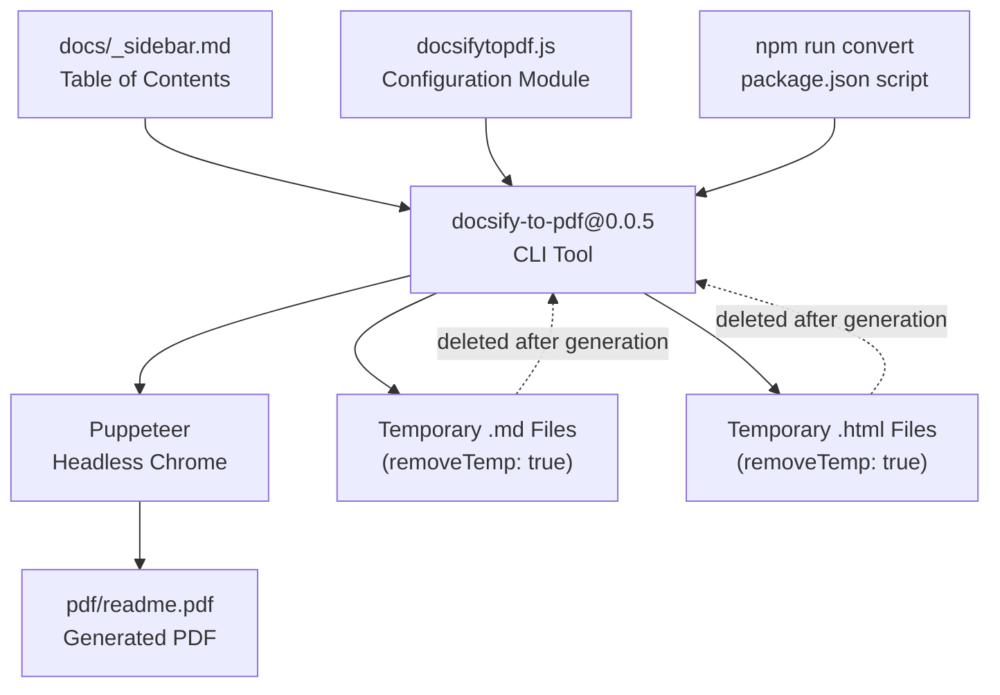
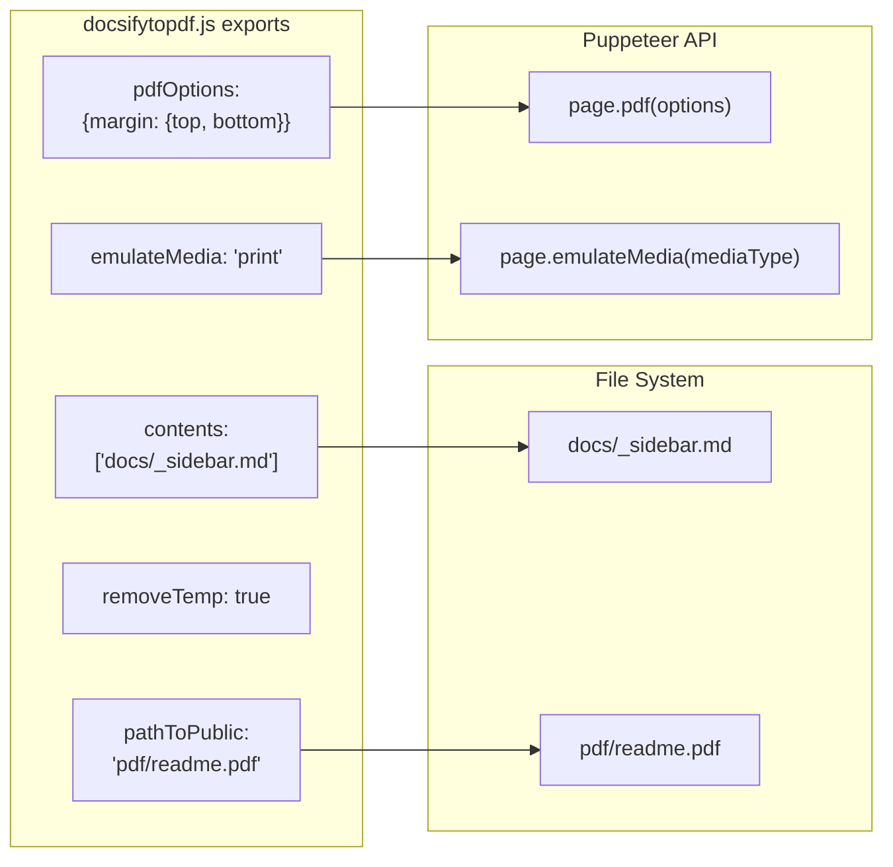
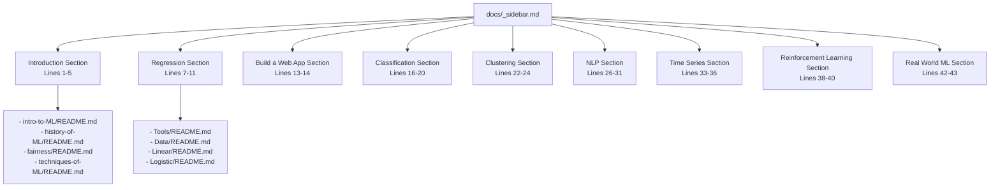
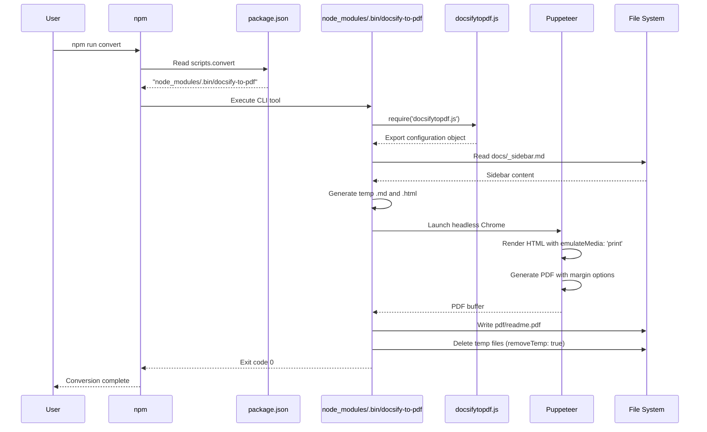
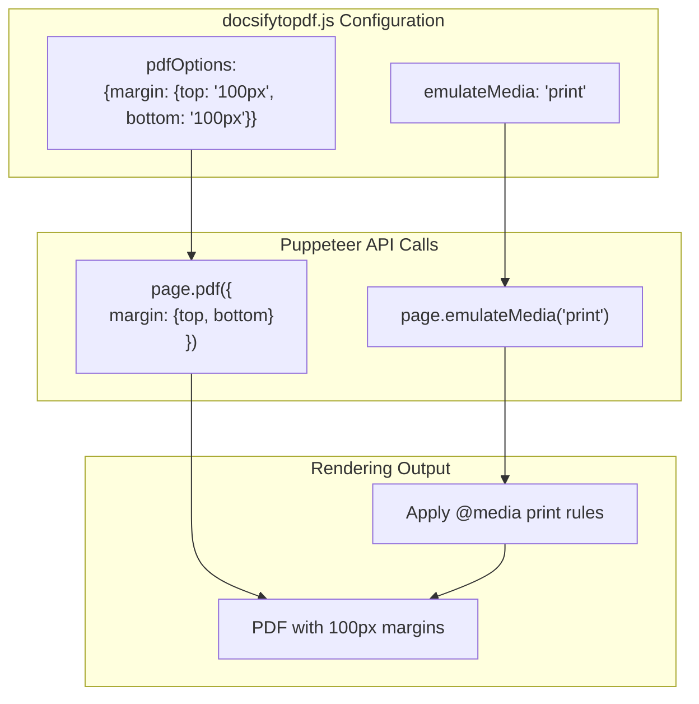
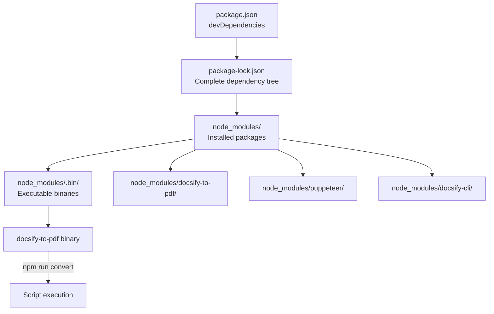
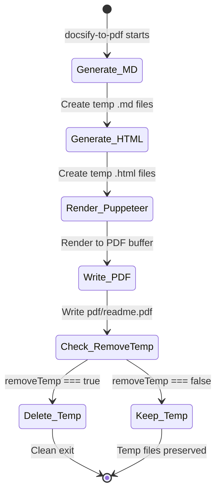
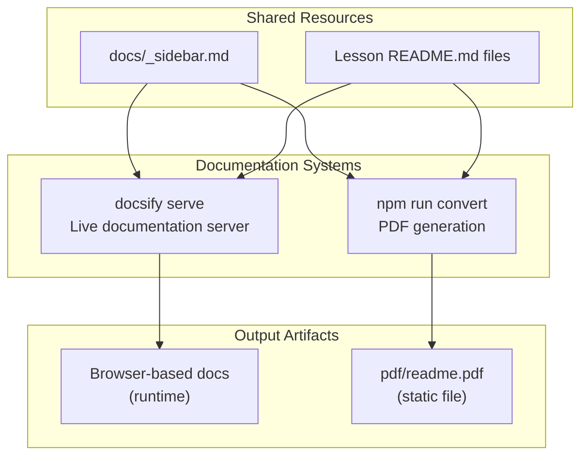

<!-- source: DeepWiki mcp.deepwiki.com · repo microsoft/ML-For-Beginners · extra page PDF Generation Workflow · fetched 2026-10-26 -->

# PDF Generation Workflow

<details>
<summary>Relevant source files</summary>

The following files were used as context for generating this wiki page:

- [docs/_sidebar.md](docs/_sidebar.md)
- [docsifytopdf.js](docsifytopdf.js)
- [package-lock.json](package-lock.json)
- [package.json](package.json)
- [pdf/readme.pdf](pdf/readme.pdf)

</details>


## Purpose and Scope

This document describes the automated PDF generation system that converts the Docsify-based documentation into a single, offline-readable PDF file. The workflow uses the `docsify-to-pdf` tool with Puppeteer to render documentation pages and export them as `pdf/readme.pdf`. For information about the online Docsify documentation system, see [Docsify Documentation](#6.4.1). For the overall documentation and build infrastructure, see [Documentation and Build System](#6.4).

**Sources:** [package.json:1-30](), [docsifytopdf.js:1-10]()

---

## System Architecture

### Component Overview



**Diagram: PDF Generation Component Architecture**

The system operates as a Node.js-based conversion pipeline. The `docsify-to-pdf` package (version 0.0.5) serves as the primary conversion engine, using Puppeteer to render documentation pages in a headless Chrome instance. The process reads the table of contents from `docs/_sidebar.md`, applies configuration from `docsifytopdf.js`, and outputs a single PDF to `pdf/readme.pdf`.

**Sources:** [package.json:6-8](), [package-lock.json:695-712](), [docsifytopdf.js:1-10]()

---

## Configuration System

### Configuration File Structure

The `docsifytopdf.js` module exports a configuration object with the following structure:

| Configuration Key | Value | Purpose |
|------------------|-------|---------|
| `contents` | `['docs/_sidebar.md']` | Array of sidebar files to process |
| `pathToPublic` | `'pdf/readme.pdf'` | Output path for generated PDF |
| `pdfOptions.margin.top` | `'100px'` | Top page margin |
| `pdfOptions.margin.bottom` | `'100px'` | Bottom page margin |
| `removeTemp` | `true` | Delete temporary files after generation |
| `emulateMedia` | `'print'` | Puppeteer media type for rendering |

**Sources:** [docsifytopdf.js:1-10]()

### Configuration to Code Mapping



**Diagram: Configuration Key Mapping**

The configuration object directly maps to file system paths and Puppeteer API parameters. The `contents` array specifies input files, `pathToPublic` determines the output location, `pdfOptions` passes through to Puppeteer's `page.pdf()` method, and `emulateMedia` controls the rendering context via `page.emulateMedia()`.

**Sources:** [docsifytopdf.js:1-10]()

---

## Table of Contents Processing

### Sidebar Structure

The `docs/_sidebar.md` file defines the documentation structure that feeds into the PDF generation:



**Diagram: Sidebar Content Organization**

The sidebar file organizes documentation into 9 major sections. Each section lists individual lesson pages using relative paths to `README.md` files. The `docsify-to-pdf` tool parses this markdown structure to determine page order and inclusion in the final PDF.

**Sources:** [docs/_sidebar.md:1-43]()

---

## Execution Workflow

### Script Invocation



**Diagram: PDF Generation Execution Flow**

The workflow begins when the user executes `npm run convert`. The npm CLI reads the `scripts.convert` field from `package.json` (line 7) and invokes the `docsify-to-pdf` binary. This tool loads configuration from `docsifytopdf.js`, processes the sidebar file, generates temporary markdown and HTML files, launches Puppeteer with print media emulation, renders the content with specified margins, and writes the output to `pdf/readme.pdf`. The `removeTemp: true` setting (line 7 of docsifytopdf.js) ensures cleanup of intermediate files.

**Sources:** [package.json:6-8](), [docsifytopdf.js:1-10]()

---

## PDF Options and Puppeteer Integration

### Margin Configuration

The `pdfOptions` object in `docsifytopdf.js` maps directly to Puppeteer's `Page.pdf()` API parameters:

```javascript
// From docsifytopdf.js:4-6
pdfOptions: {
    margin: { top: '100px', bottom: '100px' }
}
```

This configuration provides:
- **Top margin**: 100 pixels of whitespace at page top
- **Bottom margin**: 100 pixels of whitespace at page bottom
- **Left/Right margins**: Default values (no explicit configuration)

The `emulateMedia: 'print'` setting (line 8) instructs Puppeteer to apply CSS `@media print` rules during rendering, ensuring print-optimized styling rather than screen styling.

**Sources:** [docsifytopdf.js:4-9]()

### Puppeteer API Reference



**Diagram: Puppeteer API Integration**

The configuration values pass directly to Puppeteer's API methods. The `emulateMedia` parameter invokes `page.emulateMedia(mediaType)`, while `pdfOptions` passes to `page.pdf(options)`. These correspond to Puppeteer's documented APIs referenced in the configuration comments (lines 6 and 8 of docsifytopdf.js).

**Sources:** [docsifytopdf.js:4-9]()

---

## Output Artifact

### Generated PDF Structure

The output file `pdf/readme.pdf` contains:

- **File format**: PDF 1.4 (as indicated by `%PDF-1.4` header at line 1)
- **Producer**: Skia/PDF m78 (Chromium's PDF rendering engine)
- **Creation date**: Embedded in PDF metadata
- **Embedded content**: 
  - Text content from all sidebar-linked pages
  - Images (encoded as DCTDecode/JPEG streams)
  - Hyperlinks (Annot objects with Link subtype and URI actions)
  - Page layout with configured margins

The PDF includes interactive elements such as clickable links to external resources (e.g., YouTube videos, GitHub repositories, quiz applications), preserved from the original Docsify documentation.

**Sources:** [pdf/readme.pdf:1-10](), [pdf/readme.pdf:109-147]()

### Link Preservation Example

The PDF maintains external link functionality through annotation objects:

```
/Type /Annot
/Subtype /Link
/A <</Type /Action
/S /URI
/URI (https://youtu.be/lTd9RSxS9ZE)>>
```

This structure (lines 109-116 of the PDF) creates clickable areas that open external URLs when the user interacts with them in a PDF reader. The `docsify-to-pdf` tool preserves all markdown links from the source documentation as PDF annotations.

**Sources:** [pdf/readme.pdf:109-147]()

---

## Dependency Management

### Package Dependency Tree

The `docsify-to-pdf` tool pulls in a substantial dependency tree visible in `package-lock.json`:

| Package | Version | Purpose |
|---------|---------|---------|
| `docsify-to-pdf` | 0.0.5 | Main conversion tool |
| `docsify-cli` | 4.4.3 | Docsify development server |
| `puppeteer` | ~1.12.2 | Headless Chrome automation |
| `colors` | 1.4.0 | Terminal output formatting |
| `lodash` | ^4.17.11 | Utility functions |
| `rimraf` | ^2.6.3 | Recursive file deletion |
| `markdown-link-extractor` | ^1.2.0 | Parse markdown links |
| `is-url` | ^1.2.4 | URL validation |

**Sources:** [package-lock.json:695-712]()

### Installation Artifacts



**Diagram: Dependency Installation Structure**

When `npm install` runs, it processes `package.json` (line 26-28), generates `package-lock.json` with the full dependency tree, and populates `node_modules/` with required packages. The `docsify-to-pdf` binary installs to `node_modules/.bin/`, making it accessible to npm scripts via the path resolution defined in `package.json:7`.

**Sources:** [package.json:26-28](), [package-lock.json:695-712]()

---

## Temporary File Handling

### Cleanup Process

The `removeTemp: true` configuration (line 7 of docsifytopdf.js) controls post-generation cleanup:



**Diagram: Temporary File Lifecycle**

During conversion, `docsify-to-pdf` generates intermediate markdown and HTML files. When `removeTemp` is set to `true` (the configured value), these files are deleted after successful PDF generation. This keeps the repository clean by avoiding committed build artifacts.

**Sources:** [docsifytopdf.js:7]()

---

## Integration with Build System

### Relationship to Other Build Processes

The PDF generation workflow operates independently from other build systems in the repository:



**Diagram: Documentation Build System Integration**

Both the live Docsify server and PDF generation consume the same source files (`docs/_sidebar.md` and individual lesson pages) but produce different outputs. The PDF workflow creates a static, offline-readable artifact, while Docsify provides an interactive browser experience. These systems do not depend on each other and can run independently.

**Sources:** [package.json:6-8](), [docs/_sidebar.md:1-43](), [docsifytopdf.js:1-10]()

---

## Execution and Output Summary

### Command Summary

| Command | Action | Output |
|---------|--------|--------|
| `npm run convert` | Execute PDF generation | `pdf/readme.pdf` created |
| `npm install` | Install dependencies | `node_modules/docsify-to-pdf/` and dependencies |

### File I/O Summary

**Input Files:**
- `docs/_sidebar.md` - Table of contents structure
- `../*/README.md` - Individual lesson pages (referenced from sidebar)
- `docsifytopdf.js` - Configuration parameters

**Output Files:**
- `pdf/readme.pdf` - Final PDF document
- Temporary `.md` and `.html` files (created and deleted during process)

**Configuration Files:**
- `package.json` - Defines `convert` script
- `package-lock.json` - Locks dependency versions
- `docsifytopdf.js` - PDF generation options

**Sources:** [package.json:1-30](), [docsifytopdf.js:1-10](), [docs/_sidebar.md:1-43]()

---

