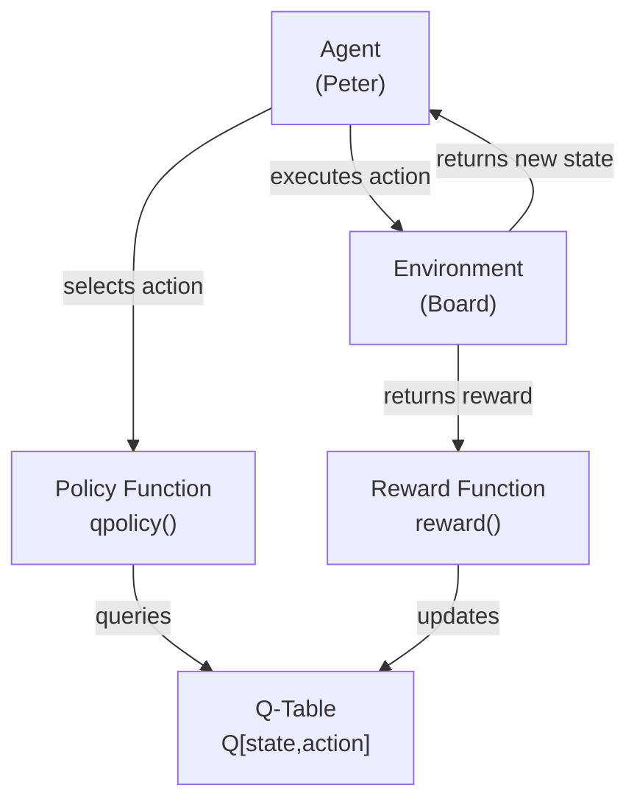
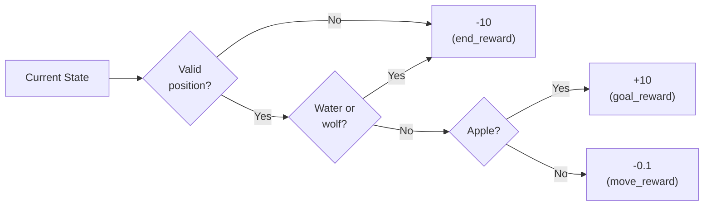
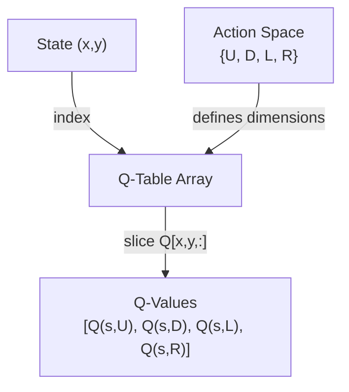
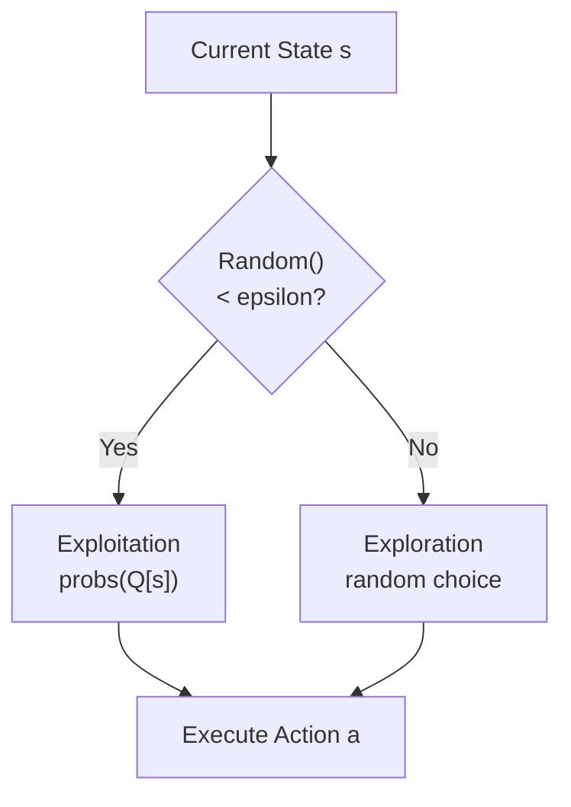
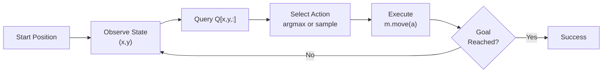
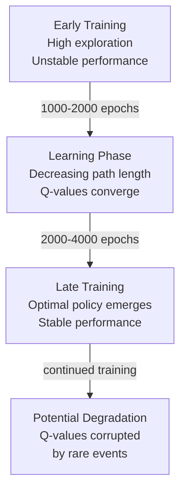
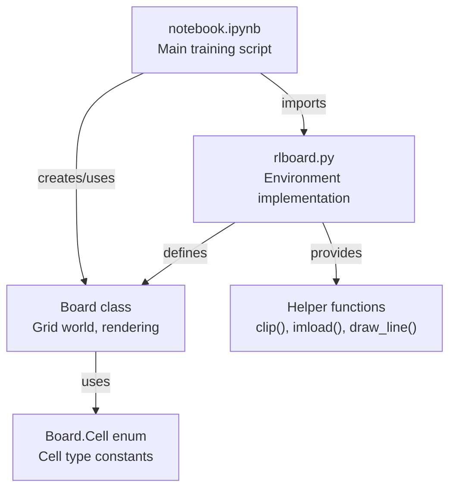

<!-- source: DeepWiki mcp.deepwiki.com · repo microsoft/ML-For-Beginners · extra page Q-Learning Fundamentals · fetched 2026-10-26 -->

# Q-Learning Fundamentals

<details>
<summary>Relevant source files</summary>

The following files were used as context for generating this wiki page:

- [3-Web-App/1-Web-App/README.md](3-Web-App/1-Web-App/README.md)
- [8-Reinforcement/1-QLearning/README.md](8-Reinforcement/1-QLearning/README.md)
- [8-Reinforcement/1-QLearning/assignment.md](8-Reinforcement/1-QLearning/assignment.md)
- [8-Reinforcement/1-QLearning/notebook.ipynb](8-Reinforcement/1-QLearning/notebook.ipynb)
- [8-Reinforcement/1-QLearning/rlboard.py](8-Reinforcement/1-QLearning/rlboard.py)
- [8-Reinforcement/1-QLearning/solution/assignment-solution.ipynb](8-Reinforcement/1-QLearning/solution/assignment-solution.ipynb)
- [8-Reinforcement/1-QLearning/solution/notebook.ipynb](8-Reinforcement/1-QLearning/solution/notebook.ipynb)
- [8-Reinforcement/1-QLearning/solution/rlboard.py](8-Reinforcement/1-QLearning/solution/rlboard.py)
- [8-Reinforcement/2-Gym/README.md](8-Reinforcement/2-Gym/README.md)
- [8-Reinforcement/2-Gym/assignment.md](8-Reinforcement/2-Gym/assignment.md)
- [8-Reinforcement/2-Gym/images/escape.png](8-Reinforcement/2-Gym/images/escape.png)
- [8-Reinforcement/2-Gym/notebook.ipynb](8-Reinforcement/2-Gym/notebook.ipynb)
- [8-Reinforcement/2-Gym/solution/notebook.ipynb](8-Reinforcement/2-Gym/solution/notebook.ipynb)
- [8-Reinforcement/README.md](8-Reinforcement/README.md)
- [8-Reinforcement/images/peter.png](8-Reinforcement/images/peter.png)

</details>


## Purpose and Scope

This document explains the fundamental concepts and implementation of Q-Learning as applied to a discrete state-space reinforcement learning problem. The material covers the Q-Learning algorithm, reward functions, the Bellman equation, exploration-exploitation trade-offs, and the training loop using the "Peter and the Wolf" board environment.

For continuous state spaces and OpenAI Gym environments, see [OpenAI Gym Environments](#5.3.2). For model deployment patterns, see [RL Model Deployment with Flask](#5.3.3).

## Q-Learning Overview

Q-Learning is a model-free reinforcement learning algorithm that learns an optimal policy by iteratively updating a **Q-Table**. The Q-Table stores "quality" values Q(s,a) for each state-action pair, representing the expected future reward from taking action `a` in state `s`.

The algorithm does not require a model of the environment's dynamics and learns through trial-and-error interaction with the environment.

### Core Components



**Sources:** [8-Reinforcement/1-QLearning/README.md:24-29](), [8-Reinforcement/1-QLearning/README.md:159-175]()

## Environment and State Representation

### The Board Environment

The `Board` class from `rlboard.py` defines the environment as a grid world with the following cell types:

| Cell Type | Value | Description |
|-----------|-------|-------------|
| ground | 0 | Walkable terrain |
| water | 1 | Non-walkable obstacle |
| wolf | 2 | Dangerous, ends episode negatively |
| tree/grass | 3 | Rest location |
| apple | 4 | Goal location, ends episode positively |

**Sources:** [8-Reinforcement/1-QLearning/rlboard.py:44-49](), [8-Reinforcement/1-QLearning/README.md:30-43]()

### Actions

Actions are defined as coordinate changes in a dictionary structure:

```python
actions = { "U" : (0,-1), "D" : (0,1), "L" : (-1,0), "R" : (1,0) }
action_idx = { a : i for i,a in enumerate(actions.keys()) }
```

**Sources:** [8-Reinforcement/1-QLearning/README.md:63-68]()

## Reward Function

The reward function defines the goal by returning numerical scores for each state:



The reward function implementation uses constants:
- `move_reward = -0.1` (small penalty for each move)
- `goal_reward = 10` (large reward for finding apple)
- `end_reward = -10` (large penalty for water/wolf)

**Sources:** [8-Reinforcement/1-QLearning/README.md:134-155]()

## The Bellman Equation

The core of Q-Learning is the **Bellman equation**, which defines how to update Q-values:

**Q(s,a) ← (1-α)Q(s,a) + α(r + γ max<sub>a'</sub>Q(s',a'))**

Where:
- **s**: current state
- **a**: action taken
- **s'**: resulting new state
- **r**: immediate reward
- **α** (alpha): learning rate (0 to 1)
- **γ** (gamma): discount factor (0 to 1)
- **max<sub>a'</sub>Q(s',a')**: maximum Q-value for next state across all actions

This equation balances current Q-value knowledge with new information: the immediate reward plus the discounted maximum future reward.

**Sources:** [8-Reinforcement/1-QLearning/README.md:177-191]()

## Q-Table Structure and Implementation

### Q-Table Representation

The Q-Table can be represented as a numpy array when state space is known:

```python
Q = np.ones((width, height, len(actions)), dtype=np.float) * 1.0/len(actions)
```

This creates a 3D array with dimensions `[width, height, num_actions]`, initialized with equal probabilities for random walk behavior.

**Sources:** [8-Reinforcement/1-QLearning/README.md:161-169]()

### Q-Value Query Function



The Q-Table is queried to retrieve values for all possible actions in a given state, enabling action selection based on learned knowledge.

**Sources:** [8-Reinforcement/1-QLearning/README.md:163-169]()

## The Learning Algorithm

### Pseudocode Structure

The Q-Learning algorithm follows this structure:

1. Initialize Q-Table with equal values
2. Set hyperparameters: α (learning rate), γ (discount factor), ε (epsilon)
3. For each epoch (training episode):
   - Start at random position
   - Repeat until terminal state:
     - Select action using ε-greedy policy
     - Execute action, observe reward and new state
     - Update Q-value using Bellman equation
     - Transition to new state
   - Record episode statistics

**Sources:** [8-Reinforcement/1-QLearning/README.md:193-209]()

### Implementation Details

```mermaid
graph TB
    Init["Initialize Q-Table<br/>Set α=1, γ, ε"]
    StartEpoch["Start Epoch<br/>m.random_start()"]
    SelectAction["Select Action<br/>ε-greedy"]
    ExecuteAction["Execute Action<br/>m.move(a)"]
    GetReward["Get Reward<br/>r = reward(m)"]
    UpdateQ["Update Q-Table<br/>Bellman Equation"]
    CheckDone{"Terminal<br/>State?"}
    NextEpoch["Next Epoch"}
    
    Init --> StartEpoch
    StartEpoch --> SelectAction
    SelectAction --> ExecuteAction
    ExecuteAction --> GetReward
    GetReward --> UpdateQ
    UpdateQ --> CheckDone
    CheckDone -->|"No"| SelectAction
    CheckDone -->|"Yes"| NextEpoch
    NextEpoch --> StartEpoch
```

The core update loop is implemented in [8-Reinforcement/1-QLearning/README.md:232-257]():

```python
for epoch in range(5000):
    m.random_start()
    n = 0
    cum_reward = 0
    while True:
        x, y = m.human
        v = probs(Q[x,y])
        a = random.choices(list(actions), weights=v)[0]
        dpos = actions[a]
        m.move(dpos, check_correctness=False)
        r = reward(m)
        cum_reward += r
        if r == end_reward or cum_reward < -1000:
            break
        alpha = np.exp(-n / 10e5)
        gamma = 0.5
        ai = action_idx[a]
        Q[x,y,ai] = (1 - alpha) * Q[x,y,ai] + alpha * (r + gamma * Q[x+dpos[0], y+dpos[1]].max())
        n += 1
```

**Sources:** [8-Reinforcement/1-QLearning/README.md:232-257]()

## Exploration vs Exploitation

### Epsilon-Greedy Strategy

The algorithm balances **exploration** (trying new actions) with **exploitation** (using learned knowledge) through an ε-greedy policy:

- With probability **ε**: select action based on Q-Table probabilities (exploitation)
- With probability **1-ε**: select random action (exploration)



The `probs()` function converts Q-values to action probabilities:

```python
def probs(v, eps=1e-4):
    v = v - v.min() + eps
    v = v / v.sum()
    return v
```

This softmax-like approach assigns higher probabilities to actions with higher Q-values while maintaining some randomness.

**Sources:** [8-Reinforcement/1-QLearning/README.md:210-214](), [8-Reinforcement/1-QLearning/README.md:220-227]()

## Hyperparameters

Three key hyperparameters control the learning process:

| Parameter | Symbol | Typical Value | Purpose |
|-----------|--------|---------------|---------|
| Learning Rate | α (alpha) | 0.3 - 1.0 | Controls how much new information overrides old |
| Discount Factor | γ (gamma) | 0.5 - 0.9 | Importance of future vs immediate rewards |
| Epsilon | ε (epsilon) | 0.9 | Exploration vs exploitation balance |

### Learning Rate Decay

The learning rate often decays over time to stabilize learning:

```python
alpha = np.exp(-n / 10e5)  # Exponential decay
```

This allows aggressive learning early (large updates) and conservative refinement later (small updates).

**Sources:** [8-Reinforcement/1-QLearning/README.md:232-257](), [8-Reinforcement/1-QLearning/README.md:294-299](), [8-Reinforcement/1-QLearning/README.md:313-315]()

## Policy Execution

### Trained Policy

After training, the Q-Table defines a policy for navigation. Two policy implementations are provided:

**Strict Policy** (`qpolicy_strict`): Always selects highest Q-value action
```python
def qpolicy_strict(m):
    x, y = m.human
    v = probs(Q[x,y])
    a = list(actions)[np.argmax(v)]
    return a
```

**Probabilistic Policy** (`qpolicy`): Samples based on Q-value probabilities
```python
def qpolicy(m):
    x, y = m.human
    v = probs(Q[x,y])
    a = random.choices(list(actions), weights=v)[0]
    return a
```

**Sources:** [8-Reinforcement/1-QLearning/README.md:265-275](), [8-Reinforcement/1-QLearning/README.md:287-297]()

### Policy Execution Flow



The `walk()` function executes a policy until terminal state:

```python
def walk(m, policy, start_position=None):
    n = 0
    if start_position:
        m.human = start_position
    else:
        m.random_start()
    while True:
        if m.at() == Board.Cell.apple:
            return n  # success
        if m.at() in [Board.Cell.wolf, Board.Cell.water]:
            return -1  # failure
        # Select and execute action...
        n += 1
```

**Sources:** [8-Reinforcement/1-QLearning/README.md:78-107]()

## Training Progress and Evaluation

### Performance Metrics

Training progress is monitored through:
- **Average path length**: Number of steps to reach goal
- **Success rate**: Episodes ending in goal vs failure
- **Cumulative reward**: Total reward accumulated per episode

The `print_statistics()` function evaluates policy performance over 100 trials:

```python
def print_statistics(policy):
    s, w, n = 0, 0, 0
    for _ in range(100):
        z = walk(m, policy)
        if z < 0:
            w += 1
        else:
            s += z
            n += 1
    print(f"Average path length = {s/n}, eaten by wolf: {w} times")
```

**Sources:** [8-Reinforcement/1-QLearning/README.md:111-126]()

### Training Dynamics



Typical observations during training:
1. **Initial phase**: Random exploration, high variance in path length
2. **Convergence phase**: Path length decreases as Q-values improve
3. **Optimal phase**: Consistent short paths (3-6 steps vs 30-40 random walk)
4. **Risk of degradation**: Continued training may corrupt Q-values

**Sources:** [8-Reinforcement/1-QLearning/README.md:301-315]()

## Random Walk Baseline

A random walk policy serves as a baseline for comparison:

```python
def random_policy(m):
    return random.choice(list(actions))
```

Performance comparison:
- **Random walk**: Average 30-40 steps to goal
- **Q-Learning**: Average 3-6 steps to goal (after training)

This demonstrates the effectiveness of learned policy over random exploration.

**Sources:** [8-Reinforcement/1-QLearning/README.md:76-129]()

## Code Structure

### Main Components



**Key files:**
- `notebook.ipynb`: Main implementation with training loop
- `solution/notebook.ipynb`: Complete working solution
- `rlboard.py`: Board environment class and utilities
- `README.md`: Comprehensive documentation

**Sources:** [8-Reinforcement/1-QLearning/rlboard.py:1-66](), [8-Reinforcement/1-QLearning/README.md:44-53]()

## Hyperparameter Optimization

Finding optimal hyperparameters is critical for Q-Learning performance. The process involves:

1. **Learning rate (α)**: 
   - Start high (0.5-1.0) for rapid initial learning
   - Decay over time to stabilize convergence
   - Too high: unstable learning, Q-values oscillate
   - Too low: slow convergence

2. **Discount factor (γ)**:
   - Range 0.5-0.9 typically works well
   - Higher values prioritize long-term rewards
   - Lower values focus on immediate rewards

3. **Epsilon (ε)**:
   - Start low (0.1-0.3) for more exploration
   - Increase gradually to 0.9-1.0 for exploitation
   - Balances finding new paths vs using learned knowledge

**Sources:** [8-Reinforcement/1-QLearning/README.md:292-315]()

---

