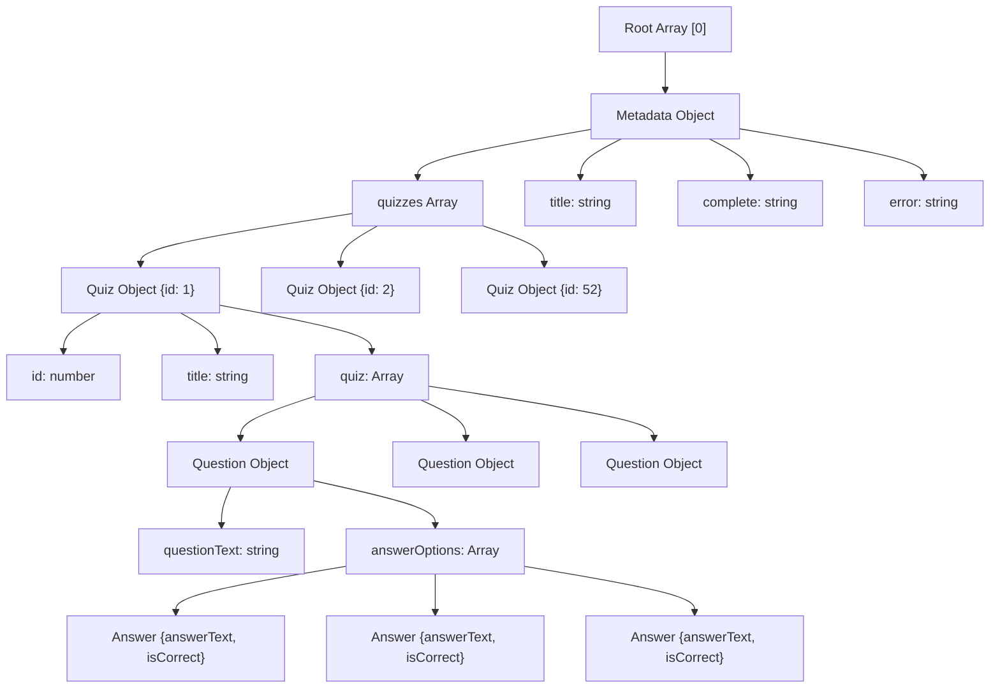
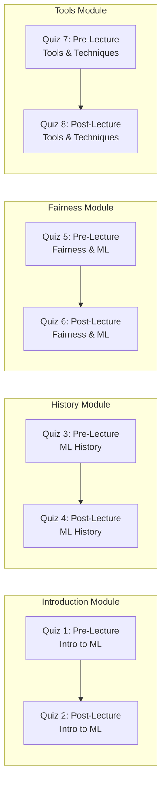
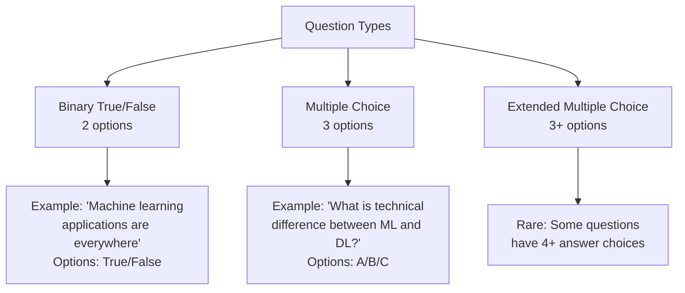
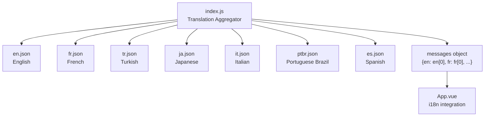
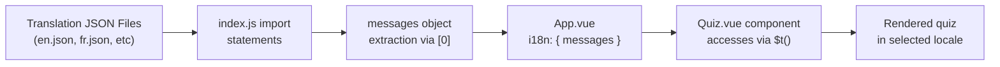
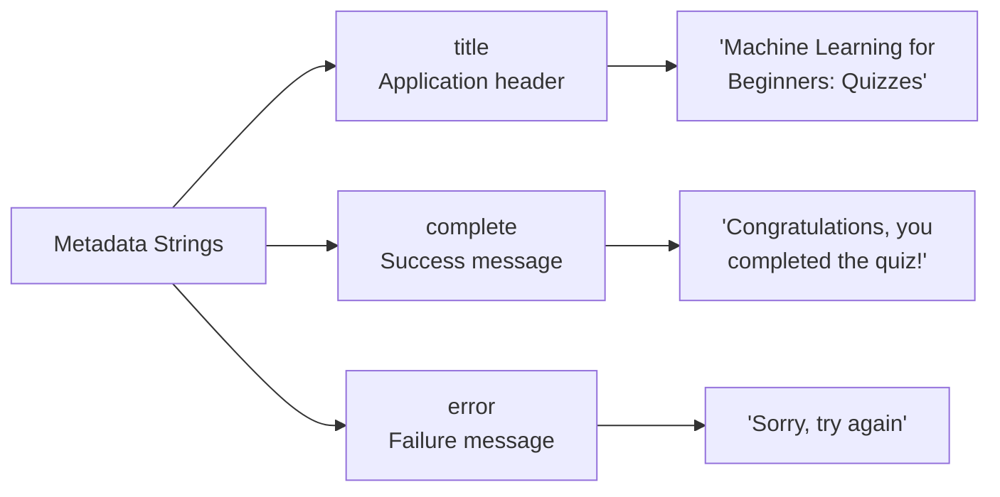

<!-- source: DeepWiki mcp.deepwiki.com · repo microsoft/ML-For-Beginners · extra page Quiz Data Structure and Content · fetched 2026-10-26 -->

# Quiz Data Structure and Content

<details>
<summary>Relevant source files</summary>

The following files were used as context for generating this wiki page:

- [.gitignore](.gitignore)
- [1-Introduction/1-intro-to-ML/lesson-1.pdf](1-Introduction/1-intro-to-ML/lesson-1.pdf)
- [1-Introduction/2-history-of-ML/lesson-2.pdf](1-Introduction/2-history-of-ML/lesson-2.pdf)
- [quiz-app/package-lock.json](quiz-app/package-lock.json)
- [quiz-app/package.json](quiz-app/package.json)
- [quiz-app/src/App.vue](quiz-app/src/App.vue)
- [quiz-app/src/assets/translations/fr.json](quiz-app/src/assets/translations/fr.json)
- [quiz-app/src/assets/translations/index.js](quiz-app/src/assets/translations/index.js)
- [quiz-app/src/assets/translations/it.json](quiz-app/src/assets/translations/it.json)
- [quiz-app/src/assets/translations/ja.json](quiz-app/src/assets/translations/ja.json)
- [quiz-app/src/assets/translations/tr.json](quiz-app/src/assets/translations/tr.json)

</details>


This document describes the JSON schema and content organization for the quiz system's question data. For information about the Vue.js application that renders these quizzes, see [Quiz Application Architecture](#6.3). For details on internationalization mechanisms, see [Quiz Internationalization System](#6.3.2).

## Overview

The quiz application contains **52 quizzes** with **156 total questions** organized across the curriculum's 26 lessons (pre-lecture and post-lecture quizzes). Each quiz is defined in JSON format with a standardized schema supporting multiple-choice questions with binary correct/incorrect answer flags. The data is localized into 7 languages (en, fr, it, ja, ptbr, tr, es) using identical structural schemas across all translations.

---

## JSON Schema Architecture

### Root Data Structure

Each translation file exports a single-element array containing the complete quiz collection. The root object structure is:



**Sources:** [quiz-app/src/assets/translations/fr.json:1-10](), [quiz-app/src/assets/translations/tr.json:1-10](), [quiz-app/src/assets/translations/it.json:1-10]()

### Complete Schema Definition

| Level | Property | Type | Description |
|-------|----------|------|-------------|
| Root | `[0]` | Object | Single root object containing all quiz data |
| Metadata | `title` | string | Application title displayed in header |
| Metadata | `complete` | string | Success message shown upon quiz completion |
| Metadata | `error` | string | Error message displayed for incorrect answers |
| Metadata | `quizzes` | Array\<Quiz\> | Collection of all 52 quizzes |
| Quiz | `id` | number | Unique identifier (1-52) for quiz routing |
| Quiz | `title` | string | Descriptive title for the quiz lesson |
| Quiz | `quiz` | Array\<Question\> | Collection of questions for this quiz (typically 3) |
| Question | `questionText` | string | The question prompt text |
| Question | `answerOptions` | Array\<Answer\> | Collection of possible answers (typically 2-3) |
| Answer | `answerText` | string | The answer choice text |
| Answer | `isCorrect` | string | "true" or "false" (stored as string, not boolean) |

**Sources:** [quiz-app/src/assets/translations/fr.json:1-115](), [quiz-app/src/assets/translations/index.js:1-23]()

---

## Quiz Content Organization

### Quiz ID Mapping

Quiz IDs follow the curriculum structure with pre-lecture (odd IDs) and post-lecture (even IDs) pairs:



**Sources:** [quiz-app/src/assets/translations/fr.json:7-458]()

### Quiz Title Patterns

Each quiz title follows a consistent naming convention in the source language (English):

- Pre-lecture: `"[Topic]: Pre-Lecture Quiz"`
- Post-lecture: `"[Topic]: Post-Lecture Quiz"`

Example quiz titles by ID range:

| ID Range | Topic Area | Example Title |
|----------|------------|---------------|
| 1-8 | Introduction & Foundations | "Introduction to Machine Learning: Pre-Lecture Quiz" |
| 9-14 | Regression | "Introduction to Regression: Pre-Lecture Quiz" |
| 15-22 | Classification | "Logistic Regression: Pre-Lecture Quiz" |
| 23-26 | Clustering | "Introduction to Clustering: Pre-Lecture Quiz" |
| 27-40 | Natural Language Processing | "NLP Introduction: Pre-Lecture Quiz" |
| 41-46 | Time Series | "Introduction to Time Series Forecasting: Pre-Lecture Quiz" |
| 47-52 | Reinforcement Learning | "Introduction to Reinforcement Learning: Pre-Lecture Quiz" |

**Sources:** [quiz-app/src/assets/translations/fr.json:9-858]()

---

## Question and Answer Structure

### Question Characteristics

Each question object contains:

1. **Question Text**: Plain text string, typically a statement or interrogative
2. **Answer Options**: Array of 2-3 choices (most commonly 3)
3. **Answer Validation**: Exactly one answer marked `isCorrect: "true"`

Example question structure from French translation:

```json
{
  "questionText": "Les applications de machine learning sont toutes autour de nous",
  "answerOptions": [
    {
      "answerText": "Vrai",
      "isCorrect": "true"
    },
    {
      "answerText": "Faux",
      "isCorrect": "false"
    }
  ]
}
```

**Sources:** [quiz-app/src/assets/translations/fr.json:11-23]()

### Answer Option Types

The data supports three primary question formats:



**Sources:** [quiz-app/src/assets/translations/fr.json:11-58](), [quiz-app/src/assets/translations/tr.json:11-58]()

### isCorrect Flag Implementation

Critical implementation detail: The `isCorrect` property is **stored as a string** (`"true"` or `"false"`), not a boolean primitive. This design choice ensures consistent JSON parsing across different locales and JavaScript runtime environments.

```javascript
// Correct answer example
{
  "answerText": "Vrai",
  "isCorrect": "true"  // String, not boolean true
}

// Incorrect answer example
{
  "answerText": "Faux",
  "isCorrect": "false"  // String, not boolean false
}
```

**Sources:** [quiz-app/src/assets/translations/fr.json:15-21]()

---

## Translation File Organization

### File Structure and Imports

Translation files are organized in the assets directory and imported through a central index:



**Sources:** [quiz-app/src/assets/translations/index.js:1-23](), [quiz-app/src/App.vue:27-31]()

### Index.js Translation Mapping

The central translation index extracts the root object from each language file:

[quiz-app/src/assets/translations/index.js:1-23]()

```javascript
import en from './en.json';
import tr from './tr.json';
import fr from './fr.json';
import ja from './ja.json';
import it from './it.json';
import ptbr from './ptbr.json';
import es from './es.json';

const messages = {
	en: en[0],      // Extract first array element
	tr: tr[0],
	fr: fr[0],
	ja: ja[0],
	it: it[0],
	ptbr: ptbr[0],
    es: es[0]
};

export default messages;
```

This structure allows the application to access quiz data via `messages[locale].quizzes[id]`.

**Sources:** [quiz-app/src/assets/translations/index.js:1-23]()

---

## Data Flow from JSON to Application

### Translation Loading and Access Pattern



**Sources:** [quiz-app/src/assets/translations/index.js:1-23](), [quiz-app/src/App.vue:27-31]()

### Locale Selection and Data Access

The application supports runtime locale switching through a dropdown menu:

[quiz-app/src/App.vue:3-14]()

```vue
<select v-model="locale">
  <option>en</option>
  <option>fr</option>
  <option>it</option>
  <option>ja</option>
  <option value="ptbr">pt-br</option>
  <option>tr</option>
  <option>es</option>
</select>
```

When locale changes, the `watch` function updates the i18n instance:

[quiz-app/src/App.vue:40-43]()

```javascript
watch: {
  locale(val) {
    this.$root.$i18n.locale = val;
  },
}
```

This triggers a reactive update, loading quiz data from `messages[locale].quizzes`.

**Sources:** [quiz-app/src/App.vue:1-51]()

---

## Content Validation and Consistency

### Cross-Language Schema Consistency

All translation files must maintain identical structural schemas to ensure proper rendering across locales. The key consistency requirements are:

| Requirement | Description | Validation Method |
|-------------|-------------|-------------------|
| Quiz Count | All files must contain exactly 52 quizzes | ID range 1-52 |
| Quiz IDs | IDs must match across all translations | Sequential numbering |
| Question Count | Same number of questions per quiz ID | Array length comparison |
| Answer Count | Same number of answers per question | Options array length |
| isCorrect Flags | Exactly one "true" per question | Boolean string validation |

**Example of structural consistency across French and Turkish:**

French [quiz-app/src/assets/translations/fr.json:7-23]():
```json
{
  "id": 1,
  "title": "Introduction au machine learning: Quiz préalable",
  "quiz": [
    {
      "questionText": "Les applications de machine learning sont toutes autour de nous",
      "answerOptions": [...]
    }
  ]
}
```

Turkish [quiz-app/src/assets/translations/tr.json:7-23]():
```json
{
  "id": 1,
  "title": "Makine Öğrenmesine Giriş: Ders Öncesi Sınav",
  "quiz": [
    {
      "questionText": "Makine öğrenimi uygulamaları her yerdedir",
      "answerOptions": [...]
    }
  ]
}
```

Both maintain the same ID (1), same number of questions, and same answer option count.

**Sources:** [quiz-app/src/assets/translations/fr.json:7-58](), [quiz-app/src/assets/translations/tr.json:7-58]()

---

## Quiz Metadata Strings

### Application-Level Messages

Each translation file includes three metadata strings at the root level:



**Example from French translation:**

[quiz-app/src/assets/translations/fr.json:3-5]()
```json
"title": "Machine Learning pour les Débutants: Quiz",
"complete": "Félicitations, vous avez terminé le quiz!",
"error": "Désolé, essayez à nouveau"
```

These strings are accessed via the `$t()` function in Vue components:
- `$t("title")` - Displays in application header
- `$t("complete")` - Shown upon successful quiz completion
- `$t("error")` - Displayed when incorrect answer is selected

**Sources:** [quiz-app/src/assets/translations/fr.json:3-5](), [quiz-app/src/App.vue:17]()

---

## Summary Table: Quiz Data Statistics

| Metric | Value | Location |
|--------|-------|----------|
| Total Quizzes | 52 | All translation files |
| Total Questions | 156 | Across all quizzes |
| Supported Languages | 7 | en, fr, it, ja, ptbr, tr, es |
| Questions per Quiz | 3 (typical) | Variable, usually 3 |
| Answers per Question | 2-3 (typical) | Usually 3 for multiple choice |
| Pre-Lecture Quizzes | 26 | Odd IDs (1, 3, 5, ..., 51) |
| Post-Lecture Quizzes | 26 | Even IDs (2, 4, 6, ..., 52) |
| Data Format | JSON | Single-element root array |
| isCorrect Type | String | "true" or "false" (not boolean) |

**Sources:** [quiz-app/src/assets/translations/fr.json:1-858](), [quiz-app/src/assets/translations/index.js:1-23]()

---

