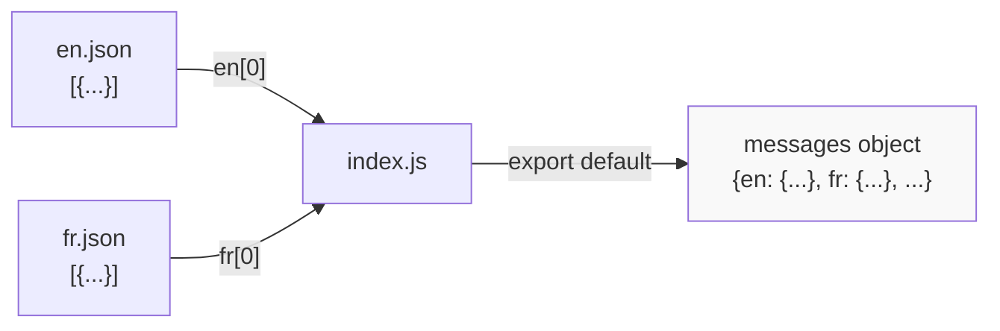
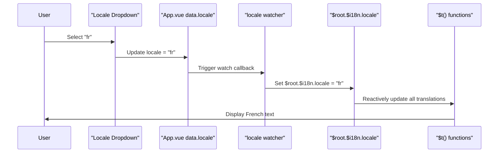
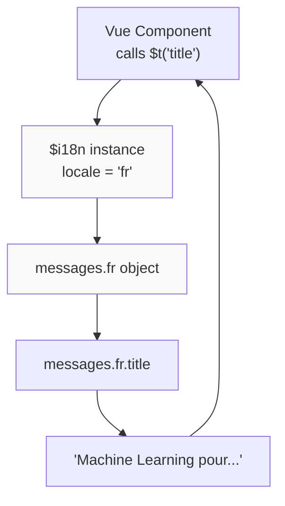

<!-- source: DeepWiki mcp.deepwiki.com · repo microsoft/ML-For-Beginners · extra page Quiz Internationalization System · fetched 2026-10-26 -->

# Quiz Internationalization System

<details>
<summary>Relevant source files</summary>

The following files were used as context for generating this wiki page:

- [.gitignore](.gitignore)
- [1-Introduction/1-intro-to-ML/lesson-1.pdf](1-Introduction/1-intro-to-ML/lesson-1.pdf)
- [1-Introduction/2-history-of-ML/lesson-2.pdf](1-Introduction/2-history-of-ML/lesson-2.pdf)
- [quiz-app/package-lock.json](quiz-app/package-lock.json)
- [quiz-app/package.json](quiz-app/package.json)
- [quiz-app/src/App.vue](quiz-app/src/App.vue)
- [quiz-app/src/assets/translations/fr.json](quiz-app/src/assets/translations/fr.json)
- [quiz-app/src/assets/translations/index.js](quiz-app/src/assets/translations/index.js)
- [quiz-app/src/assets/translations/it.json](quiz-app/src/assets/translations/it.json)
- [quiz-app/src/assets/translations/ja.json](quiz-app/src/assets/translations/ja.json)
- [quiz-app/src/assets/translations/tr.json](quiz-app/src/assets/translations/tr.json)

</details>


## Purpose and Scope

This document describes the internationalization (i18n) system for the quiz application, including the vue-i18n integration, locale management, translation file organization, and runtime locale switching mechanism. For information about the overall Vue.js application structure, see [Vue.js Application Structure](#6.3.1). For details on quiz content schema and data organization, see [Quiz Data Structure and Content](#6.3.3).

## Architecture Overview

The quiz application uses `vue-i18n` version 8.26.7 to provide multilingual support for 7 languages: English (en), French (fr), Italian (it), Japanese (ja), Brazilian Portuguese (ptbr), Turkish (tr), and Spanish (es). The system centralizes translation data in JSON files and exposes them through a messages object that vue-i18n consumes at runtime.

### High-Level Component Interaction

```mermaid
graph TB
    App["App.vue<br/>Root Component"]
    i18nPlugin["vue-i18n Plugin<br/>$i18n instance"]
    indexJS["translations/index.js<br/>messages object"]
    
    enJSON["translations/en.json"]
    frJSON["translations/fr.json"]
    itJSON["translations/it.json"]
    jaJSON["translations/ja.json"]
    ptbrJSON["translations/ptbr.json"]
    trJSON["translations/tr.json"]
    esJSON["translations/es.json"]
    
    localeSelect["Locale Dropdown<br/><select v-model='locale'>"]
    tFunction["$t() Function<br/>Runtime Translation"]
    
    indexJS --> enJSON
    indexJS --> frJSON
    indexJS --> itJSON
    indexJS --> jaJSON
    indexJS --> ptbrJSON
    indexJS --> trJSON
    indexJS --> esJSON
    
    indexJS --> i18nPlugin
    App --> i18nPlugin
    App --> localeSelect
    localeSelect --> i18nPlugin
    i18nPlugin --> tFunction
    
    style i18nPlugin fill:#f9f9f9
    style indexJS fill:#f9f9f9
```



**Sources:** [quiz-app/src/App.vue:1-51](), [quiz-app/src/assets/translations/index.js:1-23](), [quiz-app/package.json:13]()

## Translation File Organization

### Directory Structure

All translation files reside in `quiz-app/src/assets/translations/` with the following naming convention:

| File | Language | Locale Code |
|------|----------|-------------|
| `en.json` | English | `en` |
| `fr.json` | French | `fr` |
| `it.json` | Italian | `it` |
| `ja.json` | Japanese | `ja` |
| `ptbr.json` | Brazilian Portuguese | `ptbr` |
| `tr.json` | Turkish | `tr` |
| `es.json` | Spanish | `es` |

**Sources:** [quiz-app/src/assets/translations/index.js:2-8]()

### Translation File Schema

Each JSON file contains an array with a single object representing all translatable strings for that locale. The structure includes:

```json
[
  {
    "title": "Machine Learning for Beginners: Quizzes",
    "complete": "Congratulations, you completed the quiz!",
    "error": "Sorry, try again",
    "quizzes": [
      {
        "id": 1,
        "title": "Introduction to Machine Learning: Pre-Lecture Quiz",
        "quiz": [
          {
            "questionText": "Machine learning applications are all around us",
            "answerOptions": [
              {
                "answerText": "True",
                "isCorrect": "true"
              }
            ]
          }
        ]
      }
    ]
  }
]
```

The schema separates **UI strings** (`title`, `complete`, `error`) from **content strings** (quiz questions and answers within the `quizzes` array).

**Sources:** [quiz-app/src/assets/translations/fr.json:1-58](), [quiz-app/src/assets/translations/it.json:1-57]()

## Messages Object Construction

### Index Module Exports

The `quiz-app/src/assets/translations/index.js` file acts as the central aggregation point for all translations. It imports each language file and constructs a `messages` object with locale codes as keys:

```javascript
// Imports
import en from './en.json';
import tr from './tr.json';
import fr from './fr.json';
// ... other imports

// Messages object construction
const messages = {
  en: en[0],
  tr: tr[0],
  fr: fr[0],
  ja: ja[0],
  it: it[0],
  ptbr: ptbr[0],
  es: es[0]
};

export default messages;
```

Each translation file exports an array, so `[0]` extracts the first (and only) object for vue-i18n consumption.



**Sources:** [quiz-app/src/assets/translations/index.js:1-23]()

## Vue-i18n Integration

### Plugin Configuration

The `App.vue` component configures vue-i18n by importing the `messages` object and passing it to the i18n component option:

```javascript
import messages from "@/assets/translations";

export default {
  name: "App",
  i18n: { messages },
  // ...
}
```

This creates a local i18n instance accessible via `this.$i18n` in the component hierarchy.

**Sources:** [quiz-app/src/App.vue:27-31]()

### Locale State Management

The application maintains locale state in the `App.vue` component's data:

```javascript
data() {
  return {
    locale: "en",
  };
}
```

A watcher responds to locale changes by updating the global i18n locale:

```javascript
watch: {
  locale(val) {
    this.$root.$i18n.locale = val;
  },
}
```

The component also checks for a query parameter `loc` on mount to support URL-based locale initialization:

```javascript
created() {
  if (this.$route.query.loc) {
    this.locale = this.$route.query.loc;
  }
}
```

**Sources:** [quiz-app/src/App.vue:35-49]()

## User Interface Components

### Locale Selection Dropdown

The application provides a dropdown in the navigation bar for locale switching:

```html
<nav>
  <router-link class="navlink" to="/">Home</router-link>
  <label for="locale">locale</label>
  <select v-model="locale">
    <option>en</option>
    <option>fr</option>
    <option>it</option>
    <option>ja</option>
    <option value="ptbr">pt-br</option>
    <option>tr</option>
    <option>es</option>
  </select>
</nav>
```

The `v-model="locale"` binding ensures that selecting an option triggers the watcher, which updates `$i18n.locale`.

**Sources:** [quiz-app/src/App.vue:3-14]()

### Translation Function Usage

Components access translated strings using the `$t()` function, which vue-i18n injects into all Vue instances:

```html
<h1>{{ $t("title") }}</h1>
```

When the locale changes, vue-i18n reactively updates all `$t()` calls to display the corresponding translation from the active locale's messages object.

**Sources:** [quiz-app/src/App.vue:17]()

## Locale Switching Flow



**Sources:** [quiz-app/src/App.vue:40-43](), [quiz-app/src/App.vue:17]()

## Translation Key Structure

The messages object exposes three top-level keys for UI strings:

| Key | Purpose | Example (en) | Example (fr) |
|-----|---------|--------------|--------------|
| `title` | Application title | "Machine Learning for Beginners: Quizzes" | "Machine Learning pour les Débutants: Quiz" |
| `complete` | Quiz completion message | "Congratulations, you completed the quiz!" | "Félicitations, vous avez terminé le quiz!" |
| `error` | Error message | "Sorry, try again" | "Désolé, essayez à nouveau" |

The `quizzes` array contains structured content that components iterate over to display questions and answers. While these strings are translated, they are accessed by array index and property name rather than as flat translation keys.

**Sources:** [quiz-app/src/assets/translations/fr.json:3-5](), [quiz-app/src/assets/translations/it.json:3-5]()

## Dependency Configuration

The `package.json` file specifies the vue-i18n dependency:

```json
{
  "dependencies": {
    "vue": "^3.5.12",
    "vue-i18n": "^8.26.7",
    "vue-router": "^3.5.3"
  }
}
```

Note that `vue-i18n` version 8.x is designed for Vue 2 compatibility. The application uses Vue 3 (`^3.5.12`), which typically requires vue-i18n version 9.x. This version mismatch may be intentional (using legacy mode) or an oversight in the dependency configuration.

**Sources:** [quiz-app/package.json:10-14]()

## Runtime Translation Resolution



When a component calls `$t("title")` with the current locale set to `"fr"`, vue-i18n:

1. Reads `$i18n.locale` (value: `"fr"`)
2. Accesses `messages["fr"]` from the messages object
3. Retrieves `messages["fr"]["title"]`
4. Returns the French translation string

**Sources:** [quiz-app/src/App.vue:31](), [quiz-app/src/assets/translations/index.js:12-20]()

## Code-to-Translation Mapping

| Code Location | Translation Key | Access Pattern |
|---------------|-----------------|----------------|
| `App.vue:17` | `title` | `$t("title")` |
| Quiz component (referenced) | `complete` | `$t("complete")` |
| Quiz component (referenced) | `error` | `$t("error")` |
| Quiz component (referenced) | `quizzes[i].title` | Direct object access |
| Quiz component (referenced) | `quizzes[i].quiz[j].questionText` | Direct object access |

The UI strings use the `$t()` function for reactive translation lookup, while quiz content is accessed directly as JavaScript objects after the initial locale selection determines which messages object is active.

**Sources:** [quiz-app/src/App.vue:17](), [quiz-app/src/assets/translations/fr.json:3-11]()

---

