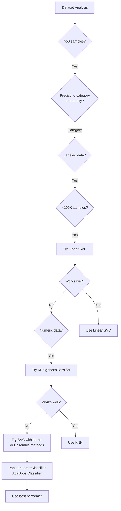
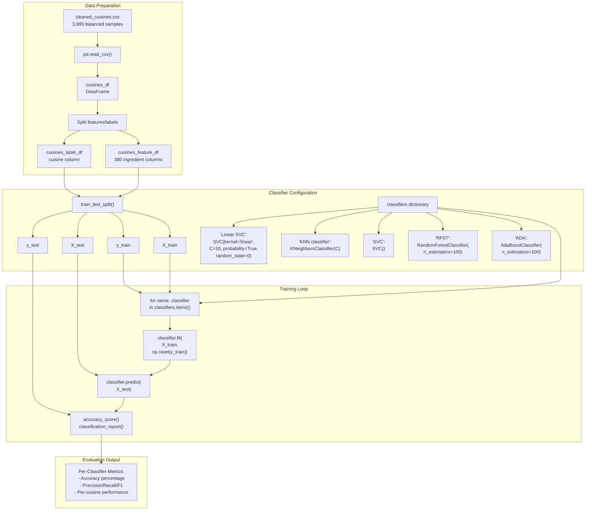
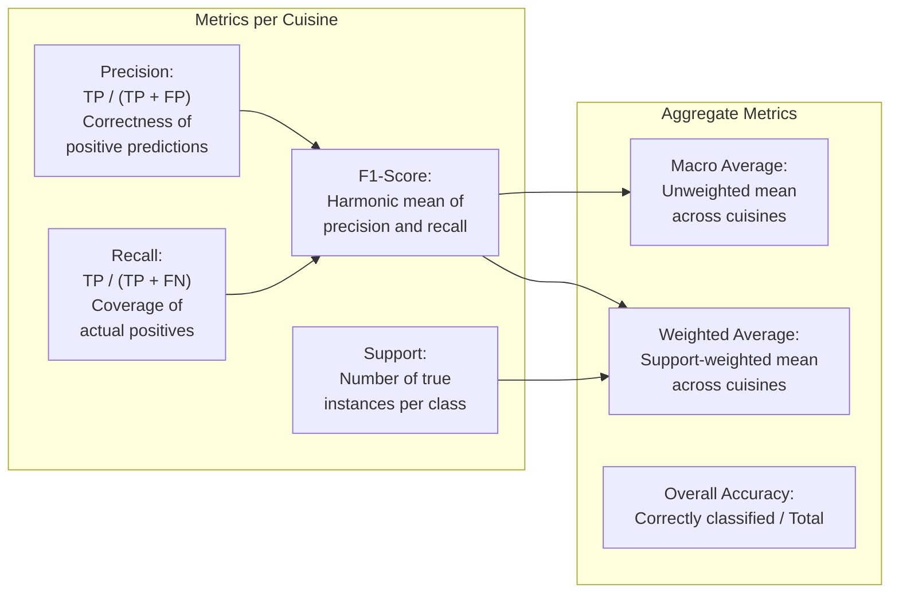

<!-- source: DeepWiki mcp.deepwiki.com · repo microsoft/ML-For-Beginners · extra page Classification Algorithms Comparison · fetched 2026-10-26 -->

# Classification Algorithms Comparison

<details>
<summary>Relevant source files</summary>

The following files were used as context for generating this wiki page:

- [4-Classification/1-Introduction/README.md](4-Classification/1-Introduction/README.md)
- [4-Classification/1-Introduction/assignment.md](4-Classification/1-Introduction/assignment.md)
- [4-Classification/1-Introduction/notebook.ipynb](4-Classification/1-Introduction/notebook.ipynb)
- [4-Classification/1-Introduction/solution/notebook.ipynb](4-Classification/1-Introduction/solution/notebook.ipynb)
- [4-Classification/2-Classifiers-1/README.md](4-Classification/2-Classifiers-1/README.md)
- [4-Classification/2-Classifiers-1/notebook.ipynb](4-Classification/2-Classifiers-1/notebook.ipynb)
- [4-Classification/2-Classifiers-1/solution/notebook.ipynb](4-Classification/2-Classifiers-1/solution/notebook.ipynb)
- [4-Classification/3-Classifiers-2/README.md](4-Classification/3-Classifiers-2/README.md)
- [4-Classification/3-Classifiers-2/notebook.ipynb](4-Classification/3-Classifiers-2/notebook.ipynb)
- [4-Classification/3-Classifiers-2/solution/notebook.ipynb](4-Classification/3-Classifiers-2/solution/notebook.ipynb)
- [4-Classification/4-Applied/README.md](4-Classification/4-Applied/README.md)
- [4-Classification/4-Applied/notebook.ipynb](4-Classification/4-Applied/notebook.ipynb)
- [4-Classification/README.md](4-Classification/README.md)

</details>


## Purpose and Scope

This page documents the systematic comparison of multiple classification algorithms applied to the cuisine dataset. After preparing and balancing the data (covered in [3.2.1](#3.2.1)), this material evaluates five distinct classifiers to determine which performs best for multiclass cuisine prediction based on ingredient presence. The comparison includes implementation details, performance metrics, and selection criteria for choosing appropriate algorithms.

For introductory classification concepts and logistic regression fundamentals, see [3.1.4](#3.1.4). For model deployment using the selected classifier, see [3.2.3](#3.2.3).

## Classifier Selection Framework

The selection of classifiers follows a decision path based on dataset characteristics. The cuisine dataset has:
- More than 50 samples (3,995 balanced samples across 5 cuisines)
- Multiclass target variable (5 cuisine types)
- Labeled data (each recipe labeled with cuisine type)
- Fewer than 100K samples
- Numeric binary features (380 ingredient presence indicators)



Sources: [4-Classification/3-Classifiers-2/README.md:15-35]()

## Implemented Classifiers

### Linear SVC

`SVC` with `kernel='linear'` implements Support-Vector Classification with a linear kernel. The algorithm creates a hyperplane in 380-dimensional feature space to separate cuisine classes.

**Key Parameters:**
- `kernel='linear'`: Uses linear decision boundary
- `C=10`: Regularization parameter controlling margin softness
- `probability=True`: Enables probability estimates via Platt scaling
- `random_state=0`: Ensures reproducible data shuffling

**Performance:** 78.6% accuracy (varies with train/test split)

Sources: [4-Classification/3-Classifiers-2/README.md:59-107](), [4-Classification/3-Classifiers-2/solution/notebook.ipynb:159-171]()

### K-Neighbors Classifier

`KNeighborsClassifier` classifies samples based on the majority vote of their K nearest neighbors in feature space. Distance is computed across the 380 ingredient dimensions.

**Key Parameters:**
- First positional argument: Number of neighbors (set to `C=10` in implementation)

**Performance:** 73.8% accuracy

**Characteristics:**
- Non-parametric method (no training phase, uses entire dataset for inference)
- Sensitive to feature scaling and curse of dimensionality
- Works well when decision boundaries are irregular

Sources: [4-Classification/3-Classifiers-2/README.md:108-140](), [4-Classification/3-Classifiers-2/solution/notebook.ipynb:165]()

### Support Vector Classifier (RBF Kernel)

`SVC` with default RBF (Radial Basis Function) kernel can model non-linear decision boundaries by implicitly mapping data to higher-dimensional space.

**Key Parameters:**
- Uses default RBF kernel (no explicit kernel parameter)
- Default `C=1.0` and `gamma='scale'`

**Performance:** 83.2% accuracy

**Characteristics:**
- Maps training examples to points in space to maximize category separation
- Can capture complex non-linear patterns in ingredient combinations
- More computationally intensive than Linear SVC

Sources: [4-Classification/3-Classifiers-2/README.md:141-172]()

### Random Forest Classifier

`RandomForestClassifier` builds an ensemble of decision trees with randomness to prevent overfitting. Each tree votes on the predicted cuisine class.

**Key Parameters:**
- `n_estimators=100`: Builds 100 decision trees in the forest

**Performance:** 84.5% accuracy (highest among tested classifiers)

**Characteristics:**
- Averaging method that builds multiple decision trees with randomness
- Reduces overfitting through ensemble voting
- Provides feature importance metrics
- Handles high-dimensional data effectively

Sources: [4-Classification/3-Classifiers-2/README.md:174-220](), [4-Classification/3-Classifiers-2/solution/notebook.ipynb:167]()

### AdaBoost Classifier

`AdaBoostClassifier` sequentially trains weak classifiers, focusing on misclassified samples by adjusting their weights.

**Key Parameters:**
- `n_estimators=100`: Creates 100 weak estimators

**Performance:** 72.4% accuracy (lowest among tested classifiers)

**Characteristics:**
- Fits classifier to dataset, then fits copies focusing on incorrectly classified items
- Adjusts weights to improve subsequent classifiers
- May underperform when base estimators are too weak or data is noisy

Sources: [4-Classification/3-Classifiers-2/README.md:174-220](), [4-Classification/3-Classifiers-2/solution/notebook.ipynb:168]()

## Implementation Architecture



Sources: [4-Classification/3-Classifiers-2/solution/notebook.ipynb:48-260](), [4-Classification/3-Classifiers-2/README.md:37-58]()

## Required Imports

The comparison implementation requires specific scikit-learn modules:

| Import | Purpose |
|--------|---------|
| `sklearn.neighbors.KNeighborsClassifier` | K-Nearest Neighbors algorithm |
| `sklearn.linear_model.LogisticRegression` | Logistic regression (available for comparison) |
| `sklearn.svm.SVC` | Support Vector Classification |
| `sklearn.ensemble.RandomForestClassifier` | Random Forest ensemble |
| `sklearn.ensemble.AdaBoostClassifier` | AdaBoost ensemble |
| `sklearn.model_selection.train_test_split` | Data splitting utility |
| `sklearn.metrics.accuracy_score` | Accuracy calculation |
| `sklearn.metrics.classification_report` | Detailed metrics report |
| `numpy` | Array manipulation (for `np.ravel()`) |

Sources: [4-Classification/3-Classifiers-2/README.md:41-51](), [4-Classification/3-Classifiers-2/solution/notebook.ipynb:136-142]()

## Performance Comparison

The following table summarizes classifier performance on the 30% test split (1,199 samples):

| Classifier | Accuracy | Best Performing Cuisine | Worst Performing Cuisine | Training Characteristics |
|------------|----------|------------------------|--------------------------|--------------------------|
| **Random Forest** | **84.5%** | Indian (92% recall) | Chinese (77% recall) | Slow training, fast inference |
| **SVC (RBF)** | **83.2%** | Indian (90% recall) | Chinese (74% recall) | Slow training, slow inference |
| **Linear SVC** | 78.6% | Indian (86% recall) | Chinese (67% recall) | Fast training, fast inference |
| **K-Neighbors** | 73.8% | Korean (high precision at 94%) | Korean (low recall at 58%) | No training, slow inference |
| **AdaBoost** | 72.4% | Indian (83% recall) | Chinese (49% recall) | Slow training, fast inference |

**Key Observations:**
- Indian cuisine consistently achieves highest precision/recall across all classifiers (87-92%)
- Chinese cuisine is most difficult to classify correctly (49-77% recall)
- Random Forest provides best overall accuracy with balanced per-class performance
- K-Neighbors shows extreme precision-recall imbalance for Korean cuisine

Sources: [4-Classification/3-Classifiers-2/README.md:91-211](), [4-Classification/3-Classifiers-2/solution/notebook.ipynb:178-246]()

## Classification Report Details

Each classifier outputs a detailed `classification_report()` showing per-cuisine metrics:



Example output for Random Forest (84.5% accuracy):

| Cuisine | Precision | Recall | F1-Score | Support |
|---------|-----------|--------|----------|---------|
| chinese | 0.80 | 0.77 | 0.78 | 242 |
| indian | 0.89 | 0.92 | 0.90 | 234 |
| japanese | 0.86 | 0.84 | 0.85 | 254 |
| korean | 0.88 | 0.83 | 0.85 | 242 |
| thai | 0.80 | 0.87 | 0.83 | 227 |
| **accuracy** | | | **0.84** | **1199** |
| **macro avg** | 0.85 | 0.85 | 0.84 | 1199 |
| **weighted avg** | 0.85 | 0.84 | 0.84 | 1199 |

Sources: [4-Classification/3-Classifiers-2/README.md:183-211]()

## Parameter Configuration Details

### Regularization Parameter C

The `C` parameter appears in both Linear SVC and implicitly affects other classifiers:

- **Linear SVC**: `C=10` provides strong regularization control. Higher C = smaller margin, lower C = larger margin
- **Default SVC**: Uses `C=1.0` by default
- Higher C values fit training data more closely but risk overfitting

### Ensemble Size (n_estimators)

Both ensemble methods use `n_estimators=100`:

- **Random Forest**: 100 independent decision trees with bootstrap sampling
- **AdaBoost**: 100 sequential weak learners with weight adjustment

Increasing `n_estimators` generally improves performance but increases training time linearly.

### Multi-class Strategy

Support Vector machines handle multiclass classification through one-vs-rest (OvR) decomposition:
- Trains 5 binary classifiers (one per cuisine vs. all others)
- Final prediction uses classifier with highest confidence score

Sources: [4-Classification/3-Classifiers-2/README.md:60-61](), [4-Classification/3-Classifiers-2/README.md:217-219]()

## Training Loop Implementation

The comparison uses a consistent evaluation loop across all classifiers:

```python
# Structure from notebook
for index, (name, classifier) in enumerate(classifiers.items()):
    classifier.fit(X_train, np.ravel(y_train))
    y_pred = classifier.predict(X_test)
    accuracy = accuracy_score(y_test, y_pred)
    print(classification_report(y_test, y_pred))
```

**Key Implementation Details:**

1. **Dictionary Iteration**: `classifiers.items()` allows consistent naming and iteration
2. **Label Flattening**: `np.ravel(y_train)` converts 2D DataFrame column to 1D array required by scikit-learn
3. **Separate Prediction Step**: Enables reuse of predictions for multiple metrics
4. **Uniform Interface**: All classifiers expose identical `fit()` and `predict()` APIs

Sources: [4-Classification/3-Classifiers-2/solution/notebook.ipynb:250-259](), [4-Classification/3-Classifiers-2/README.md:77-89]()

## Selection Criteria and Trade-offs

| Criterion | Recommended Classifier | Rationale |
|-----------|----------------------|-----------|
| **Maximum accuracy** | Random Forest (84.5%) | Best overall performance with balanced per-class metrics |
| **Fastest training** | Linear SVC | Linear complexity in sample size, no ensemble overhead |
| **Smallest model size** | Linear SVC | Single linear model vs. 100 trees or support vectors |
| **Interpretability** | Random Forest | Can extract feature importance for ingredient analysis |
| **Fastest prediction** | Linear SVC | Single matrix multiplication |
| **Handling new ingredients** | Random Forest or SVC | Non-linear methods generalize better to unseen combinations |
| **Minimal tuning required** | Random Forest | Robust to default parameters |

### Algorithm-Specific Considerations

**Linear SVC:**
- Assumes linear separability in feature space
- Fast but may underfit complex patterns
- Best when cuisines differ by simple ingredient presence/absence

**K-Neighbors:**
- Requires careful K selection (sensitive to parameter)
- Memory-intensive (stores entire training set)
- Slow prediction time increases with dataset size

**SVC (RBF):**
- Automatically handles non-linear patterns
- Requires parameter tuning (`C`, `gamma`) for optimal performance
- Memory consumption grows with support vectors

**Random Forest:**
- Parallel training possible across trees
- Handles feature interactions naturally
- Black-box model (less interpretable than linear methods)

**AdaBoost:**
- Sequential training (cannot parallelize)
- Sensitive to noisy data and outliers
- May perform poorly with weak base learners on this dataset

Sources: [4-Classification/3-Classifiers-2/README.md:213-232](), [4-Classification/3-Classifiers-2/README.md:108-220]()

## Code References

The complete classifier comparison implementation can be found in:
- Main implementation: [4-Classification/3-Classifiers-2/solution/notebook.ipynb:136-259]()
- Classifier configuration: [4-Classification/3-Classifiers-2/solution/notebook.ipynb:159-171]()
- Training loop: [4-Classification/3-Classifiers-2/solution/notebook.ipynb:250-259]()
- Documentation: [4-Classification/3-Classifiers-2/README.md:1-236]()

## Related Workflows

After selecting the optimal classifier (Random Forest in most runs), the model proceeds to:
1. **ONNX Conversion**: Transform scikit-learn model for web deployment (see [3.2.3](#3.2.3))
2. **Web Application Integration**: Deploy as cuisine recommender (see [3.2.3](#3.2.3))

For alternative implementations using R's tidymodels framework, see [6.2](#6.2).

---

