<!-- source: DeepWiki mcp.deepwiki.com · repo microsoft/ML-For-Beginners · extra page R Model Training and Evaluation · fetched 2026-10-26 -->

# R Model Training and Evaluation

Relevant source files

The following files were used as context for generating this wiki page:

- [2-Regression/4-Logistic/solution/R/lesson_4-R.ipynb](2-Regression/4-Logistic/solution/R/lesson_4-R.ipynb)
- [2-Regression/4-Logistic/solution/R/lesson_4.Rmd](2-Regression/4-Logistic/solution/R/lesson_4.Rmd)
- [2-Regression/4-Logistic/solution/R/lesson_4.html](2-Regression/4-Logistic/solution/R/lesson_4.html)
- [4-Classification/1-Introduction/solution/R/lesson_10-R.ipynb](4-Classification/1-Introduction/solution/R/lesson_10-R.ipynb)
- [4-Classification/1-Introduction/solution/R/lesson_10.Rmd](4-Classification/1-Introduction/solution/R/lesson_10.Rmd)
- [4-Classification/1-Introduction/solution/R/lesson_10.html](4-Classification/1-Introduction/solution/R/lesson_10.html)
- [4-Classification/2-Classifiers-1/solution/R/lesson_11-R.ipynb](4-Classification/2-Classifiers-1/solution/R/lesson_11-R.ipynb)
- [4-Classification/2-Classifiers-1/solution/R/lesson_11.Rmd](4-Classification/2-Classifiers-1/solution/R/lesson_11.Rmd)
- [4-Classification/data/cleaned_cuisines_R.csv](4-Classification/data/cleaned_cuisines_R.csv)
- [5-Clustering/1-Visualize/solution/R/lesson_14-R.ipynb](5-Clustering/1-Visualize/solution/R/lesson_14-R.ipynb)
- [5-Clustering/1-Visualize/solution/R/lesson_14.Rmd](5-Clustering/1-Visualize/solution/R/lesson_14.Rmd)
- [5-Clustering/2-K-Means/solution/R/lesson_15-R.ipynb](5-Clustering/2-K-Means/solution/R/lesson_15-R.ipynb)
- [5-Clustering/2-K-Means/solution/R/lesson_15.Rmd](5-Clustering/2-K-Means/solution/R/lesson_15.Rmd)

This document covers model training and evaluation using the tidymodels framework in R, specifically focusing on the parsnip package for model specification and yardstick package for performance metrics. For preprocessing steps, see [R Recipes and Preprocessing](#6.2.2). For an overview of the tidymodels ecosystem, see [tidymodels Framework Overview](#6.2.1).

## Model Specification with Parsnip

The parsnip package provides a unified interface for specifying machine learning models across different computational engines. Model specifications define the algorithm, engine, and mode before training.

### Binary Classification with Logistic Regression

Binary classification models use `logistic_reg()` to specify logistic regression. The model specification requires setting an engine (computational backend) and mode (classification):

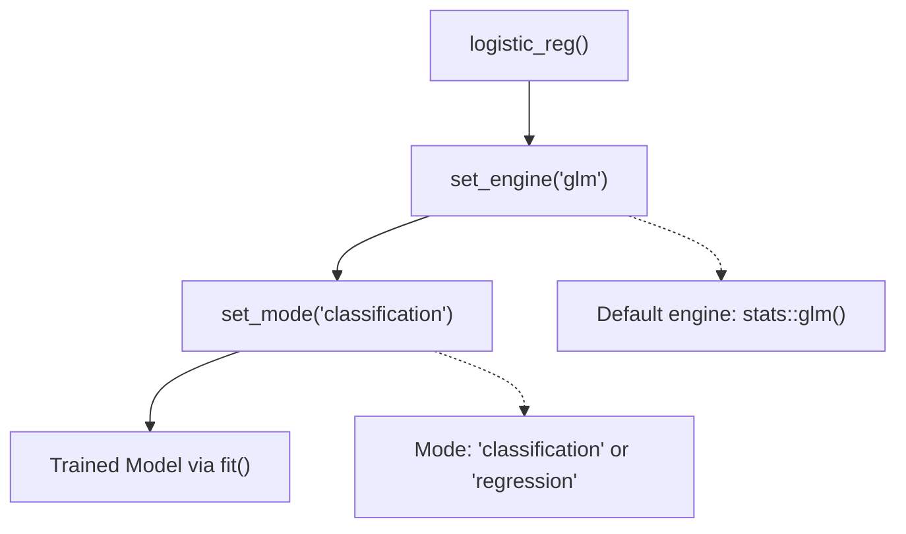

The specification pattern separates model definition from training, as shown in [2-Regression/4-Logistic/solution/R/lesson_4.Rmd:272-283]():

- `logistic_reg()` creates the model specification
- `set_engine("glm")` uses R's built-in generalized linear model function
- `set_mode("classification")` configures for categorical outcomes

Sources: [2-Regression/4-Logistic/solution/R/lesson_4.Rmd:272-283]()

### Multiclass Classification with Multinomial Regression

Multiclass problems require `multinom_reg()` for multinomial logistic regression. This handles outcomes with more than two categories:

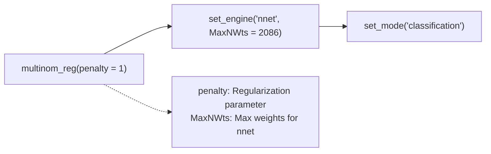

The nnet engine requires specific parameters as demonstrated in [4-Classification/2-Classifiers-1/solution/R/lesson_11.Rmd:230-237]():

- `penalty` controls regularization strength
- `MaxNWts` parameter passed to nnet engine handles large feature spaces
- Engine choice affects available hyperparameters

Sources: [4-Classification/2-Classifiers-1/solution/R/lesson_11.Rmd:230-237]()

## Workflow Construction

The `workflow` object bundles preprocessing recipes with model specifications, creating a complete modeling pipeline. This approach ensures consistent preprocessing during training and prediction.

### Workflow Assembly Pattern

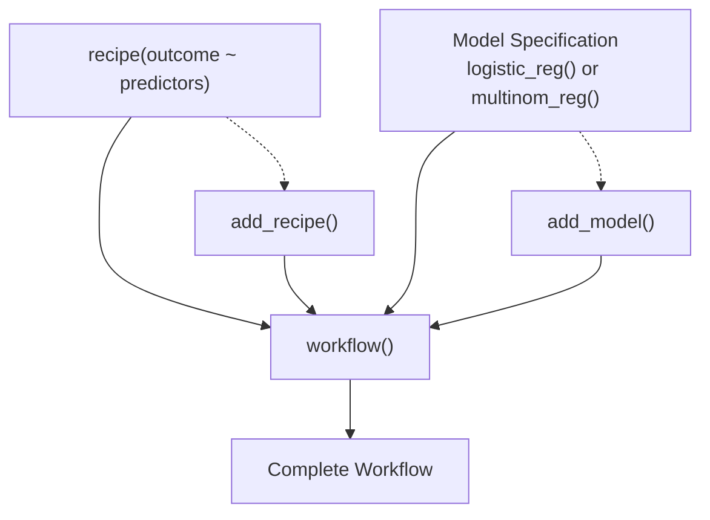

The workflow construction follows a consistent pattern in [2-Regression/4-Logistic/solution/R/lesson_4.Rmd:290-297]():

1. Create empty workflow with `workflow()`
2. Add recipe using `add_recipe(pumpkins_recipe)`
3. Add model using `add_model(log_reg)`
4. Result is bundled object ready for training

Benefits of workflows:
- Automatic application of preprocessing steps
- No manual `prep()` and `bake()` calls needed
- Ensures train/test consistency
- Simplifies production deployment

Sources: [2-Regression/4-Logistic/solution/R/lesson_4.Rmd:290-297](), [4-Classification/2-Classifiers-1/solution/R/lesson_11.Rmd:244-253]()

### Workflow vs Manual Recipe Processing

Workflows automate recipe application, contrasting with manual preprocessing:

| Manual Recipe Processing | Workflow Approach |
|-------------------------|-------------------|
| `recipe() %>% prep() %>% bake()` | Recipe bundled in workflow |
| Separate preprocessing step | Automatic during `fit()` |
| Risk of train/test inconsistency | Guaranteed consistency |
| Suitable for data exploration | Recommended for modeling |

Sources: [2-Regression/4-Logistic/solution/R/lesson_4.Rmd:174-176](), [2-Regression/4-Logistic/solution/R/lesson_4.Rmd:268-269]()

## Model Training with fit()

The `fit()` function trains the model using the training dataset. When applied to a workflow, it executes both preprocessing and model estimation.

### Training Process Flow

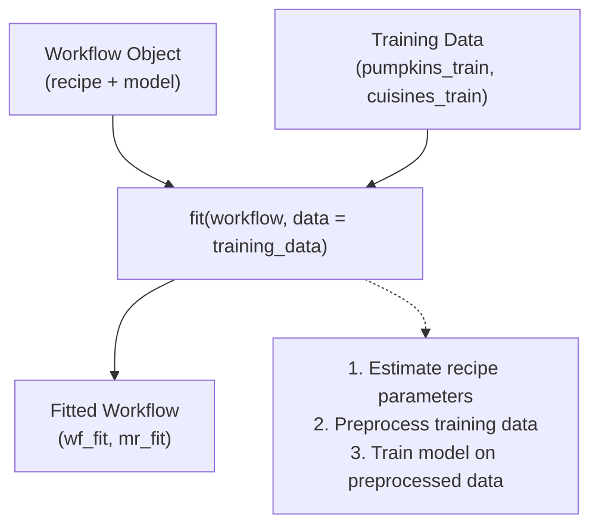

Training execution in [2-Regression/4-Logistic/solution/R/lesson_4.Rmd:302-309]():

- `fit(object = log_reg_wf, data = pumpkins_train)` trains the complete pipeline
- Workflow automatically estimates recipe transformations
- Model coefficients learned from preprocessed training data
- Returns fitted workflow object containing trained model

The fitted workflow stores learned parameters for both preprocessing and model, as shown in [4-Classification/2-Classifiers-1/solution/R/lesson_11.Rmd:257-262]().

Sources: [2-Regression/4-Logistic/solution/R/lesson_4.Rmd:302-309](), [4-Classification/2-Classifiers-1/solution/R/lesson_11.Rmd:257-262]()

## Making Predictions

Prediction methods on fitted workflows apply preprocessing and generate predictions. The `predict()` function supports multiple output types.

### Prediction Types

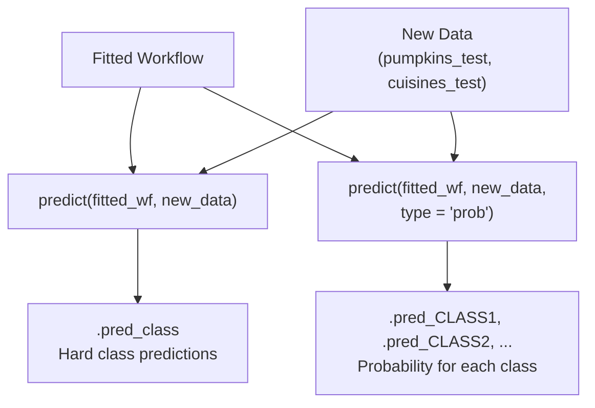

### Hard Class Predictions

Hard class predictions assign each observation to a single class, demonstrated in [2-Regression/4-Logistic/solution/R/lesson_4.Rmd:316-326]():

- `predict(wf_fit, new_data = pumpkins_test)` generates `.pred_class` column
- Classification based on highest probability (threshold 0.5 for binary)
- Returns tibble with predicted categories

### Probability Predictions

Probability predictions provide confidence scores for all classes, shown in [2-Regression/4-Logistic/solution/R/lesson_4.Rmd:316-326]():

- `predict(wf_fit, new_data = pumpkins_test, type = "prob")` generates probability columns
- Binary classification: `.pred_ORANGE` and `.pred_WHITE` columns
- Multiclass: one column per class (`.pred_chinese`, `.pred_indian`, etc.)
- Probabilities sum to 1.0 across classes

### Combining Predictions with Actual Values

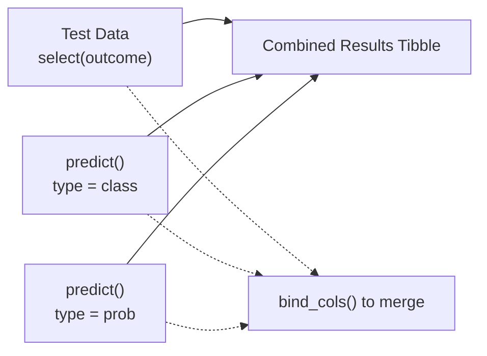

The results assembly pattern in [4-Classification/2-Classifiers-1/solution/R/lesson_11.Rmd:319-330]():

- Start with test data outcome column using `select(cuisine)`
- Add class predictions with `bind_cols(predict(fitted_model, new_data))`
- Add probability predictions with `bind_cols(predict(fitted_model, new_data, type = "prob"))`
- Result contains truth, predictions, and probabilities for evaluation

Sources: [2-Regression/4-Logistic/solution/R/lesson_4.Rmd:316-326](), [4-Classification/2-Classifiers-1/solution/R/lesson_11.Rmd:271-279](), [4-Classification/2-Classifiers-1/solution/R/lesson_11.Rmd:319-330]()

## Model Evaluation with Yardstick

The yardstick package provides performance metrics for model evaluation. Metrics require both truth values and predictions.

### Core Evaluation Metrics

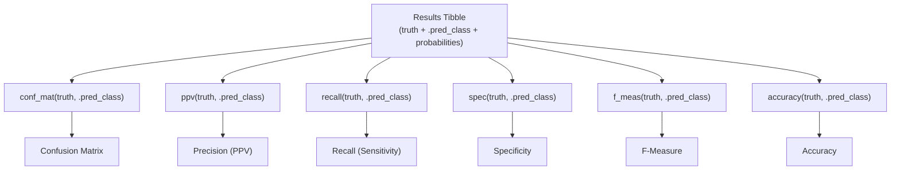

### Metric Set for Batch Evaluation

The `metric_set()` function combines multiple metrics for efficient evaluation, as shown in [2-Regression/4-Logistic/solution/R/lesson_4.Rmd:380-383]():

- `metric_set(ppv, recall, spec, f_meas, accuracy)` creates metric bundle
- Single call evaluates all metrics simultaneously
- Returns tibble with metric names and values

### Key Metric Definitions

| Metric | Formula | Interpretation | yardstick Function |
|--------|---------|----------------|-------------------|
| Precision (PPV) | `TP/(TP + FP)` | Proportion of predicted positives that are correct | `ppv()` |
| Recall (Sensitivity) | `TP/(TP + FN)` | Proportion of actual positives correctly identified | `recall()` |
| Specificity | `TN/(TN + FP)` | Proportion of actual negatives correctly identified | `spec()` |
| Accuracy | `(TP + TN)/(TP + TN + FP + FN)` | Overall proportion of correct predictions | `accuracy()` |
| F-Measure | Weighted average of precision and recall | Harmonic mean, balances precision/recall | `f_meas()` |

Where TP = True Positive, TN = True Negative, FP = False Positive, FN = False Negative.

Sources: [2-Regression/4-Logistic/solution/R/lesson_4.Rmd:365-383]()

## Confusion Matrix Analysis

The confusion matrix tabulates predicted vs actual classes, providing the foundation for classification metrics. For multiclass problems, it becomes a matrix showing all pairwise counts.

### Binary Confusion Matrix Structure

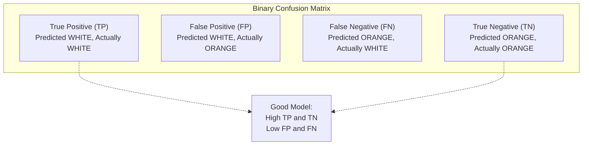

The confusion matrix interpretation from [2-Regression/4-Logistic/solution/R/lesson_4.Rmd:338-363]():

| Predicted ↓ / Actual → | WHITE | ORANGE |
|------------------------|-------|--------|
| **WHITE** | True Positive (TP) | False Positive (FP) |
| **ORANGE** | False Negative (FN) | True Negative (TN) |

Interpretation guidelines:
- True Positives: Model correctly predicts positive class
- True Negatives: Model correctly predicts negative class
- False Positives: Model incorrectly predicts positive (Type I error)
- False Negatives: Model incorrectly predicts negative (Type II error)

### Multiclass Confusion Matrix

Multiclass confusion matrices extend to NxN tables for N classes. Visualization as heatmap aids interpretation:

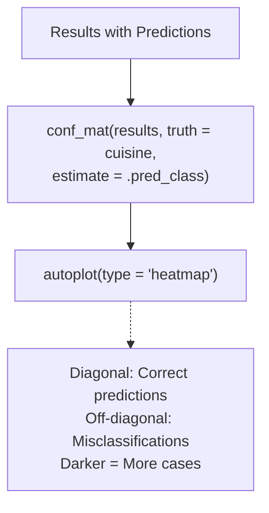

Multiclass confusion matrix usage in [4-Classification/2-Classifiers-1/solution/R/lesson_11.Rmd:283-298]():

- `conf_mat(data = results, truth = cuisine, estimate = .pred_class)` for raw matrix
- `autoplot(type = "heatmap")` visualizes with ggplot2
- Diagonal elements represent correct classifications
- Off-diagonal shows confusion between specific class pairs
- `update_geom_defaults()` customizes visual appearance

### Summary Statistics from Confusion Matrix

The `summary()` method on confusion matrices produces comprehensive metrics:

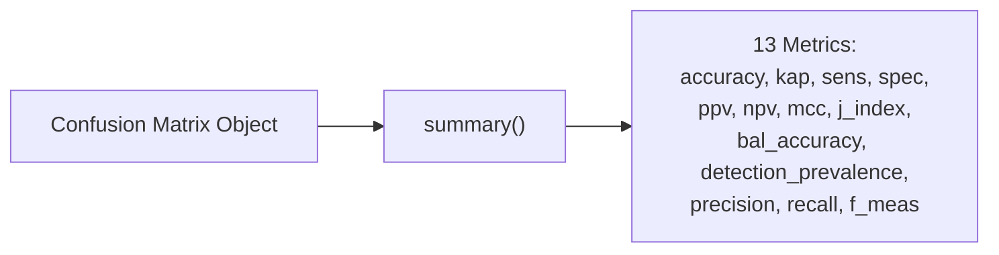

As demonstrated in [4-Classification/2-Classifiers-1/solution/R/lesson_11.Rmd:304-307](), the summary includes 13 different performance metrics automatically calculated from the confusion matrix.

Sources: [2-Regression/4-Logistic/solution/R/lesson_4.Rmd:338-363](), [4-Classification/2-Classifiers-1/solution/R/lesson_11.Rmd:283-307]()

## ROC Curves and AUC

Receiver Operating Characteristic (ROC) curves visualize classifier performance across decision thresholds. The Area Under the Curve (AUC) provides a single-number summary.

### ROC Curve Construction

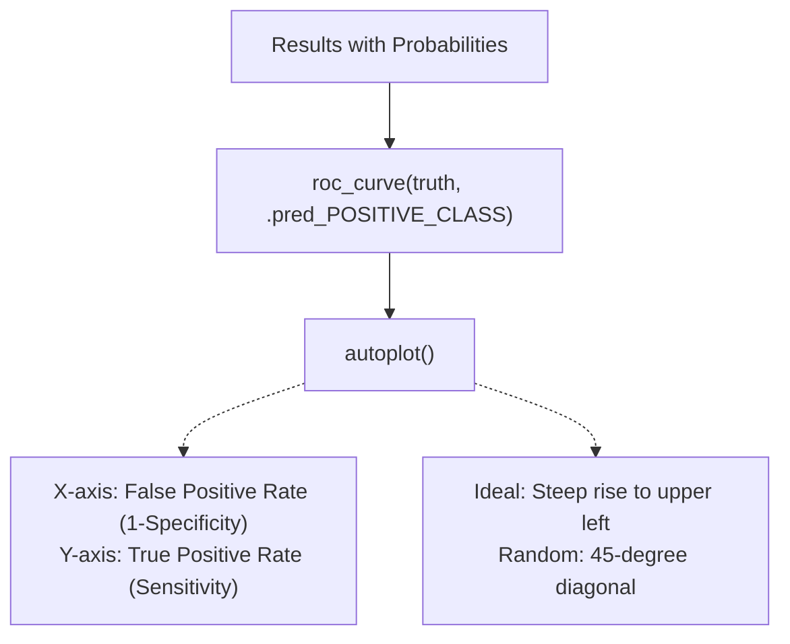

ROC curve generation in [2-Regression/4-Logistic/solution/R/lesson_4.Rmd:390-394]():

- `roc_curve(results, truth = color, estimate = .pred_ORANGE)` computes ROC points
- Requires probability predictions (not class predictions)
- `autoplot()` creates ggplot2 visualization
- Steeper curve indicates better discrimination between classes

### ROC Curve Interpretation

The ROC curve plots trade-offs between true positive rate and false positive rate:

- **Perfect Classifier**: Curve goes straight up (y=1) then right (x=1)
- **Random Classifier**: 45-degree diagonal line
- **Worse than Random**: Curve below diagonal
- **Good Classifier**: Curve bows toward upper-left corner

From [2-Regression/4-Logistic/solution/R/lesson_4.Rmd:396]():
> "The steepness of the curve and the space between the midpoint line and the curve matter: you want a curve that quickly heads up and over the line."

### Area Under the Curve (AUC)

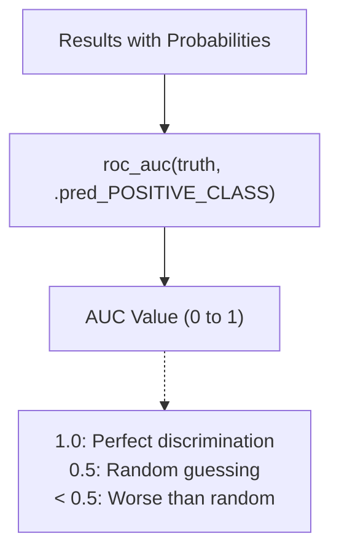

AUC calculation in [2-Regression/4-Logistic/solution/R/lesson_4.Rmd:400-404]():

- `roc_auc(results, truth = color, estimate = .pred_ORANGE)` computes AUC
- Interpretation: Probability that model ranks random positive example higher than random negative example
- Range: 0 to 1, where 1 is perfect
- Example result: 0.975 indicates excellent model performance

AUC provides threshold-independent evaluation:
- Summarizes performance across all possible classification thresholds
- Single metric for model comparison
- Particularly useful when class distribution varies between train/test

Sources: [2-Regression/4-Logistic/solution/R/lesson_4.Rmd:387-407]()

## Complete Evaluation Workflow

The complete model evaluation process integrates predictions with multiple metrics:

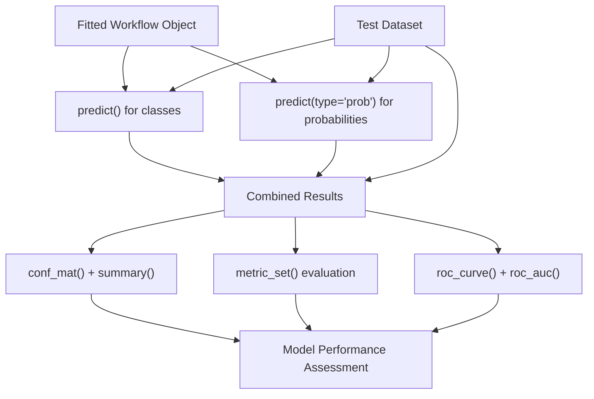

Typical evaluation sequence:
1. Generate class and probability predictions on test set
2. Combine with actual values using `bind_cols()`
3. Calculate confusion matrix for classification patterns
4. Compute metric set for numerical assessment
5. Generate ROC curve and AUC for threshold-independent evaluation
6. Interpret results holistically

Sources: [2-Regression/4-Logistic/solution/R/lesson_4.Rmd:316-407](), [4-Classification/2-Classifiers-1/solution/R/lesson_11.Rmd:268-330]()

---

