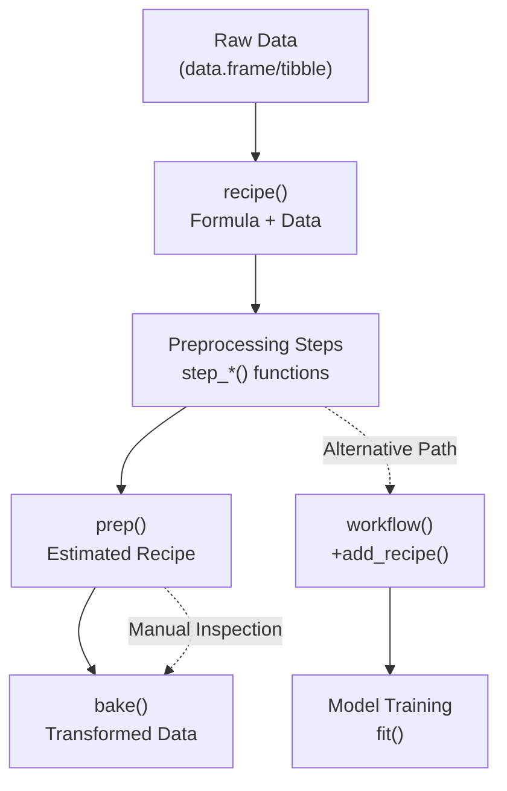
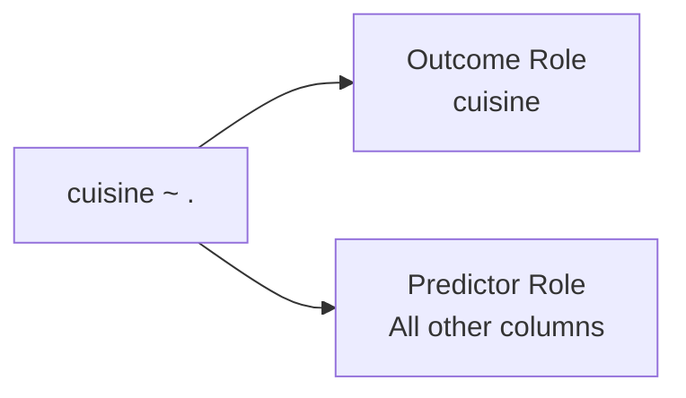
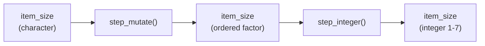
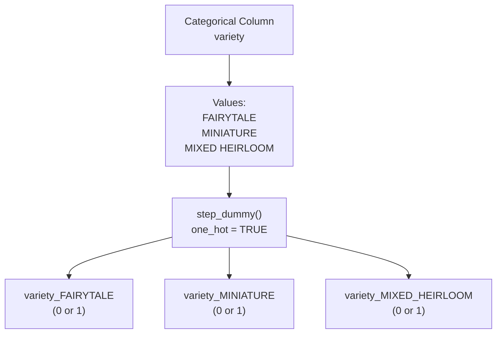
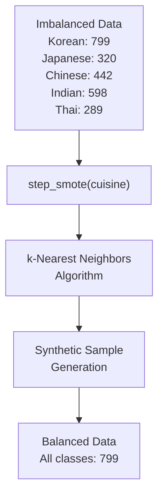
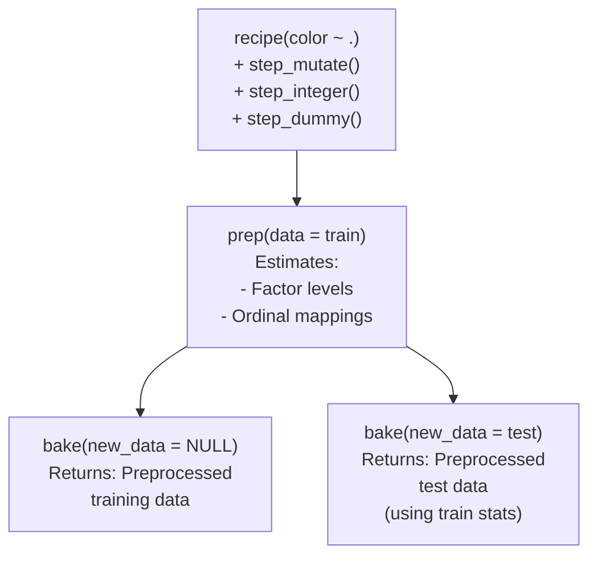
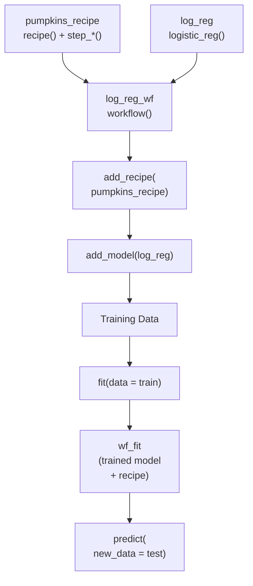
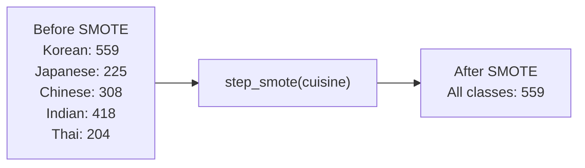

<!-- source: DeepWiki mcp.deepwiki.com · repo microsoft/ML-For-Beginners · extra page R Recipes and Preprocessing · fetched 2026-10-26 -->

# R Recipes and Preprocessing

<details>
<summary>Relevant source files</summary>

The following files were used as context for generating this wiki page:

- [2-Regression/4-Logistic/solution/R/lesson_4-R.ipynb](2-Regression/4-Logistic/solution/R/lesson_4-R.ipynb)
- [2-Regression/4-Logistic/solution/R/lesson_4.Rmd](2-Regression/4-Logistic/solution/R/lesson_4.Rmd)
- [2-Regression/4-Logistic/solution/R/lesson_4.html](2-Regression/4-Logistic/solution/R/lesson_4.html)
- [4-Classification/1-Introduction/solution/R/lesson_10-R.ipynb](4-Classification/1-Introduction/solution/R/lesson_10-R.ipynb)
- [4-Classification/1-Introduction/solution/R/lesson_10.Rmd](4-Classification/1-Introduction/solution/R/lesson_10.Rmd)
- [4-Classification/1-Introduction/solution/R/lesson_10.html](4-Classification/1-Introduction/solution/R/lesson_10.html)
- [4-Classification/2-Classifiers-1/solution/R/lesson_11-R.ipynb](4-Classification/2-Classifiers-1/solution/R/lesson_11-R.ipynb)
- [4-Classification/2-Classifiers-1/solution/R/lesson_11.Rmd](4-Classification/2-Classifiers-1/solution/R/lesson_11.Rmd)
- [4-Classification/data/cleaned_cuisines_R.csv](4-Classification/data/cleaned_cuisines_R.csv)
- [5-Clustering/1-Visualize/solution/R/lesson_14-R.ipynb](5-Clustering/1-Visualize/solution/R/lesson_14-R.ipynb)
- [5-Clustering/1-Visualize/solution/R/lesson_14.Rmd](5-Clustering/1-Visualize/solution/R/lesson_14.Rmd)
- [5-Clustering/2-K-Means/solution/R/lesson_15-R.ipynb](5-Clustering/2-K-Means/solution/R/lesson_15-R.ipynb)
- [5-Clustering/2-K-Means/solution/R/lesson_15.Rmd](5-Clustering/2-K-Means/solution/R/lesson_15.Rmd)

</details>


## Purpose and Scope

This document details the preprocessing capabilities provided by the `recipes` package in the tidymodels framework. Recipes provide a blueprint for transforming raw data into analysis-ready features through a sequence of preprocessing steps. This page covers recipe creation, feature encoding techniques (ordinal and one-hot), data balancing methods (SMOTE), and the integration of recipes with modeling workflows.

For an overview of the broader tidymodels ecosystem, see [6.2.1](#6.2.1). For model training and evaluation using recipes, see [6.2.3](#6.2.3). For the Python scikit-learn equivalent, see [6.1.1](#6.1.1).

---

## Recipe Architecture

The `recipes` package implements a declarative preprocessing pipeline where transformations are specified upfront, estimated on training data, and then consistently applied to new data. This ensures reproducibility and prevents data leakage between training and test sets.



**Recipe Processing Modes**

Sources: [2-Regression/4-Logistic/solution/R/lesson_4.Rmd:172-177](), [4-Classification/1-Introduction/solution/R/lesson_10.Rmd:330-391]()

---

## Recipe Creation with recipe()

The `recipe()` function initializes a preprocessing blueprint by specifying variable roles using R's formula syntax.

### Function Signature

```r
recipe(formula, data)
```

**Parameters:**
- `formula`: A formula defining outcome and predictor variables (e.g., `cuisine ~ .`)
- `data`: Reference dataset used to infer column types and compute statistics

### Role Assignment



**Variable Role Assignments from Formula**

| Formula Pattern | Outcome Role | Predictor Role |
|----------------|--------------|----------------|
| `color ~ .` | `color` | All other columns |
| `cuisine ~ ., data = df_select` | `cuisine` | All columns except `cuisine` |
| `color ~ item_size + variety` | `color` | `item_size`, `variety` only |

Sources: [2-Regression/4-Logistic/solution/R/lesson_4.Rmd:273-277](), [4-Classification/1-Introduction/solution/R/lesson_10.Rmd:336-337]()

---

## Preprocessing Step Functions

### step_mutate(): Feature Transformations

The `step_mutate()` function applies dplyr-style mutations to create or modify columns before encoding.

**Use Case: Ordinal Variable Creation**

The pumpkin color prediction model creates ordered factors for item size:

```r
step_mutate(item_size = ordered(item_size, 
                                levels = c('sml', 'med', 'med-lge', 'lge', 
                                          'xlge', 'jbo', 'exjbo')))
```

This establishes a logical ordering: small → medium → large → extra large → jumbo → extra jumbo.



**Ordinal Encoding Pipeline for item_size**

Sources: [2-Regression/4-Logistic/solution/R/lesson_4.Rmd:180-189](), [2-Regression/4-Logistic/solution/R/lesson_4.Rmd:274-277]()

---

### step_integer(): Ordinal Encoding

Converts ordered factors to integer sequences while preserving ordinal relationships.

**Parameters:**
- `zero_based`: If `FALSE`, integers start at 1; if `TRUE`, start at 0

**Example from Logistic Regression:**

The pumpkin dataset encodes item size as integers for modeling:

```
step_integer(item_size, zero_based = FALSE)
```

This transforms: `'sml'` → 1, `'med'` → 2, `'med-lge'` → 3, ..., `'exjbo'` → 7

**When to Use Ordinal Encoding:**
- Variables with inherent ordering (small < medium < large)
- Tree-based models that can exploit ordinality
- Reduces dimensionality compared to one-hot encoding

Sources: [2-Regression/4-Logistic/solution/R/lesson_4.Rmd:183-184](), [4-Classification/2-Classifiers-1/solution/R/lesson_11.Rmd:276]()

---

### step_dummy(): One-Hot Encoding

The `step_dummy()` function creates binary indicator columns for categorical variables using one-hot encoding.

**Function Signature:**

```r
step_dummy(all_nominal(), -all_outcomes(), one_hot = TRUE)
```

**Selector Functions:**
- `all_nominal()`: Targets all categorical columns
- `-all_outcomes()`: Excludes the outcome variable
- `one_hot = TRUE`: Creates full set of dummy variables (vs. reference encoding)

### Encoding Strategy



**One-Hot Encoding Expansion**

**When to Use One-Hot Encoding:**
- Nominal variables without ordering (cuisine types, city names)
- Linear models requiring numeric inputs
- Variables with moderate cardinality (too many categories → high dimensionality)

Sources: [2-Regression/4-Logistic/solution/R/lesson_4.Rmd:186](), [4-Classification/2-Classifiers-1/solution/R/lesson_11.Rmd:277]()

---

### step_smote(): Balancing Imbalanced Data

The `step_smote()` function from the `themis` package synthetically generates minority class samples using the Synthetic Minority Over-sampling Technique (SMOTE).

**Algorithm:**
1. For each minority class sample, identify k nearest neighbors (default k=5)
2. Randomly select one neighbor
3. Generate synthetic sample along the line segment between sample and neighbor
4. Repeat until class balance is achieved



**SMOTE Balancing Process**

**Usage in Cuisine Classification:**

The cuisine dataset exhibits class imbalance (Korean cuisines are ~3x Thai cuisines):

```r
cuisines_recipe <- recipe(cuisine ~ ., data = df_select) %>% 
  step_smote(cuisine)
```

After applying SMOTE, all cuisine classes have 559 observations (maximum class count).

| Cuisine | Original Count | After SMOTE |
|---------|---------------|-------------|
| Korean | 799 | 799 |
| Japanese | 320 | 799 |
| Chinese | 442 | 799 |
| Indian | 598 | 799 |
| Thai | 289 | 799 |

**Impact on Model Performance:**
- Prevents model bias toward majority class
- Improves recall for minority classes
- May introduce noise through synthetic samples

Sources: [4-Classification/1-Introduction/solution/R/lesson_10.Rmd:332-340](), [4-Classification/1-Introduction/solution/R/lesson_10.Rmd:313-321]()

---

## The prep() and bake() Workflow

### prep(): Estimating Recipe Parameters

The `prep()` function trains the recipe by computing statistics needed for preprocessing steps (e.g., mean/SD for normalization, factor levels for encoding).

```r
prep(recipe, training = data)
```

**What prep() Computes:**
- Factor levels for `step_dummy()`
- Ordering for `step_integer()`
- Nearest neighbor structures for `step_smote()`
- Means/variances for normalization steps

### bake(): Applying Transformations

The `bake()` function applies the trained recipe to data.

```r
bake(prepped_recipe, new_data = NULL)
```

**Parameters:**
- `new_data = NULL`: Returns preprocessed training data
- `new_data = test_set`: Applies recipe to new data using training-derived parameters



**prep() and bake() Workflow**

### Manual Preprocessing Example

The cuisine classification lesson demonstrates manual prep/bake for data inspection:

```r
baked_pumpkins <- recipe(color ~ ., data = pumpkins_select) %>%
  step_mutate(item_size = ordered(item_size, 
                                  levels = c('sml', 'med', 'med-lge', 
                                            'lge', 'xlge', 'jbo', 'exjbo'))) %>%
  step_integer(item_size, zero_based = FALSE) %>%
  step_dummy(all_nominal(), -all_outcomes(), one_hot = TRUE) %>%
  prep(data = pumpkins_select) %>%
  bake(new_data = NULL)
```

This pattern is used for exploratory analysis but **not recommended for modeling** (use `workflow()` instead).

Sources: [2-Regression/4-Logistic/solution/R/lesson_4.Rmd:178-193](), [4-Classification/1-Introduction/solution/R/lesson_10.Rmd:348-368]()

---

## Workflow Integration

### Why Use workflow() Instead of prep/bake?

The `workflow()` function automates recipe estimation and application during model training, preventing common errors:

**Problems with Manual prep/bake:**
1. Risk of data leakage (prepping on full dataset)
2. Forgetting to apply recipe to test data
3. Code duplication

**Benefits of workflow():**
1. Automatic prep on training data only
2. Consistent application to all data
3. Single object for model + preprocessing



**workflow() Architecture for Recipe-Based Modeling**

### Workflow Construction Pattern

**Step 1: Create Recipe**

```r
pumpkins_recipe <- recipe(color ~ ., data = pumpkins_train) %>% 
  step_mutate(item_size = ordered(item_size, 
                                  levels = c('sml', 'med', 'med-lge', 
                                            'lge', 'xlge', 'jbo', 'exjbo'))) %>%
  step_integer(item_size, zero_based = FALSE) %>%  
  step_dummy(all_nominal(), -all_outcomes(), one_hot = TRUE)
```

**Step 2: Create Model Specification**

```r
log_reg <- logistic_reg() %>% 
  set_engine("glm") %>% 
  set_mode("classification")
```

**Step 3: Bundle into Workflow**

```r
log_reg_wf <- workflow() %>% 
  add_recipe(pumpkins_recipe) %>% 
  add_model(log_reg)
```

**Step 4: Train Model**

```r
wf_fit <- log_reg_wf %>% 
  fit(data = pumpkins_train)
```

The `fit()` call automatically:
1. Runs `prep(pumpkins_recipe, training = pumpkins_train)`
2. Runs `bake(prepped_recipe, new_data = pumpkins_train)`
3. Trains model on preprocessed data

**Step 5: Make Predictions**

```r
results <- pumpkins_test %>% 
  bind_cols(wf_fit %>% predict(new_data = pumpkins_test))
```

The `predict()` call automatically:
1. Runs `bake(prepped_recipe, new_data = pumpkins_test)`
2. Applies model to preprocessed test data

Sources: [2-Regression/4-Logistic/solution/R/lesson_4.Rmd:273-309](), [4-Classification/2-Classifiers-1/solution/R/lesson_11.Rmd:229-262]()

---

## Complete Preprocessing Examples

### Example 1: Logistic Regression with Ordinal Encoding

This example from the pumpkin dataset demonstrates ordinal encoding for item size and one-hot encoding for other categorical variables.

**Recipe Definition:**

```r
pumpkins_recipe <- recipe(color ~ ., data = pumpkins_train) %>% 
  step_mutate(item_size = ordered(item_size, 
                                  levels = c('sml', 'med', 'med-lge', 
                                            'lge', 'xlge', 'jbo', 'exjbo'))) %>%
  step_integer(item_size, zero_based = FALSE) %>%  
  step_dummy(all_nominal(), -all_outcomes(), one_hot = TRUE)
```

**Processing Steps:**

| Step | Input | Output | Purpose |
|------|-------|--------|---------|
| `step_mutate()` | `item_size` (character) | `item_size` (ordered factor) | Establish ordinal relationship |
| `step_integer()` | `item_size` (ordered factor) | `item_size` (integer 1-7) | Convert to numeric for modeling |
| `step_dummy()` | `city_name`, `package`, `variety`, `origin` | Binary columns (e.g., `city_name_BALTIMORE`) | One-hot encode nominal variables |

Sources: [2-Regression/4-Logistic/solution/R/lesson_4.Rmd:273-277]()

---

### Example 2: Multiclass Classification with SMOTE

The cuisine classification example demonstrates balancing imbalanced data with SMOTE before training.

**Recipe with SMOTE:**

```r
cuisines_recipe <- recipe(cuisine ~ ., data = cuisines_train) %>% 
  step_smote(cuisine)
```

**Before and After SMOTE:**



**SMOTE Application Results**

The workflow automatically applies SMOTE during training:

```r
mr_wf <- workflow() %>% 
  add_recipe(cuisines_recipe) %>% 
  add_model(mr_spec)

mr_fit <- fit(object = mr_wf, data = cuisines_train)
```

Sources: [4-Classification/2-Classifiers-1/solution/R/lesson_11.Rmd:137-153]()

---

### Example 3: Combined Encoding Strategies

The multinomial regression example combines ordinal and one-hot encoding (though not explicitly shown in the SMOTE example, this pattern is common):

**Recipe Structure:**

```r
recipe(cuisine ~ ., data = cuisines_train) %>%
  # Ordinal encoding for ordered features
  step_mutate(spice_level = ordered(spice_level, 
                                    levels = c('mild', 'medium', 'hot'))) %>%
  step_integer(spice_level, zero_based = FALSE) %>%
  # One-hot encoding for nominal features
  step_dummy(all_nominal(), -all_outcomes(), one_hot = TRUE) %>%
  # Balance classes
  step_smote(cuisine)
```

This demonstrates the typical preprocessing sequence:
1. Create ordered factors for ordinal variables
2. Convert ordered factors to integers
3. One-hot encode remaining nominal variables
4. Balance imbalanced outcomes

Sources: [4-Classification/2-Classifiers-1/solution/R/lesson_11.Rmd:141-147]()

---

## Common Recipe Patterns

### Pattern 1: Basic Feature Encoding

```r
recipe(outcome ~ ., data = train) %>%
  step_dummy(all_nominal(), -all_outcomes(), one_hot = TRUE)
```

Use for datasets with only nominal predictors.

### Pattern 2: Ordinal + Nominal Encoding

```r
recipe(outcome ~ ., data = train) %>%
  step_mutate(size = ordered(size, levels = c('S', 'M', 'L', 'XL'))) %>%
  step_integer(size, zero_based = FALSE) %>%
  step_dummy(all_nominal(), -all_outcomes(), one_hot = TRUE)
```

Use when dataset contains both ordered and unordered categorical variables.

### Pattern 3: Imbalanced Data Handling

```r
recipe(outcome ~ ., data = train) %>%
  step_dummy(all_nominal(), -all_outcomes(), one_hot = TRUE) %>%
  step_smote(outcome)
```

Use when outcome variable has unequal class distribution.

### Pattern 4: Inspection Recipe (prep + bake)

```r
preprocessed_data <- recipe(outcome ~ ., data = full_data) %>%
  step_dummy(all_nominal(), -all_outcomes(), one_hot = TRUE) %>%
  prep() %>%
  bake(new_data = NULL)
```

Use only for exploratory analysis, not for modeling workflows.

Sources: [2-Regression/4-Logistic/solution/R/lesson_4.Rmd:172-193](), [4-Classification/1-Introduction/solution/R/lesson_10.Rmd:330-391]()

---

## Key Advantages of Recipes

| Advantage | Description | Benefit |
|-----------|-------------|---------|
| **Declarative Syntax** | Specify transformations upfront | Clear preprocessing pipeline |
| **Parameter Estimation** | Statistics computed on training data only | Prevents data leakage |
| **Reproducibility** | Same transformations applied to train/test | Consistent preprocessing |
| **Workflow Integration** | Automatic prep/bake in `fit()` | Reduces boilerplate code |
| **Extensibility** | Custom steps via `step_*()` functions | Flexible preprocessing |

---

## Recipe Limitations and Considerations

1. **Memory Overhead**: SMOTE can significantly increase dataset size (all minority classes upsampled to majority class size)

2. **Computational Cost**: Complex recipes with many steps increase training time

3. **One-Hot Encoding Sparsity**: High-cardinality categorical variables create many sparse columns

4. **prep/bake vs workflow**: Manual prep/bake is discouraged except for data exploration; always use `workflow()` for modeling

5. **Factor Level Handling**: New factor levels in test data (not seen in training) are converted to `NA` by default

Sources: [4-Classification/1-Introduction/solution/R/lesson_10.Rmd:330-391]()

---

## Related Components

- **recipe()**: [2-Regression/4-Logistic/solution/R/lesson_4.Rmd:273]()
- **step_mutate()**: [2-Regression/4-Logistic/solution/R/lesson_4.Rmd:182]()
- **step_integer()**: [2-Regression/4-Logistic/solution/R/lesson_4.Rmd:184]()
- **step_dummy()**: [2-Regression/4-Logistic/solution/R/lesson_4.Rmd:186]()
- **step_smote()**: [4-Classification/1-Introduction/solution/R/lesson_10.Rmd:337]()
- **prep()**: [4-Classification/1-Introduction/solution/R/lesson_10.Rmd:355]()
- **bake()**: [4-Classification/1-Introduction/solution/R/lesson_10.Rmd:358]()
- **workflow()**: [2-Regression/4-Logistic/solution/R/lesson_4.Rmd:291]()
- **add_recipe()**: [2-Regression/4-Logistic/solution/R/lesson_4.Rmd:292]()

---

