<!-- source: DeepWiki mcp.deepwiki.com · repo microsoft/ML-For-Beginners · extra page RL Model Deployment with Flask · fetched 2026-10-26 -->

# RL Model Deployment with Flask

Relevant source files

The following files were used as context for generating this wiki page:

- [3-Web-App/1-Web-App/README.md](3-Web-App/1-Web-App/README.md)
- [8-Reinforcement/1-QLearning/README.md](8-Reinforcement/1-QLearning/README.md)
- [8-Reinforcement/1-QLearning/assignment.md](8-Reinforcement/1-QLearning/assignment.md)
- [8-Reinforcement/1-QLearning/notebook.ipynb](8-Reinforcement/1-QLearning/notebook.ipynb)
- [8-Reinforcement/1-QLearning/rlboard.py](8-Reinforcement/1-QLearning/rlboard.py)
- [8-Reinforcement/1-QLearning/solution/assignment-solution.ipynb](8-Reinforcement/1-QLearning/solution/assignment-solution.ipynb)
- [8-Reinforcement/1-QLearning/solution/notebook.ipynb](8-Reinforcement/1-QLearning/solution/notebook.ipynb)
- [8-Reinforcement/1-QLearning/solution/rlboard.py](8-Reinforcement/1-QLearning/solution/rlboard.py)
- [8-Reinforcement/2-Gym/README.md](8-Reinforcement/2-Gym/README.md)
- [8-Reinforcement/2-Gym/assignment.md](8-Reinforcement/2-Gym/assignment.md)
- [8-Reinforcement/2-Gym/images/escape.png](8-Reinforcement/2-Gym/images/escape.png)
- [8-Reinforcement/2-Gym/notebook.ipynb](8-Reinforcement/2-Gym/notebook.ipynb)
- [8-Reinforcement/2-Gym/solution/notebook.ipynb](8-Reinforcement/2-Gym/solution/notebook.ipynb)
- [8-Reinforcement/README.md](8-Reinforcement/README.md)
- [8-Reinforcement/images/peter.png](8-Reinforcement/images/peter.png)

## Purpose and Scope

This document describes the process of deploying trained Reinforcement Learning models using Flask web applications. It covers model persistence techniques for Q-Learning algorithms, Flask application structure for RL inference, and the workflow for serving trained agents in production environments. This page focuses on deployment mechanics rather than training algorithms.

For RL training fundamentals, see [5.3.1](#5.3.1). For Gym environment usage during training, see [5.3.2](#5.3.2). For general ML model deployment patterns with classification models, see [3.2.3](#3.2.3).

## Model Persistence in Reinforcement Learning

### Q-Table Serialization

Unlike supervised learning models that have explicit `fit()` and `predict()` methods, Q-Learning algorithms store learned policies in Q-Tables—data structures mapping state-action pairs to Q-values. These tables must be serialized for deployment.

**Pickle-based Persistence**

The Python `pickle` module serializes Q-Table data structures for file storage and later retrieval:

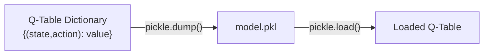

**Q-Table Structure Types**

Two primary Q-Table implementations appear in the codebase:

1. **Numpy Array Q-Tables**: Fixed-size arrays for discrete, bounded state spaces
2. **Dictionary Q-Tables**: Dynamic structures for unbounded or sparse state spaces

Sources: [8-Reinforcement/1-QLearning/README.md:160-167](), [8-Reinforcement/2-Gym/README.md:176-191]()

### Persistence Workflow

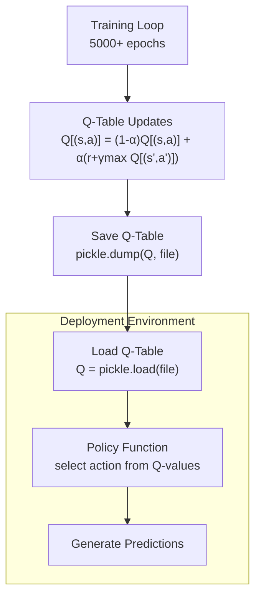

The training phase accumulates Q-values through iterative updates, then serializes the final table. The deployment phase loads this table and uses it for action selection without further updates.

Sources: [8-Reinforcement/1-QLearning/README.md:231-257](), [8-Reinforcement/2-Gym/README.md:338-370]()

## Flask Application Architecture for RL Models

### Application Structure

Flask applications for RL deployment follow a standard structure adapted from supervised learning patterns:

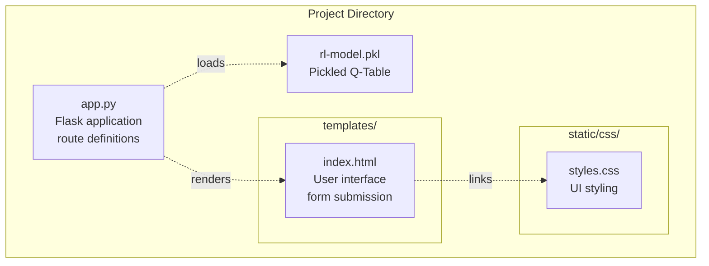

Sources: [3-Web-App/1-Web-App/README.md:160-173]()

### Core Flask Components

**app.py Route Structure**

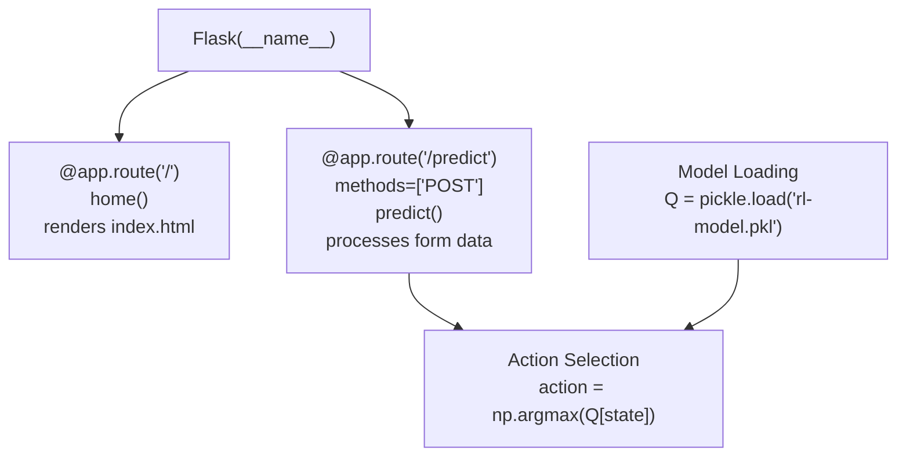

The Flask application defines two primary routes: a root route serving the UI and a prediction route processing inference requests.

Sources: [3-Web-App/1-Web-App/README.md:275-310]()

### Model Loading Pattern

The model loading occurs at application startup, outside request handlers to avoid repeated file I/O:

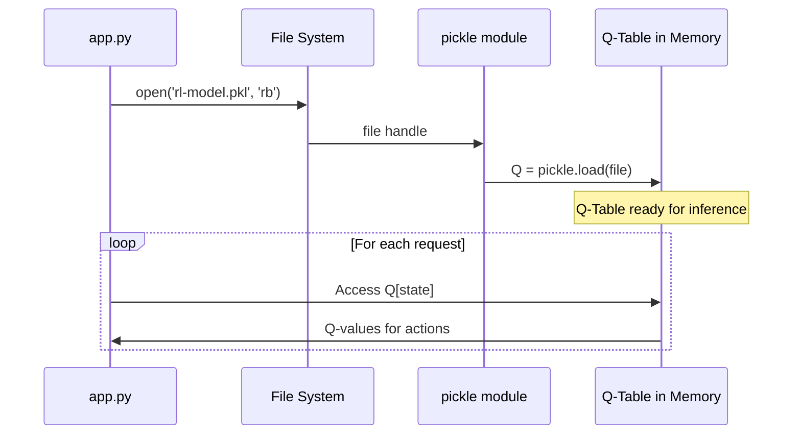

Sources: [3-Web-App/1-Web-App/README.md:277-284]()

## State Preprocessing and Action Selection

### State Discretization

Continuous state spaces from RL environments must be discretized before Q-Table lookup. The codebase implements discretization functions that map continuous observations to discrete states:

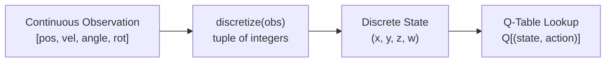

**Discretization Implementation Types**

1. **Linear scaling**: Divide by fixed intervals and convert to integers
2. **Binning**: Use `np.digitize()` with predefined bin edges

Sources: [8-Reinforcement/2-Gym/README.md:122-156]()

### Action Selection Strategies

Two primary action selection strategies for deployment:

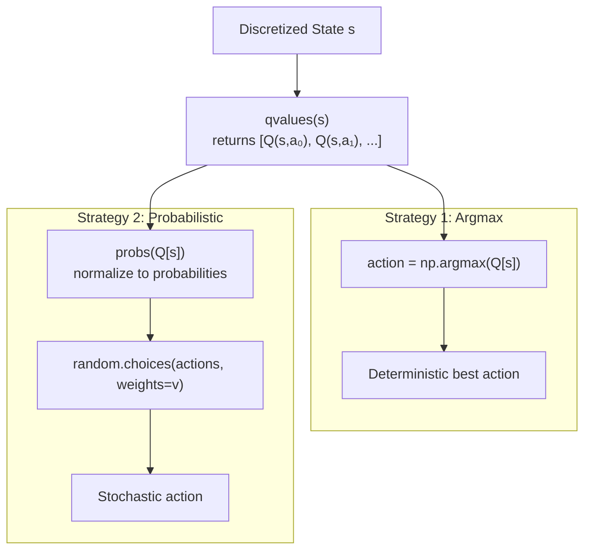

The deterministic argmax strategy always selects the highest Q-value action. The probabilistic strategy samples according to Q-value proportions, allowing exploration in production.

Sources: [8-Reinforcement/1-QLearning/README.md:265-275](), [8-Reinforcement/2-Gym/README.md:306-318]()

## Complete Deployment Workflow

### End-to-End Deployment Pipeline

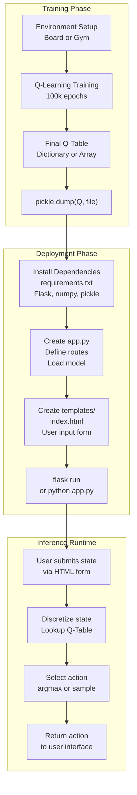

Sources: [3-Web-App/1-Web-App/README.md:145-314](), [8-Reinforcement/1-QLearning/README.md:231-257]()

### Flask Request/Response Cycle

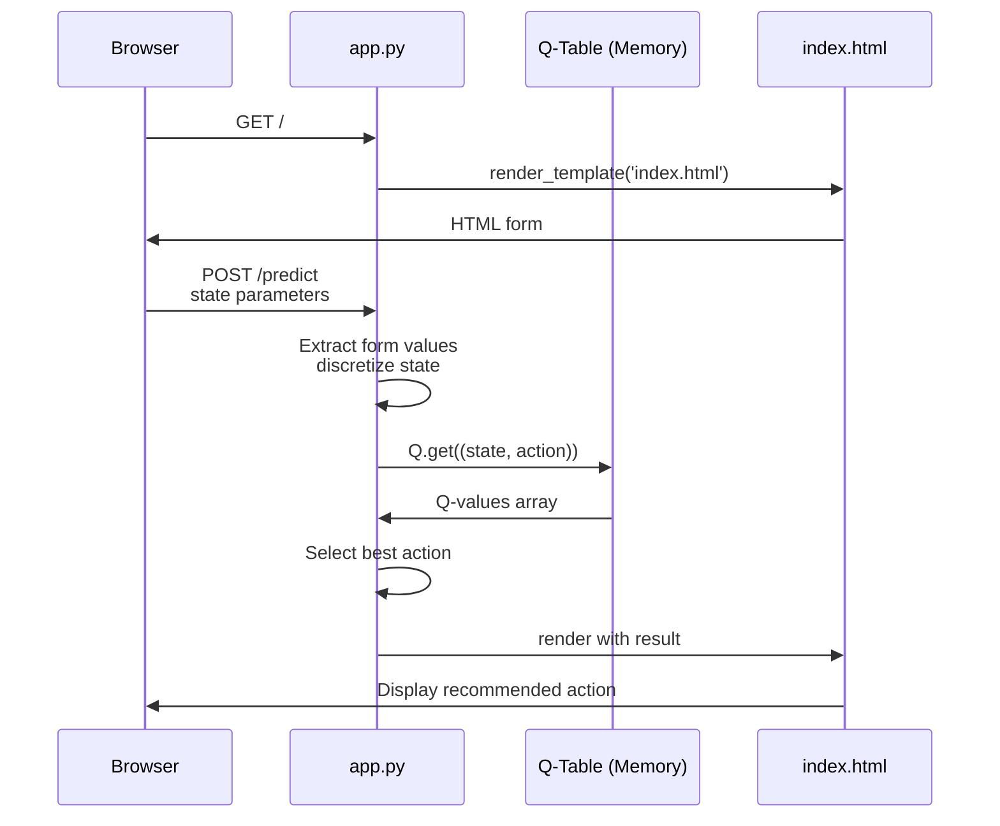

Sources: [3-Web-App/1-Web-App/README.md:287-306]()

## Code Entity Mapping

### Key Python Modules and Functions

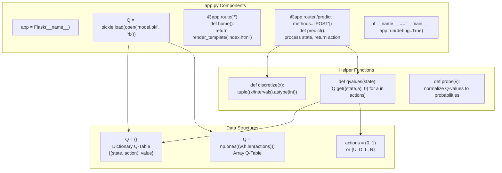

**Module Dependencies**

| Module | Purpose | Usage Location |
|--------|---------|----------------|
| `pickle` | Q-Table serialization | Model save/load operations |
| `numpy` | Q-Table arrays, argmax | Action selection, discretization |
| `flask` | Web framework | App initialization, routing |
| `random` | Probabilistic action selection | Exploration during inference |

Sources: [3-Web-App/1-Web-App/README.md:277-310](), [8-Reinforcement/2-Gym/README.md:182-191]()

### Q-Table Data Structure Variants

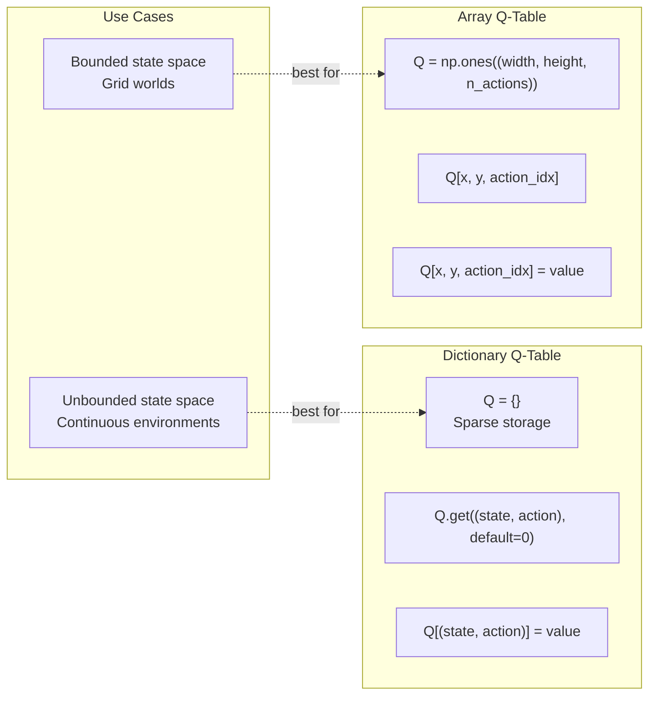

Dictionary Q-Tables handle sparse or unbounded state spaces dynamically. Array Q-Tables provide faster lookup for fixed-size discrete state spaces but require predefined dimensions.

Sources: [8-Reinforcement/1-QLearning/README.md:160-167](), [8-Reinforcement/2-Gym/README.md:176-191]()

## RL vs. Supervised Learning Deployment

### Key Architectural Differences

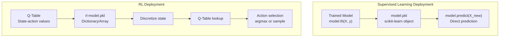

**Comparison Table**

| Aspect | Supervised Learning | Reinforcement Learning |
|--------|-------------------|----------------------|
| **Persisted Artifact** | Trained model object with methods | Q-Table data structure |
| **Input Processing** | Feature scaling, encoding | State discretization |
| **Inference Operation** | `model.predict(features)` | Q-Table lookup + action selection |
| **Output Type** | Continuous value or class label | Discrete action |
| **Exploration** | Not applicable | Can sample probabilistically |

Sources: [3-Web-App/1-Web-App/README.md:123-135](), [8-Reinforcement/2-Gym/README.md:304-332]()

### State Representation Requirements

RL models require explicit state discretization for Q-Table-based approaches, while supervised learning models often handle continuous features directly:

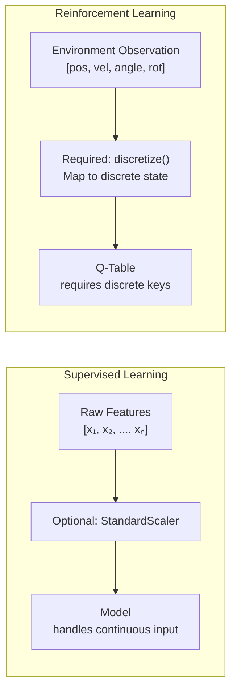

Sources: [8-Reinforcement/2-Gym/README.md:122-156](), [3-Web-App/1-Web-App/README.md:110-121]()

## Dependencies and Requirements

### Python Package Requirements

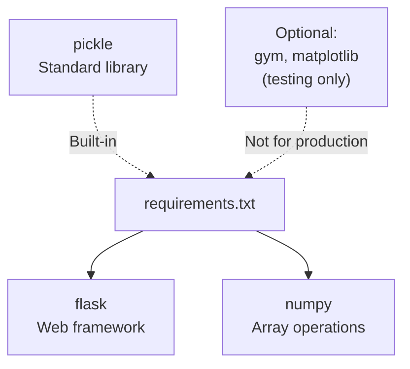

The `requirements.txt` file should specify Flask and numpy as minimum dependencies. The pickle module is part of Python's standard library and requires no installation.

Sources: [3-Web-App/1-Web-App/README.md:175-183]()

### Installation and Execution Commands

| Command | Purpose |
|---------|---------|
| `pip install -r requirements.txt` | Install dependencies |
| `python app.py` | Run Flask in development mode |
| `flask run` | Alternative Flask execution |
| `export FLASK_DEBUG=1` | Enable debug mode (development only) |

Sources: [3-Web-App/1-Web-App/README.md:184-194](), [3-Web-App/1-Web-App/README.md:309-314]()

---

