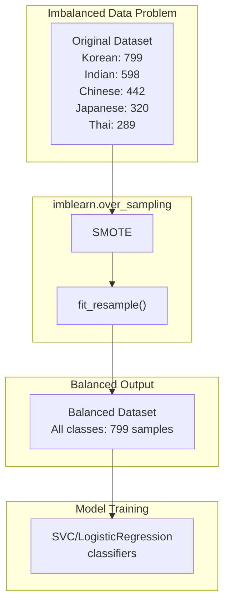
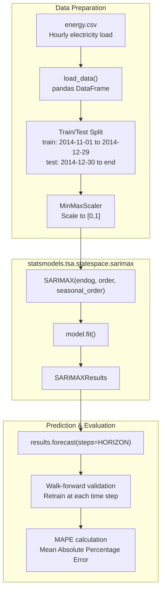
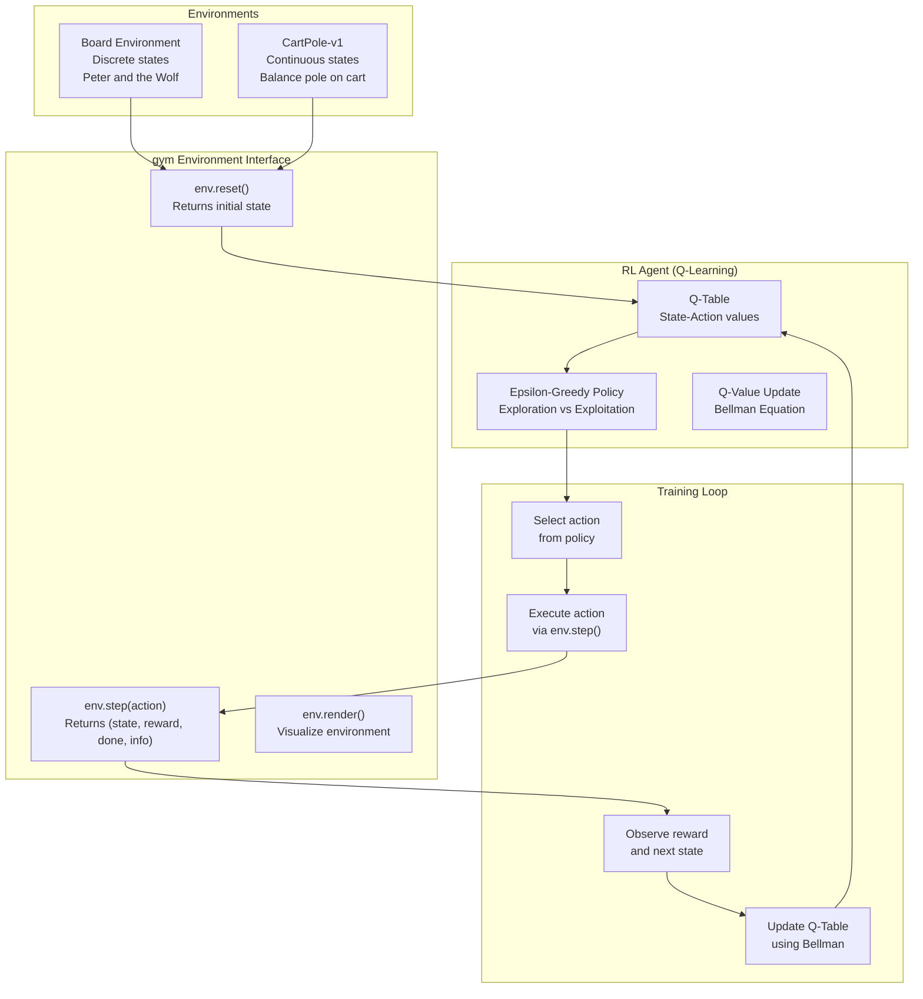
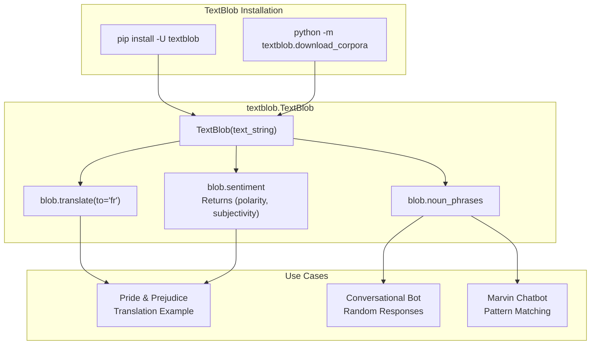
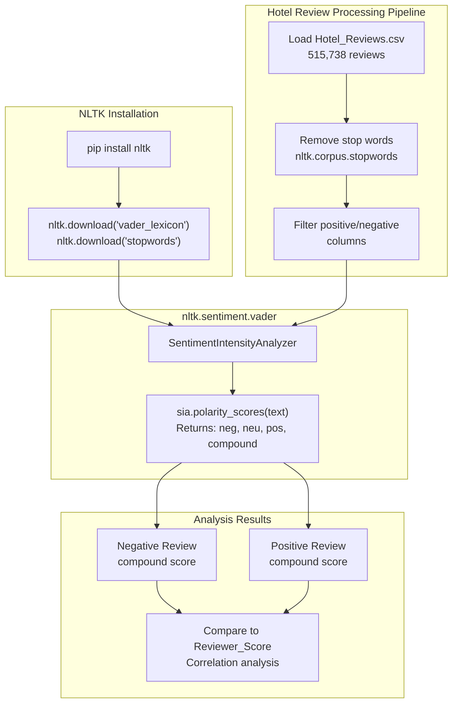
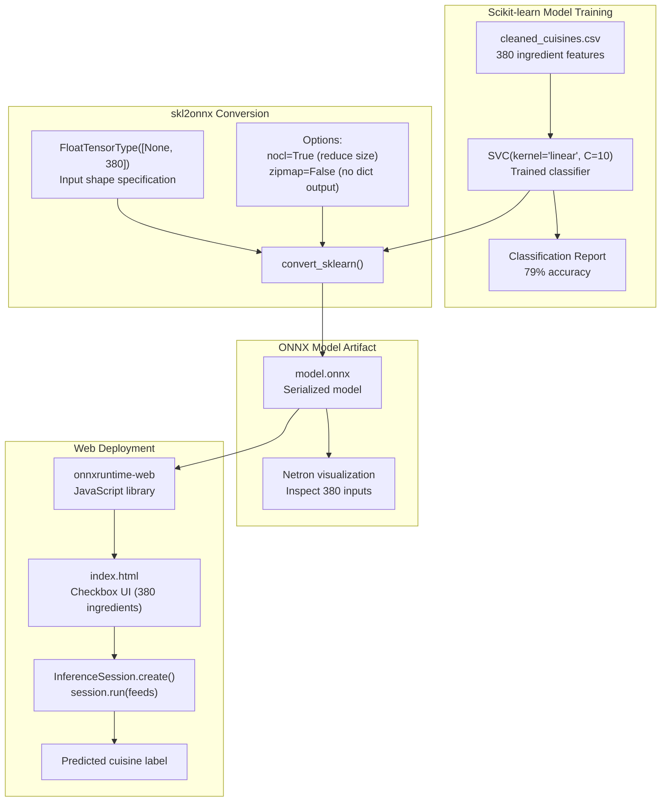
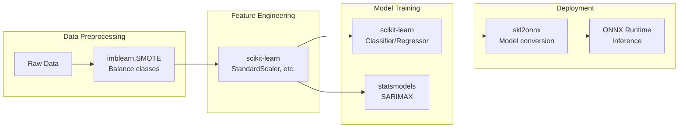

<!-- source: DeepWiki mcp.deepwiki.com · repo microsoft/ML-For-Beginners · extra page Specialized Python Libraries · fetched 2026-10-26 -->

# Specialized Python Libraries

<details>
<summary>Relevant source files</summary>

The following files were used as context for generating this wiki page:

- [4-Classification/1-Introduction/README.md](4-Classification/1-Introduction/README.md)
- [4-Classification/1-Introduction/assignment.md](4-Classification/1-Introduction/assignment.md)
- [4-Classification/1-Introduction/notebook.ipynb](4-Classification/1-Introduction/notebook.ipynb)
- [4-Classification/1-Introduction/solution/notebook.ipynb](4-Classification/1-Introduction/solution/notebook.ipynb)
- [4-Classification/2-Classifiers-1/README.md](4-Classification/2-Classifiers-1/README.md)
- [4-Classification/2-Classifiers-1/notebook.ipynb](4-Classification/2-Classifiers-1/notebook.ipynb)
- [4-Classification/2-Classifiers-1/solution/notebook.ipynb](4-Classification/2-Classifiers-1/solution/notebook.ipynb)
- [4-Classification/3-Classifiers-2/README.md](4-Classification/3-Classifiers-2/README.md)
- [4-Classification/3-Classifiers-2/notebook.ipynb](4-Classification/3-Classifiers-2/notebook.ipynb)
- [4-Classification/3-Classifiers-2/solution/notebook.ipynb](4-Classification/3-Classifiers-2/solution/notebook.ipynb)
- [4-Classification/4-Applied/README.md](4-Classification/4-Applied/README.md)
- [4-Classification/4-Applied/notebook.ipynb](4-Classification/4-Applied/notebook.ipynb)
- [4-Classification/README.md](4-Classification/README.md)
- [5-Clustering/1-Visualize/README.md](5-Clustering/1-Visualize/README.md)
- [5-Clustering/2-K-Means/README.md](5-Clustering/2-K-Means/README.md)
- [6-NLP/1-Introduction-to-NLP/README.md](6-NLP/1-Introduction-to-NLP/README.md)
- [6-NLP/1-Introduction-to-NLP/images/comprehension.png](6-NLP/1-Introduction-to-NLP/images/comprehension.png)
- [6-NLP/2-Tasks/README.md](6-NLP/2-Tasks/README.md)
- [6-NLP/3-Translation-Sentiment/README.md](6-NLP/3-Translation-Sentiment/README.md)
- [6-NLP/3-Translation-Sentiment/images/monnaie.png](6-NLP/3-Translation-Sentiment/images/monnaie.png)
- [6-NLP/4-Hotel-Reviews-1/README.md](6-NLP/4-Hotel-Reviews-1/README.md)
- [6-NLP/5-Hotel-Reviews-2/README.md](6-NLP/5-Hotel-Reviews-2/README.md)
- [6-NLP/5-Hotel-Reviews-2/assignment.md](6-NLP/5-Hotel-Reviews-2/assignment.md)
- [6-NLP/5-Hotel-Reviews-2/solution/3-notebook.ipynb](6-NLP/5-Hotel-Reviews-2/solution/3-notebook.ipynb)
- [6-NLP/README.md](6-NLP/README.md)
- [7-TimeSeries/1-Introduction/README.md](7-TimeSeries/1-Introduction/README.md)
- [7-TimeSeries/2-ARIMA/README.md](7-TimeSeries/2-ARIMA/README.md)
- [7-TimeSeries/README.md](7-TimeSeries/README.md)

</details>


## Purpose and Scope

This page documents domain-specific Python libraries used in the ML-For-Beginners curriculum to address specialized machine learning tasks beyond core scikit-learn functionality. These libraries extend the Python ML stack to handle imbalanced datasets, time series forecasting, reinforcement learning environments, natural language processing, and model deployment optimization.

For core Python libraries (scikit-learn, pandas, numpy, matplotlib), see [Core Python Libraries and Workflow](#6.1.1). For the R-based alternative implementation, see [R Implementation with tidymodels](#6.2).

---

## Overview of Specialized Libraries

The curriculum employs five primary specialized libraries, each addressing distinct ML challenges:

| Library | Domain | Primary Use Cases | Key Modules |
|---------|--------|------------------|-------------|
| imblearn | Data Preprocessing | Handling class imbalance via SMOTE | `imblearn.over_sampling.SMOTE` |
| statsmodels | Time Series | ARIMA/SARIMA forecasting models | `statsmodels.tsa.statespace.sarimax.SARIMAX` |
| OpenAI Gym | Reinforcement Learning | RL environment simulation | `gym` environments (CartPole, Board) |
| NLTK | Natural Language Processing | Sentiment analysis, tokenization | `nltk.sentiment.vader.SentimentIntensityAnalyzer` |
| TextBlob | Natural Language Processing | Translation, basic NLP tasks | `textblob.TextBlob` |
| skl2onnx | Model Deployment | Model format conversion | `skl2onnx.convert_sklearn` |

---

## Imbalanced Data Handling with imblearn

### Purpose

The imblearn library (imbalanced-learn) addresses class imbalance problems where training data contains unequal representation of target classes. In the cuisine classification dataset, Korean cuisine had 799 samples while Thai had only 289 samples, creating bias risk in trained models.

### SMOTE Algorithm

**SMOTE (Synthetic Minority Over-sampling Technique)** generates synthetic samples for minority classes by interpolating between existing minority class samples rather than duplicating them.



### Implementation Pattern

The cuisine classification lessons demonstrate the standard SMOTE workflow:

1. **Installation**: imblearn must be explicitly installed as it's not included with scikit-learn
2. **Import**: `from imblearn.over_sampling import SMOTE`
3. **Instantiation**: Create SMOTE instance with default or custom parameters
4. **Resampling**: Call `fit_resample()` with features and labels
5. **Verification**: Check class distribution with `value_counts()`

**Sources:** [4-Classification/1-Introduction/README.md:54-266]()

### Code Usage Example

The classification notebook demonstrates the complete SMOTE workflow:

```python
from imblearn.over_sampling import SMOTE

# Create SMOTE instance
oversample = SMOTE()

# Resample the dataset
transformed_feature_df, transformed_label_df = oversample.fit_resample(feature_df, labels_df)

# Verify balancing
print(f'new label count: {transformed_label_df.value_counts()}')
# Output: All classes now have 799 samples
```

**Key Parameters:**
- `sampling_strategy`: Determines resampling ratio (default: 'auto' balances to largest class)
- `k_neighbors`: Number of nearest neighbors for synthetic sample generation (default: 5)
- `random_state`: Seed for reproducibility

**Sources:** [4-Classification/1-Introduction/README.md:230-266](), [4-Classification/1-Introduction/solution/notebook.ipynb:17-54]()

---

## Time Series Analysis with statsmodels

### Purpose

The statsmodels library provides comprehensive statistical modeling capabilities, with SARIMAX (Seasonal AutoRegressive Integrated Moving Average with eXogenous factors) used for electricity load forecasting in the time series curriculum.

### ARIMA Model Components

SARIMAX extends basic ARIMA with seasonal components:

| Parameter | Name | Description |
|-----------|------|-------------|
| p | AR Order | Number of autoregressive lag terms |
| d | Differencing Order | Degree of differencing for stationarity |
| q | MA Order | Number of moving average lag terms |
| P | Seasonal AR Order | Seasonal autoregressive component |
| D | Seasonal Differencing | Seasonal differencing degree |
| Q | Seasonal MA Order | Seasonal moving average component |
| m | Seasonal Period | Number of periods per season (e.g., 24 for hourly data) |

**Sources:** [7-TimeSeries/2-ARIMA/README.md:172-182]()

### SARIMAX Workflow



### Implementation Pattern

The ARIMA lesson demonstrates model building with parameter tuning:

**Sources:** [7-TimeSeries/2-ARIMA/README.md:36-378]()

### Key API Methods

**Model Creation:**
```python
from statsmodels.tsa.statespace.sarimax import SARIMAX

# Define parameters
order = (4, 1, 0)  # p, d, q
seasonal_order = (1, 1, 0, 24)  # P, D, Q, m (24-hour seasonality)

# Create model
model = SARIMAX(endog=train_data, order=order, seasonal_order=seasonal_order)
```

**Model Training:**
```python
# Fit the model (in-sample training)
results = model.fit()

# Print diagnostic summary
print(results.summary())
```

**Forecasting:**
```python
# Forecast HORIZON steps ahead
HORIZON = 3
yhat = results.forecast(steps=HORIZON)
```

**Sources:** [7-TimeSeries/2-ARIMA/README.md:171-208]()

### Walk-Forward Validation

The curriculum implements walk-forward validation for realistic time series evaluation:

```python
training_window = 720  # 30 days of hourly data

for t in range(test_data.shape[0]):
    # Train on sliding window
    model = SARIMAX(endog=history[-training_window:], 
                    order=order, 
                    seasonal_order=seasonal_order)
    model_fit = model.fit()
    
    # Forecast next HORIZON steps
    yhat = model_fit.forecast(steps=HORIZON)
    predictions.append(yhat)
    
    # Update training window
    history.append(test_data.iloc[t][0])
    history.pop(0)
```

This approach ensures the model never uses future information, providing robust accuracy estimates. The energy forecasting model achieves **MAPE < 1.2%** with this technique.

**Sources:** [7-TimeSeries/2-ARIMA/README.md:210-286]()

---

## Reinforcement Learning with OpenAI Gym

### Purpose

OpenAI Gym provides standardized environments for developing and testing reinforcement learning algorithms. The curriculum uses Gym to implement Q-Learning on discrete and continuous state spaces.

### Gym Environment Architecture



### State Space Handling

**Discrete States (Board Environment):**
- States are directly used as Q-Table indices
- Q-Table dimensions: `[n_states, n_actions]`
- Direct lookup for action selection

**Continuous States (CartPole):**
- States must be discretized before Q-Table lookup
- Discretization bins continuous values into discrete buckets
- Example: Cart position `[-2.4, 2.4]` → 10 bins → indices `[0-9]`

**Sources:** Diagram 3 in provided context, [8-Reinforcement/README.md]() references

### Q-Learning Implementation Pattern

The basic Q-Learning algorithm structure used with Gym:

```python
import gym

# Create environment
env = gym.make('CartPole-v1')

# Initialize Q-Table
Q = initialize_q_table(state_space_size, action_space_size)

# Training loop
for episode in range(num_episodes):
    state = env.reset()
    done = False
    
    while not done:
        # Epsilon-greedy action selection
        if random.random() < epsilon:
            action = env.action_space.sample()  # Explore
        else:
            action = np.argmax(Q[state])  # Exploit
        
        # Execute action
        next_state, reward, done, info = env.step(action)
        
        # Update Q-Table (Bellman equation)
        Q[state][action] += alpha * (
            reward + gamma * np.max(Q[next_state]) - Q[state][action]
        )
        
        state = next_state
```

**Key Parameters:**
- `alpha`: Learning rate (step size for Q-value updates)
- `gamma`: Discount factor (importance of future rewards)
- `epsilon`: Exploration rate (probability of random action)

**Sources:** Diagram 3 in provided context describing Q-Learning fundamentals

---

## Natural Language Processing Libraries

The curriculum employs two complementary NLP libraries: TextBlob for basic tasks and translation, NLTK for advanced sentiment analysis.

### Library Comparison

| Feature | TextBlob | NLTK |
|---------|----------|------|
| Installation | `pip install textblob` | `pip install nltk` + corpus downloads |
| Primary Use | Translation, basic sentiment | Sentiment analysis, tokenization |
| API Style | Object-oriented (TextBlob objects) | Function-based |
| Sentiment Method | Built-in polarity/subjectivity | VADER lexicon |
| Backend | Wraps NLTK and pattern libraries | Standalone with multiple corpora |

### TextBlob for Translation and Basic NLP



**Sources:** [6-NLP/1-Introduction-to-NLP/README.md:46-52](), [6-NLP/3-Translation-Sentiment/README.md:58-79]()

### TextBlob API Examples

**Translation:**
```python
from textblob import TextBlob

text = "It is a truth universally acknowledged, that a single man in possession of a good fortune, must be in want of a wife!"
blob = TextBlob(text)

# Translate to French
french = blob.translate(to="fr")
print(french)
# Output: C'est une vérité universellement reconnue, qu'un homme célibataire...
```

**Sentiment Analysis:**
```python
blob = TextBlob(quote)
sentiment = blob.sentiment

# Returns Sentiment(polarity=0.209, subjectivity=0.271)
# polarity: -1 (negative) to 1 (positive)
# subjectivity: 0 (objective) to 1 (subjective)
```

**Noun Phrase Extraction:**
```python
from textblob.np_extractors import ConllExtractor

extractor = ConllExtractor()
blob = TextBlob(user_input, np_extractor=extractor)
noun_phrases = blob.noun_phrases
```

**Sources:** [6-NLP/3-Translation-Sentiment/README.md:58-120](), [6-NLP/2-Tasks/README.md:119-138]()

### NLTK with VADER Sentiment Analysis

VADER (Valence Aware Dictionary and sEntiment Reasoner) is specifically tuned for social media sentiment and handles negations, intensifiers, and emoticons effectively.



**Sources:** [6-NLP/4-Hotel-Reviews-1/README.md:1-295](), [6-NLP/5-Hotel-Reviews-2/README.md:1-300]()

### VADER Sentiment Scoring

The hotel review analysis demonstrates VADER usage on 515,738 reviews:

```python
from nltk.sentiment.vader import SentimentIntensityAnalyzer
from nltk.corpus import stopwords
import nltk

# Download required data
nltk.download('vader_lexicon')
nltk.download('stopwords')

# Initialize analyzer
sia = SentimentIntensityAnalyzer()

# Analyze sentiment
def analyze_sentiment(text):
    scores = sia.polarity_scores(text)
    return scores

# Example output
sentiment = analyze_sentiment("The hotel was absolutely wonderful!")
# Returns: {'neg': 0.0, 'neu': 0.344, 'pos': 0.656, 'compound': 0.8176}
```

**VADER Score Components:**
- `neg`: Negative sentiment proportion [0-1]
- `neu`: Neutral sentiment proportion [0-1]
- `pos`: Positive sentiment proportion [0-1]
- `compound`: Normalized aggregate score [-1 to 1]

The `compound` score is typically used for classification:
- `>= 0.05`: Positive sentiment
- `<= -0.05`: Negative sentiment
- Between: Neutral sentiment

**Sources:** [6-NLP/5-Hotel-Reviews-2/solution/3-notebook.ipynb:27-57]()

### Stop Word Removal

NLTK provides stop word lists for text preprocessing:

```python
from nltk.corpus import stopwords

# Get English stop words
stop_words = set(stopwords.words('english'))

# Filter tokens
filtered_text = [word for word in tokens if word.lower() not in stop_words]
```

This removes common words like "the", "is", "at" that don't contribute to sentiment, improving analysis accuracy on the hotel review dataset.

**Sources:** [6-NLP/4-Hotel-Reviews-1/README.md:1-295]()

---

## Model Deployment with skl2onnx

### Purpose

skl2onnx converts trained scikit-learn models to ONNX (Open Neural Network Exchange) format, enabling deployment in web browsers via ONNX Runtime for JavaScript. This allows client-side inference without server round-trips.

### Conversion Architecture



**Sources:** [4-Classification/4-Applied/README.md:1-315]()

### Conversion Implementation

The cuisine classifier conversion demonstrates the complete workflow:

**Step 1: Install skl2onnx**
```python
!pip install skl2onnx
import pandas as pd
from skl2onnx import convert_sklearn
from skl2onnx.common.data_types import FloatTensorType
```

**Step 2: Train Scikit-learn Model**
```python
from sklearn.svm import SVC

# Train model (380 ingredient features)
model = SVC(kernel='linear', C=10, probability=True, random_state=0)
model.fit(X_train, y_train.values.ravel())

# Verify accuracy
print(classification_report(y_test, y_pred))
# Accuracy: 79%
```

**Step 3: Convert to ONNX**
```python
# Specify input tensor shape: 380 features
initial_type = [('float_input', FloatTensorType([None, 380]))]

# Conversion options
options = {id(model): {'nocl': True, 'zipmap': False}}

# Convert
onx = convert_sklearn(model, initial_types=initial_type, options=options)

# Save
with open("./model.onnx", "wb") as f:
    f.write(onx.SerializeToString())
```

**Sources:** [4-Classification/4-Applied/README.md:27-140]()

### Conversion Parameters

| Parameter | Purpose | Example |
|-----------|---------|---------|
| `initial_types` | Define input tensor shape and type | `[('float_input', FloatTensorType([None, 380]))]` |
| `nocl` | Exclude class labels to reduce model size | `True` |
| `zipmap` | Output as list of dicts (slower) vs arrays | `False` for better performance |

The `[None, 380]` shape specification means:
- `None`: Batch size is flexible (can predict 1 or many samples)
- `380`: Fixed number of input features (ingredients)

**Sources:** [4-Classification/4-Applied/README.md:118-138]()

### Web Application Integration

The converted model runs in-browser using ONNX Runtime for JavaScript:

```html
<script src="https://cdn.jsdelivr.net/npm/onnxruntime-web@1.9.0/dist/ort.min.js"></script>

<script>
    // Initialize 380-element array (one per ingredient)
    const ingredients = Array(380).fill(0);
    
    // Update based on checkbox selections
    checks.forEach(check => {
        check.addEventListener('change', function() {
            ingredients[check.value] = check.checked ? 1 : 0;
        });
    });
    
    async function startInference() {
        // Load ONNX model
        const session = await ort.InferenceSession.create('./model.onnx');
        
        // Create input tensor
        const input = new ort.Tensor(new Float32Array(ingredients), [1, 380]);
        const feeds = { float_input: input };
        
        // Run inference
        const results = await session.run(feeds);
        
        // Display predicted cuisine
        alert('You can enjoy ' + results.label.data[0] + ' cuisine today!');
    }
</script>
```

**Key Points:**
- `float_input` name must match the conversion `initial_types` parameter
- Input shape `[1, 380]` matches the model's expected dimensions
- Results return label directly (due to `zipmap=False`)

**Sources:** [4-Classification/4-Applied/README.md:156-277]()

### Model Inspection with Netron

The ONNX model can be visualized using Netron (desktop application):
- Shows 380 input nodes (one per ingredient)
- Displays classifier structure
- Verifies proper conversion

This visualization helps debug shape mismatches and confirms the model architecture before deployment.

**Sources:** [4-Classification/4-Applied/README.md:142-148]()

---

## Library Integration Patterns

### Common Installation Workflow

All specialized libraries follow a consistent installation pattern:

1. **Install via pip** (typically in notebook first cell)
2. **Download additional data** if required (NLTK corpora, TextBlob data)
3. **Import modules** at notebook top
4. **Verify installation** with a simple test

```python
# Example: Installing imblearn
!pip install imblearn

# Example: NLTK with data download
!pip install nltk
import nltk
nltk.download('vader_lexicon')
nltk.download('stopwords')

# Example: TextBlob with corpora
!pip install -U textblob
!python -m textblob.download_corpora
```

**Sources:** [4-Classification/1-Introduction/README.md:54-62](), [6-NLP/1-Introduction-to-NLP/README.md:46-52]()

### Scikit-learn Integration

Most specialized libraries integrate seamlessly with scikit-learn pipelines:



**Integration Points:**
- **imblearn**: Drops in before scikit-learn via `fit_resample()` on X, y arrays
- **skl2onnx**: Accepts any fitted scikit-learn estimator
- **statsmodels**: Uses pandas DataFrames like scikit-learn but separate API
- **NLTK/TextBlob**: Preprocessing step before vectorization (e.g., TfidfVectorizer)

**Sources:** Multiple files demonstrating integration patterns

### Performance Considerations

| Library | Performance Note | Mitigation |
|---------|-----------------|------------|
| statsmodels | SARIMAX fitting is slow; walk-forward validation compounds this | Use limited training window (720 samples); consider caching |
| TextBlob | Translation requires internet (calls Google Translate API) | Cache translations; handle offline gracefully |
| NLTK VADER | Fast sentiment analysis once lexicon is loaded | Download lexicon once during setup |
| imblearn SMOTE | Memory intensive for large datasets | Apply after feature selection; use `sampling_strategy` parameter |
| skl2onnx | Conversion time negligible | One-time operation; store .onnx file |

**Sources:** [7-TimeSeries/2-ARIMA/README.md:213-286]() for SARIMAX performance, [6-NLP/3-Translation-Sentiment/README.md:58-79]() for TextBlob translation

---

## Summary

The specialized Python libraries extend scikit-learn's core functionality to address specific ML challenges:

- **imblearn (SMOTE)**: Balances imbalanced classification datasets through synthetic sample generation
- **statsmodels (SARIMAX)**: Provides econometric time series models with seasonal components
- **OpenAI Gym**: Standardizes RL environment interfaces for algorithm development
- **NLTK + TextBlob**: Offers complementary NLP capabilities for sentiment analysis and translation
- **skl2onnx**: Enables browser-based model deployment via format conversion

These libraries integrate with scikit-learn's API conventions while providing domain expertise that core libraries don't address. The curriculum demonstrates practical usage patterns including installation, parameter tuning, and integration into complete ML workflows.

---

