<!-- source: DeepWiki mcp.deepwiki.com · repo microsoft/ML-For-Beginners · extra page Time Series Data Processing and Evaluation · fetched 2026-10-26 -->

# Time Series Data Processing and Evaluation

<details>
<summary>Relevant source files</summary>

The following files were used as context for generating this wiki page:

- [7-TimeSeries/1-Introduction/README.md](7-TimeSeries/1-Introduction/README.md)
- [7-TimeSeries/2-ARIMA/README.md](7-TimeSeries/2-ARIMA/README.md)
- [7-TimeSeries/README.md](7-TimeSeries/README.md)

</details>


## Purpose and Scope

This page documents the data processing pipeline and evaluation methods for time series forecasting models in the ML-For-Beginners curriculum. It covers temporal data splitting, MinMaxScaler normalization, walk-forward validation, and Mean Absolute Percentage Error (MAPE) calculation for electricity load forecasting. For information about ARIMA/SARIMA model architecture and parameter selection, see [ARIMA and SARIMA Models](#5.2.1). For foundational time series concepts and characteristics, see [Time Series Forecasting](#5.2).

---

## Data Preparation Pipeline

### Dataset Loading and Structure

The time series forecasting module uses the GEFCom2014 electricity load dataset, containing hourly electricity consumption data from 2012-2014. The data is loaded using a utility function that returns a pandas DataFrame with a datetime index.

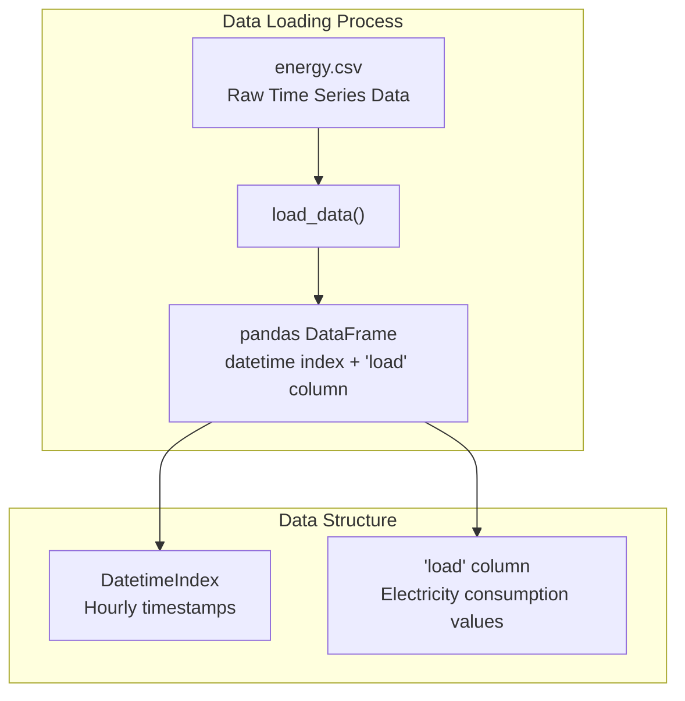

**Data Loading Implementation**

Sources: [7-TimeSeries/2-ARIMA/README.md:66-71](), [7-TimeSeries/1-Introduction/README.md:129-133]()

The dataset is loaded and filtered to include only the `load` column:

| Timestamp | Load Value |
|-----------|------------|
| Hourly datetime index | Electricity consumption (numeric) |
| 2012-01-01 00:00:00 | 2698.0 |
| 2012-01-01 01:00:00 | 2558.0 |

---

## Temporal Train/Test Splitting

Time series data requires special splitting strategies that preserve temporal order, unlike random splitting used in other ML tasks. The curriculum uses a **forward-looking temporal split** where training data precedes test data chronologically.

### Splitting Strategy

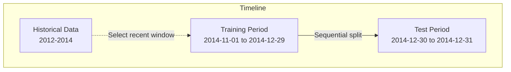

**Temporal Splitting Parameters**

Sources: [7-TimeSeries/2-ARIMA/README.md:88-93]()

| Parameter | Value | Purpose |
|-----------|-------|---------|
| `train_start_dt` | '2014-11-01 00:00:00' | Beginning of training window |
| `test_start_dt` | '2014-12-30 00:00:00' | Beginning of test period |
| Training duration | ~2 months | Sufficient data for seasonal patterns |
| Test duration | ~2 days | Evaluation window |

### Implementation Details

The temporal filtering uses pandas boolean indexing to create non-overlapping train/test sets:

```python
train = energy.copy()[(energy.index >= train_start_dt) & (energy.index < test_start_dt)][['load']]
test = energy.copy()[energy.index >= test_start_dt][['load']]
```

Sources: [7-TimeSeries/2-ARIMA/README.md:120-126]()

**Resulting Shapes:**
- Training data: (1416, 1) - approximately 59 days of hourly data
- Test data: (48, 1) - 2 days of hourly data

---

## Feature Scaling with MinMaxScaler

Time series models benefit from normalized inputs to improve convergence and numerical stability. The curriculum uses `MinMaxScaler` from scikit-learn to project data into the [0, 1] interval.

### Scaling Process

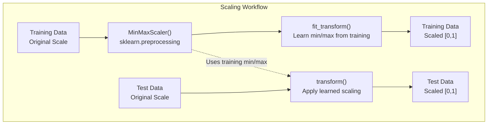

Sources: [7-TimeSeries/2-ARIMA/README.md:135-164]()

### Critical Implementation Pattern

**Training Data Scaling:**
```python
scaler = MinMaxScaler()
train['load'] = scaler.fit_transform(train)
```

**Test Data Scaling:**
```python
test['load'] = scaler.transform(test)
```

Sources: [7-TimeSeries/2-ARIMA/README.md:138-140](), [7-TimeSeries/2-ARIMA/README.md:162-163]()

⚠️ **Important:** The scaler is fit only on training data to prevent data leakage. Test data uses the same transformation parameters learned from training data.

### Scaling Visualization

The curriculum includes histogram comparisons to verify scaling effectiveness. Original data shows the natural distribution of electricity load values, while scaled data is compressed into [0, 1]:

| Original Data | Scaled Data |
|---------------|-------------|
| Mean: ~3000 kW | Mean: ~0.5 |
| Range: 2000-5000 kW | Range: 0.0-1.0 |

---

## Walk-Forward Validation

Walk-forward validation is the **gold standard** for time series model evaluation. Unlike traditional cross-validation, it respects temporal dependencies by training on past data and testing on immediate future data in a sliding window fashion.

### Walk-Forward Validation Concept

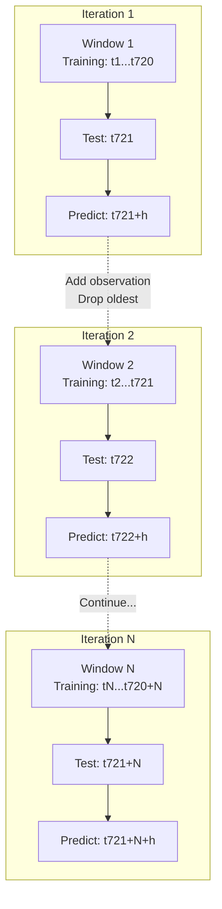

Sources: [7-TimeSeries/2-ARIMA/README.md:210-220]()

### Implementation Parameters

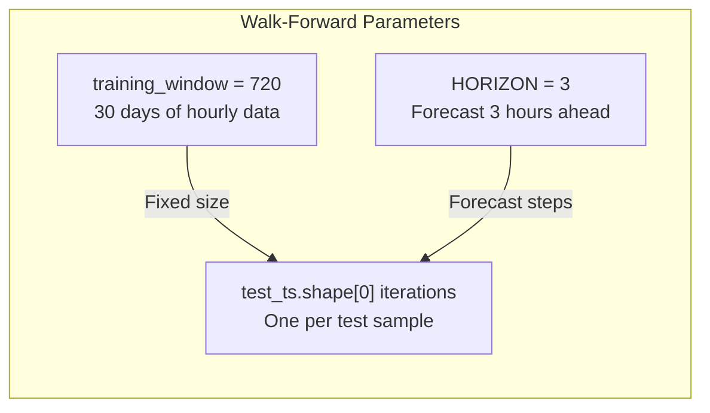

Sources: [7-TimeSeries/2-ARIMA/README.md:184-189](), [7-TimeSeries/2-ARIMA/README.md:248]()

| Parameter | Value | Purpose |
|-----------|-------|---------|
| `training_window` | 720 hours (30 days) | Fixed window size for model training |
| `HORIZON` | 3 hours | Number of steps to forecast ahead |
| `order` | (2, 1, 0) | ARIMA parameters (p, d, q) |
| `seasonal_order` | (1, 1, 0, 24) | Seasonal ARIMA parameters (P, D, Q, m) |

### Walk-Forward Loop Structure

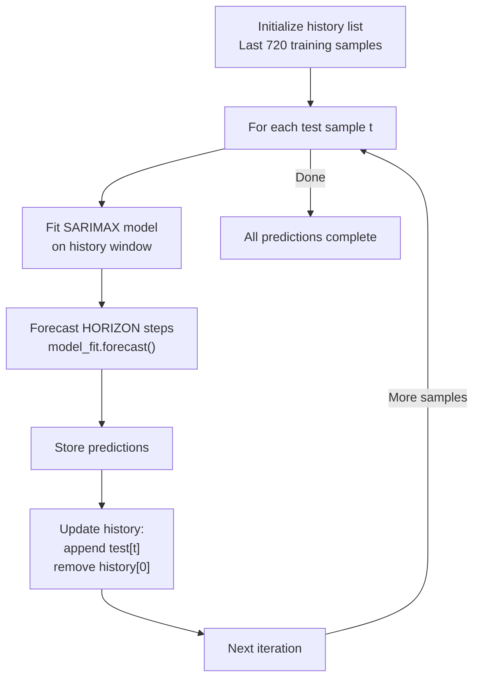

Sources: [7-TimeSeries/2-ARIMA/README.md:244-272]()

**Key Implementation Details:**

```python
training_window = 720  # 30 days
history = [x for x in train_ts]
history = history[(-training_window):]  # Keep last 720 points

for t in range(test_ts.shape[0]):
    model = SARIMAX(endog=history, order=order, seasonal_order=seasonal_order)
    model_fit = model.fit()
    yhat = model_fit.forecast(steps=HORIZON)
    predictions.append(yhat)
    
    # Slide the window
    obs = list(test_ts.iloc[t])
    history.append(obs[0])
    history.pop(0)
```

Sources: [7-TimeSeries/2-ARIMA/README.md:248-272]()

---

## Horizon Shifting for Multi-Step Forecasting

When forecasting multiple steps ahead (HORIZON > 1), the test data is restructured to include future values for each timestamp, enabling multi-step evaluation.

### Horizon Shifting Process

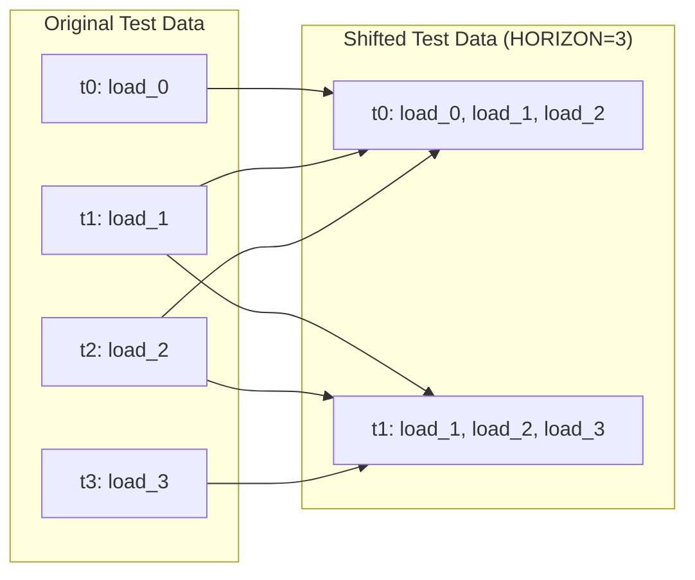

Sources: [7-TimeSeries/2-ARIMA/README.md:222-241]()

**Implementation:**

```python
test_shifted = test.copy()

for t in range(1, HORIZON+1):
    test_shifted['load+'+str(t)] = test_shifted['load'].shift(-t, freq='H')

test_shifted = test_shifted.dropna(how='any')
```

Sources: [7-TimeSeries/2-ARIMA/README.md:225-231]()

**Resulting Structure:**

| Timestamp | load | load+1 | load+2 |
|-----------|------|--------|--------|
| 2014-12-30 00:00:00 | 0.33 | 0.29 | 0.27 |
| 2014-12-30 01:00:00 | 0.29 | 0.27 | 0.27 |
| 2014-12-30 02:00:00 | 0.27 | 0.27 | 0.30 |

---

## Evaluation Metrics

### Mean Absolute Percentage Error (MAPE)

MAPE is the primary evaluation metric for time series forecasting in this curriculum. It expresses prediction accuracy as a percentage, making it interpretable across different scales.

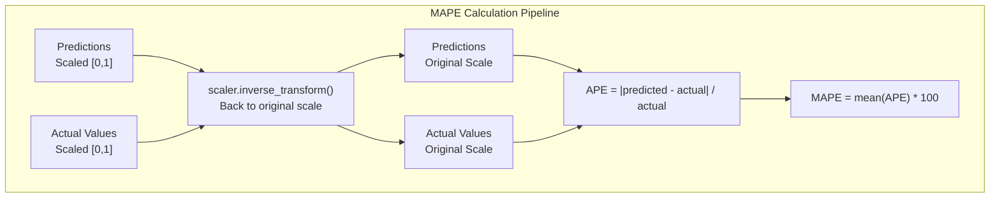

Sources: [7-TimeSeries/2-ARIMA/README.md:314-344]()

### MAPE Formula

**Mathematical Definition:**

MAPE = (1/n) × Σ|(actual_t - predicted_t) / actual_t| × 100%

Where:
- n = number of predictions
- actual_t = true value at time t
- predicted_t = forecasted value at time t

Sources: [7-TimeSeries/2-ARIMA/README.md:314-318]()

### MAPE Implementation

**Code Reference:**

```python
eval_df['APE'] = (eval_df['prediction'] - eval_df['actual']).abs() / eval_df['actual']
mape_value = eval_df.groupby('h')['APE'].mean()
```

Sources: [7-TimeSeries/2-ARIMA/README.md:324-325]()

**Single-step vs Multi-step MAPE:**

```python
# One-step forecast MAPE
one_step_mape = mape(eval_df[eval_df['h'] == 't+1']['prediction'], 
                     eval_df[eval_df['h'] == 't+1']['actual']) * 100

# Multi-step forecast MAPE
multi_step_mape = mape(eval_df['prediction'], eval_df['actual']) * 100
```

Sources: [7-TimeSeries/2-ARIMA/README.md:330-339]()

### MAPE Interpretation

| MAPE Value | Interpretation |
|------------|----------------|
| < 1% | Excellent forecasting accuracy |
| 1-5% | Very good accuracy |
| 5-10% | Good accuracy |
| 10-20% | Acceptable accuracy |
| > 20% | Poor accuracy |

The curriculum achieves:
- One-step forecast MAPE: ~0.56%
- Multi-step forecast MAPE: ~1.15%

Sources: [7-TimeSeries/2-ARIMA/README.md:334](), [7-TimeSeries/2-ARIMA/README.md:342-343]()

---

## Evaluation DataFrame Structure

After walk-forward validation, predictions are transformed into a structured DataFrame for analysis.

### Evaluation Data Transformation

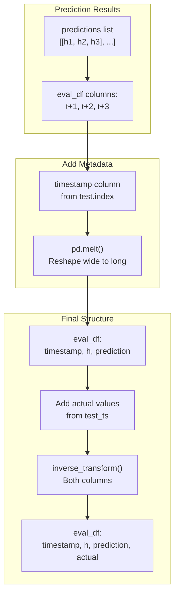

Sources: [7-TimeSeries/2-ARIMA/README.md:289-305]()

**Implementation:**

```python
eval_df = pd.DataFrame(predictions, columns=['t+'+str(t) for t in range(1, HORIZON+1)])
eval_df['timestamp'] = test.index[0:len(test.index)-HORIZON+1]
eval_df = pd.melt(eval_df, id_vars='timestamp', value_name='prediction', var_name='h')
eval_df['actual'] = np.array(np.transpose(test_ts)).ravel()
eval_df[['prediction', 'actual']] = scaler.inverse_transform(eval_df[['prediction', 'actual']])
```

Sources: [7-TimeSeries/2-ARIMA/README.md:290-295]()

**Sample Output:**

| Index | Timestamp | h | Prediction | Actual |
|-------|-----------|---|------------|--------|
| 0 | 2014-12-30 00:00:00 | t+1 | 3008.74 | 3023.00 |
| 1 | 2014-12-30 01:00:00 | t+1 | 2955.53 | 2935.00 |
| 2 | 2014-12-30 02:00:00 | t+1 | 2900.17 | 2899.00 |

---

## Visualization of Forecast Accuracy

The curriculum includes visualization code to display multi-step forecast performance, showing how predictions diverge from actual values as the forecast horizon increases.

### Multi-Step Forecast Plotting Logic

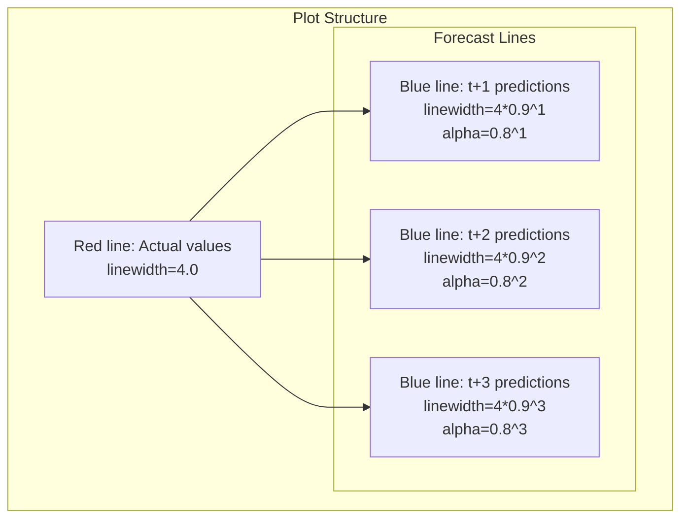

Sources: [7-TimeSeries/2-ARIMA/README.md:350-373]()

**Plotting Code Pattern:**

```python
for t in range(1, HORIZON+1):
    x = plot_df['timestamp'][(t-1):]
    y = plot_df['t+'+str(t)][0:len(x)]
    ax.plot(x, y, color='blue', 
            linewidth=4*math.pow(.9,t), 
            alpha=math.pow(0.8,t))
```

Sources: [7-TimeSeries/2-ARIMA/README.md:364-367]()

The visualization uses decreasing line width and transparency for longer horizons to visually indicate increasing uncertainty.

---

## Data Processing Best Practices

### Summary of Key Principles

| Principle | Implementation | Rationale |
|-----------|----------------|-----------|
| **Temporal Ordering** | Sequential train/test split, no shuffling | Prevents future information leakage |
| **Scaling Discipline** | Fit scaler on training only, transform test | Prevents test data leakage |
| **Window Size** | 720 hours (30 days) for training | Captures weekly and daily patterns |
| **Validation Method** | Walk-forward validation | Realistic simulation of production forecasting |
| **Inverse Scaling** | Transform predictions back before MAPE | Evaluate on original scale for interpretability |

Sources: [7-TimeSeries/2-ARIMA/README.md:84-164](), [7-TimeSeries/2-ARIMA/README.md:210-220]()

### Common Utilities

The curriculum provides utility functions in `common/utils.py`:

| Function | Purpose |
|----------|---------|
| `load_data()` | Load and parse energy.csv with datetime index |
| `mape()` | Calculate Mean Absolute Percentage Error |

Sources: [7-TimeSeries/2-ARIMA/README.md:57](), [7-TimeSeries/2-ARIMA/README.md:331]()

---

## Integration with SARIMAX Model

The data processing pipeline integrates with the `statsmodels.tsa.statespace.sarimax.SARIMAX` class:

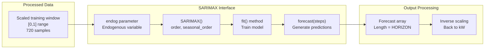

Sources: [7-TimeSeries/2-ARIMA/README.md:261-264]()

The `endog` parameter of `SARIMAX()` receives the scaled training window, and `forecast(steps=HORIZON)` generates predictions that are later inverse-transformed for evaluation.

---

