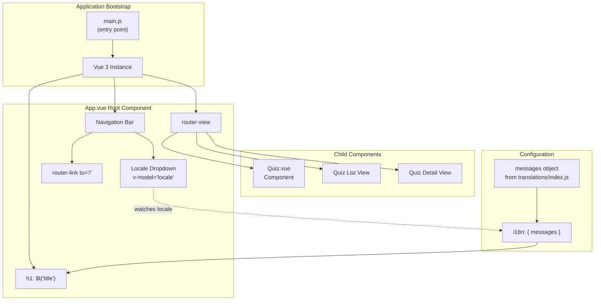
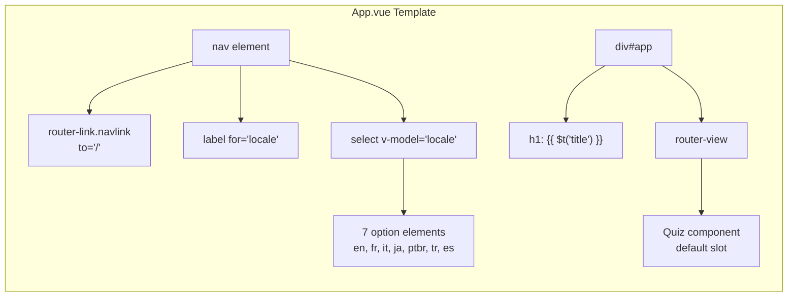
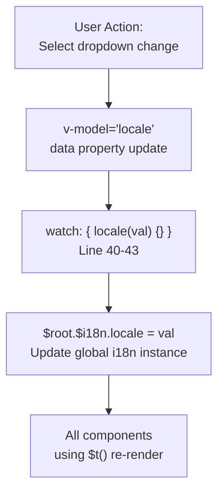
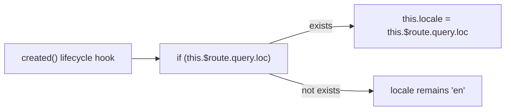
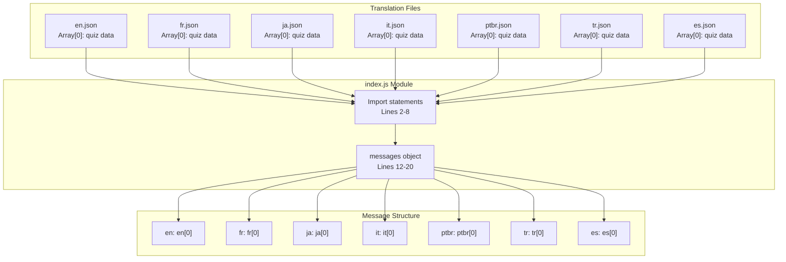
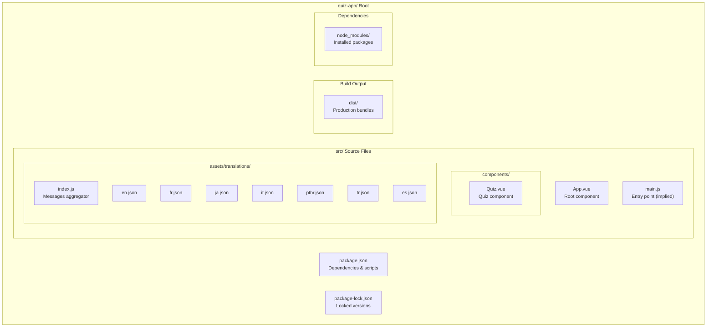

<!-- source: DeepWiki mcp.deepwiki.com · repo microsoft/ML-For-Beginners · extra page Vue.js Application Structure · fetched 2026-10-26 -->

# Vue.js Application Structure

<details>
<summary>Relevant source files</summary>

The following files were used as context for generating this wiki page:

- [.gitignore](.gitignore)
- [1-Introduction/1-intro-to-ML/lesson-1.pdf](1-Introduction/1-intro-to-ML/lesson-1.pdf)
- [1-Introduction/2-history-of-ML/lesson-2.pdf](1-Introduction/2-history-of-ML/lesson-2.pdf)
- [quiz-app/package-lock.json](quiz-app/package-lock.json)
- [quiz-app/package.json](quiz-app/package.json)
- [quiz-app/src/App.vue](quiz-app/src/App.vue)
- [quiz-app/src/assets/translations/fr.json](quiz-app/src/assets/translations/fr.json)
- [quiz-app/src/assets/translations/index.js](quiz-app/src/assets/translations/index.js)
- [quiz-app/src/assets/translations/tr.json](quiz-app/src/assets/translations/tr.json)

</details>


## Purpose and Scope

This document describes the technical architecture of the standalone quiz application built with Vue.js 3. It covers the component hierarchy, root application structure, routing system, and build tooling. For internationalization implementation details, see [Quiz Internationalization System](#6.3.2). For quiz data format and content organization, see [Quiz Data Structure and Content](#6.3.3).

---

## Technology Stack and Dependencies

The quiz application uses Vue.js 3 as the primary framework with a minimal set of dependencies for internationalization and routing.

### Core Dependencies

| Package | Version | Purpose |
|---------|---------|---------|
| `vue` | ^3.5.12 | Core Vue.js 3 framework |
| `vue-i18n` | ^8.26.7 | Internationalization support |
| `vue-router` | ^3.5.3 | Client-side routing |
| `core-js` | ^3.6.5 | JavaScript polyfills |

### Development Dependencies

| Package | Purpose |
|---------|---------|
| `@vue/cli-service` | Build orchestration and development server |
| `@vue/cli-plugin-babel` | ES6+ transpilation |
| `@vue/cli-plugin-eslint` | Code linting and quality |
| `eslint-plugin-vue` | Vue-specific linting rules |
| `vue-template-compiler` | Template compilation |

**Sources:** [quiz-app/package.json:10-24]()

---

## Application Entry Point and Structure

### Root Component Architecture

The application follows a single-file component (SFC) pattern with `App.vue` serving as the root component. This component establishes the global layout, locale management, and routing container.



**Diagram: Root Component Structure and Initialization Flow**

**Sources:** [quiz-app/src/App.vue:1-51]()

### Template Structure

The root template in `App.vue` consists of three main sections:

1. **Navigation Bar** - Contains home link and locale selector
2. **Application Title** - Dynamically translated using `$t("title")`
3. **Router Outlet** - Where routed components render via `<router-view>`



**Diagram: Template DOM Hierarchy**

**Sources:** [quiz-app/src/App.vue:1-23]()

---

## Component Configuration and Reactivity

### Data Properties

The `App` component maintains a single reactive data property:

- **`locale`** (String, default: `"en"`) - Controls the current interface language

This property is bound bidirectionally to the locale dropdown using `v-model`.

**Sources:** [quiz-app/src/App.vue:35-38]()

### Locale Synchronization System

The application implements a reactive locale switching mechanism using Vue's `watch` API:



**Diagram: Locale Change Propagation Flow**

The watcher function directly updates the root Vue instance's i18n locale, triggering reactivity throughout the component tree:

```
watch: {
  locale(val) {
    this.$root.$i18n.locale = val;
  }
}
```

**Sources:** [quiz-app/src/App.vue:40-43]()

### URL-Based Locale Initialization

The component supports setting the initial locale via URL query parameter `?loc=<language>`:



**Diagram: Locale Initialization from URL**

This allows direct linking to specific language versions, e.g., `https://quiz-app.netlify.app/?loc=fr`.

**Sources:** [quiz-app/src/App.vue:45-49]()

---

## Translation Integration

### Messages Object Structure

The application imports language files and constructs a `messages` object for vue-i18n:



**Diagram: Translation Module Assembly**

Each translation file exports an array where the first element contains the complete quiz data structure with localized strings. The `index.js` module extracts `[0]` from each import and maps it to a locale key.

**Sources:** [quiz-app/src/assets/translations/index.js:1-23]()

### Component-Level i18n Configuration

The `App` component configures i18n at the component level rather than globally:

```
export default {
  name: "App",
  i18n: { messages },
  components: {
    Quiz,
  },
  // ...
}
```

This creates a local i18n instance accessible via `$t()` throughout the component tree.

**Sources:** [quiz-app/src/App.vue:29-34]()

---

## Build System and Development Workflow

### Vue CLI Scripts

The application uses Vue CLI 5 for build orchestration with three primary npm scripts:

| Script | Command | Purpose |
|--------|---------|---------|
| `serve` | `vue-cli-service serve` | Development server with hot reload |
| `build` | `vue-cli-service build` | Production build with minification |
| `lint` | `vue-cli-service lint` | Code quality checks |

```mermaid
graph TB
    subgraph "Development Mode"
        ServeCmd["npm run serve"]
        DevServer["webpack-dev-server<br/>Port 8080 (default)"]
        HMR["Hot Module Replacement"]
        Browser["Browser: localhost:8080"]
    end
    
    subgraph "Production Build"
        BuildCmd["npm run build"]
        Webpack["Webpack bundling"]
        Babel["Babel transpilation"]
        Minify["Code minification"]
        Output["dist/ directory"]
    end
    
    subgraph "Code Quality"
        LintCmd["npm run lint"]
        ESLint["ESLint engine"]
        VuePlugin["eslint-plugin-vue"]
        Report["Lint report"]
    end
    
    ServeCmd --> DevServer
    DevServer --> HMR
    HMR --> Browser
    
    BuildCmd --> Webpack
    Webpack --> Babel
    Babel --> Minify
    Minify --> Output
    
    LintCmd --> ESLint
    ESLint --> VuePlugin
    VuePlugin --> Report
```



**Diagram: Build System Command Flow**

**Sources:** [quiz-app/package.json:5-8]()

### ESLint Configuration

The application includes inline ESLint configuration in `package.json`:

```javascript
"eslintConfig": {
  "root": true,
  "env": { "node": true },
  "extends": [
    "plugin:vue/essential",
    "eslint:recommended"
  ],
  "parserOptions": {
    "parser": "babel-eslint"
  },
  "rules": {}
}
```

This configuration:
- Uses Vue-specific essential rules
- Applies ESLint recommended rule set
- Employs `babel-eslint` for modern JavaScript parsing

**Sources:** [quiz-app/package.json:25-37]()

### Browser Compatibility

The build targets modern browsers using the Browserslist configuration:

```json
"browserslist": [
  "> 1%",
  "last 2 versions",
  "not dead"
]
```

This ensures compatibility with browsers having >1% market share, the last 2 versions of each browser, excluding officially unsupported versions.

**Sources:** [quiz-app/package.json:39-43]()

---

## File Structure and Module Organization

### Application Directory Layout



**Diagram: Quiz Application File Structure**

**Sources:** [quiz-app/package.json:1-44](), [quiz-app/src/App.vue:1-112](), [quiz-app/src/assets/translations/index.js:1-23]()

---

## Component Import and Registration

### Static Imports

The `App` component statically imports its dependencies:

```javascript
import Quiz from "@/components/Quiz.vue";
import messages from "@/assets/translations";
```

The `@` alias resolves to the `src/` directory, configured by Vue CLI.

### Component Registration

Components are registered in the `components` object:

```javascript
components: {
  Quiz,
}
```

This makes the `Quiz` component available for use in the template, though it's placed inside `<router-view>` as a default slot content.

**Sources:** [quiz-app/src/App.vue:26-34]()

---

## Styling Architecture

### Global Styles

The `App.vue` component includes unscoped styles that apply globally:

| Selector | Key Properties | Purpose |
|----------|----------------|---------|
| `html` | `font-family`, `-webkit-font-smoothing` | Typography baseline |
| `nav` | `background-color: #252d4a`, `padding` | Navigation bar styling |
| `nav a` | `color: white` | Link styling |
| `.card` | `width: 60%`, `border`, `margin: auto` | Quiz card container |
| `.btn` | `background-color: #252d4a`, `cursor: pointer` | Button styling |
| `.ans-btn` | `display: flex`, `justify-content: center` | Answer button layout |

The absence of `<style scoped>` means these styles cascade to all child components, establishing a consistent design system.

**Sources:** [quiz-app/src/App.vue:53-111]()

---

## Vue Router Integration

### Router-View Component

The application uses `<router-view>` as the mounting point for routed components:

```vue
<router-view>
  <Quiz />
</router-view>
```

The `<Quiz />` component inside `<router-view>` serves as default slot content, though typically router-view renders components based on the current route configuration defined elsewhere in the application.

### Route-Based Locale Access

The component accesses route data through `this.$route`:

```javascript
if (this.$route.query.loc) {
  this.locale = this.$route.query.loc;
}
```

This demonstrates integration with `vue-router` 3.x API for query parameter access.

**Sources:** [quiz-app/src/App.vue:18-20](), [quiz-app/src/App.vue:46-48]()

---

## Supported Locales

The application supports seven locales with corresponding dropdown options:

| Locale Code | Display Value | Language |
|-------------|---------------|----------|
| `en` | en | English |
| `fr` | fr | French |
| `it` | it | Italian |
| `ja` | ja | Japanese |
| `ptbr` | pt-br | Portuguese (Brazil) |
| `tr` | tr | Turkish |
| `es` | es | Spanish |

The locale dropdown renders one `<option>` for each supported language, with `ptbr` displaying as "pt-br" while using `ptbr` as the internal value.

**Sources:** [quiz-app/src/App.vue:7-13](), [quiz-app/src/assets/translations/index.js:12-20]()

---

